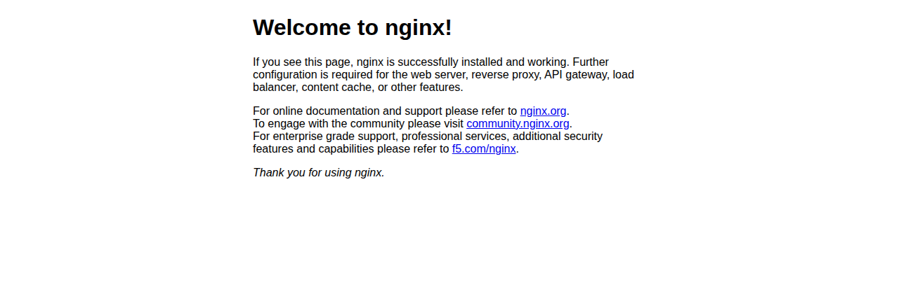
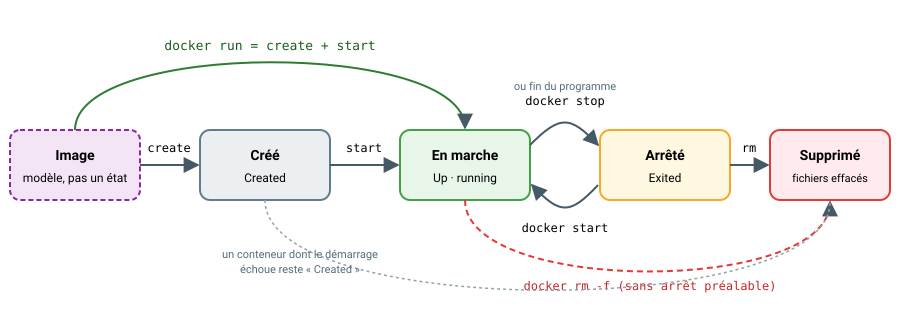

<!-- ============================================================ -->
<!-- ⚠️ RAPPEL IMPORTANT :                                          -->
<!-- Pensez TOUJOURS à ajouter une entrée dans le fichier d'index  -->
<!-- (index.md) du dossier correspondant (ex: docs/cloud/index.md) -->
<!-- afin de référencer ce nouvel article et permettre aux         -->
<!-- visiteurs de le trouver et de cliquer dessus !                -->
<!-- ============================================================ -->

# Premiers conteneurs

!!! abstract "Résumé"
    On décortique d'abord ce qui s'est passé pendant le `hello-world` de la partie 1, puis on lance un vrai service : un **serveur web nginx**, joignable depuis le navigateur du PC grâce à la **publication de port**. On fait ensuite vivre ce conteneur : l'**arrêter**, le **redémarrer**, lire ses **journaux**, **entrer dedans**, le **supprimer**.

    On termine par les **images** (d'où elles viennent, comment elles sont faites de **couches**, pourquoi préciser leur **version**) et par le **ménage**, pour ne pas remplir le disque de la VM. À la fin, toutes les commandes de base de Docker sont connues et ont été pratiquées.

| Propriété | Valeur |
|-----------|--------|
| Difficulté | Débutant |
| Durée estimée | 2 h |
| Version décrite | Debian 13.7, Docker Engine 29.10, nginx 1.31 |
| Place dans le parcours | Partie 2 sur 17 du parcours [Docker](index.md) — jour 1 |
| Dernière mise à jour | 2026-11-24 |

---

!!! info "Convention de lecture"
    🖥️ **PC hôte** · 🐧 **VM** `docker-hote`, connecté en `tssr` · 📦 **dans un conteneur** · 🌐 **navigateur du PC** · ✍️ **exercice**. Point de départ : l'instantané `01-docker-installe`. 🖥️ Démarrer la VM, puis s'y connecter en SSH : `ssh tssr@IP-de-la-VM`.

<!-- NOTE DE RÉDACTION (non affichée) : reprend la section « Utiliser les commandes Docker de base » et l'aide-mémoire du cours « 00 Théorie Docker » du formateur, réorganisés en TP. Correction : « docker run -it ubuntu /bin/ » (commande tronquée) → « docker run -it debian:13 bash ». Sorties recopiées de la VM de test (Docker 29.10.0, 2026-11-24) ; la colonne EXTRA et les colonnes DISK USAGE / CONTENT SIZE de « docker images » sont propres à Docker 29. -->

## 1. Ce qui s'est passé pendant `hello-world`

🐧 Relancer le conteneur de test, en lisant cette fois le message en entier :

```bash
docker run hello-world
```

```text
Hello from Docker!
This message shows that your installation appears to be working correctly.

To generate this message, Docker took the following steps:
 1. The Docker client contacted the Docker daemon.
 2. The Docker daemon pulled the "hello-world" image from the Docker Hub.
    (amd64)
 3. The Docker daemon created a new container from that image which runs the
    executable that produces the output you are currently reading.
 4. The Docker daemon streamed that output to the Docker client, which sent it
    to your terminal.
```

Le message résume tout le fonctionnement de Docker en quatre étapes :

1. le **client** (la commande `docker`) a contacté le **démon** (le service `dockerd`) à travers le socket `/var/run/docker.sock` ;
2. le démon n'avait pas l'image `hello-world` : il l'a **téléchargée** (*pull*) depuis **Docker Hub**, le registre public ;
3. il a **créé un conteneur** à partir de cette image et lancé le programme qu'elle contient ;
4. il a renvoyé ce que le programme affichait vers le terminal.

Cette fois, la première ligne `Unable to find image 'hello-world:latest' locally` n'apparaît plus : l'image est déjà sur la VM, Docker la réutilise.

🐧 Lister les conteneurs **en marche**, puis **tous** les conteneurs :

```bash
docker ps
docker ps -a
```

```text
CONTAINER ID   IMAGE     COMMAND   CREATED   STATUS    PORTS     NAMES
CONTAINER ID   IMAGE         COMMAND    CREATED        STATUS                              PORTS     NAMES
1023f8e4aa98   hello-world   "/hello"   1 second ago   Exited (0) Less than a second ago             kind_mestorf
```

Aucun conteneur ne tourne, mais le conteneur `hello-world` **existe toujours** (il y en a même un par `docker run hello-world` déjà tapé : la liste peut en montrer plusieurs), à l'état `Exited (0)` (terminé, code de retour 0 = sans erreur). Un conteneur vit **aussi longtemps que son programme principal** : `hello-world` affiche son message et se termine, donc le conteneur s'arrête aussitôt. Faute de nom choisi, Docker lui en a donné un au hasard (`kind_mestorf`).

## 2. Lancer un serveur web

### 2.1 `docker run` avec ses options

🐧 Lancer un serveur web **nginx** :

```bash
docker run -d --name web -p 8080:80 nginx
```

```text
Unable to find image 'nginx:latest' locally
latest: Pulling from library/nginx
f5d03f5fad65: Pulling fs layer
37fb86c2a767: Pulling fs layer
...
37fb86c2a767: Pull complete
Digest: sha256:c35c59a6a083b2557aaf6e0740b2f4f9fe0e0226544e121498a67d2ec4d14ac9
Status: Downloaded newer image for nginx:latest
81a6e8ec8f61565865a85745c0fff93fcdc714cab7e68e5b93ae06e4ef5974f5
```

| Morceau de la commande | Rôle |
|---|---|
| `docker run` | Créer un conteneur à partir d'une image **et** le démarrer |
| `-d` | Mode **détaché** (*detached*) : le conteneur tourne en arrière-plan et rend la main au terminal |
| `--name web` | Donner un **nom** au conteneur, pour le désigner facilement ensuite |
| `-p 8080:80` | **Publier** le port 80 du conteneur sur le port 8080 de la VM (voir plus bas) |
| `nginx` | Le nom de l'**image** à utiliser |

La longue suite de chiffres et de lettres affichée à la fin est l'**identifiant** complet du conteneur. Les lignes `Pulling fs layer` montrent que l'image est téléchargée en **plusieurs morceaux**, les **couches** : on y revient en [section 5](#5-les-images).

### 2.2 Le conteneur tourne

🐧 Vérifier :

```bash
docker ps
```

```text
CONTAINER ID   IMAGE     COMMAND                  CREATED         STATUS                  PORTS                                     NAMES
81a6e8ec8f61   nginx     "/docker-entrypoint.…"   2 seconds ago   Up Less than a second   0.0.0.0:8080->80/tcp, [::]:8080->80/tcp   web
```

| Colonne | Signification |
|---|---|
| `CONTAINER ID` | Les 12 premiers caractères de l'identifiant ; ils suffisent pour désigner le conteneur |
| `IMAGE` | L'image d'origine |
| `COMMAND` | Le programme principal lancé dans le conteneur |
| `STATUS` | `Up` (en marche) depuis combien de temps, ou `Exited` (arrêté) |
| `PORTS` | Les ports publiés : `0.0.0.0:8080->80/tcp` = le port 8080 de **toutes** les adresses IPv4 de la VM mène au port 80 du conteneur ; `[::]:8080` = pareil en IPv6 |
| `NAMES` | Le nom du conteneur |

### 2.3 La publication de port

Un conteneur a sa **propre adresse IP**, sur un réseau privé que Docker crée **à l'intérieur** de la VM (`172.17.0.0/16` par défaut). Le PC ne connaît pas ce réseau et ne peut pas le joindre. L'option `-p 8080:80` demande à Docker de faire suivre tout ce qui arrive sur le **port 8080 de la VM** vers le **port 80 du conteneur**, comme une box Internet qui redirige un port vers un PC de la maison.

{ loading=lazy }
/// caption
`-p port-de-la-VM:port-du-conteneur` : le premier nombre est **dehors**, le second **dedans**.
///

1. 🐧 Tester depuis la VM elle-même :

    ```bash
    curl -s http://localhost:8080 | head -5
    ```

    ```text
    <!DOCTYPE html>
    <html>
    <head>
    <title>Welcome to nginx!</title>
    <style>
    ```

2. 🌐 Ouvrir `http://IP-de-la-VM:8080` dans le navigateur du PC :

    { loading=lazy }
    /// caption
    La page d'accueil de nginx, servie par le conteneur `web` et vue depuis le PC.
    ///

!!! question "Pourquoi 8080 et pas 80 ?"
    Rien n'empêche d'écrire `-p 80:80`. Mais **un seul programme** peut écouter sur un port donné d'une machine : si on lance dix serveurs web, chacun doit avoir **son** port sur la VM (8080, 8081, 8082…), même s'ils écoutent tous sur le port 80 **dans** leur conteneur. Au jour 3, un **reverse proxy** permettra de tous les joindre par le port 80, en les distinguant par leur nom.

## 3. Le cycle de vie d'un conteneur

{ loading=lazy }
/// caption
Les états d'un conteneur et les commandes qui le font passer de l'un à l'autre.
///

1. 🐧 **Arrêter** le conteneur, puis regarder les deux listes :

    ```bash
    docker stop web
    docker ps
    docker ps -a
    ```

    ```text
    web
    CONTAINER ID   IMAGE     COMMAND   CREATED   STATUS    PORTS     NAMES
    CONTAINER ID   IMAGE         COMMAND                  CREATED          STATUS                              PORTS     NAMES
    81a6e8ec8f61   nginx         "/docker-entrypoint.…"   2 seconds ago    Exited (0) Less than a second ago             web
    1023f8e4aa98   hello-world   "/hello"                 15 seconds ago   Exited (0) 14 seconds ago                     kind_mestorf
    ```

    Le conteneur n'est plus dans `docker ps`, mais il existe toujours (`docker ps -a`) : la page web ne répond plus, mais rien n'est perdu.

2. 🐧 Le **relancer** : il reprend avec la même configuration (même nom, même port publié).

    ```bash
    docker start web
    ```

3. 🐧 Essayer de le **supprimer** pendant qu'il tourne :

    ```bash
    docker rm web
    ```

    ```text
    Error response from daemon: cannot remove container "web": container is running: stop the container before removing or force remove
    ```

    Docker protège les conteneurs en marche. Il faut d'abord l'arrêter (`docker stop web`, puis `docker rm web`), ou **forcer** : `docker rm -f web` arrête et supprime en une fois. On le garde pour la suite.

!!! warning "Supprimer un conteneur, c'est perdre ce qu'il contient"
    Tout fichier créé ou modifié **dans** un conteneur disparaît avec lui au `docker rm`. L'image, elle, reste intacte : on peut recréer un conteneur neuf en une commande. Garder des données au-delà de la vie d'un conteneur, c'est le rôle des **volumes**, vus au jour 2.

## 4. Regarder ce qui se passe dans un conteneur

### 4.1 Les journaux

🐧 Afficher ce que le programme principal du conteneur a écrit :

```bash
docker logs web
```

```text
/docker-entrypoint.sh: Configuration complete; ready for start up
172.17.0.1 - - [23/Nov/2026:23:10:45 +0000] "GET / HTTP/1.1" 200 896 "-" "curl/8.14.1" "-"
2026/11/23 23:10:45 [notice] 1#1: nginx/1.31.10
...
```

On y voit la requête faite tout à l'heure avec `curl`. Dans une image bien construite, l'application écrit ses journaux **sur sa sortie standard** plutôt que dans un fichier : Docker les récupère, et `docker logs` est le **premier réflexe** quand un conteneur ne fonctionne pas. L'option `-f` (*follow*) suit les journaux en direct, comme `tail -f` : `docker logs -f web`, puis ++ctrl+c++ pour arrêter de suivre.

### 4.2 Exécuter une commande dans le conteneur

🐧 `docker exec` lance une commande **dans** un conteneur en marche :

```bash
docker exec web nginx -v
```

```text
nginx version: nginx/1.31.10
```

🐧 Pour obtenir un **terminal** dans le conteneur, comme si on s'y connectait, il faut les options `-i` (garder l'entrée clavier ouverte) et `-t` (créer un terminal) :

```bash
docker exec -it web bash
```

📦 L'invite change : on est maintenant **dans** le conteneur, en `root`. Explorer un peu :

```bash
hostname                       # le nom de la machine… c'est l'identifiant du conteneur
cat /etc/os-release | head -2  # l'image nginx est construite sur Debian
ls /usr/share/nginx/html       # les pages servies par nginx
exit                           # sortir du conteneur : il continue de tourner
```

!!! failure "`cannot attach stdin to a TTY-enabled container because stdin is not a terminal`"
    Ce message apparaît quand on utilise `-it` dans un script, ou à travers un outil qui n'est pas un vrai terminal. Dans ce cas, retirer `-it` et passer la commande directement : `docker exec web cat /etc/os-release`.

### 4.3 Inspecter et surveiller

🐧 `docker inspect` affiche **toute** la configuration d'un conteneur, en JSON (un format texte structuré). L'option `--format` (ou `-f`) en extrait une valeur :

```bash
docker inspect web --format '{{.NetworkSettings.Networks.bridge.IPAddress}} {{.State.Status}} {{.Config.Image}}'
```

```text
172.17.0.2 running nginx
```

🐧 Voir les processus du conteneur **depuis la VM**, et ce qu'il consomme :

```bash
docker top web
docker stats --no-stream --format 'table {{.Name}}\t{{.CPUPerc}}\t{{.MemUsage}}'
```

```text
UID      PID     PPID    C   STIME   TTY   TIME       CMD
root     13632   13606   0   00:28   ?     00:00:00   nginx: master process nginx -g daemon off;
uuidd    13701   13632   0   00:28   ?     00:00:00   nginx: worker process
uuidd    13702   13632   0   00:28   ?     00:00:00   nginx: worker process

NAME   CPU %   MEM USAGE / LIMIT
web    0.00%   3.355MiB / 3.83GiB
```

Deux constats importants pour un administrateur :

- les processus du conteneur sont de **simples processus de la VM**, avec un numéro (PID) visible depuis la VM : on les retrouve dans `ps aux` ou `top`. Un conteneur n'est pas une machine à part ;
- les processus *worker* de nginx tournent sous l'utilisateur numéro **101** du conteneur (qui s'y appelle `nginx`). La VM ne connaît pas ce nom : `docker top` affiche donc le nom de **son propre** utilisateur 101, quel qu'il soit (ici `uuidd` ; sur une autre installation, ce peut être `sshd`, `messagebus`… ou simplement `101`). La commande `getent passwd 101` montre qui c'est sur la VM. Les numéros d'utilisateur sont **partagés** entre le conteneur et la machine : c'est une raison de plus pour ne pas lancer n'importe quelle image en `root`.

Un serveur nginx consomme ici **3 Mo** de mémoire : c'est ce qui permet d'empiler autant de conteneurs sur un seul serveur.

## 5. Les images

### 5.1 Lister, télécharger, chercher

🐧 Télécharger deux images sans lancer de conteneur, puis lister les images présentes :

```bash
docker pull debian:13
docker pull alpine
docker images
```

```text
IMAGE                ID             DISK USAGE   CONTENT SIZE   EXTRA
alpine:latest        f59abe656b69         13MB         3.94MB
debian:13            9c6e381421d0        187MB         52.6MB
hello-world:latest   1e4c05b897a7       25.9kB         9.49kB   U
nginx:latest         c35c59a6a083        255MB         69.8MB   U
```

| Colonne | Signification |
|---|---|
| `IMAGE` | Le **nom** de l'image et, après les deux-points, son **étiquette** (*tag*), en général la version |
| `ID` | L'identifiant de l'image |
| `DISK USAGE` | La place occupée sur le disque de la VM, une fois l'image décompressée |
| `CONTENT SIZE` | La taille téléchargée (compressée) |
| `EXTRA` | `U` (*in use*) : au moins un conteneur, même arrêté, utilise cette image |

La différence de taille entre images est frappante : **Alpine**, une distribution Linux minimaliste, tient en 13 Mo ; Debian en 187 Mo. Les images « officielles » (nginx, httpd, mariadb…) proposent souvent une variante `-alpine` plus légère.

🐧 Chercher une image sur Docker Hub depuis le terminal :

```bash
docker search --limit 5 debian
```

```text
NAME                DESCRIPTION                                     STARS     OFFICIAL
debian              Debian is a Linux distribution that's compos…   5329      [OK]
dockette/debian     🐳 Debian base images                           3
...
```

!!! warning "Toutes les images ne se valent pas"
    N'importe qui peut publier une image sur Docker Hub. Préférer les images marquées **`[OK]` dans la colonne `OFFICIAL`** (maintenues par Docker et l'éditeur du logiciel) ou publiées par l'**éditeur lui-même** (par exemple `portainer/portainer-ce`). Une image inconnue peut contenir un logiciel vieux, mal configuré… ou malveillant.

### 5.2 Les étiquettes : toujours préciser la version

Sans étiquette, Docker utilise `latest`. `nginx` veut donc dire `nginx:latest`, c'est-à-dire « la version la plus récente **au moment du téléchargement** ». Deux serveurs qui téléchargent `nginx` à six mois d'écart n'ont donc pas la même version.

🐧 Comparer :

```bash
docker run --rm debian:13 cat /etc/debian_version
docker run --rm alpine cat /etc/alpine-release
```

```text
13.7
3.24.4
```

En production, on **précise toujours la version** (`nginx:1.31`, `debian:13`, `mariadb:11.8`) : on sait exactement ce qui tourne, et on choisit quand passer à la version suivante.

### 5.3 Une image est faite de couches

🐧 Afficher l'historique de fabrication de l'image nginx :

```bash
docker image history nginx | head -8
```

```text
IMAGE          CREATED       CREATED BY                                      SIZE      COMMENT
c35c59a6a083   3 hours ago   CMD ["nginx" "-g" "daemon off;"]                0B        buildkit.dockerfile.v0
<missing>      3 hours ago   STOPSIGNAL SIGQUIT                              0B        buildkit.dockerfile.v0
<missing>      3 hours ago   EXPOSE map[80/tcp:{}]                           0B        buildkit.dockerfile.v0
<missing>      3 hours ago   ENTRYPOINT ["/docker-entrypoint.sh"]            0B        buildkit.dockerfile.v0
<missing>      3 hours ago   COPY 30-tune-worker-processes.sh /docker-ent…   16.4kB    buildkit.dockerfile.v0
...
```

Une image est un **empilement de couches** en lecture seule : une couche de base (ici une Debian minimale), puis une couche par étape de fabrication (installation de nginx, copie de fichiers…). Quand on lance un conteneur, Docker pose par-dessus une **fine couche en écriture**, propre à ce conteneur : c'est là que vont ses modifications, et c'est elle qui disparaît au `docker rm`.

Les couches sont **partagées** : dix conteneurs nginx n'occupent pas dix fois 255 Mo, mais une seule fois, plus leurs petites couches d'écriture. Et deux images bâties sur la même base ne la téléchargent qu'une fois (lignes `Already exists` pendant un `pull`). La fabrication des images, avec un **Dockerfile**, est le sujet de la partie 14.

## 6. Des conteneurs jetables

Un conteneur peut servir à **exécuter une seule commande** dans un autre système, sans rien installer sur la VM.

🐧 Ouvrir un terminal dans un conteneur Debian neuf :

```bash
docker run -it --rm --name essai debian:13 bash
```

📦 On est dans une Debian toute neuve, réduite au strict minimum :

```bash
hostname
ps aux          # bash: ps: command not found : même ps n'est pas installé !
cat /etc/debian_version
exit
```

En quittant le terminal, on arrête `bash`, donc le **programme principal** du conteneur : le conteneur s'arrête, et l'option `--rm` le supprime aussitôt. `docker ps -a` ne le montre plus.

!!! tip "L'option `--rm`"
    `--rm` est idéale pour les essais et les commandes ponctuelles : pas de conteneur arrêté qui traîne. Elle est à éviter pour un service qu'on veut pouvoir redémarrer.

## 7. Faire le ménage

Conteneurs arrêtés et images inutilisées s'accumulent vite.

1. 🐧 Supprimer le conteneur `web` et tous les conteneurs arrêtés :

    ```bash
    docker rm -f web
    docker container prune -f
    ```

    ```text
    web
    Deleted Containers:
    1023f8e4aa98e3ac199834678a5c3db0a41a65946fa649dee81dcb1aae8b5d03
    Total reclaimed space: 4.096kB
    ```

2. 🐧 Faire le bilan de la place occupée par Docker :

    ```bash
    docker system df
    ```

    ```text
    TYPE            TOTAL     ACTIVE    SIZE      RECLAIMABLE
    Images          4         0         454.6MB   454.5MB (99%)
    Containers      0         0         0B        0B
    Local Volumes   0         0         0B        0B
    Build Cache     0         0         0B        0B
    ```

    Aucun conteneur n'existe plus, donc aucune image n'est « active » : la colonne `RECLAIMABLE` indique qu'on pourrait récupérer presque toute la place. La partie 12 revient sur le nettoyage (`docker system prune`) et ses pièges.

3. 🐧 Supprimer une image dont on n'a plus besoin (impossible tant qu'un conteneur l'utilise, même arrêté) :

    ```bash
    docker image rm hello-world
    ```

## 8. Exercices

✍️ **Exercice 1** — Lancer un deuxième serveur nginx nommé `web2`, joignable depuis le navigateur du PC sur le port **8081** de la VM. Vérifier dans le navigateur.

??? success "Réponse"
    ```bash
    docker run -d --name web2 -p 8081:80 nginx
    ```

    🌐 `http://IP-de-la-VM:8081` affiche la page « Welcome to nginx! ». L'image étant déjà présente, le conteneur démarre instantanément, sans téléchargement.

✍️ **Exercice 2** — Lancer un troisième conteneur nommé `web3`, encore sur le port 8081. Que se passe-t-il ? Dans quel état est `web3` ensuite ?

??? success "Réponse"
    ```bash
    docker run -d --name web3 -p 8081:80 nginx
    ```

    ```text
    docker: Error response from daemon: failed to set up container networking: driver failed programming
    external connectivity on endpoint web3 (…): Bind for 0.0.0.0:8081 failed: port is already allocated
    ```

    Le port 8081 de la VM est déjà pris par `web2`. Le conteneur `web3` a pourtant été **créé** : `docker ps -a` le montre à l'état `Created`, jamais démarré. Il faut le supprimer (`docker rm web3`) avant de réutiliser ce nom.

✍️ **Exercice 3** — Lancer un serveur web **Apache** (image officielle `httpd`) nommé `apache`, sur le port 8082. Afficher sa page d'accueil avec `curl`, puis la **version** d'Apache qui tourne dans le conteneur.

??? success "Réponse"
    ```bash
    docker run -d --name apache -p 8082:80 httpd
    curl -s http://localhost:8082
    docker exec apache httpd -v
    ```

    ```text
    <title>It works! Apache httpd</title>
    ...
    Server version: Apache/2.4.71 (Unix)
    ```

    Pendant le téléchargement, certaines couches affichent `Already exists` : l'image `httpd` partage sa couche de base Debian avec l'image `nginx`, déjà présente.

✍️ **Exercice 4** — Trouver l'adresse IP du conteneur `web2` dans le réseau de Docker. Pourquoi ne peut-on pas l'utiliser depuis le PC ?

??? success "Réponse"
    ```bash
    docker inspect -f '{{range .NetworkSettings.Networks}}{{.IPAddress}}{{end}}' web2
    ```

    ```text
    172.17.0.2
    ```

    (le dernier nombre dépend de l'ordre de démarrage des conteneurs : Docker donne la première adresse libre). Ce réseau `172.17.0.0/16` n'existe **qu'à l'intérieur de la VM** : le PC n'a aucune route vers lui. Depuis l'extérieur, on passe toujours par un **port publié** de la VM.

✍️ **Exercice 5** — Faire le ménage : supprimer `web2` et `apache`, puis l'image `httpd`.

??? success "Réponse"
    ```bash
    docker rm -f web2 apache
    docker image rm httpd
    ```

    L'ordre compte : tant qu'un conteneur (même arrêté) utilise l'image `httpd`, Docker refuse de la supprimer.

## 9. Vérifier son lab

!!! success "Vérifier son lab"
    🐧 En `tssr` :

    ```bash
    docker run -d --name controle -p 8080:80 nginx
    curl -s http://localhost:8080 | grep title
    docker ps --format '{{.Names}} {{.Status}} {{.Ports}}'
    docker rm -f controle
    ```

    Résultat attendu :

    ```text
    <title>Welcome to nginx!</title>
    controle Up 1 second 0.0.0.0:8080->80/tcp, [::]:8080->80/tcp
    controle
    ```

    🌐 Pendant que `controle` tourne, `http://IP-de-la-VM:8080` doit aussi afficher la page de nginx depuis le PC. Si la page s'affiche dans la VM mais pas sur le PC, l'adresse utilisée n'est pas la bonne : sur VirtualBox, c'est celle de la **seconde** carte (`192.168.56.x`).

## 10. Questions de révision

1. Quelle est la différence entre `docker ps` et `docker ps -a` ?
2. Que signifie `-p 8080:80` ? Lequel des deux nombres est le port de la VM ?
3. Pourquoi le conteneur `hello-world` s'arrête-t-il tout seul, alors que le conteneur `web` continue de tourner ?
4. Quelle est la différence entre une **image** et un **conteneur** ? Que devient l'image quand on supprime le conteneur ?
5. Quelle commande donne en premier des indices quand un conteneur ne démarre pas ou se comporte mal ?
6. Pourquoi vaut-il mieux écrire `debian:13` que `debian` dans une commande ou un fichier de production ?

??? success "Corrigé"
    1. `docker ps` ne liste que les conteneurs **en marche** ; `docker ps -a` (*all*) liste **tous** les conteneurs, y compris arrêtés (`Exited`) ou jamais démarrés (`Created`).
    2. Le port **8080 de la VM** est redirigé vers le port **80 du conteneur**. Le premier nombre est toujours le port de l'hôte (dehors), le second celui du conteneur (dedans).
    3. Un conteneur vit **aussi longtemps que son programme principal**. Le programme de `hello-world` affiche un message et se termine ; nginx, lui, est un serveur qui attend des requêtes indéfiniment.
    4. L'**image** est un modèle en lecture seule ; le **conteneur** est une image qui tourne, avec une couche en écriture par-dessus. Supprimer le conteneur supprime cette couche (et donc les fichiers modifiés dedans) ; l'image reste intacte et peut resservir.
    5. `docker logs <conteneur>` : il affiche ce que le programme principal a écrit, y compris ses messages d'erreur.
    6. Sans étiquette, Docker prend `latest`, qui change au fil des publications : la même commande peut installer une autre version demain. Avec `debian:13`, on sait exactement quelle version tourne et on choisit quand changer.

---

## Ressources

- [Docker — Référence de `docker run`](https://docs.docker.com/reference/cli/docker/container/run/) — toutes les options de la commande (en anglais).
- [Docker — Publier des ports](https://docs.docker.com/engine/network/port-publishing/) — la publication de port en détail.
- [Docker — Images et couches](https://docs.docker.com/get-started/docker-concepts/building-images/understanding-image-layers/) — comment une image est construite en couches.
- [Image officielle nginx sur Docker Hub](https://hub.docker.com/_/nginx) — les étiquettes disponibles et la documentation de l'image.
- Partie précédente : [Découvrir Docker et l'installer](01-decouvrir-et-installer-docker.md) · Partie suivante : [Un serveur web et SSH dans un conteneur Debian](03-apache-et-ssh-dans-un-conteneur.md).

*[VM]: Virtual Machine — machine virtuelle
*[PID]: Process IDentifier — numéro d'un processus
*[JSON]: JavaScript Object Notation — format de données texte structuré
*[TCP]: Transmission Control Protocol
*[IP]: Internet Protocol — adresse d'une machine sur le réseau
