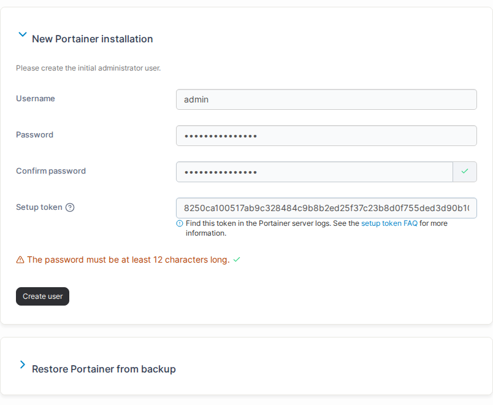
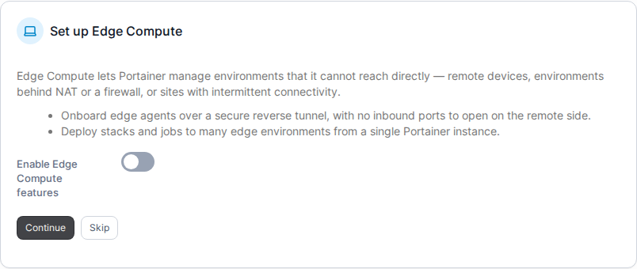
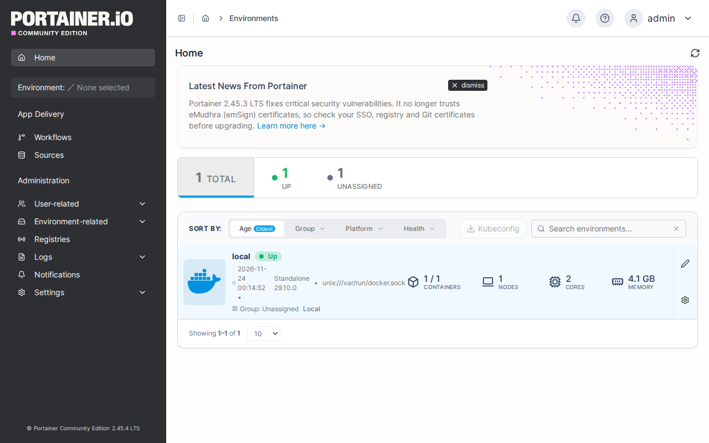
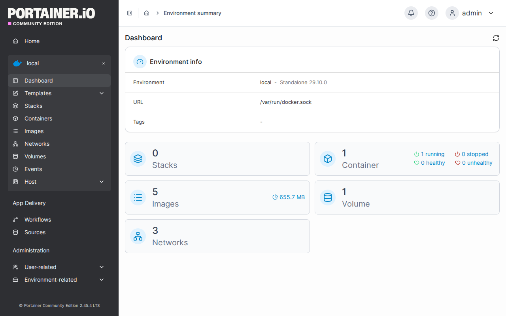
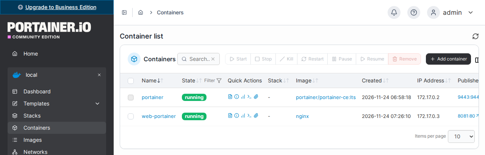
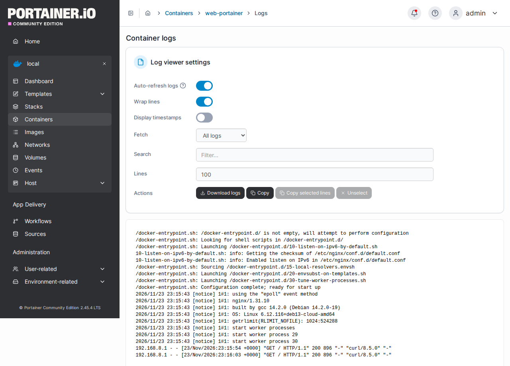
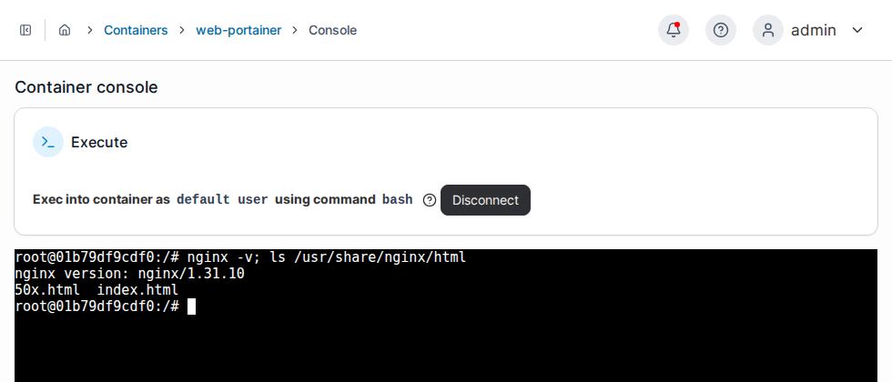

<!-- ============================================================ -->
<!-- ⚠️ RAPPEL IMPORTANT :                                          -->
<!-- Pensez TOUJOURS à ajouter une entrée dans le fichier d'index  -->
<!-- (index.md) du dossier correspondant (ex: docs/cloud/index.md) -->
<!-- afin de référencer ce nouvel article et permettre aux         -->
<!-- visiteurs de le trouver et de cliquer dessus !                -->
<!-- ============================================================ -->

# Gérer Docker avec Portainer et LazyDocker

!!! abstract "Résumé"
    La ligne de commande est indispensable, mais une **interface** aide à voir d'un coup d'œil ce qui tourne, à lire des journaux, à dépanner. Ce TP installe **Portainer CE**, l'interface web d'administration de Docker la plus répandue, **dans un conteneur**. On y crée un conteneur sans taper de commande, on lit ses journaux et on ouvre une console dedans, depuis le navigateur du PC.

    On découvre ensuite **LazyDocker**, une interface **en mode texte** qui s'utilise dans une session SSH, puis on situe **Docker Desktop**, l'application graphique pour les postes de travail. Au passage, on comprend pourquoi donner à une interface l'accès au **socket Docker** revient à lui donner les **clés de la machine**.

| Propriété | Valeur |
|-----------|--------|
| Difficulté | Débutant |
| Durée estimée | 1 h 30 |
| Version décrite | Portainer CE 2.45.4 LTS, LazyDocker 0.25.2, Docker Engine 29.10 |
| Place dans le parcours | Partie 4 sur 17 du parcours [Docker](index.md) — jour 1 |
| Dernière mise à jour | 2026-11-24 |

---

!!! info "Convention de lecture"
    🖥️ **PC hôte** · 🐧 **VM** `docker-hote`, connecté en `adminlab` · 🌐 **navigateur du PC** · ✍️ **exercice**. Portainer n'existe **qu'en anglais** : ses menus sont écrits en gras, en anglais, avec leur traduction entre parenthèses. Point de départ : `docker ps -a` ne montre **aucun** conteneur (sinon les supprimer avec `docker rm -f`), et les ports 8081 et 9443 de la VM sont libres.

<!-- NOTE DE RÉDACTION (non affichée) : le TD « 10 Portainer » du formateur ne contenait que le script d'installation interactif (Docker + Portainer CE/EE + Rancher « à corriger ») : partie écrite d'après la documentation de Portainer (docs.portainer.io, novembre 2026) et rejouée dans le lab. Écarts avec le script du formateur : image portainer/portainer-ce:lts (et non :latest), volume portainer_data, port 9000 (HTTP) plus publié par défaut (la doc le garde « for legacy reasons »), champ « Setup token » apparu dans les versions récentes (jeton dans docker logs), mot de passe ≥ 12 caractères, Rancher non repris (Rancher sert à gérer Kubernetes, pas Docker seul). Captures Portainer prises à travers un relais local (certificat autosigné) le 2026-11-24 ; LazyDocker capturé dans tmux, rendu en image. -->

## 1. Ligne de commande, interface web, interface texte

| Outil | Type | Où il tourne | Pour quoi faire |
|---|---|---|---|
| Commande `docker` | Ligne de commande | Sur le serveur | Tout, et surtout l'**automatisation** (scripts, fichiers de configuration) |
| **Portainer CE** | Interface **web** | Dans un conteneur, sur le serveur ; on l'utilise depuis un navigateur | Voir et gérer un ou plusieurs serveurs Docker à plusieurs, sans être expert de la ligne de commande |
| **LazyDocker** | Interface **texte** (TUI) | Dans le terminal, sur le serveur | Surveiller et dépanner rapidement dans une session SSH, sans rien ouvrir sur le réseau |
| **Docker Desktop** | Application graphique | Sur un **poste de travail** Windows, macOS ou Linux | Développer et tester des conteneurs sur son PC |

Ces interfaces ne remplacent pas la ligne de commande : elles envoient **exactement les mêmes ordres** au moteur Docker. Un conteneur créé dans Portainer apparaît dans `docker ps`, et inversement.

## 2. Installer Portainer CE

### 2.1 Lancer le conteneur Portainer

**Portainer CE** (*Community Edition*) est la version gratuite et libre de Portainer ; il existe aussi une version payante, *Business Edition*. Portainer publie deux branches : **LTS** (*Long Term Support*, maintenue longtemps, conseillée) et **STS** (*Short Term Support*, nouveautés plus rapides). On installe la LTS, comme le recommande la [documentation de Portainer](https://docs.portainer.io/start/install-ce/server/docker/linux).

1. 🐧 Créer le **volume** où Portainer rangera sa base de données (comptes, réglages) :

    ```bash
    docker volume create portainer_data
    ```

    Un volume est un espace de stockage géré par Docker, qui **survit** à la suppression du conteneur. On en reparle en détail au jour 2 ; retenir pour l'instant que sans lui, supprimer le conteneur Portainer effacerait tous ses réglages.

2. 🐧 Lancer Portainer (une seule commande, sur une seule ligne) :

    ```bash
    docker run -d -p 9443:9443 --name portainer --restart=always -v /var/run/docker.sock:/var/run/docker.sock -v portainer_data:/data portainer/portainer-ce:lts
    ```

    | Option | Explication |
    |---|---|
    | `-p 9443:9443` | L'interface web, en **HTTPS** |
    | `--name portainer` | Nom du conteneur |
    | `--restart=always` | **Politique de redémarrage** : Docker relance le conteneur s'il s'arrête tout seul, et au démarrage de la VM |
    | `-v /var/run/docker.sock:/var/run/docker.sock` | Donne au conteneur l'accès au **socket Docker** de la VM : c'est ainsi que Portainer pilote Docker (voir la [section 5](#5-le-socket-docker-les-cles-de-la-maison)) |
    | `-v portainer_data:/data` | Range le dossier `/data` du conteneur dans le volume créé juste avant |
    | `portainer/portainer-ce:lts` | L'image de Portainer CE, branche LTS |

3. 🐧 Vérifier :

    ```bash
    docker ps
    ```

    ```text
    CONTAINER ID   IMAGE                        COMMAND        CREATED         STATUS         PORTS                                                             NAMES
    2fc8f7b7cb70   portainer/portainer-ce:lts   "/portainer"   5 seconds ago   Up 4 seconds   8000/tcp, 9000/tcp, 0.0.0.0:9443->9443/tcp, [::]:9443->9443/tcp   portainer
    ```

    La colonne `PORTS` affiche aussi `8000/tcp` et `9000/tcp`, sans flèche : le conteneur écoute sur ces ports, mais ils ne sont **pas publiés**, donc injoignables depuis l'extérieur de la VM. Le port 9000 sert une version HTTP non chiffrée de l'interface, que la documentation de Portainer ne garde que pour des raisons de compatibilité. Le port 8000 sert de tunnel aux agents *Edge* (des serveurs distants qui se connectent à Portainer) : la documentation le publie avec `-p 8000:8000`, mais on ne le fait que si l'on utilise ces agents. **Moins de ports publiés, c'est moins de portes d'entrée.**

!!! question "Que fait `--restart=always` ?"
    En partie 3, les services ne revenaient pas après un redémarrage. Ici, c'est **Docker lui-même** qui relance le conteneur Portainer quand la VM redémarre, ou si Portainer plante. Les politiques possibles : `no` (par défaut, rien), `on-failure` (seulement après une erreur), `always` (relancé s'il s'arrête tout seul, et à chaque démarrage de Docker, **même** s'il avait été arrêté exprès avec `docker stop`) et `unless-stopped` (pareil, **sauf** s'il avait été arrêté exprès). Dans tous les cas, un `docker stop` arrête bien le conteneur sur le moment.

### 2.2 Récupérer le jeton de configuration

Pour qu'un inconnu ne puisse pas créer le compte administrateur à notre place pendant les premières minutes, Portainer demande un **jeton de configuration** (*setup token*), qu'il écrit dans ses journaux au démarrage.

🐧 L'afficher :

```bash
docker logs portainer 2>&1 | grep setup_token
```

```text
setup_token=8250ca100517ab9c328484c9b8b2ed25f37c23b8d0f755ded3d90b1032963779
```

Le jeton change à chaque installation : copier **le sien** (sélectionner la suite de chiffres et de lettres après `setup_token=` dans le terminal, puis clic droit ou ++ctrl+shift+c++ selon le terminal).

### 2.3 Créer le compte administrateur

1. 🌐 Ouvrir `https://IP-de-la-VM:9443` (bien **https**). Le navigateur affiche une alerte de sécurité : Portainer utilise un **certificat autosigné**, qu'aucune autorité reconnue n'a signé. Dans un lab, c'est attendu : cliquer sur **Paramètres avancés**, puis **Continuer vers le site** (Chrome, Edge), ou **Avancé**, puis **Accepter le risque et poursuivre** (Firefox).
2. 🌐 Remplir l'écran **New Portainer installation** (nouvelle installation) :

    | Champ | Valeur |
    |---|---|
    | **Username** (identifiant) | `admin` |
    | **Password** et **Confirm password** (mot de passe, confirmation) | `TutoDocker-Lab1!` |
    | **Setup token** (jeton de configuration) | Le jeton copié à l'étape précédente |

    { loading=lazy }
    /// caption
    Création du compte administrateur : 12 caractères minimum et le jeton lu dans les journaux.
    ///

3. 🌐 Cliquer sur **Create user** (créer l'utilisateur).
4. 🌐 L'écran **Set up Edge Compute** propose d'activer la gestion de serveurs distants : cliquer sur **Skip** (passer).

    { loading=lazy }
    /// caption
    Les fonctions Edge servent à gérer des serveurs distants : inutiles ici.
    ///

5. 🌐 Sur l'écran d'accueil, cliquer sur **Get Started** (commencer) : Portainer se connecte au Docker de la machine sur laquelle il tourne, l'environnement **local**.

!!! failure "« Your Portainer instance has timed out for security purposes »"
    Pour limiter les risques, Portainer ne laisse qu'un **temps limité** pour créer le compte administrateur après son démarrage. Si ce message apparaît, redémarrer le conteneur, relire le jeton dans les journaux (`tail -1` garde la ligne la plus récente) et recommencer :

    ```bash
    docker restart portainer
    docker logs portainer 2>&1 | grep setup_token | tail -1
    ```

## 3. Faire le tour de Portainer

### 3.1 Les environnements

La page **Home** (accueil) liste les **environnements**, c'est-à-dire les serveurs Docker gérés par Portainer. Il n'y en a qu'un, `local`.

{ loading=lazy }
/// caption
L'environnement `local` : le Docker de la VM, joint par son socket.
///

On y lit la version de Docker (**29.10.0**), le mode (**Standalone**, un serveur seul, par opposition à un cluster Swarm), et les ressources de la VM : 2 cœurs, 4,1 Go. Un même Portainer peut gérer des dizaines de serveurs Docker, en leur installant un petit **agent**.

🌐 Cliquer sur l'environnement **local**.

### 3.2 Le tableau de bord

{ loading=lazy }
/// caption
Le tableau de bord résume tout ce que contient le Docker de la VM.
///

Le menu de gauche reprend les objets de Docker vus en ligne de commande :

| Menu | Contenu | Équivalent en ligne de commande |
|---|---|---|
| **Containers** (conteneurs) | Liste, création, actions | `docker ps -a`, `docker run`, `docker stop`… |
| **Images** | Images présentes, téléchargement | `docker images`, `docker pull` |
| **Networks** (réseaux) | Réseaux Docker (jour 2) | `docker network ls` |
| **Volumes** | Volumes (jour 2) | `docker volume ls` |
| **Stacks** (piles) | Applications décrites en Docker Compose (jour 2) | `docker compose` |
| **Templates** (modèles) | Applications prêtes à déployer en un clic | — |
| **Events** (évènements) | Journal de tout ce qui se passe dans Docker | `docker events` |

## 4. Créer et dépanner un conteneur depuis Portainer

### 4.1 Créer un conteneur nginx

1. 🌐 **Containers**, puis **Add container** (ajouter un conteneur).
2. 🌐 Remplir :

    | Champ | Valeur |
    |---|---|
    | **Name** (nom) | `web-portainer` |
    | **Image** | `nginx:latest` (registre **Docker Hub (anonymous)** déjà choisi) |
    | **Network ports configuration** > **Map additional port** (publier un port) | **Host** (hôte) `8081` → **Container** (conteneur) `80`, **TCP** |

    { loading=lazy }
    /// caption
    Chaque champ du formulaire correspond à une option de `docker run`.
    ///

3. 🌐 Cliquer sur **Deploy the container** (déployer le conteneur). Après quelques secondes, il apparaît dans la liste, à l'état **running** (en marche).

    { loading=lazy }
    /// caption
    Les deux conteneurs de la VM : Portainer lui-même, et celui qu'on vient de créer.
    ///

4. 🌐 Ouvrir `http://IP-de-la-VM:8081` : la page « Welcome to nginx! » s'affiche.
5. 🐧 Vérifier que la ligne de commande voit le même conteneur :

    ```bash
    docker ps --format '{{.Names}}  {{.Image}}  {{.Ports}}'
    ```

    ```text
    web-portainer  nginx:latest  0.0.0.0:8081->80/tcp, [::]:8081->80/tcp
    portainer  portainer/portainer-ce:lts  8000/tcp, 9000/tcp, 0.0.0.0:9443->9443/tcp, [::]:9443->9443/tcp
    ```

!!! info "« You are currently using an anonymous account… limited to 100 pulls every 6 hours »"
    Le message du formulaire rappelle une règle de **Docker Hub** : sans compte, on ne peut télécharger que **100 images toutes les 6 heures** par adresse IP publique (200 avec un compte personnel gratuit). Dans une salle de formation où vingt PC sortent sur Internet par la **même** adresse, la limite peut être atteinte : le message d'erreur contient alors `toomanyrequests`. Il suffit d'attendre, ou de se connecter à un compte Docker gratuit (`docker login`), ce que montre la partie 15.

### 4.2 Lire les journaux et ouvrir une console

Dans la colonne **Quick Actions** (actions rapides), chaque icône ouvre un outil : **Logs** (journaux), **Inspect** (inspecter), **Stats** (statistiques), **Console** (terminal dans le conteneur) et **Attach** (s'attacher au processus principal).

1. 🌐 Cliquer sur l'icône **Logs** de `web-portainer` : c'est l'équivalent de `docker logs`. Les requêtes faites depuis le navigateur du PC y apparaissent, avec l'adresse du PC.

    { loading=lazy }
    /// caption
    Les journaux du conteneur, avec recherche et téléchargement.
    ///

2. 🌐 Revenir à la liste, cliquer sur l'icône **Console** (`>_`), laisser la commande `/bin/bash` et cliquer sur **Connect** (se connecter). Un terminal s'ouvre **dans** le conteneur, dans le navigateur : c'est l'équivalent de `docker exec -it web-portainer bash`. Taper par exemple :

    ```bash
    nginx -v; ls /usr/share/nginx/html
    ```

    { loading=lazy }
    /// caption
    Une console dans le conteneur, depuis le navigateur du PC.
    ///

3. 🌐 Cliquer sur **Disconnect** (se déconnecter) pour fermer la console.

✍️ **Exercice** — Avec Portainer uniquement : arrêter `web-portainer`, vérifier que la page ne répond plus, le redémarrer, puis le **supprimer**. Vérifier ensuite avec `docker ps -a` dans la VM.

??? success "Réponse"
    Dans **Containers**, cocher la case de `web-portainer`, puis utiliser les boutons **Stop** (arrêter), **Start** (démarrer) et **Remove** (supprimer) au-dessus de la liste. Portainer demande une confirmation avant la suppression. Après la suppression, `docker ps -a` ne montre plus que `portainer`.

## 5. Le socket Docker : les clés de la maison

Pour piloter Docker, Portainer a besoin du **socket** `/var/run/docker.sock`, qu'on lui a donné avec `-v /var/run/docker.sock:/var/run/docker.sock`. En [partie 1](01-decouvrir-et-installer-docker.md#42-ajouter-adminlab-au-groupe-docker), on a vu que l'accès à ce socket permet de **devenir `root` sur la machine**.

Conséquence directe : **quiconque se connecte à Portainer en administrateur contrôle la VM**. Il peut lancer un conteneur qui monte `/` et lire ou modifier n'importe quel fichier.

!!! danger "Protéger Portainer comme un accès root"
    - Un **mot de passe fort**, et pas de compte partagé : Portainer gère des utilisateurs, des équipes et des droits.
    - **Jamais** d'interface Portainer ouverte sur Internet sans protection : la réserver au réseau d'administration, ou la placer derrière un VPN ou un reverse proxy avec authentification (jour 3).
    - Garder Portainer **à jour** : c'est un logiciel exposé, qui a déjà eu des failles de sécurité.
    - Même règle pour **tout** conteneur à qui l'on donne le socket Docker (outils de supervision, de mise à jour automatique…) : se demander s'il en a vraiment besoin, et s'il vient d'une source de confiance.

## 6. LazyDocker, l'interface en mode texte

**LazyDocker** est un petit programme qui s'utilise **dans le terminal**, par exemple dans la session SSH ouverte depuis le PC. Il affiche les conteneurs, les images, les volumes et les réseaux, avec les journaux et les statistiques en direct, et se pilote au clavier. Aucun port à ouvrir, aucun mot de passe de plus : il utilise les droits de l'utilisateur qui le lance (ici `adminlab`, membre du groupe `docker`).

### 6.1 L'installer

Son auteur fournit un script d'installation. Comme vu en partie 1, on le **lit** avant de l'exécuter.

1. 🐧 Télécharger le script, le lire, puis l'exécuter **en `adminlab`** (pas en `root`, ni avec `sudo` : il s'installe dans le dossier personnel) :

    ```bash
    curl -fsSLO https://raw.githubusercontent.com/jesseduffield/lazydocker/master/scripts/install_update_linux.sh
    less install_update_linux.sh
    bash install_update_linux.sh
    ```

    Le programme est copié dans `~/.local/bin/lazydocker`.

2. 🐧 Se **déconnecter et se reconnecter** : à la connexion, Debian ajoute `~/.local/bin` à la liste des dossiers où chercher les commandes, s'il existe. Vérifier :

    ```bash
    lazydocker --version | head -1
    ```

    ```text
    Version: 0.25.2
    ```

    Le script installe toujours la **dernière** version : le numéro peut être plus récent.

### 6.2 L'utiliser

🐧 Relancer d'abord le conteneur de l'exercice, pour avoir quelque chose à regarder, puis lancer LazyDocker :

```bash
docker run -d --name web-portainer -p 8081:80 nginx
lazydocker
```

{ loading=lazy }
/// caption
LazyDocker, en français, dans une session SSH : tout Docker sur un seul écran.
///

| Touche | Action |
|---|---|
| ++arrow-up++ ++arrow-down++ | Choisir un élément dans le panneau actif |
| ++arrow-left++ ++arrow-right++ | Changer de panneau (Conteneurs, Images, Volumes, Réseaux) |
| ++bracket-left++ ++bracket-right++ | Changer d'onglet à droite (Journaux, Statistiques, Env, Config, Top) |
| ++x++ | Ouvrir le menu des actions possibles sur l'élément choisi (arrêter, redémarrer, supprimer, ouvrir un terminal…) |
| ++q++ | Quitter |

✍️ **Exercice** — Dans LazyDocker : afficher les **statistiques** de `web-portainer` (processeur et mémoire en direct), puis l'**arrêter** et le **supprimer** depuis le menu ++x++.

??? success "Réponse"
    Sélectionner `web-portainer` dans **Conteneurs**, puis aller sur l'onglet **Statistiques** avec ++bracket-right++ : un graphique du processeur et de la mémoire s'affiche. Appuyer sur ++x++ et choisir l'action d'**arrêt** dans le menu, puis à nouveau ++x++ et l'action de **suppression**, et confirmer. Le menu ++x++ rappelle aussi la touche directe de chaque action.

## 7. Docker Desktop, pour les postes de travail

**Docker Desktop** est une application graphique pour **Windows**, **macOS** et **Linux**, destinée aux postes de travail. Sous Windows, elle fait tourner Docker Engine dans une petite machine virtuelle Linux, gérée par **WSL 2** (le sous-système Windows pour Linux), puisque les conteneurs Linux ont besoin d'un noyau Linux. Elle ajoute une interface graphique proche de Portainer, et installe la commande `docker` dans PowerShell.

| | Docker Desktop | Docker Engine sur un serveur Linux |
|---|---|---|
| Usage | Développer, tester, apprendre **sur son PC** | **Héberger** des services pour les utilisateurs |
| Système | Windows 10/11, macOS, Linux avec bureau | Linux (Debian, Ubuntu, Red Hat…) |
| Mémoire conseillée | 8 Go de mémoire vive sur le PC au minimum (pré-requis de Docker pour Windows) | Selon les conteneurs, à partir de 1 Go |
| Licence | Gratuit pour un usage personnel, l'enseignement, les projets libres non commerciaux et les entreprises de moins de 250 salariés **et** 10 millions de dollars de chiffre d'affaires ; **payant** au-delà | Gratuit et libre |

Pour un administrateur systèmes et réseaux, Docker Desktop est pratique pour **essayer** une image sur son PC avant de la déployer sur un serveur. Mais ce n'est pas un outil de production : on ne fait pas tourner les services de l'entreprise sur un poste de travail.

!!! warning "Docker Desktop et les autres hyperviseurs"
    Docker Desktop pour Windows active la virtualisation de Windows (WSL 2, et Hyper-V dans certains modes). Sur un PC qui fait aussi tourner VMware Workstation ou VirtualBox, les deux cohabitent avec les versions récentes, mais les VM peuvent devenir **plus lentes**. Pour suivre ce parcours, Docker Desktop n'est **pas** nécessaire : tout se passe dans la VM `docker-hote`.

## 8. Vérifier son lab

!!! success "Vérifier son lab"
    🐧 En `adminlab` :

    ```bash
    docker ps --format '{{.Names}}  {{.Status}}' --filter name=^portainer$
    docker inspect portainer --format '{{.HostConfig.RestartPolicy.Name}}'
    docker volume ls
    lazydocker --version | head -1
    ```

    Résultat attendu :

    ```text
    portainer  Up 20 minutes
    always
    DRIVER    VOLUME NAME
    local     portainer_data
    Version: 0.25.2
    ```

    🌐 `https://IP-de-la-VM:9443` affiche la page de connexion de Portainer, et l'on se connecte avec `admin` / `TutoDocker-Lab1!`.

    🐧 Pour aller plus loin : redémarrer la VM (`sudo reboot`), se reconnecter en SSH, et vérifier avec `docker ps` que **Portainer est revenu tout seul**, grâce à `--restart=always`.

!!! success "🛟 Prendre l'instantané `02-fin-jour-1`"
    🐧 Éteindre la VM (`sudo poweroff`), puis 🖥️ prendre un instantané nommé `02-fin-jour-1`. Portainer et son compte `admin` resservent aux jours suivants.

## 9. Questions de révision

1. Un conteneur créé dans Portainer apparaît-il dans `docker ps` ? Pourquoi ?
2. Pourquoi Portainer a-t-il besoin de `-v /var/run/docker.sock:/var/run/docker.sock` ? Quel risque cela fait-il prendre ?
3. Pourquoi le navigateur affiche-t-il une alerte de sécurité en ouvrant `https://IP-de-la-VM:9443` ? Est-ce grave dans le lab ? Et en production ?
4. À quoi sert le volume `portainer_data` ? Que se passerait-il sans lui si l'on supprimait puis recréait le conteneur ?
5. Dans quel cas préférer LazyDocker à Portainer, et inversement ?
6. Quelle est la différence entre Docker Desktop et Docker Engine ? Lequel installe-t-on sur un serveur ?

??? success "Corrigé"
    1. Oui. Portainer n'a pas son propre moteur : il envoie ses ordres **au même Docker Engine** que la commande `docker`, à travers le socket. Les deux voient donc exactement les mêmes conteneurs.
    2. C'est par ce socket que Portainer **pilote Docker**. Mais l'accès au socket permet de tout faire sur la machine, y compris devenir `root` : un administrateur de Portainer contrôle la VM. Il faut donc protéger Portainer comme un accès `root` (mot de passe fort, pas d'exposition sur Internet, mises à jour).
    3. Portainer chiffre la connexion avec un **certificat autosigné**, qu'aucune autorité reconnue par le navigateur n'a signé : le navigateur ne peut pas vérifier l'identité du serveur. Dans un lab, c'est acceptable. En production, on utilise un certificat signé par une autorité (par exemple Let's Encrypt, au jour 3), sinon les utilisateurs prennent l'habitude d'ignorer les alertes.
    4. Il conserve la **base de données** de Portainer (comptes, réglages, environnements). Sans lui, ces données seraient dans la couche du conteneur et disparaîtraient avec lui : il faudrait recréer le compte administrateur et tout reconfigurer.
    5. LazyDocker : pour un coup d'œil rapide **dans une session SSH**, sans rien exposer sur le réseau ni installer de service. Portainer : pour gérer **plusieurs serveurs**, travailler à plusieurs avec des droits différents, ou laisser des collègues moins à l'aise avec la ligne de commande gérer des conteneurs.
    6. Docker Engine est le moteur seul, pour serveurs Linux, gratuit et libre. Docker Desktop est une application pour postes de travail, qui fait tourner Docker Engine dans une VM cachée et ajoute une interface graphique, avec une licence payante dans les grandes entreprises. Sur un serveur, on installe **Docker Engine**.

---

## Ressources

- [Portainer — Installer Portainer CE avec Docker sur Linux](https://docs.portainer.io/start/install-ce/server/docker/linux) — la procédure suivie dans ce TP (en anglais).
- [Portainer — Trouver ou personnaliser le jeton de configuration](https://docs.portainer.io/faqs/installing/setup-token) — le *setup token* (en anglais).
- [LazyDocker sur GitHub](https://github.com/jesseduffield/lazydocker) — installation, raccourcis clavier, configuration.
- [Docker — Politiques de redémarrage](https://docs.docker.com/engine/containers/start-containers-automatically/) — `no`, `on-failure`, `unless-stopped`, `always`.
- [Docker — Limites de téléchargement de Docker Hub](https://docs.docker.com/docker-hub/usage/) — les quotas avec et sans compte.
- [Docker Desktop pour Windows](https://docs.docker.com/desktop/setup/install/windows-install/) — prérequis et installation.
- Partie précédente : [Un serveur web et SSH dans un conteneur Debian](03-apache-et-ssh-dans-un-conteneur.md) · Partie suivante : [Garder ses données : volumes et dossiers montés](05-volumes-et-dossiers-montes.md).

*[TUI]: Text User Interface — interface en mode texte
*[CE]: Community Edition — édition communautaire, gratuite
*[LTS]: Long Term Support — version maintenue longtemps
*[STS]: Short Term Support — version maintenue peu de temps
*[HTTPS]: HTTP sécurisé par TLS
*[WSL]: Windows Subsystem for Linux — sous-système Windows pour Linux
*[VPN]: Virtual Private Network — réseau privé virtuel
*[SSH]: Secure Shell — protocole d'administration à distance chiffré
*[VM]: Virtual Machine — machine virtuelle
