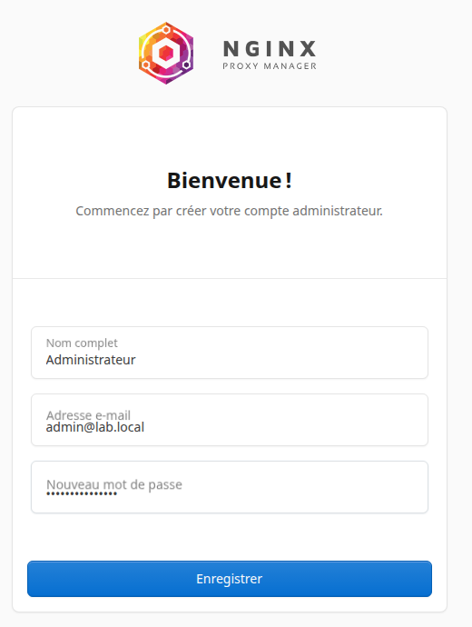
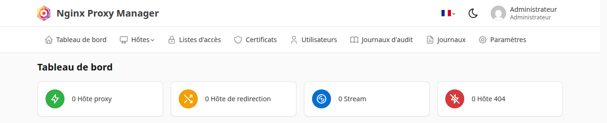
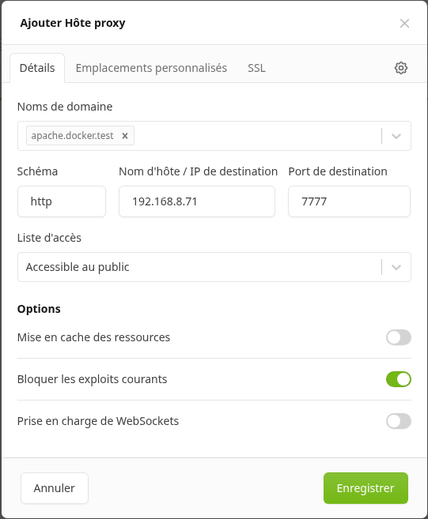
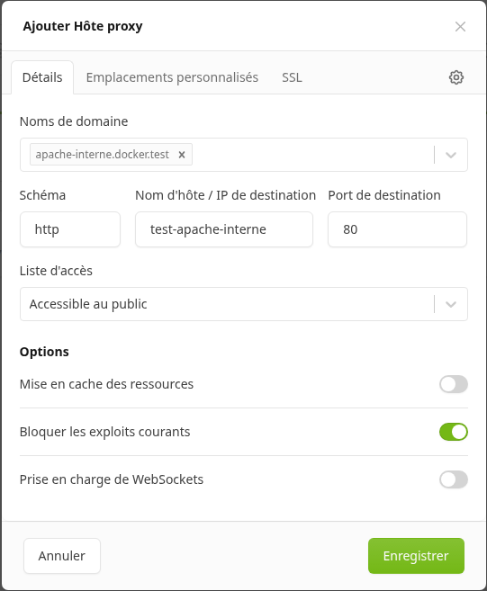
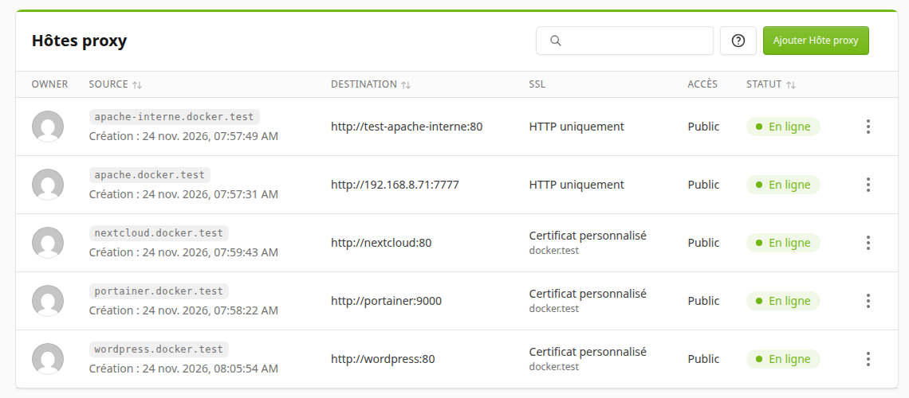
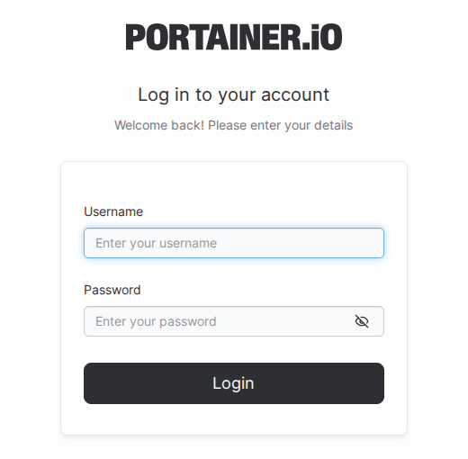

<!-- ============================================================ -->
<!-- ⚠️ RAPPEL IMPORTANT :                                          -->
<!-- Pensez TOUJOURS à ajouter une entrée dans le fichier d'index  -->
<!-- (index.md) du dossier correspondant (ex: docs/cloud/index.md) -->
<!-- afin de référencer ce nouvel article et permettre aux         -->
<!-- visiteurs de le trouver et de cliquer dessus !                -->
<!-- ============================================================ -->

# Un reverse proxy avec Nginx Proxy Manager

!!! abstract "Résumé"
    Jusqu'ici, chaque service avait **son** port sur la VM : 8080, 8081, 9443… Impossible à retenir pour des utilisateurs, et autant de portes ouvertes. Un **reverse proxy** reçoit toutes les requêtes sur les ports **80** et **443**, regarde le **nom** demandé (`portainer.docker.test`, `nextcloud.docker.test`…) et transmet chaque requête au bon conteneur.

    Ce TP installe **Nginx Proxy Manager** (NPM), un reverse proxy avec une interface web en français, puis publie un serveur Apache de deux façons : par son port publié, puis **sans aucun port publié**, par un réseau Docker partagé. Il se termine par un TP sans pas-à-pas : **cacher Portainer derrière le proxy**, en passant par une erreur 502 instructive.

| Propriété | Valeur |
|-----------|--------|
| Difficulté | Intermédiaire |
| Durée estimée | 2 h |
| Version décrite | Nginx Proxy Manager 2.17.1, Docker Engine 29.10 |
| Place dans le parcours | Partie 9 sur 17 du parcours [Docker](index.md) — jour 3 |
| Dernière mise à jour | 2026-11-24 |

---

!!! info "Convention de lecture"
    🖥️ **PC hôte** · 🐧 **VM** `docker-hote`, connecté en `adminlab` · 🌐 **navigateur du PC** · ✍️ **exercice**. Point de départ : l'instantané `03-fin-jour-2`. Les ports **80**, **81** et **443** de la VM doivent être libres : `docker ps` ne doit montrer que `portainer`.

<!-- NOTE DE RÉDACTION (non affichée) : reprend le TD « 11 Reverse proxy NPM dans Docker » v1.2 et le TD/TP « 12 Déplacer un conteneur Portainer derrière un reverse proxy » du formateur. Mises à jour vérifiées dans le lab (NPM 2.17.1, 2026-11-24) : plus d'identifiants par défaut (admin@example.com / changeme) : NPM demande de créer le compte administrateur au premier accès ; interface disponible en français ; variable TZ de la documentation ajoutée. Domaines : *.docker.test (TLD réservé aux tests, RFC 2606) au lieu de sous-domaines de tutotech.org. Conteneur Portainer : nom « portainer » du jour 1 au lieu de « portainer-container » (même déroulé). Correction : « docker docker rm -f » (doublon). Captures prises avec la résolution forcée du navigateur, le fichier hosts du PC hôte du lab n'a pas été modifié. -->

## 1. Qu'est-ce qu'un reverse proxy ?

Un **reverse proxy** (« mandataire inverse ») est un serveur placé **devant** les services web. Il reçoit les requêtes des navigateurs et les **transmet** au bon serveur, puis renvoie la réponse. Le navigateur ne parle qu'au proxy.

C'est l'**accueil d'un immeuble de bureaux** : les visiteurs entrent tous par la même porte (le port 80 ou 443), disent qui ils viennent voir (le **nom de domaine**), et l'hôtesse les oriente vers le bon bureau (le bon conteneur). Les bureaux, eux, n'ont pas besoin de porte sur la rue.

{ loading=lazy }
/// caption
Un seul point d'entrée, qui aiguille chaque requête selon le nom demandé.
///

Ce qu'apporte un reverse proxy :

- **plusieurs sites sur les ports 80 et 443**, distingués par leur nom ;
- **moins de ports ouverts** : les conteneurs n'en publient plus aucun, seul le proxy est exposé (on a vu en partie 7 que les ports publiés contournent le pare-feu) ;
- un **seul endroit pour le HTTPS** : les certificats sont gérés par le proxy (partie 10) ;
- des **protections** centralisées : blocage d'attaques courantes, listes d'accès, authentification.

**Nginx Proxy Manager** (NPM) est une interface web libre qui pilote **nginx**, un serveur web très utilisé comme reverse proxy. Sans écrire une ligne de configuration nginx, on y crée des **hôtes proxy** (un nom de domaine → un service), on gère les certificats et les accès.

## 2. Résoudre les noms : le fichier `hosts`

Pour que le navigateur du PC trouve `portainer.docker.test`, il faut que ce nom **pointe vers l'adresse de la VM**. En entreprise, on ajouterait un enregistrement dans le **DNS** (un enregistrement de type **A**, « tel nom → telle adresse IPv4 ») ; sur Internet, chez l'hébergeur du nom de domaine, avec une redirection de port sur la box ou le pare-feu. Dans un lab, on **simule** le DNS avec le fichier `hosts` du PC, que le système consulte **avant** le DNS.

!!! info "Pourquoi `.docker.test` ?"
    Le domaine de premier niveau `.test` est **réservé aux essais** (RFC 2606) : il n'existera jamais sur Internet, donc aucun risque de détourner un vrai site. À éviter : un vrai domaine qu'on ne possède pas, et `.local`, utilisé par les imprimantes et les appareils Apple pour se découvrir sur le réseau.

=== "Windows"

    1. 🖥️ Ouvrir le **Bloc-notes en tant qu'administrateur** : menu **Démarrer**, taper `bloc-notes`, clic droit sur **Bloc-notes**, **Exécuter en tant qu'administrateur**.
    2. 🖥️ **Fichier > Ouvrir**, aller dans `C:\Windows\System32\drivers\etc`, choisir **Tous les fichiers (\*.\*)** en bas à droite, et ouvrir `hosts`.
    3. 🖥️ Ajouter à la fin une ligne par nom, avec l'adresse de la VM (`IP-de-la-VM`), puis enregistrer :

        ```text
        IP-de-la-VM   apache.docker.test
        IP-de-la-VM   apache-interne.docker.test
        IP-de-la-VM   portainer.docker.test
        IP-de-la-VM   nextcloud.docker.test
        IP-de-la-VM   wordpress.docker.test
        ```

=== "Linux ou macOS"

    🖥️ Ajouter les mêmes lignes au fichier `/etc/hosts`, en `root` : `sudo nano /etc/hosts`.

🖥️ Vérifier dans PowerShell que les noms répondent avec l'adresse de la VM :

```powershell
ping -n 1 portainer.docker.test
```

La ligne `Envoi d'une requête 'ping' sur portainer.docker.test [IP-de-la-VM] …` doit afficher l'adresse de la VM entre crochets (sous Linux ou macOS : `ping -c 1 portainer.docker.test`). (Les noms suivants, comme `nextcloud.docker.test`, serviront aux parties suivantes : autant les ajouter tout de suite.)

!!! failure "Le navigateur ne trouve toujours pas le site"
    - Taper l'adresse **avec** `http://` : sans lui, comme `.test` n'est pas un domaine connu, le navigateur lance une recherche sur Internet.
    - Un **proxy** est configuré sur le poste (réseau d'entreprise ou d'école) : ajouter `*.docker.test` à ses exceptions.
    - Fermer et rouvrir le navigateur après une modification du fichier `hosts`, ou essayer avec un autre navigateur.

## 3. Installer Nginx Proxy Manager

1. 🐧 Créer un dossier pour le projet et y écrire le fichier Compose (`nano docker-compose.yml`) :

    ```bash
    mkdir ~/npm && cd ~/npm
    nano docker-compose.yml
    ```

    ```yaml
    services:
      app:
        image: jc21/nginx-proxy-manager:2.17.1
        restart: unless-stopped
        ports:
          - 80:80
          - 81:81
          - 443:443
        environment:
          TZ: Europe/Paris
        volumes:
          - ./data:/data
          - ./letsencrypt:/etc/letsencrypt
    ```

    | Ligne | Explication |
    |---|---|
    | `image: jc21/nginx-proxy-manager:2.17.1` | La version est **figée** : une mise à jour se fera quand on l'aura décidé, en changeant ce numéro (partie 12), et non par surprise lors d'un `docker compose pull` |
    | `80:80` et `443:443` | Les ports **publics** : HTTP et HTTPS, par lesquels passeront tous les sites |
    | `81:81` | L'interface d'**administration** de NPM (en HTTP non chiffré : en production, on ne l'expose pas, ou on la limite à l'adresse d'administration avec `127.0.0.1:81:81` et un tunnel SSH) |
    | `TZ: Europe/Paris` | Le fuseau horaire, pour des journaux à l'heure française |
    | `./data:/data` | La configuration et la base de NPM, dans le dossier `~/npm/data` de la VM (**dossier monté**, partie 5) et non dans `/var/lib/docker/volumes` |
    | `./letsencrypt:/etc/letsencrypt` | Les certificats |

    !!! warning "L'interface d'administration reste ouverte"
        Le port **81** donne accès à toute la configuration de NPM, en HTTP non chiffré, avec un mot de passe publié dans ce parcours. Dans le lab, la VM n'est joignable que depuis le PC (réseau NAT ou privé hôte) : c'est acceptable. Sur un serveur, une fois les hôtes créés, on publie ce port seulement en local (`127.0.0.1:81:81`) et on y accède par un tunnel SSH (`ssh -L 8081:127.0.0.1:81 adminlab@IP-de-la-VM`, puis `http://localhost:8081` sur le PC).

2. 🐧 Démarrer NPM :

    ```bash
    docker compose up -d
    docker compose ps
    ```

    ```text
    NAME        IMAGE                             COMMAND   SERVICE   CREATED         STATUS                  PORTS
    npm-app-1   jc21/nginx-proxy-manager:2.17.1   "/init"   app       2 seconds ago   Up Less than a second   0.0.0.0:80-81->80-81/tcp, [::]:80-81->80-81/tcp, 0.0.0.0:443->443/tcp, [::]:443->443/tcp
    ```

    Au premier démarrage, NPM prépare sa base de données (journaux `Migrating Up…`) : attendre quelques secondes.

3. 🐧 Compose a créé un réseau pour le projet :

    ```bash
    docker network ls | grep npm
    ```

    ```text
    29b686d6ded2   npm_default   bridge    local
    ```

    Ce réseau `npm_default` va servir à relier NPM aux conteneurs qu'il doit atteindre. C'est une bonne pratique recommandée par la [documentation de NPM](https://nginxproxymanager.com/advanced-config/#best-practice-use-a-docker-network) : les applications n'ont alors plus besoin de publier de port.

## 4. Créer le compte administrateur

1. 🌐 Ouvrir `http://IP-de-la-VM:81`.
2. 🌐 NPM s'affiche en français si le navigateur est en français. Sinon, l'icône de **globe** en haut à droite permet de choisir **FR Français**.
3. 🌐 Au premier accès, NPM demande de **créer le compte administrateur** :

    { loading=lazy }
    /// caption
    Le premier écran de Nginx Proxy Manager : créer son compte.
    ///

    | Champ | Valeur |
    |---|---|
    | **Nom complet** | `Administrateur` |
    | **Adresse e-mail** | `admin@lab.local` (ne sert que d'identifiant de connexion : elle n'est jamais utilisée sur le réseau) |
    | **Nouveau mot de passe** | `TutoDocker-Lab1!` |

4. 🌐 Cliquer sur **Enregistrer** : le **Tableau de bord** s'affiche, sans aucun hôte pour l'instant.

    { loading=lazy }
    /// caption
    NPM est prêt : zéro hôte proxy pour l'instant.
    ///

!!! info "Et les identifiants `admin@example.com` / `changeme` ?"
    Les anciennes versions de NPM créaient un compte par défaut, `admin@example.com` avec le mot de passe `changeme`, à changer à la première connexion. Les versions récentes demandent directement de créer son compte : plus de mot de passe connu de tous, même quelques minutes.

## 5. Publier un conteneur derrière le proxy

### 5.1 Un conteneur avec un port publié

1. 🐧 Lancer un serveur Apache sur le port 7777 de la VM :

    ```bash
    docker run --name test-apache -p7777:80 -d httpd:latest
    ```

2. 🌐 Dans NPM : **Hôtes > Hôtes proxy**, puis **Ajouter Hôte proxy**. Remplir l'onglet **Détails** :

    | Champ | Valeur |
    |---|---|
    | **Noms de domaine** | `apache.docker.test`, puis ++enter++ |
    | **Schéma** | `http` |
    | **Nom d'hôte / IP de destination** | l'adresse de la VM (`IP-de-la-VM`) |
    | **Port de destination** | `7777` |
    | **Bloquer les exploits courants** | Activé |

    { loading=lazy }
    /// caption
    Un hôte proxy vers un port publié : le proxy rejoint le conteneur par la VM.
    ///

3. 🌐 Cliquer sur **Enregistrer**, puis ouvrir `http://apache.docker.test` : la page « It works! » d'Apache s'affiche, **sans numéro de port** dans l'adresse.

Ça fonctionne, mais le conteneur publie **toujours** son port 7777 : on peut aussi le joindre directement par `http://IP-de-la-VM:7777`, en contournant le proxy et ses protections.

### 5.2 Un conteneur sans port publié

Mieux : le conteneur ne publie **rien**, et NPM le rejoint par un **réseau Docker commun**, en l'appelant par son **nom** (partie 7).

1. 🐧 Lancer un second Apache, **sans** `-p`, directement sur le réseau `npm_default` :

    ```bash
    docker run --name test-apache-interne --network npm_default -d httpd:latest
    docker network inspect npm_default --format '{{range .Containers}}{{.Name}} {{.IPv4Address}} {{end}}'
    ```

    ```text
    npm-app-1 172.18.0.2/16 test-apache-interne 172.18.0.3/16
    ```

    NPM et le nouvel Apache sont sur le même réseau.

2. 🌐 Ajouter un hôte proxy `apache-interne.docker.test`, avec pour destination le **nom du conteneur** `test-apache-interne`, port `80` (le port **dans** le conteneur) :

    { loading=lazy }
    /// caption
    La destination est le nom du conteneur : le DNS de Docker fait le reste.
    ///

3. 🌐 Ouvrir `http://apache-interne.docker.test` : la page « It works! » s'affiche. Ce conteneur n'est joignable **que** par le proxy.

!!! question "Nom du conteneur ou adresse IP ?"
    On pourrait mettre l'adresse IP du conteneur (`docker inspect -f '{{range.NetworkSettings.Networks}}{{.IPAddress}}{{end}}' test-apache-interne`). Mais elle peut **changer** si le conteneur est recréé ; son **nom**, lui, reste le même, et le DNS de Docker le résout toujours vers la bonne adresse. On met donc toujours le **nom**.

{ loading=lazy }
/// caption
La liste des hôtes proxy telle qu'elle sera à la fin du jour 3 : chaque nom de domaine a sa destination, et le HTTPS est ajouté en partie 10.
///

!!! tip "Un réseau par application"
    Pour aller plus loin en sécurité, on crée **un réseau par application** derrière le proxy, et l'on y branche NPM (`docker network connect`). Si un conteneur est piraté, l'attaquant se retrouve enfermé sur son petit réseau, sans accès aux autres applications. C'est ce que fait le TP suivant.

## 6. TP — Cacher Portainer derrière le reverse proxy

Portainer (partie 4) publie son port 9443 : n'importe qui sur le réseau peut tomber sur sa page de connexion. L'objectif de ce TP est d'y accéder par **`http://portainer.docker.test`**, **sans aucun port publié**.

✍️ **Indices** :

- il faut un **réseau Docker** commun entre Portainer et NPM ;
- un port publié ne se retire pas d'un conteneur existant : il faut **recréer** le conteneur (son volume `portainer_data` garde ses réglages) ;
- Portainer écoute en HTTP simple sur son port **9000**, à l'intérieur ;
- vérifier la connectivité et résoudre les erreurs rencontrées.

Essayer seul d'abord ; le corrigé détaillé est replié ci-dessous.

??? success "Corrigé pas à pas"
    **1. Créer l'hôte proxy… et constater l'erreur.** 🌐 Dans NPM, ajouter un hôte proxy `portainer.docker.test` → `http`, `portainer`, port `9000`, en cochant **Prise en charge de WebSockets** : la **console** et les journaux en direct de Portainer passent par des WebSockets, et sans cette option NPM les refuse (la console reste vide). Ouvrir `http://portainer.docker.test` :

    { loading=lazy }
    /// caption
    502 : le proxy n'arrive pas à joindre le service.
    ///

    Une erreur **502 Bad Gateway** signifie : « le proxy a bien reçu la requête, mais n'a pas réussi à joindre le serveur derrière lui ». Ici, NPM ne connaît pas le nom `portainer` : les deux conteneurs ne partagent **aucun** réseau Docker.

    **2. Créer un réseau pour Portainer.** 🐧

    ```bash
    docker network ls
    docker network create portainer_network
    ```

    **3. Recréer Portainer sans port publié, sur ce réseau.** 🐧 On ne peut pas publier ni retirer un port d'un conteneur qui existe : les ports sont fixés à sa création. Supprimer le conteneur (pas son volume !) et le recréer :

    ```bash
    docker rm -f portainer
    docker run -d --network=portainer_network --name=portainer --restart=always -v /var/run/docker.sock:/var/run/docker.sock -v portainer_data:/data portainer/portainer-ce:lts
    docker network inspect portainer_network --format '{{range .Containers}}{{.Name}} {{.IPv4Address}} {{end}}'
    ```

    ```text
    portainer 172.19.0.2/16
    ```

    **4. Brancher NPM sur ce réseau.** 🐧

    ```bash
    docker network connect portainer_network npm-app-1
    docker inspect npm-app-1 --format '{{range $k, $v := .NetworkSettings.Networks}}{{$k}} {{$v.IPAddress}} {{end}}'
    ```

    ```text
    npm_default 172.18.0.2 portainer_network 172.19.0.3
    ```

    NPM est maintenant sur ses deux réseaux.

    **5. Vérifier.** 🌐 Rafraîchir `http://portainer.docker.test` (si l'erreur 502 persiste, attendre quelques secondes : Portainer démarre). La page de connexion de Portainer s'affiche, et les identifiants `admin` / `TutoDocker-Lab1!` fonctionnent : le volume a gardé le compte.

    { loading=lazy }
    /// caption
    Portainer, joint par son nom à travers le proxy.
    ///

    **6. Rendre le branchement durable.** 🐧 Un branchement fait avec `docker network connect` **disparaît** dès que Compose recrée le conteneur de NPM (modification du fichier, mise à jour de l'image…) : Portainer retomberait en 502. On le déclare donc dans `~/npm/docker-compose.yml`, en ajoutant au service `app` (au même niveau que `volumes:`) :

    ```yaml
        networks:
          - default
          - portainer_network
    ```

    et, à la fin du fichier, sans indentation :

    ```yaml
    networks:
      portainer_network:
        external: true
    ```

    Puis `cd ~/npm && docker compose up -d` : NPM est recréé, déjà branché sur ses deux réseaux.

    🐧 Plus aucun port publié pour Portainer :

    ```bash
    docker ps --format '{{.Names}}  {{.Ports}}' --filter name=^portainer$
    ```

    ```text
    portainer  8000/tcp, 9000/tcp, 9443/tcp
    ```

!!! warning "Portainer en HTTP"
    Pour l'instant, Portainer passe par le proxy en **HTTP** : le mot de passe d'un compte qui contrôle toute la VM circule en clair entre le PC et la VM. La [partie 10](10-nextcloud-https-derriere-le-proxy.md) ajoute un certificat au proxy et active le HTTPS pour `portainer.docker.test` : ne pas s'en servir pour de vrai avant.

## 7. Faire le ménage

🐧 Supprimer les deux serveurs Apache d'essai (garder NPM et Portainer) :

```bash
docker rm -f test-apache test-apache-interne
```

🌐 Dans NPM, **Hôtes > Hôtes proxy** : supprimer les hôtes `apache.docker.test` et `apache-interne.docker.test` (menu **⋮** au bout de la ligne, **Supprimer**). Sinon, ils resteraient dans la liste et renverraient une erreur 502.

## 8. Vérifier son lab

!!! success "Vérifier son lab"
    🐧 Ces commandes interrogent le proxy **depuis la VM**, en lui donnant le nom à servir dans l'en-tête `Host` (c'est exactement ce que fait un navigateur) :

    ```bash
    curl -s -o /dev/null -w '%{http_code}\n' -H 'Host: portainer.docker.test' http://localhost/
    docker ps --format '{{.Names}}  {{.Ports}}'
    ```

    Résultat attendu : `200`, puis une liste où **seul** `npm-app-1` publie des ports (`0.0.0.0:80-81->80-81/tcp…`). 🌐 Depuis le PC, `http://portainer.docker.test` affiche Portainer.

## 9. Questions de révision

1. À quoi sert un reverse proxy ? Citer trois avantages.
2. Pourquoi ajoute-t-on des lignes au fichier `hosts` du PC dans ce lab ? Que ferait-on en entreprise ?
3. Quelle est la différence entre les hôtes `apache.docker.test` et `apache-interne.docker.test` ? Lequel est le plus sûr, et pourquoi ?
4. Que signifie une erreur **502 Bad Gateway** ? Quelle en était la cause dans le TP Portainer ?
5. Pourquoi a-t-il fallu **recréer** le conteneur Portainer ? Pourquoi ses réglages ont-ils survécu ?
6. Pourquoi indiquer le **nom** du conteneur plutôt que son adresse IP comme destination ?

??? success "Corrigé"
    1. Il reçoit toutes les requêtes web et les transmet au bon service selon le nom demandé. Avantages : plusieurs sites sur les ports 80 et 443 ; plus aucun port publié par les applications ; HTTPS géré à un seul endroit ; protections centralisées (blocage d'attaques, listes d'accès).
    2. Pour que le PC traduise les noms `*.docker.test` en adresse de la VM, sans serveur DNS. En entreprise, on crée des enregistrements **A** (ou un enregistrement générique `*.domaine`) dans le DNS interne ; sur Internet, chez l'hébergeur du domaine.
    3. `apache.docker.test` passe par un **port publié** de la VM : le conteneur reste joignable directement, sans le proxy. `apache-interne.docker.test` passe par un **réseau Docker** commun, sans port publié : on ne peut le joindre **que** par le proxy. Le second est plus sûr.
    4. Le proxy a reçu la requête mais n'a pas pu joindre le service. NPM et Portainer ne partageaient aucun réseau Docker : le nom `portainer` était inconnu de NPM.
    5. Les ports publiés sont fixés à la **création** d'un conteneur : pour les retirer, il faut le supprimer et le recréer. Ses réglages étaient dans le **volume** `portainer_data`, qui n'est pas supprimé avec le conteneur.
    6. L'adresse IP d'un conteneur peut changer quand il est recréé ; son nom est stable et le DNS intégré de Docker le résout toujours vers la bonne adresse.

---

## Ressources

- [Nginx Proxy Manager — Installation complète](https://nginxproxymanager.com/setup/) — le fichier Compose de référence (en anglais).
- [Nginx Proxy Manager — Bonne pratique : utiliser un réseau Docker](https://nginxproxymanager.com/advanced-config/#best-practice-use-a-docker-network) — pourquoi ne plus publier de ports.
- [RFC 2606 — Noms de domaine réservés](https://www.rfc-editor.org/rfc/rfc2606) — `.test`, `.example`, `.invalid`, `.localhost`.
- Partie précédente : [Docker Compose : Nextcloud en une commande](08-docker-compose-nextcloud.md) · Partie suivante : [Nextcloud en HTTPS derrière le reverse proxy](10-nextcloud-https-derriere-le-proxy.md).

*[NPM]: Nginx Proxy Manager
*[DNS]: Domain Name System — résolution des noms
*[VM]: Virtual Machine — machine virtuelle
*[HTTPS]: HTTP sécurisé par TLS
*[RFC]: Request For Comments — document de normalisation d'Internet
