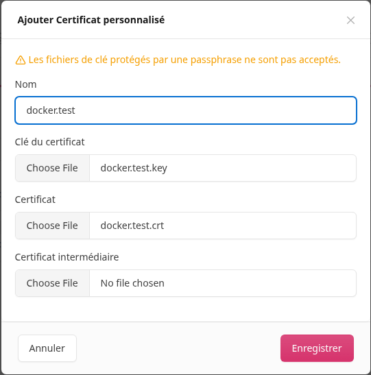
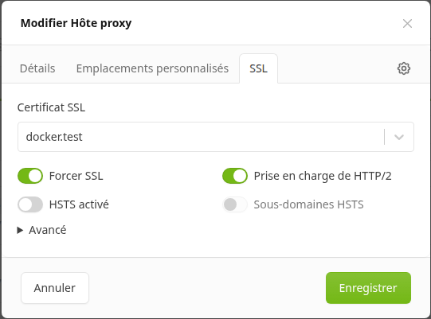
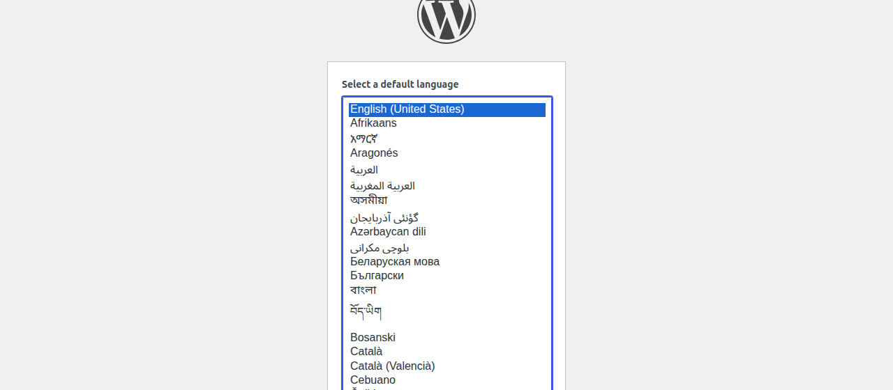

<!-- ============================================================ -->
<!-- ⚠️ RAPPEL IMPORTANT :                                          -->
<!-- Pensez TOUJOURS à ajouter une entrée dans le fichier d'index  -->
<!-- (index.md) du dossier correspondant (ex: docs/cloud/index.md) -->
<!-- afin de référencer ce nouvel article et permettre aux         -->
<!-- visiteurs de le trouver et de cliquer dessus !                -->
<!-- ============================================================ -->

# Nextcloud en HTTPS derrière le reverse proxy

!!! abstract "Résumé"
    Ce TP assemble tout ce qui précède : un **Nextcloud** décrit en **Docker Compose**, qui ne publie **aucun port**, est rendu accessible par **Nginx Proxy Manager** sous le nom `nextcloud.docker.test`. On le passe ensuite en **HTTPS** avec un **certificat autosigné** fabriqué avec `openssl`, et l'on apprend à Nextcloud qu'il est derrière un proxy, pour qu'il construise ses liens en `https://`.

    En exercice, on publie de la même façon un **WordPress** avec sa base de données. À la fin, deux applications tournent derrière un seul point d'entrée, chiffré.

| Propriété | Valeur |
|-----------|--------|
| Difficulté | Intermédiaire |
| Durée estimée | 2 h |
| Version décrite | Nextcloud 35.0.3, MariaDB 11.8, Nginx Proxy Manager 2.17.1, OpenSSL 3.5 |
| Place dans le parcours | Partie 10 sur 17 du parcours [Docker](index.md) — jour 3 |
| Dernière mise à jour | 2026-11-24 |

---

!!! info "Convention de lecture"
    🖥️ **PC hôte** · 🐧 **VM** `docker-hote`, connecté en `tssr` · 🌐 **navigateur du PC** · ✍️ **exercice** · 🛟 **instantané**. Suite de la [partie 9](09-reverse-proxy-nginx-proxy-manager.md) : NPM et Portainer tournent, et le fichier `hosts` du PC contient `nextcloud.docker.test` et `wordpress.docker.test`.

<!-- NOTE DE RÉDACTION (non affichée) : reprend le TD « 13 Docker Compose Nextcloud derrière reverse proxy », la partie SSL du TD « 14 Certificat SSL » et le brouillon « 13 TD Docker Compose WordPress » du formateur. Mises à jour vérifiées dans le lab (2026-11-24) : mariadb:10.5 → 11.8 + test de santé ; NPM 2.17 : le certificat personnalisé s'importe en envoyant les FICHIERS .key et .crt (le TD faisait coller leur contenu) ; certificat généré avec subjectAltName (sans lui, Chrome et Edge refusent le certificat même importé dans le magasin de confiance) ; Nextcloud derrière HTTPS : avertissement « Vous accédez au site de manière non sécurisée via HTTP » tant que TRUSTED_PROXIES / OVERWRITEPROTOCOL ne sont pas définis (mesuré, puis corrigé par les variables de l'image) ; WordPress : le brouillon (« ne fonctionne pas encore ») déclarait npm_default comme réseau interne du projet au lieu de « external: true », et utilisait mysql:latest ; corrigé et testé (302 vers wp-admin/install.php). Texte parasite « CopierModifier » du TD 14 retiré. La page d'alerte de certificat du navigateur n'a pas pu être capturée (navigateur sans interface). -->

## 1. Le fichier Compose de Nextcloud derrière un proxy

On repart d'un **nouveau** projet, dans son propre dossier, pour ne pas mélanger avec le Nextcloud de la partie 8.

!!! tip "Libérer de la place"
    Le Nextcloud de la partie 8 n'est plus utile. Pour récupérer environ 300 Mo sur le disque de la VM, supprimer ses volumes : `cd ~/nextcloud && docker compose down -v`.

1. 🐧 Créer le dossier et le fichier :

    ```bash
    mkdir ~/nextcloud-proxy && cd ~/nextcloud-proxy
    nano docker-compose.yml
    ```

    ```yaml
    services:
      redis:
        image: redis:alpine
        container_name: nextcloud-redis
        restart: always
        networks:
          - redis
        expose:
          - 6379
      mariadb:
        image: mariadb:11.8
        container_name: nextcloud-mariadb
        command: --transaction-isolation=READ-COMMITTED --binlog-format=ROW
        restart: always
        volumes:
          - mariadb:/var/lib/mysql
        networks:
          - mariadb
        environment:
          - MYSQL_DATABASE=nextcloud
          - MYSQL_USER=nextcloud
          - MYSQL_ROOT_PASSWORD=TutoDocker2026!
          - MYSQL_PASSWORD=TutoDocker2026!
        expose:
          - 3306
        healthcheck:
          test: ["CMD", "healthcheck.sh", "--connect", "--innodb_initialized"]
          interval: 10s
          timeout: 5s
          retries: 5
          start_period: 30s
      nextcloud:
        image: nextcloud:apache
        container_name: nextcloud
        restart: always
        volumes:
          - app:/var/www/html
        networks:
          - redis
          - mariadb
          - app
        environment:
          - REDIS_HOST=redis
          - MYSQL_HOST=mariadb
          - MYSQL_DATABASE=nextcloud
          - MYSQL_USER=nextcloud
          - MYSQL_PASSWORD=TutoDocker2026!
        depends_on:
          mariadb:
            condition: service_healthy
    volumes:
      mariadb:
      app:
    networks:
      mariadb:
      redis:
      app:
    ```

Les différences avec la partie 8 :

| Ligne | Explication |
|---|---|
| **Aucun** `ports:` | Nextcloud ne publie plus rien : seul le proxy le joindra |
| Volumes `mariadb` et `app` | La base de données et les fichiers de Nextcloud (le volume `app` n'a rien à voir avec le réseau du même nom) |
| `container_name: nextcloud` | Un nom fixe et court pour le conteneur (au lieu de `nextcloud-proxy-nextcloud-1`), plus pratique à indiquer dans NPM |
| Réseau `app` | Un réseau réservé à la liaison entre Nextcloud et le proxy |
| `MYSQL_HOST=mariadb` | Le service de base de données s'appelle maintenant `mariadb` |
| `REDIS_HOST=redis` | `redis` est le nom du **service** : il reste valable même si le conteneur s'appelle `nextcloud-redis` |

2. 🐧 Lancer le projet :

    ```bash
    docker compose up -d
    docker compose ps --format '{{.Name}} {{.Status}} {{.Ports}}'
    ```

    ```text
    nextcloud Up Less than a second 80/tcp
    nextcloud-mariadb Up 16 seconds (healthy) 3306/tcp
    nextcloud-redis Up 16 seconds 6379/tcp
    ```

    Aucune flèche dans la colonne des ports : rien n'est publié.

## 2. Brancher le proxy et créer l'hôte

1. 🐧 Les réseaux du projet portent le préfixe `nextcloud-proxy_` (le nom du dossier). Brancher NPM sur le réseau `app` :

    ```bash
    docker network ls --filter name=nextcloud-proxy
    docker network connect nextcloud-proxy_app npm-app-1
    ```

    ```text
    NETWORK ID     NAME                      DRIVER    SCOPE
    c3e2c0eb3d4d   nextcloud-proxy_app       bridge    local
    d228d6be6161   nextcloud-proxy_mariadb   bridge    local
    66d095acc251   nextcloud-proxy_redis     bridge    local
    ```

    NPM rejoint Nextcloud par `app`, mais n'a **aucun** accès à la base de données ni à Redis : ils sont sur d'autres réseaux. Comme en partie 9, rendre ce branchement durable en ajoutant `nextcloud-proxy_app` à la liste `networks:` du service `app` de `~/npm/docker-compose.yml`, et `nextcloud-proxy_app: external: true` à la section `networks:` de fin de fichier, puis `cd ~/npm && docker compose up -d`.

2. 🌐 Dans NPM, **Ajouter Hôte proxy** :

    | Champ | Valeur |
    |---|---|
    | **Noms de domaine** | `nextcloud.docker.test` |
    | **Schéma** | `http` |
    | **Nom d'hôte / IP de destination** | `nextcloud` |
    | **Port de destination** | `80` |
    | **Bloquer les exploits courants** | Activé |
    | **Prise en charge de WebSockets** | Activé (utilisé par certaines applications de Nextcloud) |

    Laisser l'onglet **SSL** tel quel pour l'instant, et **Enregistrer**.

3. 🌐 Ouvrir `http://nextcloud.docker.test` : l'assistant d'installation s'affiche. Créer le compte `admin` / `TutoDocker2026!` comme en [partie 8](08-docker-compose-nextcloud.md#52-creer-le-compte-administrateur), puis **Installer** (environ une minute).

!!! info "Le nom de domaine retenu par Nextcloud"
    Pendant l'installation, Nextcloud enregistre le nom par lequel on l'a joint comme **domaine de confiance** (*trusted domain*). On le vérifie avec `occ` :

    ```bash
    docker exec -u www-data nextcloud php occ config:system:get trusted_domains
    ```

    ```text
    nextcloud.docker.test
    ```

    Ouvert par un autre nom (son adresse IP, par exemple), Nextcloud refuserait avec le message **Accès par un domaine non approuvé**. Pour ajouter un nom : `docker exec -u www-data nextcloud php occ config:system:set trusted_domains 1 --value=autre.nom`.

## 3. Passer en HTTPS avec un certificat autosigné

### 3.1 Pourquoi un certificat autosigné ?

Un certificat prouve au navigateur l'**identité** du site et permet de **chiffrer** la connexion. Sur Internet, on le demande gratuitement à **Let's Encrypt**, que NPM sait interroger tout seul (**Certificats > Ajouter > Let's Encrypt**). Mais Let's Encrypt doit vérifier qu'on contrôle le nom de domaine, depuis Internet : impossible pour un nom fictif comme `nextcloud.docker.test`.

Dans un lab, on fabrique donc soi-même un certificat **autosigné** : il chiffre la connexion aussi bien, mais aucune autorité reconnue ne l'a signé. Le navigateur affichera une alerte, ce qui est normal. Ce n'est **pas** adapté à la production.

### 3.2 Générer le certificat avec `openssl`

Un même certificat peut être valable pour **plusieurs noms** : on en fabrique un seul pour les trois services du jour 3 (Nextcloud, Portainer et WordPress).

🐧 Créer un dossier et le certificat (une seule commande, sur plusieurs lignes) :

```bash
mkdir ~/certs && cd ~/certs
openssl req -x509 -nodes -days 365 -newkey rsa:2048 \
  -keyout docker.test.key \
  -out docker.test.crt \
  -subj "/C=FR/ST=France/L=Paris/O=Lab Docker/CN=docker.test" \
  -addext "subjectAltName=DNS:nextcloud.docker.test,DNS:portainer.docker.test,DNS:wordpress.docker.test"
```

| Option | Explication |
|---|---|
| `req -x509` | Fabriquer directement un certificat signé par lui-même (au lieu d'une simple demande à envoyer à une autorité) |
| `-nodes` | Ne pas chiffrer la clé privée par un mot de passe (sinon il faudrait le taper à chaque démarrage du proxy) |
| `-days 365` | Valable un an |
| `-newkey rsa:2048` | Créer en même temps une nouvelle clé RSA de 2048 bits |
| `-keyout`, `-out` | Les fichiers produits : la **clé privée** (secrète) et le **certificat** (public) |
| `-subj "…/CN=docker.test"` | L'identité inscrite dans le certificat ; `CN` est son nom principal |
| `-addext "subjectAltName=DNS:…,DNS:…"` | Les noms pour lesquels le certificat est valable, séparés par des virgules. **Indispensable** : les navigateurs récents ne regardent plus le `CN`, seulement ce champ |

🐧 Vérifier :

```bash
ls -l
openssl x509 -in docker.test.crt -noout -subject -enddate -ext subjectAltName
```

```text
-rw-rw-r-- 1 tssr tssr 1411 24 nov.  08:31 docker.test.crt
-rw------- 1 tssr tssr 1704 24 nov.  08:31 docker.test.key
subject=C=FR, ST=France, L=Paris, O=Lab Docker, CN=docker.test
notAfter=Nov 24 07:31:21 2027 GMT
X509v3 Subject Alternative Name:
    DNS:nextcloud.docker.test, DNS:portainer.docker.test, DNS:wordpress.docker.test
```

La clé privée n'est lisible que par `tssr` (`-rw-------`) : elle ne doit jamais être partagée.

### 3.3 Copier les fichiers sur le PC

NPM importe les certificats en **envoyant des fichiers** depuis le navigateur : il faut donc les avoir sur le PC.

🖥️ Dans PowerShell, copier les deux fichiers de la VM vers le dossier courant du PC :

```powershell
cd $HOME
scp tssr@IP-de-la-VM:certs/docker.test.* .
```

Les fichiers arrivent dans le dossier personnel de Windows (`C:\Users\<nom>`). Après l'import dans NPM, supprimer la **clé privée** du PC : `Remove-Item .\docker.test.key`.

### 3.4 Importer le certificat dans NPM

1. 🌐 Dans NPM, **Certificats**, **Ajouter**, puis **Certificat personnalisé**.
2. 🌐 Remplir :

    | Champ | Valeur |
    |---|---|
    | **Nom** | `docker.test` |
    | **Clé du certificat** | le fichier `docker.test.key` |
    | **Certificat** | le fichier `docker.test.crt` |
    | **Certificat intermédiaire** | vide (inutile pour un certificat autosigné) |

    { loading=lazy }
    /// caption
    Le certificat et sa clé, envoyés depuis le PC.
    ///

3. 🌐 **Enregistrer** : le certificat apparaît dans la liste, **Non utilisé** pour l'instant, avec sa date d'expiration.

### 3.5 Activer HTTPS sur l'hôte Nextcloud

1. 🌐 **Hôtes > Hôtes proxy**, menu **⋮** au bout de la ligne `nextcloud.docker.test`, **Modifier**, onglet **SSL**.
2. 🌐 Choisir le certificat `docker.test`, puis activer :
    - **Forcer SSL** : toute visite en `http://` est redirigée vers `https://` ;
    - **Prise en charge de HTTP/2** : une version plus rapide du protocole HTTP.

    { loading=lazy }
    /// caption
    Le certificat associé à l'hôte, HTTPS forcé.
    ///

3. 🌐 **Enregistrer**.
4. 🌐 Faire de même pour l'hôte `portainer.docker.test` (partie 9) : Portainer devient joignable en `https://portainer.docker.test`, et son mot de passe ne circule plus en clair.

!!! warning "Ne pas activer HSTS dans un lab"
    L'option **HSTS** demande au navigateur de ne **plus jamais** accepter ce site autrement qu'en HTTPS valide, pendant des mois. Avec un certificat autosigné, on risque de ne plus pouvoir ouvrir le site du tout dans ce navigateur. HSTS est une bonne pratique en production, avec un vrai certificat.

### 3.6 Tester

1. 🐧 Depuis la VM, vérifier la redirection et le HTTPS (l'option `-k` accepte le certificat autosigné, `--resolve` remplace le fichier `hosts`) :

    ```bash
    curl -s -o /dev/null -w '%{http_code} %{redirect_url}\n' --resolve nextcloud.docker.test:80:127.0.0.1 http://nextcloud.docker.test/
    curl -sk -o /dev/null -w '%{http_code} HTTP/%{http_version}\n' --resolve nextcloud.docker.test:443:127.0.0.1 https://nextcloud.docker.test/status.php
    ```

    ```text
    301 https://nextcloud.docker.test/
    200 HTTP/2
    ```

    La visite en HTTP est **redirigée** (code 301) vers HTTPS, qui répond en HTTP/2.

2. 🌐 Ouvrir `https://nextcloud.docker.test`. Le navigateur affiche une **alerte de sécurité** (« Votre connexion n'est pas privée », code `NET::ERR_CERT_AUTHORITY_INVALID`) : il ne connaît pas l'autorité qui a signé le certificat, puisque c'est… le certificat lui-même. Dans un lab maîtrisé, on passe outre :
    - Chrome ou Edge : **Paramètres avancés**, puis **Continuer vers le site** ;
    - Firefox : **Avancé**, puis **Accepter le risque et poursuivre**.

    Un clic sur le cadenas (ou sur **Non sécurisé**) de la barre d'adresse permet d'afficher le certificat : on y retrouve `Lab Docker` et la date d'expiration.

!!! tip "Faire confiance au certificat sur le PC"
    Pour ne plus voir l'alerte, on peut ajouter le certificat aux **autorités de confiance** du PC. 🖥️ Sous Windows : double-cliquer sur `docker.test.crt`, **Installer le certificat…**, **Utilisateur actuel**, **Placer tous les certificats dans le magasin suivant**, **Parcourir…**, **Autorités de certification racines de confiance**, puis **Terminer** ; Windows demande une confirmation (**Oui**). Redémarrer le navigateur. Pour le retirer à la fin du parcours : `certmgr.msc`, **Autorités de certification racines de confiance > Certificats**, supprimer `docker.test`. Firefox utilise son propre magasin : **Paramètres > Vie privée et sécurité > Certificats > Afficher les certificats > Autorités > Importer**. À ne faire **que** pour un certificat de son propre lab : une autorité de confiance peut usurper n'importe quel site.

## 4. Dire à Nextcloud qu'il est derrière un proxy HTTPS

🌐 Se connecter à Nextcloud, puis ouvrir **Paramètres d'administration > Vue d'ensemble** (menu de l'avatar en haut à droite). Nextcloud signale une erreur :

```text
Accès HTTPS et URL
Vous accédez au site de manière non sécurisée via HTTP. Il est fortement recommandé de configurer votre serveur pour exiger HTTPS.
```

Pourtant, le navigateur est bien en HTTPS ! C'est le piège classique du reverse proxy : le **chiffrement s'arrête au proxy**. Entre NPM et Nextcloud, sur le réseau Docker `app`, la requête circule en HTTP simple. Nextcloud ne voit donc que du HTTP, et risque de fabriquer des liens en `http://`.

{ loading=lazy }
/// caption
Le HTTPS s'arrête au proxy : Nextcloud doit le savoir.
///

Le proxy ajoute à chaque requête des **en-têtes** qui racontent ce qui s'est passé avant lui (`X-Forwarded-Proto: https`, `X-Forwarded-For: adresse du PC`). Mais Nextcloud ne les croit que s'ils viennent d'un **proxy de confiance** : sinon, n'importe qui pourrait les inventer. L'image Nextcloud lit pour cela trois variables d'environnement.

1. 🐧 Dans `~/nextcloud-proxy/docker-compose.yml`, ajouter au bloc `environment` du service `nextcloud` :

    ```yaml
          - TRUSTED_PROXIES=172.16.0.0/12
          - OVERWRITEPROTOCOL=https
          - OVERWRITECLIURL=https://nextcloud.docker.test
    ```

    | Variable | Rôle |
    |---|---|
    | `TRUSTED_PROXIES=172.16.0.0/12` | Faire confiance aux en-têtes envoyés par une adresse de cette plage, celle où Docker choisit ses réseaux (`172.16.0.0` à `172.31.255.255`) |
    | `OVERWRITEPROTOCOL=https` | Toujours fabriquer des liens en `https://` |
    | `OVERWRITECLIURL=https://…` | L'adresse publique, utilisée par les tâches en ligne de commande (notifications, courriels…) |

2. 🐧 Appliquer : Compose recrée seulement le conteneur `nextcloud` ; les données sont dans les volumes.

    ```bash
    cd ~/nextcloud-proxy
    docker compose up -d
    ```

    ```text
     Container nextcloud Recreate
     Container nextcloud Recreated
     Container nextcloud Starting
     Container nextcloud Started
    ```

3. 🌐 Recharger **Vue d'ensemble** : l'erreur **Accès HTTPS et URL** a disparu. Les autres avertissements (fenêtre de maintenance, types MIME, répertoire de données…) concernent le réglage fin de Nextcloud et peuvent être ignorés dans ce lab.

!!! question "Pourquoi une plage aussi large ?"
    L'adresse de NPM sur le réseau `app` est attribuée par Docker et peut changer si le réseau est recréé. La plage `172.16.0.0/12` couvre les réseaux que Docker crée par défaut tant qu'il en existe moins d'une quinzaine ; au-delà, il passe en `192.168.x.0/20`. Le vérifier : `docker network inspect nextcloud-proxy_app --format '{{range .IPAM.Config}}{{.Subnet}}{{end}}'`. En production, on la restreint en fixant le sous-réseau du réseau partagé avec le proxy (`ipam` dans Compose) et en ne déclarant que lui.

## 5. Exercice — Publier WordPress derrière le proxy

✍️ Écrire un projet Compose dans `~/wordpress` avec deux services :

- `database` : MariaDB 11.8 (avec test de santé), base `wordpress`, utilisateur `wordpress`, mot de passe `TutoDocker2026!`, volume `db_data`, sur un réseau `db_wordpress` seulement ;
- `wordpress` : image `wordpress`, volume `wp_data`, sur `db_wordpress` **et** sur le réseau **existant** `npm_default` de NPM, aucun port publié.

Le publier en `https://wordpress.docker.test`, avec le certificat `docker.test`, **avant** de lancer l'assistant d'installation de WordPress (installé en HTTP, WordPress enregistrerait des adresses en `http://` et continuerait à produire de tels liens après le passage en HTTPS).

!!! tip "Indice"
    Un réseau **créé par un autre projet** (ici `npm_default`, créé par le projet `npm`) se déclare avec `external: true` dans la section `networks:`. Sans cette ligne, Compose créerait un **nouveau** réseau `wordpress_npm_default`, et NPM ne joindrait pas WordPress (erreur 502).

??? success "Réponse"
    🐧 `~/wordpress/docker-compose.yml` :

    ```yaml
    services:
      database:
        image: mariadb:11.8
        container_name: database
        restart: always
        networks:
          - db_wordpress
        environment:
          - MARIADB_ROOT_PASSWORD=TutoDocker2026!
          - MARIADB_DATABASE=wordpress
          - MARIADB_USER=wordpress
          - MARIADB_PASSWORD=TutoDocker2026!
        volumes:
          - db_data:/var/lib/mysql
        healthcheck:
          test: ["CMD", "healthcheck.sh", "--connect", "--innodb_initialized"]
          interval: 10s
          timeout: 5s
          retries: 5
          start_period: 30s
      wordpress:
        image: wordpress:latest
        container_name: wordpress
        restart: always
        depends_on:
          database:
            condition: service_healthy
        networks:
          - db_wordpress
          - npm_default
        environment:
          - WORDPRESS_DB_HOST=database:3306
          - WORDPRESS_DB_NAME=wordpress
          - WORDPRESS_DB_USER=wordpress
          - WORDPRESS_DB_PASSWORD=TutoDocker2026!
        volumes:
          - wp_data:/var/www/html
    networks:
      db_wordpress:
      npm_default:
        external: true
    volumes:
      db_data:
      wp_data:
    ```

    🐧 `cd ~/wordpress && docker compose up -d`, puis 🌐 un hôte proxy `wordpress.docker.test` → `wordpress`, port `80`, avec dans l'onglet **SSL** le certificat `docker.test`, **Forcer SSL** et **HTTP/2**. 🐧 Vérifier :

    ```bash
    curl -sk -o /dev/null -w '%{http_code} %{redirect_url}\n' --resolve wordpress.docker.test:443:127.0.0.1 https://wordpress.docker.test/
    ```

    ```text
    302 https://wordpress.docker.test/wp-admin/install.php
    ```

    L'image WordPress lit l'en-tête `X-Forwarded-Proto` du proxy : elle redirige bien vers une adresse en `https://`. L'assistant d'installation commence par le choix de la langue :

    { loading=lazy }
    /// caption
    WordPress, joint par son nom à travers le proxy.
    ///

    Ici, NPM est déjà sur `npm_default` : pas besoin de `docker network connect`, c'est WordPress qui vient sur le réseau du proxy. Le certificat `docker.test` couvre déjà `wordpress.docker.test`. Les variables `MARIADB_*` sont les nouveaux noms des variables `MYSQL_*`, que l'image MariaDB accepte toutes deux.

## 6. Vérifier son lab

!!! success "Vérifier son lab"
    🐧 Depuis la VM :

    ```bash
    curl -sk --resolve nextcloud.docker.test:443:127.0.0.1 https://nextcloud.docker.test/status.php
    docker ps --format '{{.Names}}  {{.Ports}}'
    ```

    Résultat attendu : une ligne `{"installed":true,…,"versionstring":"35.0.3",…}`, et une liste de conteneurs où **seul** `npm-app-1` publie des ports. 🌐 `https://nextcloud.docker.test` ouvre Nextcloud (après l'alerte de certificat), et **Vue d'ensemble** ne signale plus l'erreur HTTPS.

!!! success "Prendre l'instantané `04-fin-jour-3`"
    🛟 🐧 Éteindre la VM (`sudo poweroff`), puis 🖥️ prendre un instantané nommé `04-fin-jour-3` : le proxy et ses hôtes sont prêts pour la suite.

## 7. Questions de révision

1. Pourquoi le fichier Compose de cette partie n'a-t-il aucune ligne `ports:` ? Comment le proxy joint-il Nextcloud ?
2. Pourquoi ne peut-on pas obtenir un certificat Let's Encrypt pour `nextcloud.docker.test` ?
3. À quoi sert l'option `-addext "subjectAltName=…"` de `openssl` ? Que se passe-t-il sans elle ?
4. Le navigateur est en HTTPS, mais Nextcloud affirme qu'on y accède en HTTP. Expliquer pourquoi, et comment on le corrige.
5. Pourquoi faut-il `external: true` pour le réseau `npm_default` dans le projet WordPress ?
6. Pourquoi ne faut-il pas activer HSTS avec un certificat autosigné ?

??? success "Corrigé"
    1. Nextcloud ne doit être joignable **que** par le proxy. NPM est branché sur le réseau `nextcloud-proxy_app` (`docker network connect`) et joint le conteneur par son nom, `nextcloud`, sur son port 80 interne.
    2. Let's Encrypt vérifie depuis Internet qu'on contrôle le domaine (par une requête HTTP ou un enregistrement DNS). Un nom en `.test` n'existe pas sur Internet : la vérification est impossible.
    3. Elle inscrit les **noms** pour lesquels le certificat est valable. Les navigateurs récents ne regardent que ce champ : sans lui, le certificat est refusé pour erreur de nom, même si on lui fait confiance.
    4. Le HTTPS s'arrête au proxy : entre NPM et Nextcloud, la requête est en HTTP. Il faut que Nextcloud fasse confiance aux en-têtes `X-Forwarded-*` du proxy (`TRUSTED_PROXIES`) et fabrique ses liens en HTTPS (`OVERWRITEPROTOCOL=https`).
    5. `npm_default` est créé par **un autre projet** (NPM). Sans `external: true`, Compose créerait son propre réseau `wordpress_npm_default`, différent, et NPM ne pourrait pas joindre WordPress.
    6. HSTS impose au navigateur de n'accepter **que** du HTTPS valide pour ce site, pendant longtemps. Avec un certificat autosigné, jamais « valide » pour le navigateur, le site deviendrait inaccessible dans ce navigateur.

---

## Ressources

- [Image officielle Nextcloud — Utilisation derrière un reverse proxy](https://github.com/nextcloud/docker#using-the-apache-image-behind-a-reverse-proxy-and-auto-configure-server-host-and-protocol) — les variables `TRUSTED_PROXIES`, `OVERWRITEPROTOCOL`… (en anglais).
- [Nextcloud — Configuration d'un reverse proxy](https://docs.nextcloud.com/server/latest/admin_manual/configuration_server/reverse_proxy_configuration.html) — `trusted_proxies` et les en-têtes `X-Forwarded-*`.
- [Let's Encrypt — Fonctionnement](https://letsencrypt.org/fr/how-it-works/) — comment une autorité vérifie qu'on contrôle un domaine.
- [Image officielle WordPress sur Docker Hub](https://hub.docker.com/_/wordpress) — variables d'environnement `WORDPRESS_DB_*`.
- Partie précédente : [Un reverse proxy avec Nginx Proxy Manager](09-reverse-proxy-nginx-proxy-manager.md) · Partie suivante : [Les plateformes tout-en-un](11-plateformes-tout-en-un.md).

*[NPM]: Nginx Proxy Manager
*[HTTPS]: HTTP sécurisé par TLS
*[HSTS]: HTTP Strict Transport Security — obligation de HTTPS mémorisée par le navigateur
*[RSA]: algorithme de chiffrement à clé publique
*[CN]: Common Name — nom inscrit dans un certificat
*[DNS]: Domain Name System — résolution des noms
*[VM]: Virtual Machine — machine virtuelle
