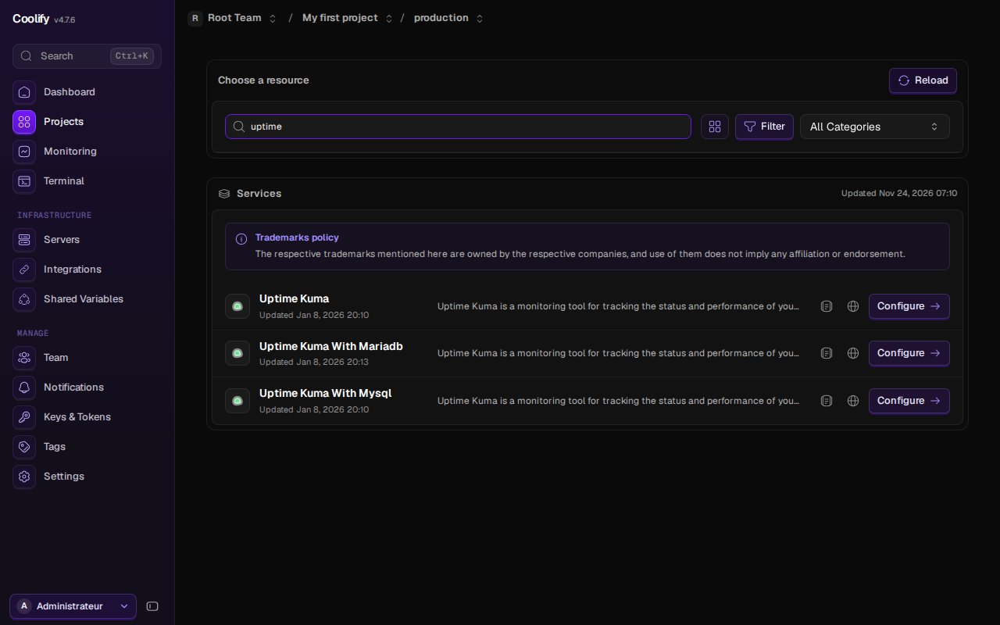

<!-- ============================================================ -->
<!-- ⚠️ RAPPEL IMPORTANT :                                          -->
<!-- Pensez TOUJOURS à ajouter une entrée dans le fichier d'index  -->
<!-- (index.md) du dossier correspondant (ex: docs/cloud/index.md) -->
<!-- afin de référencer ce nouvel article et permettre aux         -->
<!-- visiteurs de le trouver et de cliquer dessus !                -->
<!-- ============================================================ -->

# Les plateformes tout-en-un

!!! abstract "Résumé"
    Les parties 8 à 10 ont assemblé à la main ce qu'il faut pour héberger des services : Docker Compose, un reverse proxy, des certificats. Des **plateformes tout-en-un** font tout cela pour nous, depuis une interface web : catalogue d'applications prêtes à déployer, reverse proxy intégré, certificats, sauvegardes, supervision.

    Ce TP installe **Coolify** sur une seconde VM et y déploie **Uptime Kuma** (un outil de supervision) en quelques clics, joignable par un nom de domaine sans toucher au fichier `hosts`. On présente ensuite deux autres outils : **Cosmos Server**, orienté serveur personnel, et **BunkerWeb**, un reverse proxy qui est aussi un **pare-feu applicatif**. À la fin, on sait ce que ces plateformes automatisent… et ce qu'elles cachent.

| Propriété | Valeur |
|-----------|--------|
| Difficulté | Intermédiaire |
| Durée estimée | 2 h 30 (dont environ 15 minutes d'installation de Debian et 4 minutes d'installation de Coolify) |
| Version décrite | Coolify 4.7.6, Uptime Kuma 2, Cosmos Server 0.24, BunkerWeb 1.6 |
| Place dans le parcours | Partie 11 sur 17 du parcours [Docker](index.md) — jour 3 |
| Dernière mise à jour | 2026-11-24 |

---

!!! info "Convention de lecture"
    🖥️ **PC hôte** · 🐧 **VM** `docker-plateforme` (nouvelle VM), connecté en `root` · 🌐 **navigateur du PC** · ✍️ **exercice** · 🛟 **instantané**. Coolify n'existe qu'en anglais : ses menus sont écrits en gras, en anglais, avec une traduction entre parenthèses.

<!-- NOTE DE RÉDACTION (non affichée) : partie écrite à la demande du formateur (plateformes Docker + reverse proxy : Coolify, Cosmos Server, BunkerWeb), absente de ses supports. Coolify rejoué le 2026-11-24 sur une VM Debian 13.7 (KVM, 2 vCPU, 4 Go) : script officiel (3 min 11 s, 9 étapes), compte, assistant, service Uptime Kuma, domaine générique sslip.io. Constat : sans domaine générique, Coolify fabrique les adresses avec l'IP PUBLIQUE de la connexion Internet (inutilisable dans un lab derrière NAT) ; d'où le réglage « Wildcard domain » avant de créer les services. Cosmos Server et BunkerWeb sont présentés d'après leur documentation et leur dépôt GitHub (non installés dans le lab). -->

## 1. Pourquoi une plateforme ?

Pour publier Nextcloud proprement en partie 10, il a fallu : écrire un fichier Compose, créer des réseaux, brancher le proxy, fabriquer un certificat, l'importer, déclarer le proxy à l'application. Une **plateforme tout-en-un** (on parle aussi de **PaaS** auto-hébergé, *Platform as a Service*) regroupe ces étapes :

| Besoin | À la main (parties 8 à 10) | Plateforme tout-en-un |
|---|---|---|
| Déployer une application | Écrire le fichier Compose | Choisir dans un **catalogue**, ou pointer un dépôt Git |
| Publier sous un nom de domaine | Hôte proxy dans NPM + réseau partagé | Automatique (reverse proxy intégré) |
| HTTPS | Certificat, import, association | Automatique avec Let's Encrypt (sur un vrai domaine) |
| Sauvegardes, supervision, journaux | À organiser soi-même | Intégrées, plus ou moins complètes |

En contrepartie, la plateforme est **une couche de plus** : elle a ses propres pannes, ses mises à jour, ses failles, et elle décide de beaucoup de choses à notre place. Comprendre ce qu'elle fait (c'est-à-dire tout ce qu'on a fait à la main depuis le jour 1) reste indispensable pour la dépanner.

| Outil | Pour qui | Points forts | Licence |
|---|---|---|---|
| **Coolify** | Équipes qui déploient des applications et des bases de données sur leurs propres serveurs | Catalogue de plus de 300 services en un clic, déploiement depuis Git, plusieurs serveurs, sauvegardes de bases de données | Apache 2.0 (libre) |
| **Cosmos Server** | Particuliers et petites structures qui hébergent leurs services chez eux | Reverse proxy avec authentification unique, protections anti-robots et anti-DDoS, magasin d'applications, VPN intégré | Code source ouvert, licence propre au projet (des fonctions avancées sont payantes) |
| **BunkerWeb** | Administrateurs qui veulent **protéger** des sites web | Reverse proxy **et** pare-feu applicatif (ModSecurity, règles OWASP), anti-robots, listes noires | AGPL 3.0 (libre), édition PRO payante |

## 2. Préparer la VM `docker-plateforme`

Coolify prend la main sur Docker et sur les ports 80, 443, 8000, 6001 et 6002 de sa machine : on l'installe sur une **VM dédiée**, pour ne pas le mélanger avec `docker-hote` et son Nginx Proxy Manager.

| Réglage | Valeur |
|---|---|
| Nom de la VM | `docker-plateforme` |
| Système | Debian 13, installé comme en [partie 1, section 2](01-decouvrir-et-installer-docker.md#2-creer-la-vm-docker-hote) (nom de machine `docker-plateforme`, mêmes comptes) |
| Réseau | Comme `docker-hote` : VMnet8 (NAT) sous Workstation ; sous VirtualBox, carte 1 en NAT **et** carte 2 en **Réseau privé hôte**, activée dans `/etc/network/interfaces` (partie 1, sections 2.1 et 2.3) |
| Processeur, mémoire, disque | 2 vCPU, 4 Go, 40 Go (Coolify demande au moins 2 cœurs, 2 Go de mémoire et 10 Go d'espace libre ; les applications déployées en réclament davantage) |
| Docker | **Ne pas l'installer** : le script de Coolify s'en charge |

🖥️ Sur un PC de 16 Go, éteindre `docker-hote` pendant l'installation si la mémoire manque, et le rallumer pour l'exercice de la section 6.

🐧 Noter l'adresse de la VM (`ip -br a`) : elle est écrite **IP-de-plateforme** dans la suite. Sous VirtualBox, c'est celle de `enp0s8` (`192.168.56.1xx`), **jamais** `10.0.2.15`.

!!! success "🛟 Prendre l'instantané `00-debian-installee` de `docker-plateforme`"
    VM éteinte, comme en partie 1 : il permet de recommencer l'installation de Coolify.

## 3. Installer Coolify

1. 🐧 En `root` (`su -`), télécharger le script officiel et le **lire** avant de l'exécuter :

    ```bash
    apt install -y curl
    curl -fsSL https://cdn.coollabs.io/coolify/install.sh -o install-coolify.sh
    less install-coolify.sh
    ```

2. 🐧 Lancer l'installation (environ 3 à 4 minutes) :

    ```bash
    bash install-coolify.sh
    ```

    ```text
      1/9  Installing required packages  curl wget git jq openssl            50.0s ✓
      2/9  Checking OpenSSH server configuration                              0.0s ✓
      3/9  Installing Docker Engine  v29.10.0                                27.2s ✓
      4/9  Configuring Docker daemon  log rotation · address pools            1.4s ✓
      5/9  Downloading required files from CDN                                0.2s ✓
      6/9  Setting up environment variables                                   0.0s ✓
      7/9  Checking SSH key for localhost access  generated new key           0.0s ✓
      8/9  Pulling images  coolify · postgres · redis · helper              1m 17s ✓
      9/9  Starting Coolify  v4.7.6                                          34.3s ✓

      Coolify is ready!  Installed in 3m 11s
      …
      ! Create the root account within 10 minutes. If the time ends, run docker restart coolify and try again.

      ! Back up /data/coolify/source/.env to a safe place outside this server (e.g. a password manager).
    ```

    Le script installe Docker (depuis le dépôt officiel, comme en partie 1), règle la rotation des journaux, télécharge les images de Coolify, puis le démarre. Il affiche aussi l'adresse publique de la connexion Internet et les adresses privées de la VM.

3. 🐧 Coolify lui-même tourne… dans des conteneurs :

    ```bash
    docker ps --format '{{.Names}}  {{.Ports}}'
    ```

    ```text
    coolify  8000/tcp, 8443/tcp, 0.0.0.0:6001-6002->6001-6002/tcp, [::]:6001-6002->6001-6002/tcp, 9000/tcp, 0.0.0.0:8000->8080/tcp, [::]:8000->8080/tcp
    coolify-db  5432/tcp
    coolify-redis  6379/tcp
    ```

    L'application (`coolify`), sa base de données PostgreSQL (`coolify-db`) et son cache (`coolify-redis`). Le port 8000 de la VM mène à l'interface web.

!!! warning "Deux consignes du script à respecter"
    - **10 minutes** pour créer le compte administrateur : passé ce délai, `docker restart coolify` et recommencer. Cela évite qu'un inconnu crée le compte à notre place.
    - Le fichier `/data/coolify/source/.env` contient les **secrets** de l'installation (mots de passe de la base, clés de chiffrement) : sans lui, impossible de restaurer Coolify. En production, il se range dans un gestionnaire de mots de passe.

## 4. Créer le compte et connecter le serveur

1. 🌐 Ouvrir `http://IP-de-plateforme:8000` : la page **Register** (inscription) s'affiche. Remplir **Name** (`Administrateur`), **Email** (`admin@lab.local`), **Password** et **Confirm Password** (`TutoDocker2026!`), puis **Create Account**.
2. 🌐 L'assistant **Welcome to Coolify** s'ouvre : **Continue**.
3. 🌐 **Choose Server Type** (type de serveur) : choisir **This machine** (cette machine). Coolify déploiera sur la VM où il est installé ; il saurait aussi piloter d'autres serveurs en SSH, ou en créer chez des hébergeurs.

    { loading=lazy }
    /// caption
    Coolify peut gérer la machine où il tourne, ou d'autres serveurs par SSH.
    ///

    Avec **This machine**, le script a donné à Coolify une **clé SSH `root`** vers la VM (étape 7/9) et l'accès au socket Docker : comme pour Portainer en partie 4, **un administrateur de Coolify est `root` sur la VM**.

4. 🌐 **Project Setup** : **Create "My First Project"** (créer le premier projet). Un projet regroupe des ressources ; il contient un environnement **production**.
5. 🌐 **Setup complete** : le résumé indique `Server: localhost`, `Project: My first project`, `Docker Engine: Installed and running`. Cliquer sur **Go to dashboard**. Fermer les bandeaux de bienvenue (**Maybe next time**, **Accept And Close**).

## 5. Donner un nom de domaine aux services : sslip.io

Coolify publie chaque service sous un **nom de domaine**, derrière son reverse proxy intégré (**Traefik**, qui joue le rôle de Nginx Proxy Manager). Sans réglage, il fabrique ces noms avec l'**adresse publique** de la connexion Internet, inutilisable dans un lab derrière un NAT. On lui indique plutôt un domaine **sslip.io** basé sur l'adresse de la VM.

!!! question "Comment fonctionne sslip.io ?"
    **sslip.io** est un service DNS public qui répond… avec l'adresse écrite dans le nom : `n-importe-quoi.192.168.56.110.sslip.io` donne `192.168.56.110`. Plus besoin de fichier `hosts` : chaque service a son propre nom, qui mène à la VM, et le reverse proxy fait le tri. Il faut seulement que le PC puisse interroger le DNS d'Internet.

1. 🌐 Menu **Servers** (serveurs), cliquer sur **localhost**.
2. 🌐 Dans **Wildcard domain** (domaine générique), saisir `http://IP-de-plateforme.sslip.io` (par exemple `http://192.168.56.110.sslip.io`), puis **Save** (enregistrer).

!!! failure "Le nom en sslip.io ne répond pas"
    Certains DNS (pfSense, OPNsense, box, réseaux d'entreprise ou d'école) refusent par sécurité les réponses qui contiennent une adresse **privée** (protection contre le *DNS rebinding*). 🖥️ Tester dans PowerShell : `nslookup test.IP-de-plateforme.sslip.io`, puis `nslookup test.IP-de-plateforme.sslip.io 1.1.1.1`. Si seul le second répond, c'est le DNS local qui filtre : ajouter le nom affiché par **Links** au fichier `hosts` du PC (partie 9), ou utiliser temporairement un DNS public sur la carte réseau du PC.

!!! warning "À faire avant de créer les services"
    Le domaine d'un service est choisi **à sa création**. Un service créé avant ce réglage garde un nom basé sur l'adresse publique : le supprimer et le recréer.

## 6. Déployer Uptime Kuma en un clic

**Uptime Kuma** surveille des sites et des services (ping, page web, port TCP, DNS…) et prévient quand ils tombent : un outil très apprécié des administrateurs.

1. 🌐 **Projects**, **My first project**, **production**, puis **+ New** (nouvelle ressource).
2. 🌐 Taper `uptime` dans la recherche : le catalogue propose **Uptime Kuma** (seul, ou avec une base MariaDB ou MySQL). Cliquer sur **Configure** en face de **Uptime Kuma**.

    { loading=lazy }
    /// caption
    Le catalogue de Coolify : des centaines de services prêts à déployer.
    ///

3. 🌐 La page du service s'ouvre, avec son fichier Compose généré (**Edit Compose File** pour le lire). Cliquer sur **Deploy** (déployer). Coolify télécharge l'image (environ 2,5 Go sur le disque, une à deux minutes) et démarre le conteneur.
4. 🌐 L'état passe à **Running** (en marche), puis **Running (healthy)** quand le test de santé de l'image répond.

    { loading=lazy }
    /// caption
    Le service tourne, avec son test de santé au vert.
    ///

5. 🌐 Le menu **Links** (liens), en haut, donne l'adresse du service, de la forme `http://uptimekuma-xxxxxxxx.IP-de-plateforme.sslip.io`. L'ouvrir : Uptime Kuma démarre son assistant, en français.

    { loading=lazy }
    /// caption
    Uptime Kuma, déployé et publié par Coolify, sans une ligne de configuration.
    ///

✍️ **Exercice** — Terminer l'installation d'Uptime Kuma (base **SQLite**, compte `admin` / `TutoDocker2026!`), puis ajouter une **sonde** (*monitor*) de type **HTTP(s)** qui surveille Nginx Proxy Manager sur `docker-hote` (`http://IP-de-la-VM:81`). Éteindre `docker-hote` et regarder la sonde passer au rouge.

??? success "Réponse"
    Dans Uptime Kuma : **Ajouter une nouvelle sonde**, **Type de sonde** **HTTP(s)**, URL `http://IP-de-la-VM:81`, intervalle par défaut (60 s), **Sauvegarder**. La sonde est verte (**En ligne**) tant que NPM répond ; une à deux minutes après l'extinction de `docker-hote`, elle passe **Hors ligne** et l'historique montre la coupure. On pourrait y ajouter une notification (courriel, Discord, Telegram…).

!!! question "Qu'a fait Coolify, exactement ?"
    🐧 Tout ce qu'on a appris à faire à la main :

    ```bash
    ls /data/coolify/services/
    docker ps --format '{{.Names}}  {{.Status}}'
    ```

    ```text
    kwd68hsgdguljxd05uemef5x
    uptime-kuma-kwd68hsgdguljxd05uemef5x  Up 2 minutes (healthy)
    coolify-proxy-error-pages  Up 12 minutes
    coolify-proxy  Up 12 minutes (healthy)
    coolify-sentinel  Up 12 minutes (healthy)
    coolify  Up 13 minutes (healthy)
    coolify-db  Up 13 minutes (healthy)
    coolify-redis  Up 13 minutes (healthy)
    ```

    Il a écrit un **fichier Compose** (dans `/data/coolify/services/<identifiant>/docker-compose.yml`), créé un **réseau** et un **volume** pour le service, ajouté au conteneur des **étiquettes** (*labels*) que lit son reverse proxy **Traefik** pour savoir quel nom mène à quel conteneur, et lancé le tout. Ouvrir ce fichier Compose permet de retrouver exactement les notions des parties 5 à 10.

## 7. Cosmos Server et BunkerWeb en bref

### 7.1 Cosmos Server

**Cosmos Server** vise le **serveur personnel** : on l'installe en un conteneur, et il devient la porte d'entrée de tous ses services. Il combine un **reverse proxy** avec certificats automatiques, une **authentification unique** devant chaque application (même celles qui n'en ont pas), des protections **anti-robots** et contre les attaques par saturation (*DDoS*), un **magasin d'applications** (*market*), un gestionnaire de conteneurs et un **VPN** pour y accéder de l'extérieur. C'est une alternative « tout intégré » à l'ensemble NPM + Portainer du jour 3, plutôt destinée à un usage domestique ou associatif.

### 7.2 BunkerWeb

**BunkerWeb**, développé par l'entreprise française Bunkerity, est d'abord un **pare-feu applicatif web** (*WAF*, *Web Application Firewall*) : un reverse proxy, basé sur nginx, qui **inspecte** chaque requête avant de la transmettre et bloque les attaques connues (injections SQL, scripts malveillants…) grâce à **ModSecurity** et aux règles **OWASP Core Rule Set**. Il ajoute des défis anti-robots, des listes noires, la limitation du débit et des en-têtes de sécurité. Il s'intègre à Docker en lisant, comme Traefik, des étiquettes posées sur les conteneurs.

!!! tip "Quel outil choisir ?"
    - Apprendre et comprendre : **Nginx Proxy Manager + Portainer** (jours 1 à 3), où chaque brique est visible.
    - Déployer vite et souvent des applications, sur un ou plusieurs serveurs : **Coolify**.
    - Héberger ses services personnels derrière une seule porte bien gardée : **Cosmos Server**.
    - Exposer des sites sur Internet avec une protection sérieuse : **BunkerWeb**, ou un WAF devant le reverse proxy.

## 8. Vérifier son lab

!!! success "Vérifier son lab"
    🐧 Sur `docker-plateforme` :

    ```bash
    docker ps --format '{{.Names}}  {{.Status}}' | grep -E 'coolify|uptime'
    ```

    Résultat attendu (les identifiants et les durées varient) :

    ```text
    uptime-kuma-kwd68hsgdguljxd05uemef5x  Up 2 minutes (healthy)
    coolify-proxy-error-pages  Up 12 minutes
    coolify-proxy  Up 12 minutes (healthy)
    coolify-sentinel  Up 12 minutes (healthy)
    coolify  Up 13 minutes (healthy)
    coolify-db  Up 13 minutes (healthy)
    coolify-redis  Up 13 minutes (healthy)
    ```

    `coolify-proxy` est le reverse proxy Traefik. 🌐 L'adresse **Links** du service ouvre Uptime Kuma depuis le PC.

!!! success "Prendre l'instantané `01-coolify` de `docker-plateforme`"
    🛟 VM éteinte (`poweroff`).

## 9. Questions de révision

1. Qu'apporte une plateforme comme Coolify par rapport à Docker Compose et Nginx Proxy Manager ? Quel en est le prix ?
2. Pourquoi installer Coolify sur une VM dédiée plutôt que sur `docker-hote` ?
3. À quoi sert le fichier `/data/coolify/source/.env` ?
4. Comment fonctionne sslip.io ? Pourquoi le régler **avant** de créer les services ?
5. Quel composant joue, dans Coolify, le rôle de Nginx Proxy Manager ? Comment sait-il quel nom mène à quel conteneur ?
6. Qu'est-ce qu'un pare-feu applicatif web (WAF) ? Lequel des trois outils en est un ?

??? success "Corrigé"
    1. Un catalogue d'applications, le déploiement depuis Git, le reverse proxy, les certificats et des sauvegardes intégrés, le tout depuis une interface. Le prix : une couche de plus, avec ses pannes, ses mises à jour et ses failles, et des choix faits à notre place. Il faut comprendre ce qu'elle fait pour la dépanner.
    2. Coolify installe et règle Docker à sa façon, et prend les ports 80, 443 et 8000 : il entrerait en conflit avec Nginx Proxy Manager et les services de `docker-hote`.
    3. Il contient les secrets de l'installation (mots de passe de la base, clés de chiffrement). Sans lui, une sauvegarde de Coolify ne peut pas être restaurée : il se range hors du serveur, dans un gestionnaire de mots de passe.
    4. C'est un DNS public qui répond avec l'adresse écrite dans le nom (`x.192.168.56.110.sslip.io` → `192.168.56.110`). Coolify choisit le nom d'un service à sa création : réglé après, le domaine générique ne s'applique pas aux services déjà créés.
    5. **Traefik**. Coolify ajoute à chaque conteneur des étiquettes (*labels*) qui décrivent le nom de domaine et le port ; Traefik les lit à travers le socket Docker et se configure tout seul.
    6. Un reverse proxy qui **inspecte** le contenu des requêtes et bloque les attaques connues (injections SQL, scripts malveillants…), au lieu de seulement les transmettre. **BunkerWeb** en est un (ModSecurity et règles OWASP).

---

## Ressources

- [Coolify — Documentation d'installation](https://coolify.io/docs/get-started/installation) — prérequis et script (en anglais).
- [Dépôt GitHub de Coolify](https://github.com/coollabsio/coolify) — code source, licence, nouveautés.
- [sslip.io](https://sslip.io/) — le DNS qui répond avec l'adresse écrite dans le nom.
- [Uptime Kuma](https://github.com/louislam/uptime-kuma) — l'outil de supervision déployé dans ce TP.
- [Cosmos Server](https://github.com/azukaar/Cosmos-Server) — dépôt, fonctions et installation.
- [BunkerWeb](https://github.com/bunkerity/bunkerweb) — dépôt et documentation du pare-feu applicatif.
- Partie précédente : [Nextcloud en HTTPS derrière le reverse proxy](10-nextcloud-https-derriere-le-proxy.md).

*[PaaS]: Platform as a Service — plateforme pour déployer des applications
*[WAF]: Web Application Firewall — pare-feu applicatif web
*[DDoS]: Distributed Denial of Service — attaque par saturation
*[OWASP]: Open Worldwide Application Security Project
*[VPN]: Virtual Private Network — réseau privé virtuel
*[DNS]: Domain Name System — résolution des noms
*[NAT]: Network Address Translation — traduction d'adresses
*[VM]: Virtual Machine — machine virtuelle
