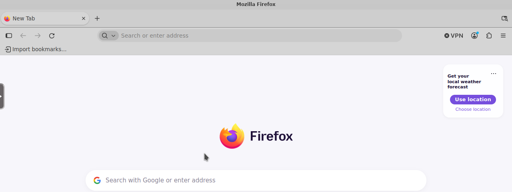
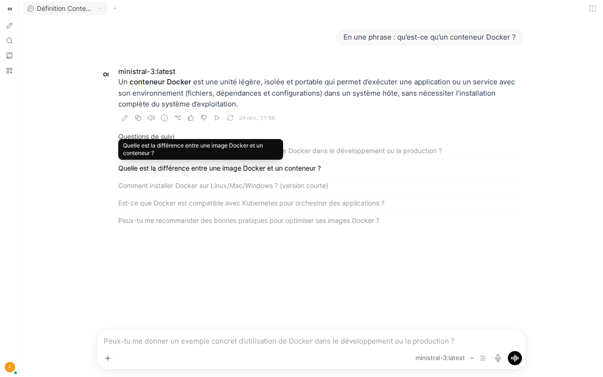

<!-- ============================================================ -->
<!-- ⚠️ RAPPEL IMPORTANT :                                          -->
<!-- Pensez TOUJOURS à ajouter une entrée dans le fichier d'index  -->
<!-- (index.md) du dossier correspondant (ex: docs/cloud/index.md) -->
<!-- afin de référencer ce nouvel article et permettre aux         -->
<!-- visiteurs de le trouver et de cliquer dessus !                -->
<!-- ============================================================ -->

# Des projets sympas à déployer

!!! abstract "Résumé"
    Place à la pratique libre. Cette partie propose un **catalogue** de projets auto-hébergeables, utiles ou amusants, à déployer avec tout ce qui a été appris : un **navigateur complet dans un conteneur** (Kasm), une **interface de discussion avec une IA locale** (Open WebUI), un **agent d'IA** (Hermes), une **supervision** de services (Uptime Kuma), **Windows** dans un conteneur, du **rétrogaming**, un générateur de **présentations**…

    Chaque projet indique ce qu'il demande (mémoire, disque, réglages particuliers) et la commande officielle pour démarrer. Deux d'entre eux sont détaillés pas à pas : Kasm et Open WebUI. Le défi : en publier un derrière Nginx Proxy Manager, en HTTPS.

| Propriété | Valeur |
|-----------|--------|
| Difficulté | Intermédiaire |
| Durée estimée | 2 h 30 |
| Version décrite | Open WebUI 0.13, image `kasmweb/firefox` 1.18, Hermes Agent 0.23, Uptime Kuma 2 |
| Place dans le parcours | Partie 13 sur 17 du parcours [Docker](index.md) — jour 4 |
| Dernière mise à jour | 2026-11-24 |

---

!!! info "Convention de lecture"
    🖥️ **PC hôte** · 🐧 **VM** `docker-hote`, connecté en `tssr` · 🌐 **navigateur du PC** · ✍️ **exercice**. Point de départ : l'instantané `05-exploitation`. Ces images sont **grosses** (souvent plusieurs Go) : vérifier la place disponible avec `df -h /` et `docker system df` avant de commencer, et supprimer chaque projet après l'avoir essayé.

<!-- NOTE DE RÉDACTION (non affichée) : projets demandés par le formateur (emulatorjs, Kasm Workspaces, dockurr, Open WebUI, Presenton, agent Hermes à la place de Moodle). Testés dans le lab le 2026-11-24 : Kasm (image kasmweb/firefox seule), Open WebUI 0.13.4 relié à l'Ollama du poste du formateur (modèle ministral-3, via un tunnel SSH, réponse obtenue), Hermes Agent v0.23.4 (image téléchargée et démarrée ; assistant de configuration non déroulé, il demande un fournisseur de modèle). Uptime Kuma déployé par Coolify en partie 11. Présentés d'après leur README, non lancés : dockur/windows (ISO Windows de plusieurs Go, 4 Go de RAM par défaut), Presenton, RomM. linuxserver/emulatorjs est archivé depuis juin 2025 : RomM, qui intègre EmulatorJS, le remplace. -->

## 1. Le catalogue

| Projet | À quoi ça sert | Image | Mémoire | Disque (image) |
|---|---|---|---|---|
| **Uptime Kuma** | Surveiller des sites et services, prévenir en cas de panne | `louislam/uptime-kuma:2` | quelques centaines de Mo | ~2,5 Go |
| **Kasm** (image seule) | Un navigateur, un bureau ou une application Linux complète, utilisés **depuis le navigateur web** | `kasmweb/firefox` | ~800 Mo | ~4,5 Go |
| **Open WebUI** | Discuter avec des modèles d'IA (locaux ou en ligne), comme sur ChatGPT | `ghcr.io/open-webui/open-webui:main` | ~1,2 Go (sans le modèle) | ~6,5 Go |
| **Hermes Agent** | Un agent d'IA (Nous Research) qui exécute des tâches, joignable par messagerie | `nousresearch/hermes-agent` | variable | ~4,7 Go |
| **Presenton** | Générer des présentations avec une IA | `ghcr.io/presenton/presenton` | variable | plusieurs Go |
| **Windows (dockur)** | Un vrai Windows dans un conteneur, utilisé depuis le navigateur | `dockurr/windows` | 4 Go par défaut | 64 Go de disque virtuel par défaut, ISO de plusieurs Go |
| **RomM** | Bibliothèque de jeux rétro, jouables dans le navigateur grâce à EmulatorJS | `rommapp/romm` (+ une base de données) | variable | variable |

!!! warning "Avant d'installer"
    - **La VM a 4 Go** : un seul projet gourmand à la fois. Arrêter Nextcloud et WordPress (`docker compose stop` dans leurs dossiers) pour libérer de la mémoire.
    - **Lire la documentation** du projet (lien en section 6) : variables, ports, volumes et prérequis changent d'une version à l'autre.
    - **Ne jamais exposer** ces services sur Internet sans authentification et sans HTTPS.

## 2. Pas à pas : Kasm, un navigateur dans un conteneur

**Kasm Workspaces** est une plateforme de bureaux virtuels ; ses **images** peuvent aussi s'utiliser seules : chacune contient un logiciel graphique (Firefox, Chrome, LibreOffice, un bureau Ubuntu…) et un serveur qui l'affiche dans le navigateur web. Pratique pour ouvrir un site douteux dans un navigateur **jetable**, ou donner accès à un outil sans rien installer sur les postes.

1. 🐧 Lancer l'image Firefox :

    ```bash
    docker run -d --name kasm-firefox --shm-size=512m -p 6901:6901 -e VNC_PW=TutoDocker2026! kasmweb/firefox:1.18.0-rolling-daily
    ```

    | Option | Rôle |
    |---|---|
    | `--shm-size=512m` | Agrandit la mémoire partagée du conteneur (64 Mo par défaut), dont Firefox a besoin pour ne pas planter |
    | `-p 6901:6901` | L'interface web, en HTTPS (certificat autosigné) |
    | `-e VNC_PW=…` | Le mot de passe de l'utilisateur `kasm_user` |

2. 🌐 Ouvrir `https://IP-de-la-VM:6901`, accepter l'alerte de certificat, puis se connecter avec `kasm_user` / `TutoDocker2026!`. Firefox s'affiche dans l'onglet : il tourne **dans le conteneur**, sur la VM.

    { loading=lazy }
    /// caption
    Un Firefox complet, qui tourne dans la VM et s'affiche dans le navigateur du PC.
    ///

3. 🐧 Mesurer ce qu'il consomme, puis le supprimer : tout ce qui a été fait dans ce navigateur disparaît avec lui.

    ```bash
    docker stats --no-stream --format '{{.Name}} {{.MemUsage}}' kasm-firefox
    docker rm -f kasm-firefox
    ```

    ```text
    kasm-firefox 814.9MiB / 3.83GiB
    ```

## 3. Pas à pas : Open WebUI et une IA locale

**Open WebUI** est une interface web, en français, pour discuter avec des **modèles de langage**. Ils peuvent tourner **en local** avec **Ollama**, un logiciel qui télécharge et exécute des modèles ouverts (Mistral, Gemma, Llama…), sans envoyer les conversations à un service en ligne.

### 3.1 Où faire tourner Ollama ?

Un modèle de langage demande beaucoup de mémoire et, idéalement, une carte graphique : la VM de 4 Go est trop petite. Le plus confortable est d'installer **Ollama sur le PC** (version Windows sur [ollama.com](https://ollama.com/download)) et de le relier à Open WebUI dans la VM.

1. 🖥️ Installer Ollama sur le PC, puis télécharger un petit modèle dans PowerShell, par exemple `ollama pull ministral-3` (plusieurs Go ; un modèle plus petit comme `gemma3:1b` suffit pour essayer).
2. 🖥️ Par défaut, Ollama n'écoute que le PC lui-même (`127.0.0.1:11434`). Pour que la VM puisse le joindre, définir la variable d'environnement **`OLLAMA_HOST=0.0.0.0`** pour l'utilisateur Windows (**Paramètres système avancés > Variables d'environnement**), puis redémarrer Ollama. Le pare-feu Windows demande alors d'autoriser Ollama : l'autoriser pour les **réseaux privés** seulement.
3. 🐧 Depuis la VM, vérifier que le PC répond (adresse du PC sur le réseau de la VM : `192.168.x.1` sous Workstation, `192.168.56.1` sous VirtualBox) :

    ```bash
    curl -s http://IP-du-PC:11434/api/tags | head -c 120; echo
    ```

    La réponse liste les modèles installés, en JSON.

!!! danger "Ollama n'a pas de mot de passe"
    Ouvert avec `OLLAMA_HOST=0.0.0.0`, Ollama accepte les requêtes de **toute** machine qui peut joindre le PC. À ne faire que sur un réseau de confiance (le réseau privé de l'hyperviseur), et à annuler après le TP.

### 3.2 Lancer Open WebUI

1. 🐧 Lancer Open WebUI, relié à l'Ollama du PC, sur le port 3000 :

    ```bash
    docker run -d --name open-webui -p 3000:8080 -e OLLAMA_BASE_URL=http://IP-du-PC:11434 -v open-webui:/app/backend/data ghcr.io/open-webui/open-webui:main
    ```

    L'image pèse environ 6,5 Go : le téléchargement prend plusieurs minutes. Le premier démarrage prépare la base de données ; attendre que la commande suivante réponde `{"status":true}` :

    ```bash
    curl -s http://localhost:3000/health
    ```

2. 🌐 Ouvrir `http://IP-de-la-VM:3000`, cliquer sur **Démarrer**, puis créer le **compte administrateur** (le premier compte créé l'est automatiquement) : nom `Administrateur`, e-mail `admin@lab.local`, mot de passe `TutoDocker2026!`, **Créer un compte administrateur**.
3. 🌐 En haut de la conversation, choisir le modèle (par exemple `ministral-3:latest`), et poser une question.

    { loading=lazy }
    /// caption
    Une IA locale : la question part de la VM vers le PC, et rien ne sort sur Internet.
    ///

!!! tip "Et pour aller plus loin"
    Open WebUI sait aussi se connecter à des services en ligne (avec une clé d'API), lire des documents pour y répondre (*RAG*), ou gérer plusieurs utilisateurs avec des droits. Publié derrière Nginx Proxy Manager en HTTPS, il devient un assistant d'IA privé pour une petite structure.

## 4. Les autres projets en bref

### 4.1 Uptime Kuma, la supervision simple

Déployé par Coolify en [partie 11](11-plateformes-tout-en-un.md#6-deployer-uptime-kuma-en-un-clic), il se lance aussi en une commande (commande officielle) :

```bash
docker run -d --restart=always -p 3001:3001 -v uptime-kuma:/app/data --name uptime-kuma louislam/uptime-kuma:2
```

Puis 🌐 `http://IP-de-la-VM:3001`. Idée : une sonde par service du parcours (NPM, Nextcloud, Portainer…), avec une notification par courriel.

### 4.2 Hermes Agent, un agent d'IA

**Hermes Agent**, de Nous Research, est un **agent** : au-delà de répondre, il exécute des tâches (commandes, recherches, fichiers), garde une mémoire, apprend des « compétences », et se pilote depuis un terminal ou une messagerie (Telegram, Discord…). Son image officielle range toutes ses données dans un dossier monté. La documentation propose de lancer d'abord l'**assistant de configuration**, qui demande un fournisseur de modèle (une clé d'API, ou un serveur compatible OpenAI comme Ollama) :

```bash
mkdir -p ~/.hermes
docker run -it --rm -v ~/.hermes:/opt/data nousresearch/hermes-agent setup
```

Puis de le faire tourner en arrière-plan (`gateway run`). L'image pèse environ 4,7 Go.

!!! danger "Un agent a des mains"
    Un agent d'IA **exécute** des actions. Dans un conteneur, il ne voit que ce qu'on lui monte : ne **jamais** lui donner le socket Docker, des dossiers sensibles ou des clés d'administration. C'est l'application directe de la partie 12 : le moins de droits possible.

### 4.3 Windows dans un conteneur (dockur)

Le projet **dockur/windows** télécharge l'installation officielle de Windows, l'installe automatiquement et l'affiche dans le navigateur (port 8006), ou par le Bureau à distance (port 3389). En réalité, le conteneur fait tourner une **machine virtuelle** QEMU/KVM : il a donc besoin du périphérique `/dev/kvm`, c'est-à-dire de la **virtualisation imbriquée** quand Docker tourne lui-même dans une VM (option **Virtualize Intel VT-x/EPT or AMD-V/RVI** de Workstation). Par défaut, Windows reçoit 2 cœurs et 4 Go de mémoire, et un disque virtuel de 64 Go : trop pour la VM `docker-hote`. Un exemple frappant de ce que permettent les conteneurs, et de leurs limites : ce n'est pas un « Windows en conteneur », mais une VM emballée dans un conteneur.

### 4.4 Presenton, des présentations générées par IA

**Presenton** génère des présentations (diapositives exportables) à partir d'un sujet ou d'un document, avec le modèle d'IA de son choix, dont Ollama (variable `LLM=ollama`). Commande de la documentation : `docker run -it --name presenton -p 5001:80 -v "./app_data:/app_data" ghcr.io/presenton/presenton:latest`, puis 🌐 `http://IP-de-la-VM:5001`.

### 4.5 Rétrogaming avec RomM

**RomM** organise une collection de jeux rétro (ceux qu'on possède) et permet d'y jouer **dans le navigateur** grâce à l'émulateur **EmulatorJS**. Il s'installe avec un fichier Compose (RomM + une base MariaDB), fourni dans sa documentation : un bon exercice de récapitulation des parties 5 à 10.

## 5. Défi : publier un projet en HTTPS

✍️ Choisir un projet de ce catalogue (Uptime Kuma, Open WebUI ou Kasm) et le publier en `https://<nom>.docker.test` derrière Nginx Proxy Manager, **sans aucun port publié**, avec un certificat autosigné qui couvre ce nom, une limite de mémoire, et une politique de redémarrage. Vérifier avec `docker ps` que seul `npm-app-1` publie des ports.

??? success "Corrigé (exemple avec Uptime Kuma)"
    1. 🐧 Réseau et conteneur, sans `-p` :

        ```bash
        docker network create kuma_net
        docker run -d --name uptime-kuma --restart unless-stopped --memory 512m --network kuma_net -v uptime-kuma:/app/data louislam/uptime-kuma:2
        ```

    2. 🐧 Brancher NPM sur ce réseau, de façon durable : ajouter `kuma_net` aux réseaux du service `app` et `kuma_net: external: true` en fin de `~/npm/docker-compose.yml` (partie 9), puis `cd ~/npm && docker compose up -d`.
    3. 🐧 Un certificat qui couvre `kuma.docker.test` (partie 10, avec `-addext "subjectAltName=DNS:kuma.docker.test"`), copié sur le PC et importé dans NPM.
    4. 🖥️ Ajouter `kuma.docker.test` au fichier `hosts` du PC.
    5. 🌐 Hôte proxy `kuma.docker.test` → `uptime-kuma`, port **`3001`** (le port **dans** le conteneur), **WebSockets** activé (Uptime Kuma s'en sert pour son tableau de bord en direct), certificat, **Forcer SSL**.
    6. 🌐 `https://kuma.docker.test` affiche l'assistant d'Uptime Kuma ; `docker ps --format '{{.Names}} {{.Ports}}'` montre `uptime-kuma 3001/tcp`, sans flèche.

## 6. Faire le ménage

🐧 Supprimer les projets essayés et leurs images, qui prennent beaucoup de place :

```bash
docker rm -f kasm-firefox open-webui uptime-kuma presenton 2>/dev/null
docker image rm kasmweb/firefox:1.18.0-rolling-daily ghcr.io/open-webui/open-webui:main nousresearch/hermes-agent louislam/uptime-kuma:2 2>/dev/null
docker system df
```

🖥️ Sur le PC, si Ollama a été ouvert au réseau : retirer la variable `OLLAMA_HOST` et redémarrer Ollama.

## 7. Vérifier son lab

!!! success "Vérifier son lab"
    🐧 Pendant que Kasm tourne :

    ```bash
    docker ps --format '{{.Names}}  {{.Ports}}' --filter name=kasm
    curl -sk -o /dev/null -w '%{http_code}\n' https://localhost:6901/
    ```

    Résultat attendu : `kasm-firefox  0.0.0.0:6901->6901/tcp, [::]:6901->6901/tcp`, puis `401` (le serveur répond et demande l'identifiant `kasm_user`, ce qui prouve qu'il fonctionne).

## 8. Questions de révision

1. Pourquoi Kasm a-t-il besoin de `--shm-size` ?
2. Pourquoi faire tourner Ollama sur le PC plutôt que dans la VM ? Quel risque prend-on avec `OLLAMA_HOST=0.0.0.0` ?
3. Comment Open WebUI trouve-t-il Ollama ?
4. Pourquoi dockur/windows a-t-il besoin de `/dev/kvm` ? Qu'est-ce que cela dit de ce qu'il fait réellement ?
5. Pourquoi ne faut-il jamais donner le socket Docker à un agent d'IA ?

??? success "Corrigé"
    1. Firefox utilise beaucoup de **mémoire partagée** (`/dev/shm`) ; les 64 Mo accordés par défaut à un conteneur ne suffisent pas et le navigateur plante.
    2. Un modèle de langage demande beaucoup de mémoire et profite d'une carte graphique : la VM de 4 Go est trop petite. Avec `OLLAMA_HOST=0.0.0.0`, Ollama, qui n'a pas d'authentification, accepte les requêtes de toute machine qui joint le PC : à réserver à un réseau de confiance, et à annuler après.
    3. Par la variable `OLLAMA_BASE_URL`, qui donne l'adresse et le port d'Ollama (`http://IP-du-PC:11434`).
    4. Il fait tourner une **machine virtuelle** (QEMU/KVM) à l'intérieur du conteneur, et la virtualisation matérielle passe par `/dev/kvm`. Ce n'est pas Windows « conteneurisé », mais une VM emballée dans un conteneur.
    5. Un agent **exécute** des actions : avec le socket Docker, il pourrait lancer n'importe quel conteneur, donc devenir `root` sur la machine (parties 1 et 12). Il ne doit voir que le strict nécessaire.

---

## Ressources

- [Uptime Kuma](https://github.com/louislam/uptime-kuma) — supervision simple et jolie.
- [Images Kasm Workspaces](https://github.com/kasmtech/workspaces-images) — Firefox, Chrome, bureaux Linux, applications.
- [Open WebUI — Démarrage rapide](https://docs.openwebui.com/getting-started/quick-start/) — installation avec Docker et Ollama (en anglais).
- [Ollama](https://ollama.com/) — exécuter des modèles de langage en local.
- [Hermes Agent — Installation Docker](https://github.com/NousResearch/hermes-agent) — l'agent de Nous Research.
- [dockur/windows](https://github.com/dockur/windows) — Windows dans un conteneur.
- [Presenton](https://github.com/presenton/presenton) — présentations générées par IA.
- [RomM](https://github.com/rommapp/romm) — bibliothèque de jeux rétro avec EmulatorJS.
- Partie précédente : [Exploiter Docker au quotidien](12-exploiter-docker-au-quotidien.md).

*[IA]: Intelligence artificielle
*[RAG]: Retrieval-Augmented Generation — réponses appuyées sur des documents
*[API]: Application Programming Interface — interface de programmation
*[VM]: Virtual Machine — machine virtuelle
