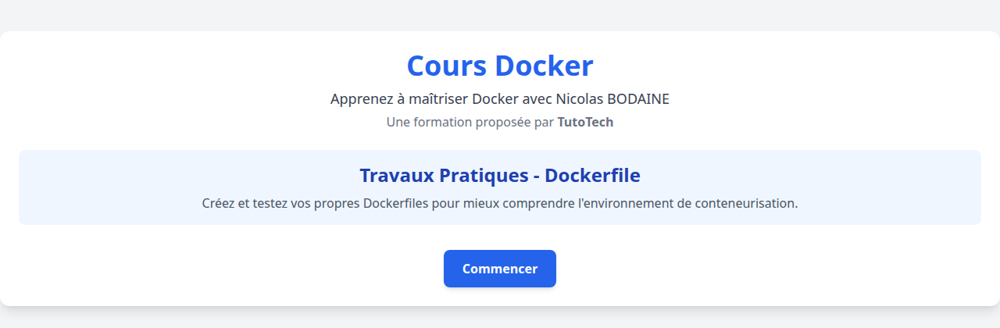
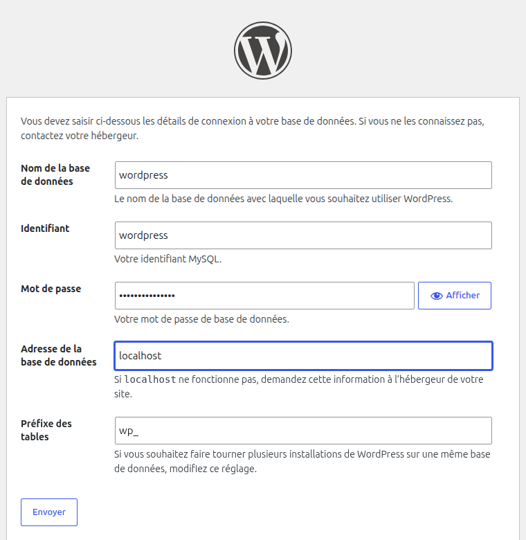
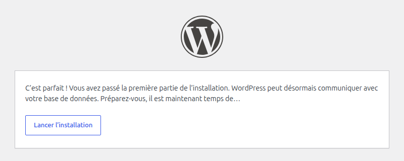

<!-- ============================================================ -->
<!-- ⚠️ RAPPEL IMPORTANT :                                          -->
<!-- Pensez TOUJOURS à ajouter une entrée dans le fichier d'index  -->
<!-- (index.md) du dossier correspondant (ex: docs/cloud/index.md) -->
<!-- afin de référencer ce nouvel article et permettre aux         -->
<!-- visiteurs de le trouver et de cliquer dessus !                -->
<!-- ============================================================ -->

# Construire ses images avec un Dockerfile

!!! abstract "Résumé"
    Jusqu'ici, toutes les images venaient de Docker Hub. On apprend maintenant à **fabriquer ses propres images** à partir d'un **Dockerfile**, un simple fichier texte qui décrit, ligne par ligne, comment construire l'image. Contrairement à `docker commit` (partie 6), la recette est lisible, reproductible et se range avec le reste du projet.

    Au programme : les instructions principales (`FROM`, `RUN`, `COPY`, `CMD`, `ENTRYPOINT`, `EXPOSE`…), la construction avec `docker build` et son **cache**, puis trois réalisations : un **site Apache** personnalisé, un **serveur SSH** dans une image Debian (à faire seul, corrigé replié), et une **pile LAMP avec WordPress** dans une seule image, avec ses limites.

| Propriété | Valeur |
|-----------|--------|
| Difficulté | Intermédiaire |
| Durée estimée | 2 h |
| Version décrite | Docker Engine 29.10 (BuildKit), images `httpd` 2.4.71, `debian:13` (13.7), WordPress 7.1 |
| Place dans le parcours | Partie 14 sur 17 du parcours [Docker](index.md) — jour 5 |
| Dernière mise à jour | 2026-11-24 |

---

!!! info "Convention de lecture"
    🖥️ **PC hôte** · 🐧 **VM** `docker-hote`, connecté en `tssr` · 🌐 **navigateur** du PC · ✍️ **exercice** · 🛟 **instantané**. Point de départ : l'instantané `05-exploitation` (fin de la partie 12), ou la VM telle qu'elle est à la fin de la partie 13.

<!-- NOTE DE RÉDACTION (non affichée) : partie construite à partir des supports du formateur 05 (TD Dockerfile), 06 (TP SSH), 07 (correction du TP) et 09 (pile LAMP + WordPress). Tout a été exécuté le 2026-11-24 sur docker-hote (Debian 13.7, Docker 29.10.0), sorties dans captures/14-*.txt du lab. Écarts corrigés : EXPOSE présenté comme documentaire (le TD disait « il faut toujours exposer les ports aussi avec -p », ce qui laissait croire que EXPOSE ouvrait le port) ; -p 80:80 remplacé par -p 8080:80 (port 80 pris par NPM depuis la partie 9 : erreur « port is already allocated » mesurée) ; « RUN : Démarrer le service SSH » du corrigé remplacé par CMD ; `RUN mkdir /var/run/sshd` fait ÉCHOUER la construction sur debian:13 (« File exists », le paquet openssh-server 1:10.0p1-7+deb13u4 crée déjà /run/sshd) → `mkdir -p /run/sshd` ; debian:latest → debian:13 ; mot de passe du corrigé remplacé par celui du lab ; dans le 09, `service mysql start` répond « mysql: unrecognized service » sur Debian 13 (service `mariadb`) et la base n'est pas créée, alors que l'assistant WordPress s'affiche quand même → corrigé, et IF NOT EXISTS ajouté (sinon erreurs à chaque redémarrage) ; LABEL maintainer (adresse e-mail) retiré ; chemin /home/<formateur>/docker/lamp-wordpress remplacé par ~/lamp-wordpress. -->

## 1. Pourquoi écrire un Dockerfile ?

En partie 6, on a créé une image avec `docker commit` : on installe des logiciels à la main dans un conteneur, puis on le fige. Ça marche, mais l'image obtenue est une **boîte noire** : `docker history` affiche une couche de 28 Mo sans dire ce qu'elle contient, et personne ne peut la refaire à l'identique.

Un **Dockerfile** règle ce problème. C'est une **recette de cuisine** : la liste des ingrédients (l'image de départ, les fichiers à copier) et des étapes (les commandes à exécuter). Docker lit la recette et prépare le plat, l'**image**, toujours de la même façon. On peut relire la recette, la corriger, la versionner avec Git, et la donner à un collègue qui obtiendra la même image.

{ loading=lazy }
/// caption
Du Dockerfile au conteneur : `build`, puis `run`. La distribution par un registre (`push`, `pull`) fait l'objet de la partie 15.
///

Le **contexte de construction** est le dossier qu'on donne à `docker build` (souvent `.`, le dossier courant) : Docker n'a accès **qu'aux fichiers de ce dossier**. Un `COPY` ne peut pas aller chercher un fichier ailleurs sur la VM.

## 2. Les instructions principales

Un Dockerfile contient une instruction par ligne, en majuscules par convention, suivie de ses arguments. Elles s'exécutent **de haut en bas**.

| Instruction | Rôle | Exemple |
|---|---|---|
| `FROM` | Choisit l'**image de base**, le point de départ | `FROM debian:13` |
| `ARG` | Déclare une variable **utilisée seulement pendant la construction** ; modifiable avec `--build-arg` | `ARG APP_VERSION=1.0` |
| `ENV` | Définit une **variable d'environnement**, présente pendant la construction **et** dans les conteneurs | `ENV APP_ENV=production` |
| `WORKDIR` | Change le **dossier de travail** des instructions suivantes (et du conteneur) ; le crée s'il n'existe pas | `WORKDIR /app` |
| `RUN` | **Exécute une commande** pendant la construction, et enregistre le résultat dans une nouvelle **couche** | `RUN apt-get update && apt-get install -y curl` |
| `COPY` | **Copie** des fichiers du contexte dans l'image | `COPY index.html /usr/local/apache2/htdocs/` |
| `ADD` | Comme `COPY`, mais sait aussi décompresser une archive locale ou télécharger une URL ; on lui préfère `COPY` quand on n'a pas besoin de ces fonctions | `ADD site.tar.gz /var/www/` |
| `USER` | Change l'**utilisateur** des instructions suivantes et du conteneur (au lieu de `root`) | `USER appli` |
| `CMD` | La **commande lancée au démarrage** du conteneur, ou les **arguments par défaut** de l'`ENTRYPOINT` ; remplacée par ce qu'on tape après le nom de l'image dans `docker run` | `CMD ["apachectl", "-D", "FOREGROUND"]` |
| `ENTRYPOINT` | Le **programme principal** du conteneur ; ce qu'on tape après le nom de l'image devient ses arguments | `ENTRYPOINT ["/init.sh"]` |
| `EXPOSE` | **Documente** le port sur lequel l'application écoute. N'ouvre et ne publie **rien** | `EXPOSE 80` |
| `VOLUME` | Déclare un dossier dont les données doivent vivre **hors du conteneur** : Docker y crée un volume anonyme si on n'en monte pas un | `VOLUME /var/lib/mysql` |
| `LABEL` | Ajoute des **étiquettes** descriptives (version, description) | `LABEL version="1.0"` |
| `HEALTHCHECK` | Commande qui teste la **santé** du conteneur, comme en partie 8 | `HEALTHCHECK CMD wget -q --spider http://127.0.0.1/` |

Quelques précisions utiles :

- **`FROM` vient en premier.** Seule exception : un `ARG` peut le précéder pour choisir la version de l'image de base (`ARG VERSION=13` puis `FROM debian:$VERSION`). Un Dockerfile peut contenir plusieurs `FROM` (construction en plusieurs étapes, citée en section 6).
- **Chaque `RUN`, `COPY` ou `ADD` crée une couche.** On regroupe donc les commandes liées dans un seul `RUN` avec `&&`, et on y supprime les fichiers temporaires : un fichier supprimé dans un `RUN` **suivant** reste stocké dans la couche précédente.
- **Forme « exec » ou forme « shell ».** `CMD ["/usr/sbin/sshd", "-D"]` (entre crochets, avec des guillemets doubles) lance le programme directement : il devient le processus n°1 du conteneur et reçoit le signal d'arrêt de `docker stop`. `CMD /usr/sbin/sshd -D` passe par `/bin/sh -c`. En forme exec, aucun shell ne cherche le programme dans le `PATH` : on donne son **chemin complet** (`sshd` lui-même refuse d'ailleurs de démarrer sans : `sshd requires execution with an absolute path`). On préfère la forme exec pour `CMD` et `ENTRYPOINT`.
- **Un conteneur vit tant que son processus principal tourne** (partie 2). La commande de démarrage doit donc rester **au premier plan** : `apachectl -D FOREGROUND`, `sshd -D`, `nginx -g 'daemon off;'`. Un service lancé « en arrière-plan » rend la main, le processus principal se termine, et le conteneur s'arrête aussitôt.

!!! warning "`EXPOSE` ne publie aucun port"
    `EXPOSE 80` est une **étiquette** qui indique « cette application écoute sur le port 80 ». C'est utile à la lecture et à certains outils, mais le port reste **fermé** depuis l'extérieur tant qu'on ne le publie pas avec `-p` au lancement (ou `-P`, qui publie tous les ports déclarés sur des ports pris au hasard). À l'inverse, une image **sans** `EXPOSE` se publie très bien avec `-p`. La section 3.4 le vérifie.

### 2.1 Essayer CMD, ENTRYPOINT, ARG et ENV

Ces instructions se comprennent mieux en les essayant. 🐧 Créer un dossier d'essai et ce Dockerfile :

```bash
mkdir -p ~/essais && cd ~/essais
nano Dockerfile
```

```dockerfile
FROM alpine:3.24
ARG VERSION_APP=1.0
ENV APP_ENV=production
RUN echo "construit en version $VERSION_APP" > /version.txt
RUN adduser -D appli
WORKDIR /home/appli
USER appli
ENTRYPOINT ["echo", "Bonjour"]
CMD ["tout le monde"]
```

🐧 Construire l'image en changeant la valeur de l'`ARG`, puis lancer trois conteneurs :

```bash
docker build -q -t essai --build-arg VERSION_APP=2.0 .
docker run --rm essai
docker run --rm essai "les admins"
docker run --rm --entrypoint sh essai -c 'cat /version.txt; echo "APP_ENV=$APP_ENV VERSION_APP=$VERSION_APP"; id; pwd'
```

```text
sha256:a27dfd65273b8ad28952f4887a7ebf6dca091126b62d03bd9f43865bd4a8f596
Bonjour tout le monde
Bonjour les admins
construit en version 2.0
APP_ENV=production VERSION_APP=
uid=1000(appli) gid=1000(appli) groups=1000(appli)
/home/appli
```

Ce qu'on observe :

- `ENTRYPOINT` + `CMD` : le conteneur lance `echo Bonjour tout le monde`. Ce qu'on tape après le nom de l'image (`"les admins"`) **remplace le `CMD`**, pas l'`ENTRYPOINT`. Pour changer l'`ENTRYPOINT`, il faut l'option `--entrypoint`.
- `ARG` a servi pendant la construction (`version 2.0` dans le fichier), mais **n'existe plus** dans le conteneur (`VERSION_APP=` vide). `ENV`, lui, est toujours là.
- `USER` et `WORKDIR` : le conteneur tourne avec l'utilisateur `appli` (uid 1000), pas `root`, dans `/home/appli`.

🐧 Supprimer l'image d'essai : `docker image rm essai`.

## 3. TP guidé : un serveur Apache construit avec un Dockerfile

Objectif : une image `web` qui contient le serveur Apache **et** une page d'accueil personnalisée.

### 3.1 Préparer le dossier du projet

1. 🐧 Créer un dossier `apache` et s'y placer :

    ```bash
    mkdir ~/apache && cd ~/apache
    ```

2. 🐧 Créer la page d'accueil :

    ```bash
    nano index.html
    ```

    Coller ce contenu, puis enregistrer avec ++ctrl+x++, ++o++ (ou ++y++ selon la langue de `nano`) et ++enter++ :

    ```html
    <!DOCTYPE html>
    <html lang="fr">
    <head>
    <meta charset="UTF-8">
    <meta name="viewport" content="width=device-width, initial-scale=1.0">
    <title>Cours Docker - TutoTech</title>
    <script src="https://cdn.tailwindcss.com"></script>
    </head>
    <body class="bg-gray-100">
    <div class="container mx-auto my-10 p-6 bg-white shadow-lg rounded-xl text-center">
    <h1 class="text-4xl font-bold text-blue-600">Cours Docker</h1>
    <p class="mt-2 text-gray-700 text-lg">Apprenez à maîtriser Docker avec Nicolas BODAINE</p>
    <p class="mt-1 text-gray-500">Une formation proposée par <span class="font-semibold">TutoTech</span></p>
    <div class="mt-6 p-4 bg-blue-50 rounded-lg">
    <h2 class="text-2xl font-semibold text-blue-800">Travaux Pratiques - Dockerfile</h2>
    <p class="mt-2 text-gray-600">Créez et testez vos propres Dockerfiles pour mieux comprendre l'environnement de conteneurisation.</p>
    </div>
    <div class="mt-8">
    <button class="px-6 py-3 bg-blue-600 text-white font-semibold rounded-lg shadow-md hover:bg-blue-700">Commencer</button>
    </div>
    </div>
    </body>
    </html>
    ```

    La mise en forme vient de **Tailwind CSS**, chargé depuis Internet par le navigateur (ligne `<script src=…>`) : sans accès à Internet sur le PC, la page s'affiche sans couleurs, mais elle s'affiche.

3. 🐧 Créer le Dockerfile, **dans le même dossier** :

    ```bash
    nano Dockerfile
    ```

    ```dockerfile
    FROM httpd:latest
    COPY index.html /usr/local/apache2/htdocs/
    EXPOSE 80
    ```

    | Ligne | Rôle |
    |---|---|
    | `FROM httpd:latest` | Part de l'image officielle d'Apache (`httpd`), déjà croisée en partie 3. `latest` simplifie ce premier essai ; la section 6 explique pourquoi, pour un vrai service, on fige la version (`httpd:2.4`) |
    | `COPY index.html /usr/local/apache2/htdocs/` | Copie la page dans le dossier que cette image publie (sa racine web) |
    | `EXPOSE 80` | Documente le port d'Apache. L'image `httpd` le déclare déjà : la ligne est redondante, mais elle rend le fichier lisible seul |

    Le fichier s'appelle exactement `Dockerfile`, avec un **D majuscule** et **sans extension**.

### 3.2 Construire l'image

🐧 Lancer la construction :

```bash
docker build -t web .
```

| Élément | Rôle |
|---|---|
| `docker build` | Construit une image à partir d'un Dockerfile |
| `-t web` | Donne le nom (*tag*) `web` à l'image ; sans étiquette après `:`, c'est `web:latest` |
| `.` | Le **contexte** : le dossier courant, où se trouvent le Dockerfile et `index.html`. Ne pas l'oublier |

```text
[+] Building 1.1s (7/7) FINISHED                                 docker:default
 => [internal] load build definition from Dockerfile                       0.0s
 => => transferring dockerfile: 108B                                       0.0s
 => [internal] load metadata for docker.io/library/httpd:latest            0.1s
 => [internal] load .dockerignore                                          0.0s
 => => transferring context: 2B                                            0.0s
 => [internal] load build context                                          0.0s
 => => transferring context: 1.09kB                                        0.0s
 => CACHED [1/2] FROM docker.io/library/httpd:latest@sha256:32e9403360ab2  0.1s
 => => resolve docker.io/library/httpd:latest@sha256:32e9403360ab2f104752  0.0s
 => [2/2] COPY index.html /usr/local/apache2/htdocs/                       0.1s
 => exporting to image                                                     0.5s
 …
 => => naming to docker.io/library/web:latest                              0.0s
```

Le moteur de construction, **BuildKit**, affiche une ligne par étape : `[1/2] FROM`, puis `[2/2] COPY`. Cette sortie a été obtenue avec l'image `httpd` déjà présente sur la VM (`CACHED` sur la ligne `FROM`) : si elle manque, Docker la télécharge d'abord, et la construction prend environ 5 secondes au lieu d'une.

🐧 Regarder l'image et ses couches :

```bash
docker image ls web
docker history web
```

```text
IMAGE        ID             DISK USAGE   CONTENT SIZE   EXTRA
web:latest   efe2f0c5ed33        175MB         45.4MB

IMAGE          CREATED        CREATED BY                                      SIZE      COMMENT
efe2f0c5ed33   1 second ago   EXPOSE 80/tcp                                   0B        buildkit.dockerfile.v0
<missing>      1 second ago   COPY index.html /usr/local/apache2/htdocs/ #…   24.6kB    buildkit.dockerfile.v0
<missing>      12 days ago    CMD ["httpd-foreground"]                        0B        buildkit.dockerfile.v0
<missing>      12 days ago    EXPOSE map[80/tcp:{}]                           0B        buildkit.dockerfile.v0
…
<missing>      2 weeks ago    # debian.sh --arch 'amd64' out/ 'trixie' '@1…   87.7MB    debuerreotype 0.17
```

Cette fois, `docker history` raconte **toute l'histoire** : nos deux lignes en haut, puis celles du Dockerfile de l'image `httpd`, jusqu'à la Debian 13 « trixie » de départ. On voit aussi que notre image n'a **pas de `CMD`** à elle : elle hérite de celui de `httpd` (`httpd-foreground`).

### 3.3 Démarrer le conteneur

1. 🐧 Essayer de publier le port 80, comme on le ferait sur une VM neuve :

    ```bash
    docker run -d --name apache -p 80:80 web
    ```

    ```text
    docker: Error response from daemon: failed to set up container networking: driver failed programming external connectivity on endpoint apache (c96aec89…): Bind for 0.0.0.0:80 failed: port is already allocated
    ```

    Le port 80 de la VM est **déjà pris** par Nginx Proxy Manager depuis la partie 9. Le conteneur a été créé mais pas démarré (état `Created`) : le supprimer, puis le relancer sur le port 8080 :

    ```bash
    docker rm apache
    docker run -d --name apache -p 8080:80 web
    ```

    | Option | Rôle |
    |---|---|
    | `-d` | Lance le conteneur en arrière-plan |
    | `--name apache` | Nom du conteneur |
    | `-p 8080:80` | Publie le port 8080 de la VM vers le port 80 du conteneur |
    | `web` | Nom de l'image construite à l'étape précédente |

2. 🌐 Ouvrir `http://IP-de-la-VM:8080` :

    { loading=lazy }
    /// caption
    La page copiée dans l'image par le Dockerfile, servie par Apache
    ///

!!! tip "Publier sur le port 80 quand même ?"
    Pour que le site réponde sans `:8080`, deux solutions : arrêter le conteneur qui tient déjà le port 80 (ce n'est pas le but ici), ou mieux, ajouter un **hôte de proxy** dans Nginx Proxy Manager vers `IP-de-la-VM:8080`, comme en partie 9.

### 3.4 Vérifier que `EXPOSE` ne publie rien

🐧 Lancer deux autres conteneurs de la même image : l'un **sans** `-p`, l'autre avec `-P` (P majuscule) :

```bash
docker run -d --name apache-sans-p web
docker run -d --name apache-P -P web
docker ps --filter name=apache --format '{{.Names}} | {{.Ports}}'
```

```text
apache-P | 0.0.0.0:32768->80/tcp, [::]:32768->80/tcp
apache-sans-p | 80/tcp
apache | 0.0.0.0:8080->80/tcp, [::]:8080->80/tcp
```

- `apache-sans-p` affiche seulement `80/tcp` : le port est **déclaré**, mais **aucun** port de la VM ne mène à lui. Depuis le PC, impossible de le joindre.
- `apache-P` : `-P` a publié le port déclaré par `EXPOSE` sur un port **pris au hasard** (`32768`). C'est le seul effet concret d'`EXPOSE`.

🐧 Supprimer les deux conteneurs d'essai : `docker rm -f apache-sans-p apache-P`.

### 3.5 Le cache de construction

🐧 Modifier la page, puis reconstruire :

```bash
echo '<!-- modif -->' >> index.html
time docker build -t web .
```

La construction ne prend qu'une seconde et demie environ : Docker **réutilise** les couches dont rien n'a changé (`CACHED`) et ne refait que l'étape `COPY`, dont le fichier source a changé, **et toutes celles qui suivent**.

!!! tip "Ordonner un Dockerfile pour profiter du cache"
    On place en haut ce qui change rarement (installation des paquets) et en bas ce qui change souvent (copie du code ou du site). Si le `COPY` du site était avant un long `apt-get install`, chaque modification de la page relancerait toute l'installation.

🐧 Le conteneur `apache` tourne toujours avec l'**ancienne** image : une image reconstruite ne met pas à jour les conteneurs existants. Pour en profiter, il faut **recréer** le conteneur (comme une mise à jour, partie 12) :

```bash
docker rm -f apache
docker run -d --name apache -p 8080:80 web
```

## 4. TP : un serveur SSH dans une image Debian ✍️

En partie 3, on a installé SSH **à la main** dans un conteneur Debian, et on a vu que tout était perdu, ou à relancer, au redémarrage. On fait maintenant la même chose **proprement**, avec un Dockerfile.

**Mission :** écrire un Dockerfile qui construit une image `debian-ssh` à partir de `debian:13`, avec :

- le serveur SSH installé (paquet `openssh-server`) ;
- un utilisateur **`user`** (avec un dossier personnel et le shell `/bin/bash`), mot de passe `TutoDocker2026!` ;
- le port 22 documenté ;
- le serveur SSH lancé automatiquement, au premier plan, à chaque démarrage du conteneur.

Puis : construire l'image, démarrer un conteneur `debian-ssh-container` qui publie le port **54321** de la VM vers le port 22, et s'y connecter en SSH avec l'utilisateur `user`.

**Ce qu'il faut obtenir :**

- l'image se construit **sans erreur** ;
- le conteneur reste démarré (`Up` dans `docker ps`) ;
- la connexion `ssh user@localhost -p 54321` depuis la VM aboutit, avec `user` (et pas `root`) ;
- on sait expliquer chaque ligne du Dockerfile et chaque option de `docker run`.

!!! tip "Indices"
    - Le programme du serveur SSH est `/usr/sbin/sshd` ; l'option `-D` le garde au premier plan.
    - `useradd -ms /bin/bash user` crée l'utilisateur ; `chpasswd` lit des lignes `utilisateur:motdepasse` sur son entrée.
    - `sshd` a besoin du dossier `/run/sshd` pour démarrer.

??? success "Corrigé"
    **Le Dockerfile.** 🐧 Dans un dossier `~/debian-ssh` :

    ```dockerfile
    # Utiliser Debian 13 comme image de base
    FROM debian:13
    # Mettre à jour la liste des paquets et installer le serveur SSH
    RUN apt-get update && \
        apt-get install -y openssh-server && \
        rm -rf /var/lib/apt/lists/*
    # Créer le répertoire nécessaire au serveur SSH
    RUN mkdir -p /run/sshd
    # Créer un utilisateur nommé « user » avec un mot de passe
    RUN useradd -ms /bin/bash user && \
        echo 'user:TutoDocker2026!' | chpasswd
    # Documenter le port du serveur SSH
    EXPOSE 22
    # Démarrer le serveur SSH au premier plan à chaque lancement du conteneur
    CMD ["/usr/sbin/sshd", "-D"]
    ```

    | Ligne | Explication |
    |---|---|
    | `FROM debian:13` | Image officielle Debian 13. Une version précise (`13`) plutôt que `latest` : l'image ne change pas de version majeure dans le dos de l'administrateur (partie 12) |
    | `apt-get update` | Met à jour la liste des paquets disponibles (l'image de base n'en contient aucune). `apt-get` plutôt qu'`apt`, prévu pour un humain, qui affiche un avertissement dans les scripts |
    | `apt-get install -y openssh-server` | Installe le serveur SSH ; `-y` répond « oui » à la confirmation, car personne n'est là pour taper pendant la construction |
    | `rm -rf /var/lib/apt/lists/*` | Supprime la liste des paquets, inutile une fois l'installation faite, **dans le même `RUN`** (section 2) |
    | `mkdir -p /run/sshd` | `sshd` range des fichiers de travail dans `/run/sshd` et refuse de démarrer si ce dossier manque. Sur Debian 13, le paquet le crée déjà : `-p` évite l'erreur « File exists » si le dossier existe, et le crée sur les systèmes où il manque |
    | `useradd -ms /bin/bash user` | Crée l'utilisateur `user` : `-m` crée son dossier personnel `/home/user`, `-s /bin/bash` choisit son shell |
    | `echo 'user:TutoDocker2026!' | chpasswd` | `chpasswd` reçoit `utilisateur:motdepasse` et définit le mot de passe. Les guillemets **simples** empêchent le shell d'interpréter le `!` |
    | `EXPOSE 22` | Documente le port de SSH. **N'ouvre rien** : la publication se fait avec `-p` au lancement |
    | `CMD ["/usr/sbin/sshd", "-D"]` | **Commande de démarrage** du conteneur (ce n'est pas un `RUN`, qui s'exécuterait une seule fois, pendant la construction). `-D` (*don't detach*) garde `sshd` au premier plan : il devient le processus principal et le conteneur reste en vie |

    **Construire l'image.** 🐧

    ```bash
    cd ~/debian-ssh
    docker build -t debian-ssh .
    docker image ls debian-ssh
    ```

    ```text
    IMAGE               ID             DISK USAGE   CONTENT SIZE   EXTRA
    debian-ssh:latest   bed81129faab        263MB           69MB
    ```

    La première construction dure une vingtaine de secondes (téléchargement et installation des paquets). Avec `apt` au lieu d'`apt-get`, la construction afficherait `WARNING: apt does not have a stable CLI interface`, sans gravité, et l'image garderait la liste des paquets (301 Mo au lieu de 263 Mo).

    **Démarrer le conteneur.** 🐧

    ```bash
    docker run -d -p 54321:22 --name debian-ssh-container debian-ssh
    docker ps --filter name=debian-ssh --format '{{.Names}} | {{.Status}} | {{.Ports}}'
    docker exec debian-ssh-container ps -ef
    ```

    ```text
    debian-ssh-container | Up 2 seconds | 0.0.0.0:54321->22/tcp, [::]:54321->22/tcp
    UID          PID    PPID  C STIME TTY          TIME CMD
    root           1       0  2 11:27 ?        00:00:00 sshd: /usr/sbin/sshd -D [listener] 0 of 10-100 startups
    root           7       0 57 11:27 ?        00:00:00 ps -ef
    ```

    `sshd` est bien le **processus n°1**. Comparer avec la partie 3, où le PID 1 était `bash` et où `sshd` disparaissait au redémarrage : ici, `docker restart` relance `sshd` automatiquement.

    | Option | Explication |
    |---|---|
    | `-d` | Lance le conteneur en arrière-plan |
    | `-p 54321:22` | Le port 54321 de la VM mène au port 22 (SSH) du conteneur. Le port 22 de la VM reste celui du SSH **de la VM** |
    | `--name debian-ssh-container` | Nom du conteneur |
    | `debian-ssh` | L'image construite |

    **Se connecter.** 🐧 Depuis la VM (ou 🖥️ depuis le PC avec `ssh user@IP-de-la-VM -p 54321`) :

    ```bash
    ssh user@localhost -p 54321
    ```

    Répondre `yes` à la question sur l'empreinte du serveur (première connexion), puis taper le mot de passe `TutoDocker2026!`. Dans la session :

    ```bash
    whoami; hostname; cat /etc/debian_version; id
    ```

    ```text
    user
    c5b81c450779
    13.7
    uid=1000(user) gid=1000(user) groups=1000(user)
    ```

    Le nom d'hôte est l'**identifiant du conteneur**. Taper `exit` pour revenir à la VM.

    | Élément | Explication |
    |---|---|
    | `user` | L'utilisateur créé dans le Dockerfile |
    | `localhost` | La VM elle-même, qui fait tourner Docker |
    | `-p 54321` | Le port publié de la VM, qui renvoie vers le port 22 du conteneur |

!!! danger "Un mot de passe dans un Dockerfile reste lisible dans l'image"
    🐧 Essayer :

    ```bash
    docker history --no-trunc debian-ssh --format '{{.CreatedBy}}' | grep chpasswd
    ```

    ```text
    RUN /bin/sh -c useradd -ms /bin/bash user &&     echo 'user:TutoDocker2026!' | chpasswd # buildkit
    ```

    Toute personne qui récupère l'image lit le mot de passe. Même chose pour un fichier copié dans l'image : le script `init.sh` de la section 5 contient le mot de passe de la base, lisible par `docker run --rm --entrypoint cat lamp-wordpress /init.sh`. Pour un lab, c'est acceptable ; pour une image partagée (partie 15), jamais. En production, les secrets se passent **au lancement** (variables d'environnement, fichiers montés, *secrets* Docker), pas dans l'image. Et, comme en partie 3, un serveur SSH dans un conteneur reste une exception : pour administrer un conteneur, `docker exec` suffit.

## 5. TP guidé : une pile LAMP avec WordPress dans une seule image

Une pile **LAMP**, c'est **L**inux, **A**pache, **M**ariaDB (ou MySQL) et **P**HP : la base de très nombreux sites web, dont WordPress. Ce TP met **les quatre** dans une seule image, avec un petit script de démarrage. C'est un bon exercice pour comprendre `ENTRYPOINT` et un script d'initialisation ; la section 5.5 explique pourquoi on ne fait pas ainsi en production.

### 5.1 Le Dockerfile

1. 🐧 Créer le dossier du projet :

    ```bash
    mkdir ~/lamp-wordpress && cd ~/lamp-wordpress
    nano Dockerfile
    ```

2. Coller ce contenu :

    ```dockerfile
    # Image de base : Debian 13
    FROM debian:13
    # Métadonnées décrivant l'image
    LABEL version="1.0" \
          description="Dockerfile pédagogique pour déployer un serveur LAMP avec WordPress"
    # Fuseau horaire
    ENV TZ=Europe/Paris
    RUN ln -snf /usr/share/zoneinfo/$TZ /etc/localtime && echo $TZ > /etc/timezone
    # Apache, MariaDB, PHP, wget et nano, puis nettoyage du cache des paquets
    RUN apt-get update && apt-get install -y \
        apache2 \
        mariadb-server \
        php \
        php-mysql \
        libapache2-mod-php \
        wget \
        nano && \
        apt-get clean && rm -rf /var/lib/apt/lists/*
    # WordPress en français
    RUN wget https://fr.wordpress.org/latest-fr_FR.tar.gz && \
        tar -xzf latest-fr_FR.tar.gz && \
        rm -rf /var/www/html/* && \
        cp -r wordpress/* /var/www/html && \
        chown -R www-data:www-data /var/www/html && \
        rm -rf wordpress latest-fr_FR.tar.gz
    # Script de démarrage
    COPY init.sh /init.sh
    RUN chmod +x /init.sh
    EXPOSE 80
    ENTRYPOINT ["/init.sh"]
    ```

    | Ligne | Explication |
    |---|---|
    | `LABEL …` | Étiquettes descriptives, visibles avec `docker inspect` |
    | `ENV TZ=…` puis `RUN ln -snf …` | Règle le fuseau horaire du conteneur sur Paris (lien `/etc/localtime`) |
    | `RUN apt-get update && apt-get install -y …` | Installe Apache, MariaDB, PHP et son module pour Apache, `wget` et `nano`, **en une seule couche** |
    | `apt-get clean && rm -rf /var/lib/apt/lists/*` | Supprime le cache des paquets **dans le même `RUN`**, pour qu'il ne pèse pas dans l'image |
    | `RUN wget … && tar … && …` | Télécharge la dernière version française de WordPress, la décompresse dans `/var/www/html`, donne les fichiers à `www-data` (l'utilisateur d'Apache), puis supprime l'archive |
    | `COPY init.sh /init.sh` et `RUN chmod +x` | Copie le script de démarrage et le rend exécutable |
    | `ENTRYPOINT ["/init.sh"]` | Le conteneur exécute `init.sh` à chaque démarrage |

### 5.2 Le script `init.sh`

Le script doit démarrer MariaDB, créer la base et l'utilisateur de WordPress, puis lancer Apache **au premier plan**.

1. 🐧 Dans le même dossier :

    ```bash
    nano init.sh
    ```

    ```bash
    #!/bin/bash
    # Démarre MariaDB (sur Debian 13, le service s'appelle « mariadb »)
    service mariadb start
    # Crée la base et l'utilisateur de WordPress (IF NOT EXISTS : pas d'erreur au redémarrage du conteneur)
    mysql -e "CREATE DATABASE IF NOT EXISTS wordpress DEFAULT CHARACTER SET utf8mb4 COLLATE utf8mb4_unicode_ci;"
    mysql -e "CREATE USER IF NOT EXISTS 'wordpress'@'localhost' IDENTIFIED BY 'TutoDocker2026!';"
    mysql -e "GRANT ALL PRIVILEGES ON wordpress.* TO 'wordpress'@'localhost';"
    mysql -e "FLUSH PRIVILEGES;"
    # Démarre Apache au premier plan : c'est lui qui garde le conteneur en vie
    apachectl -D FOREGROUND
    ```

    | Commande | Explication |
    |---|---|
    | `service mariadb start` | Démarre le serveur de bases de données. Il n'y a pas de `systemd` dans un conteneur : on passe par le script de service |
    | `CREATE DATABASE IF NOT EXISTS wordpress …` | Crée la base `wordpress`, en `utf8mb4` (tous les caractères, émojis compris) |
    | `CREATE USER IF NOT EXISTS 'wordpress'@'localhost' …` | Crée l'utilisateur `wordpress`, qui ne peut se connecter que depuis le conteneur lui-même |
    | `GRANT ALL PRIVILEGES …` puis `FLUSH PRIVILEGES` | Lui donne tous les droits sur sa base, et applique |
    | `apachectl -D FOREGROUND` | Lance Apache **au premier plan** : tant qu'Apache tourne, le conteneur vit |

    `IF NOT EXISTS` compte : le script s'exécute à **chaque** démarrage du conteneur. Sans lui, le deuxième démarrage afficherait des erreurs « la base existe déjà ».

2. 🐧 Rendre le script exécutable :

    ```bash
    chmod +x init.sh
    ```

!!! warning "Sur Debian 13, le service s'appelle `mariadb`, pas `mysql`"
    Avec `service mysql start`, le conteneur démarre quand même, mais ses journaux montrent l'échec :

    ```text
    grep: /etc/init.d/mysql: No such file or directory
    mysql: unrecognized service
    ERROR 2002 (HY000): Can't connect to local server through socket '/run/mysqld/mysqld.sock' (2)
    ```

    Le piège : Apache démarre, et l'assistant de WordPress **s'affiche normalement**. L'erreur n'apparaît qu'à l'étape de connexion à la base. D'où le réflexe : `docker logs` après chaque premier démarrage.

### 5.3 Construire et démarrer

1. 🐧 Construire l'image :

    ```bash
    docker build -t lamp-wordpress .
    docker image ls lamp-wordpress
    ```

    ```text
    IMAGE                   ID             DISK USAGE   CONTENT SIZE   EXTRA
    lamp-wordpress:latest   ba6f11143aa8        949MB          185MB
    ```

    Compter environ **2 minutes** (téléchargement de plus de 100 paquets et de WordPress). L'image contient PHP 8.4, MariaDB 11.8, Apache 2.4 et WordPress 7.1.

2. 🐧 Démarrer le conteneur et lire ses journaux :

    ```bash
    docker run -d -p 65432:80 --name wordpress-lamp lamp-wordpress
    sleep 6
    docker logs wordpress-lamp
    ```

    ```text
    Starting MariaDB database server: mariadbd ..
    AH00558: apache2: Could not reliably determine the server's fully qualified domain name, using 172.17.0.3. Set the 'ServerName' directive globally to suppress this message
    ```

    MariaDB a démarré ; le message `AH00558` d'Apache est sans gravité (déjà vu en partie 3).

3. 🐧 Vérifier la base et les processus :

    ```bash
    docker exec wordpress-lamp mysql -e "SHOW DATABASES;"
    docker exec wordpress-lamp ps -eo pid,user,comm
    ```

    La liste des bases contient `wordpress`. Le processus n°1 est `init.sh`, avec `mariadbd` et plusieurs `apache2` en dessous.

### 5.4 Installer WordPress

1. 🌐 Ouvrir `http://IP-de-la-VM:65432`. L'assistant de WordPress s'ouvre en français. Cliquer sur **C'est parti !**.

2. 🌐 Saisir les informations de la base :

    | Champ | Valeur |
    |---|---|
    | Nom de la base de données | `wordpress` |
    | Identifiant | `wordpress` |
    | Mot de passe | `TutoDocker2026!` |
    | Adresse de la base de données | `localhost` (la base est **dans le même conteneur**) |
    | Préfixe des tables | `wp_` (ne pas changer) |

    { loading=lazy }
    /// caption
    Les détails de connexion à la base MariaDB du conteneur
    ///

3. 🌐 Cliquer sur **Envoyer** :

    { loading=lazy }
    /// caption
    WordPress joint bien la base créée par `init.sh`
    ///

4. 🌐 Cliquer sur **Lancer l'installation**, puis remplir **Titre du site** (au choix), **Identifiant** `admin`, **Mot de passe** `TutoDocker2026!` (WordPress le juge « Forte ») et **Votre e-mail** avec une adresse fictive (`admin@lab.local`). Cliquer sur **Installer WordPress** : le message « Quel succès ! » confirme l'installation.

### 5.5 Pourquoi on ne fait pas ainsi en production

🐧 Essayer : supprimer le conteneur et en recréer un, à partir de la même image :

```bash
docker rm -f wordpress-lamp
docker run -d -p 65432:80 --name wordpress-lamp lamp-wordpress
sleep 6
curl -s -o /dev/null -w 'code=%{http_code} -> %{redirect_url}\n' http://localhost:65432/
```

```text
code=302 -> http://localhost:65432/wp-admin/setup-config.php
```

Retour à l'assistant d'installation : le site, sa configuration (`wp-config.php`) et la base étaient dans la **couche du conteneur**, supprimée avec lui (partie 5). Un simple `docker restart` les aurait gardés, mais la moindre mise à jour de l'image (qui impose de recréer le conteneur) les perd.

Les autres défauts de cette image « tout-en-un » :

- **Un seul processus principal** : si MariaDB s'arrête, Docker ne le voit pas (il ne surveille qu'`init.sh` et Apache), et rien ne le relance.
- **Mise à jour** : changer de version de PHP oblige à reconstruire et recréer **toute** la pile, base comprise.
- **Pas de passage à l'échelle** : impossible de lancer trois serveurs web devant une seule base.

La bonne pratique, déjà appliquée en partie 10 : **un service par conteneur** (WordPress d'un côté, MariaDB de l'autre), des **volumes** pour les données, et un fichier **Compose** pour décrire l'ensemble. Ce TP reste utile pour comprendre ce qui se passe **dans** une image comme `wordpress:latest`.

🐧 Faire le ménage : `docker rm -f wordpress-lamp debian-ssh-container apache`. Garder les images `web` et `debian-ssh` : elles servent en partie 15.

## 6. Les bonnes pratiques d'un Dockerfile

| Pratique | Pourquoi |
|---|---|
| Partir d'une image **officielle** et **figer sa version** (`debian:13`, `nginx:1.31-alpine`) | Image suivie et corrigée ; pas de changement de version majeure surprise |
| Préférer une image de base **légère** (`-alpine`, `-slim`) quand elle suffit | Moins de place, moins de failles à corriger (partie 12, Trivy) |
| **Regrouper** les commandes liées dans un seul `RUN`, et nettoyer dans ce même `RUN` | Moins de couches, image plus petite |
| Mettre en haut ce qui change rarement, en bas ce qui change souvent | Le cache accélère les reconstructions |
| Un fichier **`.dockerignore`** dans le dossier du projet | Exclut du contexte les fichiers inutiles ou sensibles (`.git`, sauvegardes, `.env`), comme un `.gitignore` |
| **Aucun secret** dans l'image (mot de passe, clé, jeton) | `docker history` les révèle à quiconque récupère l'image |
| Un utilisateur **non root** (`USER`) quand l'application le permet | Limite les dégâts en cas de faille (partie 12) |
| **Une application par conteneur**, qui reste au premier plan | Docker surveille et relance le bon processus |
| `HEALTHCHECK` pour les services | Docker, Compose et Swarm savent si le service répond vraiment |

!!! info "Pour aller plus loin : la construction en plusieurs étapes"
    Un Dockerfile peut contenir plusieurs `FROM` : une première étape compile une application avec tous les outils nécessaires, une seconde ne récupère que le résultat (`COPY --from=…`) dans une image légère. C'est le *multi-stage build*, très utilisé par les développeurs ; la documentation de Docker le présente en détail (voir Ressources).

## 7. Vérifier son lab

!!! success "Vérifier son lab"
    🐧 Après la section 5 :

    ```bash
    docker image ls --format '{{.Repository}}:{{.Tag}} {{.Size}}' | grep -E '^(web|debian-ssh|lamp-wordpress):'
    docker run --rm debian-ssh sh -c 'id user; ls -ld /run/sshd'
    docker inspect web --format '{{json .Config.ExposedPorts}}'
    ```

    Résultat attendu (l'ordre des images et la date du dossier peuvent varier) :

    ```text
    debian-ssh:latest 263MB
    web:latest 175MB
    lamp-wordpress:latest 949MB
    uid=1000(user) gid=1000(user) groups=1000(user)
    drwxr-xr-x 2 root root 4096 Nov 24 12:52 /run/sshd
    {"80/tcp":{}}
    ```

    La dernière ligne est le port **déclaré** par `EXPOSE`.

## 8. Questions de révision

1. Quelle différence entre une image créée avec `docker commit` et une image construite avec un Dockerfile ?
2. Un conteneur lancé avec `docker run -d monimage` s'arrête aussitôt, alors que la construction s'est bien passée. Quelle est la cause la plus probable ?
3. `EXPOSE 80` est dans le Dockerfile, mais le site est injoignable depuis le PC. Pourquoi ?
4. Différence entre `RUN`, `CMD` et `ENTRYPOINT` ?
5. Pourquoi écrire `apt-get update && apt-get install -y … && rm -rf /var/lib/apt/lists/*` dans **un seul** `RUN` ?
6. Pourquoi ne faut-il pas écrire un mot de passe réel dans un Dockerfile ?

??? success "Corrigé"
    1. `docker commit` fige un conteneur modifié à la main : on ne sait pas ce qu'il contient ni comment le refaire. Le Dockerfile est une **recette** lisible, versionnable et reproductible : la même image se reconstruit à l'identique, et `docker history` montre chaque étape.
    2. Le **processus principal** se termine : la commande de démarrage (`CMD` ou `ENTRYPOINT`) lance un service en arrière-plan puis rend la main, ou finit tout de suite. Il faut une commande qui reste **au premier plan** (`sshd -D`, `apachectl -D FOREGROUND`). `docker logs` aide à trouver la cause.
    3. `EXPOSE` ne fait que **documenter** le port. Il faut le **publier** au lancement : `-p 8080:80` (ou `-P`).
    4. `RUN` s'exécute **pendant la construction** et laisse son résultat dans une couche. `CMD` et `ENTRYPOINT` s'exécutent **au démarrage de chaque conteneur** : `ENTRYPOINT` est le programme principal, `CMD` sa commande ou ses arguments par défaut, remplaçables en fin de `docker run`.
    5. Chaque `RUN` crée une couche. Un fichier supprimé dans un `RUN` suivant reste stocké dans la couche précédente : l'image ne maigrit pas. Dans un seul `RUN`, le cache des paquets n'est jamais enregistré. Et `update` + `install` ensemble évitent d'installer à partir d'une liste de paquets ancienne restée en cache.
    6. Le texte du Dockerfile est enregistré dans l'image : `docker history --no-trunc` l'affiche à toute personne qui récupère l'image, par exemple depuis un registre. Les secrets se fournissent au lancement.

---

## Ressources

- [Référence du Dockerfile](https://docs.docker.com/reference/dockerfile/) — toutes les instructions et leurs options (en anglais).
- [Bonnes pratiques de construction](https://docs.docker.com/build/building/best-practices/) — les conseils officiels de Docker.
- [Construction en plusieurs étapes](https://docs.docker.com/build/building/multi-stage/) — le *multi-stage build*.
- [Image officielle `httpd`](https://hub.docker.com/_/httpd) — l'image Apache utilisée en section 3.
- Partie précédente : [Des projets sympas à déployer](13-projets-sympas.md) · Partie suivante : [Distribuer ses images : Docker Hub et registre privé](15-distribuer-ses-images-registre.md).

*[LAMP]: Linux, Apache, MariaDB (ou MySQL), PHP
*[PID]: Process Identifier — numéro d'un processus
*[SSH]: Secure Shell — protocole d'administration à distance chiffré
*[BuildKit]: moteur de construction d'images de Docker
*[HTML]: HyperText Markup Language — langage des pages web
*[CSS]: Cascading Style Sheets — mise en forme des pages web
*[PHP]: langage de programmation des sites web dynamiques
*[VM]: Virtual Machine — machine virtuelle
