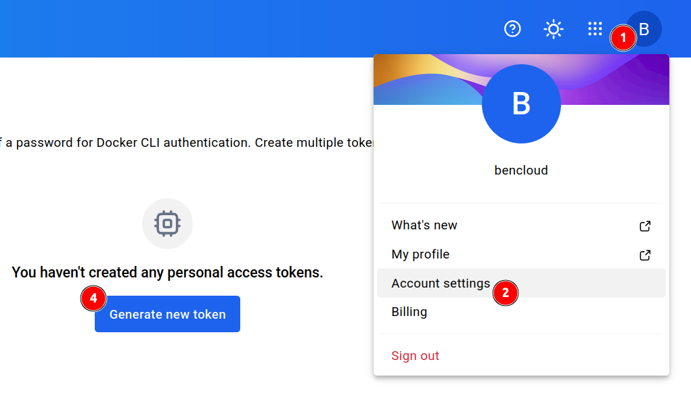
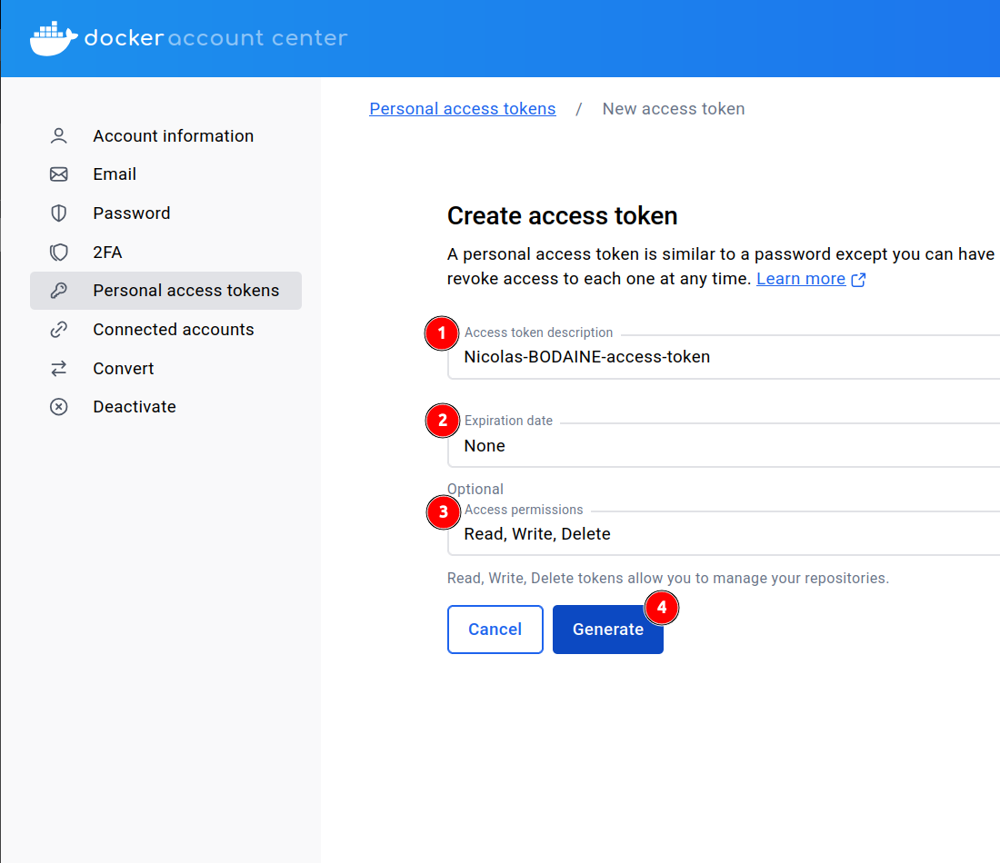
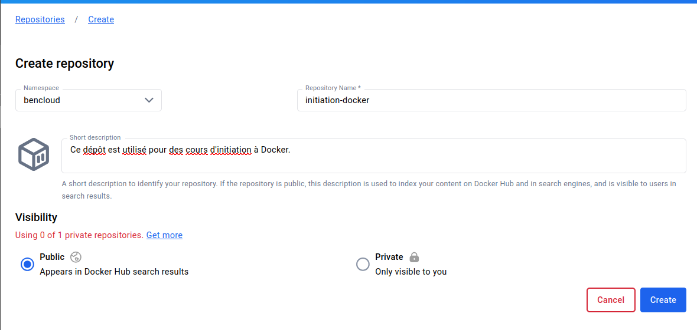
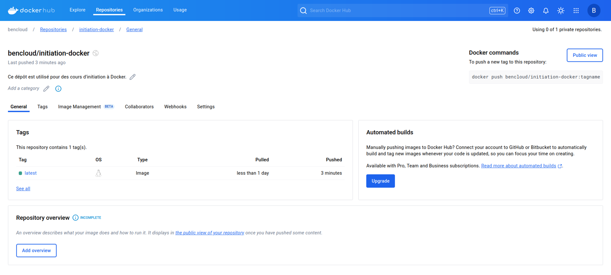

<!-- ============================================================ -->
<!-- ⚠️ RAPPEL IMPORTANT :                                          -->
<!-- Pensez TOUJOURS à ajouter une entrée dans le fichier d'index  -->
<!-- (index.md) du dossier correspondant (ex: docs/cloud/index.md) -->
<!-- afin de référencer ce nouvel article et permettre aux         -->
<!-- visiteurs de le trouver et de cliquer dessus !                -->
<!-- ============================================================ -->

# Distribuer ses images : Docker Hub et registre privé

!!! abstract "Résumé"
    Une image construite sur une VM ne sert qu'à cette VM. Pour la donner à un collègue, la déployer sur un autre serveur ou sur tout un cluster, on la range dans un **registre** : un serveur qui stocke des images et les distribue avec `docker push` et `docker pull`.

    Cette partie explique comment se lit le nom complet d'une image, comment **publier sur Docker Hub** avec un **jeton d'accès** (et non son mot de passe), puis monte un **registre privé** dans le lab, utilisé ensuite par le cluster Swarm de la partie 16. On y découvre aussi pourquoi Docker refuse un registre sans HTTPS, et comment l'autoriser sans rien casser.

| Propriété | Valeur |
|-----------|--------|
| Difficulté | Intermédiaire |
| Durée estimée | 1 h 30 |
| Version décrite | Docker Engine 29.10, image `registry:3` (Distribution 3.1), Docker Hub (novembre 2026) |
| Place dans le parcours | Partie 15 sur 17 du parcours [Docker](index.md) — jour 5 |
| Dernière mise à jour | 2026-11-24 |

---

!!! info "Convention de lecture"
    🖥️ **PC hôte** · 🐧 **VM** `docker-hote`, connecté en `tssr` · 🌐 **navigateur** du PC · ✍️ **exercice** · 🛟 **instantané**. Point de départ : la fin de la partie 14 (images `web` et `debian-ssh` construites).

<!-- NOTE DE RÉDACTION (non affichée) : partie construite à partir du TD 08 du formateur (publier sur Docker Hub). La création d'un compte Docker Hub n'a pas été faite dans le lab (compte personnel requis) : la section 2 suit le TD 08, ses captures (mars 2025) et la documentation Docker lue le 2026-11-24 (jetons : avatar > Account settings > Personal access tokens > Generate new token ; permissions « Read-only », « Read & Write », « Read, Write, Delete » ; dépôts : My Hub > Repositories > Create repository ; 1 dépôt privé sur un compte Personal ; limites 100 pulls / 6 h sans compte, 200 avec un compte Personal). Comportements de la CLI mesurés dans le lab : connexion web par code à usage unique quand on tape `docker login` sans -u, invite « Password: » avec -u, avertissement « credentials are stored unencrypted ». Le registre privé (sections 3 et 4) est entièrement mesuré (captures/15-*.txt). Fait découvert : déclarer `insecure-registries` remplace la liste par défaut 127.0.0.0/8 et ::1/128 (InsecureRegistryCIDRs devient null) et casse localhost:5000 ; corrigé en ajoutant les deux plages. Le TD 08 utilisait l'ID de l'image dans `docker tag` : gardé en variante, le nom est plus lisible. -->

## 1. Registre, dépôt, étiquette : bien lire le nom d'une image

Un **registre** (*registry*) est un serveur qui stocke des images. **Docker Hub** est le registre public de Docker, celui qu'on utilise depuis le début sans le savoir. D'autres existent : GitHub Container Registry (`ghcr.io`, croisé en partie 13 avec Open WebUI), le registre de GitLab, Quay, Harbor pour héberger le sien…

Le nom complet d'une image se lit comme une **adresse postale** :

```text
registre / espace / dépôt : étiquette
docker.io/library/nginx:latest
ghcr.io/open-webui/open-webui:main
192.168.8.71:5000/web:1.0
```

| Partie | Rôle | Si on l'omet |
|---|---|---|
| **registre** | Le serveur qui stocke l'image (nom ou IP, et port) | `docker.io` (Docker Hub) |
| **espace** (*namespace*) | Le compte ou l'organisation propriétaire | `library`, l'espace des **images officielles** du Hub |
| **dépôt** (*repository*) | Le nom de l'application ; un dépôt rassemble toutes les versions d'une image | obligatoire |
| **étiquette** (*tag*) | La version | `latest` |

Ainsi, `docker pull nginx` télécharge en réalité `docker.io/library/nginx:latest`. Et pour **envoyer** une image quelque part, il faut d'abord lui donner un nom qui contient la bonne adresse : c'est le rôle de `docker tag`.

!!! info "Les limites de téléchargement de Docker Hub"
    Docker Hub limite les téléchargements : **100 par période de 6 heures** sans compte (par adresse IP publique), **200** avec un compte personnel gratuit connecté par `docker login`. Dans une salle où tous les PC sortent par la même adresse IP, la limite anonyme peut être atteinte : se connecter, ou installer un registre local qui garde une copie des images, règle le problème.

## 2. Publier une image sur Docker Hub

Publier sur Docker Hub demande un **compte personnel**, gratuit, à créer sur [hub.docker.com](https://hub.docker.com/) (bouton **Sign up**, adresse e-mail à confirmer). Cette section décrit la démarche complète ; sans compte, on peut passer directement au registre privé de la section 3, qui suit exactement les mêmes gestes.

Dans les commandes, `<identifiant>` est le nom du compte Docker Hub (en minuscules).

### 2.1 Créer un jeton d'accès personnel

Pour la ligne de commande, on n'utilise **pas son mot de passe**, mais un **jeton d'accès personnel** (*Personal Access Token*). C'est un mot de passe **dédié à un usage**, qu'on peut limiter (lecture seule, par exemple), faire expirer, et révoquer sans toucher au vrai mot de passe.

1. 🌐 Se connecter à Docker Hub, cliquer sur l'**avatar** en haut à droite, puis **Account settings** (paramètres du compte).

2. 🌐 Dans le menu de gauche, cliquer sur **Personal access tokens** (jetons d'accès personnels), puis **Generate new token** (générer un jeton) :

    { loading=lazy }
    /// caption
    Avatar > **Account settings**, puis **Personal access tokens** > **Generate new token** (interface de 2025 : l'emplacement des menus peut avoir changé)
    ///

3. 🌐 Remplir le formulaire :

    | Champ | Valeur conseillée |
    |---|---|
    | **Access token description** (description) | Un nom qui dit à quoi sert le jeton, par exemple `vm-docker-hote` |
    | **Expiration date** (date d'expiration) | **30 days** (30 jours) pour un TP ; `None` (jamais) est possible mais déconseillé |
    | **Access permissions** (droits) | **Read & Write** (lecture et écriture) : suffisant pour pousser une image. **Read, Write, Delete** ajoute la suppression, inutile ici |

    { loading=lazy }
    /// caption
    Le formulaire de création du jeton (ici avec les droits les plus larges et sans expiration : pour un TP, préférer **Read & Write** et 30 jours)
    ///

4. 🌐 Cliquer sur **Generate**, puis **copier le jeton** (il commence par `dckr_pat_`). Il ne sera **plus jamais affiché** : le ranger dans un gestionnaire de mots de passe. Un jeton perdu se révoque et se recrée.

### 2.2 Créer un dépôt

1. 🌐 Dans Docker Hub, menu **My Hub** > **Repositories** (dépôts), puis **Create repository** (créer un dépôt).

2. 🌐 Remplir :

    - **Namespace** : son identifiant ;
    - **Repository Name** : `initiation-docker` (minuscules, chiffres, `-` et `_` seulement ; **impossible à renommer** ensuite) ;
    - **Short description** : une phrase, facultative ;
    - **Visibility** : **Public** (tout le monde peut télécharger l'image) ou **Private** (soi seul). Un compte personnel gratuit a droit à **un** dépôt privé.

    { loading=lazy }
    /// caption
    Création du dépôt `initiation-docker` (interface de 2025) : le compteur « Using 0 of 1 private repositories » rappelle le dépôt privé unique d'un compte gratuit
    ///

3. 🌐 Cliquer sur **Create**. La page du dépôt rappelle la commande à utiliser : `docker push <identifiant>/initiation-docker:tagname`.

!!! tip "Le dépôt peut aussi se créer tout seul"
    Pousser une image vers `<identifiant>/un-nom` crée le dépôt automatiquement s'il n'existe pas, avec la visibilité par défaut du compte. Le créer à l'avance permet de choisir sa visibilité et sa description.

### 2.3 Se connecter depuis la VM

🐧 Se connecter en donnant son identifiant :

```bash
docker login -u <identifiant>
```

À l'invite `Password:`, **coller le jeton** (rien ne s'affiche pendant la saisie, c'est normal), puis ++enter++. Docker répond `Login Succeeded`, précédé d'un avertissement :

```text
WARNING! Your credentials are stored unencrypted in '/home/tssr/.docker/config.json'.
Configure a credential helper to remove this warning. See
https://docs.docker.com/go/credential-store/

Login Succeeded
```

Sur une Debian sans bureau, aucun coffre de mots de passe n'est installé : le jeton est rangé dans `~/.docker/config.json`, simplement **encodé** en base64 (ce n'est pas un chiffrement), lisible seulement par `tssr` (droits `600`). C'est une raison de plus d'utiliser un jeton limité et qui expire. `docker logout` l'efface.

!!! info "Et `docker login` sans `-u` ?"
    Sans identifiant, Docker propose une **connexion par le navigateur** :

    ```text
    i Info → Using web-based login. To sign in with credentials on the command line, use 'docker login -u <username>'

    Your one-time device confirmation code is: XXXX-XXXX
    Open this URL to authenticate: https://login.docker.com/activate?user_code=XXXX-XXXX
    ```

    On ouvre l'adresse sur le PC, on se connecte, on confirme le code, et la VM est connectée. Pratique sur un poste de travail ; sur un serveur ou dans un script, on préfère `-u` et un jeton.

### 2.4 Étiqueter et pousser une image construite avec un Dockerfile

1. 🐧 Lister les images locales :

    ```bash
    docker image ls
    ```

2. 🐧 Donner à l'image `web` (partie 14) un **second nom**, qui contient l'adresse du dépôt :

    ```bash
    docker tag web <identifiant>/initiation-docker:1.0
    ```

    Format : `docker tag <image source> <identifiant>/<dépôt>:<étiquette>`. L'image source peut être désignée par son **nom** (`web`) ou par son **ID** (la colonne `ID` de `docker image ls`). `docker tag` ne copie rien : les deux noms désignent la **même** image (même ID).

3. 🐧 Envoyer l'image :

    ```bash
    docker push <identifiant>/initiation-docker:1.0
    ```

    Docker envoie les **couches** une par une (`Pushed`), puis affiche l'empreinte de l'image (`digest: sha256:…`). Une couche que le registre possède déjà n'est pas renvoyée (`Layer already exists`) : les couches de `httpd` partagées par plusieurs images ne voyagent qu'une fois.

4. 🌐 Ouvrir le dépôt sur Docker Hub : l'étiquette `1.0` apparaît dans la section **Tags** de l'onglet **General** (et dans l'onglet **Tags**), avec sa date d'envoi.

    { loading=lazy }
    /// caption
    L'image publiée apparaît dans les étiquettes du dépôt (ici une image poussée avec l'étiquette `latest`)
    ///

5. 🐧 N'importe quelle machine peut maintenant la récupérer (après `docker login` si le dépôt est privé) :

    ```bash
    docker pull <identifiant>/initiation-docker:1.0
    ```

### 2.5 Publier un conteneur modifié avec `docker commit`

On peut aussi publier une image créée à partir d'un conteneur existant (partie 6) : `docker commit` lui donne directement le nom complet. `<conteneur>` est le nom (ou l'ID) d'un conteneur, visible avec `docker ps -a`.

```bash
docker commit <conteneur> <identifiant>/initiation-docker:commit
docker push <identifiant>/initiation-docker:commit
```

Ça fonctionne, mais l'image reste une **boîte noire** (partie 6) : pour une image destinée à d'autres, le Dockerfile est préférable.

!!! danger "Une image publique est publique pour tout le monde"
    Avant de pousser une image dans un dépôt public, vérifier qu'elle ne contient **aucun secret** : mot de passe dans un `RUN` (visible avec `docker history`, partie 14), fichier `.env`, clé SSH copiée par erreur… N'importe qui peut télécharger l'image et en lire toutes les couches.

## 3. TP : un registre privé dans le lab

Un **registre privé** garde les images **chez soi** : pas de compte, pas de limite de téléchargement, des images internes qui ne sortent pas de l'entreprise. Docker fournit le logiciel de registre lui-même… sous forme d'image : `registry`.

### 3.1 Démarrer le registre

1. 🐧 Lancer le registre, avec un volume pour ses données :

    ```bash
    docker run -d -p 5000:5000 --restart always --name registre \
      -v registre-data:/var/lib/registry registry:3
    ```

    | Option | Rôle |
    |---|---|
    | `-p 5000:5000` | Le registre écoute sur le port **5000** |
    | `--restart always` | Il redémarre avec Docker, comme un service |
    | `-v registre-data:/var/lib/registry` | Les images stockées vivent dans un **volume** : elles survivent à la suppression du conteneur |
    | `registry:3` | L'image officielle du registre (projet *Distribution*), en version 3 |

2. 🐧 Vérifier qu'il répond. Le registre parle **HTTP** et expose une petite interface de programmation (API) :

    ```bash
    docker ps --filter name=registre --format '{{.Names}} | {{.Image}} | {{.Status}} | {{.Ports}}'
    curl -s http://localhost:5000/v2/_catalog
    ```

    ```text
    registre | registry:3 | Up 2 seconds | 0.0.0.0:5000->5000/tcp, [::]:5000->5000/tcp
    {"repositories":[]}
    ```

    `_catalog` liste les dépôts : vide pour l'instant.

### 3.2 Pousser une image

1. 🐧 Donner à l'image `web` un nom qui contient l'adresse du registre, puis la pousser :

    ```bash
    docker tag web localhost:5000/web:1.0
    docker push localhost:5000/web:1.0
    ```

    ```text
    The push refers to repository [localhost:5000/web]
    5095e9eeb5b3: Pushed
    88628174925b: Pushed
    …
    f66a634827fc: Pushed
    1.0: digest: sha256:cc2545ccdc357a4d98d07ae4d8dd736072f332e8563560b57d56a6c9b48ccf7f size: 856
    ```

2. 🐧 Pousser aussi l'image SSH, puis interroger le registre :

    ```bash
    docker tag debian-ssh localhost:5000/debian-ssh:1.0
    docker push localhost:5000/debian-ssh:1.0
    curl -s http://localhost:5000/v2/_catalog
    curl -s http://localhost:5000/v2/web/tags/list
    ```

    ```text
    {"repositories":["debian-ssh","web"]}
    {"name":"web","tags":["1.0"]}
    ```

3. 🐧 Preuve que l'image vient bien du registre : supprimer le nom local, puis la retélécharger :

    ```bash
    docker image rm localhost:5000/web:1.0
    docker pull localhost:5000/web:1.0
    ```

    ```text
    Untagged: localhost:5000/web:1.0
    1.0: Pulling from web
    Digest: sha256:cc2545ccdc357a4d98d07ae4d8dd736072f332e8563560b57d56a6c9b48ccf7f
    Status: Downloaded newer image for localhost:5000/web:1.0
    localhost:5000/web:1.0
    ```

    `Untagged` (et pas `Deleted`) : seul le nom a été retiré, car l'image porte encore son autre nom, `web:latest`.

🐧 Les images stockées sont dans le volume, rangées par dépôt et par couche (`sudo du -sh /var/lib/docker/volumes/registre-data/_data` : environ 126 Mo pour les deux images).

## 4. Utiliser le registre depuis une autre machine

`localhost:5000` ne vaut que **sur la VM elle-même**. Depuis une autre machine (et en partie 16, depuis les autres nœuds du cluster), il faut utiliser l'**adresse IP** de la VM.

### 4.1 Le refus du HTTP

🐧 Simuler une autre machine en utilisant l'adresse IP de la VM :

```bash
docker pull IP-de-la-VM:5000/web:1.0
```

```text
Error response from daemon: failed to resolve reference "192.168.8.71:5000/web:1.0": failed to do request: Head "https://192.168.8.71:5000/v2/web/manifests/1.0": http: server gave HTTP response to HTTPS client
```

Docker parle **HTTPS** à tout registre, sauf aux adresses locales (`127.0.0.0/8` et `::1`, c'est-à-dire `localhost`). Notre registre ne parle que HTTP : Docker refuse, pour ne pas envoyer ni recevoir d'images en clair sur le réseau sans qu'on l'ait décidé.

### 4.2 Autoriser ce registre, et seulement lui

Pour un lab, on autorise ce registre précis en HTTP avec l'option **`insecure-registries`** de `/etc/docker/daemon.json`, le fichier déjà créé en partie 12 pour les journaux.

1. 🐧 Ouvrir le fichier :

    ```bash
    sudo nano /etc/docker/daemon.json
    ```

2. Ajouter la clé `insecure-registries` **sans effacer** le réglage des journaux : attention à la **virgule** après l'accolade fermante de `log-opts`, et à remplacer `IP-de-la-VM` par sa vraie adresse :

    ```json
    {
      "log-driver": "json-file",
      "log-opts": {
        "max-size": "10m",
        "max-file": "3"
      },
      "insecure-registries": ["IP-de-la-VM:5000", "127.0.0.0/8", "::1/128"]
    }
    ```

    !!! warning "Ne pas oublier `127.0.0.0/8` et `::1/128`"
        Dès qu'on déclare `insecure-registries`, la liste **remplace** la règle par défaut qui autorisait `localhost`. Avec seulement `"IP-de-la-VM:5000"`, c'est `localhost:5000` qui se met à échouer, avec la même erreur `server gave HTTP response to HTTPS client`. Les deux plages locales remettent la règle par défaut.

3. 🐧 Vérifier la syntaxe, puis redémarrer Docker :

    ```bash
    sudo dockerd --validate --config-file /etc/docker/daemon.json
    sudo systemctl restart docker
    ```

    ```text
    configuration OK
    ```

    Rappel de la partie 12 : redémarrer Docker **arrête et relance tous les conteneurs**. Ceux qui ont une politique de redémarrage (`always`, `unless-stopped`) repartent seuls ; les autres restent arrêtés.

4. 🐧 Vérifier la prise en compte, puis retenter :

    ```bash
    docker info | grep -A3 "Insecure Registries"
    docker pull IP-de-la-VM:5000/web:1.0
    docker pull localhost:5000/web:1.0
    ```

    ```text
     Insecure Registries:
      192.168.8.71:5000
      127.0.0.0/8
      ::1/128
    1.0: Pulling from web
    Digest: sha256:cc2545ccdc357a4d98d07ae4d8dd736072f332e8563560b57d56a6c9b48ccf7f
    Status: Downloaded newer image for 192.168.8.71:5000/web:1.0
    192.168.8.71:5000/web:1.0
    …
    localhost:5000/web:1.0
    ```

    Les deux adresses fonctionnent. Chaque machine qui utilisera ce registre aura besoin du même réglage (ce sera le cas des nœuds Swarm en partie 16).

!!! danger "Un registre en HTTP, sans authentification, c'est pour le lab"
    Ce registre accepte les images de **n'importe qui** sur le réseau, et les transmet en clair. En production :

    - **HTTPS** obligatoire, avec un certificat (Let's Encrypt, ou l'autorité interne de l'entreprise) ; le registre peut aussi se placer derrière un reverse proxy comme NPM (partie 9) ;
    - une **authentification** : le registre sait vérifier un fichier de mots de passe (`htpasswd`), mais **seulement en HTTPS**, pour ne pas faire circuler les mots de passe en clair ;
    - pour une équipe, un registre complet comme **Harbor** ajoute une interface web, des droits par projet et l'analyse des failles des images (comme Trivy, partie 12).

## 5. Bien choisir ses étiquettes

| Pratique | Pourquoi |
|---|---|
| Une étiquette **par version** (`1.0`, `1.1`, `2.0`) | On sait ce qui tourne, et on peut revenir à la version précédente |
| Ne pas compter sur `latest` | `latest` n'est qu'une étiquette comme une autre, posée par défaut : elle ne garantit pas la version la plus récente, et elle change de contenu dans le dos des serveurs |
| Ne jamais **réutiliser** une étiquette pour un contenu différent | Deux serveurs qui ont tiré `web:1.0` à deux dates différentes auraient deux images différentes |
| Pour une certitude absolue : l'**empreinte** (*digest*) | `web@sha256:cc2545cc…` désigne **un** contenu précis, qui ne peut pas changer |

## 6. Vérifier son lab

!!! success "Vérifier son lab"
    🐧 Après la section 4 :

    ```bash
    curl -s http://IP-de-la-VM:5000/v2/_catalog
    docker info | grep -A3 "Insecure Registries"
    docker ps --filter name=registre --format '{{.Names}} {{.Status}}'
    ```

    Résultat attendu (avec l'adresse de sa VM) :

    ```text
    {"repositories":["debian-ssh","web"]}
     Insecure Registries:
      192.168.8.71:5000
      127.0.0.0/8
      ::1/128
    registre Up 4 seconds
    ```

!!! success "Prendre l'instantané `06-registre`"
    🛟 🐧 `sudo poweroff`, puis 🖥️ prendre l'instantané `06-registre` de `docker-hote`. Au redémarrage de la VM, le registre repart tout seul (`--restart always`).

## 7. Questions de révision

1. Décomposer le nom `ghcr.io/open-webui/open-webui:main`. Et `nginx` ?
2. Pourquoi utiliser un jeton d'accès plutôt que son mot de passe Docker Hub avec `docker login` ?
3. Que fait exactement `docker tag` ? Prend-il de la place sur le disque ?
4. `docker pull 192.168.8.71:5000/web:1.0` répond `server gave HTTP response to HTTPS client`. Que se passe-t-il, et comment le régler dans un lab ?
5. Après avoir ajouté `insecure-registries`, `docker push localhost:5000/…` ne fonctionne plus. Pourquoi ?
6. Quelles sont les deux protections minimales d'un registre privé en production ?

??? success "Corrigé"
    1. Registre `ghcr.io` (GitHub Container Registry), espace `open-webui`, dépôt `open-webui`, étiquette `main`. `nginx` signifie `docker.io/library/nginx:latest` : registre Docker Hub, espace des images officielles, étiquette `latest` par défaut.
    2. Le jeton est **limité** (lecture seule, ou lecture et écriture), peut **expirer** et se **révoque** seul, sans changer le mot de passe du compte. Il reste stocké sur la VM (`~/.docker/config.json`, seulement encodé) : mieux vaut que ce soit un jeton limité qu'un mot de passe qui ouvre tout le compte.
    3. Il donne un **nom supplémentaire** à une image existante : même ID, aucune copie, aucune place en plus. C'est ce nom qui indique à `docker push` vers quel registre et quel dépôt envoyer l'image.
    4. Docker veut parler HTTPS à ce registre, qui ne parle que HTTP. Dans un lab : ajouter `"IP:5000"` à `insecure-registries` dans `/etc/docker/daemon.json` (sur **chaque** machine cliente), puis redémarrer Docker.
    5. La liste `insecure-registries` **remplace** la règle par défaut qui autorisait `127.0.0.0/8` et `::1`. Il faut ajouter ces deux plages à la liste.
    6. **HTTPS** (certificat) et **authentification** (comptes, droits). Un registre complet comme Harbor ajoute droits par projet et analyse des failles.

---

## Ressources

- [Docker Hub : créer un dépôt](https://docs.docker.com/docker-hub/repos/create/) — les champs du formulaire (en anglais).
- [Jetons d'accès personnels](https://docs.docker.com/security/access-tokens/) — créer, limiter et révoquer un jeton.
- [Limites d'utilisation de Docker Hub](https://docs.docker.com/docker-hub/usage/) — téléchargements autorisés selon le type de compte.
- [`docker login`](https://docs.docker.com/reference/cli/docker/login/) — connexion par le navigateur, par jeton, et stockage des identifiants.
- [Déployer un registre (Distribution)](https://distribution.github.io/distribution/about/deploying/) — HTTPS, authentification, stockage.
- [Tester un registre non sécurisé](https://distribution.github.io/distribution/about/insecure/) — l'option `insecure-registries` et ses risques.
- Partie précédente : [Construire ses images avec un Dockerfile](14-construire-ses-images-dockerfile.md) · Partie suivante : [Un cluster Docker Swarm](16-cluster-docker-swarm.md).

*[API]: Application Programming Interface — interface de programmation
*[HTTPS]: HTTP sécurisé par TLS
*[TLS]: Transport Layer Security — chiffrement des échanges
*[VM]: Virtual Machine — machine virtuelle
*[ID]: identifiant
*[NPM]: Nginx Proxy Manager
*[JSON]: JavaScript Object Notation — format de données texte
