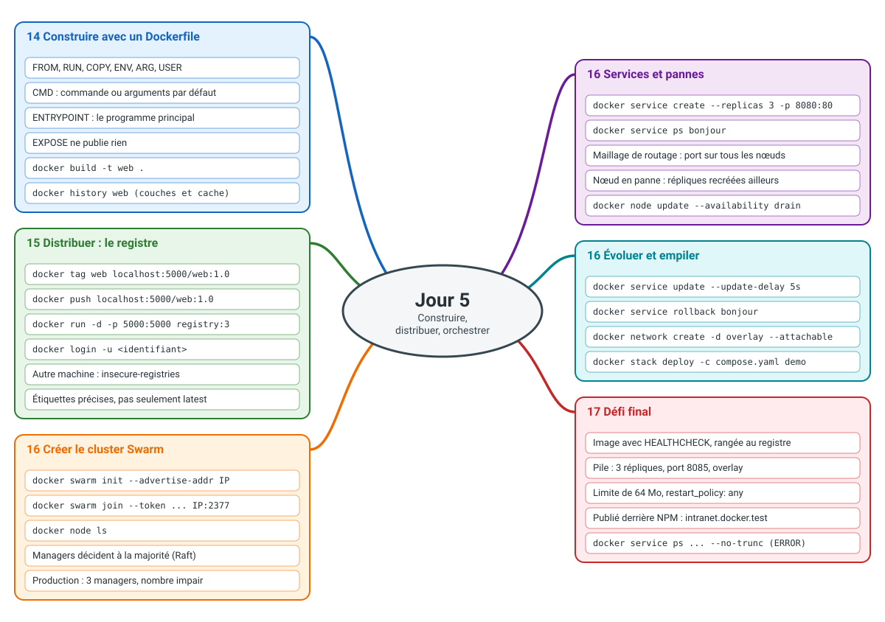

<!-- ============================================================ -->
<!-- ⚠️ RAPPEL IMPORTANT :                                          -->
<!-- Pensez TOUJOURS à ajouter une entrée dans le fichier d'index  -->
<!-- (index.md) du dossier correspondant (ex: docs/cloud/index.md) -->
<!-- afin de référencer ce nouvel article et permettre aux         -->
<!-- visiteurs de le trouver et de cliquer dessus !                -->
<!-- ============================================================ -->

# Défi final

!!! abstract "Résumé"
    Une mise en situation **sans pas-à-pas**, qui mobilise tout le parcours : écrire un Dockerfile, ranger l'image dans le registre privé, **dépanner** le fichier de déploiement d'un collègue, déployer le service sur le cluster Swarm avec ses limites, le publier par un nom derrière Nginx Proxy Manager, puis prouver qu'il survit à la panne d'un nœud.

    Le corrigé, replié en bas de page, détaille une solution et les messages d'erreur à reconnaître.

| Propriété | Valeur |
|-----------|--------|
| Difficulté | Intermédiaire |
| Durée estimée | 1 h |
| Version décrite | Docker Engine 29.10 (mode Swarm), Nginx Proxy Manager 2.17 |
| Place dans le parcours | Partie 17 sur 17 du parcours [Docker](index.md) — jour 5 |
| Dernière mise à jour | 2026-11-24 |

---

!!! info "Convention de lecture"
    🖥️ **PC hôte** · 🐧 dans une VM : **1️⃣** `docker-hote` (le manager), **2️⃣** `docker-n2`, **3️⃣** `docker-n3` · 🌐 **navigateur du PC**. Les commandes Docker se tapent en `adminlab`. Les adresses `192.168.8.x` du corrigé sont celles du lab de référence : les remplacer par les siennes (tableau en tête de la [partie 16](16-cluster-docker-swarm.md)).

!!! info "Point de départ"
    L'instantané `07-swarm` des trois VM (fin de la partie 16) : le cluster `docker-hote` + `docker-n2` + `docker-n3`, le registre privé sur `IP-de-la-VM:5000`, Nginx Proxy Manager sur `docker-hote`, et le service `bonjour` qui occupe le port 8080.

<!-- NOTE DE RÉDACTION (non affichée) : défi écrit pour ce parcours (pas de support du formateur), entièrement résolu dans le lab le 2026-11-24 (captures/17-*.txt). Les trois erreurs du fichier et leurs messages sont ceux obtenus réellement. Panne de docker-n2 (virsh destroy) avec une requête par seconde sur intranet.docker.test à travers NPM : 1 échec sur 60, deux secondes après la coupure. -->

## 1. La mission

L'association veut un **intranet** : une page d'accueil simple, accessible à l'adresse **`http://intranet.docker.test`**, qui doit rester disponible même si une machine tombe en panne.

![Schéma de l'architecture visée : le navigateur du PC ouvre http://intranet.docker.test (nom déclaré dans le fichier hosts) ; Nginx Proxy Manager, sur docker-hote, transmet à IP-de-la-VM:8085. Le port 8085 est ouvert sur les trois nœuds du cluster Swarm (docker-hote, docker-n2, docker-n3) par le maillage de routage, qui envoie chaque requête à l'une des trois répliques du service intranet (limite de 64 Mo chacune). Les répliques sont reliées par un réseau overlay. L'image intranet:1.0 est rangée dans le registre privé IP-de-la-VM:5000, sur docker-hote.](images/defi-final-cible.svg){ loading=lazy }
/// caption
L'architecture à obtenir : trois répliques sur trois nœuds, publiées derrière Nginx Proxy Manager.
///

Un collègue a commencé le travail. Il a laissé ce fichier `compose.yaml`, mais « le déploiement ne marche pas » :

```yaml
services:
  intranet:
    image: localhost:5000/intranet:1.0
    ports:
      - "8080:80"
    networks:
      - interne
    deploy:
      replicas: 3
networks:
  interne:
    driver: bridge
```

### 1.1 Ce qui est demandé

1. **Construire** une image `intranet`, version `1.0`, à partir de `nginx:1.31-alpine`, qui sert une page d'accueil titrée « Intranet de l'association », et qui intègre un **test de santé** (`HEALTHCHECK`).
2. La **ranger** dans le registre privé du lab.
3. **Corriger** le fichier du collègue et le **déployer** sur le cluster, en **pile** nommée `intranet`, avec :
    - **3 répliques**, réparties sur les trois nœuds ;
    - le port **8085** (le 8080 est déjà pris) ;
    - un réseau **overlay** ;
    - une limite de **64 Mo** de mémoire par réplique, et des répliques **toujours** recréées quand elles s'arrêtent, même proprement (lors de l'arrêt normal d'un nœud par exemple).
4. **Publier** le service derrière Nginx Proxy Manager sous le nom `intranet.docker.test` (fichier `hosts` du PC, comme en partie 9).
5. **Prouver** que l'intranet reste accessible quand on coupe brutalement un worker, et noter combien de requêtes échouent.

### 1.2 Critères de réussite

- `docker service ls` affiche `intranet_intranet` en **3/3**, image `IP-de-la-VM:5000/intranet:1.0` (le registre de la partie 15), port `*:8085->80/tcp`.
- Les trois répliques sont sur **trois nœuds différents** (au besoin après une nouvelle répartition), et `docker ps` sur un nœud montre la sienne **`(healthy)`**.
- `http://intranet.docker.test` affiche la page dans le navigateur du PC.
- Pendant la coupure d'un worker, le site reste joignable (au plus une ou deux requêtes perdues), et le service revient à 3/3 tout seul.
- Chaque erreur du fichier du collègue est **expliquée** : message obtenu, cause, correction.

!!! success "Vérifier son lab"
    1️⃣ Sur `docker-hote`, une fois le défi terminé :

    ```bash
    docker service ls --filter name=intranet
    docker service ps intranet_intranet --filter desired-state=running --format "{{.Name}}  {{.Node}}  {{.CurrentState}}"
    docker ps --filter name=intranet --format "{{.Names}}  {{.Status}}"
    curl -s --resolve intranet.docker.test:80:127.0.0.1 http://intranet.docker.test/ | grep -o "<title>.*</title>"
    ```

    Résultat attendu (les identifiants et les durées changent) : le service en `3/3` avec l'image du registre privé et le port 8085, une réplique par nœud (Swarm étale les tâches entre les nœuds disponibles, sans le garantir : après une panne ou un redéploiement, des répliques peuvent s'entasser, et `docker service update --force intranet_intranet` les répartit de nouveau), la réplique locale `(healthy)`, et le titre de la page servi **à travers NPM** (l'option `--resolve` de `curl` remplace le fichier `hosts` pour ce test) :

    ```text
    ID             NAME                MODE         REPLICAS   IMAGE                            PORTS
    a3mrmkm9x9zy   intranet_intranet   replicated   3/3        192.168.8.71:5000/intranet:1.0   *:8085->80/tcp
    intranet_intranet.1  docker-n3  Running 3 hours ago
    intranet_intranet.2  docker-n2  Running 3 hours ago
    intranet_intranet.3  docker-hote  Running 3 hours ago
    intranet_intranet.3.y8zk6cmp5uxsj51at02vakauy  Up 3 hours (healthy)
    <title>Intranet de l'association</title>
    ```

!!! tip "Indices, à ouvrir seulement en cas de blocage"
    ??? note "Indice 1 : les erreurs de déploiement"
        `docker stack deploy` peut échouer **immédiatement** (message à l'écran), ou réussir puis laisser le service à `0/3`. Dans ce second cas, la cause est dans `docker service ps <service> --no-trunc`, colonne `ERROR`.

    ??? note "Indice 2 : un réseau qui ne veut pas se corriger"
        Un réseau déjà créé par une pile n'est pas modifié quand on change son `driver` dans le fichier. Il faut le faire disparaître d'abord.

    ??? note "Indice 3 : `localhost`"
        Qui télécharge l'image, et sur quelle machine ? Que désigne `localhost` sur cette machine ?

---

## 2. Corrigé

??? success "Corrigé détaillé"
    ### Étape 1 : l'image

    1️⃣ Sur `docker-hote` :

    ```bash
    mkdir -p ~/defi/intranet && cd ~/defi/intranet
    nano index.html
    ```

    ```html
    <!DOCTYPE html>
    <html lang="fr"><head><meta charset="UTF-8"><title>Intranet de l'association</title></head>
    <body><h1>Intranet de l'association</h1><p>Service déployé sur le cluster Swarm.</p></body></html>
    ```

    ```bash
    nano Dockerfile
    ```

    ```dockerfile
    FROM nginx:1.31-alpine
    COPY index.html /usr/share/nginx/html/index.html
    HEALTHCHECK --interval=10s --timeout=3s --retries=3 \
      CMD wget -q --spider http://127.0.0.1/ || exit 1
    ```

    Le test de santé demande la page toutes les 10 secondes, avec `wget` (présent dans les images Alpine) ; trois échecs de suite rendent le conteneur `unhealthy`, et Swarm le remplace.

    ### Étape 2 : le registre

    Comme en partie 16, les adresses sont celles du lab (`192.168.8.71` pour `docker-hote`) : les remplacer par les siennes.

    ```bash
    docker build -t 192.168.8.71:5000/intranet:1.0 .
    docker push 192.168.8.71:5000/intranet:1.0
    curl -s http://192.168.8.71:5000/v2/intranet/tags/list
    ```

    ```text
    {"name":"intranet","tags":["1.0"]}
    ```

    ### Étape 3 : les trois erreurs du fichier

    1️⃣ Copier le fichier du collègue tel quel, et le déployer pour lire les erreurs :

    ```bash
    mkdir -p ~/defi/panne && cd ~/defi/panne
    nano compose.yaml          # coller le fichier de la section 1
    docker stack deploy -c compose.yaml intranet
    ```

    **Erreur 1 : le réseau `bridge`.**

    ```text
    Creating network intranet_interne
    Creating service intranet_intranet
    failed to create service intranet_intranet: Error response from daemon: The network intranet_interne cannot be used with services. Only networks scoped to the swarm can be used, such as those created with the overlay driver.
    ```

    Un réseau `bridge` n'existe que sur **une** machine ; un service Swarm s'étend sur plusieurs : il lui faut un réseau **`overlay`**. Correction : `driver: overlay`.

    Piège : après la correction, le même message revient. Le réseau `intranet_interne` a été **créé** (en `bridge`) au premier essai et la pile le réutilise sans le modifier. Supprimer d'abord la pile, ce qui supprime son réseau :

    ```bash
    docker stack rm intranet
    ```

    ```text
    Removing network intranet_interne
    ```

    **Erreur 2 : le port 8080 déjà pris.** Au déploiement suivant :

    ```text
    failed to create service intranet_intranet: Error response from daemon: rpc error: code = InvalidArgument desc = port '8080' is already in use by service 'bonjour' (bfy6rguo107w4s7zfmqgqkzjy) as an ingress port
    ```

    Avec le maillage de routage, un port publié est réservé sur **tous** les nœuds : le service `bonjour` de la partie 16 occupe déjà le 8080. Correction : `"8085:80"`.

    **Erreur 3 : l'image en `localhost`.** Cette fois, le déploiement réussit… mais le service ne se comporte pas comme prévu :

    ```bash
    docker service ls --filter name=intranet
    docker service ps intranet_intranet --filter desired-state=running --format '{{.Name}} {{.Node}}'
    ```

    ```text
    ID             NAME                MODE         REPLICAS   IMAGE                         PORTS
    a3mrmkm9x9zy   intranet_intranet   replicated   2/3        localhost:5000/intranet:1.0   *:8085->80/tcp
    intranet_intranet.1 docker-hote
    intranet_intranet.2 docker-hote
    ```

    Les répliques s'entassent **toutes sur `docker-hote`**, et le service peine à atteindre 3/3 : le critère « trois nœuds différents » démasque l'erreur. L'historique complet des tâches donne la cause :

    ```bash
    docker service ps intranet_intranet --no-trunc --format '{{.Node}} | {{.CurrentState}} | {{.Error}}'
    ```

    ```text
    docker-n2 | Rejected 4 seconds ago | "failed to resolve reference "localhost:5000/intranet:1.0": failed to do request: Head "https://localhost:5000/v2/intranet/manifests/1.0": dial tcp [::1]:5000: connect: connection refused"
    docker-n3 | Rejected 9 seconds ago | "failed to resolve reference "localhost:5000/intranet:1.0": … connect: connection refused"
    ```

    Chaque nœud télécharge l'image **lui-même**. Sur `docker-n2` et `docker-n3`, `localhost` désigne le nœud lui-même, où aucun registre n'écoute : `connection refused`, et la tâche est rejetée. Seul `docker-hote`, où `localhost:5000` mène bien au registre (grâce aux plages locales ajoutées à `insecure-registries` en partie 15), lance les répliques. Le service semble fonctionner, mais une panne de `docker-hote` emporterait tout. Sans ces plages locales, `docker-hote` échouerait aussi (`server gave HTTP response to HTTPS client`) et le service resterait à `0/3`. Correction : `image: 192.168.8.71:5000/intranet:1.0`.

    ### Étape 4 : le fichier corrigé et complété

    ```yaml
    services:
      intranet:
        image: 192.168.8.71:5000/intranet:1.0
        ports:
          - "8085:80"
        networks:
          - interne
        deploy:
          replicas: 3
          resources:
            limits:
              memory: 64M
          restart_policy:
            condition: any
    networks:
      interne:
        driver: overlay
    ```

    ```bash
    docker stack deploy -c compose.yaml intranet
    docker service ls --filter name=intranet
    docker service ps intranet_intranet --filter desired-state=running --format '{{.Name}} {{.Node}}'
    ```

    ```text
    ID             NAME                MODE         REPLICAS   IMAGE                            PORTS
    a3mrmkm9x9zy   intranet_intranet   replicated   3/3        192.168.8.71:5000/intranet:1.0   *:8085->80/tcp
    intranet_intranet.1 docker-n3
    intranet_intranet.2 docker-n2
    intranet_intranet.3 docker-hote
    ```

    `condition: any` (valeur par défaut, écrite pour être explicite) : avec `on-failure`, une réplique arrêtée proprement, par exemple quand on éteint normalement un nœud, passe à `Complete` et n'est **pas** recréée. Après un arrêt propre des trois VM, le service peut rester à `1/3` avec `on-failure` ; avec `any`, il revient à `3/3`.

    Si les répliques ne sont pas réparties (restes des essais précédents) : `docker service update --force intranet_intranet`.

    2️⃣ Sur `docker-n2`, la santé de la réplique qu'il exécute :

    ```bash
    docker ps --filter name=intranet --format '{{.Names}} {{.Status}}'
    ```

    ```text
    intranet_intranet.2.uxa503wzbho9vbdk4j9tp6kf8 Up 45 seconds (healthy)
    ```

    ### Étape 5 : la publication

    1. 🖥️ Ajouter au fichier `hosts` du PC la ligne `IP-de-la-VM   intranet.docker.test` (partie 9).
    2. 🌐 Dans Nginx Proxy Manager, **Hôtes** > **Hôtes proxy** > **Ajouter Hôte proxy** : **Noms de domaine** `intranet.docker.test`, **Schéma** `http`, **Nom d'hôte / IP de destination** `IP-de-la-VM`, **Port de destination** `8085`, cocher **Bloquer les exploits courants**, puis **Enregistrer**.

        Ici, NPM n'utilise **pas** un nom de conteneur comme en partie 9 : il tourne hors du cluster (lancé par `docker compose`), et n'est pas branché sur le réseau overlay de la pile. Il passe donc par le **port publié**, que le maillage de routage ouvre sur la VM.

    3. 🌐 Ouvrir `http://intranet.docker.test` : la page « Intranet de l'association » s'affiche. Pour passer en HTTPS, il faut un certificat qui contient le nom `intranet.docker.test` : celui de la partie 10 ne couvre que `nextcloud`, `portainer` et `wordpress`. Le refaire avec la même commande `openssl` en ajoutant `DNS:intranet.docker.test` dans `subjectAltName`, l'importer dans NPM, puis le choisir dans l'onglet **SSL** de l'hôte.

    ### Étape 6 : la preuve de tolérance aux pannes

    1️⃣ Dans une session sur `docker-hote`, une requête par seconde **à travers NPM** :

    ```bash
    while true; do echo "$(date +%T) $(curl -s -m 2 -o /dev/null -w '%{http_code}' --resolve intranet.docker.test:80:127.0.0.1 http://intranet.docker.test/ || echo ECHEC)"; sleep 1; done
    ```

    `--resolve` fait pointer le nom vers la VM elle-même, sans modifier son fichier `hosts`.

    🖥️ Couper `docker-n2` brutalement (comme en partie 16). Résultat attendu : une requête perdue au plus, deux secondes environ après la coupure (elle s'affiche `000ECHEC` : `curl` écrit le code `000`, puis la boucle ajoute `ECHEC`) ; toutes les autres répondent `200`. Sur 60 requêtes, une seule a été perdue. `docker node ls` passe `docker-n2` en `Down`, et la réplique perdue est recréée sur un autre nœud : `docker service ls` revient à **3/3**.

    🖥️ Rallumer `docker-n2`, puis 1️⃣ rééquilibrer : `docker service update --force intranet_intranet`.

    ### Ce que le défi a mobilisé

    | Partie | Utilisée pour |
    |---|---|
    | 9 et 10 | Fichier `hosts`, hôte de proxy NPM, certificat |
    | 8 et 12 | Compose, `healthcheck`, limites de mémoire, politique de redémarrage |
    | 14 | Dockerfile, `HEALTHCHECK` |
    | 15 | Étiquette avec l'adresse du registre, `push`, registre non sécurisé |
    | 16 | Pile Swarm, réseau overlay, maillage de routage, panne d'un nœud, rééquilibrage |

---

## Le jour 5 en résumé

{ loading=lazy }
/// caption
Le jour 5 en un coup d'œil : construire, distribuer, orchestrer.
///

## Ressources

- [Référence du fichier Compose : `deploy`](https://docs.docker.com/reference/compose-file/deploy/) — répliques, limites, redémarrage (en anglais).
- [`docker stack deploy`](https://docs.docker.com/reference/cli/docker/stack/deploy/) — options de déploiement d'une pile.
- [Dépanner un service Swarm](https://docs.docker.com/reference/cli/docker/service/ps/) — `docker service ps` et la colonne `ERROR`.
- [Annexes du parcours](annexes.md) — aide-mémoire des commandes, dépannage et glossaire.
- Partie précédente : [Un cluster Docker Swarm](16-cluster-docker-swarm.md) · Suite : [Annexes](annexes.md).

*[NPM]: Nginx Proxy Manager
*[HTML]: HyperText Markup Language — langage des pages web
*[HTTPS]: HTTP sécurisé par TLS
*[VM]: Virtual Machine — machine virtuelle
