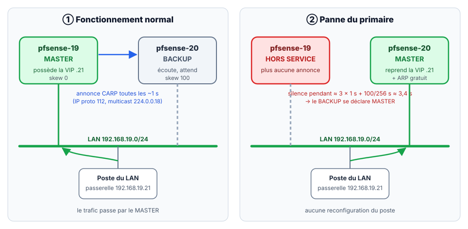
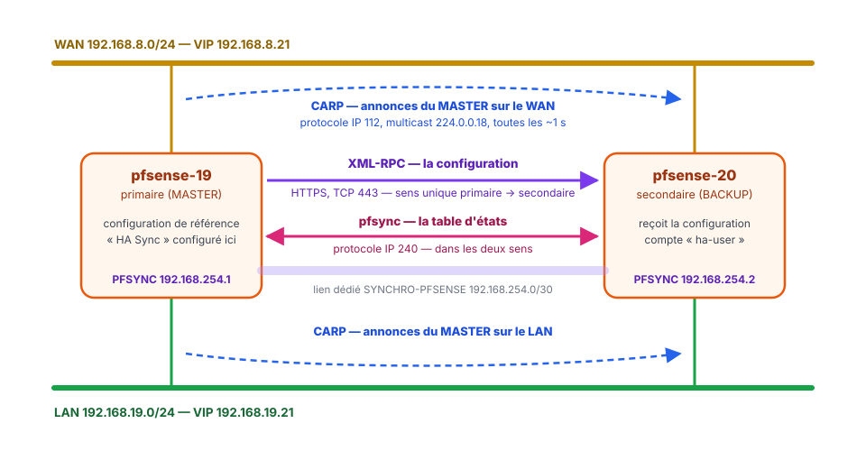

<!-- ============================================================ -->
<!-- ⚠️ RAPPEL IMPORTANT :                                          -->
<!-- Pensez TOUJOURS à ajouter une entrée dans le fichier d'index  -->
<!-- (index.md) du dossier correspondant (ex: docs/cloud/index.md) -->
<!-- afin de référencer ce nouvel article et permettre aux         -->
<!-- visiteurs de le trouver et de cliquer dessus !                -->
<!-- ============================================================ -->

# Comprendre la haute disponibilité d'un pare-feu

!!! abstract "Résumé"
    Ce cours pose les bases indispensables avant de construire le cluster. Il répond à quatre questions :

    1. **Qu'est-ce que pfSense**, et pourquoi un pare-feu à états ?
    2. **Pourquoi doubler un pare-feu**, et quelle différence entre un cluster actif/actif et actif/passif ?
    3. **Comment deux pare-feux partagent-ils une même adresse** sans que les postes du réseau s'en aperçoivent ?
    4. **Que synchronisent CARP, pfsync et XML-RPC**, et par quel chemin ?

    Des questions de révision terminent le cours. Les corrigés sont repliés : il vaut mieux chercher la réponse avant de les ouvrir.

| Propriété | Valeur |
|-----------|--------|
| Difficulté | Débutant — aucun prérequis sur pfSense |
| Durée estimée | 45 min de lecture et de questions |
| Place dans le parcours | Partie 1 sur 8 du parcours [Cluster pfSense en haute disponibilité](index.md) |
| Dernière mise à jour | 2026-11-07 |

---

## 1. pfSense en quelques mots

**pfSense** est un système d'exploitation libre (*open source*) spécialisé dans le rôle de **routeur et pare-feu**. Il est basé sur **FreeBSD**, un système de la famille Unix, et non sur Linux. À l'origine, c'est un dérivé (*fork*) du projet m0n0wall.

pfSense utilise le pare-feu **Packet Filter** (PF), un pare-feu dit **à états** (*stateful*) : il mémorise chaque connexion autorisée dans une **table d'états**, ce qui lui permet de laisser passer automatiquement les réponses sans règle supplémentaire. Il assure aussi le routage, le NAT, le VPN, le DHCP, etc., c'est-à-dire l'équivalent libre des fonctions d'un routeur professionnel propriétaire. On le rencontre aussi bien dans un réseau domestique que dans un réseau d'entreprise.

!!! info "Deux éditions de pfSense"
    Netgate, l'éditeur, propose **pfSense CE** (*Community Edition*), gratuite et utilisée dans ce parcours, et **pfSense Plus**, livrée avec ses boîtiers ou disponible sous licence. Les menus utilisés ici sont les mêmes dans les deux éditions.

## 2. Haute disponibilité et basculement (*fail-over*)

Un pare-feu est un **point de passage obligé** : tout le trafic entre le réseau interne (LAN) et l'extérieur (WAN) le traverse. S'il tombe en panne, plus personne n'accède à Internet. On parle de **point unique de défaillance** (*SPOF*, *Single Point Of Failure*).

La **haute disponibilité** (*HA*, *High Availability*) consiste à supprimer ce point unique en doublant l'équipement. Le **basculement** (*fail-over*, « passer outre à la panne ») est la capacité de l'ensemble à passer automatiquement sur l'équipement de secours quand l'équipement principal défaille.

Il existe deux grands modes de fonctionnement :

| Mode | Principe | Usage |
|------|----------|-------|
| **Actif/actif** | Les deux équipements traitent du trafic en même temps. | Se rapproche de la répartition de charge (*load-balancing*). |
| **Actif/passif** | Le secondaire reste en veille tant que le primaire fonctionne, puis prend le relais en cas de panne. | Mode classique et le plus répandu. **C'est celui de ce parcours.** |

!!! example "Analogie"
    Un avion de ligne a un pilote et un copilote. Le copilote suit tout ce qui se passe (la route, les échanges radio, les réglages) sans tenir les commandes. Si le pilote fait un malaise, le copilote reprend immédiatement le vol, car il connaît déjà la situation. Dans le cluster, le primaire est le pilote et le secondaire le copilote : **XML-RPC** lui transmet les réglages et **pfsync** la situation en cours.

## 3. Le principe : des adresses IP virtuelles partagées

Chaque pare-feu garde sa propre adresse IP sur chacune de ses interfaces (`.19` pour le primaire, `.20` pour le secondaire). Le cluster ajoute une **troisième adresse par réseau**, l'**adresse IP virtuelle** ou **VIP** (`.21`), **partagée** entre les deux machines.

- Les postes du LAN utilisent la VIP `192.168.19.21` comme **passerelle par défaut**, jamais l'adresse propre d'un pare-feu.
- À un instant donné, un seul pare-feu « possède » la VIP : celui qui est dans l'état **MASTER**. L'autre est **BACKUP**.
- Le MASTER annonce sa présence environ chaque seconde. Si les annonces s'arrêtent, le BACKUP récupère la VIP et devient MASTER.

<figure markdown="span">
  { loading=lazy }
  <figcaption>La VIP suit toujours le pare-feu MASTER : les postes du LAN ne voient aucun changement de passerelle.</figcaption>
</figure>

## 4. Les trois protocoles du cluster

| Protocole | Ce qu'il synchronise | Transport | Sens | Réseau emprunté |
|-----------|----------------------|-----------|------|-----------------|
| **CARP** (*Common Address Redundancy Protocol*) | Qui possède les adresses IP virtuelles (MASTER/BACKUP) | Protocole IP n° 112, en multicast vers `224.0.0.18` | Annonces émises par le MASTER | Les réseaux qui portent une VIP : **WAN et LAN** |
| **pfsync** | La **table d'états** : la liste des connexions en cours | Protocole IP n° 240 | Dans les deux sens | Le lien dédié **PFSYNC** |
| **XML-RPC** | La **configuration** : règles, NAT, VIP, utilisateurs, etc. | HTTPS (TCP 443), vers l'interface web du pair | **Uniquement** du primaire vers le secondaire | Le lien dédié **PFSYNC** |

- **CARP** permet à plusieurs hôtes d'un même réseau de partager une adresse IP. C'est une alternative libre aux protocoles VRRP et HSRP, créée par le projet OpenBSD pour contourner des brevets. En cas de défaillance du primaire, le secondaire reprend l'adresse IP virtuelle de façon transparente.
- **pfsync** recopie en continu les états des connexions entre les deux pare-feux. Lorsque le primaire tombe, le secondaire connaît déjà les connexions ouvertes et peut les **poursuivre sans les couper** : une connexion TCP en cours survit ainsi à l'arrêt brutal du primaire (voir les [mesures de la partie 6](06-tester-la-bascule.md#3-pour-aller-plus-loin-verifier-depuis-un-poste-client)).
- **XML-RPC** est un protocole d'appel de procédure à distance (*Remote Procedure Call*) qui transporte des données XML sur HTTP. pfSense s'en sert pour **pousser la configuration** du primaire vers le secondaire. Netgate recommande de le faire passer par le même lien dédié que pfsync.

<figure markdown="span">
  { loading=lazy }
  <figcaption>Le lien dédié transporte la configuration et les états ; les annonces CARP circulent sur les réseaux qui portent les VIP.</figcaption>
</figure>

!!! question "Pourquoi un lien de synchronisation dédié ?"
    pfsync transmet en clair, en permanence, la liste de toutes les connexions qui traversent le pare-feu. Sur le LAN, n'importe quel poste pourrait écouter ces informations, voire injecter de faux états. Un lien **réservé aux deux pare-feux** est donc plus **sûr**. Il est aussi plus **fiable**, car la synchronisation n'est pas ralentie par le trafic des utilisateurs. À défaut, Netgate tolère l'usage du LAN, mais ce parcours applique la bonne pratique.

---

## 5. Questions de révision

1. Pourquoi dit-on qu'un pare-feu seul est un **point unique de défaillance** ?
2. Quelle est la différence entre un cluster **actif/actif** et un cluster **actif/passif** ? Lequel ce parcours construit-il ?
3. Pourquoi les postes du LAN utilisent-ils `192.168.19.21` comme passerelle, et jamais `192.168.19.19` ?
4. Que synchronise chacun des trois protocoles **CARP**, **pfsync** et **XML-RPC** ? Dans quel sens circule XML-RPC ?
5. Au moment d'une bascule, que perdrait-on si le secondaire ne recevait pas les états pfsync ?
6. Pourquoi faire passer pfsync et XML-RPC par un lien réservé aux deux pare-feux plutôt que par le LAN ?

??? success "Corrigé"
    1. Tout le trafic entre le LAN et l'extérieur le **traverse** : s'il tombe en panne, plus aucun poste n'accède à Internet. Un seul équipement suffit à arrêter tout le service.
    2. En **actif/actif**, les deux équipements traitent du trafic en même temps, ce qui se rapproche de la répartition de charge. En **actif/passif**, le secondaire reste en veille et ne prend le relais qu'en cas de panne du primaire. Le parcours construit un cluster **actif/passif**, le mode le plus répandu.
    3. La **VIP** suit toujours le pare-feu MASTER : après une bascule, elle passe au secondaire et les postes continuent d'utiliser la même passerelle, sans rien reconfigurer. L'adresse `.19` n'appartient qu'au primaire : s'il tombe, elle ne répond plus, et chaque poste devrait être reconfiguré à la main.
    4. **CARP** décide qui possède les VIP (MASTER ou BACKUP) ; ses annonces partent du MASTER sur le WAN et le LAN. **pfsync** recopie la **table d'états**, c'est-à-dire les connexions en cours, dans les deux sens. **XML-RPC** recopie la **configuration** (règles, NAT, VIP, utilisateurs), **uniquement du primaire vers le secondaire**.
    5. Le secondaire prendrait bien les VIP, mais il ne connaîtrait **aucune des connexions en cours**. Un pare-feu à états ne laisse pas passer la suite d'une connexion qu'il n'a pas vue s'ouvrir : ces connexions seraient coupées, et il faudrait les rouvrir.
    6. Pour la **sécurité** : pfsync transmet en clair la liste des connexions, qu'un poste du LAN pourrait écouter, voire falsifier en injectant de faux états. Pour la **fiabilité** : sur un lien dédié, la synchronisation n'est pas ralentie par le trafic des utilisateurs.

---

## Ressources

- [Netgate — High Availability : vue d'ensemble](https://docs.netgate.com/pfsense/en/latest/highavailability/index.html) — CARP, pfsync, XML-RPC et leurs exigences.
- [FreeBSD — page de manuel carp(4)](https://man.freebsd.org/cgi/man.cgi?query=carp&sektion=4) — Fonctionnement détaillé de CARP, préemption et rétrogradation.
- Wikipédia : [Basculement (informatique)](https://fr.wikipedia.org/wiki/Basculement_%28informatique%29), [Haute disponibilité](https://fr.wikipedia.org/wiki/Haute_disponibilit%C3%A9), [CARP](https://fr.wikipedia.org/wiki/Common_Address_Redundancy_Protocol), [pfsync](https://fr.wikipedia.org/wiki/Pfsync), [XML-RPC](https://fr.wikipedia.org/wiki/XML-RPC)
- Partie suivante : [Préparer le lab et installer pfSense](02-preparer-lab-installer-pfsense.md).

*[CARP]: Common Address Redundancy Protocol
*[VIP]: Virtual IP — adresse IP virtuelle partagée
*[HA]: High Availability — haute disponibilité
*[NAT]: Network Address Translation — traduction d'adresses
*[SPOF]: Single Point Of Failure — point unique de défaillance
