<!-- ============================================================ -->
<!-- ⚠️ RAPPEL IMPORTANT :                                          -->
<!-- Pensez TOUJOURS à ajouter une entrée dans le fichier d'index  -->
<!-- (index.md) du dossier correspondant (ex: docs/cloud/index.md) -->
<!-- afin de référencer ce nouvel article et permettre aux         -->
<!-- visiteurs de le trouver et de cliquer dessus !                -->
<!-- ============================================================ -->

# TP pfSense HA : préparer le lab et installer pfSense

!!! abstract "Résumé"
    Ce premier TP construit le **laboratoire** utilisé par tout le parcours. On crée dans l'hyperviseur les **trois réseaux virtuels** du lab (WAN, LAN et le lien de synchronisation SYNCHRO-PFSENSE), puis **deux machines virtuelles identiques**, `pfsense-19` et `pfsense-20`, avec trois cartes réseau chacune.

    On installe ensuite **pfSense CE 2.7.2** sur les deux VM, puis on fait les premiers réglages dans leur console : l'affectation des trois interfaces, dans le même ordre sur les deux pare-feux, et l'adresse LAN qui permettra d'ouvrir l'interface web depuis le PC hôte.

| Propriété | Valeur |
|-----------|--------|
| Difficulté | Débutant à intermédiaire |
| Durée estimée | 1 h 30, dont quelques minutes d'attente pendant l'installation |
| Version décrite | pfSense CE 2.7.2, VMware Workstation Pro (17, 25H2 ou 26H1) ou Oracle VirtualBox 7 |
| Place dans le parcours | Partie 2 sur 8 du parcours [Cluster pfSense en haute disponibilité](index.md) |
| Dernière mise à jour | 2026-11-07 |

---

!!! info "Convention de lecture"
    Chaque action commence par un repère qui indique où elle se fait : 🖥️ **PC hôte** (hyperviseur, navigateur, terminal), 1️⃣ **primaire** `pfsense-19`, 2️⃣ **secondaire** `pfsense-20`, 1️⃣ 2️⃣ **les deux pare-feux**. Le [plan d'adressage](index.md#plan-dadressage), les [comptes et mots de passe](index.md#comptes-et-mots-de-passe) et le [dimensionnement des VM](index.md#dimensionnement-des-machines-virtuelles) sont sur la page d'accueil du parcours : **la garder ouverte** pendant le TP.

## 1. Prérequis

**Matériel et logiciels**

- Un PC avec **8 Go de RAM** au minimum, environ **50 Go d'espace disque** libre et la virtualisation matérielle (Intel VT-x ou AMD-V) activée dans le BIOS/UEFI.
- Un hyperviseur au choix :
    - **VMware Workstation Pro** : gratuit pour tous les usages depuis novembre 2024. Le téléchargement se fait depuis le portail de support Broadcom, avec un compte gratuit, en choisissant la variante « Personal ». La version 26H1 est la plus récente à la date de rédaction.
    - **Oracle VirtualBox 7**, gratuit.
- L'image ISO de **pfSense CE 2.7.2**, téléchargée et vérifiée (voir les [logiciels à télécharger](index.md#telecharger-limage-iso-de-pfsense-ce-272)).
- Un accès Internet sur le PC hôte : il est nécessaire pour la mise à jour finale.

**Connaissances**

- Savoir créer une machine virtuelle.
- Connaître l'adressage IPv4 : adresse, masque, notation CIDR (`/24`, `/30`), passerelle.
- Avoir une première idée de ce qu'est une règle de pare-feu et le NAT. L'article [Configurer le NAT et le routage avec nftables](../../reseaux/configurer-nat-routage-serveur-linux-nftables.md) présente ces notions sous Linux.
- Avoir lu le cours de la [partie 1](01-comprendre-haute-disponibilite.md).

!!! tip "Prendre des instantanés"
    Un **instantané** (*snapshot*) enregistre l'état complet d'une VM et permet d'y revenir en un clic. Le parcours suggère plusieurs points de sauvegarde (🛟), récapitulés dans les [instantanés conseillés](index.md#instantanes-conseilles). Ils évitent de tout recommencer après une erreur.

---

## 2. Créer les réseaux virtuels

Le lab utilise trois réseaux :

- **WAN** : il représente l'extérieur et donne accès à Internet grâce au NAT de l'hyperviseur.
- **LAN** : il représente le réseau interne de l'entreprise. Le PC hôte y est connecté, ce qui permet d'ouvrir l'interface web des pare-feux depuis son navigateur.
- **SYNCHRO-PFSENSE** : c'est un « câble virtuel » qui relie uniquement les deux pare-feux.

| Réseau du TP | VMware Workstation | VirtualBox |
|--------------|--------------------|------------|
| WAN `192.168.8.0/24` | VMnet8, type **NAT** | **Réseau NAT** (*NAT Network*) |
| LAN `192.168.19.0/24` | VMnet19, type **Host-only** | **Réseau privé hôte** (*Host-only*) |
| SYNCHRO-PFSENSE `192.168.254.0/30` | **LAN segment** | **Réseau interne** (*Internal Network*) |

<!-- NOTE DE RÉDACTION (non affichée) : Variante VirtualBox non rejouée
Les manipulations de ce TP ont été réalisées et vérifiées sous VMware Workstation et KVM. Les réglages VirtualBox (onglets VirtualBox des étapes 2 et 3, puis de la partie 7) suivent la documentation d'Oracle et les recommandations de Netgate pour la virtualisation, mais n'ont pas été rejoués dans VirtualBox.
-->

=== "VMware Workstation"

    🖥️ **Sur le PC hôte**, dans VMware Workstation :

    1. Ouvrir **Edit > Virtual Network Editor**, puis cliquer sur **Change Settings** (droits administrateur requis sous Windows).
    2. Sélectionner **VMnet8** (type *NAT*) et saisir **Subnet IP** `192.168.8.0` et **Subnet mask** `255.255.255.0`.
    3. Cliquer sur **NAT Settings…** et vérifier que **Gateway IP** vaut `192.168.8.2`. C'est la valeur par défaut : l'adresse `.1` est réservée au PC hôte.
    4. Cliquer sur **Add Network…**, choisir **VMnet19**, puis sélectionner **Host-only**. Saisir **Subnet IP** `192.168.19.0` et le masque `255.255.255.0`. Laisser cochée l'option **Connect a host virtual adapter to this network** : le PC hôte reçoit alors l'adresse `192.168.19.1` sur ce réseau.
    5. Cliquer sur **Apply**, puis sur **OK**.

    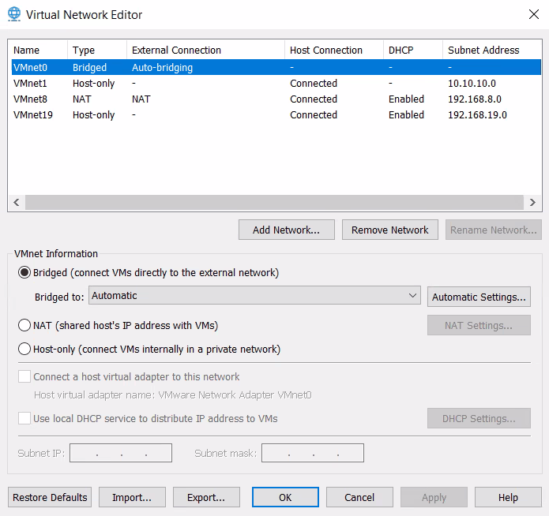{ loading=lazy }
    /// caption
    VMware — éditeur de réseaux virtuels : VMnet8 en NAT (192.168.8.0) et VMnet19 en Host-only (192.168.19.0)
    ///

    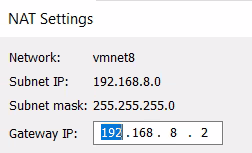{ loading=lazy width="300" }
    /// caption
    VMware — paramètres NAT de VMnet8 : passerelle 192.168.8.2
    ///

    !!! info "Pourquoi changer le sous-réseau de VMnet8 ?"
        À l'installation, VMware choisit **au hasard** un sous-réseau pour VMnet8 (par exemple `192.168.153.0/24`), différent d'un PC à l'autre. Le fixer à `192.168.8.0/24` permet de suivre le TP à l'identique. L'option DHCP de VMnet19 peut rester active : aucune machine du TP ne l'utilise.

    Le réseau **SYNCHRO-PFSENSE** ne se crée pas ici. C'est un **LAN segment**, créé depuis les paramètres de la VM (voir l'[étape 3](#3-creer-les-deux-machines-virtuelles)).

=== "VirtualBox"

    🖥️ **Sur le PC hôte**, dans VirtualBox :

    1. Ouvrir le **Gestionnaire de réseau** : **Fichier > Outils > Gestionnaire de réseau**, ou le volet **Outils > Réseau**.
    2. Dans l'onglet **Réseaux NAT**, cliquer sur **Créer**. Nommer le réseau `WAN-PFSENSE` et saisir le préfixe IPv4 `192.168.8.0/24`. L'option DHCP n'a pas d'importance. La passerelle sera automatiquement `192.168.8.1`.
    3. Dans l'onglet **Réseaux privés hôte**, cliquer sur **Créer**. Choisir **Configurer l'adaptateur manuellement** avec l'adresse IPv4 `192.168.19.1` et le masque `255.255.255.0`. Dans l'onglet **Serveur DHCP**, décocher **Activer le serveur**.
    4. Le réseau **SYNCHRO-PFSENSE** est un **réseau interne** : il n'a pas besoin d'être créé à l'avance. Il existe dès qu'une carte réseau est rattachée à un réseau interne portant ce nom.

    !!! warning "Ne pas utiliser le mode « NAT » simple pour le WAN"
        En mode **NAT** (et non *Réseau NAT*), VirtualBox crée un réseau **privé pour chaque VM** : les deux pare-feux ne se voient pas côté WAN. Chacun se croit alors seul et se déclare MASTER de la VIP WAN, et le cluster ne peut pas fonctionner. Le mode **Réseau NAT** place au contraire les deux VM sur le **même** réseau.

    !!! note "Hôte Linux ou macOS"
        Sur ces systèmes, VirtualBox n'autorise par défaut que les réseaux privés hôte compris dans `192.168.56.0/21`. Pour utiliser `192.168.19.0/24`, ajouter la ligne `* 192.168.0.0/16` dans le fichier `/etc/vbox/networks.conf`, à créer s'il n'existe pas.

---

## 3. Créer les deux machines virtuelles

🖥️ **Sur le PC hôte**, créer deux VM identiques, nommées `pfsense-19` et `pfsense-20`.

| Paramètre | Valeur | Explication |
|-----------|--------|-------------|
| Système invité | **Other > FreeBSD 14 64-bit** (VMware) ou **BSD > FreeBSD (64-bit)** (VirtualBox) | pfSense 2.7.2 repose sur FreeBSD 14. Si cette version n'est pas proposée, choisir la version 64 bits de FreeBSD la plus récente. |
| Processeur | 1 vCPU | Largement suffisant pour un lab. |
| Mémoire | **1 Go** (**2 Go** si la mise à jour de la partie 8 est prévue) | 1 Go est le minimum officiel et suffit pour tout le TP (512 Mo fonctionnent en pratique pour un lab). La mise à jour demande plus : avec 1 Go, elle peut échouer faute de mémoire (voir la [partie 8](08-mettre-a-jour-le-cluster.md#1-avant-de-commencer)). |
| Disque | 20 Go | Le minimum officiel est de 8 Go. |
| Lecteur CD | L'ISO pfSense CE 2.7.2 | — |
| Cartes réseau | **3 cartes, dans cet ordre** : WAN, LAN, SYNCHRO-PFSENSE | pfSense les nommera `em0`, `em1` et `em2` dans cet ordre. |

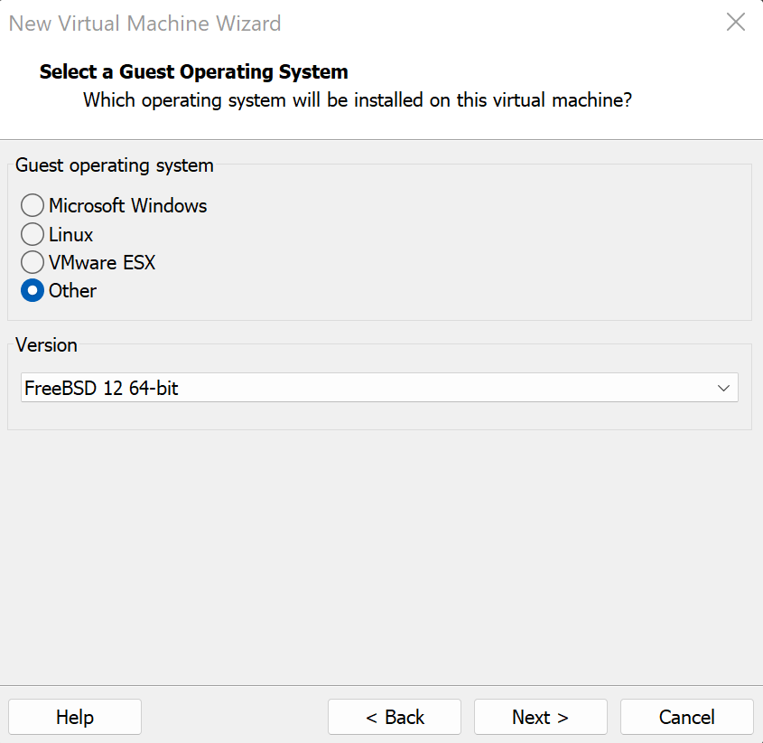{ loading=lazy width="420" }
/// caption
VMware — choix du système invité : Other, puis FreeBSD 64 bits
///

=== "VMware Workstation"

    Dans **VM > Settings… > Hardware** :

    - **Network Adapter** : **Custom** > `VMnet8 (NAT)` ;
    - **Network Adapter 2** (bouton **Add… > Network Adapter**) : **Custom** > `VMnet19` ;
    - **Network Adapter 3** : choisir **LAN segment**, cliquer sur **LAN Segments… > Add**, nommer le segment `SYNCHRO-PFSENSE`, valider, puis le sélectionner dans la liste.

    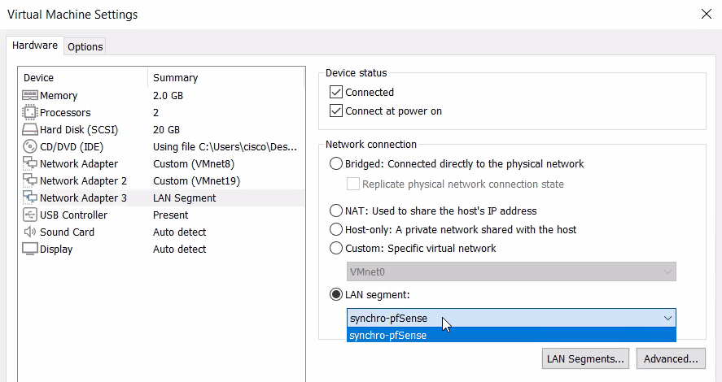{ loading=lazy }
    /// caption
    VMware — 3ᵉ carte réseau reliée au LAN segment de synchronisation
    ///

    !!! info "Qu'est-ce qu'un LAN segment ?"
        Un **LAN segment** relie entre elles les VM qui y sont connectées, comme un switch privé, **sans passer par le Virtual Network Editor**.

        - Contrairement à un VMnet, il ne crée **aucune carte réseau virtuelle sur le PC hôte** et ne fournit **aucun service DHCP**. Il faut donc obligatoirement définir des **adresses IP statiques** dans chaque VM, ici dans pfSense.
        - Il accepte n'importe quel masque, dont le `/30`. Un VMnet, lui, est aussi relié au PC hôte : le réseau de synchronisation ne serait plus réservé aux deux pare-feux. De plus, VMware déconseille de modifier le masque des VMnets, et VMware Workstation ne permet pas d'y descendre en dessous d'un `/29` (6 hôtes).

=== "VirtualBox"

    Dans **Configuration > Réseau** :

    | Carte | Mode d'accès réseau | Nom |
    |-------|---------------------|-----|
    | Adapter 1 | **Réseau NAT** | `WAN-PFSENSE` |
    | Adapter 2 | **Réseau privé hôte** | l'adaptateur créé en `192.168.19.1` |
    | Adapter 3 | **Réseau interne** | `SYNCHRO-PFSENSE` (saisir le nom) |

    Pour **chacune des trois cartes**, déplier **Avancé** et régler :

    - **Type d'interface** : `Intel PRO/1000 MT Desktop (82540EM)`. pfSense nommera alors les interfaces `em0`, `em1` et `em2`, comme dans ce TP.
    - **Mode Promiscuité** : **Tout autoriser** (*Allow All*). CARP utilise une adresse MAC virtuelle (`00:00:5e:00:01:xx`). Sans ce réglage, VirtualBox rejette les trames destinées à cette adresse et la bascule échoue. C'est la recommandation officielle de Netgate pour la virtualisation.

    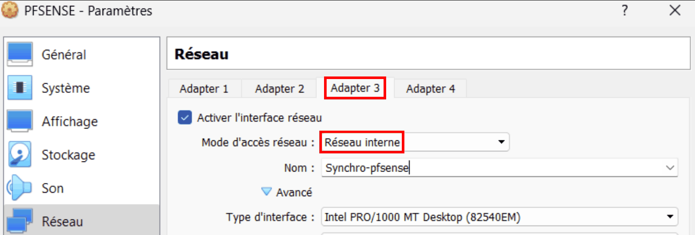{ loading=lazy }
    /// caption
    VirtualBox — 3ᵉ carte en « Réseau interne » dédié à la synchronisation
    ///

    !!! tip "Installation automatique"
        Si l'assistant de VirtualBox propose une « installation sans surveillance » (*unattended installation*), la désactiver : pfSense s'installe manuellement.

!!! warning "Ne pas modifier les adresses MAC des cartes réseau"
    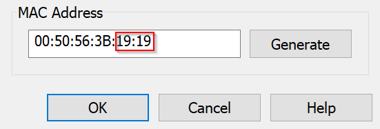{ loading=lazy width="380" }
    /// caption
    VMware — champ MAC Address d'une carte réseau : à laisser tel quel
    ///

    Il peut être tentant de personnaliser l'adresse MAC de chaque carte (**VM > Settings… > Network Adapter > Advanced > MAC Address**), pour reconnaître le réseau d'une interface à la lecture de son adresse. En pratique, cela s'est révélé source de problèmes réseau dans certains cas. **Laisser les adresses générées par l'hyperviseur.**

!!! warning "Vérifier l'ordre des interfaces"
    La synchronisation XML-RPC recopie les règles **interface par interface**. Netgate exige donc que les interfaces soient **affectées dans le même ordre sur les deux nœuds** : `em0` = WAN, `em1` = LAN, `em2` = PFSYNC. Si une VMware récente nomme les interfaces `vmx0`, `vmx1`, `vmx2` (carte de type *vmxnet3*), ce n'est pas grave : il suffit d'adapter les noms en respectant le même ordre sur les deux pare-feux.

---

## 4. Installer pfSense sur les deux VM

1️⃣ 2️⃣ Réaliser cette installation **sur les deux VM**. Elles peuvent être installées en parallèle.

1. Démarrer la VM sur l'ISO. Sur l'écran **Copyright and Trademark Notices**, valider **Accept** avec ++enter++.

    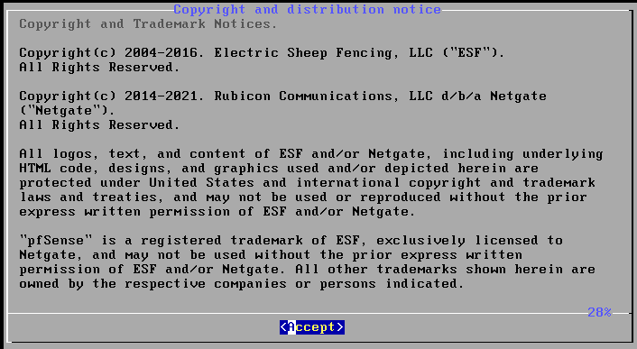{ loading=lazy width="420" }
    /// caption
    Installeur — écran de copyright : Accept
    ///

2. Sur l'écran **Welcome to pfSense!**, choisir **Install — Install pfSense**, puis **OK**.

    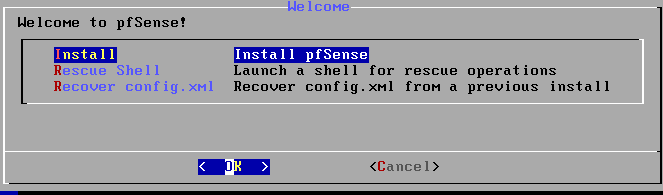{ loading=lazy width="420" }
    /// caption
    Installeur — choisir Install pfSense
    ///

3. Sur l'écran de partitionnement (**How would you like to partition your disk?**), choisir **Auto (ZFS) — Guided Root-on-ZFS**, puis **OK**.

    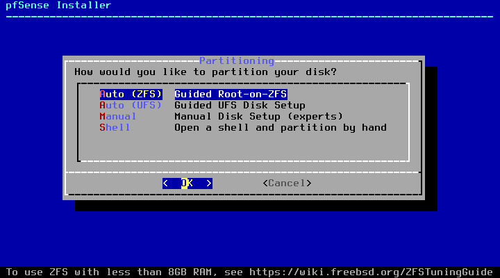{ loading=lazy width="420" }
    /// caption
    Installeur 2.7.2 — partitionnement : Auto (ZFS)
    ///

    !!! info "ZFS ou UFS ?"
        **ZFS** est un système de fichiers moderne qui résiste mieux aux coupures de courant brutales. C'est le choix par défaut depuis pfSense 2.6. Le message « *To use ZFS with less than 8GB RAM…* » est purement informatif : il ne pose aucun problème dans ce lab. Selon la version de l'installeur, l'ordre des options peut varier, ou un écran de choix du clavier (*Keymap Selection*) peut apparaître avant. Dans ce cas, garder le clavier par défaut.

4. Le menu **ZFS Configuration** s'affiche. Descendre sur **T — Pool Type/Disks** et valider avec ++enter++.

5. Choisir **stripe — No Redundancy**. La VM n'a qu'un disque : la redondance n'aurait aucun sens.

    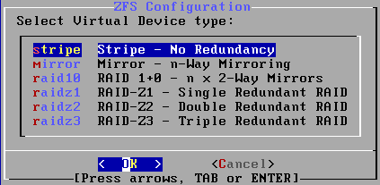{ loading=lazy width="420" }
    /// caption
    Type de pool ZFS : stripe
    ///

6. Cocher le disque `da0` avec la **barre d'espace** (une étoile `[*]` apparaît), puis valider **OK**.

    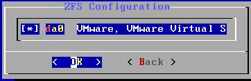{ loading=lazy width="420" }
    /// caption
    Sélection du disque da0 avec la barre d'espace
    ///

7. De retour au menu, la ligne indique **stripe: 1 disk**. Remonter sur **>>> Install — Proceed with Installation** et valider.

    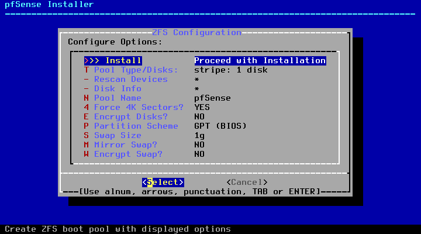{ loading=lazy width="420" }
    /// caption
    Menu ZFS Configuration : stripe sur 1 disque, prêt pour Install
    ///

8. Sur l'avertissement **Last Chance!**, choisir **YES** (flèche gauche, puis ++enter++). Le disque virtuel est vide, rien n'est perdu.

    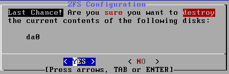{ loading=lazy width="420" }
    /// caption
    Dernière confirmation avant l'effacement du disque : YES
    ///

9. Patienter pendant la vérification et l'extraction des fichiers (une à deux minutes).

    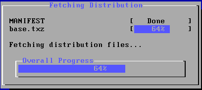{ loading=lazy width="420" }
    /// caption
    Extraction des fichiers
    ///

10. Sur l'écran **Complete**, choisir **Reboot**.

    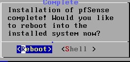{ loading=lazy width="380" }
    /// caption
    Fin de l'installation : Reboot
    ///

!!! tip "Éjecter l'ISO"
    Si la VM redémarre sur l'installeur au lieu du système installé, éteindre la VM, **déconnecter le lecteur CD** (VMware : décocher **Connected** et **Connect at power on** ; VirtualBox : **Retirer le disque du lecteur virtuel**), puis la redémarrer.

🛟 **Point de sauvegarde** : 🖥️ prendre un instantané des deux VM, nommé `01-installation-terminee`.

---

## 5. Configuration initiale en console

Au premier démarrage, pfSense affiche un menu numéroté dans la console de la VM. Le clavier y est en **QWERTY** : voir les [annexes](annexes.md#17-passer-le-clavier-de-la-console-en-azerty) pour passer en AZERTY.

### 5.1 Affecter les interfaces (option 1)

pfSense attribue automatiquement `em0` au WAN et `em1` au LAN, mais pas `em2`. L'option **1) Assign Interfaces** permet de tout affecter explicitement, **dans le même ordre sur les deux pare-feux**.

1️⃣ 2️⃣ **Sur les deux pare-feux** : saisir `1`, puis répondre aux questions.

| Question affichée | Réponse | Explication |
|-------------------|---------|-------------|
| `Should VLANs be set up now [y\|n]?` | `n` | Pas de VLAN dans ce TP. |
| `Enter the WAN interface name…` | `em0` | Première carte = VMnet8 (NAT). |
| `Enter the LAN interface name…` | `em1` | Deuxième carte = VMnet19. |
| `Enter the Optional 1 interface name…` | `em2` | Troisième carte = LAN segment SYNCHRO-PFSENSE. Elle s'appellera `OPT1` jusqu'à son renommage en `PFSYNC`. |
| `Enter the Optional 2 interface name…` | ++enter++ (vide) | Plus d'autre carte. |
| `Do you want to proceed [y\|n]?` | `y` | — |

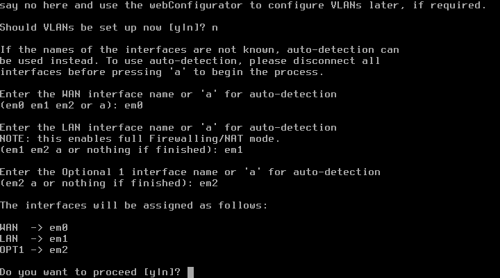{ loading=lazy width="560" }
/// caption
Console — affectation des interfaces : WAN em0, LAN em1, OPT1 em2
///

### 5.2 Donner son adresse IP au LAN (option 2)

L'adresse LAN par défaut, `192.168.1.1`, n'est pas dans le réseau du PC hôte (`192.168.19.0/24`). Il faut la changer pour pouvoir ouvrir l'interface web.

1️⃣ 2️⃣ **Sur chaque pare-feu** : saisir `2`, puis `2` pour choisir l'interface LAN.

| Question affichée | 1️⃣ `pfsense-19` | 2️⃣ `pfsense-20` | Explication |
|-------------------|--------------|--------------|-------------|
| `Configure IPv4 address LAN interface via DHCP? (y/n)` | `n` | `n` | Un pare-feu a une adresse fixe. |
| `Enter the new LAN IPv4 address` | `192.168.19.19` | `192.168.19.20` | — |
| `Enter the new LAN IPv4 subnet bit count` | `24` | `24` | Masque `255.255.255.0`. |
| `For a WAN, enter the new LAN IPv4 upstream gateway address` | ++enter++ | ++enter++ | Pas de passerelle sur un LAN. |
| `Configure IPv6 address LAN interface via DHCP6? (y/n)` | `n` | `n` | Pas d'IPv6 dans ce TP. |
| `Enter the new LAN IPv6 address` | ++enter++ | ++enter++ | — |
| `Do you want to enable the DHCP server on LAN? (y/n)` | `n` | `n` | Deux serveurs DHCP sur le même réseau se feraient concurrence. |
| `Do you want to revert to HTTP as the webConfigurator protocol? (y/n)` | `n` | `n` | On garde HTTPS, chiffré. |

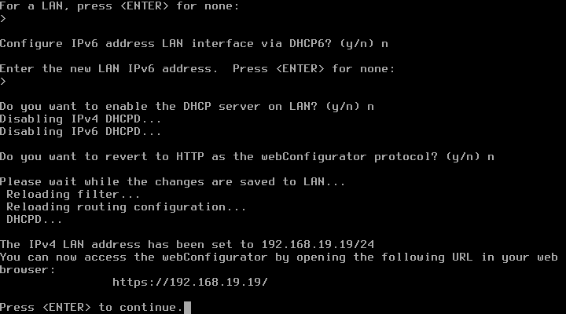{ loading=lazy width="560" }
/// caption
Console — fin de la configuration de l'adresse LAN du primaire
///

!!! success "Vérification"
    🖥️ Depuis le PC hôte, la commande `ping 192.168.19.19` puis `ping 192.168.19.20` doit recevoir des réponses. Si ce n'est pas le cas, vérifier que la 2^e^ carte de la VM est bien dans VMnet19 (ou dans le réseau privé hôte de VirtualBox).

---

## 6. Questions de révision

1. Pourquoi installer pfSense CE **2.7.2** plutôt que directement la dernière version ?
2. À quoi sert chacun des trois réseaux du lab (WAN, LAN, SYNCHRO-PFSENSE) ?
3. Pourquoi le réseau de synchronisation est-il un **LAN segment** (VMware) ou un **réseau interne** (VirtualBox), et non un VMnet ou un réseau privé hôte ?
4. Pourquoi les trois cartes réseau doivent-elles être affectées **dans le même ordre** sur les deux pare-feux ?
5. Pourquoi répond-on `n` à la question `Do you want to enable the DHCP server on LAN?` ?
6. Sous VirtualBox, pourquoi le WAN utilise-t-il le mode **Réseau NAT** et non le mode **NAT** ?

??? success "Corrigé"
    1. Depuis la 2.8, pfSense CE ne se télécharge plus en **ISO autonome** : il faut le *Netgate Installer*, qui exige un compte Netgate et une connexion Internet pendant l'installation. L'ISO 2.7.2 s'installe hors ligne, ce qui est plus simple et plus fiable pour un TP. La mise à jour de la partie 8 apprend ensuite à mettre un cluster à jour.
    2. Le **WAN** (`192.168.8.0/24`) représente l'extérieur et donne accès à Internet par le NAT de l'hyperviseur. Le **LAN** (`192.168.19.0/24`) représente le réseau interne ; le PC hôte y est relié, ce qui permet d'ouvrir les interfaces web. **SYNCHRO-PFSENSE** (`192.168.254.0/30`) est un câble virtuel réservé aux deux pare-feux, pour la synchronisation.
    3. Un LAN segment ou un réseau interne ne relie **que les VM** qui y sont branchées : aucune carte n'est créée sur le PC hôte, et le lien reste réservé aux deux pare-feux. Il accepte aussi le masque `/30`. Un VMnet est relié au PC hôte, et VMware Workstation n'y accepte pas de masque plus petit qu'un `/29`.
    4. XML-RPC recopie les règles **interface par interface**. Si `em2` était le LAN sur un nœud et PFSYNC sur l'autre, les règles recopiées atterriraient sur la mauvaise interface. Netgate exige donc le même ordre d'affectation sur les deux nœuds.
    5. Les deux pare-feux sont sur le **même LAN** : deux serveurs DHCP s'y feraient concurrence. Aucune machine du lab n'utilise d'ailleurs le DHCP.
    6. En mode **NAT** simple, VirtualBox crée un réseau privé **pour chaque VM** : les deux pare-feux ne se voient pas côté WAN, chacun se déclare MASTER de la VIP WAN et le cluster ne fonctionne pas. Le **Réseau NAT** place les deux VM sur le même réseau.

---

## Ressources

- [Netgate — Installing pfSense](https://docs.netgate.com/pfsense/en/latest/install/index.html) — Documentation officielle de l'installation.
- [Netgate — High Availability in virtual environments](https://docs.netgate.com/pfsense/en/latest/troubleshooting/high-availability-virtual.html) — Réglages des hyperviseurs (mode promiscuité).
- [Oracle — Modes réseau de VirtualBox](https://docs.oracle.com/en/virtualization/virtualbox/7.1/user/networkingdetails.html) — NAT, Réseau NAT, réseau privé hôte et réseau interne.
- Partie précédente : [Comprendre la haute disponibilité](01-comprendre-haute-disponibilite.md) · Partie suivante : [Configuration initiale](03-configuration-initiale.md).

*[CARP]: Common Address Redundancy Protocol
*[VIP]: Virtual IP — adresse IP virtuelle partagée
*[NAT]: Network Address Translation — traduction d'adresses
*[NIC]: Network Interface Controller — carte réseau
*[ISO]: Image disque d'un CD/DVD
*[CIDR]: Classless Inter-Domain Routing — notation /24, /30…
