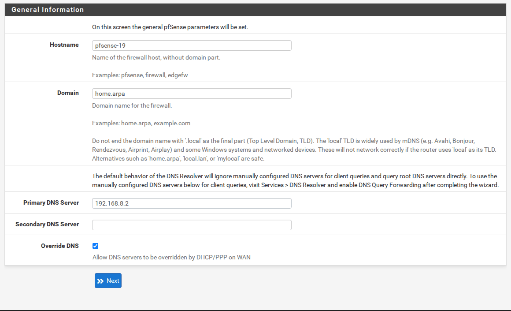
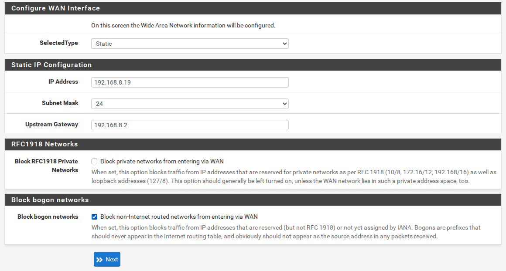
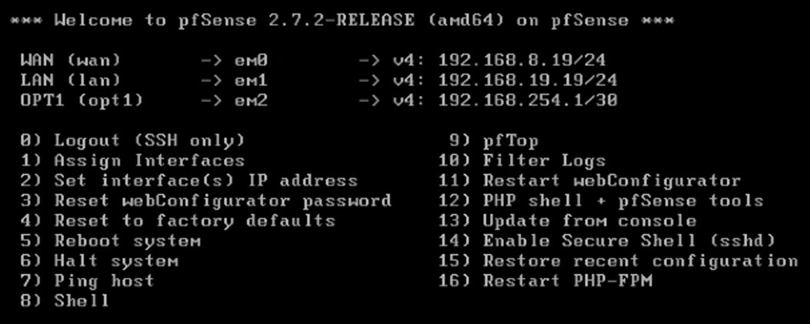
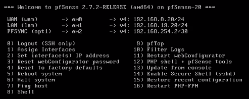
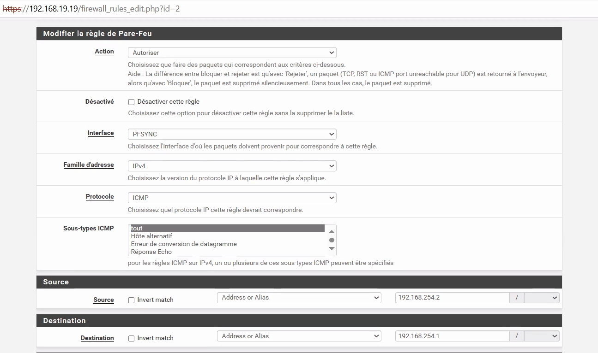
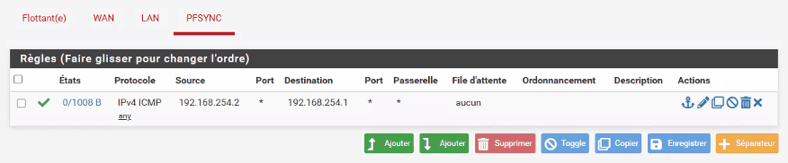
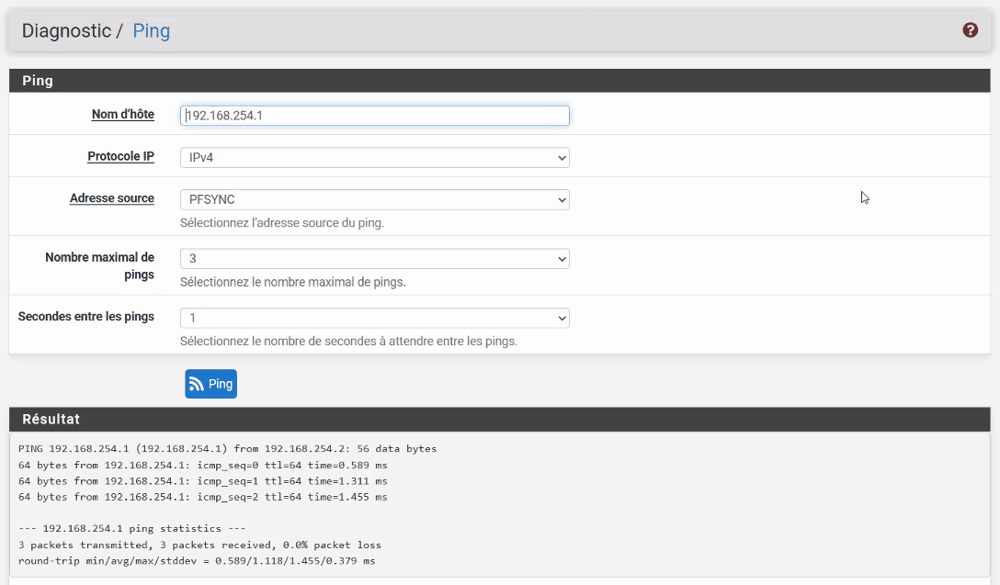
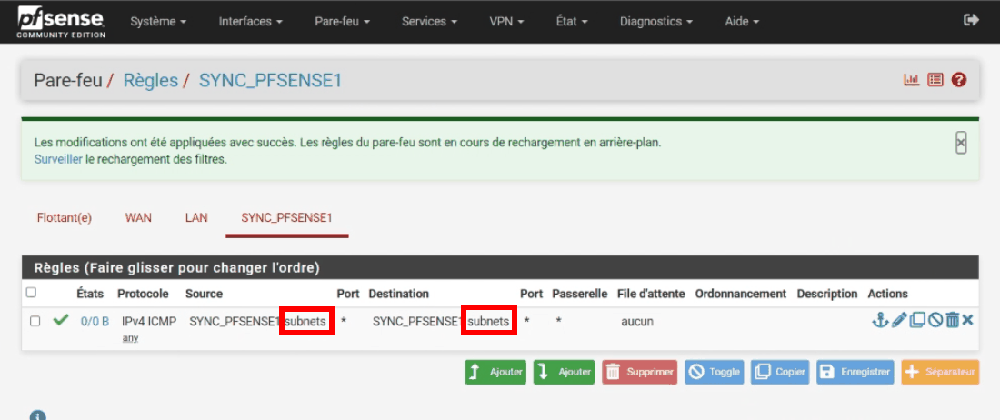

<!-- ============================================================ -->
<!-- ⚠️ RAPPEL IMPORTANT :                                          -->
<!-- Pensez TOUJOURS à ajouter une entrée dans le fichier d'index  -->
<!-- (index.md) du dossier correspondant (ex: docs/cloud/index.md) -->
<!-- afin de référencer ce nouvel article et permettre aux         -->
<!-- visiteurs de le trouver et de cliquer dessus !                -->
<!-- ============================================================ -->

# TP pfSense HA : configuration initiale des deux pare-feux

!!! abstract "Résumé"
    Les deux pare-feux sont installés et joignables sur le LAN. Ce TP fait leur **configuration initiale** dans l'interface web : l'assistant de configuration (nom, DNS, fuseau horaire, adresses WAN et LAN, mot de passe `admin`), puis l'interface de synchronisation **PFSYNC** sur la troisième carte.

    On apprend ensuite à **distinguer les deux pare-feux d'un coup d'œil**, et on fait le premier test de connectivité entre eux, en écrivant une première règle de filtrage. C'est l'occasion de comprendre **sur quel pare-feu** une règle doit être créée.

| Propriété | Valeur |
|-----------|--------|
| Difficulté | Intermédiaire |
| Durée estimée | 45 min |
| Version décrite | pfSense CE 2.7.2 |
| Place dans le parcours | Partie 3 sur 8 du parcours [Cluster pfSense en haute disponibilité](index.md) |
| Dernière mise à jour | 2026-11-07 |

---

!!! info "Convention de lecture"
    Chaque action commence par un repère qui indique où elle se fait : 🖥️ **PC hôte**, 1️⃣ **primaire** `pfsense-19` (`https://192.168.19.19`), 2️⃣ **secondaire** `pfsense-20` (`https://192.168.19.20`), 1️⃣ 2️⃣ **les deux pare-feux**. Les interfaces web s'ouvrent dans le navigateur du PC hôte. Les [comptes et mots de passe](index.md#comptes-et-mots-de-passe) sont rappelés sur la page d'accueil du parcours.

## 1. Se connecter à l'interface web

🖥️ Depuis le navigateur du PC hôte, ouvrir `https://192.168.19.19` pour le primaire et `https://192.168.19.20` pour le secondaire.

Le navigateur affiche un **avertissement de sécurité**. C'est normal : pfSense utilise un **certificat auto-signé**, qu'aucune autorité reconnue n'a signé. La connexion est bien chiffrée, mais le navigateur ne peut pas garantir l'identité du site. Dans un lab, cliquer sur **Paramètres avancés > Continuer vers le site**.

L'identifiant et le mot de passe par défaut sont **`admin` / `pfsense`** (documentation officielle de Netgate).

## 2. Suivre l'assistant de configuration (*Setup Wizard*)

L'assistant démarre automatiquement à la première connexion. 1️⃣ 2️⃣ Le réaliser **sur les deux pare-feux** avec les valeurs suivantes, en cliquant sur **Next** à chaque page.

| Page de l'assistant | Champ | 1️⃣ `pfsense-19` | 2️⃣ `pfsense-20` |
|---------------------|-------|--------------|--------------|
| Netgate Global Support | — | **Next** | **Next** |
| General Information | Hostname | `pfsense-19` | `pfsense-20` |
| | Domain | `home.arpa` | `home.arpa` |
| | Primary DNS Server | `192.168.8.2` (VirtualBox : `.1`) | idem |
| Time Server Information | Timezone | `Europe/Paris` | `Europe/Paris` |
| Configure WAN Interface | SelectedType | `Static` | `Static` |
| | IP Address / Subnet Mask | `192.168.8.19` / `24` | `192.168.8.20` / `24` |
| | Upstream Gateway | `192.168.8.2` (VirtualBox : `.1`) | idem |
| | **Block RFC1918 Private Networks** | **décoché** | **décoché** |
| | Block bogon networks | coché (par défaut) | coché |
| Configure LAN Interface | LAN IP Address / Subnet Mask | `192.168.19.19` / `24` | `192.168.19.20` / `24` |
| Set Admin WebGUI Password | Admin Password | `Tp-PvnpZskdQq` | **le même** : `Tp-PvnpZskdQq` |
| Reload configuration | — | **Reload** | **Reload** |

<figure markdown="span">
  { loading=lazy }
  <figcaption>Le nom d'hôte est propre à chaque nœud et n'est jamais synchronisé : c'est lui qui permet de savoir où l'on se trouve.</figcaption>
</figure>

<figure markdown="span">
  { loading=lazy }
  <figcaption>Extrait de la page WAN : seules les parties à modifier sont montrées.</figcaption>
</figure>

!!! warning "Pourquoi décocher « Block RFC1918 Private Networks » ?"
    Cette option bloque, à l'entrée du WAN, tout trafic provenant d'une adresse **privée** (`10.0.0.0/8`, `172.16.0.0/12`, `192.168.0.0/16`). Sur une vraie connexion Internet, c'est une bonne protection : aucune adresse privée ne devrait arriver d'Internet. Mais dans ce lab, **le WAN lui-même est un réseau privé** (`192.168.8.0/24`), et le texte d'aide de pfSense le précise : *« This option should generally be left turned on, unless the WAN network lies in such a private address space, too »*. Laissée cochée, l'option bloquerait toute connexion **initiée depuis le WAN** du lab, par exemple l'accès à l'interface web par le WAN décrit dans les [annexes](annexes.md#15-acceder-a-linterface-web-par-le-wan-avec-une-regle-permanente).

    Elle ne gêne en revanche **ni CARP ni l'accès à Internet** : la règle automatique qui autorise CARP passe avant ce blocage, et les réponses aux connexions sortantes sont acceptées grâce à la table d'états.

!!! danger "Ne pas relancer l'assistant sur un pare-feu déjà configuré"
    L'assistant reste accessible dans **System > Setup Wizard**, mais il ne sert qu'à la première configuration. Rouvrir l'assistant sur un pare-feu en service et cliquer sur **Next** à une seule étape, sans aller jusqu'au bout, suffit à **effacer l'adresse IP du WAN** dans la configuration. La panne n'apparaît qu'au redémarrage suivant, ce qui la rend difficile à diagnostiquer. Pour modifier un réglage ensuite, passer par le menu concerné, par exemple **Interfaces > WAN**.

!!! info "Pourquoi le même mot de passe admin sur les deux nœuds ?"
    L'option **Synchronize admin**, activée à la [partie 4](04-synchroniser-le-cluster.md#2-parametrer-la-synchronisation-sur-le-primaire), recopiera de toute façon le compte `admin` du primaire vers le secondaire. Choisir le même mot de passe dès maintenant évite toute confusion.

## 3. Configurer l'interface de synchronisation (OPT1 → PFSYNC)

1️⃣ 2️⃣ **Sur chaque pare-feu**, ouvrir **Interfaces > OPT1**, puis :

| Champ | 1️⃣ `pfsense-19` | 2️⃣ `pfsense-20` |
|-------|--------------|--------------|
| Enable | coché | coché |
| Description | `PFSYNC` | `PFSYNC` |
| IPv4 Configuration Type | `Static IPv4` | `Static IPv4` |
| IPv4 Address | `192.168.254.1` / `30` | `192.168.254.2` / `30` |
| IPv4 Upstream gateway | `None` | `None` |

Cliquer sur **Save**, puis sur **Apply Changes**.

!!! info "Pourquoi « None » comme passerelle ?"
    Une passerelle (*gateway*) sert à joindre des réseaux **lointains**. Le lien de synchronisation ne mène nulle part ailleurs : les deux pare-feux sont directement reliés, une passerelle y serait inutile.

## 4. Distinguer les deux pare-feux d'un coup d'œil

Pour ne pas confondre les deux interfaces web, ouvertes côte à côte dans le navigateur :

- 1️⃣ **Sur le primaire** : dans **System > General Setup** (*Système > Configuration générale*), régler **Language** sur **Français** et **Theme** sur **pfSense-dark**, puis **Save**.
- 2️⃣ **Sur le secondaire** : laisser l'anglais et le thème clair.

Ces réglages appartiennent à **System > General Setup**, qui n'est **jamais synchronisé** : ils resteront différents même une fois la synchronisation active.

!!! success "État attendu des consoles"
    Une fois les interfaces configurées, la console de chaque pare-feu affiche ses trois adresses.

    { loading=lazy width="560" }
    /// caption
    Console du primaire, interfaces configurées
    ///

    { loading=lazy width="560" }
    /// caption
    Console du secondaire, interfaces configurées
    ///

---

## 5. Tester la connectivité entre les deux pare-feux

Sur une interface optionnelle comme PFSYNC, pfSense **bloque tout le trafic entrant par défaut** tant qu'aucune règle ne l'autorise. C'est le principe du **refus par défaut** : *tout ce qui n'est pas explicitement autorisé est interdit*. Le premier test consiste à autoriser le ping du secondaire vers le primaire.

1️⃣ **Sur le primaire**, ouvrir **Firewall > Rules > PFSYNC** (*Pare-feu > Règles > PFSYNC*), cliquer sur **Add**, puis renseigner :

| Champ | Valeur |
|-------|--------|
| Action | `Pass` (*Autoriser*) |
| Interface | `PFSYNC` |
| Address Family | `IPv4` |
| Protocol | `ICMP` — sous-type `any` (*tout*) |
| Source | `Address or Alias` : `192.168.254.2` (le secondaire) |
| Destination | `Address or Alias` : `192.168.254.1` (le primaire) |

Cliquer sur **Save**, puis sur **Apply Changes** (*Appliquer les modifications*). Tant que ce bouton n'est pas cliqué, la règle est enregistrée mais **pas active**.

{ loading=lazy }
/// caption
Primaire — règle ICMP sur PFSYNC, de 192.168.254.2 vers 192.168.254.1
///

{ loading=lazy }
/// caption
Primaire — la règle ICMP dans la liste des règles PFSYNC
///

2️⃣ **Sur le secondaire**, ouvrir **Diagnostics > Ping**, puis saisir **Hostname** `192.168.254.1`, **Source address** `PFSYNC` et cliquer sur **Ping**.

{ loading=lazy }
/// caption
Secondaire — ping de 192.168.254.1 depuis l'interface PFSYNC : 0 % de perte
///

!!! question "Pourquoi créer la règle sur le primaire, alors que le ping part du secondaire ?"
    ??? success "Réponse"
        Une règle de pare-feu pfSense s'applique aux paquets qui **entrent** par une interface. Le ping (*echo request*) sort du secondaire, ce qui est toujours autorisé, puis **entre** dans le primaire par son interface PFSYNC : c'est **le primaire** qui doit l'accepter. La réponse (*echo reply*) revient ensuite automatiquement, grâce à la **table d'états**.

        Avec la règle sur le secondaire uniquement, le ping donne **100 % de perte** ; avec la règle sur le primaire, **0 % de perte**.

!!! tip "En cas d'échec du ping"
    Si le ping ne passe toujours pas, autoriser l'ensemble du réseau **PFSYNC subnets** en source et en destination, au lieu des deux adresses, 1️⃣ 2️⃣ **sur les deux pare-feux**. Cette modification a réglé le problème dans certains cas.

    { loading=lazy }
    /// caption
    Variante de dépannage : ICMP autorisé entre PFSYNC subnets
    ///

**Vérifier aussi l'accès à Internet** (indispensable pour la mise à jour finale) : 1️⃣ 2️⃣ **sur chaque pare-feu**, dans **Diagnostics > Ping**, pinguer `192.168.8.2` (la passerelle ; VirtualBox : `192.168.8.1`), puis `1.1.1.1`, avec **Source address** `WAN`.

🛟 **Point de sauvegarde** : 🖥️ prendre un instantané des deux VM, nommé `02-configuration-de-base`.

---

## 6. Questions de révision

1. Pourquoi le navigateur affiche-t-il un avertissement de sécurité à la première connexion, et pourquoi peut-on continuer dans ce lab ?
2. Pourquoi décoche-t-on **Block RFC1918 Private Networks** dans l'assistant ?
3. Pourquoi ne faut-il pas relancer l'assistant sur un pare-feu déjà configuré ?
4. Pourquoi la règle ICMP se crée-t-elle **sur le primaire**, alors que le ping part du secondaire ?
5. Après avoir enregistré une règle avec **Save**, que faut-il encore faire pour qu'elle soit active ?
6. Pourquoi la langue et le thème choisis sur le primaire ne seront-ils jamais recopiés sur le secondaire, et en quoi est-ce utile ?

??? success "Corrigé"
    1. pfSense utilise un **certificat auto-signé** : la connexion est chiffrée, mais aucune autorité reconnue ne garantit l'identité du site. Dans un lab, on sait à quelle machine on se connecte, on peut donc continuer.
    2. Dans ce lab, **le WAN est lui-même un réseau privé** (`192.168.8.0/24`). Laissée cochée, l'option bloquerait toute connexion initiée depuis le WAN, comme l'accès à l'interface web par le WAN décrit dans les annexes. Elle ne gêne ni CARP ni l'accès à Internet.
    3. Cliquer sur **Next** à une seule étape suffit à **effacer l'adresse IP du WAN** dans la configuration, et la panne n'apparaît qu'au redémarrage suivant : elle est difficile à diagnostiquer. Un réglage se modifie dans son menu, par exemple **Interfaces > WAN**.
    4. Une règle s'applique aux paquets qui **entrent** par une interface. La demande d'écho sort du secondaire et **entre dans le primaire** par PFSYNC : c'est le primaire qui doit l'accepter. La réponse revient grâce à la table d'états. Avec la règle sur le secondaire seul, le ping donne 100 % de perte.
    5. Cliquer sur **Apply Changes**. Tant que ce bouton n'est pas cliqué, la règle est enregistrée mais pas active.
    6. Ces réglages appartiennent à **System > General Setup**, qui n'est **jamais synchronisé**. C'est voulu : ils restent différents sur les deux nœuds et permettent de savoir d'un coup d'œil sur quel pare-feu on travaille.

---

## Ressources

- [Netgate — Setup Wizard](https://docs.netgate.com/pfsense/en/latest/config/setup-wizard.html) — Les pages de l'assistant de configuration.
- [Netgate — Configuring High Availability (recette complète)](https://docs.netgate.com/pfsense/en/latest/recipes/high-availability.html) — La procédure de référence de l'éditeur.
- Partie précédente : [Préparer le lab et installer pfSense](02-preparer-lab-installer-pfsense.md) · Partie suivante : [Synchroniser le cluster](04-synchroniser-le-cluster.md).

*[CARP]: Common Address Redundancy Protocol
*[NAT]: Network Address Translation — traduction d'adresses
*[CIDR]: Classless Inter-Domain Routing — notation /24, /30…
