<!-- ============================================================ -->
<!-- ⚠️ RAPPEL IMPORTANT :                                          -->
<!-- Pensez TOUJOURS à ajouter une entrée dans le fichier d'index  -->
<!-- (index.md) du dossier correspondant (ex: docs/cloud/index.md) -->
<!-- afin de référencer ce nouvel article et permettre aux         -->
<!-- visiteurs de le trouver et de cliquer dessus !                -->
<!-- ============================================================ -->

# TP pfSense HA : synchroniser le cluster

!!! abstract "Résumé"
    Ce TP met en place les deux synchronisations du cluster. **XML-RPC** recopie la configuration du primaire vers le secondaire : il faut pour cela un **utilisateur dédié**, `ha-user`, et le paramétrage de la page **High Availability** du primaire. **pfsync** échange la table d'états dans les deux sens : il s'active sur **chaque** nœud.

    Entre les deux, on n'ouvre sur le lien PFSYNC que les flux **strictement nécessaires** (XML-RPC, pfsync, CARP), en comprenant pourquoi chaque règle se crée sur un pare-feu plutôt que sur l'autre. On vérifie enfin que la réplication fonctionne et on apprend à la dépanner.

| Propriété | Valeur |
|-----------|--------|
| Difficulté | Intermédiaire |
| Durée estimée | 1 h |
| Version décrite | pfSense CE 2.7.2 |
| Place dans le parcours | Partie 4 sur 8 du parcours [Cluster pfSense en haute disponibilité](index.md) |
| Dernière mise à jour | 2026-11-07 |

---

!!! info "Convention de lecture"
    Chaque action commence par un repère qui indique où elle se fait : 🖥️ **PC hôte**, 1️⃣ **primaire** `pfsense-19` (`https://192.168.19.19`), 2️⃣ **secondaire** `pfsense-20` (`https://192.168.19.20`), 1️⃣ 2️⃣ **les deux pare-feux**. Dans cette partie plus que dans toute autre, **relire le repère avant chaque manipulation** : l'ordre et le nœud comptent. Les [comptes et mots de passe](index.md#comptes-et-mots-de-passe) sont rappelés sur la page d'accueil du parcours.

## 1. Créer un utilisateur dédié à la synchronisation

Le primaire doit **s'authentifier** auprès du secondaire pour lui envoyer la configuration. Plutôt que d'utiliser le compte `admin`, on crée un compte dédié. C'est une bonne pratique : ce compte sert à une seule tâche, et il peut être désactivé ou changé sans toucher au compte d'administration.

2️⃣ **Sur le secondaire** :

1. Ouvrir **System > User Manager** (*Système > Gestionnaire d'usagers*) et cliquer sur **Add**.
2. Saisir **Username** `ha-user` et le mot de passe `Ha-UdO8Xe29FS`, puis cliquer sur **Save**.
3. **Modifier à nouveau** l'utilisateur (icône crayon) : la section **Effective Privileges** n'apparaît qu'après le premier enregistrement.

    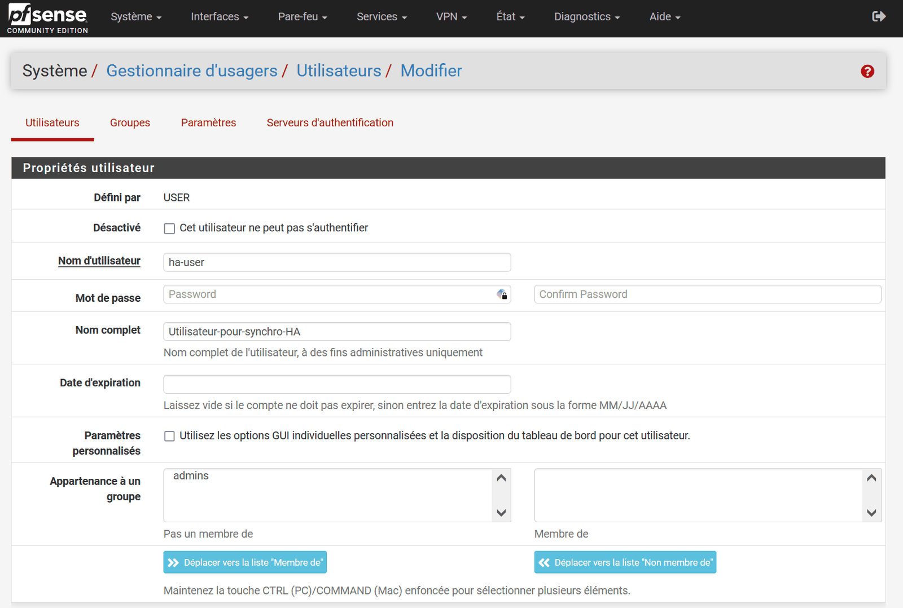{ loading=lazy }
    /// caption
    Création de l'utilisateur ha-user
    ///

4. Dans **Effective Privileges**, cliquer sur **Add**, sélectionner **System - HA node sync** (*Système – Synchronisation du nœud du Système HA*), puis enregistrer.

    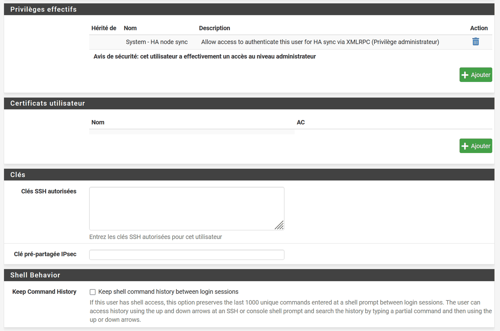{ loading=lazy }
    /// caption
    Privilège System - HA node sync attribué à ha-user
    ///

!!! warning "Un compte à protéger"
    pfSense le signale lui-même : ce privilège donne en pratique un **accès équivalent à celui d'un administrateur**, puisqu'il permet de remplacer la configuration. Le mot de passe de `ha-user` doit donc être aussi robuste que celui d'`admin`.

1️⃣ **Sur le primaire**, créer **le même utilisateur**, avec le même nom (`ha-user`), le même mot de passe (`Ha-UdO8Xe29FS`) et le même privilège.

!!! question "Pourquoi créer aussi `ha-user` sur le primaire, alors que c'est le secondaire qui reçoit les connexions ?"
    ??? success "Réponse"
        La synchronisation XML-RPC ne **fusionne** pas les configurations : elle **remplace** des sections entières du secondaire par celles du primaire. C'est le cas de la liste des utilisateurs, dès que l'option *User manager users and groups* est cochée.

        Si `ha-user` n'existait que sur le secondaire, la première synchronisation **supprimerait** ce compte, absent du primaire, et toutes les synchronisations suivantes échoueraient faute d'authentification. Le cluster se « casserait » lui-même.

## 2. Paramétrer la synchronisation sur le primaire

1️⃣ **Sur le primaire uniquement**, ouvrir **System > High Avail. Sync**. La page s'intitule *High Availability* ; en français, le menu s'appelle **Système > High Availability**.

| Section | Champ | Valeur | Rôle |
|---------|-------|--------|------|
| State Synchronization Settings (pfsync) | **Synchronize states** | coché | Envoie la table d'états au pair. |
| | **Synchronize Interface** | `PFSYNC` | Lien dédié. |
| | Filter Host ID | vide | Identifiant unique généré automatiquement. |
| | **pfsync Synchronize Peer IP** | `192.168.254.2` | Envoi direct au secondaire, plutôt qu'en multicast. |
| Configuration Synchronization Settings (XMLRPC Sync) | **Synchronize Config to IP** | `192.168.254.2` | Adresse PFSYNC du secondaire. |
| | **Remote System Username** | `ha-user` | — |
| | **Remote System Password** | `Ha-UdO8Xe29FS` (mot de passe de `ha-user`) | — |
| | **Synchronize admin** | coché | Recopie aussi le compte `admin`, mot de passe compris. |
| | **Select options to sync** | **Toggle All** (tout cocher) | Règles, NAT, VIP, utilisateurs, etc. |

Cliquer sur **Save**.

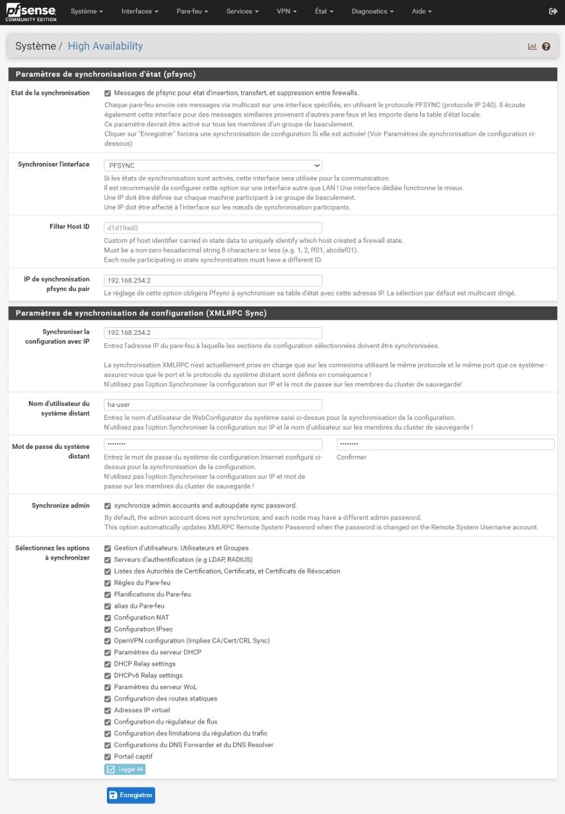{ loading=lazy }
/// caption
Primaire — page High Availability entièrement renseignée
///

**Il n'est pas nécessaire de configurer la partie XML-RPC sur le secondaire** : la réplication de la configuration du primaire s'effectuera dès que les flux seront autorisés des deux côtés.

## 3. Autoriser les flux de synchronisation

Pour respecter les bonnes pratiques de sécurité, on n'autorise **que les adresses, ports et protocoles strictement nécessaires** à la synchronisation, et rien de plus. La configuration se fait dans **Firewall > Rules > PFSYNC**.

### 3.1 Règle 1 — XML-RPC, pour la synchronisation de la configuration

1️⃣ **Sur le primaire**, cliquer sur **Add** et créer la règle suivante :

| Champ | Valeur | Explication |
|-------|--------|-------------|
| Action | `Pass` | — |
| Interface | `PFSYNC` | Interface dédiée à la réplication. |
| Address Family | `IPv4` | — |
| Protocol | `TCP` | XML-RPC voyage dans une connexion HTTPS. |
| Source | `PFSYNC subnets` | Tout le réseau `192.168.254.0/30` : il ne contient que les deux pare-feux. |
| Destination | `PFSYNC subnets` | Même raisonnement. |
| Destination Port Range | `HTTPS (443)` | Port de l'interface web, qui reçoit les appels XML-RPC. |
| Description | `autoriser la synchro de configuration XML-RPC` | Une règle décrite est une règle compréhensible six mois plus tard. |

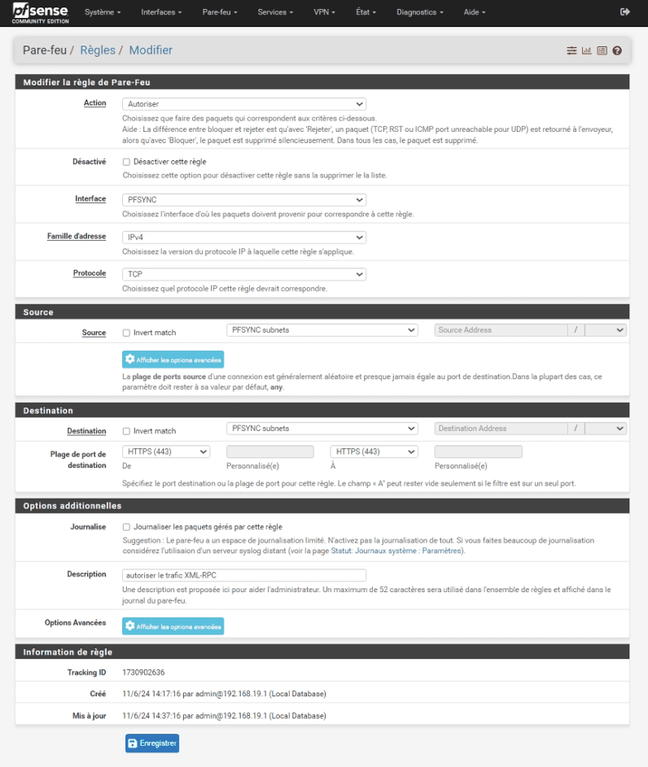{ loading=lazy }
/// caption
Règle XML-RPC : TCP 443 de PFSYNC subnets vers PFSYNC subnets
///

!!! info "Pourquoi « PFSYNC subnets » plutôt qu'une adresse IP ?"
    La règle va être **recopiée telle quelle** sur le secondaire. Avec une adresse propre à un nœud (par exemple « destination `192.168.254.1` »), la copie serait fausse sur l'autre nœud, puisque la règle ne serait pas adaptée à sa situation. **PFSYNC subnets** désigne le réseau `/30`, valable sur les deux pare-feux. Un **alias** contenant les deux adresses `192.168.254.1` et `192.168.254.2` conviendrait aussi.

2️⃣ **Ensuite, créer exactement la même règle sur le secondaire.**

!!! question "Pourquoi faire cette règle sur le secondaire également ?"
    ??? success "Réponse"
        Le primaire **envoie** son flux XML-RPC vers le secondaire. Ce flux **entre** donc par l'interface PFSYNC du **secondaire**. Sans règle l'autorisant sur le secondaire, il est bloqué (refus par défaut) et la synchronisation ne s'effectue pas.

        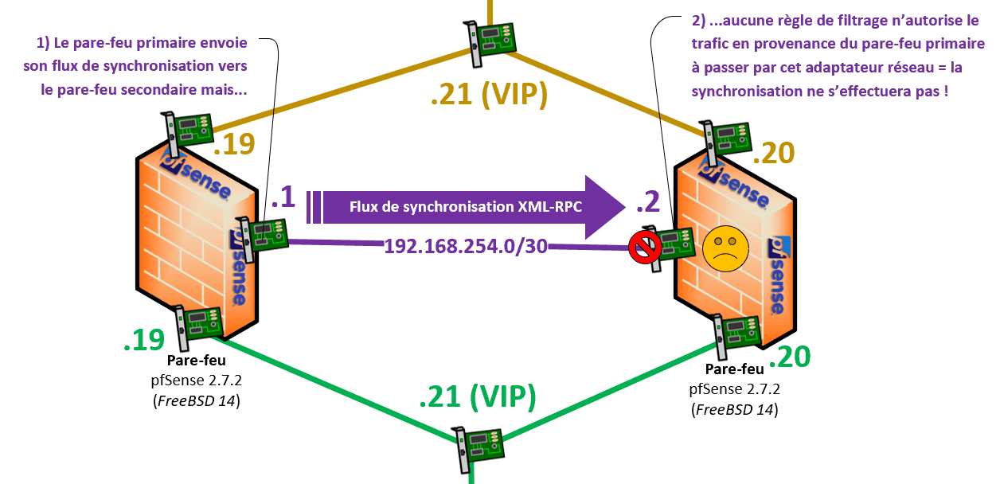{ loading=lazy }
        /// caption
        Sans règle sur le secondaire, le flux XML-RPC est bloqué à son entrée
        ///

!!! question "Pourquoi ne pas avoir commencé par la règle sur le secondaire, alors ?"
    ??? success "Réponse"
        Parce que la configuration du **primaire est la référence**. Dès que la synchronisation fonctionne, les règles du secondaire sont **remplacées** par celles du primaire.

        Si la règle XML-RPC n'existait que sur le secondaire, la première synchronisation l'**effacerait**, puisqu'elle est absente de la configuration de référence, et toutes les synchronisations suivantes seraient bloquées. En la créant d'abord sur le primaire, on garantit qu'elle fait partie de la configuration recopiée : le secondaire reçoit une copie identique de sa propre règle et la synchronisation se maintient.

        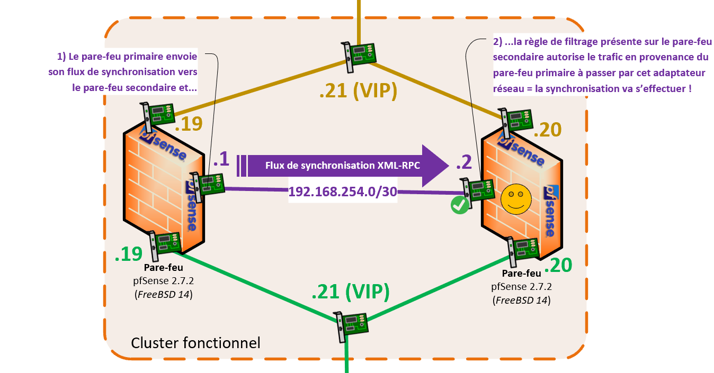{ loading=lazy }
        /// caption
        Avec la règle sur le secondaire, la synchronisation fonctionne
        ///

Une fois la règle XML-RPC créée sur le secondaire, la configuration se réplique. Pour une vérification rapide, il est possible de **forcer la synchronisation, uniquement depuis le primaire** : 1️⃣ **sur le primaire**, dans **Status > Filter Reload** (*État > Recharger les filtres*), bouton **Force Config Sync**.

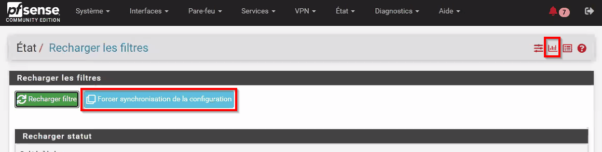{ loading=lazy }
/// caption
Primaire — État > Recharger les filtres : synchronisation forcée
///

### 3.2 Règle 2 — pfsync, pour la synchronisation des états

1️⃣ **Retourner sur le primaire** et créer une deuxième règle :

| Champ | Valeur |
|-------|--------|
| Action | `Pass` |
| Interface | `PFSYNC` |
| Address Family | `IPv4` |
| Protocol | `PFSYNC` |
| Source | `PFSYNC subnets` |
| Destination | `PFSYNC subnets` |
| Description | `autoriser la synchro des états pfsync` |

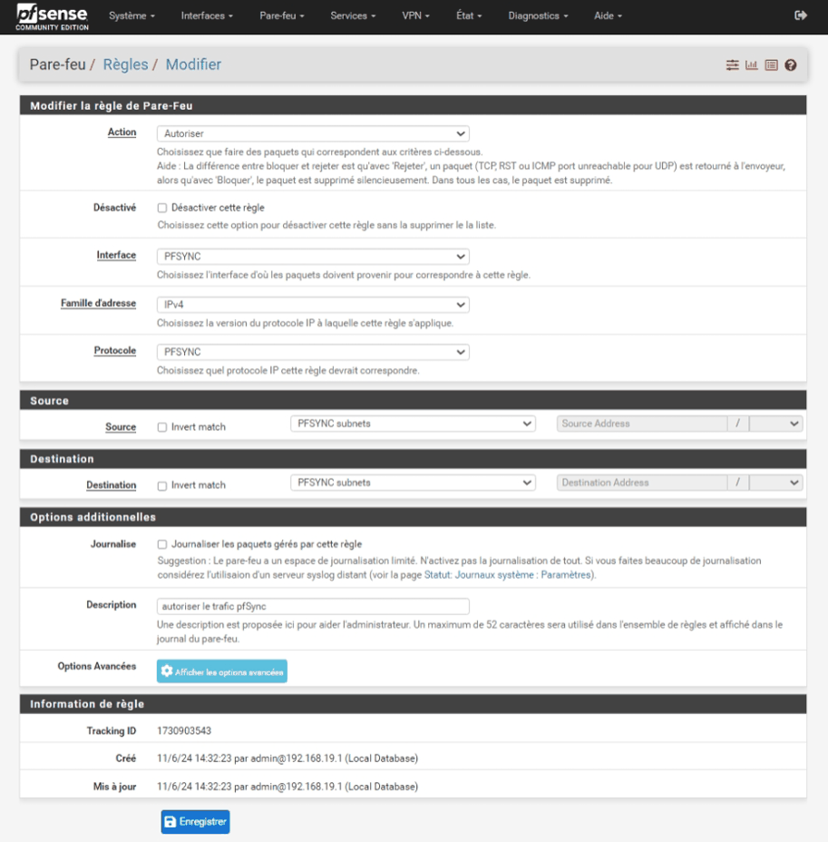{ loading=lazy }
/// caption
Règle pfsync : protocole PFSYNC entre PFSYNC subnets
///

### 3.3 Règle 3 — CARP

1️⃣ Toujours **sur le primaire**, créer une troisième règle sur le même modèle, avec le protocole **CARP**.

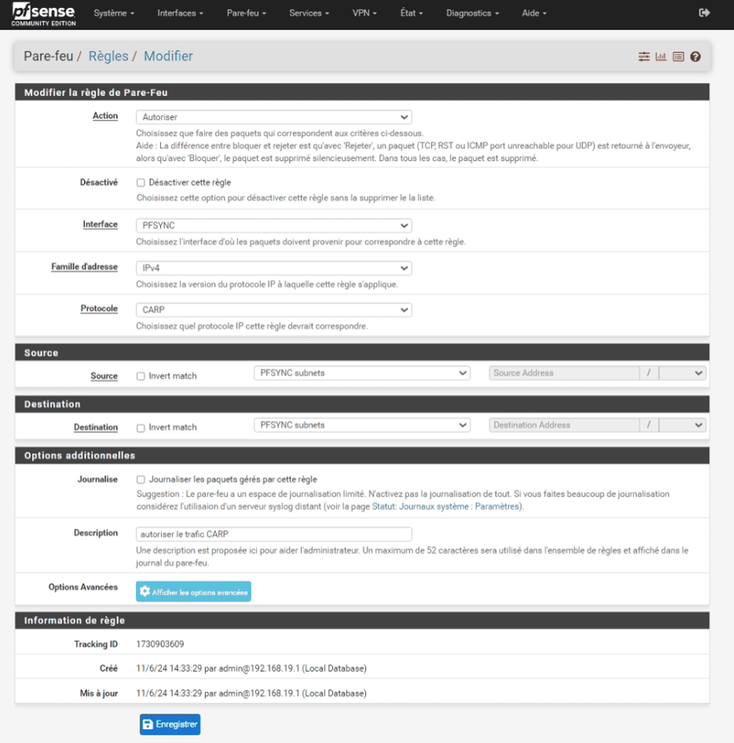{ loading=lazy }
/// caption
Règle CARP : protocole CARP entre PFSYNC subnets
///

!!! note "Pour aller plus loin : cette règle est-elle indispensable ?"
    Dès qu'une VIP CARP existe, pfSense ajoute une règle **automatique** qui autorise le protocole CARP sur toutes les interfaces. De plus, les annonces CARP circulent sur les réseaux qui portent une VIP (WAN et LAN), pas sur le lien PFSYNC. Cette troisième règle n'est donc pas strictement nécessaire. Elle ne présente aucun risque, puisqu'elle ne concerne que le `/30` des deux pare-feux, et elle **documente l'intention** de la configuration. pfsync, en revanche, n'est **jamais** autorisé automatiquement : la règle 2 est indispensable.

    Ces trois points se vérifient une fois les VIP créées (partie 5), en 2.7.2 comme en 2.9.0 :

    - la commande `pfctl -sr | grep carp` (dans **Diagnostics > Command Prompt**) affiche la règle automatique `pass quick proto carp all no state` ;
    - une capture (`tcpdump -ni em1 ip proto 112`) montre les annonces CARP sur `em0` et `em1` ;
    - sur `em2`, on ne voit passer que du pfsync.

    Les outils de capture (`tcpdump`, Wireshark) affichent les paquets CARP comme du **VRRPv2** : les deux protocoles utilisent le même numéro, 112.

Après toutes ces manipulations, l'interface PFSYNC du primaire présente ces règles :

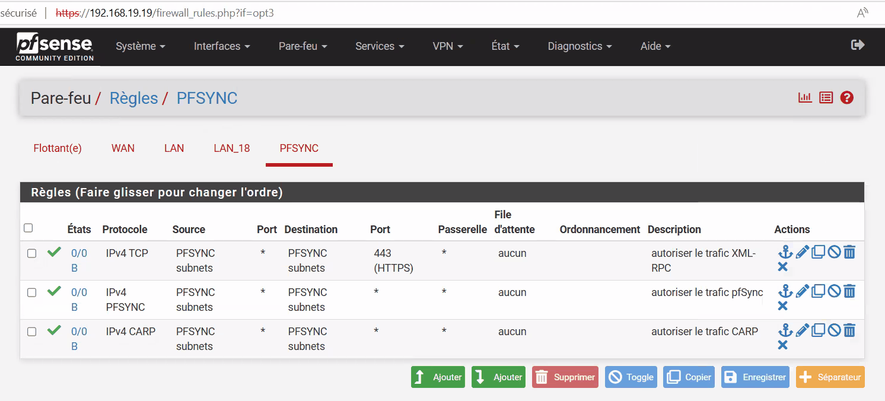{ loading=lazy }
/// caption
Primaire — règles de l'interface PFSYNC
///

2️⃣ **Ne pas toucher au secondaire** : les règles 2 et 3 vont y arriver toutes seules.

## 4. Vérifier la réplication et dépanner

2️⃣ **Sur le secondaire**, ouvrir **Firewall > Rules > PFSYNC** : les règles 2 et 3 sont apparues **automatiquement**, grâce à la règle XML-RPC.

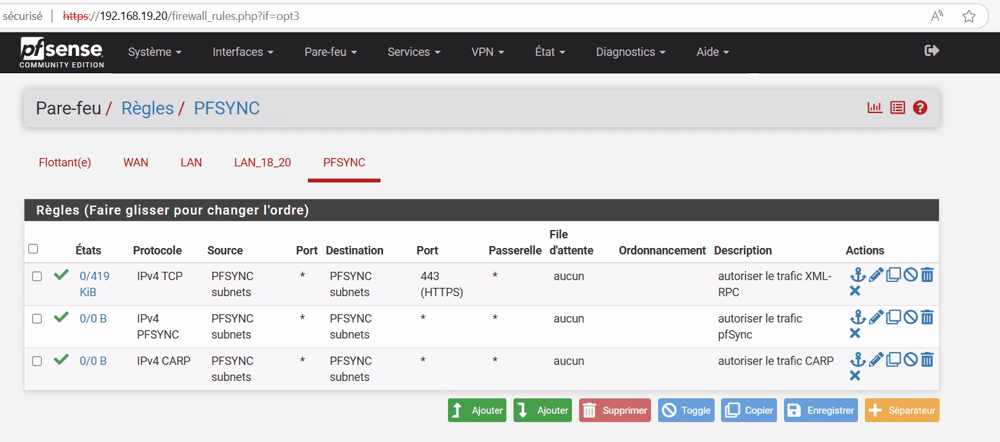{ loading=lazy }
/// caption
Secondaire — les mêmes règles, arrivées par réplication
///

En cas de problème de synchronisation, deux outils permettent d'en trouver la cause :

- **Les journaux du pare-feu sur le secondaire** : **Status > System Logs > Firewall** (*État > Journaux système > Pare-feu*). On y repère le trafic **bloqué** en provenance de l'interface PFSYNC du primaire. Le bouton **+** (*Easy Rule*) crée en un clic une règle qui l'autorise.

    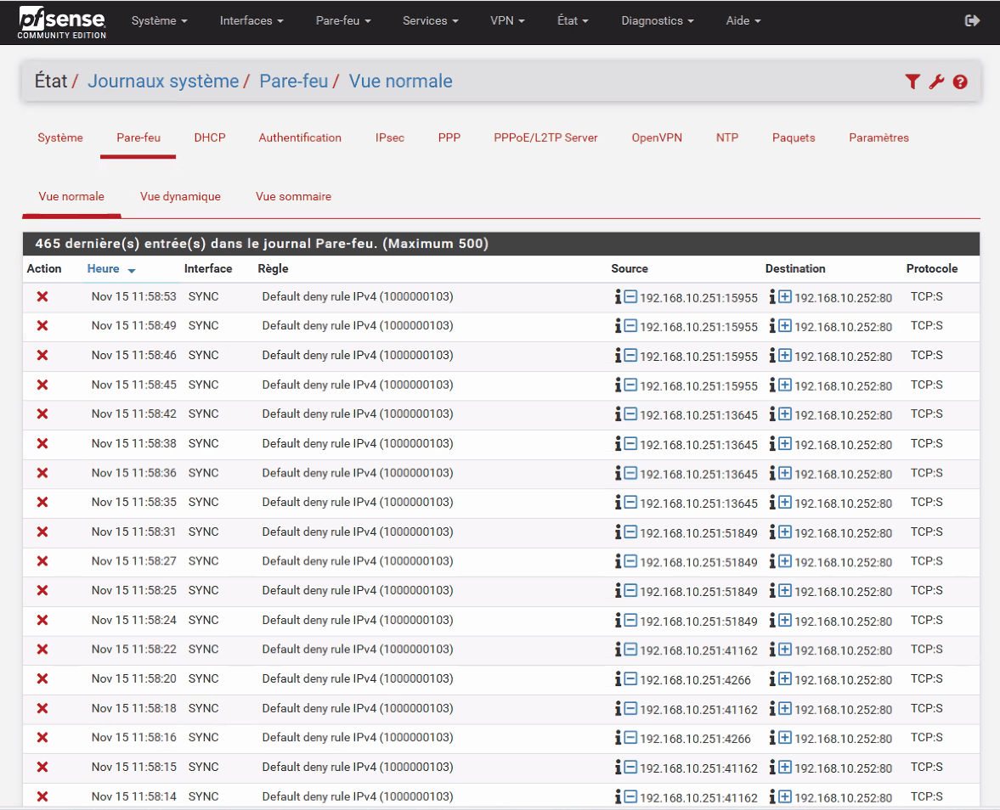{ loading=lazy }
    /// caption
    Journaux du pare-feu : trafic de synchronisation bloqué. Capture issue d'un autre lab : l'interface s'y appelle SYNC et les adresses diffèrent, mais la démarche est identique.
    ///

- **Les notifications** : l'icône en forme de **cloche**, en haut à droite. Il faut **vraiment les lire**. Elles signalent par exemple un mauvais mot de passe ou un utilisateur inexistant sur le secondaire.

**Test de réplication** : 1️⃣ **sur le primaire**, ajouter une règle quelconque, par exemple autoriser le trafic IPv6 sur le LAN. Elle doit apparaître 2️⃣ sur le secondaire quelques secondes plus tard. Si ce n'est pas le cas, reprendre attentivement les étapes 1 à 3.

2️⃣ Sur le secondaire, la page **System > High Avail. Sync** se présente ainsi :

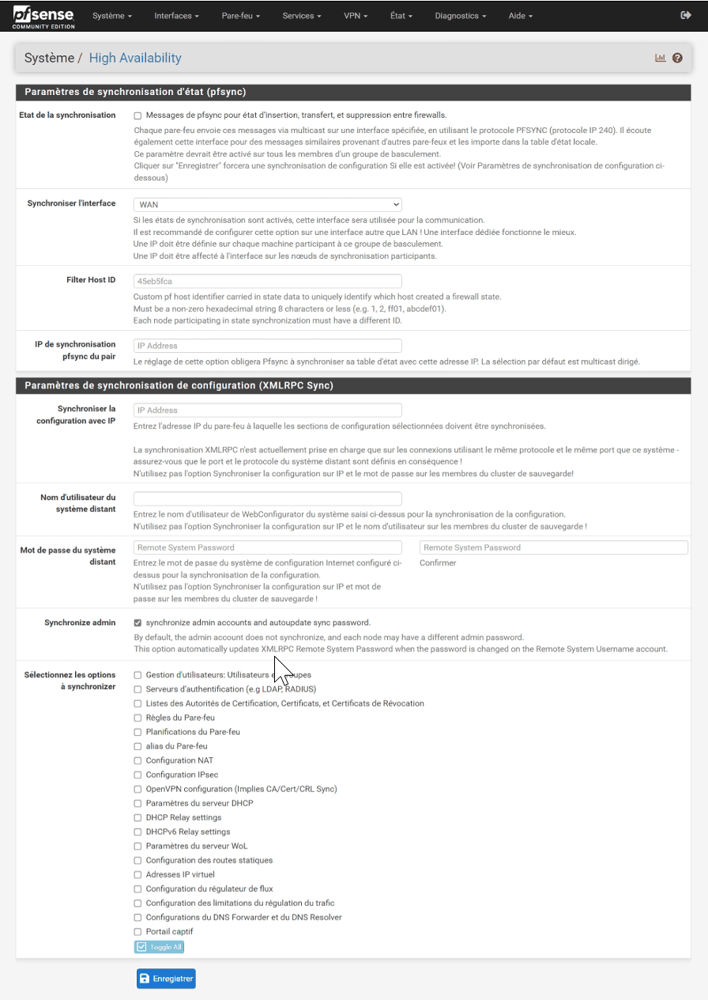{ loading=lazy }
/// caption
Secondaire — page High Availability : seule l'option Synchronize admin est cochée
///

!!! question "Les cases de la partie « XMLRPC Sync » sont décochées sur le secondaire. Faut-il les remplir ?"
    ??? success "Réponse"
        **Non.** Si les tests précédents sont concluants, il n'y a aucune raison d'y toucher. La synchronisation de configuration est à **sens unique** et ne doit être configurée **que sur le primaire**.

        La documentation de Netgate est formelle : ces réglages ne doivent être activés **que sur le primaire**. Renseignés sur le secondaire, ils lui feraient pousser à son tour **sa** configuration vers le primaire, qui cesserait d'être la référence. Netgate rappelle aussi : *« Do not make changes to the secondary in areas set to be synchronized! »*

## 5. Activer la réception des états pfsync sur le secondaire

!!! warning "Pourquoi cette étape est indispensable"
    La partie **haute** de la page HA (*State Synchronization Settings*, pfsync) n'est **pas synchronisée** par XML-RPC. Sur le secondaire, la case **Synchronize states** reste donc décochée.

    Dans cette situation, la bascule des VIP fonctionne, mais **le secondaire n'importe aucun état** envoyé par le primaire : il ne connaîtrait pas les connexions en cours au moment d'une bascule. Sans cette étape, la table d'états du secondaire ne contient **aucun** état créé par le primaire ; après cette étape, elle les contient. Le texte d'aide de la case le précise d'ailleurs : *« This setting should be enabled on all members of a failover group »*. La documentation de Netgate demande d'activer pfsync sur **chaque** nœud, chacun pointant vers l'autre.

    La différence se voit aussi en conditions réelles, avec un poste client : sans cette étape, une connexion TCP en cours est **perdue** lors de l'arrêt brutal du primaire ; avec cette étape, elle **survit** (voir les [mesures de la partie 6](06-tester-la-bascule.md#3-pour-aller-plus-loin-verifier-depuis-un-poste-client)).

2️⃣ **Sur le secondaire**, ouvrir **System > High Avail. Sync** et renseigner **uniquement la partie haute** :

| Champ | Valeur |
|-------|--------|
| **Synchronize states** | coché |
| **Synchronize Interface** | `PFSYNC` |
| **pfsync Synchronize Peer IP** | `192.168.254.1` (le primaire) |
| Partie *XMLRPC Sync* | **laisser vide**, comme expliqué ci-dessus |

Cliquer sur **Save**.

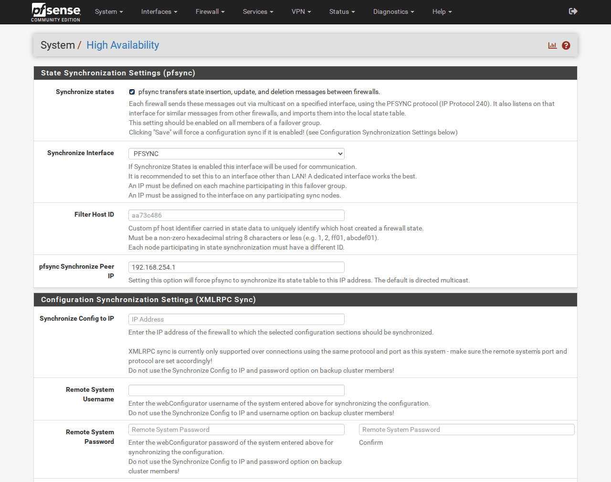{ loading=lazy }
/// caption
Secondaire — pfsync activé vers 192.168.254.1, partie XML-RPC laissée vide
///

**Vérification (facultative)** : le contrôle le plus simple se fait dans l'interface web, à la [partie 6](06-tester-la-bascule.md#1-controler-letat-normal), une fois les VIP créées. Dès maintenant, la commande suivante compte les états selon le nœud qui les a créés. 1️⃣ 2️⃣ Elle se lance dans **Diagnostics > Command Prompt** (*Diagnostics > Invite de commande*) de **chaque** pare-feu, champ **Execute Shell Command** :

```bash
pfctl -vvss | grep -o "creatorid: [0-9a-f]*" | sort | uniq -c
```

!!! success "Résultat attendu"
    Deux identifiants (`creatorid`) différents apparaissent sur chaque nœud : celui du pare-feu lui-même et celui de son pair. Par exemple, sur le secondaire :

    ```text
      16 creatorid: aa73c486
       6 creatorid: dfd3ca09
    ```

    Si un seul identifiant apparaît, les états ne sont pas échangés : vérifier la règle pfsync (règle 2) et la case **Synchronize states** des deux nœuds.

🛟 **Point de sauvegarde** : 🖥️ prendre un instantané des deux VM, nommé `03-synchronisation-ha`.

---

## 6. Questions de révision

1. Pourquoi créer un compte `ha-user` dédié plutôt que d'utiliser `admin` pour la synchronisation ?
2. Pourquoi faut-il aussi créer `ha-user` **sur le primaire** ?
3. Pourquoi la règle XML-RPC doit-elle exister sur les deux pare-feux, et pourquoi la créer **d'abord sur le primaire** ?
4. Pourquoi utiliser **PFSYNC subnets** plutôt qu'une adresse IP dans les règles de synchronisation ?
5. Pourquoi coche-t-on **Synchronize states** sur le secondaire, mais laisse-t-on vide sa partie **XMLRPC Sync** ?
6. Parmi les règles XML-RPC, pfsync et CARP de l'interface PFSYNC, laquelle n'est pas strictement indispensable, et pourquoi la garder ?

??? success "Corrigé"
    1. Un compte qui ne sert **qu'à une tâche** peut être désactivé ou changé sans toucher au compte d'administration. Il reste à protéger : le privilège *System - HA node sync* équivaut en pratique à un accès administrateur.
    2. XML-RPC **remplace** la liste des utilisateurs du secondaire par celle du primaire. Sans `ha-user` sur le primaire, la première synchronisation supprimerait le compte du secondaire, et toutes les suivantes échoueraient faute d'authentification.
    3. Le flux XML-RPC **entre** par l'interface PFSYNC du secondaire : sans règle, le refus par défaut le bloque. La créer d'abord sur le primaire garantit qu'elle fait partie de la **configuration de référence** : sinon, la première synchronisation l'effacerait du secondaire et bloquerait toutes les suivantes.
    4. Les règles sont **recopiées telles quelles** sur le secondaire. Une adresse propre à un nœud serait fausse sur l'autre, alors que **PFSYNC subnets** désigne le `/30`, valable sur les deux pare-feux.
    5. La partie pfsync n'est **pas synchronisée** par XML-RPC : sans la case, le secondaire n'importerait aucun état et perdrait les connexions en cours lors d'une bascule. La partie XML-RPC, elle, ne se configure **que sur le primaire** : remplie sur le secondaire, elle lui ferait pousser sa propre configuration vers le primaire, qui cesserait d'être la référence.
    6. La règle **CARP** : pfSense autorise CARP automatiquement dès qu'une VIP existe, et les annonces CARP passent par le WAN et le LAN, pas par le lien PFSYNC. On la garde parce qu'elle ne présente aucun risque (elle ne concerne que le `/30`) et qu'elle **documente l'intention**. La règle pfsync, elle, est indispensable : pfsync n'est jamais autorisé automatiquement.

---

## Ressources

- [Netgate — Configuration synchronization (XML-RPC)](https://docs.netgate.com/pfsense/en/latest/highavailability/xmlrpc-sync.html) — Ce qui est synchronisé, et ce qui ne l'est pas.
- [Netgate — State synchronization (pfsync)](https://docs.netgate.com/pfsense/en/latest/highavailability/pfsync.html) — Fonctionnement et règles nécessaires.
- [Netgate — Configuring High Availability (recette complète)](https://docs.netgate.com/pfsense/en/latest/recipes/high-availability.html) — La procédure de référence de l'éditeur.
- Partie précédente : [Configuration initiale](03-configuration-initiale.md) · Partie suivante : [VIP CARP et NAT sortant](05-vip-carp-nat-sortant.md).

*[CARP]: Common Address Redundancy Protocol
*[VIP]: Virtual IP — adresse IP virtuelle partagée
*[HA]: High Availability — haute disponibilité
*[NAT]: Network Address Translation — traduction d'adresses
