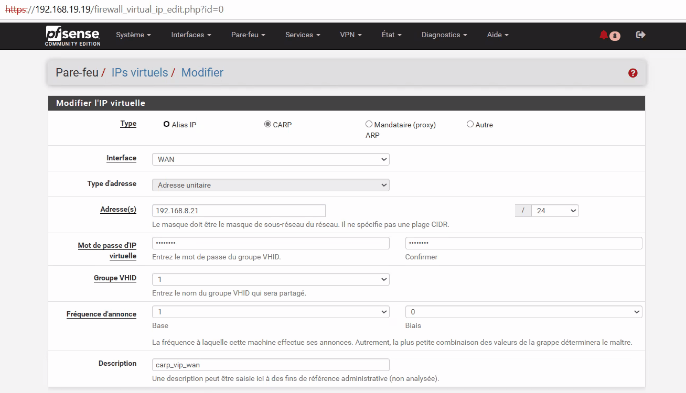
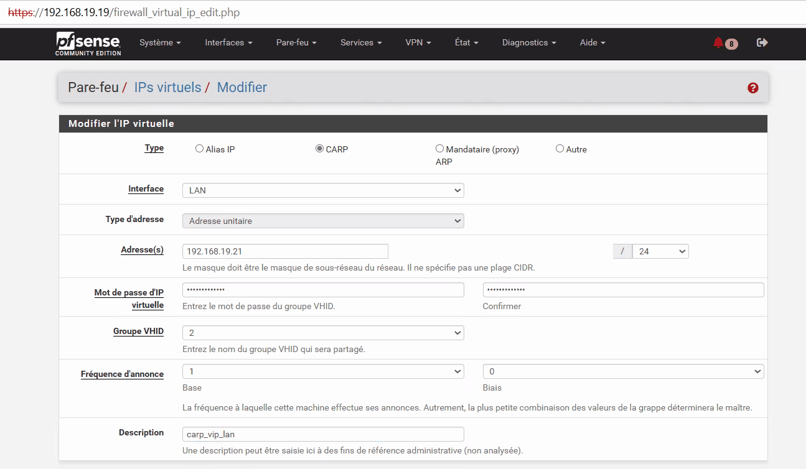
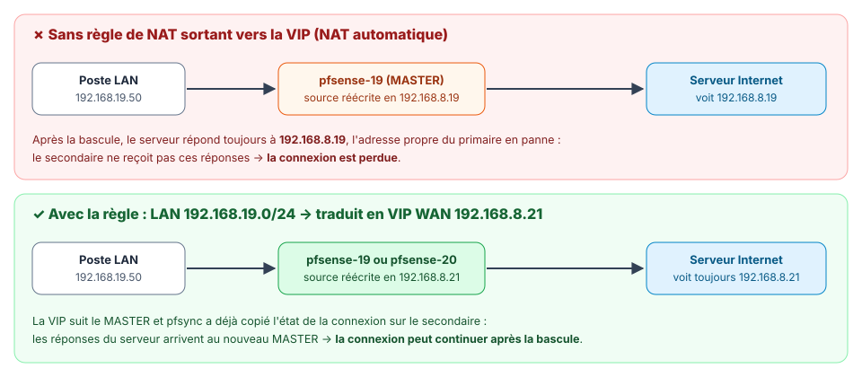
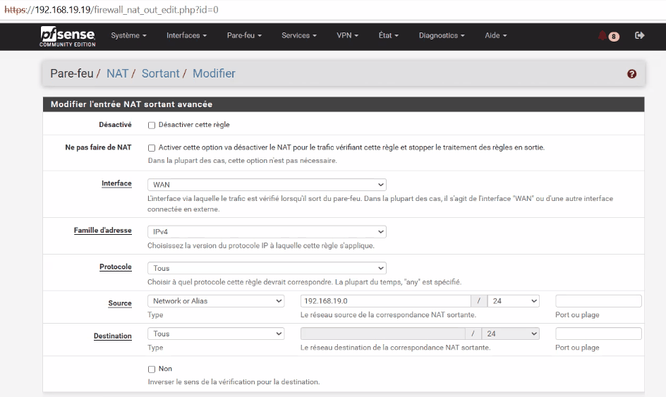
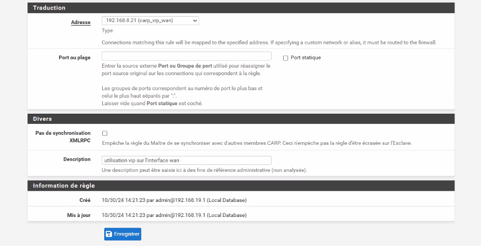

<!-- ============================================================ -->
<!-- ⚠️ RAPPEL IMPORTANT :                                          -->
<!-- Pensez TOUJOURS à ajouter une entrée dans le fichier d'index  -->
<!-- (index.md) du dossier correspondant (ex: docs/cloud/index.md) -->
<!-- afin de référencer ce nouvel article et permettre aux         -->
<!-- visiteurs de le trouver et de cliquer dessus !                -->
<!-- ============================================================ -->

# TP pfSense HA : VIP CARP et NAT sortant

!!! abstract "Résumé"
    La synchronisation fonctionne : tout ce qui se configure sur le primaire arrive désormais sur le secondaire. Ce TP crée les deux **adresses IP virtuelles CARP** du cluster, `192.168.8.21` sur le WAN et `192.168.19.21` sur le LAN, et explique les réglages qui décident quel pare-feu les porte (VHID, *base*, *skew*).

    On ajoute ensuite une règle de **NAT sortant** qui fait sortir le trafic du LAN avec la VIP du WAN, et non avec l'adresse propre du pare-feu actif : sans elle, les connexions en cours ne survivraient pas à une bascule.

| Propriété | Valeur |
|-----------|--------|
| Difficulté | Intermédiaire |
| Durée estimée | 45 min |
| Version décrite | pfSense CE 2.7.2 |
| Place dans le parcours | Partie 5 sur 8 du parcours [Cluster pfSense en haute disponibilité](index.md) |
| Dernière mise à jour | 2026-11-07 |

---

!!! info "Convention de lecture"
    Chaque action commence par un repère qui indique où elle se fait : 🖥️ **PC hôte**, 1️⃣ **primaire** `pfsense-19` (`https://192.168.19.19`), 2️⃣ **secondaire** `pfsense-20` (`https://192.168.19.20`), 1️⃣ 2️⃣ **les deux pare-feux**. Toute la configuration de cette partie se fait **sur le primaire** : le secondaire la reçoit par réplication. Les [comptes et mots de passe](index.md#comptes-et-mots-de-passe) sont rappelés sur la page d'accueil du parcours.

## 1. Configurer les adresses IP virtuelles (VIP CARP)

Pour que le cluster soit **résilient** (tolérant à la panne), chaque pare-feu garde sa propre adresse sur chaque interface, mais dispose aussi d'une **adresse IP virtuelle partagée**. On utilise donc **trois adresses par réseau** : `.19`, `.20` et `.21`.

1️⃣ **Sur le primaire**, ouvrir **Firewall > Virtual IPs** (*Pare-feu > IPs virtuels*) et cliquer sur **Add**.

| Champ | VIP WAN | VIP LAN | Explication |
|-------|---------|---------|-------------|
| Type | `CARP` | `CARP` | Les autres types (*IP Alias*, *Proxy ARP*) ne basculent pas. |
| Interface | `WAN` | `LAN` | — |
| Address(es) | `192.168.8.21` / `24` | `192.168.19.21` / `24` | Le masque est **celui du réseau** (`/24`), pas `/32`. |
| Virtual IP Password | `Carp-I0yZc4hYXz` | `Carp-I0yZc4hYXz` | Authentifie les annonces CARP entre les membres du groupe. |
| VHID Group | valeur par défaut (`1`) | valeur par défaut (`2`) | Numéro du groupe CARP (*Virtual Host ID*). |
| Advertising frequency — Base | `1` | `1` | Une annonce par seconde. |
| Advertising frequency — Skew | `0` | `0` | 0 = priorité la plus forte, celle du primaire. |
| Description | `carp_vip_wan` | `carp_vip_lan` | — |

{ loading=lazy }
/// caption
VIP CARP du WAN : 192.168.8.21/24, VHID 1, base 1, skew 0
///

{ loading=lazy }
/// caption
VIP CARP du LAN : 192.168.19.21/24
///

Cliquer sur **Save**, puis sur **Apply Changes** après chaque VIP.

!!! info "Comprendre VHID, Base et Skew"
    - Le **VHID** identifie un groupe CARP sur un réseau. Il sert aussi à fabriquer l'adresse MAC virtuelle de la VIP, `00:00:5e:00:01:<VHID>`. Deux clusters différents installés sur **le même réseau** doivent donc utiliser des VHID différents. pfSense propose automatiquement un numéro libre **sur ce pare-feu**, mais il ignore les VHID utilisés par d'autres équipements du réseau : c'est à l'administrateur de s'en assurer.
    - **Base** est l'intervalle entre deux annonces, en secondes. **Skew** (*biais*) ajoute un léger retard, en 256^e^ de seconde. **Le pare-feu dont les annonces sont les plus fréquentes gagne** : avec un skew de 0, le primaire est prioritaire.
    - Lors de la réplication vers le secondaire, pfSense **ajoute automatiquement 100 au skew**. Le secondaire annonce donc moins souvent et reste BACKUP. La commande `ifconfig em1 | grep carp`, lancée sur le secondaire (**Diagnostics > Command Prompt**), le confirme : sa VIP affiche `advskew 100`.
    - Le BACKUP se déclare MASTER s'il ne reçoit plus d'annonce pendant environ **3 × Base + Skew/256** secondes, soit à peu près 3,4 s ici.

2️⃣ La réplication vers le secondaire est automatique, mais il faut aller la vérifier dans **Firewall > Virtual IPs** sur le secondaire.

---

## 2. Faire sortir le trafic avec la VIP (NAT sortant)

Le **NAT sortant** réécrit l'adresse source des paquets qui quittent le LAN vers le WAN. Par défaut (mode *Automatic*), pfSense utilise **l'adresse propre de son interface WAN** : `192.168.8.19` sur le primaire, `192.168.8.20` sur le secondaire. Dans un cluster, c'est un problème. Les serveurs distants répondent à l'adresse propre du primaire (`192.168.8.19`). Après une bascule, ces réponses partent donc vers un pare-feu en panne, et le secondaire ne les reçoit pas : d'après la documentation de Netgate, un trafic adressé directement à un nœud, et non à une VIP, n'est jamais repris par les autres nœuds.

!!! success "Ce que change la règle"
    Un serveur placé côté WAN voit le poste client sous l'adresse `192.168.8.21` (la VIP) avec la règle, et sous `192.168.8.19` sans elle.

    Lors de l'arrêt brutal du primaire, la connexion TCP en cours **survit** avec la règle. Sans elle, elle est **perdue** : même un ping déjà lancé ne se rétablit jamais, car son état, recopié par pfsync, continue de traduire vers `192.168.8.19`. Seules les nouvelles connexions repartent, avec l'adresse du secondaire (`192.168.8.20`).

<figure markdown="span">
  { loading=lazy }
  <figcaption>Traduire le LAN vers la VIP WAN garantit une adresse source identique quel que soit le pare-feu actif.</figcaption>
</figure>

!!! note "Et dans ce lab ?"
    Ici, l'hyperviseur ajoute lui-même un second NAT entre le réseau `192.168.8.0/24` et Internet. Le principe reste celui d'une vraie installation, où l'interface WAN porte des adresses **publiques** fournies par l'opérateur.

1️⃣ **Sur le primaire**, ouvrir **Firewall > NAT > Outbound** (*Pare-feu > NAT > Sortant*), puis :

1. Sélectionner **Hybrid Outbound NAT rule generation** (*Automatic Outbound NAT + rules below*), puis cliquer sur **Save**. Le mode hybride conserve les règles automatiques et y ajoute les règles manuelles.
2. Dans **Mappings**, cliquer sur **Add** et renseigner :

    | Champ | Valeur |
    |-------|--------|
    | Interface | `WAN` |
    | Address Family | `IPv4` |
    | Protocol | `any` |
    | Source | `Network or Alias` : `192.168.19.0` / `24` |
    | Destination | `Any` |
    | Translation — Address | `192.168.8.21 (carp_vip_wan)` |
    | Description | `utilisation vip sur l'interface wan` |

3. Cliquer sur **Save**, puis sur **Apply Changes**.

{ loading=lazy }
/// caption
Règle de NAT sortant : interface WAN, source 192.168.19.0/24
///

{ loading=lazy }
/// caption
Suite de la règle : traduction vers la VIP 192.168.8.21
///

2️⃣ La règle est dupliquée automatiquement sur le secondaire.

!!! info "Les quatre modes de NAT sortant"
    - **Automatic** : pfSense génère seul les règles, avec l'adresse de l'interface.
    - **Hybrid** : règles automatiques **plus** règles manuelles, prioritaires.
    - **Manual** : uniquement les règles écrites à la main.
    - **Disabled** : pas de NAT sortant.

    Le mode hybride est le plus simple pour un cluster : seul le trafic du LAN est traduit vers la VIP, et le reste ne change pas. C'est aussi le choix de la recette officielle de Netgate.

---

## 3. Questions de révision

1. Pourquoi le masque des VIP est-il `/24`, et non `/32` ?
2. Que fait pfSense au **skew** des VIP lorsqu'il les réplique sur le secondaire, et quel en est l'effet ?
3. Combien de temps le BACKUP attend-il avant de se déclarer MASTER avec ces réglages ? Détailler le calcul.
4. Deux clusters pfSense sont installés sur le même LAN. Quelle précaution prendre pour les **VHID**, et pourquoi ?
5. Pourquoi le NAT sortant **automatique** pose-t-il problème dans un cluster ?
6. Pourquoi choisir le mode **hybride** plutôt que le mode manuel ?

??? success "Corrigé"
    1. La VIP appartient au **réseau de l'interface** (`192.168.19.0/24`), comme les adresses `.19` et `.20` : elle prend le masque de ce réseau. La recette de Netgate l'exige : le masque d'une VIP CARP doit être celui des adresses de l'interface.
    2. Il **ajoute 100** au skew : les VIP du secondaire ont un skew de 100 (`advskew 100`). Le secondaire annonce donc moins souvent que le primaire et reste BACKUP tant que le primaire fonctionne.
    3. Environ **3 × Base + Skew/256** secondes, soit 3 × 1 + 100/256 ≈ **3,4 s**.
    4. Leur donner des **VHID différents**. Le VHID fabrique l'adresse MAC virtuelle `00:00:5e:00:01:<VHID>` : deux groupes CARP de même VHID sur un même réseau entreraient en conflit. pfSense ne connaît que ses propres VHID, c'est à l'administrateur de vérifier les autres équipements.
    5. Le trafic sort avec l'**adresse propre** du WAN du pare-feu actif (`192.168.8.19`). Après une bascule, les réponses des serveurs reviennent vers cette adresse, que le secondaire ne reprend jamais : les connexions en cours sont perdues, même un ping déjà lancé. Avec la VIP, l'adresse source reste la même quel que soit le pare-feu actif.
    6. Le mode **hybride** garde les règles automatiques et y ajoute la règle manuelle, prioritaire : seul le trafic du LAN est traduit vers la VIP, et le reste ne change pas. En mode manuel, il faudrait réécrire toutes les règles à la main, avec un risque d'oubli. C'est aussi le choix de la recette officielle de Netgate.

---

## Ressources

- [Netgate — Virtual IP Addresses](https://docs.netgate.com/pfsense/en/latest/firewall/virtual-ip-addresses.html) — Les types de VIP et leurs réglages.
- [Netgate — Outbound NAT](https://docs.netgate.com/pfsense/en/latest/nat/outbound.html) — Les modes de NAT sortant.
- [Netgate — Configuring High Availability (recette complète)](https://docs.netgate.com/pfsense/en/latest/recipes/high-availability.html) — VIP CARP et NAT sortant dans la recette de l'éditeur.
- Partie précédente : [Synchroniser le cluster](04-synchroniser-le-cluster.md) · Partie suivante : [Tester la bascule](06-tester-la-bascule.md).

*[CARP]: Common Address Redundancy Protocol
*[VIP]: Virtual IP — adresse IP virtuelle partagée
*[VHID]: Virtual Host ID — numéro de groupe CARP
*[NAT]: Network Address Translation — traduction d'adresses
