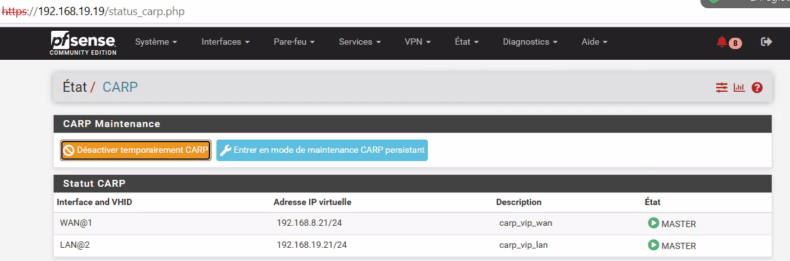
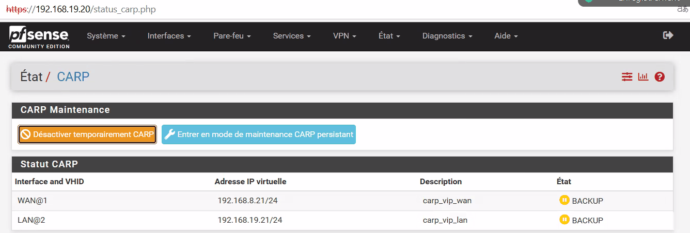
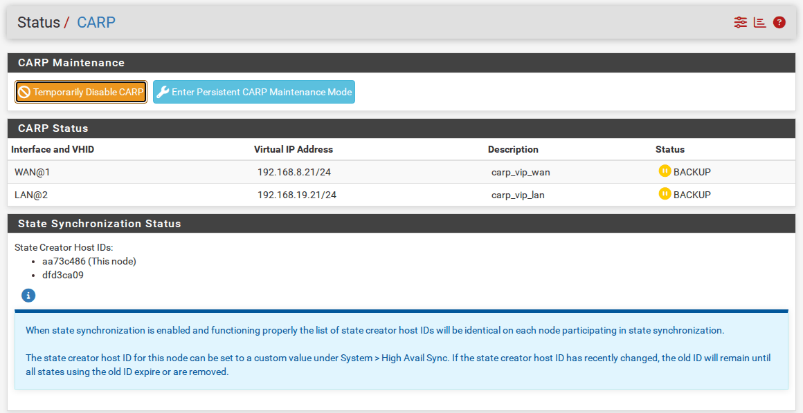

<!-- ============================================================ -->
<!-- ⚠️ RAPPEL IMPORTANT :                                          -->
<!-- Pensez TOUJOURS à ajouter une entrée dans le fichier d'index  -->
<!-- (index.md) du dossier correspondant (ex: docs/cloud/index.md) -->
<!-- afin de référencer ce nouvel article et permettre aux         -->
<!-- visiteurs de le trouver et de cliquer dessus !                -->
<!-- ============================================================ -->

# TP pfSense HA : tester la bascule

!!! abstract "Résumé"
    Le cluster est complet. Ce TP vérifie qu'il tient ses promesses : on contrôle l'**état normal** (primaire MASTER, secondaire BACKUP, états pfsync échangés), puis on **simule une panne** du primaire en mesurant la coupure, et on observe le retour du primaire.

    Un prolongement facultatif ajoute un **poste client** derrière le cluster, pour vérifier qu'une connexion en cours survit à l'arrêt brutal du primaire. Cinq **exercices corrigés** explorent enfin le sens de la synchronisation et la panne d'une seule interface.

| Propriété | Valeur |
|-----------|--------|
| Difficulté | Intermédiaire |
| Durée estimée | 1 h 30, exercices compris |
| Version décrite | pfSense CE 2.7.2 |
| Place dans le parcours | Partie 6 sur 8 du parcours [Cluster pfSense en haute disponibilité](index.md) |
| Dernière mise à jour | 2026-11-07 |

---

!!! info "Convention de lecture"
    Chaque action commence par un repère qui indique où elle se fait : 🖥️ **PC hôte** (hyperviseur, navigateur, terminal), 1️⃣ **primaire** `pfsense-19` (`https://192.168.19.19`), 2️⃣ **secondaire** `pfsense-20` (`https://192.168.19.20`), 1️⃣ 2️⃣ **les deux pare-feux**. Le [plan d'adressage](index.md#plan-dadressage) est rappelé sur la page d'accueil du parcours.

## 1. Contrôler l'état normal

1️⃣ 2️⃣ Ouvrir **Status > CARP (failover)** (*État > CARP (basculement)*) sur chaque pare-feu.

- 1️⃣ Le **primaire** (`.19`) affiche **MASTER** pour les deux VIP :

    { loading=lazy }
    /// caption
    Primaire — les deux VIP en MASTER
    ///

- 2️⃣ Le **secondaire** (`.20`) affiche **BACKUP** :

    { loading=lazy }
    /// caption
    Secondaire — les deux VIP en BACKUP
    ///

La même page vérifie aussi **pfsync**. Sa section **State Synchronization Status** liste les identifiants des nœuds qui ont créé des états (*State Creator Host IDs*). Quand la synchronisation des états fonctionne dans les deux sens, **la liste est identique sur les deux pare-feux** et contient les deux identifiants. Si un nœud n'affiche que le sien, revoir l'[étape 5 de la partie 4](04-synchroniser-le-cluster.md#5-activer-la-reception-des-etats-pfsync-sur-le-secondaire).

{ loading=lazy }
/// caption
État > CARP : section State Synchronization Status, avec les identifiants des deux nœuds
///

!!! note "« DISABLED » juste après une synchronisation"
    Juste après la création des VIP, la page du secondaire peut afficher brièvement **DISABLED**. Il suffit de la recharger quelques secondes plus tard pour voir **BACKUP**.

## 2. Simuler une panne du primaire et mesurer la coupure

1. 🖥️ **Sur le PC hôte**, lancer un ping continu vers la VIP LAN :

    === "Windows"

        ```powershell
        ping -t 192.168.19.21
        ```

    === "Linux"

        ```bash
        ping 192.168.19.21
        ```

2. 1️⃣ **Sur le primaire**, simuler une panne au choix :
    - dans **Status > CARP (failover)**, cliquer sur le bouton orange **Temporarily Disable CARP** (*Désactiver temporairement CARP*) ;
    - ou, 🖥️ dans les paramètres de la VM, **déconnecter la carte réseau du LAN** ;
    - ou 🖥️ **éteindre** la VM.
3. 🖥️ Observer le ping : quelques réponses manquent, puis il reprend tout seul.
4. 2️⃣ **Sur le secondaire**, actualiser **Status > CARP (failover)** : les deux VIP sont passées en **MASTER**. Le cluster à basculement fonctionne.
5. 🖥️ Ouvrir `https://192.168.19.21` dans le navigateur et se connecter : c'est le **secondaire** qui répond. Une fois connecté, le nom `pfsense-20.home.arpa` apparaît dans le titre de l'onglet et sur le tableau de bord. La page de connexion, elle, n'affiche pas le nom du pare-feu.
6. 1️⃣ Rétablir le primaire : bouton **Enable CARP**, carte reconnectée ou VM rallumée. Le primaire **reprend automatiquement** le rôle de MASTER : c'est la **préemption**.

!!! success "Résultat attendu"
    La bascule coupe le ping pendant **environ 3,4 secondes** (17 réponses perdues avec un ping toutes les 0,2 s). C'est exactement le délai théorique de CARP : 3 × 1 s + 100/256 s. Aucun réglage n'est nécessaire sur le PC hôte.

    Au retour du primaire, la reprise du rôle de MASTER se fait **sans aucune perte**.

## 3. Pour aller plus loin : vérifier depuis un poste client

Le ping depuis le PC hôte montre que la VIP bascule. Pour vérifier qu'**une connexion en cours survit** à la panne, il faut un poste placé **derrière** le cluster, sur le LAN.

1. 🖥️ Créer une petite VM (Linux ou Windows) dont l'unique carte réseau est dans **VMnet19** (VirtualBox : le réseau privé hôte).
2. **Sur le poste client**, lui donner une adresse fixe : IP `192.168.19.50/24`, passerelle `192.168.19.21` (la **VIP**), DNS `192.168.19.21` (le résolveur DNS de pfSense, joint lui aussi par la VIP) puis `1.1.1.1` en second DNS.

    !!! note "Si la résolution DNS échoue"
        Un VPN actif sur le PC hôte peut intercepter les requêtes DNS qui sortent des VM. Le résolveur de pfSense répond alors *SERVFAIL* : sa validation DNSSEC échoue, car les réponses ne viennent plus des vrais serveurs DNS. Le second DNS (`1.1.1.1`) permet de continuer ; le reste du TP n'en dépend pas.

3. **Sur le poste client**, vérifier qu'il accède à Internet **à travers le cluster** : `ping 1.1.1.1` doit répondre.
4. **Sur le poste client**, lancer un ping continu vers Internet (`ping -t 1.1.1.1` sous Windows, `ping 1.1.1.1` sous Linux), ainsi qu'un téléchargement volumineux.
5. 🖥️ **Éteindre brutalement le primaire**, comme une coupure de courant : VMware : **VM > Power > Power Off** ; VirtualBox : fermer la fenêtre de la VM et choisir **Éteindre la machine**.
6. Observer : le ping s'interrompt quelques secondes puis reprend, et le téléchargement continue sans erreur.
7. 🖥️ Rallumer le primaire : il reprend le rôle de MASTER sans que le poste ne s'en aperçoive.

!!! example "Mesures de référence"
    Les mesures ont été prises avec un poste client du LAN (`192.168.19.50`) et un serveur placé côté WAN (`192.168.8.50`). Le serveur envoyait une ligne toutes les 0,2 s sur une connexion TCP, et le poste le pinguait toutes les 0,2 s. Chaque scénario désactive volontairement un élément de la configuration, pour montrer à quoi il sert.

    | Scénario | Connexion TCP en cours | Ping du poste vers le serveur WAN |
    |----------|------------------------|-----------------------------------|
    | Arrêt brutal du primaire, cluster complet | **intacte**, silence max 3,5 s | 12 perdus sur 299, coupure de 2,7 s |
    | Retour du primaire (préemption) | **intacte**, aucun silence | aucune perte |
    | Arrêt brutal du primaire, **sans pfsync sur le secondaire** ([partie 4, étape 5](04-synchroniser-le-cluster.md#5-activer-la-reception-des-etats-pfsync-sur-le-secondaire)) | **perdue** | coupure de 3,5 s, puis reprise |
    | Arrêt brutal du primaire, **sans la règle de NAT vers la VIP** ([partie 5](05-vip-carp-nat-sortant.md#2-faire-sortir-le-trafic-avec-la-vip-nat-sortant)) | **perdue** | jamais rétabli pendant le test |
    | Câble WAN du primaire débranché, IPv6 du WAN en DHCP6 (exercice 4) | **bloquée** pendant la panne | *Destination Host Unreachable* du primaire |
    | Câble WAN du primaire débranché, IPv6 du WAN à *None* (exercice 5) | **intacte**, silence max 3,5 s | coupure d'environ 3 s |
    | Entrée puis sortie du mode maintenance CARP ([partie 8](08-mettre-a-jour-le-cluster.md#4-etape-3-placer-le-primaire-en-maintenance-carp)) | **intacte**, aucun silence | aucune perte |

---

## 4. Exercices

Réaliser les exercices suivants et faire une **capture d'écran** de chaque résultat. 🛟 Prendre un instantané des deux VM avant de commencer, nommé `04-cluster-fonctionnel`.

### Exercice 1

Tester si une règle de pare-feu créée **sur le secondaire** se réplique **sur le primaire**.

??? success "Réponse"
    **Non.** La synchronisation XML-RPC est à **sens unique**, du primaire vers le secondaire. Le secondaire n'a aucun paramètre XML-RPC renseigné : il ne pousse rien.

### Exercice 2

Faire basculer le secondaire en MASTER en **éteignant le primaire**, puis vérifier qu'il a bien récupéré le statut MASTER. Créer une règle de pare-feu sur ce secondaire devenu MASTER. Rallumer le primaire et vérifier qu'il récupère le statut MASTER. A-t-il récupéré la règle créée sur le secondaire pendant que ce dernier était MASTER ?

??? success "Réponse"
    **Non.** Le primaire redevient MASTER grâce à la préemption, mais ne récupère pas la règle. Les rôles CARP (MASTER/BACKUP) et le sens de la synchronisation XML-RPC sont **indépendants** : même MASTER, le secondaire ne pousse jamais sa configuration. Il ne faut donc **jamais** modifier la configuration sur le secondaire, même en cas de panne prolongée du primaire, sauf pour une urgence suivie d'une reprise manuelle sur le primaire.

### Exercice 3

À la suite de l'exercice précédent, vérifier si l'absence, sur le primaire, de la règle créée sur le secondaire a entraîné la **suppression** de cette règle sur le secondaire.

??? success "Réponse"
    **Oui**, mais **à la prochaine synchronisation**, pas au redémarrage du primaire. Juste après le retour du primaire, la règle est encore présente sur le secondaire. Elle disparaît dès qu'une synchronisation a lieu : une modification quelconque sur le primaire, ou **Status > Filter Reload > Force Config Sync**.

    L'explication est la même que pour `ha-user` : XML-RPC **remplace** la section « règles » du secondaire par celle du primaire, et ne fusionne rien. Tout ce qui n'existe que sur le secondaire est perdu.

### Exercice 4

Simuler une panne de l'**interface WAN** du MASTER (déconnecter sa carte WAN dans les paramètres de la VM) et vérifier si le WAN du secondaire a bien récupéré le statut MASTER. Vérifier également le statut de l'interface LAN du secondaire : est-il passé en MASTER ?

??? success "Réponse"
    **Non** (avec la configuration réalisée jusqu'ici). Le WAN du secondaire passe bien MASTER, mais le LAN du **primaire** garde le statut MASTER. Les deux pare-feux se partagent alors les rôles : les postes du LAN envoient toujours leur trafic au primaire, dont le WAN est coupé, et **perdent l'accès à l'extérieur**.

    Un poste client du LAN voit ainsi sa connexion TCP en cours **bloquée pendant toute la panne**. Ses pings reçoivent la réponse *« Destination Host Unreachable »* de la part du primaire (`192.168.19.19`), resté MASTER côté LAN mais privé de WAN.

    Ce n'est **pas un défaut de pfSense** : c'est la conséquence d'un réglage laissé par l'assistant, que l'exercice 5 permet de corriger.

    **Explication.** En théorie, pfSense active la **préemption CARP** (`net.inet.carp.preempt=1`). Quand une interface portant une VIP perd son lien, le pare-feu se **rétrograde** (*demotion* +240) sur **toutes** ses VIP, et le secondaire prend tout. Le journal système montre d'ailleurs que la VIP LAN bascule dans un premier temps. Mais l'assistant a laissé l'IPv6 du WAN en **DHCP6**. pfSense considère alors le WAN comme une interface **dynamique** et, à la perte du lien, il la « démonte » entièrement, VIP comprise. La VIP ayant disparu, la rétrogradation est **annulée** (`carp: demoted by -240 to 0 (vhid removed)`), et le primaire reprend la VIP LAN.

### Exercice 5 — Corriger le comportement de l'exercice 4

Sur **les deux pare-feux**, ouvrir **Interfaces > WAN**, régler **IPv6 Configuration Type** sur **None**, puis **Save** et **Apply Changes**. La configuration des interfaces n'est pas synchronisée : il faut le faire sur chaque nœud. Refaire ensuite l'exercice 4. Que se passe-t-il ?

??? success "Réponse"
    Cette fois, **les deux VIP** passent MASTER sur le secondaire. Sur le primaire, la VIP WAN est en **INIT** (lien absent) et la VIP LAN en **BACKUP** ; `sysctl net.inet.carp.demotion` affiche `240`. Le WAN étant désormais entièrement statique, pfSense ne démonte plus l'interface et la rétrogradation reste en place.

    Au retour du lien WAN, le primaire reprend automatiquement les deux VIP.

    Mesures pour un câble WAN débranché pendant 30 s :

    - un ping continu du PC hôte vers la VIP LAN ne perd **aucun paquet** ;
    - un poste client du LAN conserve sa connexion TCP en cours (3,5 s de silence au plus) ;
    - le ping de ce poste vers un serveur côté WAN est coupé environ 3 s, le temps que le secondaire reprenne la VIP WAN.

---

## 5. Questions de révision

1. Sur quelle page voit-on l'état des VIP, et que doit-elle afficher sur chaque nœud en fonctionnement normal ?
2. Comment vérifier, sur cette même page, que pfsync fonctionne dans les deux sens ?
3. La bascule coupe le ping environ 3,4 s. D'où vient cette valeur ?
4. Pourquoi le primaire redevient-il MASTER tout seul à son retour ? Comment s'appelle ce mécanisme ?
5. Après la bascule, `https://192.168.19.21` ouvre l'interface d'un pare-feu. Lequel, et comment le vérifier ?
6. Pourquoi un ping lancé depuis le PC hôte ne suffit-il pas à prouver qu'une connexion en cours survit à la panne ?

??? success "Corrigé"
    1. **Status > CARP (failover)**. En fonctionnement normal, le primaire affiche **MASTER** pour les deux VIP et le secondaire **BACKUP**. Juste après la création des VIP, le secondaire peut afficher brièvement **DISABLED** : il suffit de recharger la page.
    2. Dans la section **State Synchronization Status**, la liste des *State Creator Host IDs* doit être **identique sur les deux nœuds** et contenir les **deux identifiants**. Si un nœud n'affiche que le sien, pfsync n'est pas activé des deux côtés (partie 4, étape 5).
    3. C'est le délai de détection de CARP : le BACKUP attend environ **3 × Base + Skew/256** secondes sans annonce, soit 3 × 1 s + 100/256 s ≈ 3,4 s, avant de prendre les VIP.
    4. C'est la **préemption**, activée par défaut dans pfSense : le primaire, avec un skew de 0, annonce plus souvent que le secondaire (skew 100) et reprend le rôle de MASTER dès qu'il revient, sans perte.
    5. Le **secondaire**, devenu MASTER, puisque la VIP suit toujours le MASTER. Une fois connecté, le nom `pfsense-20.home.arpa` apparaît dans le titre de l'onglet et sur le tableau de bord ; la page de connexion, elle, n'affiche pas le nom.
    6. Le PC hôte pingue **la VIP elle-même** : il prouve que la VIP répond, pas que le trafic qui **traverse** le cluster continue. Une connexion entre le LAN et le WAN dépend de la table d'états (pfsync) et du NAT vers la VIP : pour la tester, il faut un poste **derrière** le cluster, qui utilise la VIP comme passerelle.

---

## Ressources

- [Netgate — CARP Status](https://docs.netgate.com/pfsense/en/latest/monitoring/status/carp.html) — La page d'état, la désactivation temporaire et le mode de maintenance.
- [FreeBSD — page de manuel carp(4)](https://man.freebsd.org/cgi/man.cgi?query=carp&sektion=4) — Préemption et rétrogradation (*demotion*).
- Partie précédente : [VIP CARP et NAT sortant](05-vip-carp-nat-sortant.md) · Partie suivante : [Agrégation LACP et troisième nœud](07-agregation-lacp-troisieme-noeud.md).

*[CARP]: Common Address Redundancy Protocol
*[VIP]: Virtual IP — adresse IP virtuelle partagée
*[NAT]: Network Address Translation — traduction d'adresses
