<!-- ============================================================ -->
<!-- ⚠️ RAPPEL IMPORTANT :                                          -->
<!-- Pensez TOUJOURS à ajouter une entrée dans le fichier d'index  -->
<!-- (index.md) du dossier correspondant (ex: docs/cloud/index.md) -->
<!-- afin de référencer ce nouvel article et permettre aux         -->
<!-- visiteurs de le trouver et de cliquer dessus !                -->
<!-- ============================================================ -->

# TP pfSense HA : agrégation LACP et troisième nœud

!!! abstract "Résumé"
    Cette partie, pour aller plus loin, supprime le dernier point unique de défaillance du cluster : le **lien de synchronisation**. On ajoute une quatrième carte réseau à chaque pare-feu et on regroupe les deux liens dans un **agrégat LACP** (un *LAGG* dans pfSense), après avoir sauvegardé les règles qu'il va effacer.

    Elle présente ensuite le principe d'un **troisième nœud**, synchronisé en chaîne par le secondaire : une expérience de lab, car Netgate ne prend officiellement en charge que les clusters de deux nœuds.

| Propriété | Valeur |
|-----------|--------|
| Difficulté | Avancé — suppose un cluster fonctionnel (parties 2 à 6) |
| Durée estimée | 1 h |
| Version décrite | pfSense CE 2.7.2 |
| Place dans le parcours | Partie 7 sur 8 du parcours [Cluster pfSense en haute disponibilité](index.md) |
| Dernière mise à jour | 2026-11-07 |

<!-- NOTE DE RÉDACTION (non affichée) : Parties non rejouées dans le lab KVM
L'agrégation LAGG/LACP et le troisième nœud n'ont pas été rejoués dans le lab KVM des 12 et 13 octobre 2026 (seuls le TP principal, les exercices et la mise à jour l'ont été). Les captures viennent du lab d'origine sous VMware Workstation. Les onglets VirtualBox suivent la documentation d'Oracle et n'ont pas été rejoués non plus.
-->

---

!!! info "Convention de lecture"
    Chaque action commence par un repère qui indique où elle se fait : 🖥️ **PC hôte** (hyperviseur, navigateur), 1️⃣ **primaire** `pfsense-19` (`https://192.168.19.19`), 2️⃣ **secondaire** `pfsense-20` (`https://192.168.19.20`), 1️⃣ 2️⃣ **les deux pare-feux**. 🛟 Partir d'un cluster fonctionnel : l'instantané `04-cluster-fonctionnel` permet d'y revenir après cette partie.

## 1. Agréger deux liens de synchronisation (LAGG/LACP)

Le *Link Aggregation Control Protocol* (**LACP**, norme IEEE 802.3ad) est un protocole de **niveau 2** du modèle OSI. Il regroupe plusieurs ports physiques en **une seule voie logique**, appelée **LAGG** (*Link AGGregation*) dans pfSense.

L'agrégat offre deux avantages :

- il **additionne la capacité** des liens : deux câbles de 1 Gbit/s offrent 2 Gbit/s au total ;
- il apporte de la **redondance** : si un câble ou un port tombe en panne, l'autre continue de transmettre le trafic sans interruption.

Attention : LACP répartit le trafic **par flux**, et une même conversation n'utilise qu'un seul lien à la fois. La synchronisation entre deux pare-feux ne gagne donc pas de débit. Son vrai bénéfice est la **redondance** : l'agrégat supprime le dernier point unique de défaillance du cluster. La même notion existe sous Linux : voir [Configurer une agrégation de liens (Bonding/LACP) avec Netplan](../../reseaux/configurer-agregation-liens-bonding-lacp-netplan-ubuntu.md).

### 1.1 Ajouter une carte réseau et un second LAN segment

🖥️ **Sur chaque pare-feu** (VM éteinte), ajouter une **quatrième carte réseau**. La placer dans **un autre LAN segment** que celui utilisé pour la synchronisation : on obtient ainsi deux « câbles » indépendants entre les pare-feux, un par interface de l'agrégat.

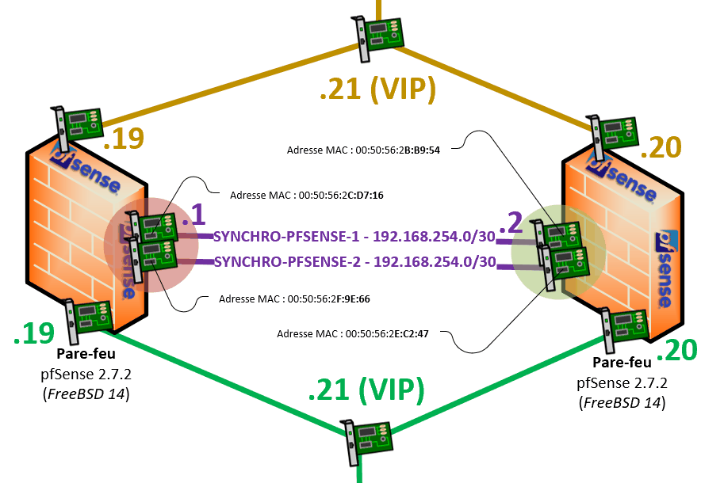{ loading=lazy }
/// caption
Deux liens de synchronisation, chacun dans son propre LAN segment
///

!!! warning "Un segment par lien"
    Utiliser **le même** LAN segment pour les deux interfaces de l'agrégat provoque un problème de connectivité. Chaque lien doit avoir **son propre** segment, comme deux câbles physiques distincts.

=== "VMware Workstation"

    Créer les segments depuis **VM > Settings… > Network Adapter > LAN Segments…**. Sur les captures, la 3^e^ carte est dans `SYNCHRO-PFSENSE-1` et la nouvelle 4^e^ carte dans `SYNCHRO-PFSENSE-2`.

    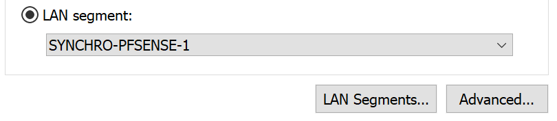{ loading=lazy width="420" } 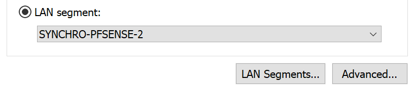{ loading=lazy width="420" }
    /// caption
    VMware — 3ᵉ carte dans SYNCHRO-PFSENSE-1, 4ᵉ carte dans SYNCHRO-PFSENSE-2
    ///

=== "VirtualBox"

    Activer l'**Adapter 4** en **Réseau interne** nommé `SYNCHRO-PFSENSE-2`, avec le type d'interface Intel PRO/1000 MT Desktop et le mode promiscuité « Tout autoriser ». L'Adapter 3 reste dans le réseau interne `SYNCHRO-PFSENSE`.

    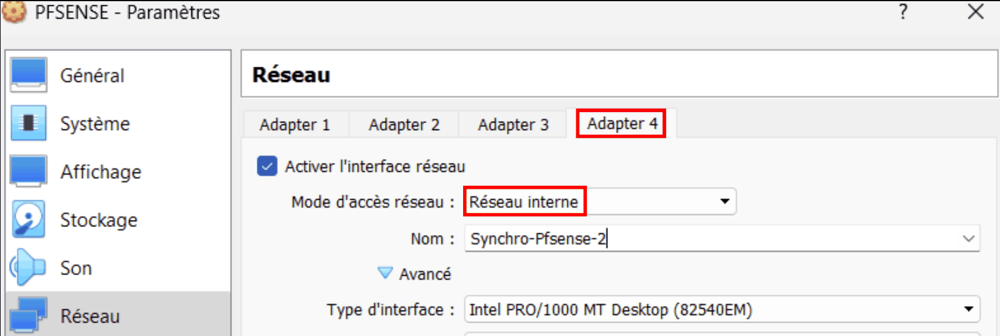{ loading=lazy }
    /// caption
    VirtualBox — 4ᵉ carte en réseau interne SYNCHRO-PFSENSE-2
    ///

### 1.2 Sauvegarder les règles de pare-feu existantes

La création du LAGG va supprimer l'interface PFSYNC **et toutes ses règles**. Il faut donc les sauvegarder d'abord, 1️⃣ **sur le primaire** :

1. Ouvrir **Diagnostics > Backup & Restore** (*Diagnostics > Sauvegarde & Restauration*).
2. Dans l'onglet **Backup & Restore**, section **Backup Configuration**, choisir **Backup area** : **Firewall Rules** (ou toute la configuration).
3. Cliquer sur **Download configuration as XML**. Un fichier XML est téléchargé sur le PC hôte.

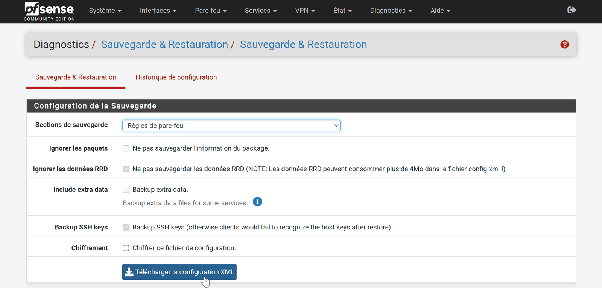{ loading=lazy }
/// caption
Sauvegarde de la zone « Règles du pare-feu »
///

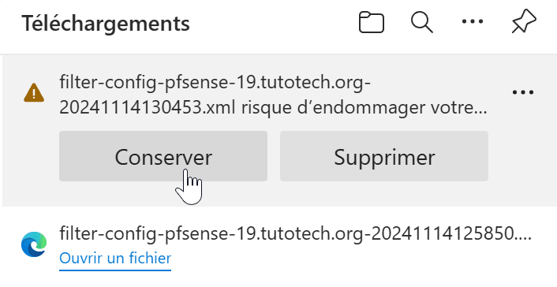{ loading=lazy width="380" }
/// caption
Le fichier XML de sauvegarde téléchargé par le navigateur
///

### 1.3 Créer le LAGG

Une interface ne peut entrer dans un LAGG que si elle **n'est affectée à rien**. Il faut donc d'abord supprimer l'interface PFSYNC actuelle. Cela **supprime aussi toutes les règles** de cette interface : il faudra les recréer, ou importer la sauvegarde.

1️⃣ **Sur le primaire** :

1. **Interfaces > Assignments** (*Interfaces > Affectations*) : supprimer la ligne **PFSYNC** (bouton **Delete**).

    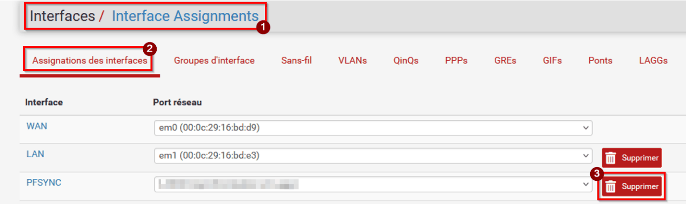{ loading=lazy }
    /// caption
    Suppression de l'interface PFSYNC dans les affectations
    ///

2. Onglet **LAGGs** > **Add** : sélectionner les **deux interfaces libres** (++ctrl++ + clic), en les reconnaissant à leur adresse MAC. Choisir le protocole **LACP**, laisser les autres options par défaut, ajouter une description pertinente, puis **Save**.

    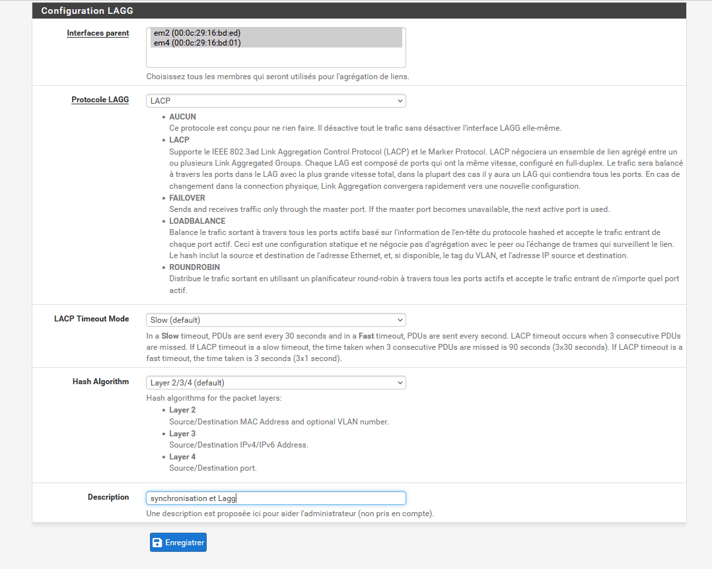{ loading=lazy }
    /// caption
    Création du LAGG en mode LACP avec deux interfaces membres
    ///

    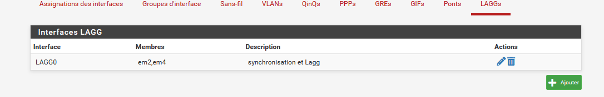{ loading=lazy }
    /// caption
    Le LAGG créé
    ///

3. Onglet **Interface Assignments** : choisir `lagg0` dans **Available network ports**, puis **Add**.
4. Cliquer sur la nouvelle interface (`OPT1` dans l'exemple) et la configurer : **Enable** coché, **Description** `PFSYNC`, IPv4 statique `192.168.254.1/30`. Enregistrer, puis appliquer les changements.

    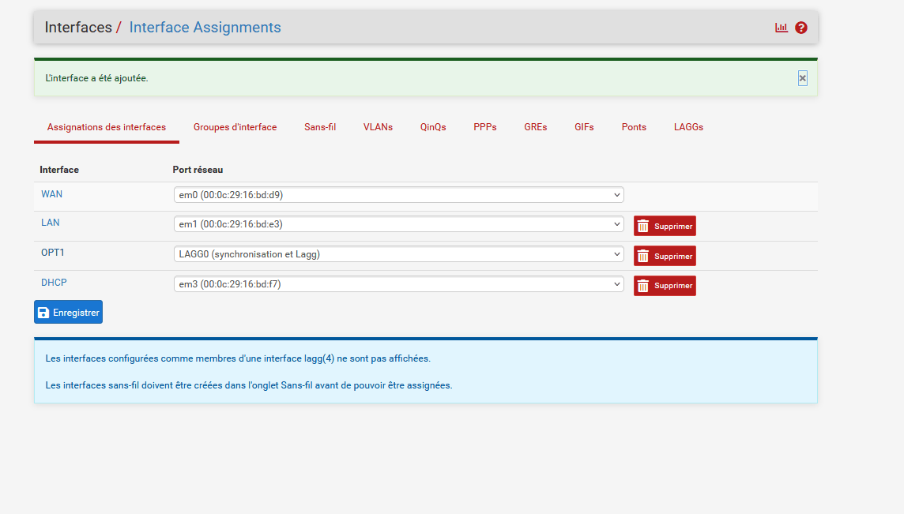{ loading=lazy }
    /// caption
    Affectation de l'interface LAGG
    ///

    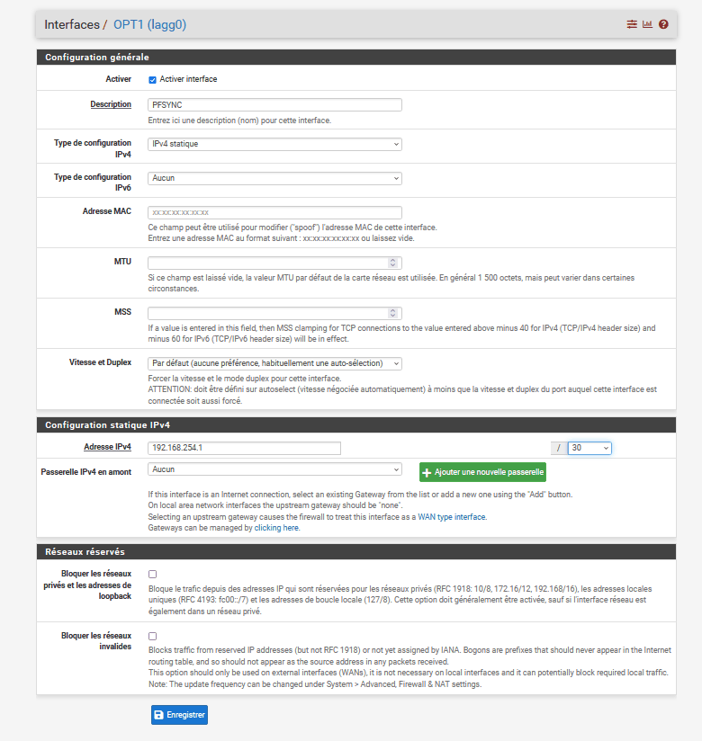{ loading=lazy }
    /// caption
    Configuration de l'interface LAGG : activée, nommée PFSYNC, IP statique
    ///

5. 2️⃣ Répéter les mêmes étapes **sur le secondaire**, avec l'adresse `192.168.254.2`.

    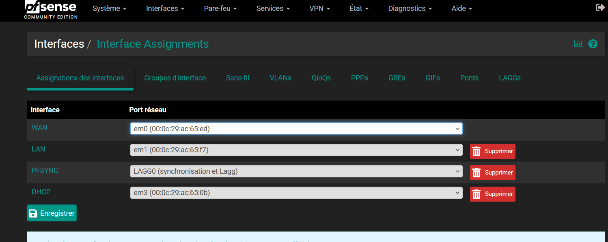{ loading=lazy }
    /// caption
    Secondaire — affectations avec l'interface LAGG
    ///

6. 1️⃣ 2️⃣ Vérifier dans **System > High Avail. Sync** que **Synchronize Interface** vaut toujours `PFSYNC` sur les deux nœuds.

### 1.4 Restaurer les règles supprimées

=== "Option 1 — Importer la sauvegarde"

    1. 1️⃣ **Sur le primaire**, ouvrir **Diagnostics > Backup & Restore**, section **Restore Backup**.
    2. **Restore area** : **Firewall Rules**. Avec *All*, tout le contenu du fichier serait restauré.
    3. **Configuration file** : **Parcourir…** > le fichier XML exporté précédemment.
    4. Cliquer sur **Restore Configuration** et confirmer. pfSense applique les règles et redémarre les services nécessaires. Dans certains cas, un redémarrage du pare-feu est utile pour s'assurer que tout est bien appliqué.
    5. 2️⃣ **Sur le secondaire**, vérifier la présence de la règle XML-RPC sur la nouvelle interface PFSYNC : ses anciennes règles ont été supprimées avec son interface. Si elle manque, la recréer comme à la [partie 4](04-synchroniser-le-cluster.md#3-autoriser-les-flux-de-synchronisation) ; les autres règles arriveront ensuite par réplication.

    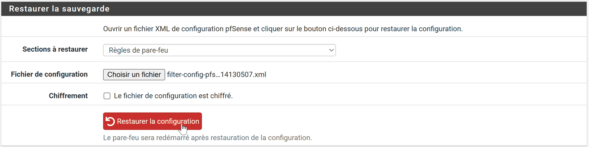{ loading=lazy }
    /// caption
    Restauration de la zone « Règles du pare-feu »
    ///

    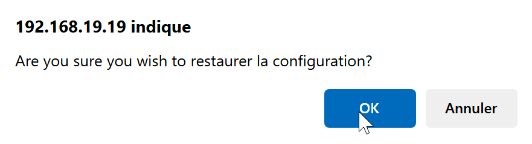{ loading=lazy width="380" }
    /// caption
    Confirmation de la restauration
    ///

    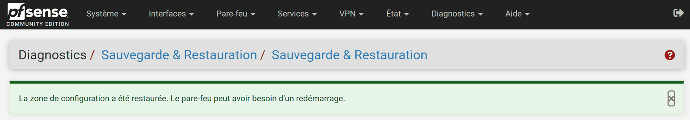{ loading=lazy }
    /// caption
    Restauration terminée
    ///

=== "Option 2 — Recréer les règles"

    1️⃣ **Firewall > Rules > PFSYNC** (interface LAGG) : recréer les règles XML-RPC, pfsync et CARP de la [partie 4](04-synchroniser-le-cluster.md#3-autoriser-les-flux-de-synchronisation). 2️⃣ La règle XML-RPC doit être recréée **aussi sur le secondaire**, sinon le primaire ne peut plus lui parler. Les règles du secondaire peuvent servir de modèle. Puis **Apply Changes**.

### 1.5 Vérifier

1️⃣ **Sur le primaire**, créer une règle de pare-feu quelconque, par exemple sur l'interface WAN :

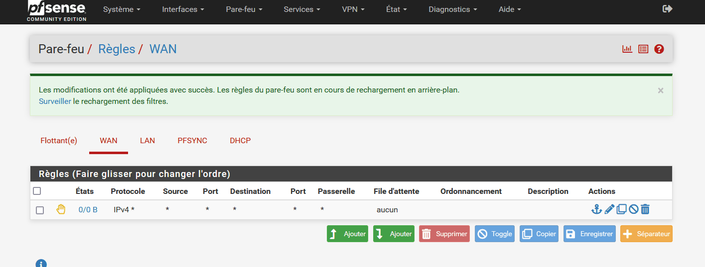{ loading=lazy }
/// caption
Primaire — règle de test sur le WAN
///

2️⃣ Elle doit apparaître automatiquement sur le secondaire :

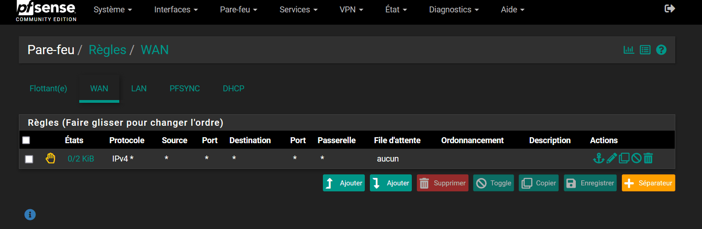{ loading=lazy }
/// caption
Secondaire — la règle de test est arrivée par réplication
///

---

## 2. Ajouter un troisième nœud au cluster

!!! warning "Une configuration que Netgate ne prend pas en charge"
    D'après la documentation de Netgate, la seule configuration de haute disponibilité prise en charge comporte **exactement deux nœuds**. Un troisième nœud est possible, mais il n'apporte pas d'avantage significatif et les clusters de plus de deux nœuds ne sont **pas officiellement pris en charge**. Cette section est donc une **expérience de lab**, à ne pas reproduire en production.

Il est possible d'ajouter un **troisième pare-feu** au cluster. Une méthode consiste à **chaîner** la synchronisation de la configuration :

1. Configurer le troisième pare-feu (`pfsense-22` par exemple) avec ses deux VIP, comme expliqué à la [partie 5](05-vip-carp-nat-sortant.md#1-configurer-les-adresses-ip-virtuelles-vip-carp).
2. 2️⃣ **Sur le secondaire** (ni le primaire, ni le tertiaire), dans **System > High Avail. Sync**, remplir la partie XML-RPC pour qu'il synchronise le tertiaire. Le secondaire devient ainsi le « maître » du tertiaire.
3. Configurer le tertiaire comme le secondaire l'a été pour le primaire : utilisateur `ha-user`, règles, pfsync.

!!! note "Points d'attention"
    - Le réseau de synchronisation en `/30` ne peut contenir que deux adresses. Le lien entre le secondaire et le tertiaire demande donc un **autre réseau dédié** (par exemple `192.168.254.4/30` sur un nouveau LAN segment) et une carte réseau supplémentaire sur le secondaire.
    - pfSense ajoute 100 au skew des VIP à chaque synchronisation XML-RPC, comme on l'a constaté entre le primaire et le secondaire ([partie 5](05-vip-carp-nat-sortant.md#1-configurer-les-adresses-ip-virtuelles-vip-carp)). Le tertiaire devrait donc recevoir un skew de 200 et être le dernier à prendre la main.
    - **Le chaînage recopie la configuration, pas les états des trois nœuds.** Avec une adresse de pair (*pfsync Synchronize Peer IP*), pfsync envoie les états **en unicast** au seul pair désigné, et le secondaire ne retransmet pas au tertiaire les états qu'il reçoit du primaire. Le tertiaire ne connaît donc pas les connexions ouvertes sur le primaire : si le trafic basculait directement du primaire vers lui, ces connexions seraient coupées. Netgate réserve l'adresse de pair aux clusters de **deux** pare-feux ; pour échanger les états entre trois nœuds, il faudrait un réseau de synchronisation **commun aux trois** (un `/29`, par exemple) et pfsync en **multicast**, son mode par défaut (adresse de pair laissée vide).

<!-- NOTE DE RÉDACTION (non affichée) : Chaînage non rejoué
Le chaînage vers un troisième nœud n'a pas été rejoué dans le lab de test ; le skew de 200 du tertiaire est une déduction à partir du +100 observé entre le primaire et le secondaire.
-->

---

## 3. Questions de révision

1. LACP additionne-t-il le débit de la synchronisation entre les deux pare-feux ? Quel est son vrai bénéfice ici ?
2. Pourquoi chaque interface de l'agrégat doit-elle être dans **son propre** LAN segment ?
3. Pourquoi sauvegarder les règles avant de créer le LAGG ?
4. Après la création du LAGG, pourquoi la règle XML-RPC doit-elle exister de nouveau **sur le secondaire** avant que la réplication reprenne ?
5. Pourquoi le lien entre le secondaire et un troisième nœud demande-t-il un autre réseau et une carte réseau supplémentaire ?
6. Le chaînage d'un troisième nœud synchronise-t-il les états des trois pare-feux ? Netgate prend-il en charge cette configuration ?

??? success "Corrigé"
    1. **Non.** LACP répartit le trafic **par flux** : une même conversation n'utilise qu'un lien à la fois, et la synchronisation entre deux pare-feux ne gagne pas de débit. Son bénéfice est la **redondance** : si un lien tombe, l'autre continue, ce qui supprime le dernier point unique de défaillance du cluster.
    2. Deux interfaces dans le **même** LAN segment provoquent un problème de connectivité. Chaque lien de l'agrégat doit être un « câble » indépendant, comme deux câbles physiques distincts.
    3. Une interface ne peut entrer dans un LAGG que si elle n'est affectée à rien : il faut **supprimer l'interface PFSYNC**, ce qui supprime aussi **toutes ses règles**. La sauvegarde XML permet de les restaurer au lieu de les recréer à la main.
    4. L'interface PFSYNC du secondaire a été supprimée avec ses règles, dont la règle XML-RPC. Sans elle, le flux XML-RPC du primaire est bloqué à l'entrée du secondaire (refus par défaut), et plus rien n'est répliqué. Une fois la règle recréée, les autres règles arrivent par réplication.
    5. Un réseau en `/30` ne contient que **deux adresses utilisables**, déjà prises par le primaire et le secondaire. Le lien secondaire-tertiaire demande donc un autre `/30` (par exemple `192.168.254.4/30`), sur un nouveau LAN segment, donc une carte de plus sur le secondaire.
    6. **Non.** Le chaînage recopie la **configuration** (XML-RPC), mais pfsync en unicast n'envoie les états qu'au pair désigné, et le secondaire ne retransmet pas au tertiaire ceux du primaire : une bascule directe du primaire vers le tertiaire couperait les connexions en cours. Il faudrait un réseau de synchronisation commun et pfsync en multicast. Et Netgate ne prend officiellement en charge que les clusters de **deux** nœuds : ce montage reste une expérience de lab.

---

## Ressources

- [Netgate — LAGG Interfaces](https://docs.netgate.com/pfsense/en/latest/interfaces/lagg-interfaces.html) — Les protocoles d'agrégation disponibles dans pfSense.
- [Netgate — Configuration synchronization (XML-RPC)](https://docs.netgate.com/pfsense/en/latest/highavailability/xmlrpc-sync.html) — Ce qui est synchronisé, et ce qui ne l'est pas.
- [Netgate — High Availability : vue d'ensemble](https://docs.netgate.com/pfsense/en/latest/highavailability/index.html) — Seuls les clusters de deux nœuds sont officiellement pris en charge.
- [Netgate — State synchronization (pfsync)](https://docs.netgate.com/pfsense/en/latest/highavailability/pfsync.html) — Multicast par défaut, adresse de pair pour deux pare-feux seulement.
- Wikipédia : [IEEE 802.3ad](https://fr.wikipedia.org/wiki/IEEE_802.3ad)
- Partie précédente : [Tester la bascule](06-tester-la-bascule.md) · Partie suivante : [Mettre à jour le cluster](08-mettre-a-jour-le-cluster.md).

*[CARP]: Common Address Redundancy Protocol
*[VIP]: Virtual IP — adresse IP virtuelle partagée
*[LACP]: Link Aggregation Control Protocol
*[LAGG]: Link Aggregation — agrégation de liens
