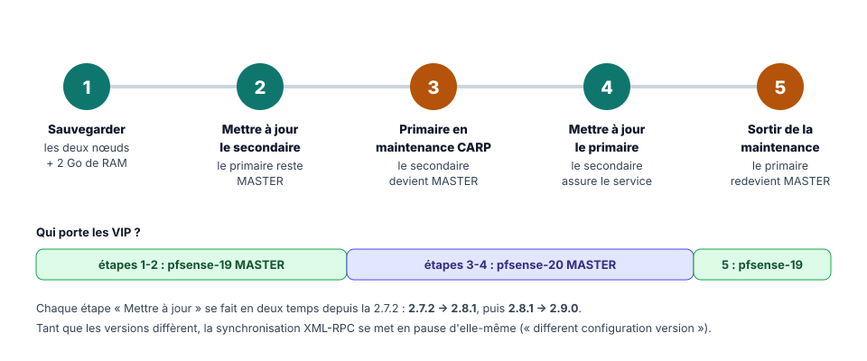
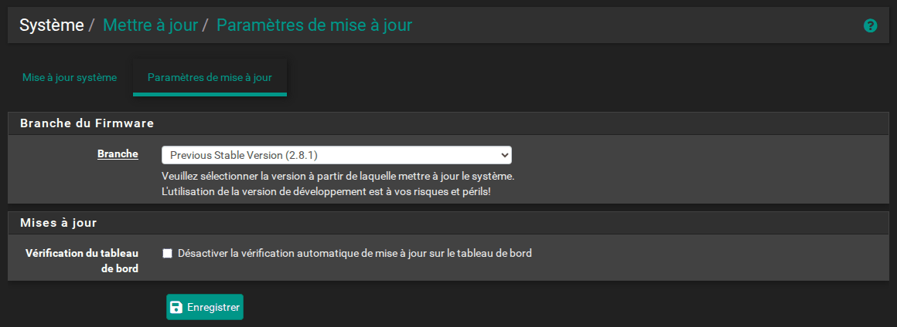
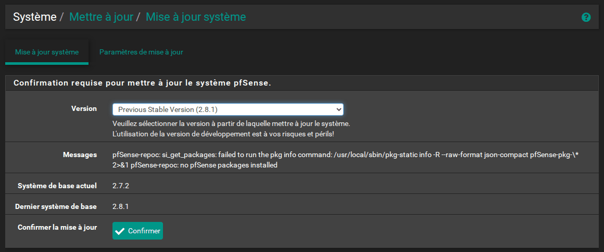
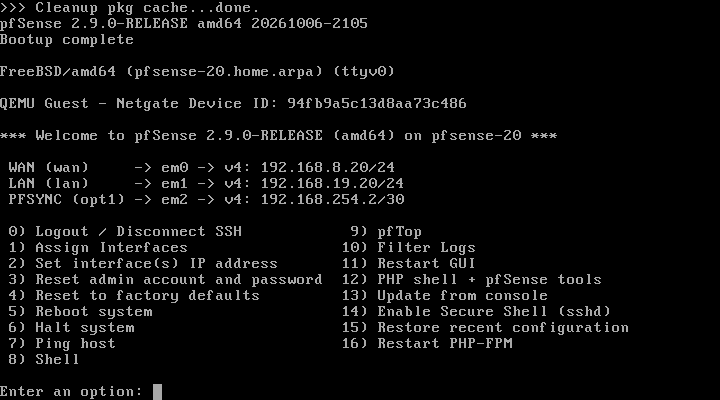
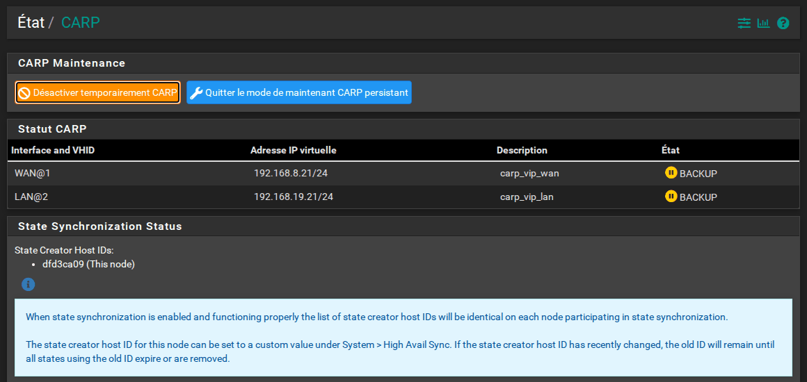

<!-- ============================================================ -->
<!-- ⚠️ RAPPEL IMPORTANT :                                          -->
<!-- Pensez TOUJOURS à ajouter une entrée dans le fichier d'index  -->
<!-- (index.md) du dossier correspondant (ex: docs/cloud/index.md) -->
<!-- afin de référencer ce nouvel article et permettre aux         -->
<!-- visiteurs de le trouver et de cliquer dessus !                -->
<!-- ============================================================ -->

# TP pfSense HA : mettre à jour le cluster vers pfSense CE 2.9.0

!!! abstract "Résumé"
    pfSense CE 2.7.2 n'est plus maintenue. Ce dernier TP met le cluster à jour vers la **2.9.0**, en deux sauts (2.7.2 → 2.8.1 → 2.9.0), **sans interruption de service** : on ne met jamais à jour le pare-feu qui porte le trafic.

    On sauvegarde d'abord les deux nœuds, on met à jour le **secondaire**, puis on place le primaire en **mode de maintenance CARP** pour que le secondaire prenne le relais sans coupure, avant de mettre à jour le primaire et de lui rendre la main. Un dépannage détaillé couvre les incidents les plus fréquents.

| Propriété | Valeur |
|-----------|--------|
| Difficulté | Intermédiaire |
| Durée estimée | 2 h 30 à 4 h, surtout du temps de téléchargement |
| Version décrite | pfSense CE 2.7.2, puis 2.8.1, puis 2.9.0 (20 août 2026) |
| Place dans le parcours | Partie 8 sur 8 du parcours [Cluster pfSense en haute disponibilité](index.md) |
| Dernière mise à jour | 2026-11-07 |

---

!!! info "Convention de lecture"
    Chaque action commence par un repère qui indique où elle se fait : 🖥️ **PC hôte** (hyperviseur, navigateur), 1️⃣ **primaire** `pfsense-19` (`https://192.168.19.19`), 2️⃣ **secondaire** `pfsense-20` (`https://192.168.19.20`), 1️⃣ 2️⃣ **les deux pare-feux**. Les [comptes et mots de passe](index.md#comptes-et-mots-de-passe) sont rappelés sur la page d'accueil du parcours.

## 1. Avant de commencer

pfSense CE **2.7.2** (décembre 2023) n'est plus maintenue. À la date de rédaction, la version courante est la **2.9.0** (20 août 2026), basée sur FreeBSD 16. Mettre à jour un cluster est un savoir-faire à part entière : bien menée, l'opération se fait **sans interruption de service**. Un flux TCP et un ping continus, entre un poste client du LAN et un serveur côté WAN, ne subissent **aucune perte** lors de l'entrée et de la sortie du mode maintenance.

<figure markdown="span">
  { loading=lazy }
  <figcaption>Le principe : on ne met jamais à jour le pare-feu qui porte le trafic.</figcaption>
</figure>

!!! info "Ce qu'il faut savoir avant de commencer"
    - **Deux sauts sont nécessaires.** Sur une 2.7.2, la page de mise à jour ne propose que la 2.8.1, et la 2.9.0 n'apparaît qu'une fois en 2.8.1. Chaque nœud passe donc par **2.7.2 → 2.8.1 → 2.9.0**.
    - **Internet est indispensable, et le téléchargement est long** : 187 paquets pour passer en 2.8.1, puis 184 pour passer en 2.9.0. Chaque saut prend **de 25 minutes à 1 heure par nœud**, selon la charge des serveurs de Netgate. L'installation et les redémarrages ne durent que 3 à 4 minutes ; tout le reste est du téléchargement.
    - **2 Go de RAM par VM.** Avec 1 Go, la mise à jour peut réussir sur un nœud et échouer sur l'autre : le système tue alors le processus d'installation par manque de mémoire, et pfSense reste inutilisable (voir le [dépannage](#7-depannage-de-la-mise-a-jour)). L'échec n'est donc pas systématique, mais le risque est réel. Avec 2 Go, les deux sauts se déroulent sans erreur.
    - **Tant que les versions diffèrent, la synchronisation XML-RPC se suspend d'elle-même.** Le journal système du primaire l'indique : *« The other member is on a different configuration version of pfSense. Sync will not be done to prevent problems! »*. Il ne faut donc **rien modifier** pendant la mise à jour, car les changements ne seraient pas recopiés.
    - **Les états pfsync passent toujours vers le nœud mis à jour.** Un secondaire en 2.9.0 importe encore les états envoyés par un primaire en 2.7.2 ; l'inverse ne fonctionne plus. Au moment de basculer vers le secondaire mis à jour, celui-ci dispose donc bien des états des connexions en cours.

## 2. Étape 1 — Sauvegarder les deux nœuds et prévoir 2 Go de RAM

1️⃣ 2️⃣ **Sur chaque pare-feu**, ouvrir **Diagnostics > Backup & Restore**, laisser **Backup area** sur **All**, puis cliquer sur **Download configuration as XML**.

🛟 **Point de sauvegarde** : 🖥️ prendre aussi un instantané des deux VM, nommé `05-avant-mise-a-jour` : en cas d'échec, c'est le moyen le plus rapide de revenir en arrière.

Si les VM ont été créées avec 1 Go, 2️⃣ **éteindre le secondaire** (console : option **6) Halt system**), 🖥️ porter sa mémoire à **2 Go** dans les paramètres de la VM, puis le rallumer. Comme il est BACKUP, le service n'est pas affecté. Le primaire sera traité à l'étape 3, une fois en maintenance.

## 3. Étape 2 — Mettre à jour le secondaire (2.7.2 → 2.8.1 → 2.9.0)

2️⃣ **Sur le secondaire** :

1. Ouvrir **System > Update** (*Système > Mettre à jour*), onglet **Update Settings** (*Paramètres de mise à jour*). Choisir **Branch** : **Previous Stable Version (2.8.1)**, puis **Save**.

    { loading=lazy }
    /// caption
    Paramètres de mise à jour : branche 2.8.1
    ///

2. Onglet **System Update** (*Mise à jour système*) : patienter jusqu'à ce que **Latest Base System** (*Dernier système de base*) affiche `2.8.1`. L'état « *Retrieving* » peut durer une à deux minutes.

    { loading=lazy }
    /// caption
    Mise à jour système : 2.7.2 installée, 2.8.1 disponible
    ///

    !!! note "Le message « pfSense-repoc: … no pfSense packages installed »"
        Ce message apparaît dans la zone **Messages** sur une pfSense CE fraîchement installée. Il est sans conséquence : la mise à jour fonctionne malgré lui.

3. Cliquer sur **Confirm**. La page affiche la progression du téléchargement. Dans la console, la suite se déroule ainsi :
    1. le message *« System is going to be upgraded. Rebooting in … seconds »* annonce un **premier redémarrage** ;
    2. le nouveau FreeBSD et les paquets s'installent pendant deux à trois minutes ;
    3. le message *« Rebooting now »* annonce un **second redémarrage**, et la console affiche `net.inet.carp.allow: 1 -> 0` : pfSense désactive CARP avant de s'arrêter ;
    4. le menu habituel revient.

    **Ne pas éteindre la VM pendant cette phase.** Des messages inquiétants peuvent défiler, comme *« POST-INSTALL script failed »* ou *« missing file »* : ils sont sans conséquence.

4. Vérifier la bannière de la console, `*** Welcome to pfSense 2.8.1-RELEASE ***`, et, dans **Status > CARP (failover)**, que le secondaire est toujours **BACKUP**.
5. Recommencer avec **Branch** : **Current Stable Version (2.9.0)**. Cette option n'apparaît qu'en 2.8.1. Cliquer sur **Save**, puis sur **System Update > Confirm**.
6. Vérifier la bannière `2.9.0-RELEASE` et l'état **BACKUP**.

    { loading=lazy width="560" }
    /// caption
    Console du secondaire après la mise à jour en 2.9.0
    ///

## 4. Étape 3 — Placer le primaire en maintenance CARP

1️⃣ **Sur le primaire**, ouvrir **Status > CARP (failover)** et cliquer sur **Enter Persistent CARP Maintenance Mode** (*Entrer en mode de maintenance CARP persistant*).

{ loading=lazy }
/// caption
Primaire en maintenance CARP : ses VIP sont en BACKUP
///

Ce mode règle le skew de toutes les VIP du primaire à **254** (`advskew 254` dans `ifconfig`). Le secondaire, dont les annonces sont désormais plus fréquentes, devient MASTER. La bascule est **planifiée** : au lieu de disparaître brutalement, le primaire annonce sa nouvelle priorité, plus faible. Le secondaire prend donc le relais immédiatement, sans attendre le délai de détection d'une panne (environ 3,4 s) : aucun ping vers la VIP n'est perdu.

Contrairement à *Temporarily Disable CARP*, ce mode **persiste après un redémarrage**. Si le primaire n'a que 1 Go, 🖥️ l'éteindre maintenant, lui donner 2 Go et le rallumer : il reste bien BACKUP au redémarrage, sans aucune perte de ping.

## 5. Étape 4 — Mettre à jour le primaire

1️⃣ **Sur le primaire**, refaire les deux sauts de l'étape 2 (2.8.1, puis 2.9.0). Pendant ce temps, le secondaire assure seul le service.

## 6. Étape 5 — Sortir du mode de maintenance

1️⃣ **Sur le primaire**, dans **Status > CARP (failover)**, cliquer sur **Leave Persistent CARP Maintenance Mode** (*Quitter le mode de maintenance CARP persistant*). Le primaire redevient MASTER grâce à la préemption, sans perte de ping.

!!! success "Vérifications finales"
    - Les deux consoles affichent `pfSense 2.9.0-RELEASE`.
    - Le primaire est **MASTER** et le secondaire **BACKUP** sur les deux VIP.
    - **La synchronisation XML-RPC a repris** : une règle de test créée sur le primaire apparaît sur le secondaire, et sa suppression est elle aussi répliquée. En 2.9.0, une synchronisation réussie n'ajoute aucune ligne au journal système : ce test est donc la vérification la plus fiable.
    - Dans **Status > CARP (failover)**, la section **State Synchronization Status** liste **les deux mêmes identifiants** sur les deux nœuds (voir la [partie 6](06-tester-la-bascule.md#1-controler-letat-normal)) : pfsync fonctionne de nouveau dans les deux sens.
    - Si le navigateur affiche un **nouvel avertissement de certificat**, c'est que pfSense a recréé le certificat de son interface web, ce qui peut arriver sur un nœud et pas sur l'autre. Il suffit d'accepter le nouveau certificat.

---

## 7. Dépannage de la mise à jour

!!! failure "La page indique toujours 2.7.2, « Your system is up to date » ou « Unable to check for updates »"
    Ces trois cas se rencontrent juste après un changement de branche. Pour en sortir :

    1. Retourner dans **Update Settings**, vérifier la branche et cliquer de nouveau sur **Save**.
    2. Dans **Diagnostics > Command Prompt**, lancer `pfSense-upgrade -c`. La commande doit répondre `2.8.1 version of pfSense is available`, ou indiquer la version visée.
    3. Recharger la page **System Update**.

    Le message *« Another instance of pfSense-upgrade is running »* signifie qu'une vérification est déjà en cours : patienter quelques minutes, puis recharger.

!!! failure "Après le redémarrage, la console affiche `php: not found` et une invite `login:`"
    C'est le symptôme d'une mise à jour lancée avec 1 Go de RAM. La console affiche notamment :

    - `/etc/rc.bootup: not found` et `pfSense-upgrade: php: not found` ;
    - une invite `FreeBSD/amd64 (Amnesiac) (ttyv0) login:` à la place du menu ;
    - une interface web injoignable.

    La commande `dmesg` (connexion en `root` avec le mot de passe du compte `admin`) montre `pkg-static … was killed: failed to reclaim memory`. L'installation a été interrompue à mi-chemin : le nouveau FreeBSD est en place, mais pas les paquets de pfSense.

    **Solution** : restaurer l'instantané de l'étape 1 (`05-avant-mise-a-jour`), porter la RAM à 2 Go, puis recommencer la mise à jour. Sans instantané, il faut réinstaller pfSense et restaurer la sauvegarde `config.xml` de l'étape 1.

<!-- NOTE DE RÉDACTION (non affichée) : Méthodes de secours non rejouées
La réinstallation suivie de la restauration de config.xml n'a pas été rejouée dans le lab. L'option 13) Update from console et les commandes de réparation de Netgate n'ont pas été nécessaires dans le lab de test : elles sont citées d'après la documentation de Netgate.
-->

Netgate propose aussi l'option **13) Update from console**, qui lance la même mise à jour en mode texte, et des commandes de réparation (`pkg-static clean -ay; pkg-static install -fy pkg pfSense-repo pfSense-upgrade`) dans sa page [Troubleshooting upgrades](https://docs.netgate.com/pfsense/en/latest/troubleshooting/upgrades.html).

---

## 8. Questions de révision

1. Pourquoi met-on à jour le **secondaire** en premier ?
2. Pourquoi faut-il deux sauts pour passer de la 2.7.2 à la 2.9.0 ?
3. Pourquoi porter la RAM des VM à 2 Go avant la mise à jour ?
4. Quelle différence entre **Temporarily Disable CARP** et **Enter Persistent CARP Maintenance Mode**, et pourquoi le second évite-t-il toute coupure ?
5. Pourquoi ne faut-il rien modifier dans la configuration pendant la mise à jour ?
6. Quelle est la vérification la plus fiable pour s'assurer que la synchronisation XML-RPC a repris en 2.9.0 ?

??? success "Corrigé"
    1. Le secondaire est **BACKUP** : il ne porte pas le trafic, sa mise à jour et ses redémarrages n'affectent pas le service. Une fois à jour, il peut reprendre le trafic pendant celle du primaire. On ne met jamais à jour le pare-feu qui porte le trafic.
    2. Sur une 2.7.2, la page de mise à jour ne propose que la **2.8.1** ; la 2.9.0 n'apparaît qu'une fois le nœud en 2.8.1. Chaque nœud passe donc par 2.7.2 → 2.8.1 → 2.9.0.
    3. Avec 1 Go, le système peut **tuer le processus d'installation** par manque de mémoire : le nouveau FreeBSD est en place mais pas les paquets de pfSense, qui reste inutilisable (`php: not found`). Avec 2 Go, les deux sauts se déroulent sans erreur.
    4. **Temporarily Disable CARP** coupe CARP sur le nœud, et ne survit pas à un redémarrage. Le **mode de maintenance persistant** règle le skew de toutes les VIP du nœud à 254 et **persiste après un redémarrage**. La bascule est planifiée : le primaire annonce une priorité plus faible au lieu de disparaître, et le secondaire prend le relais immédiatement, sans attendre le délai de détection d'environ 3,4 s.
    5. Tant que les versions diffèrent, la synchronisation XML-RPC **se suspend d'elle-même** (*« Sync will not be done to prevent problems! »*) : une modification faite pendant la mise à jour ne serait pas recopiée sur l'autre nœud.
    6. Créer une **règle de test sur le primaire** et vérifier qu'elle apparaît sur le secondaire, puis que sa suppression est elle aussi répliquée. En 2.9.0, une synchronisation réussie n'ajoute aucune ligne au journal système.

---

## Ressources

- [Netgate — Upgrading a High Availability Cluster](https://docs.netgate.com/pfsense/en/latest/install/upgrade-guide-ha.html) — Ordre officiel de mise à jour.
- [Netgate — CARP Status](https://docs.netgate.com/pfsense/en/latest/monitoring/status/carp.html) — Désactivation temporaire et mode de maintenance.
- [Netgate — Troubleshooting upgrades](https://docs.netgate.com/pfsense/en/latest/troubleshooting/upgrades.html) — Que faire si la mise à jour échoue.
- [Netgate — Notes de version pfSense CE 2.9.0](https://docs.netgate.com/pfsense/en/latest/releases/2-9-0.html)
- Partie précédente : [Agrégation LACP et troisième nœud](07-agregation-lacp-troisieme-noeud.md) · Annexes : [dépannage, aide-mémoire et glossaire](annexes.md).

*[CARP]: Common Address Redundancy Protocol
*[VIP]: Virtual IP — adresse IP virtuelle partagée
*[HA]: High Availability — haute disponibilité
