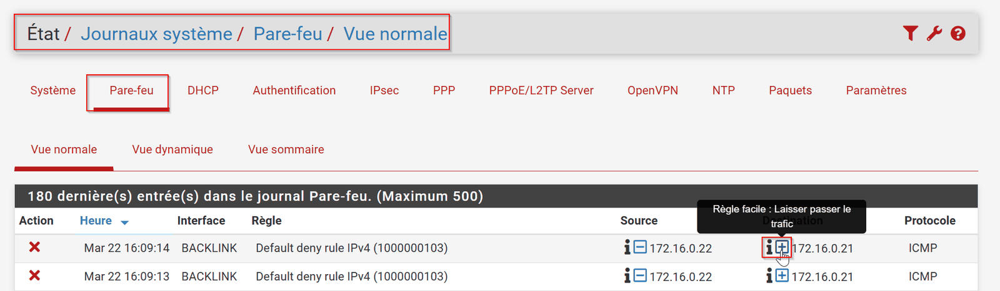
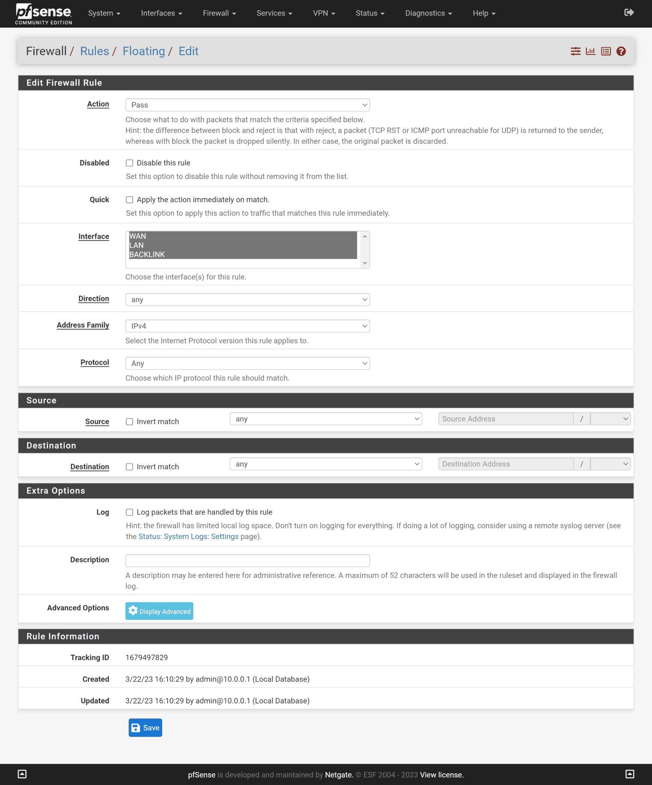
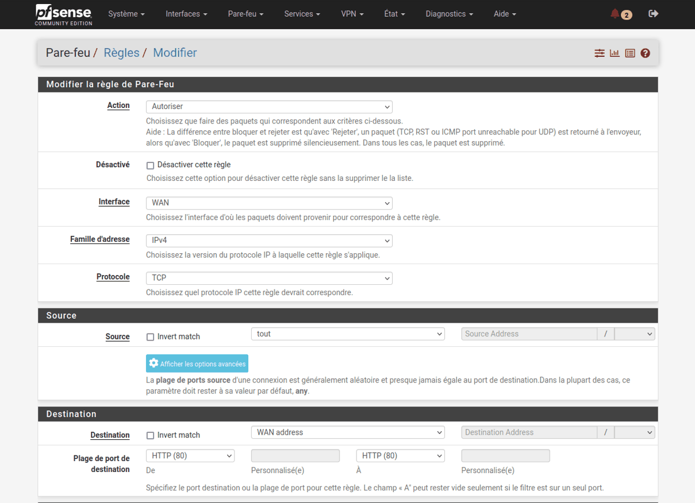
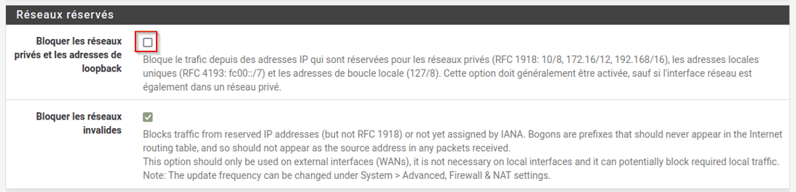
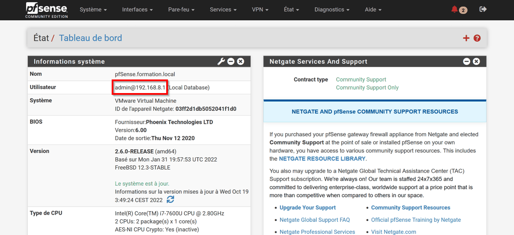
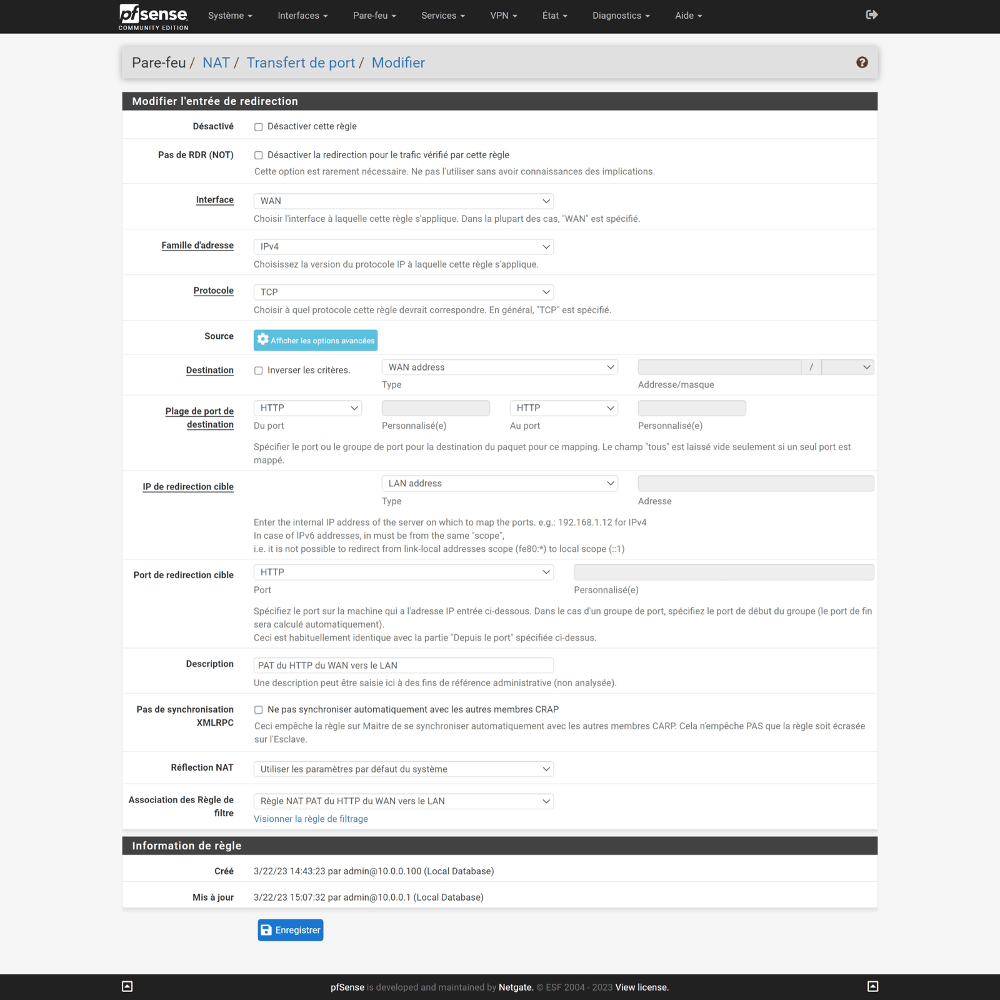

<!-- ============================================================ -->
<!-- ⚠️ RAPPEL IMPORTANT :                                          -->
<!-- Pensez TOUJOURS à ajouter une entrée dans le fichier d'index  -->
<!-- (index.md) du dossier correspondant (ex: docs/cloud/index.md) -->
<!-- afin de référencer ce nouvel article et permettre aux         -->
<!-- visiteurs de le trouver et de cliquer dessus !                -->
<!-- ============================================================ -->

# Annexes : dépannage et astuces, aide-mémoire, glossaire

!!! abstract "Résumé"
    Cette page rassemble ce qui sert pendant tout le parcours : les **pannes les plus courantes** et leur solution, quelques **astuces** (accès par le WAN, clavier AZERTY dans la console), un **aide-mémoire** des menus et des commandes, et un **glossaire** du vocabulaire de la haute disponibilité.

| Propriété | Valeur |
|-----------|--------|
| Usage | À consulter à tout moment du parcours |
| Version décrite | pfSense CE 2.7.2 → 2.9.0 |
| Place dans le parcours | Annexes du parcours [Cluster pfSense en haute disponibilité](index.md) |
| Dernière mise à jour | 2026-11-07 |

---

## 1. Dépannage et astuces

### 1.1 Les deux pare-feux sont MASTER en même temps

C'est le symptôme le plus courant. On parle de **« split-brain »** : chaque nœud croit être seul, car il n'entend pas les annonces de l'autre. Vérifier dans l'ordre :

1. Les deux cartes WAN (et les deux cartes LAN) sont-elles bien dans le **même** réseau virtuel ? Sous VirtualBox, le mode **NAT** simple isole chaque VM : utiliser **Réseau NAT**.
2. Sous VirtualBox, le **mode promiscuité** est-il réglé sur **Tout autoriser** ?
3. Les VIP ont-elles bien été **répliquées** sur le secondaire, avec le même VHID et le même mot de passe ?

### 1.2 Pas de ping entre les deux pare-feux

Ouvrir **Status > System Logs > Firewall** (*État > Journaux système > Pare-feu*) pour retrouver le blocage du protocole ICMP, puis créer une règle rapide avec le bouton **+** (*Easy Rule*).

{ loading=lazy }
/// caption
Journal du pare-feu : ICMP bloqué ; le bouton + crée une règle rapide
///

### 1.3 Pas de ping vers la passerelle

- Désactiver puis réactiver la carte réseau virtuelle du VMnet concerné sur le PC hôte Windows (raccourci `ncpa.cpl`).
- Supprimer le VMnet concerné, appliquer les changements, puis le recréer à l'identique.
- Redémarrer les pfSense.
- En dernier recours, et **uniquement pour diagnostiquer**, créer une règle flottante (**Firewall > Rules > Floating**) qui autorise tout trafic sur toutes les interfaces, puis vérifier si la passerelle est toujours injoignable. Si elle répond, le problème vient des règles ; sinon, il vient du réseau virtuel. **Supprimer cette règle après le test.**

    { loading=lazy }
    /// caption
    Règle flottante de diagnostic autorisant tout le trafic, à supprimer après le test
    ///

### 1.4 Accéder à l'interface web par le WAN, temporairement, en ligne de commande

Pour administrer un pare-feu par son interface WAN, la commande suivante **désactive complètement le filtrage**. Elle se tape dans le shell pfSense, option **8) Shell** de la console :

```bash
pfctl -d
```

L'interface web est alors accessible depuis le WAN. Cet accès est **à usage unique** : à la prochaine modification de configuration, pfSense réactive le filtrage et il faut relancer la commande.

!!! danger "Le pare-feu ne filtre plus rien"
    Tant que `pfctl -d` est actif, le pare-feu laisse **tout** passer. À n'utiliser que dans un lab, le temps d'une manipulation. La commande `pfctl -e` réactive le filtrage.

### 1.5 Accéder à l'interface web par le WAN avec une règle permanente

!!! danger "À ne jamais faire en production"
    Exposer l'interface d'administration côté WAN est un **trou de sécurité majeur**. Ces manipulations ne sont acceptables que dans un lab isolé.

**Avec une règle de filtrage** : ouvrir **Firewall > Rules > WAN**, puis **Add**. Il existe deux boutons **Add** : l'un ajoute la règle en haut de la liste, l'autre en bas, et les règles s'appliquent **de haut en bas**. Renseigner :

| Champ | Valeur |
|-------|--------|
| Action | `Pass` |
| Interface | `WAN` |
| Address Family | `IPv4` |
| Protocol | `TCP` |
| Source | `any` (ou un hôte ou réseau précis, ce qui est préférable) |
| Destination | `WAN address` |
| Destination port range | `HTTPS (443)`, ou `HTTP (80)` si l'interface web a été repassée en HTTP |

Cliquer sur **Save**, puis sur **Apply Changes**. Pour désactiver la règle plus tard, cliquer sur la coche verte (la règle devient grisée), puis appliquer.

{ loading=lazy }
/// caption
Règle WAN vers l'adresse WAN du pare-feu. Sur cette capture, l'interface web était servie en HTTP, d'où le port 80.
///

Dans ce lab, l'ordinateur qui se connecte côté WAN a une adresse **privée**. La règle ne fonctionne donc que si la case **Block RFC1918 Private Networks** est décochée, comme demandé dans l'assistant ([partie 3](03-configuration-initiale.md#2-suivre-lassistant-de-configuration-setup-wizard)) : le blocage des réseaux privés est évalué **avant** les règles écrites à la main. Si la case est cochée, la décocher dans **Interfaces > WAN**, section **Reserved Networks**, puis appliquer.

{ loading=lazy }
/// caption
Interfaces > WAN : case de blocage des réseaux privés
///

{ loading=lazy }
/// caption
Tableau de bord ouvert depuis l'adresse WAN
///

**Avec une redirection de port (PAT)** : une règle de **Firewall > NAT > Port Forward** peut aussi rediriger un port du WAN vers l'interface web.

{ loading=lazy }
/// caption
Redirection de port du WAN vers l'interface web (ici en HTTP, port 80)
///

### 1.6 Une règle a disparu du secondaire

C'est normal si elle avait été créée **sur le secondaire** : la synchronisation suivante l'a effacée (voir l'[exercice 3](06-tester-la-bascule.md#exercice-3)). Toute modification se fait **sur le primaire**.

### 1.7 Passer le clavier de la console en AZERTY

**Temporairement**, jusqu'au prochain redémarrage : au menu de la console, choisir **8) Shell** et saisir :

```bash
kbdcontrol -l /usr/share/syscons/keymaps/fr.iso.kbd
```

Le clavier étant encore en QWERTY pendant la saisie, il faut taper :

| Pour obtenir | Appuyer sur |
|--------------|-------------|
| `-` | touche `)` |
| `m` | touche `,` |
| `/` | touche `!` |
| `a` | touche `q` |
| `.` | touche `:` (sans majuscule) |

**De façon permanente** : installer le paquet **Shellcmd**. Ouvrir **System > Package Manager > Available Packages** (*Système > Gestionnaire de paquets > Paquets disponibles*), installer **Shellcmd**, puis ouvrir **Services > Shellcmd > Add** :

| Champ | Valeur |
|-------|--------|
| Command | `kbdcontrol -l /usr/share/syscons/keymaps/fr.iso.kbd` |
| Shellcmd Type | `shellcmd` |
| Description | `clavier azerty` |

Au prochain redémarrage, la console utilisera le clavier français.

---

## 2. Aide-mémoire

| Action | Menu ou commande |
|--------|------------------|
| Affecter les interfaces | Console : **1) Assign Interfaces** |
| Changer l'adresse IP d'une interface | Console : **2) Set interface(s) IP address** — ou **Interfaces > *nom*** |
| Configurer la haute disponibilité | **System > High Avail. Sync** (*Système > High Availability*) |
| Gérer les utilisateurs | **System > User Manager** (*Système > Gestionnaire d'usagers*) |
| Règles de filtrage | **Firewall > Rules > *interface*** — toujours **Apply Changes** ensuite |
| Créer une VIP | **Firewall > Virtual IPs** (*Pare-feu > IPs virtuels*) |
| NAT sortant | **Firewall > NAT > Outbound** (*Pare-feu > NAT > Sortant*) |
| État MASTER/BACKUP, maintenance | **Status > CARP (failover)** (*État > CARP (basculement)*) |
| Forcer la synchronisation (primaire) | **Status > Filter Reload > Force Config Sync** |
| Journaux du pare-feu | **Status > System Logs > Firewall** |
| Tester la connectivité | **Diagnostics > Ping** (choisir l'adresse source) |
| Lancer une commande shell | **Diagnostics > Command Prompt** — ou console **8) Shell** |
| Sauvegarder / restaurer | **Diagnostics > Backup & Restore** |
| Mettre à jour | **System > Update** — ou console **13) Update from console** |
| Voir l'état CARP d'une interface | `ifconfig em1 \| grep carp` |
| Voir la rétrogradation CARP | `sysctl net.inet.carp.demotion` |
| Compter les états par nœud créateur | `pfctl -vvss \| grep -o "creatorid: [0-9a-f]*" \| sort \| uniq -c` |

---

## 3. Glossaire

ARP gratuit
:   Message ARP qu'un équipement envoie spontanément pour annoncer « cette adresse IP est désormais chez moi ». Le nouveau MASTER l'utilise pour que les switches et les postes mettent à jour leurs tables immédiatement.

BACKUP / MASTER
:   États d'une VIP CARP. Le **MASTER** possède la VIP et répond au trafic ; le **BACKUP** attend et surveille les annonces du MASTER.

CARP
:   *Common Address Redundancy Protocol*. Protocole qui permet à un groupe d'hôtes d'un même segment réseau de partager une adresse IP. Il sert à la tolérance de panne de routeurs, et parfois à la répartition de charge, sans protocole de routage dynamique. C'est une alternative libre et sécurisée aux protocoles VRRP (*Virtual Router Redundancy Protocol*), HSRP (*Hot Standby Router Protocol*) et FSRP, créée pour contourner des brevets.

Cluster
:   Ensemble de serveurs ou d'équipements, appelés **nœuds**, qui travaillent ensemble pour fournir un service unique. Le cluster agit comme une seule unité, ce qui améliore la fiabilité et parfois les performances.

Failover (basculement)
:   Mécanisme qui bascule automatiquement d'un système défaillant vers un système de secours, sans interruption de service ou avec une interruption minimale.

HA (High Availability, haute disponibilité)
:   Capacité d'un système à fonctionner en continu avec un minimum d'interruptions. Elle s'obtient par la redondance, la réplication des données et des procédures de basculement.

LACP / LAGG
:   *Link Aggregation Control Protocol* (IEEE 802.3ad) : protocole de niveau 2 qui regroupe plusieurs ports Ethernet en un seul lien logique, de plus grande capacité totale et redondant. Le trafic est réparti par flux. Dans pfSense, l'interface résultante s'appelle un **LAGG**.

NAT sortant
:   Traduction de l'adresse source des paquets qui sortent d'un réseau, par exemple du LAN vers le WAN. Dans un cluster, elle doit utiliser la VIP WAN.

NIC
:   *Network Interface Controller* : carte réseau, physique ou virtuelle.

pfsync
:   Protocole qui synchronise la table d'états entre plusieurs machines exécutant le pare-feu Packet Filter. Il diffuse les états des connexions actives entre les nœuds du cluster, pour que le nœud de secours les connaisse au moment d'une bascule. Il fonctionne par défaut en multicast, mais une adresse de pair (*syncpeer*) permet d'envoyer les paquets directement au nœud voulu, comme dans ce parcours.

Préemption
:   Capacité d'un nœud prioritaire à **reprendre** le rôle de MASTER dès qu'il redevient disponible. Elle est activée par défaut dans pfSense.

Redondance
:   Ajout de composants ou de systèmes de secours pour assurer la continuité de service en cas de défaillance.

Rétrogradation (demotion)
:   Pénalité ajoutée par CARP à **toutes** les VIP d'un nœud quand l'une de ses interfaces tombe. Le nœud devient moins prioritaire, et l'ensemble des VIP bascule vers l'autre nœud.

Skew (biais)
:   Retard ajouté aux annonces CARP d'un nœud. Plus il est faible, plus le nœud est prioritaire. pfSense ajoute 100 au skew sur le secondaire.

Split-brain
:   Situation anormale où plusieurs nœuds se croient MASTER en même temps, ou se partagent les VIP de façon incohérente.

Table d'états
:   Liste des connexions en cours, mémorisée par un pare-feu à états. Grâce à elle, les réponses d'une connexion autorisée passent sans règle supplémentaire.

VHID
:   *Virtual Host ID*. Numéro d'un groupe CARP sur un réseau. Il détermine l'adresse MAC virtuelle `00:00:5e:00:01:<VHID>`.

VIP
:   *Virtual IP*. Adresse IP virtuelle partagée par les nœuds du cluster et portée par le MASTER.

XML-RPC
:   Protocole d'appel de procédure à distance (*Remote Procedure Call*) qui transporte des données structurées en XML sur HTTP. Il a été publié en 1998 par Dave Winer (UserLand Software) avec Microsoft. pfSense l'utilise pour répliquer la configuration du primaire vers le secondaire.

---

## Ressources

- Les ressources complètes du parcours sont sur la [page d'accueil](index.md#ressources).
- Partie précédente : [Mettre à jour le cluster](08-mettre-a-jour-le-cluster.md) · Retour à l'accueil : [Cluster pfSense en haute disponibilité](index.md).

*[CARP]: Common Address Redundancy Protocol
*[VIP]: Virtual IP — adresse IP virtuelle partagée
*[VHID]: Virtual Host ID — numéro de groupe CARP
*[HA]: High Availability — haute disponibilité
*[NAT]: Network Address Translation — traduction d'adresses
*[PAT]: Port Address Translation — redirection de port
*[LACP]: Link Aggregation Control Protocol
*[LAGG]: Link Aggregation — agrégation de liens
*[NIC]: Network Interface Controller — carte réseau
