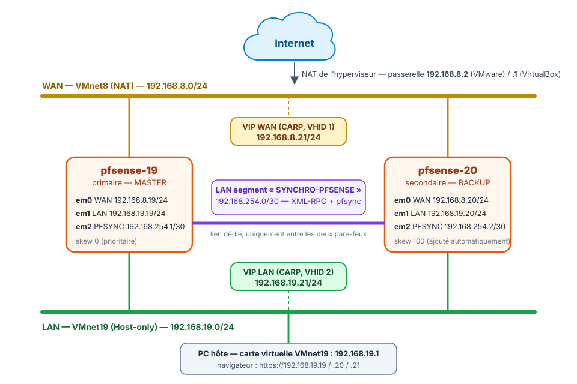

<!-- ============================================================ -->
<!-- ⚠️ RAPPEL IMPORTANT :                                          -->
<!-- Pensez TOUJOURS à ajouter une entrée dans le fichier d'index  -->
<!-- (index.md) du dossier correspondant (ex: docs/cloud/index.md) -->
<!-- afin de référencer ce nouvel article et permettre aux         -->
<!-- visiteurs de le trouver et de cliquer dessus !                -->
<!-- ============================================================ -->

# Cluster de pare-feux pfSense en haute disponibilité : cours et travaux pratiques

!!! abstract "Résumé"
    Ce parcours en huit parties construit, dans deux machines virtuelles, un **cluster actif/passif de deux pare-feux pfSense**. Si le pare-feu principal tombe en panne, le pare-feu de secours prend le relais en quelques secondes, sans qu'aucun poste du réseau n'ait à être reconfiguré.

    Le cluster repose sur trois mécanismes :

    - **CARP** pour partager des adresses IP virtuelles ;
    - **pfsync** pour recopier la table des connexions en cours ;
    - **XML-RPC** pour répliquer automatiquement la configuration.

    Le parcours commence par un cours, continue par cinq travaux pratiques (préparation de l'hyperviseur, installation de pfSense CE 2.7.2, configuration de la haute disponibilité, tests de bascule et exercices corrigés) et se termine par deux prolongements : agrégation de liens LACP et troisième nœud, puis **mise à jour du cluster vers pfSense CE 2.9.0** sans interruption de service.

    Cette page rassemble ce qu'il faut garder sous la main pendant tout le parcours : le plan, le schéma du lab, les adresses, les comptes et mots de passe, le dimensionnement des machines virtuelles, les instantanés conseillés et les logiciels à télécharger.

| Propriété | Valeur |
|-----------|--------|
| Public | Débutants en réseau qui suivent les étapes dans l'ordre : savoir créer une machine virtuelle et connaître l'adressage IPv4 suffit, aucune connaissance de pfSense n'est demandée |
| Durée totale | Environ 10 à 11 h : 6 h 15 pour le cours, le TP principal et les exercices (parties 1 à 6), 1 h pour la partie 7, 2 h 30 à 4 h pour la mise à jour (partie 8), surtout du temps de téléchargement |
| Versions décrites | pfSense Community Edition **2.7.2**, mise à jour en **2.9.0** à la fin du parcours |
| Hyperviseur | VMware Workstation Pro (17, 25H2 ou 26H1) ou Oracle VirtualBox 7 |
| Organisation | Travail individuel, sur un PC disposant d'au moins 8 Go de RAM |
| Dernière mise à jour | 2026-11-07 |

<!-- NOTE DE RÉDACTION (non affichée) : Ce qui a changé par rapport à l'article d'origine (article unique de la catégorie Réseaux, 12-13 octobre 2026)
- L'article unique (~1 600 lignes) a été découpé en un accueil, huit parties et une page d'annexes, sur le modèle du parcours Veeam. Les étapes et les explications sont reprises telles quelles ; seules les références internes (« étape 10.5 », « partie 15.3 »…) ont été renumérotées.
- Ajouts : repères visuels 🖥️ / 1️⃣ / 2️⃣, questions de révision avec corrigé à la fin de chaque partie, noms d'instantanés, vrais mots de passe du lab (lab-secrets.json) à la place de « un mot de passe robuste ».
- Le TP principal, les exercices et la mise à jour complète du cluster vers la 2.9.0 ont été rejoués de bout en bout dans un lab KVM/libvirt les 12 et 13 octobre 2026, avec un poste client sur le LAN (192.168.19.50) et un serveur côté WAN (192.168.8.50) pour mesurer les coupures. Les mesures citées dans le parcours (temps de bascule, paquets perdus, durées) en sont issues.
- Non rejoués dans ce lab : les onglets VirtualBox (partie 2), l'agrégation LAGG/LACP et le troisième nœud (partie 7), la réinstallation suivie de la restauration de config.xml et les commandes de réparation de Netgate (partie 8). Les captures VMware viennent du lab d'origine sous VMware Workstation.
- L'ancienne page de la catégorie Réseaux a été supprimée sans redirection (choix du propriétaire).
-->

---

## Objectifs du parcours

À la fin du parcours, il est possible de :

- expliquer la différence entre un pare-feu seul et un cluster à basculement (*fail-over*) ;
- préparer des réseaux virtuels (NAT, réseau privé hôte, réseau interne) dans un hyperviseur ;
- installer pfSense et réaliser sa configuration initiale en console puis dans l'interface web ;
- configurer la synchronisation de configuration (XML-RPC) et la synchronisation des états (pfsync) ;
- créer des adresses IP virtuelles CARP et une règle de NAT sortant adaptée à un cluster ;
- écrire des règles de filtrage **minimales** (seulement ce qui est nécessaire) ;
- tester une bascule, mesurer la coupure et interpréter les journaux en cas de problème ;
- mettre à jour un cluster sans interrompre le service.

## Plan du parcours

| Partie | Type | Durée | Contenu | Machines allumées |
|:---:|---|---|---|---|
| [1. Comprendre la haute disponibilité](01-comprendre-haute-disponibilite.md) | Cours | 45 min | pfSense, SPOF, actif/passif, adresses IP virtuelles, CARP, pfsync et XML-RPC | Aucune |
| [2. Préparer le lab et installer pfSense](02-preparer-lab-installer-pfsense.md) | TP | 1 h 30 | Réseaux virtuels, deux machines virtuelles, installation de pfSense CE 2.7.2, interfaces et adresse LAN en console | `pfsense-19`, `pfsense-20` |
| [3. Configuration initiale](03-configuration-initiale.md) | TP | 45 min | Interface web, assistant de configuration, interface PFSYNC, premier test de connectivité | `pfsense-19`, `pfsense-20` |
| [4. Synchroniser le cluster](04-synchroniser-le-cluster.md) | TP | 1 h | Utilisateur `ha-user`, synchronisation XML-RPC et pfsync, règles minimales du lien PFSYNC | `pfsense-19`, `pfsense-20` |
| [5. VIP CARP et NAT sortant](05-vip-carp-nat-sortant.md) | TP | 45 min | Adresses IP virtuelles WAN et LAN, règle de NAT sortant vers la VIP | `pfsense-19`, `pfsense-20` |
| [6. Tester la bascule](06-tester-la-bascule.md) | TP | 1 h 30 | État MASTER/BACKUP, panne simulée, mesure de la coupure, exercices corrigés | `pfsense-19`, `pfsense-20` (+ un poste client, facultatif) |
| [7. Agrégation LACP et troisième nœud](07-agregation-lacp-troisieme-noeud.md) | Pour aller plus loin | 1 h | Lien de synchronisation agrégé (LAGG/LACP), principe d'un troisième nœud (non pris en charge par Netgate) | `pfsense-19`, `pfsense-20` |
| [8. Mettre à jour le cluster](08-mettre-a-jour-le-cluster.md) | TP | 2 h 30 à 4 h | Mise à jour 2.7.2 → 2.8.1 → 2.9.0, mode de maintenance CARP, dépannage | `pfsense-19`, `pfsense-20` |

Les [annexes](annexes.md) rassemblent le dépannage et les astuces, un aide-mémoire des menus et des commandes, et un glossaire. Les durées sont indicatives : la partie 8 est surtout faite d'attente pendant les téléchargements.

!!! tip "Suivre l'ordre"
    Chaque TP s'appuie sur le précédent : la partie 4 utilise l'interface PFSYNC créée en partie 3, la partie 6 les VIP et le NAT sortant de la partie 5. Le cours de la partie 1 explique le vocabulaire utilisé partout ensuite. Les parties 7 et 8 sont indépendantes l'une de l'autre : elles partent toutes les deux d'un cluster fonctionnel.

## Schéma du lab

<figure markdown="span">
  { loading=lazy }
  <figcaption>Topologie du lab. Le dernier octet rappelle le rôle : .19 = primaire, .20 = secondaire, .21 = VIP.</figcaption>
</figure>

Le lab utilise trois réseaux virtuels : le **WAN** (l'extérieur, avec accès à Internet par le NAT de l'hyperviseur), le **LAN** (le réseau interne, auquel le PC hôte est relié) et **SYNCHRO-PFSENSE**, un « câble virtuel » qui relie uniquement les deux pare-feux. Leur rôle est expliqué dans la [partie 1](01-comprendre-haute-disponibilite.md) et leur création dans la [partie 2](02-preparer-lab-installer-pfsense.md#2-creer-les-reseaux-virtuels).

## Plan d'adressage

| Interface pfSense | Rôle | `pfsense-19` (primaire) | `pfsense-20` (secondaire) | VIP partagée | Réseau virtuel |
|-------------------|------|-------------------------|---------------------------|--------------|----------------|
| `em0` | **WAN** — côté extérieur | `192.168.8.19/24` | `192.168.8.20/24` | `192.168.8.21/24` | VMnet8 (NAT) — passerelle `192.168.8.2` |
| `em1` | **LAN** — réseau interne | `192.168.19.19/24` | `192.168.19.20/24` | `192.168.19.21/24` | VMnet19 (*Host-only*) |
| `em2` | **PFSYNC** — synchronisation (ex-OPT1) | `192.168.254.1/30` | `192.168.254.2/30` | — | LAN segment « SYNCHRO-PFSENSE » |

Le PC hôte a l'adresse `192.168.19.1` sur le LAN : c'est depuis son navigateur que s'ouvrent les interfaces web des deux pare-feux. Le poste client facultatif de la [partie 6](06-tester-la-bascule.md#3-pour-aller-plus-loin-verifier-depuis-un-poste-client) prend l'adresse `192.168.19.50`.

!!! info "Pourquoi un masque /30 pour la synchronisation ?"
    Un réseau en `/30` (masque `255.255.255.252`) contient **4 adresses** : `192.168.254.0` (adresse du réseau), `.1` et `.2` (les deux seules adresses utilisables) et `.3` (diffusion). Il ne peut donc y avoir **que deux machines** sur ce réseau, exactement les deux pare-feux. Personne d'autre ne peut s'y glisser avec une adresse valide.

    Pour comparaison, un `/29` (masque `255.255.255.248`) offre 6 adresses utilisables, et un `/24` en offre 254.

!!! warning "Utilisateurs de VirtualBox : une seule différence"
    D'après la documentation d'Oracle, la passerelle d'un « Réseau NAT » VirtualBox est **toujours la première adresse** du réseau, soit `192.168.8.1`, et ce n'est pas modifiable. Partout où ce parcours indique la passerelle ou le DNS `192.168.8.2`, utiliser **`192.168.8.1`** avec VirtualBox. Toutes les autres adresses sont identiques.

## Comptes et mots de passe

Ce lab est **pédagogique** : les mots de passe sont écrits ici volontairement pour que chacun puisse suivre à l'identique. En production, chaque mot de passe serait unique, long et rangé dans un gestionnaire de mots de passe, et ne serait jamais publié. Ces mots de passe étant publics, **ne jamais les réutiliser** ailleurs que dans ce lab, et les changer si le lab devient joignable depuis un autre réseau que le PC hôte.

| Où | Compte | Mot de passe | Créé en |
|---|---|---|---|
| `pfsense-19` et `pfsense-20` : interface web, avant l'assistant | `admin` | `pfsense` (mot de passe par défaut de pfSense) | Partie 3 |
| `pfsense-19` et `pfsense-20` : interface web, après l'assistant | `admin` | `Tp-PvnpZskdQq` (le même sur les deux nœuds) | Partie 3 |
| `pfsense-19` et `pfsense-20` : synchronisation XML-RPC | `ha-user` (privilège *System - HA node sync*) | `Ha-UdO8Xe29FS` | Partie 4 |
| VIP CARP du WAN et du LAN | — (*Virtual IP Password*) | `Carp-I0yZc4hYXz` | Partie 5 |

Le compte `root`, utilisé seulement en ligne de commande (dépannage de la [partie 8](08-mettre-a-jour-le-cluster.md#7-depannage-de-la-mise-a-jour)), partage le mot de passe du compte `admin`.

!!! warning "Un compte `ha-user` aussi précieux que `admin`"
    Le privilège *System - HA node sync* permet de remplacer la configuration du pare-feu : il équivaut en pratique à un accès administrateur. Son mot de passe se protège comme celui d'`admin`.

## Dimensionnement des machines virtuelles

| Machine | Conseillé | Minimal | Disque | Cartes réseau |
|---|---|---|---|---|
| `pfsense-19` (primaire) | 1 vCPU, **2 Go** | 1 vCPU, 1 Go | 20 Go | 3 : WAN, LAN, SYNCHRO-PFSENSE (4 en partie 7) |
| `pfsense-20` (secondaire) | 1 vCPU, **2 Go** | 1 vCPU, 1 Go | 20 Go | 3 : WAN, LAN, SYNCHRO-PFSENSE (4 en partie 7) |
| Poste client (facultatif, partie 6) | 1 vCPU, 1 Go (une petite distribution Linux suffit) | — | Selon le système | 1 : LAN |

- **1 Go** de RAM est le minimum officiel de pfSense et suffit pour les parties 1 à 7 (512 Mo fonctionnent en pratique pour un lab).
- La **mise à jour** de la partie 8 demande **2 Go par VM** : avec 1 Go, elle peut échouer faute de mémoire et laisser pfSense inutilisable. Créer directement les VM avec 2 Go évite d'avoir à les modifier plus tard.
- Le disque de 20 Go dépasse largement le minimum officiel de 8 Go.
- **PC hôte** : au moins **8 Go de RAM**, environ **50 Go d'espace disque libre** et la virtualisation matérielle (Intel VT-x ou AMD-V) activée dans le BIOS/UEFI. Un accès à Internet est nécessaire pour la mise à jour finale.

## Instantanés conseillés

Un **instantané** (*snapshot*) enregistre l'état complet d'une machine virtuelle et permet d'y revenir en un clic. En cas d'erreur, on y revient en quelques secondes au lieu de tout recommencer. Prendre les instantanés **sur les deux pare-feux en même temps**, de préférence VM éteintes (console : option **6) Halt system**), aux étapes marquées 🛟 :

| Instantané | Moment | Permet de recommencer |
|---|---|---|
| `01-installation-terminee` | Fin de l'installation de pfSense (partie 2) | La configuration en console et toute la suite |
| `02-configuration-de-base` | Fin de la partie 3 (adresses, assistant, ping sur PFSYNC) | La synchronisation (partie 4) |
| `03-synchronisation-ha` | Fin de la partie 4 (XML-RPC et pfsync fonctionnels) | Les VIP et le NAT sortant (partie 5) |
| `04-cluster-fonctionnel` | Partie 6, juste avant les exercices | Les exercices, puis les parties 7 et 8 avec un cluster propre |
| `05-avant-mise-a-jour` | Partie 8, étape 1, après la sauvegarde des configurations | La mise à jour, en cas d'échec |

**Toujours restaurer les deux VM sur le même instantané** : un primaire et un secondaire revenus à des moments différents n'ont plus la même configuration.

=== "VMware Workstation"

    **VM > Snapshot > Take Snapshot…**, avec le nom de l'instantané, sur chaque VM.

=== "VirtualBox"

    Onglet **Instantanés** de la VM (menu **Machine > Outils > Instantanés**) puis **Prendre**, avec le nom de l'instantané, sur chaque VM.

!!! warning "Un instantané n'est pas une sauvegarde"
    L'instantané reste **sur le même disque** que la machine virtuelle : si le disque du PC hôte tombe en panne, les instantanés disparaissent avec lui. Pour un pare-feu en production, la sauvegarde de référence est le fichier de configuration XML, exporté dans **Diagnostics > Backup & Restore** (voir la [partie 8](08-mettre-a-jour-le-cluster.md#2-etape-1-sauvegarder-les-deux-nuds-et-prevoir-2-go-de-ram)).

## Logiciels à télécharger

| Logiciel | Où le trouver | Remarque |
|---|---|---|
| pfSense CE 2.7.2 (image ISO) | Miroirs ci-dessous | Archive `.iso.gz` d'environ 575 Mo (ISO décompressée : environ 875 Mo) ; empreinte SHA256 à vérifier |
| VMware Workstation Pro | [Page produit VMware](https://www.vmware.com/products/desktop-hypervisor/workstation-and-fusion) | Gratuit pour tous les usages depuis novembre 2024. Téléchargement depuis le portail de support Broadcom, avec un compte gratuit, en choisissant la variante « Personal ». La version 26H1 est la plus récente à la date de rédaction |
| Oracle VirtualBox 7 | [virtualbox.org](https://www.virtualbox.org/wiki/Downloads) | Gratuit |
| 7-Zip (Windows) | [7-zip.org](https://www.7-zip.org/) | Pour décompresser l'archive `.iso.gz` sous Windows |

### Télécharger l'image ISO de pfSense CE 2.7.2

Depuis la version 2.8, pfSense CE ne se télécharge plus sous forme d'image ISO autonome. Il faut passer par le **Netgate Installer**, un installeur en ligne qui exige un compte Netgate et une connexion Internet pendant l'installation. Pour un TP, il est plus simple et plus fiable d'installer la **version 2.7.2** depuis une ISO hors ligne, puis de mettre le cluster à jour à la fin (voir la [partie 8](08-mettre-a-jour-le-cluster.md)). Cela permet aussi d'apprendre la procédure de mise à jour d'un cluster.

Des sites miroirs hébergent toujours l'ISO 2.7.2 :

- Dakota State University (États-Unis), archive compressée : <https://repo.ialab.dsu.edu/pfsense/pfSense-CE-2.7.2-RELEASE-amd64.iso.gz>
- Fagskolen Innlandet (Norvège), ISO directe : <https://ftp.fagskolen.gjovik.no/pub/pfSense/pfSense-CE-2.7.2-RELEASE-amd64.iso>

Un fichier en `.iso.gz` est une **archive compressée** : il faut la décompresser pour obtenir le fichier `.iso` à insérer dans le lecteur CD virtuel. Sous Windows, utiliser 7-Zip (clic droit > *7-Zip > Extraire ici*). Sous Linux, utiliser `gunzip`.

**Vérifier l'intégrité du téléchargement** permet de s'assurer que le fichier n'a été ni corrompu ni modifié. L'empreinte SHA256 officielle de l'archive `pfSense-CE-2.7.2-RELEASE-amd64.iso.gz` est :

```text
883fb7bc64fe548442ed007911341dd34e178449f8156ad65f7381a02b7cd9e4
```

=== "Windows (PowerShell)"

    ```powershell
    Get-FileHash .\pfSense-CE-2.7.2-RELEASE-amd64.iso.gz -Algorithm SHA256
    ```

=== "Linux"

    ```bash
    sha256sum pfSense-CE-2.7.2-RELEASE-amd64.iso.gz
    gunzip -k pfSense-CE-2.7.2-RELEASE-amd64.iso.gz
    ```

!!! success "Résultat attendu"
    L'empreinte affichée est **identique** à celle ci-dessus. Si elle diffère, supprimer le fichier et le télécharger à nouveau.

## Convention de lecture

Dans les TP, chaque action commence par un repère qui indique **où** elle se fait :

| Repère | Où se fait l'action |
|---|---|
| 🖥️ | **PC hôte** : l'hyperviseur (réseaux virtuels, VM, instantanés), le navigateur ou un terminal du PC |
| 1️⃣ | **Primaire** `pfsense-19` (`192.168.19.19`), le pare-feu qui porte normalement le trafic |
| 2️⃣ | **Secondaire** `pfsense-20` (`192.168.19.20`), le pare-feu de secours |
| 1️⃣ 2️⃣ | **Les deux pare-feux**, l'un après l'autre |

- Les interfaces web des deux pare-feux s'ouvrent dans le navigateur du PC hôte : les repères 1️⃣ et 2️⃣ désignent le pare-feu **sur lequel** on agit, que ce soit dans sa console ou dans son interface web. Beaucoup d'erreurs viennent d'une action faite sur le mauvais nœud : relire le repère avant chaque manipulation.
- Les menus sont donnés en anglais, la langue par défaut de pfSense, suivis de leur équivalent français : **Firewall > Rules** (*Pare-feu > Règles*).
- Pour savoir sur quel pare-feu une capture a été prise, se fier au texte qui l'accompagne ou à l'adresse visible en haut de l'image : `192.168.19.19` pour le primaire, `192.168.19.20` pour le secondaire. Les captures mélangent l'interface en français et en anglais. Pour s'y retrouver soi-même, la [partie 3](03-configuration-initiale.md#4-distinguer-les-deux-pare-feux-dun-coup-dil) propose de distinguer les deux pare-feux par la langue et le thème.
- Les encadrés « Pourquoi ? » expliquent ce que fait chaque réglage, et les questions de révision de fin de partie vérifient qu'il est compris : comprendre vaut mieux que recopier.

## Ressources

- [Netgate — Configuring High Availability (recette complète)](https://docs.netgate.com/pfsense/en/latest/recipes/high-availability.html) — La procédure de référence de l'éditeur.
- [Netgate — High Availability : vue d'ensemble](https://docs.netgate.com/pfsense/en/latest/highavailability/index.html) — CARP, pfsync, XML-RPC et leurs exigences.
- [Netgate — Configuration synchronization (XML-RPC)](https://docs.netgate.com/pfsense/en/latest/highavailability/xmlrpc-sync.html) — Ce qui est synchronisé, et ce qui ne l'est pas.
- [Netgate — State synchronization (pfsync)](https://docs.netgate.com/pfsense/en/latest/highavailability/pfsync.html) — Fonctionnement et règles nécessaires.
- [Netgate — Upgrading a High Availability Cluster](https://docs.netgate.com/pfsense/en/latest/install/upgrade-guide-ha.html) — Ordre officiel de mise à jour.
- [Netgate — CARP Status](https://docs.netgate.com/pfsense/en/latest/monitoring/status/carp.html) — Désactivation temporaire et mode de maintenance.
- [Netgate — High Availability in virtual environments](https://docs.netgate.com/pfsense/en/latest/troubleshooting/high-availability-virtual.html) — Réglages des hyperviseurs (mode promiscuité).
- [Netgate — Troubleshooting upgrades](https://docs.netgate.com/pfsense/en/latest/troubleshooting/upgrades.html) — Que faire si la mise à jour échoue.
- [Netgate — Notes de version pfSense CE 2.9.0](https://docs.netgate.com/pfsense/en/latest/releases/2-9-0.html)
- [Netgate — LAGG Interfaces](https://docs.netgate.com/pfsense/en/latest/interfaces/lagg-interfaces.html)
- [Oracle — Modes réseau de VirtualBox](https://docs.oracle.com/en/virtualization/virtualbox/7.1/user/networkingdetails.html)
- [FreeBSD — page de manuel carp(4)](https://man.freebsd.org/cgi/man.cgi?query=carp&sektion=4) — Fonctionnement détaillé de CARP, préemption et rétrogradation.
- Wikipédia : [Basculement (informatique)](https://fr.wikipedia.org/wiki/Basculement_%28informatique%29), [Haute disponibilité](https://fr.wikipedia.org/wiki/Haute_disponibilit%C3%A9), [CARP](https://fr.wikipedia.org/wiki/Common_Address_Redundancy_Protocol), [pfsync](https://fr.wikipedia.org/wiki/Pfsync), [XML-RPC](https://fr.wikipedia.org/wiki/XML-RPC), [IEEE 802.3ad](https://fr.wikipedia.org/wiki/IEEE_802.3ad)
- [Parcours Veeam Backup & Replication](../veeam/index.md) — le parcours de sauvegarde du wiki, dont le lab se branche sur le LAN de ce cluster.
- Commencer le parcours : [Comprendre la haute disponibilité](01-comprendre-haute-disponibilite.md).

*[CARP]: Common Address Redundancy Protocol
*[VIP]: Virtual IP — adresse IP virtuelle partagée
*[VHID]: Virtual Host ID — numéro de groupe CARP
*[HA]: High Availability — haute disponibilité
*[NAT]: Network Address Translation — traduction d'adresses
*[LACP]: Link Aggregation Control Protocol
*[LAGG]: Link Aggregation — agrégation de liens
*[SPOF]: Single Point Of Failure — point unique de défaillance
*[ISO]: Image disque d'un CD/DVD
*[CIDR]: Classless Inter-Domain Routing — notation /24, /30…
