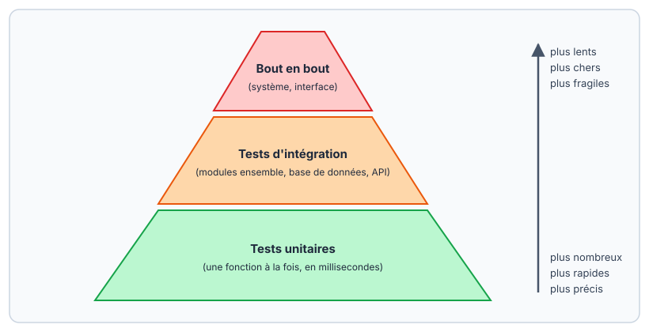

<!-- ============================================================ -->
<!-- ⚠️ RAPPEL IMPORTANT :                                          -->
<!-- Pensez TOUJOURS à ajouter une entrée dans le fichier d'index  -->
<!-- (index.md) du dossier correspondant (ex: docs/cloud/index.md) -->
<!-- afin de référencer ce nouvel article et permettre aux         -->
<!-- visiteurs de le trouver et de cliquer dessus !                -->
<!-- ============================================================ -->

# Comprendre les tests

!!! abstract "Résumé"
    Cette partie pose les bases du parcours en répondant à trois questions : **pourquoi** tester, **quand** tester (cycle en V, pyramide des tests) et **que** tester (les grands types de tests, et ceux qui concernent un administrateur d'infrastructure).

| Propriété | Valeur |
|-----------|--------|
| Difficulté | Débutant — aucun prérequis |
| Durée estimée | 15 min de lecture et de questions |
| Version décrite | Indépendante des outils |
| Place dans le parcours | Partie 1 sur 5 du parcours [Les tests en informatique](index.md) |
| Dernière mise à jour | 2026-11-25 |

---

## 1. Pourquoi tester ?

### 1.1 Une définition simple

**Tester**, c'est faire fonctionner un logiciel, un script ou un système dans des conditions choisies, puis **comparer ce qui se passe à ce qui devrait se passer**. Si le résultat obtenu diffère du résultat attendu, on a trouvé un problème.

Une analogie : un constructeur automobile contrôle chaque pièce à l'atelier (les freins), puis l'assemblage (les freins répondent-ils à la pédale ?), puis la voiture entière sur circuit, et enfin la confie à des clients pour un essai sur route. Le logiciel suit la même logique.

### 1.2 Erreur, défaut, défaillance

Le vocabulaire international des tests, celui de l'**ISTQB** (l'organisme qui certifie les testeurs), distingue trois mots souvent confondus :

| Terme | Définition | Exemple |
|---|---|---|
| **Erreur** (*error*) | Une action humaine qui produit un résultat incorrect | L'administrateur écrit `>` au lieu de `>>` dans un script |
| **Défaut** (*defect*, ou *bug*) | L'imperfection qui reste dans le code ou la configuration | Le script **écrase** le fichier de journal au lieu de le compléter |
| **Défaillance** (*failure*) | Le mauvais comportement visible quand le défaut s'exécute | Les journaux de la nuit ont disparu le matin |

Un défaut peut dormir des années sans se manifester. Le but d'un test est de provoquer la défaillance **avant** la mise en production, là où elle ne fait pas de dégâts.

### 1.3 Les objectifs des tests

On teste pour **trouver des défauts** avant les utilisateurs, **vérifier** que le système fait ce qui était demandé, **valider** qu'il répond au vrai besoin, **éviter les régressions** (une modification qui casse ce qui marchait), **mesurer** ce qui ne se voit pas à l'œil nu (rapidité, sécurité) et **donner confiance** avant une mise en production.

!!! question "Pourquoi tester le plus tôt possible ?"
    Un défaut découvert pendant l'écriture du code se corrige en quelques minutes. Le même défaut découvert en production demande d'analyser l'incident, corriger, retester, redéployer, parfois restaurer des données. **Plus un défaut est découvert tard, plus il coûte cher.**

### 1.4 Deux défaillances célèbres

- **Ariane 5, vol 501 (4 juin 1996).** Une trentaine de secondes après le décollage, la fusée dévie et s'autodétruit. Un logiciel **réutilisé d'Ariane 4** convertissait une valeur liée à la vitesse horizontale, codée sur 64 bits, en un entier de 16 bits : un format assez grand pour la trajectoire d'Ariane 4, trop petit pour celle, plus rapide, d'Ariane 5. Il n'avait pas été testé avec les données de vol d'Ariane 5.
- **Panne CrowdStrike (19 juillet 2024).** Une mise à jour d'un **fichier de configuration** de CrowdStrike Falcon, un logiciel de sécurité installé sur les postes des entreprises, fait planter environ 8,5 millions d'ordinateurs Windows dans le monde : aéroports, hôpitaux, banques. Le fichier défectueux a échappé aux contrôles automatiques de l'éditeur et a été envoyé d'un coup à tous les postes connectés, sans déploiement progressif.

La leçon pour un administrateur : **toute mise à jour, même de configuration, se teste**, puis se déploie d'abord sur un petit groupe de machines.

### 1.5 Les sept principes des tests

L'ISTQB résume l'expérience de la profession en sept principes :

1. Les tests montrent la **présence** de défauts, pas leur absence.
2. Les tests **exhaustifs** sont impossibles : il faut choisir les cas utiles.
3. **Tester tôt** économise du temps et de l'argent.
4. Les défauts se **regroupent** : une petite partie du code concentre la plupart des problèmes.
5. Les tests **s'usent** : répétés à l'identique, ils finissent par ne plus rien trouver.
6. Les tests dépendent du **contexte** : on ne teste pas un site vitrine comme un logiciel médical.
7. L'absence de défauts est une **illusion** : un logiciel sans bogue qui ne répond pas au besoin reste un mauvais logiciel.

---

## 2. Quand teste-t-on ?

### 2.1 Le cycle en V

Le **cycle de vie du développement logiciel** décrit les étapes d'un logiciel, de l'idée à la mise en service. Le modèle le plus utilisé pour situer les tests est le **cycle en V** :

{ loading=lazy }
/// caption
Le cycle en V : chaque étape de conception a son niveau de test.
///

La branche de gauche descend du général au détail, la branche de droite remonte du détail au général : chaque niveau de test vérifie l'étape de conception qui lui fait face. Les tests se **préparent** donc dès la branche de gauche.

Dans les **méthodes agiles** (des méthodes d'organisation du travail en équipe comme Scrum ou Kanban), on livre de petites fonctionnalités toutes les deux à quatre semaines : chaque livraison parcourt les mêmes niveaux de tests, en miniature et le plus souvent **automatiquement** ([partie 5](05-tests-integration-et-ci-cd.md)).

### 2.2 Les quatre niveaux de tests

| Niveau | Ce qu'on vérifie | Exemple en administration |
|---|---|---|
| **Test unitaire** | Un seul petit morceau de code (une fonction), isolé | La fonction qui calcule le nombre d'adresses d'un réseau `/24` renvoie bien 254 |
| **Test d'intégration** | Plusieurs morceaux qui travaillent ensemble | Le script de création de comptes écrit bien dans l'annuaire Active Directory |
| **Test système** | Le système complet, dans un environnement proche de la production | Le nouvel intranet fonctionne de bout en bout : connexion, recherche, impression |
| **Test d'acceptation** (ou **recette**) | Le système répond au besoin des utilisateurs | Le service des ressources humaines valide la nouvelle application de congés |

La **recette** se termine par un **procès-verbal** signé : système accepté, accepté avec réserves, ou refusé.

### 2.3 La pyramide des tests

Combien de tests à chaque niveau ? La **pyramide des tests**, popularisée par Mike Cohn en 2009, répond :

{ loading=lazy }
/// caption
Beaucoup de petits tests rapides en bas, peu de gros tests lents en haut.
///

Les **tests unitaires** s'exécutent en millisecondes et désignent précisément l'endroit du problème : on en écrit des centaines. Les tests **de bout en bout** imitent un vrai utilisateur : lents, coûteux et fragiles, on les réserve aux parcours essentiels. L'erreur classique est la pyramide inversée : tout tester à la main, à travers l'interface, la veille de la mise en production.

---

## 3. Que teste-t-on ? Les types de tests

Les **niveaux** disent à quelle échelle on teste ; les **types** disent quelle qualité on vérifie.

| Famille | Question posée | Exemples |
|---|---|---|
| **Tests fonctionnels** | Le système fait-il **ce qu'il doit faire** ? | Le formulaire crée bien le compte ; le script supprime les fichiers de plus de 30 jours, et seulement eux |
| **Tests non fonctionnels** | Le fait-il **bien** ? | **Performance** (tient-il 500 utilisateurs ?), **sécurité** (résiste-t-il aux attaques ?), fiabilité, ergonomie, compatibilité |

Quelques autres notions à connaître :

- **Boîte noire / boîte blanche** : en boîte noire, on ignore l'intérieur et on observe seulement les entrées et les sorties ; en boîte blanche, on connaît le code et on teste chacun de ses chemins. Entre les deux, la **boîte grise**.
- **Test statique / dynamique** : un test **dynamique** exécute le programme ; un test **statique** l'examine sans l'exécuter (relecture, outil d'analyse appelé *linter* comme `shellcheck` pour Bash, ou `nginx -t` qui vérifie la configuration de nginx avant un redémarrage).
- **Test de confirmation** : on rejoue le test qui avait échoué pour confirmer une correction.
- **Test de régression** : on rejoue **tous** les tests existants pour vérifier qu'une modification n'a rien cassé ailleurs. C'est le premier test à automatiser.
- **Test de fumée** (*smoke test*) : quelques vérifications rapides juste après une installation (le service démarre, la page d'accueil répond). Le nom vient de l'électronique : on met sous tension, et si rien ne fume, on peut commencer les vrais tests.
- **Test manuel / automatisé** : le test manuel convient à l'exploration et à la recette ; le test automatisé, rapide et répétable, convient à la régression, aux tests unitaires, à la charge et aux scans de sécurité.

Un **cas de test** décrit précisément un test : conditions de départ, actions, données et **résultat attendu**. Sans résultat attendu écrit à l'avance, on ne teste pas, on se promène.

---

## 4. Les tests dans le métier d'administrateur

Un administrateur d'infrastructure teste en permanence, souvent sans le nommer ainsi :

| Situation | Ce qu'il faut tester |
|---|---|
| Écriture d'un script PowerShell ou Bash | Chaque fonction (test unitaire), puis le script sur une machine de test |
| Mise à jour d'un serveur | Le service redémarre et les applications fonctionnent encore (fumée, régression) |
| Nouvelle règle de pare-feu | Le flux autorisé passe, **et les autres restent bloqués** (test négatif) |
| Mise en service d'un site web | Il tient le nombre de visiteurs attendu (performance) |
| Exposition d'un service sur Internet | Il n'a pas de faille connue et n'ouvre que les ports utiles (sécurité) |
| Plan de sauvegarde et de reprise | On sait **restaurer** un fichier, un serveur, basculer sur le site de secours |

On ne teste pas en production : une organisation sérieuse sépare au moins un environnement de **développement**, un environnement de **recette** ou de **préproduction** (une copie fidèle de la production, réservée aux tests : à ne pas confondre avec la recette au sens de validation par les utilisateurs) et la **production**.

!!! warning "Données de test et RGPD"
    Copier la base de production en recette, c'est copier des **données personnelles** dans un environnement souvent moins protégé. On les **anonymise**, ou on génère des données fictives.

---

## 5. Questions de révision

1. Un script de nettoyage contient `rm -rf "$DOSSIER"/*` et la variable `DOSSIER` est vide sur un serveur. Identifier l'erreur, le défaut et la défaillance.
2. Quelle est la différence entre un test de confirmation et un test de régression ?
3. Pourquoi la pyramide des tests place-t-elle les tests unitaires à la base ?
4. Classer en fonctionnel ou non fonctionnel : (a) le site supporte 2 000 connexions simultanées ; (b) l'export CSV contient toutes les colonnes ; (c) la page s'affiche en moins de 2 secondes.

??? success "Corrigé"
    1. **Erreur** : l'auteur n'a pas prévu le cas d'une variable vide. **Défaut** : la ligne `rm -rf "$DOSSIER"/*`, qui devient `rm -rf /*`. **Défaillance** : tout le contenu de la racine `/` est effacé, le serveur est détruit. Un test du cas « variable vide » l'aurait révélé, et l'analyse statique de `shellcheck` le signale (avertissement SC2115, qui conseille d'écrire `"${DOSSIER:?}"` pour arrêter le script si la variable est vide).
    2. Le test de **confirmation** rejoue le test qui avait échoué, pour vérifier la correction. Le test de **régression** rejoue tous les autres, pour vérifier que la correction n'a rien cassé ailleurs.
    3. Parce qu'ils sont **rapides, précis et peu coûteux** : des centaines s'exécutent en quelques secondes à chaque modification, et un échec désigne l'endroit exact du problème.
    4. (a) non fonctionnel (charge) ; (b) fonctionnel ; (c) non fonctionnel (temps de réponse).

---

## Ressources

- [Syllabus ISTQB Foundation (CFTL)](https://www.cftl.fr/certifications/istqb-foundation/) — vocabulaire officiel des tests en français.
- [Rapport d'enquête sur l'échec d'Ariane 501 (ESA, en anglais)](https://www.esa.int/Newsroom/Press_Releases/Ariane_501_-_Presentation_of_Inquiry_Board_report) — l'enquête officielle.
- [Rapport préliminaire de CrowdStrike (en anglais)](https://www.crowdstrike.com/en-us/blog/falcon-content-update-preliminary-post-incident-report/) — l'analyse de la panne du 19 juillet 2024 par l'éditeur.
- [The Practical Test Pyramid, Martin Fowler (en anglais)](https://martinfowler.com/articles/practical-test-pyramid.html) — la pyramide des tests en détail.

Retour à l'[accueil du parcours](index.md) · Partie suivante : [Les tests unitaires](02-tests-unitaires.md)

*[ISTQB]: International Software Testing Qualifications Board
*[RGPD]: Règlement général sur la protection des données
*[CSV]: Comma-Separated Values : fichier texte de données séparées par des virgules
