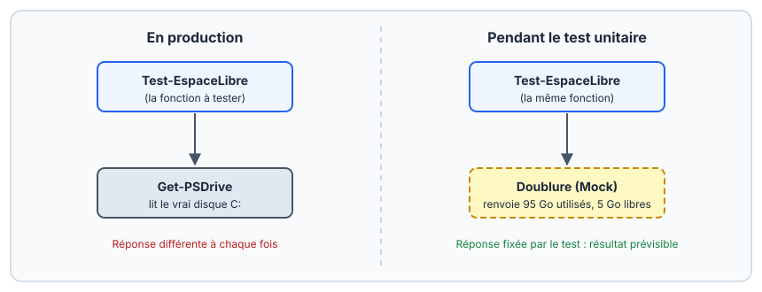

<!-- ============================================================ -->
<!-- ⚠️ RAPPEL IMPORTANT :                                          -->
<!-- Pensez TOUJOURS à ajouter une entrée dans le fichier d'index  -->
<!-- (index.md) du dossier correspondant (ex: docs/cloud/index.md) -->
<!-- afin de référencer ce nouvel article et permettre aux         -->
<!-- visiteurs de le trouver et de cliquer dessus !                -->
<!-- ============================================================ -->

# Les tests unitaires

!!! abstract "Résumé"
    Un **test unitaire** vérifie, en quelques millisecondes, qu'un petit morceau de code fait exactement ce qu'on attend de lui. Cette partie explique le principe, le montre sur un exemple complet en **Python** avec **pytest** (avec les vrais messages affichés quand un test réussit ou échoue), présente les **doublures**, la **couverture de code** et le **TDD**, puis applique tout cela à un script **PowerShell** avec **Pester**. Chaque ligne de code est expliquée : il n'est pas nécessaire de savoir programmer.

| Propriété | Valeur |
|-----------|--------|
| Difficulté | Intermédiaire — lire un peu de code, sans avoir à en écrire |
| Durée estimée | 15 min de lecture et de questions |
| Version décrite | Python 3.12, pytest 9.2, PowerShell 7.4, Pester 6.2 |
| Place dans le parcours | Partie 2 sur 5 du parcours [Les tests en informatique](index.md) |
| Dernière mise à jour | 2026-11-25 |

---

## 1. Qu'est-ce qu'un test unitaire ?

Une **unité** est le plus petit morceau de code que l'on peut tester seul, le plus souvent une **fonction** : un bloc de code qui porte un nom, reçoit des valeurs (ses **paramètres**) et renvoie un résultat.

Un **test unitaire** est un petit programme qui appelle cette fonction avec des valeurs choisies et **vérifie automatiquement** le résultat. Il est écrit une fois, puis relancé à chaque modification. Comme sur une chaîne de montage, on contrôle chaque pièce **avant** de l'assembler.

Ses bénéfices : on trouve les défauts au plus tôt, on **modifie sans peur** (un test échoue dès qu'on casse quelque chose), le test **documente** le comportement attendu, et il s'automatise facilement ([partie 5](05-tests-integration-et-ci-cd.md)).

Un bon test unitaire est **rapide**, **indépendant** des autres tests, **reproductible** (même résultat partout, à toute heure) et **auto-vérifiant** (il dit lui-même « réussi » ou « échoué »). Pour cela, il **ne touche à rien d'extérieur** : ni disque, ni réseau, ni base de données, ni annuaire.

Presque tous les tests suivent le même plan en trois temps, appelé **AAA** en anglais (*Arrange, Act, Assert*) :

1. **Préparer** : mettre en place les données d'entrée ;
2. **Agir** : appeler la fonction testée ;
3. **Vérifier** : comparer le résultat obtenu au résultat attendu. Cette vérification s'appelle une **assertion**.

Chaque langage a son **framework de test**, un outil prêt à l'emploi qui trouve les tests, les lance et affiche le bilan : **pytest** pour Python, **Pester** pour PowerShell, bats-core pour Bash, JUnit pour Java, xUnit ou NUnit pour .NET, Jest pour JavaScript. La plupart produisent un rapport au format **JUnit XML**, que les outils d'intégration continue comme Jenkins savent lire.

---

## 2. Exemple complet avec pytest 🐍

### 2.1 Le code à tester

Un petit module Python, `reseau.py`, avec deux fonctions utiles à un administrateur réseau :

```python title="reseau.py"
"""Petites fonctions utiles à un administrateur réseau."""


def est_ipv4_valide(adresse: str) -> bool:
    """Renvoie True si la chaîne est une adresse IPv4 écrite correctement."""
    morceaux = adresse.split(".")          # "192.168.19.55" -> ["192", "168", "19", "55"]
    if len(morceaux) != 4:                 # il faut exactement 4 nombres
        return False
    for morceau in morceaux:
        if not morceau.isdigit():          # uniquement des chiffres
            return False
        if int(morceau) > 255:             # chaque nombre entre 0 et 255
            return False
    return True


def nombre_hotes(prefixe: int) -> int:
    """Nombre d'adresses utilisables pour des machines dans un réseau /prefixe."""
    if not 0 <= prefixe <= 32:
        raise ValueError("Le préfixe doit être compris entre 0 et 32")
    return 2 ** (32 - prefixe) - 2         # on retire l'adresse réseau et la diffusion
```

`nombre_hotes(24)` doit renvoyer 254 : un réseau `/24` compte 256 adresses, moins l'adresse du réseau et l'adresse de diffusion. `raise ValueError` **lève une erreur** : la fonction refuse un préfixe impossible.

### 2.2 Les tests

Les tests sont dans un fichier à part, dont le nom commence par `test_` : c'est ainsi que pytest les trouve.

```python title="test_reseau.py"
import pytest

from reseau import est_ipv4_valide, nombre_hotes


def test_adresse_correcte_acceptee():
    # Préparer : une adresse valide
    adresse = "192.168.19.55"
    # Agir : appeler la fonction testée
    resultat = est_ipv4_valide(adresse)
    # Vérifier : le résultat est celui attendu
    assert resultat is True


def test_octet_trop_grand_refuse():
    assert est_ipv4_valide("192.168.19.256") is False


def test_trois_octets_refuse():
    assert est_ipv4_valide("10.0.1") is False


def test_lettres_refusees():
    assert est_ipv4_valide("10.0.a.1") is False


@pytest.mark.parametrize("prefixe, attendu", [(24, 254), (30, 2), (16, 65534)])
def test_nombre_hotes(prefixe, attendu):
    assert nombre_hotes(prefixe) == attendu


def test_prefixe_impossible_leve_une_erreur():
    with pytest.raises(ValueError):
        nombre_hotes(33)
```

- Chaque fonction `test_…` est un test, dont le nom dit en français ce qu'il vérifie.
- `assert` signifie « vérifier que » : si la condition est fausse, le test échoue.
- On teste les cas valides, mais surtout les **cas invalides** (256, trois nombres, des lettres) : c'est là que se cachent les défauts.
- `@pytest.mark.parametrize` lance le même test avec trois couples (préfixe, résultat attendu).
- `pytest.raises(ValueError)` vérifie que la fonction **refuse** bien un préfixe de 33.

### 2.3 Lancer les tests

🐧 pytest s'installe avec `sudo apt install python3-pytest` (Debian, Ubuntu) ou `pip install pytest`. Dans le dossier des deux fichiers, `pytest -v` (*verbose*, « bavard ») affiche une ligne par test :

```text
collected 8 items

test_reseau.py::test_adresse_correcte_acceptee PASSED                    [ 12%]
test_reseau.py::test_octet_trop_grand_refuse PASSED                      [ 25%]
test_reseau.py::test_trois_octets_refuse PASSED                          [ 37%]
test_reseau.py::test_lettres_refusees PASSED                             [ 50%]
test_reseau.py::test_nombre_hotes[24-254] PASSED                         [ 62%]
test_reseau.py::test_nombre_hotes[30-2] PASSED                           [ 75%]
test_reseau.py::test_nombre_hotes[16-65534] PASSED                       [ 87%]
test_reseau.py::test_prefixe_impossible_leve_une_erreur PASSED           [100%]

============================== 8 passed in 0.02s ===============================
```

Huit tests réussis (*passed*) en deux centièmes de seconde.

### 2.4 Quand un test échoue

Un préfixe `/32` désigne **une seule machine** (c'est ce qu'on écrit dans une règle de pare-feu pour viser un hôte précis). Ajoutons ce cas :

```python
def test_prefixe_32_designe_une_seule_machine():
    assert nombre_hotes(32) == 1
```

```text
test_reseau.py ........F                                                 [100%]

=================================== FAILURES ===================================
__________________ test_prefixe_32_designe_une_seule_machine ___________________

    def test_prefixe_32_designe_une_seule_machine():
>       assert nombre_hotes(32) == 1
E       assert -1 == 1
E        +  where -1 = nombre_hotes(32)

test_reseau.py:38: AssertionError
========================= 1 failed, 8 passed in 0.03s ==========================
```

Le `F` signale l'échec (*failed*), la ligne `>` l'assertion en cause, et les lignes `E` l'explication : `nombre_hotes(32)` renvoie **-1** au lieu de 1, car 2⁰ - 2 = -1. Le test a trouvé un **vrai défaut** : les cas `/32` (une machine) et `/31` (un lien point à point entre deux routeurs, dont les deux adresses sont utilisables selon la RFC 3021) ne sont pas gérés. On corrige :

```python
    if prefixe == 32:
        return 1  # une seule machine (route d'hôte)
    if prefixe == 31:
        return 2  # lien point à point (RFC 3021)
    return 2 ** (32 - prefixe) - 2
```

pytest affiche alors `9 passed`. Le nouveau test reste dans le fichier : il empêchera ce défaut de revenir. **Un défaut corrigé = un test ajouté.**

---

## 3. Trois notions incontournables

### 3.1 Les doublures

Une **doublure** (*test double*), comme au cinéma, remplace un acteur réel pendant le test : un disque, un serveur, une base de données, l'annuaire, l'horloge. Un **bouchon** (*stub*) renvoie une réponse toute faite ; un **simulacre** (*mock*) renvoie une réponse toute faite et enregistre comment il a été appelé. Dans le langage courant, on dit souvent « *mock* » pour toutes les doublures. La section 4 en montre une.

### 3.2 La couverture de code

La **couverture de code** mesure la part du code exécutée au moins une fois par les tests. Sur l'exemple **avant correction**, l'extension `pytest-cov` affiche :

```text
Name        Stmts   Miss  Cover   Missing
-----------------------------------------
reseau.py      14      0   100%
```

**100 % de couverture… et pourtant le défaut du `/32` était là.** La couverture dit quelles lignes ont été **exécutées**, pas si elles ont été vérifiées avec les **bonnes valeurs**. C'est un bon indicateur pour repérer le code jamais testé, pas une preuve de qualité. Il faut surtout tester les **cas limites** : valeurs vides, nulles, maximales, juste au-dessus et juste au-dessous des limites.

### 3.3 Le développement piloté par les tests (TDD)

Le **TDD** (*Test-Driven Development*) inverse l'ordre habituel : on écrit le test **avant** le code, en cycles de quelques minutes. 🔴 **Rouge** : écrire un test, qui échoue puisque le code n'existe pas. 🟢 **Vert** : écrire le code le plus simple qui le fait réussir. 🔵 **Remanier** : améliorer le code en gardant les tests au vert. On réfléchit ainsi au résultat attendu avant d'écrire la moindre ligne.

---

## 4. Tester un script PowerShell avec Pester 🪟

**Pester** est le framework de test libre de PowerShell ; une ancienne version est même livrée avec Windows. Voici une fonction qui vérifie qu'il reste assez d'espace libre sur un lecteur :

```powershell title="EspaceDisque.ps1"
function Test-EspaceLibre {
    param(
        [string]$Lecteur,
        [int]$SeuilPourcent = 10
    )
    $disque = Get-PSDrive -Name $Lecteur
    $pourcentLibre = $disque.Free / ($disque.Used + $disque.Free) * 100
    return $pourcentLibre -ge $SeuilPourcent
}
```

Elle lit le lecteur avec `Get-PSDrive` et renvoie `$true` s'il reste au moins 10 % d'espace libre. Sur un vrai disque, l'espace libre change sans cesse : le test ne serait pas reproductible. On remplace donc `Get-PSDrive` par une **doublure** :

{ loading=lazy }
/// caption
Pendant le test, la doublure remplace la vraie commande Get-PSDrive.
///

```powershell title="EspaceDisque.Tests.ps1"
BeforeAll {
    . $PSScriptRoot/EspaceDisque.ps1
}

Describe 'Test-EspaceLibre' {
    It 'répond OK quand il reste 50 % du disque' {
        Mock Get-PSDrive { [pscustomobject]@{ Used = 50GB; Free = 50GB } }
        Test-EspaceLibre -Lecteur 'C' | Should -BeTrue
    }

    It 'donne l''alerte quand il reste 5 % du disque' {
        Mock Get-PSDrive { [pscustomobject]@{ Used = 95GB; Free = 5GB } }
        Test-EspaceLibre -Lecteur 'C' | Should -BeFalse
    }
}
```

| Mot-clé | Rôle |
|---|---|
| `BeforeAll` | S'exécute avant tous les tests : ici, charge le script à tester |
| `Describe` | Un groupe de tests, souvent un par fonction |
| `It` | Un test, avec sa description en langage courant |
| `Mock` | Crée une **doublure** : pendant ce test, `Get-PSDrive` renvoie l'objet indiqué au lieu de lire le disque |
| `Should -BeTrue` | L'**assertion** : le résultat doit être vrai (`-BeFalse` : faux) |

On installe Pester depuis la PowerShell Gallery, le magasin officiel de modules, puis on lance les tests :

```powershell
Install-Module Pester -Force -Scope CurrentUser
Invoke-Pester -Path .\EspaceDisque.Tests.ps1 -Output Detailed
```

```text
Pester v6.2.0

Running tests from 1 files.

Running tests from '/src/EspaceDisque.Tests.ps1'
Describing Test-EspaceLibre
  [+] répond OK quand il reste 50 % du disque 278ms
  [+] donne l'alerte quand il reste 5 % du disque 20ms
Tests completed in 661ms
Tests Passed: 2, Failed: 0, Skipped: 0, Inconclusive: 0, NotRun: 0
```

Les deux tests réussissent (`[+]`) sans jamais lire le vrai disque.

!!! info "Pester sur Windows PowerShell 5.1"
    Windows est livré avec la très ancienne version 3.4 de Pester, à la syntaxe différente. Pour installer la version récente, ajouter l'option `-SkipPublisherCheck` à `Install-Module` : les deux versions ne sont pas signées par le même certificat.

---

## 5. Questions de révision

1. Retrouver les trois temps Préparer – Agir – Vérifier dans le test `test_adresse_correcte_acceptee`.
2. Pourquoi un test unitaire ne doit-il pas lire le vrai disque ou interroger le vrai annuaire ? Que fait-on à la place ?
3. Les tests couvraient 100 % du code de `reseau.py`, et pourtant un défaut existait. Expliquer.
4. Dans Pester, à quoi servent `Describe`, `It`, `Mock` et `Should` ?

??? success "Corrigé"
    1. **Préparer** : `adresse = "192.168.19.55"` ; **Agir** : `resultat = est_ipv4_valide(adresse)` ; **Vérifier** : `assert resultat is True`.
    2. Le test deviendrait **lent** et **non reproductible** (l'espace libre ou l'annuaire changent, le réseau peut être coupé), et il pourrait modifier des données réelles. On remplace ces dépendances par des **doublures** qui renvoient une réponse fixée par le test.
    3. La couverture indique que chaque ligne a été **exécutée**, pas qu'elle a été vérifiée avec toutes les valeurs utiles : aucun test n'utilisait la valeur limite 32.
    4. `Describe` regroupe des tests, `It` définit un test, `Mock` remplace une commande par une doublure, `Should` est l'assertion.

---

## Ressources

- [Documentation de pytest (en anglais)](https://docs.pytest.org/) — démarrage, assertions, tests paramétrés.
- [Pester — Quick Start (en anglais)](https://pester.dev/docs/quick-start) — installation et premiers tests PowerShell.
- [Pester — Mocking (en anglais)](https://pester.dev/docs/usage/mocking) — les doublures dans Pester.
- [ShellCheck](https://www.shellcheck.net/) — analyse statique des scripts Bash.

Partie précédente : [Comprendre les tests](01-comprendre-les-tests.md) · Partie suivante : [Tests de performance et de charge](03-tests-de-performance-et-de-charge.md)

*[AAA]: Arrange, Act, Assert : Préparer, Agir, Vérifier
*[TDD]: Test-Driven Development : développement piloté par les tests
*[RFC]: Request for Comments : document qui décrit une norme d'Internet
