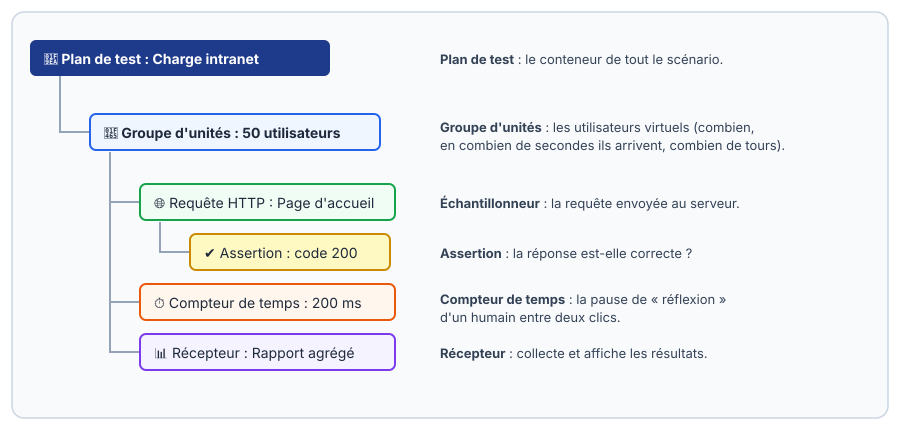

<!-- ============================================================ -->
<!-- ⚠️ RAPPEL IMPORTANT :                                          -->
<!-- Pensez TOUJOURS à ajouter une entrée dans le fichier d'index  -->
<!-- (index.md) du dossier correspondant (ex: docs/cloud/index.md) -->
<!-- afin de référencer ce nouvel article et permettre aux         -->
<!-- visiteurs de le trouver et de cliquer dessus !                -->
<!-- ============================================================ -->

# Tests de performance et de charge

!!! abstract "Résumé"
    Un service peut fonctionner parfaitement avec un utilisateur… et s'effondrer le jour de la rentrée, quand 2 000 personnes se connectent en même temps. Cette partie présente les quatre grands **tests de performance** (charge, stress, pic, endurance), les **indicateurs** à savoir lire (temps de réponse, percentiles, débit, taux d'erreur, Apdex), puis **Apache JMeter**, l'outil libre de référence, avec un exemple de test de charge lancé en ligne de commande.

| Propriété | Valeur |
|-----------|--------|
| Difficulté | Intermédiaire |
| Durée estimée | 15 min de lecture et de questions |
| Version décrite | Apache JMeter 5.6.3 |
| Place dans le parcours | Partie 3 sur 5 du parcours [Les tests en informatique](index.md) |
| Dernière mise à jour | 2026-11-25 |

---

## 1. Les tests de performance

### 1.1 Définition

Un **test de performance** mesure la **rapidité**, la **stabilité** et la **consommation de ressources** d'un système soumis à un certain volume de travail. Il ne demande pas « est-ce que ça marche ? » mais « est-ce que ça marche **encore**, et **assez vite**, quand beaucoup de monde s'en sert ? ». Ce « beaucoup de monde » est simulé par des **utilisateurs virtuels** : des programmes qui envoient des requêtes comme de vrais utilisateurs, par centaines ou par milliers, depuis un seul poste.

### 1.2 Les quatre grands tests

{ loading=lazy }
/// caption
Les quatre profils de tests de performance. La ligne rouge pointillée marque la capacité prévue.
///

| Test | Question posée | Ce qu'il révèle |
|---|---|---|
| **Test de charge** (*load test*) | Le système tient-il la charge **attendue** (par exemple 500 utilisateurs) ? | Temps de réponse et taux d'erreur en conditions normales et aux heures de pointe |
| **Test de stress** (*stress test*) | Jusqu'où tient-il, et **comment casse-t-il** ? On dépasse la charge prévue, par paliers, jusqu'à la rupture | Le point de rupture, le maillon faible, et la capacité à **revenir à la normale** quand la charge baisse |
| **Test de pic** (*spike test*) | Supporte-t-il une **arrivée brutale** (ouverture des inscriptions, début d'un examen en ligne) ? | Files d'attente saturées, délais dépassés |
| **Test d'endurance** (*soak test*) | Tient-il **dans la durée** (8, 24 ou 72 heures de charge normale) ? | **Fuites de mémoire** (un programme qui ne rend pas la mémoire dont il n'a plus besoin et finit par la saturer), disques qui se remplissent de journaux, ralentissement progressif |

!!! question "Pourquoi l'administrateur est-il en première ligne ?"
    Les causes d'une mauvaise performance sont souvent **dans l'infrastructure** : machine virtuelle sous-dimensionnée, disque lent, base de données sans index (la « table des matières » qui permet de retrouver vite une ligne), limite de connexions trop basse dans le serveur web, pare-feu saturé. Pendant le test, l'administrateur surveille les ressources de chaque serveur (`top` sous Linux, Analyseur de performances sous Windows, ou un outil de supervision comme Zabbix ou Grafana) pour trouver le **goulet d'étranglement** : le composant qui sature le premier et ralentit tout le reste.

### 1.3 Les indicateurs

| Indicateur | Définition |
|---|---|
| **Temps de réponse** | Durée entre l'envoi d'une requête et la réception de la réponse complète, en millisecondes (ms) |
| **Débit** (*throughput*) | Nombre de requêtes traitées par seconde |
| **Taux d'erreur** | Part des requêtes en échec (erreur serveur, délai dépassé, réponse incorrecte) |
| **Utilisateurs simultanés** | Nombre d'utilisateurs virtuels actifs en même temps |

La **moyenne** des temps de réponse est trompeuse. Sur 100 requêtes, si 95 répondent en 100 ms et 5 en 10 secondes, la moyenne vaut environ 600 ms : une valeur que **personne** n'a vécue. On utilise donc les **percentiles** :

- la **médiane** : la moitié des requêtes ont répondu plus vite que cette valeur ;
- le **90ᵉ percentile** (P90) : 90 % des requêtes ont répondu plus vite ; les P95 et P99 montrent l'expérience des utilisateurs les plus mal servis.

Une exigence sérieuse s'écrit donc ainsi : « **95 % des pages en moins de 2 secondes, avec 500 utilisateurs simultanés et moins de 1 % d'erreurs** ».

L'**Apdex** (*Application Performance Index*) résume la satisfaction en un nombre entre 0 et 1. Sous un seuil **T**, une requête est « satisfaisante » ; entre T et le seuil de frustration (4 × T dans la définition d'origine), « tolérable » ; au-delà, « frustrante ». Apdex = (satisfaisantes + tolérables ÷ 2) ÷ total. Un Apdex de 1 signifie que tous les utilisateurs sont satisfaits ; sous 0,7, la situation est jugée médiocre. JMeter fixe ses propres seuils, réglables : T = 500 ms et un seuil de frustration de 1 500 ms.

---

## 2. Apache JMeter

### 2.1 Présentation

**Apache JMeter** est un logiciel **libre et gratuit** de la fondation Apache, écrit en Java (il demande **Java 8 ou plus récent**). Il charge des applications web (HTTP, HTTPS) mais aussi des bases de données, des serveurs FTP ou des annuaires LDAP. Il est traduit en français : menu **Options** > **Choisir une langue** > **Français**.

JMeter a deux modes : le **mode graphique** pour **construire** le plan de test, et le **mode ligne de commande** pour **lancer** le vrai test.

!!! warning "Ne jamais lancer un vrai test de charge en mode graphique"
    L'interface graphique consomme elle-même beaucoup de ressources : c'est alors l'outil de test qui ralentit, et les mesures sont faussées. JMeter le rappelle à chaque démarrage. Règle : **construire en graphique, exécuter en ligne de commande**.

### 2.2 Les éléments d'un plan de test

Un test JMeter est décrit par un **plan de test**, enregistré dans un fichier `.jmx`. C'est une arborescence d'éléments que l'on ajoute par clic droit > **Ajouter** :

{ loading=lazy }
/// caption
Un plan de test minimal : qui, quoi, comment vérifier, à quel rythme, et où lire les résultats.
///

| Élément (nom à l'écran) | Nom anglais | Rôle |
|---|---|---|
| **Groupe d'unités** | *Thread Group* | Les utilisateurs virtuels : **Nombre d'unités** (combien), **Durée de montée en charge** (en combien de secondes ils arrivent tous), **Nombre d'itérations** (combien de fois chacun rejoue le scénario) |
| **Requête HTTP** | *HTTP Request* | Ce qu'envoie chaque utilisateur : serveur, port, méthode (GET pour lire une page, POST pour envoyer un formulaire), chemin de la page |
| **Assertion Réponse** | *Response Assertion* | Vérifie que la réponse est correcte (code 200, présence d'un texte). Sans assertion, une page d'erreur rapide passerait pour un succès |
| **Compteur de temps fixe** | *Constant Timer* | La pause entre deux actions, qui imite le temps de « réflexion » d'un humain |
| **Arbre de résultats**, **Rapport agrégé** | *Listeners* (récepteurs) | Affichent chaque requête (pour la mise au point) ou les statistiques |

Plutôt que de saisir les requêtes à la main, JMeter peut aussi **enregistrer** une navigation réelle en se plaçant comme intermédiaire (*proxy*) entre le navigateur et le site.

### 2.3 Exemple : la page d'accueil d'un intranet

Le plan de test `plan-intranet.jmx` simule **50 utilisateurs** qui arrivent en **10 secondes** et chargent chacun **100 fois** la page d'accueil, avec une pause de **200 ms** entre deux chargements. Une assertion vérifie le code HTTP **200** (« OK »). Total attendu : 50 × 100 = **5 000 requêtes**.

🐧 On lance le test en ligne de commande (sous Windows : `bin\jmeter.bat`) :

```bash
./bin/jmeter -n -t plan-intranet.jmx -l resultats.jtl -e -o rapport
```

| Option | Signification |
|---|---|
| `-n` | Sans interface graphique (*non-GUI*) |
| `-t` | Le plan de test à exécuter |
| `-l` | Le fichier des résultats bruts (une ligne par requête) |
| `-e -o rapport` | Générer à la fin un rapport HTML dans le dossier `rapport` (vide ou inexistant) |

Résultat pour un petit serveur web de test :

```text
Created the tree successfully using plan-intranet.jmx
Starting standalone test @ 2026 Nov 25 15:34:43 GMT+01:00 (1795617283527)
summary +   2825 in 00:00:16 =  171.6/s Avg:     0 Min:     0 Max:    33 Err:     0 (0.00%) Active: 50 Started: 50 Finished: 0
summary +   2175 in 00:00:13 =  161.4/s Avg:     0 Min:     0 Max:     7 Err:     0 (0.00%) Active: 0 Started: 50 Finished: 50
summary =   5000 in 00:00:30 =  167.0/s Avg:     0 Min:     0 Max:    33 Err:     0 (0.00%)
Tidying up ...    @ 2026 Nov 25 15:35:13 GMT+01:00 (1795617313539)
... end of run
```

La dernière ligne `summary =` est le bilan : **5 000 requêtes en 30 secondes**, un **débit de 167 requêtes par seconde**, un temps de réponse moyen inférieur à 1 ms (la console arrondit : `Avg: 0` signifie moins de 1 ms ; maximum 33 ms) et **0 % d'erreur**. Les lignes `summary +` donnent l'état intermédiaire : `Active: 50` signifie que les 50 utilisateurs travaillaient en même temps.

Le fichier `rapport/index.html` présente un tableau de bord complet. Pour ce test :

| Indicateur | Valeur |
|---|---|
| Erreurs | 0 % |
| Temps de réponse médian | 1 ms |
| P90 / P95 / P99 | 1 / 2 / 4 ms |
| Débit | environ 169 requêtes/s (calculé sur la durée exacte des requêtes, d'où un léger écart avec la console) |
| Apdex | 1,0 |

Ce serveur, qui ne renvoie qu'une petite page statique, n'est pas à la peine. Le débit est d'ailleurs limité par les **pauses** des utilisateurs simulés (200 ms entre deux requêtes), pas par le serveur. Avec une vraie application, on augmenterait le nombre d'unités ou on supprimerait les pauses (test de stress) pour trouver le point où percentiles et taux d'erreur se dégradent.

### 2.4 Bonnes pratiques

- **Écrire l'exigence avant le test** : nombre d'utilisateurs, temps de réponse avec un percentile, taux d'erreur acceptable.
- **Tester dans un environnement proche de la production**, jamais en production sans accord ni créneau prévu.
- **Lancer JMeter depuis une autre machine** que le serveur testé, sinon il consomme les ressources qu'il mesure.
- **Surveiller les serveurs** pendant le test, et **répéter** le même plan après chaque correction pour comparer.

!!! danger "Un test de charge non autorisé est une attaque"
    Envoyer des milliers de requêtes à un site qui ne nous appartient pas, c'est une **attaque par déni de service**, punie par l'article 323-2 du Code pénal (entrave au fonctionnement d'un système). On teste **son propre système**, ou avec l'**accord écrit** de son propriétaire.

Autres outils courants : **k6** (scénarios en JavaScript, très utilisé dans les pipelines), **Gatling**, **Locust** (scénarios en Python), et pour un test rapide d'une seule adresse, **ab** (Apache Bench) ou **wrk**.

---

## 3. Questions de révision

1. Quelle est la différence entre un test de charge et un test de stress ?
2. Un site d'inscription ouvre chaque année le 1ᵉʳ septembre à 9 h précises. Quel test choisir ?
3. Après 36 heures de fonctionnement, un serveur devient lent. Quel test l'aurait détecté, et quelle est la cause probable ?
4. Pourquoi exprimer une exigence avec un percentile plutôt qu'avec une moyenne ?
5. Que signifient les options `-n`, `-t`, `-l`, `-e` et `-o` de la commande `jmeter` ?

??? success "Corrigé"
    1. Le test de **charge** vérifie la tenue de la charge **attendue** ; le test de **stress** va **au-delà**, jusqu'à la rupture, pour connaître la limite et le composant qui cède en premier.
    2. Un **test de pic** : tout le monde arrive dans la même minute, c'est cette montée brutale qu'il faut simuler.
    3. Un **test d'endurance**. Cause probable : une **fuite de mémoire**, des connexions jamais refermées ou des journaux qui remplissent le disque.
    4. La moyenne **masque les cas extrêmes**. Le P95 garantit l'expérience de 95 % des utilisateurs.
    5. `-n` : sans interface graphique ; `-t` : le plan de test ; `-l` : le fichier des résultats ; `-e` : générer le rapport HTML ; `-o` : le dossier de ce rapport.

---

## Ressources

- [Manuel utilisateur d'Apache JMeter (en anglais)](https://jmeter.apache.org/usermanual/index.html) — documentation officielle.
- [Bonnes pratiques JMeter (en anglais)](https://jmeter.apache.org/usermanual/best-practices.html) — mode ligne de commande, récepteurs à éviter pendant un vrai test.
- [Générer le rapport HTML (en anglais)](https://jmeter.apache.org/usermanual/generating-dashboard.html) — lecture du tableau de bord et de l'Apdex.
- [Documentation de k6 (en anglais)](https://grafana.com/docs/k6/latest/) — l'alternative la plus utilisée dans les pipelines.

Partie précédente : [Les tests unitaires](02-tests-unitaires.md) · Partie suivante : [Tests de sécurité](04-tests-de-securite.md)

*[Apdex]: Application Performance Index
*[HTTP]: HyperText Transfer Protocol
*[HTTPS]: HTTP sécurisé par TLS
*[FTP]: File Transfer Protocol
*[LDAP]: Lightweight Directory Access Protocol
