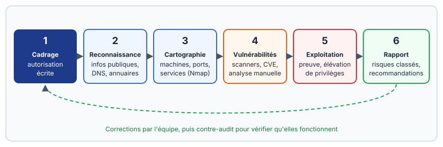

<!-- ============================================================ -->
<!-- ⚠️ RAPPEL IMPORTANT :                                          -->
<!-- Pensez TOUJOURS à ajouter une entrée dans le fichier d'index  -->
<!-- (index.md) du dossier correspondant (ex: docs/cloud/index.md) -->
<!-- afin de référencer ce nouvel article et permettre aux         -->
<!-- visiteurs de le trouver et de cliquer dessus !                -->
<!-- ============================================================ -->

# Tests de sécurité

!!! abstract "Résumé"
    Un système peut être rapide et fonctionnel, et pourtant ouvert à tous les vents. Les **tests de sécurité** cherchent les failles **avant** les attaquants. Cette partie présente le vocabulaire (**vulnérabilité**, **CVE**, **CVSS**), le **cadre légal**, les familles de tests (**audit**, **scan de vulnérabilités**, **test d'intrusion**), le classement **OWASP Top 10**, puis les outils de référence : **Nmap** (avec un exemple réel), **Greenbone/OpenVAS**, **Nessus**, **OWASP ZAP**, **Burp Suite** et **Lynis**.

| Propriété | Valeur |
|-----------|--------|
| Difficulté | Intermédiaire |
| Durée estimée | 20 min de lecture et de questions |
| Version décrite | Nmap 7.94, OWASP Top 10:2025, CVSS 4.0 |
| Place dans le parcours | Partie 4 sur 5 du parcours [Les tests en informatique](index.md) |
| Dernière mise à jour | 2026-11-25 |

---

## 1. Pourquoi tester la sécurité ?

Les tests fonctionnels vérifient que le système fait ce qu'il doit faire. Les tests de sécurité vérifient qu'il **ne fait pas ce qu'il ne doit pas faire** : laisser entrer un inconnu, révéler des données, obéir à une commande cachée dans un formulaire. Un défaut fonctionnel se voit ; une faille de sécurité **ne se voit pas**, jusqu'au jour où quelqu'un l'exploite. Or des robots balaient en permanence tout Internet : un serveur fraîchement exposé reçoit très vite, souvent en quelques minutes, ses premières tentatives de connexion.

On teste la sécurité pour **découvrir les failles** et les corriger par ordre de gravité, **vérifier les correctifs**, **prouver** un niveau de sécurité (clients, assureurs, normes comme ISO 27001 ou la directive européenne NIS 2) et **mesurer la réaction** de l'équipe face à une attaque simulée.

---

## 2. Le vocabulaire de base

| Terme | Définition |
|---|---|
| **Vulnérabilité** (faille) | Une faiblesse qui peut être utilisée pour nuire : version boguée, mauvaise configuration |
| **Exploit** | Le programme ou la technique qui utilise concrètement une vulnérabilité |
| **Risque** | La combinaison de la probabilité d'une attaque et de son impact |
| **Surface d'attaque** | Tout ce qu'un attaquant peut atteindre : ports ouverts, applications, comptes, personnes |
| **Durcissement** (*hardening*) | Réduire la surface d'attaque : désactiver le superflu, renforcer les réglages |

Une **CVE** (*Common Vulnerabilities and Exposures*) est l'identifiant unique d'une vulnérabilité publique, de la forme `CVE-année-numéro`. Par exemple, **CVE-2021-44228** est la faille **Log4Shell**, découverte en décembre 2021 dans la bibliothèque Java Log4j : écrire un simple texte piégé dans un journal suffisait à prendre le contrôle d'un serveur. Grâce à cet identifiant, éditeurs, scanners et administrateurs parlent de la même faille. En France, le **CERT-FR** (ANSSI) publie avis et alertes en citant les CVE.

Le **CVSS** (*Common Vulnerability Scoring System*) note la gravité d'une vulnérabilité de **0 à 10** : exploitable à distance ? sans compte ? avec quel impact ? La version actuelle est CVSS 4.0 (2023), mais beaucoup d'outils affichent encore des scores 3.1. Échelle : **faible** de 0,1 à 3,9, **moyenne** de 4,0 à 6,9, **élevée** de 7,0 à 8,9, **critique** de 9,0 à 10. Log4Shell a reçu **10,0**. Le score aide à prioriser, mais il ignore le contexte : une faille « moyenne » sur un serveur exposé à Internet peut être plus urgente qu'une faille « élevée » sur une machine isolée.

---

## 3. Le cadre légal : une autorisation écrite avant tout

!!! danger "Tester sans autorisation est un délit"
    En France, l'**article 323-1 du Code pénal** punit l'accès ou le maintien frauduleux dans un système informatique de **3 ans d'emprisonnement et 100 000 € d'amende**, davantage si des données sont modifiées ou si le système appartient à l'État. « Je voulais seulement vérifier » n'est pas une défense.

Avant tout scan ou test d'intrusion d'un système qui n'est pas le sien, il faut une **autorisation écrite** du propriétaire (**convention d'audit**) qui précise le **périmètre** (adresses, applications, et ce qui est exclu), les **dates**, les **techniques** permises ou interdites, les **contacts d'urgence** et la **confidentialité** des résultats. Un hébergeur ou un fournisseur de cloud a aussi ses propres règles. En France, l'ANSSI qualifie **PASSI** les prestataires d'audit qui respectent son référentiel.

Pour apprendre : **son propre lab**, des applications volontairement vulnérables (DVWA, OWASP Juice Shop), des plateformes d'entraînement légales (Root Me, TryHackMe), ou `scanme.nmap.org`, que le projet Nmap met à disposition pour quelques scans par jour.

---

## 4. Les familles de tests de sécurité

| Test | Principe | Apport |
|---|---|---|
| **Audit de configuration** | Comparer les réglages d'un système à un référentiel de bonnes pratiques (guides de l'ANSSI, référentiels CIS), avec un outil comme Lynis | Liste des écarts au durcissement attendu |
| **Scan de vulnérabilités** | Un outil interroge automatiquement les machines pour détecter les versions et failles **connues** (OpenVAS, Nessus) | Large, rapide, répétable chaque semaine ; mais **faux positifs** possibles (alerte pour une faille inexistante) et rien sur les failles inconnues |
| **Test d'intrusion** (*pentest*) | Un auditeur humain se met dans la peau d'un attaquant et **exploite** les failles, en les enchaînant, sur une durée limitée | Profondeur et preuve concrète : « depuis le Wi-Fi invité, nous sommes devenus administrateurs du domaine » |

L'analogie : le scan est le **contrôle technique** de la voiture ; le test d'intrusion est l'expert qui essaie **vraiment de la voler**. Les deux sont complémentaires : le scan chaque semaine sur tout le parc, le test d'intrusion une ou deux fois par an, ou avant la mise en ligne d'une application importante.

Comme en [partie 1](01-comprendre-les-tests.md#3-que-teste-t-on-les-types-de-tests), on parle de test en **boîte noire** (l'auditeur ne sait rien, comme un attaquant extérieur), **grise** (il a un compte utilisateur, comme un salarié malveillant) ou **blanche** (il a tout, y compris le code source).

Côté développement, trois analyses automatiques complètent ces tests : le **SAST** analyse le code source sans l'exécuter (SonarQube, Semgrep) ; le **DAST** attaque l'application en fonctionnement, de l'extérieur (OWASP ZAP) ; la **SCA** inventorie les **bibliothèques** utilisées et signale celles qui ont des CVE (Trivy, OWASP Dependency-Check). Log4Shell a montré qu'une seule bibliothèque vulnérable pouvait toucher des milliers de logiciels.

---

## 5. Le déroulement d'un test d'intrusion

{ loading=lazy }
/// caption
Les étapes d'un test d'intrusion, du cadrage au contre-audit.
///

1. **Cadrage** : périmètre, règles et **autorisation signée**.
2. **Reconnaissance** : informations publiques, sans toucher aux systèmes (sous-domaines, technologies visibles, adresses de messagerie).
3. **Cartographie** : machines actives, ports ouverts, services et versions (**Nmap**).
4. **Recherche de vulnérabilités** : scanners et analyse manuelle.
5. **Exploitation** : prouver que la faille est réelle, puis tenter l'**élévation de privilèges** (devenir administrateur) et le **mouvement latéral** (rebondir vers d'autres machines). L'auditeur s'arrête à la preuve, sans causer de dégâts.
6. **Rapport** : synthèse pour la direction, détail technique de chaque faille avec sa gravité et sa **recommandation de correction**.

Après les corrections, un **contre-audit** vérifie leur efficacité.

---

## 6. L'OWASP Top 10

L'**OWASP** (*Open Worldwide Application Security Project*) est une fondation à but non lucratif qui publie des guides et outils libres sur la sécurité des applications. Son **Top 10** classe les dix risques les plus critiques des applications web. Version en vigueur, l'**OWASP Top 10:2025** :

| Rang | Catégorie | En clair |
|---|---|---|
| A01 | *Broken Access Control* | Accéder aux données d'un autre utilisateur, par exemple en changeant un numéro dans l'adresse |
| A02 | *Security Misconfiguration* | Mots de passe par défaut, services inutiles activés, messages d'erreur trop bavards |
| A03 | *Software Supply Chain Failures* | Bibliothèques vulnérables ou piégées, outils de construction compromis |
| A04 | *Cryptographic Failures* | Données sensibles en clair, chiffrement obsolète |
| A05 | *Injection* | Une saisie interprétée comme une commande (injection SQL, de commandes système) |
| A06 | *Insecure Design* | La faille est dans la logique même de l'application |
| A07 | *Authentication Failures* | Mots de passe faibles acceptés, essais illimités, sessions mal gérées |
| A08 | *Software or Data Integrity Failures* | Mises à jour non signées, données modifiables en chemin |
| A09 | *Security Logging and Alerting Failures* | L'attaque a lieu, personne ne la voit faute de journaux et d'alertes |
| A10 | *Mishandling of Exceptional Conditions* | Erreurs mal traitées, système qui reste « ouvert » quand quelque chose échoue |

Plusieurs catégories relèvent directement de l'administrateur : **A02** (configuration des serveurs et du cloud), **A03** (mises à jour des composants), **A04** (certificats et protocoles TLS), **A07** (politique de mots de passe, authentification multifacteur) et **A09** (journaux centralisés, supervision).

---

## 7. Les outils

| Outil | Rôle | Licence |
|---|---|---|
| **Nmap** | Cartographie : machines, ports ouverts, versions des services | Libre |
| **Greenbone / OpenVAS** | Scanner de vulnérabilités réseau | Libre (édition communautaire) |
| **Nessus** (Tenable) | Scanner de vulnérabilités réseau, le plus répandu en entreprise | Commercial ; version gratuite limitée à quelques adresses |
| **OWASP ZAP** | Scanner d'applications web (DAST) | Libre |
| **Burp Suite** (PortSwigger) | Proxy d'audit web, l'outil quotidien des auditeurs | Community gratuite, Professional payante |
| **Lynis** (CISOfy) | Audit de durcissement d'un serveur Linux | Libre |

### 7.1 Nmap : cartographier

**Nmap** (*Network Mapper*), créé en 1997, découvre les machines actives, leurs **ports** ouverts (les « portes » numérotées par lesquelles un service écoute : 22 pour SSH, 443 pour HTTPS) et les services qui y répondent.

🐧 Exemple réel sur un serveur web de test (`-sV` : détecter la version des services) :

```bash
nmap -sV 172.17.0.2
```

```text
Nmap scan report for 172.17.0.2
Host is up (0.00026s latency).
Not shown: 998 closed tcp ports (conn-refused)
PORT   STATE    SERVICE VERSION
53/tcp filtered domain
80/tcp open     http    nginx 1.31.10
```

Par défaut, Nmap teste les **1 000 ports TCP** les plus courants. **998** sont **fermés** (*closed* : la machine répond que personne n'écoute). Le port **80** est **ouvert** (*open*) : un serveur web **nginx 1.31.10** y répond, version que l'on comparera aux CVE connues. Le port **53** est **filtré** (*filtered*) : aucune réponse, un pare-feu bloque probablement le passage.

Options courantes : `-sn` (découvrir les machines d'un réseau sans scanner les ports), `-p 22,80,443` ou `-p-` (ces ports, ou les 65 535), `-O` (deviner le système d'exploitation), `-A` (versions, système, scripts et traceroute), `--script vuln` (scripts de détection de vulnérabilités).

!!! tip "Le test négatif de l'administrateur"
    Lancé **depuis l'extérieur**, Nmap vérifie un pare-feu : il doit trouver ouverts **uniquement** les ports prévus. Tout autre port ouvert est une surface d'attaque à justifier ou à fermer.

### 7.2 OpenVAS et Nessus : scanner les vulnérabilités

Un **scanner de vulnérabilités** va plus loin : pour chaque service trouvé, il lance des milliers de tests mis à jour chaque jour, et produit un rapport avec, pour chaque faille, la machine, le port, la CVE, le score CVSS et la **solution** (souvent : « mettre à jour en version X »). **Greenbone Community Edition** regroupe le scanner libre **OpenVAS** et une interface web ; **Nessus** est son équivalent commercial.

Un scan **authentifié** (avec un compte SSH ou Windows dédié) lit directement la liste des logiciels et correctifs installés : il trouve beaucoup plus de failles réelles et produit moins de faux positifs qu'un scan non authentifié, qui voit la machine de l'extérieur.

### 7.3 ZAP et Burp Suite : tester les applications web

Ces deux outils se placent comme **proxy** entre le navigateur et le site : chaque requête passe par eux et peut être lue, modifiée, rejouée. **ZAP** (aujourd'hui « ZAP by Checkmarx »), libre, explore le site puis lance des attaques connues ; il s'intègre facilement dans un pipeline. **Burp Suite** est l'outil de référence des auditeurs pour les tests manuels ; son scanner automatique est réservé à l'édition payante.

### 7.4 Lynis : auditer le durcissement d'un serveur

**Lynis** s'exécute sur le serveur Linux à auditer avec `sudo lynis audit system`. Il passe en revue des centaines de points (mises à jour, comptes, droits, SSH, pare-feu, journaux) et donne des **avertissements**, des **suggestions** et un **indice de durcissement** sur 100, utile pour suivre les progrès.

---

## 8. Questions de révision

1. Que signifie `CVE-2021-44228`, et que nous apprend sa note CVSS de 10,0 ?
2. Un collègue propose de « lancer un petit Nmap » sur le site d'un concurrent. Que lui répondre ?
3. Scan de vulnérabilités ou test d'intrusion : quelle différence, et lequel planifier chaque semaine ?
4. Dans la sortie Nmap de la section 7.1, que signifient `open`, `closed` et `filtered` ?
5. Pourquoi un scan authentifié donne-t-il de meilleurs résultats ?

??? success "Corrigé"
    1. C'est l'identifiant de la faille **Log4Shell** (Log4j, 2021). La note de **10,0** est la gravité maximale : exploitable à distance, sans compte, avec prise de contrôle complète.
    2. Que c'est **illégal** sans autorisation écrite du propriétaire (article 323-1 du Code pénal). Pour s'entraîner : son propre lab ou `scanme.nmap.org`.
    3. Le **scan** est automatique, large, et ne trouve que des failles connues ; le **test d'intrusion** est mené par un humain, en profondeur, et exploite les failles pour prouver un impact. On planifie le **scan** chaque semaine.
    4. `open` : un service accepte les connexions ; `closed` : la machine répond mais rien n'écoute ; `filtered` : pas de réponse, un pare-feu bloque probablement.
    5. Il lit directement la liste des logiciels et correctifs installés au lieu de deviner les versions de l'extérieur : plus de failles réelles, moins de faux positifs.

---

## Ressources

- [OWASP Top 10:2025 (en anglais)](https://owasp.org/Top10/2025/) — le classement officiel et le détail de chaque catégorie.
- [Guide de référence de Nmap (en français)](https://nmap.org/man/fr/) — toutes les options de Nmap.
- [CERT-FR](https://www.cert.ssi.gouv.fr/) — avis et alertes de sécurité de l'ANSSI.
- [Prestataires qualifiés PASSI (ANSSI)](https://cyber.gouv.fr/produits-services-qualifies/passi) — le référentiel et la liste des auditeurs qualifiés.
- [Greenbone Community Edition (en anglais)](https://greenbone.github.io/docs/latest/) — installation du scanner OpenVAS.
- [Documentation de ZAP (en anglais)](https://www.zaproxy.org/docs/) — scans automatisés d'applications web.
- [Code pénal, atteintes aux systèmes de traitement automatisé de données (Légifrance)](https://www.legifrance.gouv.fr/codes/section_lc/LEGITEXT000006070719/LEGISCTA000006149839/) — les articles 323-1 à 323-8.

Partie précédente : [Tests de performance et de charge](03-tests-de-performance-et-de-charge.md) · Partie suivante : [Tests d'intégration et CI/CD](05-tests-integration-et-ci-cd.md)

*[CVE]: Common Vulnerabilities and Exposures
*[CVSS]: Common Vulnerability Scoring System
*[ANSSI]: Agence nationale de la sécurité des systèmes d'information
*[CERT-FR]: Centre gouvernemental de veille, d'alerte et de réponse aux attaques informatiques
*[PASSI]: Prestataires d'audit de la sécurité des systèmes d'information
*[OWASP]: Open Worldwide Application Security Project
*[SAST]: Static Application Security Testing
*[DAST]: Dynamic Application Security Testing
*[SCA]: Software Composition Analysis
*[CIS]: Center for Internet Security
*[TLS]: Transport Layer Security
*[SQL]: Structured Query Language
