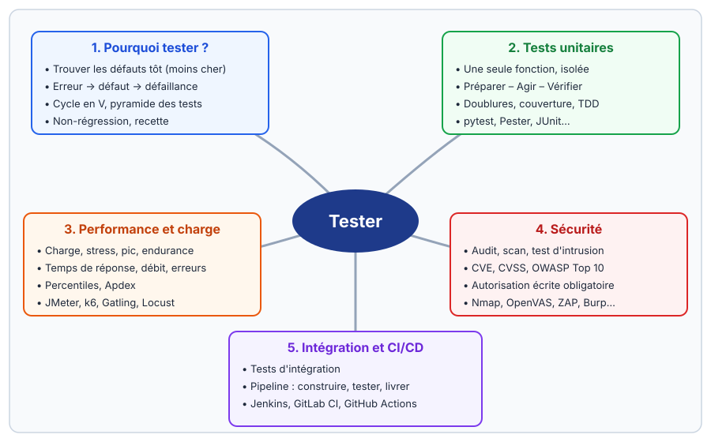

<!-- ============================================================ -->
<!-- ⚠️ RAPPEL IMPORTANT :                                          -->
<!-- Pensez TOUJOURS à ajouter une entrée dans le fichier d'index  -->
<!-- (index.md) du dossier correspondant (ex: docs/cloud/index.md) -->
<!-- afin de référencer ce nouvel article et permettre aux         -->
<!-- visiteurs de le trouver et de cliquer dessus !                -->
<!-- ============================================================ -->

# Les tests en informatique

!!! abstract "Résumé"
    Ce cours en cinq parties explique **pourquoi et comment on teste** un logiciel, un script ou une infrastructure, du plus petit morceau de code jusqu'à la mise en production automatique. Il ne demande aucune installation : chaque partie se lit en 15 à 20 minutes et s'appuie sur des schémas, des définitions et des exemples réels dont les résultats sont recopiés tels qu'ils s'affichent.

    À la fin du parcours, le vocabulaire des tests n'a plus de secret : test unitaire, test de charge, scan de vulnérabilités, test d'intrusion, intégration continue, pipeline… Chaque notion est reliée au quotidien d'un administrateur d'infrastructure : tester un script avant de le lancer sur 300 serveurs, vérifier qu'un serveur web tiendra la rentrée, prouver qu'une faille est corrigée, automatiser tout cela à chaque modification.

| Propriété | Valeur |
|-----------|--------|
| Public | Administrateurs et techniciens systèmes et réseaux ; aucune expérience de développement n'est demandée |
| Durée totale | Environ 1 h 30 de lecture, questions de révision comprises |
| Outils présentés | pytest, Pester, JMeter, Nmap, OpenVAS, Nessus, ZAP, Burp Suite, Lynis, Jenkins |
| Dernière mise à jour | 2026-11-25 |

---

## Objectifs du parcours

À la fin du parcours, il est possible de :

- expliquer **à quoi servent les tests** et pourquoi un défaut coûte d'autant plus cher qu'il est découvert tard ;
- distinguer les **niveaux** de tests (unitaire, intégration, système, acceptation) et les **types** de tests (fonctionnels, de performance, de sécurité, de régression) ;
- lire et comprendre un **test unitaire** écrit avec pytest (Python) ou Pester (PowerShell) ;
- choisir entre un **test de charge**, de **stress**, de **pic** ou d'**endurance**, et lire les résultats d'un test **JMeter** ;
- différencier **audit**, **scan de vulnérabilités** et **test d'intrusion**, connaître leur cadre légal et les principaux outils ;
- expliquer ce qu'est un **pipeline CI/CD** et comment **Jenkins** y automatise les tests.

## Plan du parcours

| Partie | Type | Durée | Contenu |
|:---:|---|---|---|
| [1. Comprendre les tests](01-comprendre-les-tests.md) | Cours | 15 min | Pourquoi tester, vocabulaire, cycle en V, pyramide des tests, types et niveaux de tests, tests en administration système |
| [2. Les tests unitaires](02-tests-unitaires.md) | Cours | 15 min | Définition, méthode Préparer-Agir-Vérifier, exemple pytest, doublures, couverture de code, TDD, Pester pour PowerShell |
| [3. Tests de performance et de charge](03-tests-de-performance-et-de-charge.md) | Cours | 15 min | Charge, stress, pic, endurance, indicateurs, percentiles, Apdex, JMeter de A à Z |
| [4. Tests de sécurité](04-tests-de-securite.md) | Cours | 20 min | Audit, scan, test d'intrusion, CVE et CVSS, cadre légal, OWASP Top 10, Nmap, OpenVAS, Nessus, ZAP, Burp, Lynis |
| [5. Tests d'intégration et CI/CD](05-tests-integration-et-ci-cd.md) | Cours | 20 min | Tests d'intégration, intégration et livraison continues, pipeline, Jenkins et Jenkinsfile, tests d'infrastructure |
| [Annexes](annexes.md) | Synthèse | 15 min | Cas de synthèse corrigé, glossaire de tous les termes |

!!! tip "Suivre l'ordre"
    Chaque partie réutilise le vocabulaire des précédentes : la partie 5 assemble dans un même pipeline les tests unitaires de la partie 2, les tests de charge de la partie 3 et les analyses de sécurité de la partie 4.

## Carte mentale du parcours

{ loading=lazy }
/// caption
Les cinq parties du parcours et leurs notions clés.
///

## Convention de lecture

| Repère | Signification |
|---|---|
| `bloc de code` | Commande à taper, fichier de configuration ou résultat affiché par un outil, recopié tel quel |
| 🐍 | Exemple en Python |
| 🪟 | Exemple en PowerShell |
| 🐧 | Commande lancée sur un poste Linux |
| ⚠️ | Point d'attention : légalité, risque pour la production |

Les encadrés « Pourquoi ? » expliquent l'intérêt de chaque notion. Les **questions de révision** de fin de partie ont un corrigé replié : chercher la réponse avant de l'ouvrir. Les termes techniques sont définis à leur première apparition et rassemblés dans le [glossaire](annexes.md#2-glossaire). Les noms d'outils et les menus qui n'existent qu'en anglais sont traduits entre parenthèses.

!!! warning "Tester uniquement ce que l'on a le droit de tester"
    Un test de charge ressemble à une attaque par saturation, un scan de ports à une reconnaissance d'attaquant. Ces tests se font sur **son propre lab**, ou sur un système dont le propriétaire a donné une **autorisation écrite**. La [partie 4](04-tests-de-securite.md#3-le-cadre-legal-une-autorisation-ecrite-avant-tout) détaille le cadre légal.

## Ressources

- [Syllabus ISTQB Niveau Fondation (CFTL)](https://www.cftl.fr/certifications/istqb-foundation/) — le référentiel international du vocabulaire des tests, traduit en français par le Comité français des tests logiciels.
- [Documentation de pytest](https://docs.pytest.org/) — l'outil de tests unitaires Python utilisé en partie 2.
- [Manuel utilisateur d'Apache JMeter](https://jmeter.apache.org/usermanual/index.html) — l'outil de tests de charge de la partie 3.
- [OWASP Top 10:2025](https://owasp.org/Top10/2025/) — le classement des risques des applications web cité en partie 4.
- [Documentation de Jenkins](https://www.jenkins.io/doc/) — l'outil d'intégration continue de la partie 5.

*[CI/CD]: Continuous Integration / Continuous Delivery (ou Deployment) : intégration continue / livraison (ou déploiement) continu
*[ISTQB]: International Software Testing Qualifications Board
*[OWASP]: Open Worldwide Application Security Project
