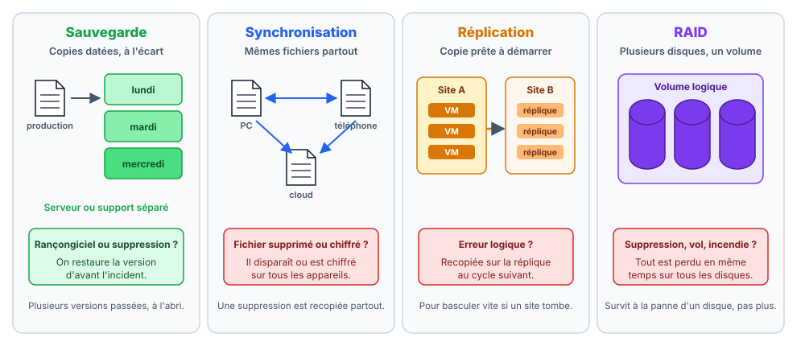
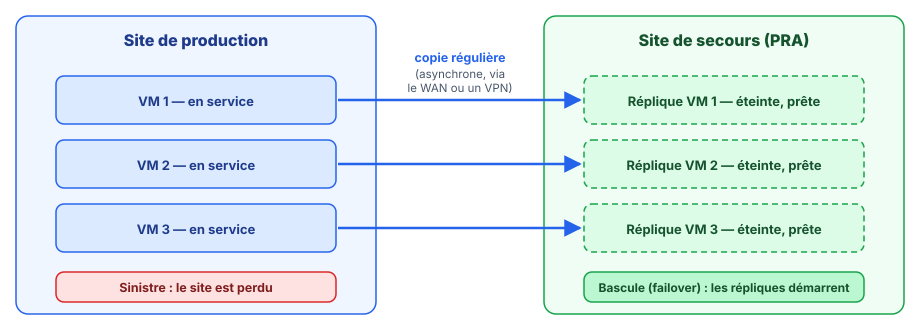
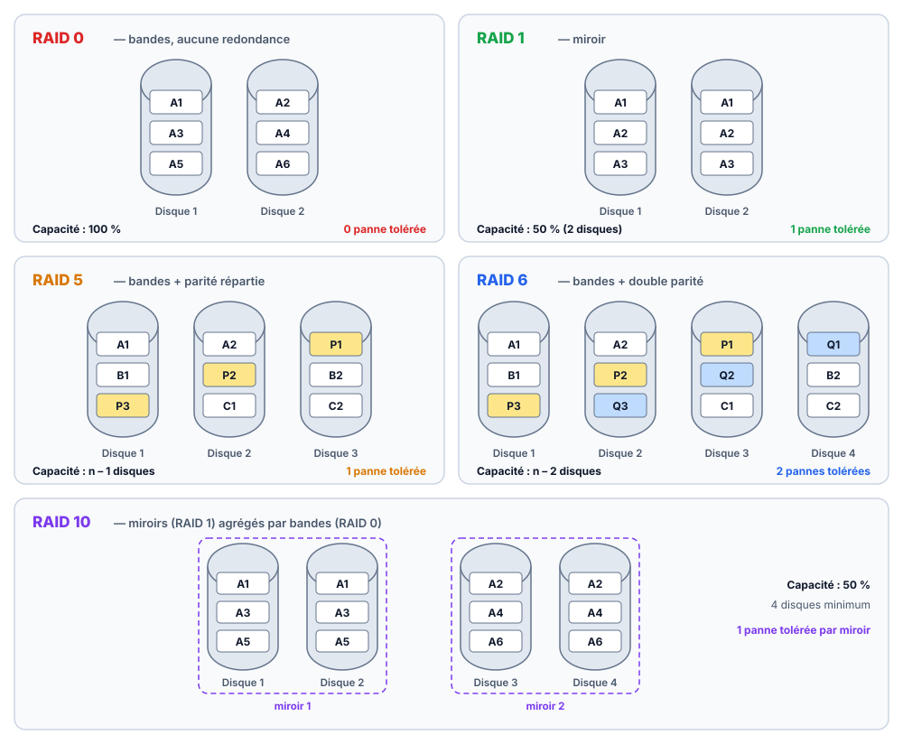
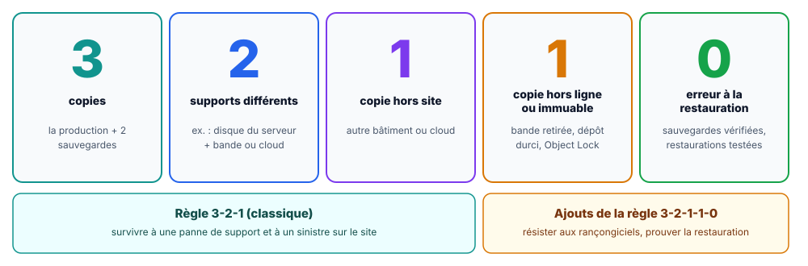
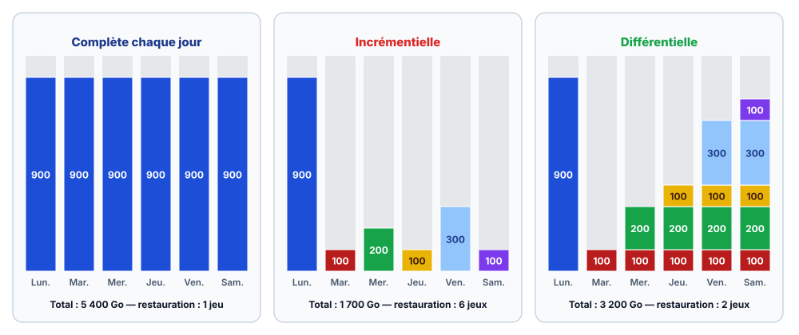
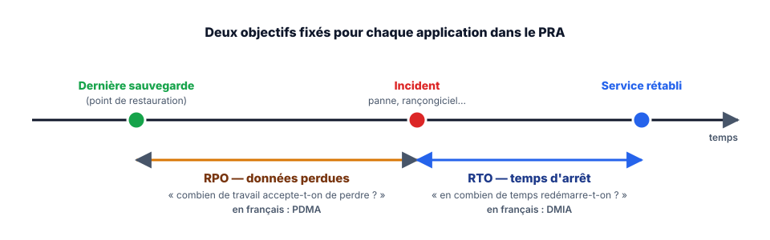
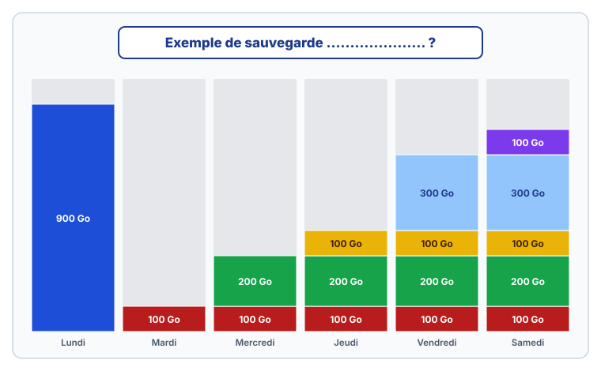

<!-- ============================================================ -->
<!-- ⚠️ RAPPEL IMPORTANT :                                          -->
<!-- Pensez TOUJOURS à ajouter une entrée dans le fichier d'index  -->
<!-- (index.md) du dossier correspondant (ex: docs/cloud/index.md) -->
<!-- afin de référencer ce nouvel article et permettre aux         -->
<!-- visiteurs de le trouver et de cliquer dessus !                -->
<!-- ============================================================ -->

# Comprendre la sauvegarde

!!! abstract "Résumé"
    Ce cours pose les bases indispensables avant de manipuler un logiciel de sauvegarde comme Veeam Backup & Replication. Il répond à quatre questions :

    1. **Quelle différence** entre une sauvegarde, une synchronisation, une réplication et un RAID ?
    2. **Comment organiser** ses copies pour survivre à une panne, un incendie ou un rançongiciel (règles 3-2-1 et 3-2-1-1-0) ?
    3. **Quels types de sauvegardes** existent (complète, incrémentielle, différentielle, synthétique, immuable) et comment choisir ?
    4. **Comment une entreprise prépare la reprise** après un sinistre (PCA, PRA, RPO, RTO) ?

    Des exercices corrigés terminent le cours. Les corrigés sont repliés : il vaut mieux chercher la réponse avant de les ouvrir.

| Propriété | Valeur |
|-----------|--------|
| Difficulté | Débutant — aucun prérequis technique |
| Durée estimée | 2 h 30 de lecture et d'exercices |
| Place dans le parcours | Partie 1 sur 7 du parcours [Veeam Backup & Replication](index.md) |
| Dernière mise à jour | 2026-11-02 |

??? info "Ce qui a changé par rapport à la version 1.5 du support (juin 2024)"
    - Toutes les illustrations ont été redessinées sous forme de schémas.
    - Plusieurs nuances ont été ajoutées ou corrigées : une réplication n'est pas toujours « en temps réel », une synchronisation et un RAID **ne sont pas** des sauvegardes, et les faits de l'incident GitLab de 2017 ont été précisés (les données ont finalement été récupérées, avec six heures de perte).
    - Nouveaux paragraphes : sauvegarde incrémentielle permanente, sauvegarde complète synthétique, rétention, chiffrement, équivalents français de RPO et RTO (PDMA et DMIA).
    - Nouveaux exercices corrigés.

---

## 1. Sauvegarde, synchronisation, réplication, RAID : quelles différences ?

Ces quatre techniques copient toutes des données d'un endroit à un autre. Vues de loin, elles se ressemblent. Elles ne protègent pourtant **pas contre les mêmes dangers** :

| Technique | Protège contre… | Ne protège pas contre… |
|-----------|-----------------|------------------------|
| **Sauvegarde** | La perte de données : suppression, panne, rançongiciel, sinistre | Une interruption de service (restaurer prend du temps) |
| **Synchronisation** | La divergence entre appareils : les mêmes fichiers partout | Une suppression ou un chiffrement, qui sont **recopiés partout** |
| **Réplication** | L'indisponibilité d'un site ou d'un serveur : on bascule sur la copie | Une erreur logique, recopiée sur la réplique au cycle suivant |
| **RAID** | La panne d'un (ou deux) disques dans un serveur | Tout le reste : suppression, rançongiciel, vol, incendie, panne du serveur entier |

Une entreprise combine souvent plusieurs de ces techniques selon la nature de ses données, la fréquence à laquelle elles changent et l'importance de leur disponibilité. Par exemple :

- une entreprise qui manipule des données sensibles et souvent modifiées a besoin d'une **sauvegarde régulière** et, pour le travail en équipe, d'une **synchronisation** ;
- une entreprise qui ne peut pas s'arrêter (vente en ligne, hôpital) ajoute une **réplication** vers un second site pour basculer rapidement ;
- un serveur qui doit offrir beaucoup de capacité et de performances repose sur un **RAID**.

<figure markdown="span">
  { loading=lazy }
  <figcaption>Seule la sauvegarde garde plusieurs versions passées, à l'écart de la production.</figcaption>
</figure>

### 1.1 Qu'est-ce qu'une sauvegarde (*backup*) ?

Une **sauvegarde** est une **copie des données, stockée à un emplacement séparé du système de production** et conservée pendant une durée choisie (la **rétention**). Si les données d'origine sont perdues (panne, erreur humaine, logiciel malveillant, catastrophe naturelle), on les **restaure** à partir de la sauvegarde.

Trois idées comptent :

- **Séparée** : une copie posée sur le même disque que l'original disparaît avec lui.
- **Datée** : chaque sauvegarde est un **point de restauration**, une photo des données à un instant précis. On peut revenir à la version d'hier ou à celle de la semaine dernière.
- **Automatique** : une sauvegarde qui dépend de la mémoire de quelqu'un finit par ne plus être faite. On la **planifie** selon le volume de données et la fréquence des modifications.

Les supports possibles sont variés : disque externe, NAS, serveur de sauvegarde, bande magnétique (*tape*, encore très utilisée pour l'archivage), stockage dans le cloud (*Azure Backup*, *AWS Backup*, ou un stockage objet comme Azure Blob ou Amazon S3 utilisé par un logiciel comme Veeam).

!!! tip "La règle d'or"
    Une sauvegarde ne vaut que par sa **capacité à être restaurée**. Une sauvegarde jamais testée est une hypothèse, pas une protection. Les TP de ce parcours terminent donc toujours par une restauration.

### 1.2 Qu'est-ce qu'une synchronisation ?

La **synchronisation** maintient **les mêmes données à plusieurs endroits**. Quand un fichier change à un endroit, la modification est reportée sur les autres, dans un sens ou dans les deux.

Exemples courants : contacts et agendas entre un téléphone et un ordinateur, dossiers *OneDrive*, *Google Drive* ou *Dropbox*. Pour se passer d'un fournisseur, des logiciels libres comme [Syncthing](https://syncthing.net/) synchronisent directement plusieurs ordinateurs entre eux.

!!! danger "Une synchronisation n'est pas une sauvegarde"
    Si un fichier est supprimé ou chiffré par un rançongiciel sur un appareil, la synchronisation **reproduit fidèlement le désastre** sur tous les autres. Certains services gardent une corbeille ou un historique de versions pendant quelques jours : c'est utile, mais cela ne remplace pas une vraie sauvegarde séparée et conservée longtemps.

### 1.3 Qu'est-ce qu'une réplication ?

La **réplication** copie des données (ou des machines virtuelles entières) **d'une source vers une destination**, généralement un autre serveur ou un autre site, pour pouvoir **basculer** dessus en cas de panne. Elle vise la **haute disponibilité** : réduire le temps d'arrêt.

Il en existe deux grandes familles :

- **Synchrone** : chaque écriture est confirmée seulement quand elle est faite des deux côtés. C'est du vrai « temps réel », réservé aux baies de stockage et aux sites proches (latence faible).
- **Asynchrone** : les modifications sont envoyées avec un léger décalage, de quelques secondes à quelques heures. C'est le cas le plus courant. Veeam Backup & Replication réplique ainsi des VM à intervalles réguliers, ou en continu avec sa fonction **CDP** (*Continuous Data Protection*) pour VMware.

<figure markdown="span">
  { loading=lazy }
  <figcaption>La réplication prépare une bascule rapide vers un second site.</figcaption>
</figure>

!!! warning "Une réplique n'est pas une sauvegarde non plus"
    Une suppression accidentelle ou un chiffrement par rançongiciel est répliqué au cycle suivant. Les solutions sérieuses (dont Veeam) conservent donc **plusieurs points de restauration** sur la réplique et s'utilisent **en complément** des sauvegardes.

Pour approfondir : [la réplication dans Veeam Data Platform](https://www.veeam.com/fr/products/veeam-data-platform/capability/advanced-replication.html).

### 1.4 Qu'est-ce que le RAID ?

Le **RAID** (*Redundant Array of Independent Disks*, « regroupement redondant de disques indépendants »[^1]) est une technologie qui **assemble plusieurs disques physiques en une seule unité logique**. Selon le niveau choisi, il sert à :

- **améliorer les performances**, en lisant et écrivant sur plusieurs disques à la fois ;
- **augmenter la capacité**, en additionnant les disques ;
- **créer une redondance**, pour que la panne d'un disque ne fasse perdre aucune donnée.

Le RAID peut être **matériel** (une carte contrôleur RAID dans le serveur) ou **logiciel** (géré par le système : *mdadm* sous Linux, *Espaces de stockage* ou volumes en miroir sous Windows, ZFS…).

<figure markdown="span">
  { loading=lazy }
  <figcaption>A, B, C… sont des blocs de données ; P et Q sont des blocs de parité.</figcaption>
</figure>

#### RAID 0 : agrégat par bandes (*striping*)

Les données sont découpées en blocs répartis sur tous les disques. Lecture et écriture sont très rapides et **toute la capacité est utilisable** (6 disques de 1 To donnent 6 To). Mais il n'y a **aucune redondance** : si un seul disque tombe en panne, **toutes** les données sont perdues. Plus il y a de disques, plus le risque augmente. Usage : données temporaires et facilement reconstituables (montage vidéo, calcul).

#### RAID 1 : miroir (*mirroring*)

Les mêmes données sont écrites à l'identique sur deux disques (parfois plus). Si un disque tombe en panne, l'autre contient tout. La capacité utile est celle **d'un seul disque** (2 disques de 1 To donnent 1 To). Usage : disque système d'un serveur, petits serveurs. [Pour approfondir](https://www.ionos.fr/digitalguide/serveur/securite/raid-1/).

#### RAID 5 : bandes avec parité répartie

Les données sont réparties sur les disques avec un **bloc de parité** calculé à partir des autres et réparti à tour de rôle sur chaque disque. Grâce à ce calcul, les données d'un disque manquant peuvent être reconstruites. Il faut **au moins 3 disques** ; la capacité utile est celle de **n − 1 disques** (6 disques de 1 To donnent 5 To) ; il **tolère la panne d'un seul disque**. [Pour approfondir](https://www.ionos.fr/digitalguide/serveur/securite/raid-5/).

!!! warning "Le RAID 5 et les gros disques"
    Après une panne, la **reconstruction** relit l'intégralité des disques restants pendant des heures, voire des jours, avec des disques de plusieurs To. Pendant ce temps, l'ensemble n'est plus protégé, et une seconde panne ou une erreur de lecture fait tout perdre. Pour de gros volumes, on préfère le RAID 6 ou le RAID 10.

#### RAID 6 : bandes avec double parité

Comme le RAID 5, mais avec **deux blocs de parité** (P et Q) sur deux disques différents. Il faut **au moins 4 disques**, la capacité utile est celle de **n − 2 disques** (6 disques de 1 To donnent 4 To) et il **tolère la panne de deux disques simultanément**. L'écriture est plus lente, car il faut calculer deux parités. [Pour approfondir](https://www.ionos.fr/digitalguide/serveur/securite/raid-6/).

#### RAID 10 (ou 1+0) : miroirs agrégés par bandes

On crée des paires de disques en miroir (RAID 1), puis on répartit les données sur ces paires (RAID 0). Il faut **au moins 4 disques** et seule **la moitié de la capacité** est utilisable (6 disques de 1 To donnent 3 To). Il est rapide et résistant (il survit à une panne par paire), mais coûteux. Usage : bases de données, virtualisation.

#### Autres niveaux et tableau récapitulatif

Il existe d'autres niveaux (RAID 2, 3, 4, rarement utilisés) et des combinaisons comme le RAID 50 ou le RAID 60 (plusieurs RAID 5 ou 6 agrégés par bandes)[^2].

| | RAID 0 | RAID 1 | RAID 5 | RAID 6 | RAID 10 |
|---|---|---|---|---|---|
| Disques minimum | 2 | 2 | 3 | 4 | 4 |
| Capacité utile (n disques de taille T) | n × T | T | (n − 1) × T | (n − 2) × T | n/2 × T |
| Pannes de disque tolérées | 0 | n − 1 | 1 | 2 | 1 par paire en miroir |
| Écriture | Très rapide | Normale | Moyenne | Lente | Rapide |
| Lecture | Très rapide | Rapide | Rapide | Rapide | Très rapide |
| Coût par To utile | Faible | Élevé | Modéré | Modéré | Élevé |

Des calculateurs en ligne donnent la capacité utile selon le nombre de disques et le niveau, par exemple <https://www.raid-calculator.com/>.

!!! danger "Le RAID n'est pas une sauvegarde"
    Le RAID protège contre **une panne matérielle de disque**, rien d'autre. Un fichier supprimé, écrasé ou chiffré par un rançongiciel l'est **instantanément sur tous les disques** de l'ensemble. Une panne de contrôleur, un vol ou un incendie emportent tout l'ensemble d'un coup.

---

## 2. Pourquoi sauvegarder ?

La perte de données arrive pour des raisons très variées : suppression accidentelle, panne matérielle, bug logiciel, **rançongiciel** (*ransomware*, un logiciel malveillant qui chiffre les données et réclame une rançon), vol, incendie, inondation. Aucune entreprise n'y échappe, quelle que soit sa taille.

Deux exemples célèbres :

**MySpace (2019).** Ce réseau social pionnier a annoncé qu'à la suite d'une migration de serveurs, les photos, vidéos et morceaux de musique envoyés par ses utilisateurs entre 2003 et 2015 n'étaient peut-être plus disponibles : environ 50 millions de morceaux de 14 millions d'artistes. Aucune copie n'existait ailleurs[^3].

**GitLab (2017).** En pleine nuit, un administrateur fatigué a supprimé par erreur environ 300 Go de données de la base de production, en se trompant de serveur. Sur les cinq mécanismes de sauvegarde et de réplication en place, **aucun ne fonctionnait correctement** : sauvegardes vides depuis des mois sans que personne ne le remarque, alertes bloquées, instantanés non activés. Les données ont finalement été restaurées à partir d'une copie faite **six heures plus tôt** pour un autre usage : six heures de travail des utilisateurs ont été perdues, et l'entreprise a dû s'expliquer publiquement[^4].

!!! example "La leçon de GitLab"
    Avoir des sauvegardes ne suffit pas : il faut **surveiller** qu'elles se font et **tester** régulièrement les restaurations. C'est exactement le « 0 » de la règle 3-2-1-1-0 vue plus bas.

---

## 3. Les stratégies de sauvegarde

Il existe plusieurs règles pour organiser ses copies (3-2-1, 3-2-1-1-0, 4-3-2…). Les deux premières sont les plus connues.

### 3.1 La règle 3-2-1

Formulée par le photographe Peter Krogh, elle reste la référence :

- **3** copies des données : les données de production et deux sauvegardes ;
- sur **2** supports de stockage différents (par exemple un serveur de sauvegarde et une bande, ou un NAS et le cloud), pour qu'un défaut propre à un type de support ne touche pas toutes les copies ;
- dont **1** copie **hors site** (dans un autre bâtiment ou dans le cloud), pour survivre à un incendie, une inondation ou un vol.

Pour approfondir : [la règle du 3-2-1 sur IT-Connect](https://www.it-connect.fr/sauvegarde-quest-ce-que-la-regle-du-3-2-1/).

### 3.2 La règle 3-2-1-1-0

Proposée par Veeam, elle ajoute deux exigences à la règle 3-2-1, en réponse à la montée des rançongiciels :

- **1** copie **hors ligne** (*offline*, *air-gapped*) **ou immuable** : une copie déconnectée du réseau (bande retirée de la librairie, disque débranché) ou une copie qui ne peut être ni modifiée ni supprimée pendant une durée donnée. Un attaquant qui prend le contrôle du réseau ne peut pas l'atteindre ou ne peut pas la détruire.
- **0** erreur à la restauration : les sauvegardes sont **vérifiées** (contrôle d'intégrité, tests de restauration automatiques ou manuels) pour s'assurer qu'elles sont réellement exploitables.

<figure markdown="span">
  { loading=lazy }
  <figcaption>La règle 3-2-1-1-0 : les deux derniers chiffres visent les rançongiciels et les sauvegardes inutilisables.</figcaption>
</figure>

Pour approfondir : [comparaison 3-2-1, 3-2-1-1-0 et 4-3-2](https://stonefly.com/blog/3-2-1-vs-3-2-1-1-0-vs-4-3-2-backup-strategies).

---

## 4. Les types de sauvegardes

### 4.1 Sauvegarde complète (*full backup*)

Elle copie **la totalité** des données sélectionnées à chaque exécution. C'est la plus simple et la **plus rapide à restaurer** (un seul jeu de données suffit), mais la plus **longue** à réaliser et la plus **gourmande en espace**.

### 4.2 Sauvegarde incrémentielle (*incremental backup*)

Après une sauvegarde complète initiale, chaque sauvegarde incrémentielle copie uniquement **ce qui a changé depuis la dernière sauvegarde, quelle qu'elle soit** (complète ou incrémentielle). Elle est rapide et économe en espace. En contrepartie, la restauration a besoin de la complète **et de toutes les incrémentielles qui suivent** : si l'une d'elles est abîmée, les suivantes deviennent inutilisables.

### 4.3 Sauvegarde différentielle (*differential backup*)

Après une sauvegarde complète initiale, chaque sauvegarde différentielle copie **tout ce qui a changé depuis la dernière sauvegarde complète**. Chaque différentielle est donc plus grosse que la précédente, mais la restauration ne demande que **deux jeux** : la complète et la dernière différentielle.

<figure markdown="span">
  { loading=lazy }
  <figcaption>Pour les mêmes modifications quotidiennes, chaque type de sauvegarde copie un volume différent.</figcaption>
</figure>

Pour approfondir : [sauvegardes incrémentielles et différentielles sur IT-Connect](https://www.it-connect.fr/comprendre-la-sauvegarde-incrementielle-et-differentielle/).

### 4.4 Incrémentielle permanente et complète synthétique

Les logiciels modernes comme Veeam combinent intelligemment ces méthodes :

- **Incrémentielle permanente** (*forever forward incremental*) : une seule complète au départ, puis uniquement des incrémentielles. Quand un point de restauration dépasse la durée de rétention, il est **fusionné** dans la complète. C'est le mode par défaut des jobs Veeam.
- **Complète synthétique** (*synthetic full*) : le serveur de sauvegarde **fabrique** une nouvelle sauvegarde complète à partir de la complète précédente et des incrémentielles qu'il possède déjà, **sans relire** la machine protégée. On obtient les avantages d'une complète sans charger la production ni le réseau.
- **Complète active** (*active full*) : une vraie nouvelle sauvegarde complète, relue depuis la machine protégée. Plus lente, mais elle repart de données fraîches.

Sur un système de fichiers qui le permet (**XFS** sous Linux, **ReFS** sous Windows), Veeam utilise le **clonage de blocs** (*Fast Clone*) : la complète synthétique **référence** les blocs déjà présents au lieu de les recopier. Elle se crée en quelques secondes et n'occupe presque pas de place supplémentaire.

### 4.5 Sauvegarde immuable

Une sauvegarde **immuable** ne peut **ni être modifiée, ni être supprimée** pendant une période de rétention définie, **même par un administrateur**. Même un attaquant qui a volé les identifiants du serveur de sauvegarde ne peut pas la détruire avant l'échéance. Elle répond au « 1 hors ligne ou immuable » de la règle 3-2-1-1-0.

Ce principe s'appelle **WORM** (*Write Once, Read Many*, « écrire une fois, lire plusieurs fois »). On le trouve par exemple :

- dans les **dépôts durcis Linux** de Veeam (*Hardened Repository*), qui verrouillent les fichiers au niveau du système de fichiers. L'appliance Veeam installée dans ce parcours en est un ;
- dans le **stockage objet** avec verrouillage (*Object Lock* d'Amazon S3, stockage immuable d'Azure Blob) ;
- dans les **instantanés immuables** de certains NAS (Synology, QNAP…).

Pour approfondir : [les sauvegardes immuables pour les débutants](https://www.it-connect.fr/les-sauvegardes-immuables-pour-les-debutants/) et [les instantanés immuables sur un NAS Synology](https://www.it-connect.fr/tuto-synology-snapshots-immuables-protection-ransomware/).

### 4.6 Avantages et inconvénients

| | Complète | Incrémentielle | Différentielle |
|---|---|---|---|
| Durée de la sauvegarde | Longue | Courte | Moyenne, puis de plus en plus longue |
| Espace occupé | Maximal | Minimal | Important |
| Durée de la restauration | Courte (1 jeu) | Longue (la complète + toutes les incrémentielles) | Moyenne (la complète + la dernière différentielle) |
| Fragilité de la chaîne | Aucune | Un maillon abîmé casse la suite | Faible |

### 4.7 Rétention et chiffrement

Deux réglages accompagnent toujours un job de sauvegarde :

- La **rétention** fixe combien de points de restauration (ou combien de jours) sont conservés. Elle dépend des besoins métier et des **obligations légales** (factures, données de santé, etc.). Une politique classique est **GFS** (*Grandfather-Father-Son*, « grand-père, père, fils ») : des points quotidiens gardés quelques jours, des hebdomadaires quelques semaines, des mensuels et des annuels plus longtemps.
- Le **chiffrement** rend la sauvegarde illisible sans son mot de passe. Il est indispensable dès qu'une copie quitte l'entreprise (cloud, bande transportée). **Perdre le mot de passe, c'est perdre la sauvegarde** : il doit être conservé en lieu sûr, par exemple dans un gestionnaire de mots de passe.

---

## 5. PCA, PRA, RPO et RTO

Sans sauvegardes adaptées, une entreprise peut perdre des données essentielles, avec des conséquences sur son activité, sa réputation, sa rentabilité, voire sa survie. Elle s'y prépare avec deux plans.

### 5.1 Le plan de continuité d'activité (PCA)

Le **PCA** est l'ensemble des mesures qui permettent à une organisation de **continuer à fonctionner** pendant un incident majeur, éventuellement en mode dégradé. Son objectif est de **réduire au minimum l'interruption** des activités essentielles. Il couvre l'informatique, mais aussi les locaux, les personnes, les fournisseurs et la communication.

Sa construction suit généralement six étapes :

1. **Analyse d'impact sur l'activité** (*BIA*, *Business Impact Analysis*) : identifier les activités et les systèmes critiques, et ce que coûte leur arrêt.
2. **Identification des menaces** : panne, cyberattaque, incendie, pandémie, défaillance d'un fournisseur…
3. **Stratégies de continuité** : comment maintenir ou rétablir chaque activité critique (redondance, site de secours, procédures manuelles).
4. **Rédaction du plan** : procédures, responsabilités, contacts, cellule de crise.
5. **Tests du plan** : exercices réguliers, du test sur table à la simulation grandeur nature.
6. **Maintien du plan** : mise à jour à chaque changement de l'entreprise ou de son informatique.

### 5.2 Le plan de reprise d'activité (PRA)

Le **PRA** est la partie du PCA qui organise le **redémarrage de l'informatique après un sinistre** : comment restaurer les données depuis les sauvegardes, reconstruire les serveurs, basculer vers un site de secours, et dans quel ordre.

Exemple de PRA : dupliquer l'infrastructure de production sur un site distant, relier les deux sites par un VPN site à site, et permettre aux salariés de se connecter au site de secours par un VPN nomade.

On définit un PRA **application par application**, en fixant deux objectifs :

- Le **RPO** (*Recovery Point Objective*) répond à la question « **combien de données accepte-t-on de perdre ?** ». Il s'exprime en durée. Avec une sauvegarde par nuit, le RPO est de 24 heures : tout ce qui a été fait depuis la dernière sauvegarde peut être perdu. En français, on parle de **PDMA** (perte de données maximale admissible).
- Le **RTO** (*Recovery Time Objective*) répond à la question « **en combien de temps doit-on redémarrer ?** ». C'est la durée entre l'incident et le retour du service. En français : **DMIA** (durée maximale d'interruption admissible).

<figure markdown="span">
  { loading=lazy }
  <figcaption>Le RPO regarde en arrière (les données perdues), le RTO regarde en avant (le temps d'arrêt).</figcaption>
</figure>

Ces objectifs se choisissent avec les métiers et peuvent différer d'une application à l'autre : on veut sans doute retrouver le logiciel de gestion (ERP) en une heure, alors que l'intranet peut attendre le lendemain. **Réduire le RPO et le RTO coûte cher** : sauvegardes plus fréquentes, réplication, stockage rapide, réseau performant, site de secours. Le budget doit rester proportionné à la valeur des données.

---

## 6. Pour aller plus loin

Quelques sujets à approfondir pour une compréhension plus complète de la sauvegarde et de la reprise après sinistre :

- **Le stockage des sauvegardes** : sur site, hors site, dans le cloud, sur bande ; coûts et délais de restauration de chaque option.
- **La rétention** : combien de temps garder les sauvegardes pour répondre aux exigences légales et opérationnelles.
- **Les tests de restauration** : à quelle fréquence, et comment les automatiser (Veeam propose *SureBackup* pour démarrer automatiquement des VM sauvegardées et vérifier qu'elles fonctionnent).
- **Le chiffrement** : protéger les sauvegardes qui contiennent des données personnelles ou sensibles, et gérer les mots de passe.
- **Les services de sauvegarde dans le cloud** : avantages (pas de matériel, copie hors site immédiate) et limites (coûts de sortie des données, dépendance à un fournisseur, débit Internet).
- **Le cadre réglementaire** : RGPD, norme ISO 22301 sur la continuité d'activité, recommandations de l'ANSSI.

---

## 7. Exercices

### Exercice 1 : identifier un type de sauvegarde

Une entreprise sauvegarde un serveur de fichiers de 900 Go. Chaque jour, de nouvelles données sont modifiées : 100 Go le mardi, 200 Go le mercredi, 100 Go le jeudi, 300 Go le vendredi et 100 Go le samedi. Le schéma montre le contenu de chaque sauvegarde de la semaine.

<figure markdown="span">
  { loading=lazy }
  <figcaption>Contenu de chaque sauvegarde de la semaine. De quel type de sauvegarde s'agit-il ?</figcaption>
</figure>

1. De quel type de sauvegarde s'agit-il ? Justifier.
2. Quel volume total occupent les six sauvegardes de la semaine ?
3. Le samedi soir, le serveur tombe en panne. Quelles sauvegardes faut-il pour le restaurer ?
4. Mêmes questions 2 et 3 si l'entreprise avait utilisé des sauvegardes incrémentielles.

??? success "Corrigé de l'exercice 1"
    1. C'est une **sauvegarde différentielle** : chaque jour, la sauvegarde contient **toutes les modifications depuis la complète du lundi** (les blocs des jours précédents se retrouvent dans les colonnes suivantes), et elle grossit au fil de la semaine.
    2. 900 (lundi) + 100 + 300 + 400 + 700 + 800 = **3 200 Go**.
    3. La **complète du lundi** et la **différentielle du samedi** : deux jeux seulement.
    4. En incrémentiel, chaque jour ne contient que ses propres modifications : 900 + 100 + 200 + 100 + 300 + 100 = **1 700 Go**. La restauration du samedi demande la complète **et les cinq incrémentielles** de mardi à samedi, soit six jeux, à appliquer dans l'ordre.

### Exercice 2 : calculer une capacité RAID

Un serveur reçoit six disques de 4 To. Calculer la capacité utile et le nombre de pannes de disque tolérées en RAID 0, RAID 5, RAID 6 et RAID 10.

??? success "Corrigé de l'exercice 2"
    | Niveau | Capacité utile | Pannes tolérées |
    |---|---|---|
    | RAID 0 | 6 × 4 = **24 To** | 0 |
    | RAID 5 | (6 − 1) × 4 = **20 To** | 1 |
    | RAID 6 | (6 − 2) × 4 = **16 To** | 2 |
    | RAID 10 | 6 / 2 × 4 = **12 To** | 1 par paire (jusqu'à 3 si elles touchent trois paires différentes) |

### Exercice 3 : sauvegarde ou pas ?

Pour chaque situation, dire si les données sont réellement sauvegardées et pourquoi.

1. Les documents d'un cabinet comptable sont sur un serveur en RAID 1.
2. Les fichiers de chaque salarié sont synchronisés avec OneDrive.
3. Chaque soir, un disque externe toujours branché au serveur reçoit une copie complète des données.
4. Chaque soir, Veeam sauvegarde le serveur sur un NAS dans la même pièce ; chaque semaine, une copie part vers un stockage cloud immuable, et une restauration de test est faite chaque mois.

??? success "Corrigé de l'exercice 3"
    1. **Non.** Le RAID 1 protège contre la panne d'un disque, pas contre une suppression ou un rançongiciel, recopiés instantanément sur les deux disques.
    2. **Non.** Une suppression ou un chiffrement est synchronisé partout. La corbeille et l'historique de versions de OneDrive aident pendant quelques jours, mais ce n'est pas une sauvegarde maîtrisée et séparée.
    3. **Partiellement.** C'est bien une copie datée, mais le disque est toujours branché (un rançongiciel le chiffrera aussi) et il est dans la même pièce (incendie, vol). Il ne garde de plus qu'une seule version.
    4. **Oui**, et c'est proche de la règle 3-2-1-1-0 : trois copies (production, NAS, cloud), deux supports, une copie hors site, une copie immuable et des restaurations testées.

### Exercice 4 : RPO et RTO

Une PME sauvegarde son serveur de gestion chaque nuit à 22 h. Restaurer le serveur complet prend 3 heures. Un mardi à 16 h, le serveur est chiffré par un rançongiciel ; l'équipe décide de restaurer dès 16 h 30.

1. Quelle période de travail est perdue ? À quel objectif cela correspond-il ?
2. À quelle heure, au plus tôt, le service peut-il revenir ? Quelle est la durée d'interruption ?
3. La direction exige de ne jamais perdre plus d'une heure de travail. Que proposer ?

??? success "Corrigé de l'exercice 4"
    1. Tout ce qui a été fait **depuis lundi 22 h**, soit 18 heures de données. Le **RPO** effectif de cette PME est donc de 24 heures au pire (une sauvegarde par jour).
    2. Restauration de 16 h 30 à 19 h 30 : retour du service vers **19 h 30**, soit **3 h 30 d'interruption** (le temps de décider compris). C'est le **RTO** constaté.
    3. Il faut au moins une sauvegarde **par heure** (sauvegardes incrémentielles fréquentes, ou journaux de transactions pour une base de données), voire une réplication. Et, vu le scénario, une copie **immuable** pour que le rançongiciel ne puisse pas détruire aussi les sauvegardes.

---

## Ressources

- [RAID (informatique) sur Wikipédia](https://fr.wikipedia.org/wiki/RAID_(informatique)) — histoire et détails de tous les niveaux.
- [Comparaison des niveaux RAID (IONOS)](https://www.ionos.fr/digitalguide/serveur/securite/comparaison-des-niveaux-raid/) — tableau comparatif.
- [La règle du 3-2-1 (IT-Connect)](https://www.it-connect.fr/sauvegarde-quest-ce-que-la-regle-du-3-2-1/) — présentation détaillée.
- [Sauvegardes incrémentielles et différentielles (IT-Connect)](https://www.it-connect.fr/comprendre-la-sauvegarde-incrementielle-et-differentielle/) — exemples chiffrés.
- [Les sauvegardes immuables pour les débutants (IT-Connect)](https://www.it-connect.fr/les-sauvegardes-immuables-pour-les-debutants/) — principe WORM.
- Partie suivante : [Découvrir Veeam Data Platform](02-decouvrir-veeam-data-platform.md).

[^1]: À ses débuts, en 1987 à l'université de Berkeley, l'acronyme signifiait *Redundant Array of Inexpensive Disks*, « regroupement redondant de disques peu onéreux ».
[^2]: Pour approfondir les niveaux imbriqués : [*Nested RAID levels* sur Wikipédia (en anglais)](https://en.wikipedia.org/wiki/Nested_RAID_levels).
[^3]: Sources : [Le Point, 18 mars 2019](https://www.lepoint.fr/high-tech-internet/myspace-a-perdu-douze-annees-de-musique-18-03-2019-2302123_47.php) ; [Le Figaro, 18 mars 2019](https://www.lefigaro.fr/secteur/high-tech/2019/03/18/32001-20190318ARTFIG00142-myspace-a-perdu-12-ans-de-morceaux-de-musique.php).
[^4]: Sources : [le compte rendu officiel de GitLab (en anglais)](https://about.gitlab.com/blog/postmortem-of-database-outage-of-january-31/) ; [Next INpact, 1er février 2017](https://www.nextinpact.com/article/25411/103135-gitlab-erreur-humaine-et-sauvegardes-defaillantes-entrainent-perte-300-go-donnees).
