<!-- ============================================================ -->
<!-- ⚠️ RAPPEL IMPORTANT :                                          -->
<!-- Pensez TOUJOURS à ajouter une entrée dans le fichier d'index  -->
<!-- (index.md) du dossier correspondant (ex: docs/cloud/index.md) -->
<!-- afin de référencer ce nouvel article et permettre aux         -->
<!-- visiteurs de le trouver et de cliquer dessus !                -->
<!-- ============================================================ -->

# TP Veeam : préparer le lab et installer la Veeam Software Appliance

!!! abstract "Résumé"
    Ce premier TP construit le **laboratoire** utilisé par tout le parcours : trois machines virtuelles branchées sur le LAN du TP pfSense. L'**appliance Veeam `vbr`** (le serveur de sauvegarde, livré par Veeam sous forme d'ISO Linux durci), un **serveur de fichiers Windows** `srv-fichiers` (la donnée à protéger, et la machine qui porte la console Veeam), un **serveur Linux** `srv-debian` (une seconde donnée à protéger).

    On installe l'appliance, on déroule son assistant de configuration (réseau, heure, mots de passe conformes à la politique STIG, authentification multifacteur), on se connecte à l'interface web, on installe la licence, puis on initialise le compte **Security Officer**. On finit par la console Windows, la vérification du lab et un **instantané** de toutes les machines.

| Propriété | Valeur |
|-----------|--------|
| Difficulté | Débutant à intermédiaire |
| Durée estimée | 4 h, dont environ 1 h d'attente (installation de l'appliance, téléchargements, mises à jour) |
| Version décrite | Veeam Software Appliance 13.1.2.57 (octobre 2026), Windows Server 2025, Debian 13 |
| Place dans le parcours | Partie 3 sur 7 du parcours [Veeam Backup & Replication](index.md) |
| Dernière mise à jour | 2026-11-02 |

<!-- NOTE DE RÉDACTION (non affichée) : Ce qui a changé par rapport à la version 1.5 du support (juin 2024)
- Le support installait **Veeam Backup & Replication 12 sur un Windows Server**, avec l'assistant d'installation Windows (SQL Server, comptes de service, ports…). Tout cela disparaît : le serveur de sauvegarde est maintenant l'**appliance Linux** `vbr`, installée depuis une ISO, avec un assistant en mode texte. Il n'y a plus de licence Windows, de base de données ni de pare-feu Windows à configurer pour le serveur de sauvegarde.
- L'administration se fait par l'**interface web** (`https://192.168.19.55`) et par **Host Management** (`https://192.168.19.55:10443`), la page d'administration du système. La **console Windows** existe toujours, mais elle s'installe sur `srv-fichiers` et se télécharge depuis l'appliance.
- Nouveautés de sécurité à connaître dès l'installation : mots de passe soumis à la politique **DISA STIG** (15 caractères minimum, pas plus de 4 caractères de la même catégorie à la suite…), **authentification multifacteur** (MFA) sur Host Management, et compte **Security Officer** à initialiser. Ces étapes n'existaient pas dans le support.
- Sans clé de licence, l'appliance passe en **Community Edition restauration seule** : une clé d'essai de 30 jours est indispensable (voir la [partie 2](02-decouvrir-veeam-data-platform.md#32-le-piege-de-la-community-edition)).
- Les adresses viennent du TP [cluster pfSense](../pfsense-ha/index.md) (LAN `192.168.19.0/24`) au lieu du réseau du support. Le serveur Debian est en Debian 13 et le serveur de fichiers en Windows Server 2025.
- Cette partie a été **entièrement rejouée** en novembre 2026 sur KVM/libvirt. Les onglets VMware Workstation, VirtualBox et Proxmox VE suivent la documentation des éditeurs et les réglages standards : ils **n'ont pas été rejoués**.
-->

---

!!! note "Convention de lecture"
    Chaque action précise la machine sur laquelle elle se fait :

    | Repère | Machine |
    |---|---|
    | 🖥️ | PC hôte (l'hyperviseur : création des VM, réseaux, instantanés) |
    | 🌐 | Navigateur web connecté à l'appliance (Edge sur `srv-fichiers`, ou le PC hôte en `192.168.19.1`) |
    | 🪟 | `srv-fichiers` (Windows Server 2025) |
    | 🐧 | `srv-debian` (Debian 13) |
    | 📦 | Écran de la VM `vbr` (console de l'appliance) |

    Les menus et boutons sont écrits **en anglais**, comme à l'écran, avec une traduction quand c'est utile.

## 1. Vue d'ensemble

### 1.1 Ce qu'on construit

| Machine | Rôle | Adresse |
|---|---|---|
| `pfsense-19` | Passerelle, NAT et DNS du LAN (TP pfSense) | VIP `192.168.19.21` |
| `vbr` | Serveur de sauvegarde : Veeam Software Appliance 13.1 | `192.168.19.55/24` |
| `srv-fichiers` | Serveur de fichiers Windows, futur dépôt n° 2, console Veeam | `192.168.19.22/24` |
| `srv-debian` | Serveur Linux à protéger | `192.168.19.170/24` |
| PC hôte | Navigateur (variante) | `192.168.19.1` |

Le serveur de sauvegarde est une appliance Linux livrée complète : ni licence Windows, ni base de données, ni pare-feu Windows à configurer pour lui.

Passerelle et DNS de toutes les VM : `192.168.19.21`. Le [schéma du lab](index.md#schema-du-lab), le [plan d'adressage](index.md#plan-dadressage), les [comptes et mots de passe](index.md#comptes-et-mots-de-passe) et le [dimensionnement](index.md#dimensionnement-des-machines-virtuelles) sont détaillés sur la page d'accueil du parcours : **la garder ouverte** pendant le TP.

### 1.2 Les comptes utilisés dans cette partie

| Où | Compte | Mot de passe |
|---|---|---|
| Appliance `vbr` (interface web, Host Management, console Windows) | `veeamadmin` (nom imposé) | `PoPoPo000@@@Lab` + code MFA (Host Management) |
| Appliance `vbr` (Security Officer) | `veeamso` | `PoPoPo111@@@Lab` à l'assistant, remplacé à la première connexion par `PoPoPo555@@@Lab` + MFA |
| Phrase secrète de sauvegarde de configuration | — | `PoPoPo666@@@Lab` |
| `srv-fichiers` | `Administrateur` | `Popopo222@@@` |
| `srv-debian` | `user` | `Popopo333@@@` |

### 1.3 Prérequis

- Un PC avec **32 Go de RAM** (profil confortable) ou 16 à 24 Go (profil minimal, voir le [dimensionnement](index.md#dimensionnement-des-machines-virtuelles)), environ **150 Go libres** sur un SSD, et la virtualisation matérielle activée dans le BIOS/UEFI.
- Un hyperviseur : **VMware Workstation**, **VirtualBox** ou **Proxmox VE**.
- Le **réseau LAN du TP pfSense** en service : la VM `pfsense-19` allumée, qui répond sur `192.168.19.21` (voir l'[étape 2](#2-preparer-le-reseau)).
- Un téléphone avec une **application d'authentification** (Microsoft Authenticator, Google Authenticator, FreeOTP…) : indispensable dès l'[étape 6](#6-lassistant-de-configuration-initiale).
- Les ISO et la licence de l'[étape 3](#3-telecharger-liso-et-obtenir-une-licence).
- Les parties [1](01-comprendre-la-sauvegarde.md) et [2](02-decouvrir-veeam-data-platform.md) lues (ou en cours de lecture pendant les longues attentes).

!!! tip "Pendant les attentes"
    L'installation de l'appliance et celles de Windows et de Debian peuvent tourner **en parallèle** si le PC a assez de mémoire. Profiter des attentes pour lire les parties 1 et 2.

---

## 2. Préparer le réseau

Les trois VM se branchent sur le **même réseau LAN** que le cluster pfSense du wiki : `192.168.19.0/24`, passerelle et DNS `192.168.19.21` (la VIP du cluster). Ce réseau n'a **pas de serveur DHCP** : toutes les adresses sont saisies à la main.

!!! question "Pourquoi réutiliser le réseau du TP pfSense ?"
    pfSense fait office de **box** du lab : il donne l'accès à Internet (NAT) et répond aux requêtes DNS. L'appliance en a besoin pour télécharger ses mises à jour, Windows pour installer la console, Debian pour ses paquets. Réutiliser le TP évite de reconstruire un routeur.

### 2.1 Vérifier le LAN

1. 🖥️ Allumer `pfsense-19` (et `pfsense-20` si le cluster est en place). Ne rien y modifier.
2. 🖥️ Vérifier que la VIP répond. Depuis un terminal du PC hôte (sous VMware et VirtualBox, il a l'adresse `192.168.19.1` sur le LAN) :

    ```bash
    ping 192.168.19.21
    ```

=== "VMware Workstation"

    Le LAN est le réseau **VMnet19**, de type **Host-only**, créé dans **Edit > Virtual Network Editor** pendant le TP pfSense (sous-réseau `192.168.19.0`, masque `255.255.255.0`, option **Connect a host virtual adapter to this network** cochée : le PC hôte reçoit `192.168.19.1`). Chaque VM de ce TP aura une carte réseau en **Custom : VMnet19**.

=== "VirtualBox"

    Le LAN est le **réseau privé hôte** (*host-only*) `192.168.19.0/24`, créé dans le gestionnaire de réseau pendant le TP pfSense (adresse de l'adaptateur `192.168.19.1`, serveur DHCP désactivé). Chaque VM aura une carte réseau en **Réseau privé hôte** sur cet adaptateur.

=== "Proxmox VE"

    Le LAN est un **pont Linux sans port physique** (par exemple `vmbr19`), créé dans **Datacenter > nœud > System > Network** pendant le TP pfSense. Chaque VM aura une carte réseau sur `vmbr19`. Le PC de l'administrateur n'est pas sur ce réseau : le navigateur du lab sera celui de `srv-fichiers`.

!!! info "Pas fait le TP pfSense ?"
    Un seul pfSense suffit, ou n'importe quel routeur qui offre la passerelle et le DNS. À défaut, brancher les trois VM sur le **réseau NAT** de l'hyperviseur et garder les **mêmes derniers octets** (`.55`, `.22`, `.170`) dans le sous-réseau de ce NAT. La **passerelle dépend de l'hyperviseur** (par exemple `.2` pour le NAT de VMware, `.1` pour le « Réseau NAT » de VirtualBox : à vérifier dans les réglages réseau de l'hyperviseur). Il faut alors remplacer **partout** `192.168.19.x` par les adresses de ce sous-réseau, y compris la passerelle et le DNS `192.168.19.21`.

---

## 3. Télécharger l'ISO et obtenir une licence

### 3.1 Créer un compte Veeam et télécharger l'ISO

1. 🖥️ Créer un **compte Veeam** gratuit sur [veeam.com](https://www.veeam.com/products/downloads.html), puis télécharger l'ISO de la **Veeam Software Appliance** : dans le lab, `VeeamSoftwareAppliance_13.1.2.57_20261023.iso`, soit **16 707 616 768 octets (environ 15,6 Gio)**. Prévoir un téléchargement long et vérifier la place sur le disque.
2. 🖥️ Télécharger aussi les ISO de **Windows Server 2025** (évaluation de 180 jours, en français) et de **Debian 13** (image *netinst*) : voir le tableau [Logiciels à télécharger](index.md#logiciels-a-telecharger).

### 3.2 Obtenir la licence d'essai

1. 🖥️ Depuis le compte Veeam, demander une **clé d'essai de 30 jours** de Veeam Data Platform (le fichier obtenu porte l'extension `.lic`). La demande se fait au même endroit que le téléchargement.
2. 🖥️ Enregistrer ce fichier `.lic` dans un dossier connu. **Ne jamais le publier** (dépôt Git, capture d'écran, forum) : il contient le nom de son titulaire et une adresse électronique.

!!! warning "Sans clé, pas de sauvegarde"
    Sans licence, l'appliance fonctionne en **Community Edition**, qui ne permet **que de restaurer** des données existantes : aucune nouvelle sauvegarde ne sera possible. Le piège est expliqué dans la [partie 2](02-decouvrir-veeam-data-platform.md#32-le-piege-de-la-community-edition). Une clé d'essai est donc **indispensable** pour la suite du parcours.

---

## 4. Créer la VM `vbr`

### 4.1 Les exigences de l'appliance

Selon la [documentation officielle](https://helpcenter.veeam.com/docs/vbr/userguide/system_requirements_backup_server.html?ver=13) (page « Backup Server », section « Linux-Based Backup Server (Veeam Software Appliance) ») :

| Élément | Exigence officielle | Utilisé dans le lab |
|---|---|---|
| Processeur | Processeur x86-64, **8 cœurs** (vCPU) minimum. Pour un petit environnement de **5 charges de travail au plus**, **6 vCPU et 16 Go de RAM** suffisent | 6 vCPU |
| Mémoire | **16 Go** plus **500 Mo par job simultané** | 16 Go |
| Disque 1 | **240 Go** minimum : système Veeam JeOS, logiciel Veeam Backup & Replication, base de configuration et cache de la restauration instantanée (480 Go sur SSD recommandés pour un petit environnement de production) | 240 Go |
| Disque 2 | **240 Go** minimum : catalogues des systèmes de fichiers invités et sauvegardes. Tout disque supplémentaire présent à l'installation lui est ajouté (volume LVM unique) | 240 Go |
| Réseau | 1 Gbit/s ou plus pour la sauvegarde sur site, 1 Mbit/s ou plus hors site | 1 carte sur le LAN |

Un profil réduit à 4 vCPU et 8 Go de RAM, utilisable dans un lab à la mémoire comptée, est **en dessous du minimum pris en charge** : voir le [dimensionnement](index.md#dimensionnement-des-machines-virtuelles). Les 2 disques peuvent être **dynamiques** (*thin*) : le lab n'a occupé qu'une trentaine de Go au départ. Veeam compte ici le Go comme 10<sup>9</sup> octets : un disque de 240 Go (ou 240 Gio) dans l'hyperviseur convient.

L'appliance s'installe en **UEFI** (ses disques sont partitionnés en GPT) : régler la VM dans ce mode, un démarrage BIOS classique ne convient pas. Le **Secure Boot** est pris en charge et recommandé (Veeam l'impose pour son modèle de VM Hyper-V) ; pour une installation depuis l'ISO, il reste facultatif. Il est activé sur la VM `vbr` de ce TP.

!!! question "Pourquoi deux disques ?"
    Le premier héberge le système et le logiciel Veeam, le second les sauvegardes (le **dépôt par défaut**, `Default Backup Repository`, y est créé). Le séparer évite que des sauvegardes volumineuses remplissent le disque système.

### 4.2 Créer la machine virtuelle

=== "VMware Workstation"

    1. 🖥️ **File > New Virtual Machine…**, choisir **Custom (advanced)**, puis **I will install the operating system later**.
    2. Système invité : **Linux**, version **Rocky Linux 64-bit** si elle est proposée, sinon **Red Hat Enterprise Linux 9 64-bit**.
    3. Nom : `vbr`. Processeurs : **6** (1 processeur, 6 cœurs). Mémoire : **16384 Mo**.
    4. Réseau : **Use host-only networking**, puis après création, dans les réglages, **Network Adapter > Custom : VMnet19**.
    5. Créer un premier disque de **240 Go** (décocher **Allocate all disk space now**, choisir **Store virtual disk as a single file**), puis ajouter un **second disque** identique (**Add > Hard Disk**).
    6. **CD/DVD > Use ISO image file** : choisir l'ISO de l'appliance.
    7. **Options > Advanced > Firmware type** : choisir **UEFI**. Cocher aussi **Enable secure boot** (recommandé, facultatif).

=== "VirtualBox"

    1. 🖥️ **Machine > Nouvelle** : nom `vbr`, ISO de l'appliance, type **Linux**, version **Red Hat (64-bit)**. Cocher **Passer l'installation automatique** si l'assistant la propose.
    2. Mémoire : **16384 Mo**, processeurs : **6**, cocher **Activer EFI (OS spéciaux uniquement)**.
    3. Disque : créer un disque **VDI** de **240 Go**, **alloué dynamiquement**. Une fois la VM créée, ouvrir **Configuration > Stockage** et ajouter un **second disque** identique.
    4. **Configuration > Réseau > Carte 1** : **Mode d'accès réseau : Réseau privé hôte**, sur l'adaptateur du LAN du TP pfSense.
    5. Si la version de VirtualBox le propose, la case **Activer Secure Boot** se trouve dans **Configuration > Système > Carte mère**, sous **Activer EFI** : la cocher est recommandé, mais facultatif pour ce TP. Les libellés peuvent varier légèrement selon la version de VirtualBox.

=== "Proxmox VE"

    1. 🖥️ **Create VM** : **General** : nom `vbr`. **OS** : l'ISO de l'appliance, type **Linux**, version **6.x - 2.6 Kernel**.
    2. **System** : **Machine** `q35`, **BIOS** `OVMF (UEFI)`, cocher **Add EFI Disk**. Laisser **Pre-Enroll keys** coché active le Secure Boot, que l'appliance prend en charge ; le décocher le désactive. **SCSI Controller** : `VirtIO SCSI single`.
    3. **Disks** : un premier disque de **240 Go**, puis **Add** un second de **240 Go**. L'allocation dynamique dépend du stockage choisi (LVM-thin, ZFS, fichiers qcow2).
    4. **CPU** : **6** cœurs, type `host`. **Memory** : **16384** Mo.
    5. **Network** : **Bridge** `vmbr19`, modèle **VirtIO**.

!!! tip "Prendre de l'avance"
    Ne pas démarrer la VM tout de suite si les VM `srv-fichiers` et `srv-debian` ne sont pas créées : l'installation de l'appliance sera longue et se déroule seule, autant lancer les trois installations ensemble (voir les étapes [10](#10-preparer-srv-fichiers) et [12](#12-preparer-srv-debian)).

---

## 5. Installer l'appliance

1. 🖥️ Démarrer la VM `vbr`. Le menu de démarrage de l'ISO s'affiche (en cas de Secure Boot, il démarre sans erreur). Appuyer sur **Entrée** pour entrer dans le menu d'installation.

!!! failure "Piège : l'entrée sélectionnée par défaut est « Reinstall »"
    Le menu propose deux entrées :

    - **Install** : installation neuve, **efface tout** (y compris les sauvegardes locales) ;
    - **Reinstall** : conserve les sauvegardes, efface les réglages et réinstalle le système.

    L'entrée sélectionnée au départ est **Reinstall**. Sur une machine neuve, elle ne convient pas : il n'y a rien à conserver.

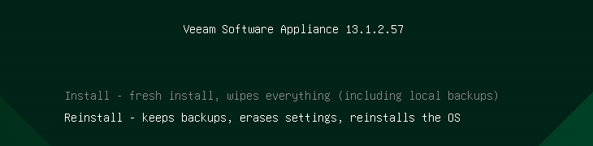{ loading=lazy }
/// caption
L'entrée **Reinstall** (en blanc) est sélectionnée par défaut.
///

2. 📦 Appuyer sur la **flèche haut** pour sélectionner **Install** (« Install - fresh install, wipes everything (including local backups) »), puis sur **Entrée**.

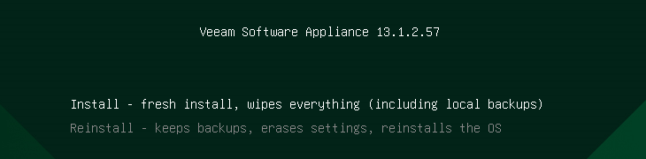{ loading=lazy }
/// caption
Après la flèche haut, **Install** est sélectionnée.
///

3. 📦 Patienter **quelques minutes** : l'installeur graphique démarre. Il affiche une **confirmation d'effacement des disques** : « Proceeding with the installation will irreversibly wipe all data currently residing on the drives… ». Vérifier qu'il s'agit bien de la bonne VM, puis cliquer sur **Yes**.

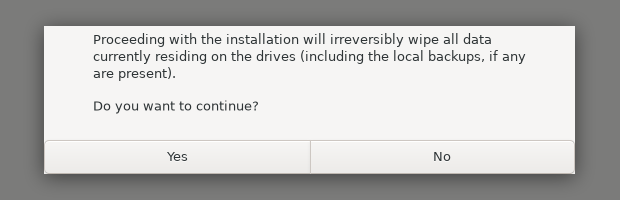{ loading=lazy }
/// caption
La confirmation d'effacement : sans danger sur une VM neuve.
///

4. 📦 Laisser l'installation se dérouler seule : partitionnement, puis installation d'environ **774 paquets**. Dans le lab elle a pris **une trentaine de minutes**, et jusqu'à **1 h** selon la vitesse du disque. La VM **redémarre toute seule** à la fin.

---

## 6. L'assistant de configuration initiale

Au premier démarrage, après quelques instants, l'appliance affiche en mode texte (bandeau vert **Veeam Host Management**) l'**Initial Configuration Wizard**. Ses étapes, listées à gauche, sont : **License**, **Hostname**, **Network**, **Time**, **Host Administrator**, **Security Officer**, **Summary**.

!!! tip "Naviguer dans une interface texte"
    Pas de souris. **Tab** passe au champ ou au bouton suivant, **Maj+Tab** au précédent, les **flèches** déplacent la sélection dans une liste, **Entrée** valide. La barre du bas rappelle les touches utiles. Les captures du lab (écran de la VM) sont prises avec le clavier **US** de l'assistant : voir l'étape 6.2 pour passer en AZERTY.

### 6.1 Licence

1. 📦 Sur l'étape **License**, sélectionner **[Veeam End User License Agreement (EULA)]** et appuyer sur **Entrée** pour lire le contrat, puis recommencer avec les autres documents si on le souhaite.
2. 📦 Se déplacer avec **Tab** jusqu'au bouton **[Accept]** et appuyer sur **Entrée**.

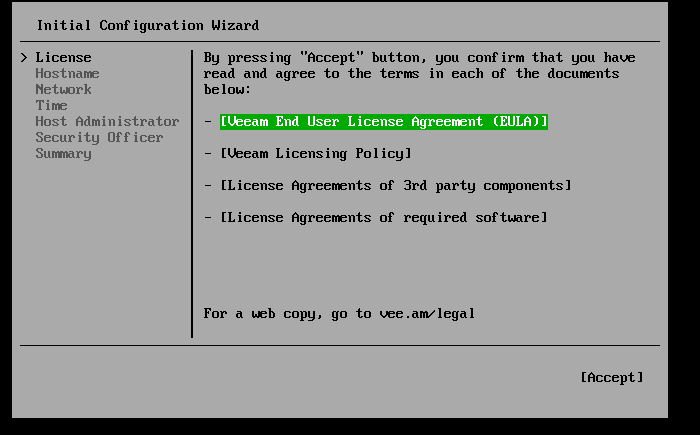{ loading=lazy }
/// caption
L'étape **License** : lire les contrats puis valider **[Accept]**. Il s'agit du contrat, pas de la clé de licence : celle-ci s'installe plus tard, dans l'interface web.
///

### 6.2 Nom d'hôte et disposition du clavier

1. 📦 Sur l'étape **Hostname**, effacer le nom proposé avec **Retour arrière** et saisir `vbr`.
2. 📦 Appuyer sur **Ctrl+K** (*Keyboard*) pour changer la **disposition du clavier** : taper `fr` dans le champ de recherche, sélectionner la disposition française (AZERTY) avec les flèches, puis **[OK]**. Le clavier **AZERTY** est alors actif pour les saisies suivantes. Les captures de ce TP montrent la disposition **US** d'origine.

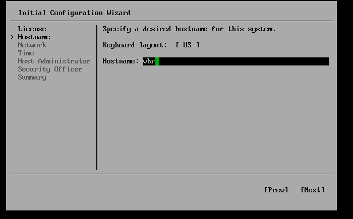{ loading=lazy }
/// caption
Le nom d'hôte `vbr`.
///

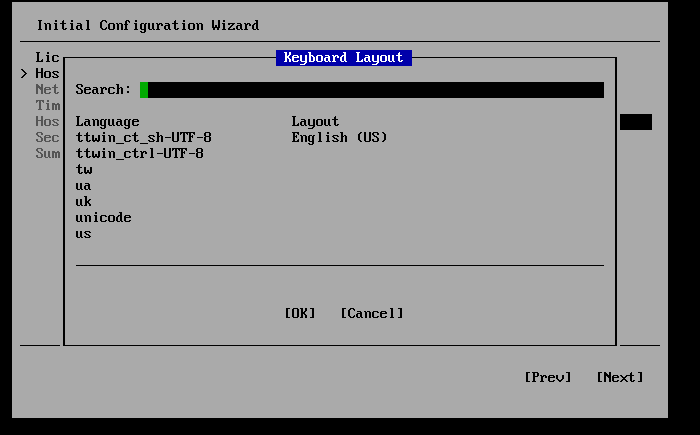{ loading=lazy }
/// caption
**Ctrl+K** ouvre la liste des dispositions : chercher `fr` pour l'AZERTY.
///

!!! warning "Choisir le clavier avant de taper les mots de passe"
    Les mots de passe contiennent des `@`. Avec un clavier mal réglé, ils seront saisis différemment de ce qui est affiché, et on ne pourra plus se connecter. Régler le clavier **maintenant**, puis cocher **Show password** (au besoin) pour vérifier ce qui est tapé.

3. 📦 Valider avec **[Next]**.

### 6.3 Réseau

1. 📦 Sur l'étape **Network**, la carte (par exemple `enp1s0`) essaie d'abord le DHCP, qui n'existe pas sur ce LAN. Sélectionner la carte, puis **[Static]**.
2. 📦 Remplir la fenêtre de réglages :

    | Champ | Valeur |
    |---|---|
    | IP4 address | `192.168.19.55` |
    | IP4 mask | `255.255.255.0` |
    | IP4 gateway | `192.168.19.21` |
    | DNS list | `192.168.19.21,1.1.1.1` |

3. 📦 Descendre sur **[Apply]**, appuyer sur **Entrée**, puis **[Next]**.

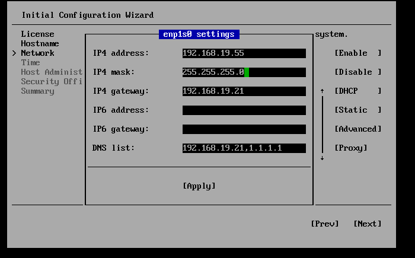{ loading=lazy }
/// caption
Les réglages statiques de la carte. Après **[Apply]**, l'adresse est active : l'appliance répond au ping.
///

!!! warning "Relire chaque champ"
    Une faute de frappe dans l'adresse, le masque ou la passerelle oblige à reprendre la configuration réseau. Relire les quatre champs avant **[Apply]**.

!!! tip "Vérifier tout de suite"
    Depuis le PC hôte, `ping 192.168.19.55` doit répondre dès que l'adresse est appliquée. Dans le lab, il répondait sans perte.

### 6.4 Heure et fuseau horaire

L'étape **Time** propose par défaut le fuseau **UTC** et un serveur NTP (`time.nist.gov` dans le lab).

1. 📦 Sélectionner **[Change]** à côté du fuseau, taper `Paris` dans le filtre, choisir **Europe/Paris** puis **[Select]**.
2. 📦 Garder le serveur NTP proposé, puis **[Next]**.

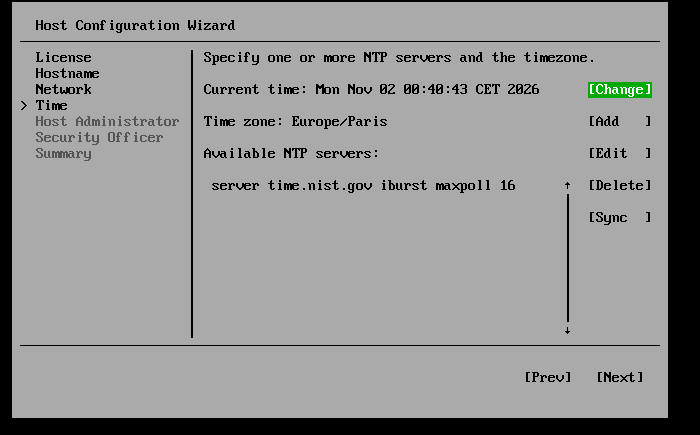{ loading=lazy }
/// caption
Fuseau **Europe/Paris** et serveur NTP : ce sont eux qui règlent l'heure de l'appliance.
///

!!! question "Pourquoi l'heure exacte est-elle vitale ?"
    Les codes d'authentification multifacteur sont des codes **TOTP** (*Time-based One-Time Password*) : l'appliance et le téléphone calculent le même code à partir d'un secret partagé **et de l'heure** (un nouveau code toutes les 30 secondes). Si l'horloge de l'appliance dérive de plus de quelques dizaines de secondes, les codes sont refusés. L'appliance a donc besoin d'un **serveur NTP** joignable (d'où le DNS et la sortie Internet du TP pfSense) et du bon fuseau pour que les plannings de jobs soient à l'heure locale.

### 6.5 Compte administrateur et politique STIG

L'administrateur de l'appliance se nomme obligatoirement **`veeamadmin`** (nom imposé, non modifiable). Il faut lui choisir un mot de passe conforme à la politique **DISA STIG**, qui est stricte.

1. 📦 Sur l'étape **Host Administrator**, vérifier la disposition du clavier, puis saisir le mot de passe dans le champ **Password**. Les essais du lab illustrent les trois règles :

    | Essai | Résultat | Message |
    |---|---|---|
    | `Popopo000@@@` | refusé | `The password contains more than 4 characters of the same class consecutively.` |
    | `PoPoPo000@@@` | refusé | `The password is shorter than 15 characters.` |
    | `PoPoPo000@@@000` | refusé | `The password fails the dictionary check - it does not contain enough DIFFERENT characters.` |
    | **`PoPoPo000@@@Lab`** | **accepté** | — |

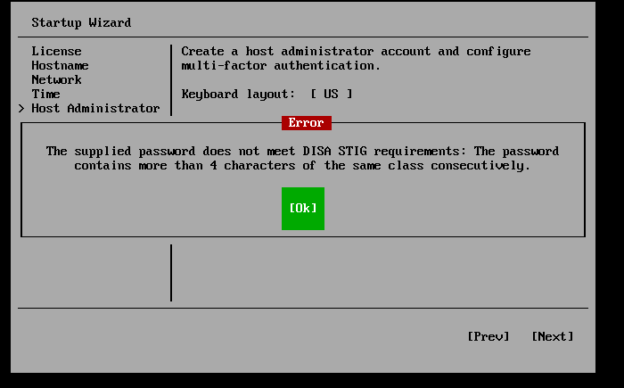{ loading=lazy }
/// caption
`Popopo000@@@` : « opopo » fait cinq minuscules d'affilée.
///

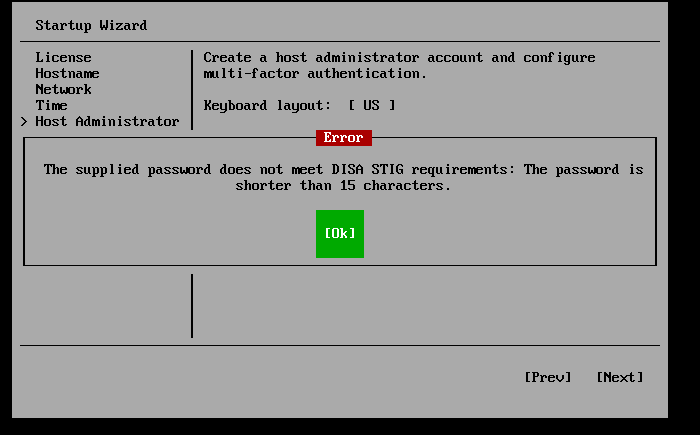{ loading=lazy }
/// caption
Variante `PoPoPo000@@@` : seulement 12 caractères.
///

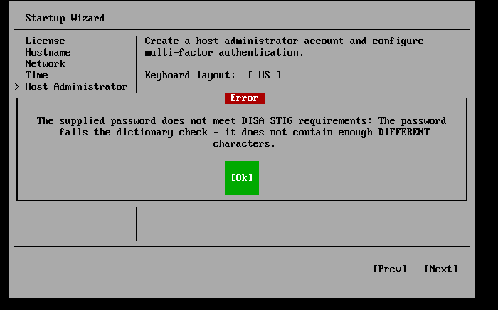{ loading=lazy }
/// caption
Variante `PoPoPo000@@@000` : 15 caractères, mais pas assez de caractères **différents**.
///

!!! failure "Message d'erreur : The supplied password does not meet DISA STIG requirements"
    Le texte complet est `The supplied password does not meet DISA STIG requirements:` suivi de la règle enfreinte (voir le tableau). Cliquer sur **[Ok]**, effacer le champ et retaper un mot de passe qui respecte **toutes** les règles à la fois : au moins **15 caractères**, des majuscules, des minuscules, des chiffres et des caractères spéciaux, **pas plus de 4 caractères de la même catégorie à la suite**, et assez de caractères différents.

    La variante retenue pour tout le parcours : **`PoPoPo000@@@Lab`**.

!!! question "Pourquoi un mot de passe aussi contraignant ?"
    L'appliance applique des règles de durcissement du référentiel **DISA STIG** (le même que les administrations américaines). Un mot de passe long, varié et sans suites de même catégorie résiste mieux aux attaques par dictionnaire. C'est la contrepartie de la sécurité renforcée par défaut dont parle la [partie 2](02-decouvrir-veeam-data-platform.md#23-une-securite-renforcee-par-defaut).

### 6.6 Authentification multifacteur (MFA)

Après le mot de passe, l'appliance impose le **MFA** et affiche la fenêtre **Configure Multi-Factor Authentication (MFA)** en trois étapes : ouvrir l'application d'authentification, **ajouter le compte**, taper le code à usage unique.

1. 🖥️ Sur le téléphone, ouvrir l'application d'authentification (Microsoft Authenticator, Google Authenticator, FreeOTP…) et choisir **Ajouter un compte** (compte « autre » / scanner un QR code).
2. 📦 Dans la fenêtre, sélectionner **[Show QR-code]** et appuyer sur **Entrée** : un QR code s'affiche sur l'écran de la VM. Le **scanner** avec le téléphone. Appuyer sur **Échap** pour revenir à la fenêtre.
3. 📦 Se placer dans le champ **Step 3. Enter a one-time password provided by your app** et saisir le **code à 6 chiffres** affiché par l'application, puis **[Ok]**.

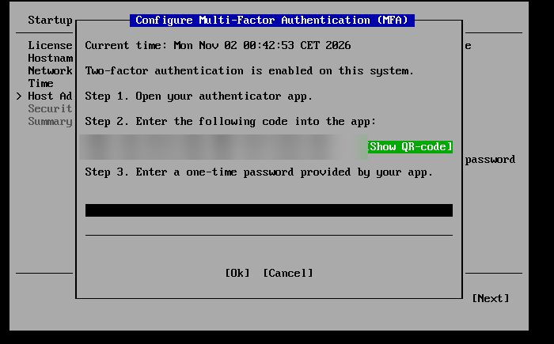{ loading=lazy }
/// caption
La fenêtre MFA. La clé secrète affichée sur la ligne du dessus a été **floutée** dans cette capture : elle est propre à chaque appliance. Le QR code (non reproduit ici) contient cette même clé.
///

!!! failure "Piège : le « O » ressemble à un « D » dans la police de la console"
    Si l'on préfère recopier la **clé secrète** à la main plutôt que scanner le QR code, attention : dans la police de la console, la lettre **O** ressemble à un **D** (dans le lab, un « O » a été lu « D » à la 15<sup>e</sup> position). Le téléphone calcule alors des codes **faux**, et l'appliance les refuse sans explication. **Préférer le QR code.**

!!! warning "Si le code est refusé"
    Vérifier d'abord l'**heure** du téléphone (réglage automatique) et du PC, puis attendre le code suivant (il change toutes les 30 secondes) et le retaper **dans le bon champ** : un **Tab** de trop déplace la sélection sur un bouton, et le code part au mauvais endroit.

### 6.7 Compte Security Officer

1. 📦 L'étape suivante demande les identifiants du **Security Officer** : nom `veeamso`, mot de passe `PoPoPo111@@@Lab` (mêmes règles STIG).
2. 📦 **[Next]** pour continuer. Ne pas cocher **Skip setting up Security Officer**.

!!! question "Pourquoi un second compte ?"
    Le **Security Officer** (officier de sécurité) **approuve** les actions sensibles demandées par l'administrateur, comme l'ouverture de l'accès `root` : c'est le principe des **quatre yeux** (*Zero Trust*) vu en [partie 2](02-decouvrir-veeam-data-platform.md). Dans une entreprise, ce rôle revient à une autre personne que l'administrateur. Dans le lab, c'est le même lecteur qui joue les deux rôles.

    Ce mot de passe de départ n'est valable que pour la **première connexion**. On le change à l'[étape 9](#9-initialiser-le-compte-security-officer).

### 6.8 Résumé et fin de l'assistant

1. 📦 L'étape **Summary** récapitule la configuration : nom d'hôte `vbr`, adresse `192.168.19.55`, serveur NTP, administrateur `veeamadmin`. Vérifier, puis sélectionner **[Finish]**.

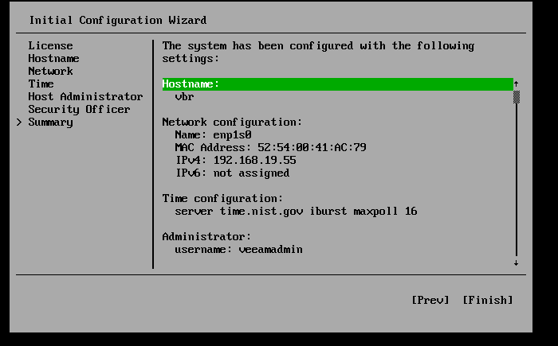{ loading=lazy }
/// caption
Le résumé avant d'appliquer la configuration.
///

2. 📦 L'appliance applique alors la configuration en **14 étapes** (génération du certificat, démarrage des services…). Compter **quelques minutes** (environ 3 minutes dans le lab, puis le temps que l'interface web réponde).
3. 📦 À la fin, l'**écran final** affiche les adresses d'accès. Les noter, ainsi que les **empreintes de certificat** (*Certificate thumbprint*) :

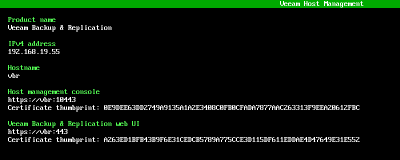{ loading=lazy }
/// caption
Host Management sur le port **10443**, l'interface web sur le port **443**, chacun avec son **empreinte** (SHA-256). Celle de l'interface web (`A263ED…E552` dans le lab) servira à l'[étape 11](#11-installer-la-console-windows-sur-srv-fichiers).
///

!!! tip "Noter l'empreinte"
    Prendre l'empreinte en photo avec le téléphone, ou la noter : elle permet de vérifier plus tard qu'on se connecte bien à **sa** machine (étapes 7 et 11). Les empreintes de votre appliance seront **différentes** de celles de la capture.

---

## 7. Première connexion à l'interface web

### 7.1 Ouvrir l'interface web

1. 🌐 Sur `srv-fichiers` (une fois préparé, [étape 10](#10-preparer-srv-fichiers)) ou sur le PC hôte (`192.168.19.1`), ouvrir un navigateur et aller sur `https://192.168.19.55`.

!!! failure "Avertissement de certificat : « Votre connexion n'est pas privée »"
    Le navigateur affiche un avertissement (`NET::ERR_CERT_AUTHORITY_INVALID` ou équivalent). C'est **normal** : l'appliance a **généré elle-même** son certificat (certificat **auto-signé**) pendant l'assistant, et aucune autorité reconnue par le navigateur ne l'a signé. Le chiffrement HTTPS fonctionne, mais le navigateur ne peut pas être sûr de parler à la bonne machine.

    Cliquer sur **Avancé**, puis **Continuer vers 192.168.19.55**. Pour une vérification sérieuse, on compare l'**empreinte** du certificat (cadenas > détails du certificat) à celle de l'écran final de l'appliance, comme à l'[étape 11](#11-installer-la-console-windows-sur-srv-fichiers).

### 7.2 Se connecter

1. 🌐 Saisir `veeamadmin` et `PoPoPo000@@@Lab`, puis cliquer sur **Sign in**.

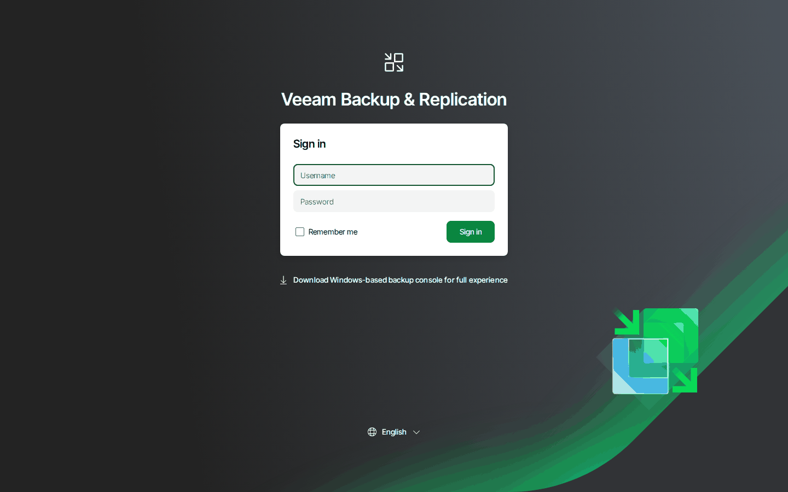{ loading=lazy }
/// caption
La page de connexion de l'interface web. Le lien en bas, **Download Windows-based backup console for full experience**, sert à l'[étape 11](#11-installer-la-console-windows-sur-srv-fichiers).
///

!!! note "Où est demandé le code MFA ?"
    Dans cette configuration, le **code MFA** n'est demandé qu'à la connexion à **Host Management** ([étape 8](#8-decouvrir-host-management)) : l'interface web et la console Windows se contentent du mot de passe. Si une page de connexion demande malgré tout un code, le lire dans l'application d'authentification.

### 7.3 La mise à jour des composants

Dès la première connexion, la fenêtre **Host Components Update** apparaît : l'appliance configure ses composants (par exemple le serveur Samba). Laisser la fenêtre travailler, puis cliquer sur **OK** quand elle se termine. Dans le lab, elle s'est terminée avec le statut **Warning** (« All components have been upgraded with warnings ») **avant** l'installation de la licence, sans conséquence pour la suite. Une fenêtre d'information **Web UI** rappelle que l'interface web ne couvre pas encore toutes les fonctions de la console Windows : c'est pourquoi on installe cette dernière à l'[étape 11](#11-installer-la-console-windows-sur-srv-fichiers).

### 7.4 Installer la licence

1. 🌐 Le tableau de bord (**Overview**) s'affiche avec une fenêtre qui demande d'installer une licence valide : « To start using Veeam Backup & Replication web UI, please install a valid product license ». Cliquer sur **Install**.
2. 🌐 Choisir le fichier `.lic` de l'[étape 3.2](#32-obtenir-la-licence-dessai). L'appliance l'accepte.

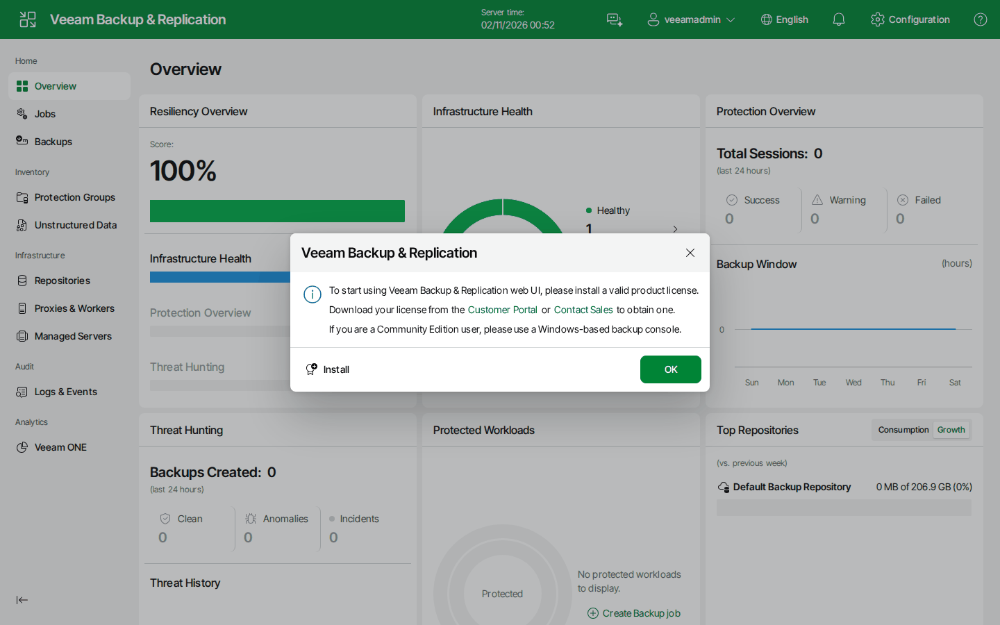{ loading=lazy }
/// caption
La fenêtre qui demande la licence au premier affichage du tableau de bord.
///

!!! warning "Sans licence : Community Edition, restauration seule"
    La fenêtre rappelle aussi : « If you are a Community Edition user, please use a Windows-based backup console ». Ne pas fermer cette fenêtre sans installer le fichier `.lic` : sans lui, aucune sauvegarde ne sera possible ([partie 2](02-decouvrir-veeam-data-platform.md#32-le-piege-de-la-community-edition)).

### 7.5 Les mises à jour critiques

1. 🌐 Après l'installation de la licence, l'appliance **vérifie ses mises à jour** (**Checking for updates**, 1 à 2 minutes dans le lab). Elle propose alors d'installer des **mises à jour critiques** : « The system requires critical updates to be installed. Install updates now? ». Cliquer sur **Yes**.
2. 🌐 Les services de l'appliance **redémarrent** : pendant quelques minutes, l'interface peut afficher une erreur interne ou rester vide. Attendre, puis recharger la page.

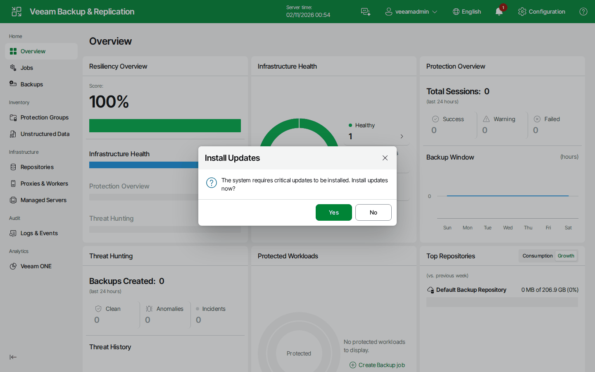{ loading=lazy }
/// caption
Les mises à jour critiques : répondre **Yes** (bonne pratique de sécurité).
///

!!! tip "Pourquoi accepter ?"
    Installer les mises à jour critiques dès l'installation corrige les failles connues. C'est aussi ce qui oblige la console Windows à mettre ses **modules** à jour à la première connexion (étape 11).

### 7.6 Le tableau de bord et la page Licence

1. 🌐 Après les mises à jour, le tableau de bord **Overview** s'affiche. Y repérer le **dépôt par défaut** : `Default Backup Repository`, sur `vbr`, **206,9 Go** (le second disque).
2. 🌐 Cliquer sur **Configuration** (en haut à droite), puis **License Information** : la page indique le statut (**Valid**), le type (**Evaluation** pour une clé d'essai), le nombre d'**instances** (charges de travail) et la **date d'expiration**.

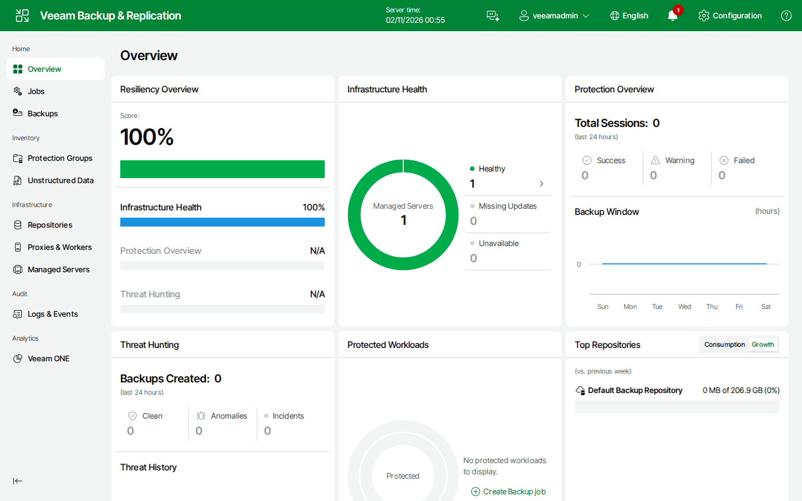{ loading=lazy }
/// caption
Le tableau de bord. En bas à droite, **Default Backup Repository** : le dépôt local créé sur le second disque.
///

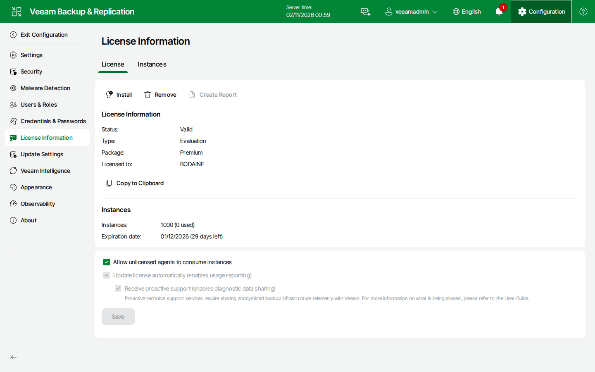{ loading=lazy }
/// caption
La page **License Information** : vérifier que le statut est **Valid** et noter la date d'expiration. Les valeurs dépendent de votre clé (dans le lab : 1 000 instances, expiration le 01/12/2026).
///

!!! failure "Message : « Your trial license will expire on … »"
    Une notification annonce la date d'expiration de la licence d'essai. C'est une information, pas une erreur. Une clé d'essai de 30 jours limite la durée de **validité du lab** : prévoir de finir le parcours dans ce délai.

---

## 8. Découvrir Host Management

**Host Management** est la page d'administration du **système** de l'appliance, distincte de l'interface web qui gère les sauvegardes. On y gère notamment le système, le réseau, l'heure, les certificats, les **mises à jour**, les utilisateurs et rôles et l'accès distant. Le **SSH** y est **désactivé par défaut**, et l'accès **`root`** n'est accordé que sur **demande approuvée par le Security Officer**. Voir la [documentation officielle](https://helpcenter.veeam.com/docs/vbr/userguide/hmc_about.html).

1. 🌐 Aller sur `https://192.168.19.55:10443` (même avertissement de certificat qu'à l'étape 7.1).
2. 🌐 Se connecter avec `veeamadmin` et `PoPoPo000@@@Lab`.
3. 🌐 La page suivante demande le **code MFA** : ouvrir l'application d'authentification et saisir le code à 6 chiffres affiché pour l'appliance, puis **Sign in**.

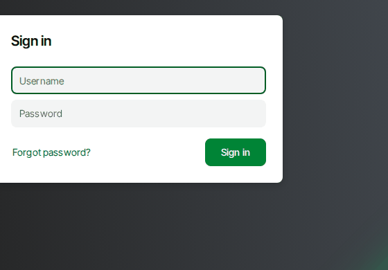{ loading=lazy width="420" }
/// caption
Connexion à Host Management : identifiant et mot de passe.
///

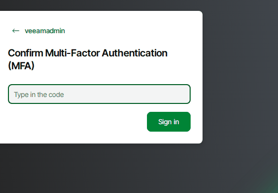{ loading=lazy width="420" }
/// caption
Le code MFA à 6 chiffres, calculé par l'application d'authentification.
///

4. 🌐 La page **Overview** résume le système : type d'appliance, serveur SSH (**Disabled**), empreintes des certificats, réseau (`enp1s0`, `192.168.19.55`), heure et serveur NTP, charge CPU et mémoire. À gauche, le menu : **Network**, **Time**, **Storage**, **Remote Access**, **Users and Roles**, **Certificates**, **Backup Infrastructure**, **Updates**, **Logs and Services**…

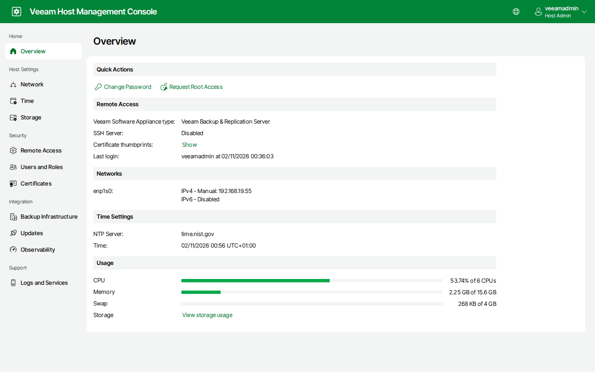{ loading=lazy }
/// caption
**Overview** : noter **SSH Server : Disabled**, le lien **Show** des empreintes de certificats, et l'utilisation des ressources.
///

!!! question "Pourquoi le SSH est-il désactivé ?"
    Un accès SSH au système d'un serveur de sauvegarde est une porte d'entrée de choix pour un attaquant. L'appliance le **ferme** et ne l'ouvre que pour une durée limitée, sur une demande **approuvée par le Security Officer** (menu **Remote Access**). Dans ce parcours, on n'en a pas besoin : tout se fait par l'interface web, Host Management et la console.

!!! tip "Installer les mises à jour système"
    Le menu **Updates** de Host Management permet de rechercher et d'installer les mises à jour du système (dans le lab, l'installation affiche ses étapes : vérification et téléchargement des paquets, installation, redémarrage des services).

---

## 9. Initialiser le compte Security Officer

Le compte `veeamso` a été créé à l'assistant avec un mot de passe **provisoire**. Sa première connexion déclenche l'assistant **Security Officer Initialization Wizard** en quatre étapes : **Password**, **Multi-Factor Authentication (MFA)**, **Recovery Token**, **Configuration Backup**.

1. 🌐 Se déconnecter de Host Management (menu du compte `veeamadmin` en haut à droite), ou ouvrir une fenêtre de navigation privée, puis aller sur `https://192.168.19.55:10443`.
2. 🌐 Se connecter avec **`veeamso`** et **`PoPoPo111@@@Lab`** (le mot de passe de l'assistant).
3. 🌐 **Étape Password** : l'assistant impose de changer le mot de passe (« You must change your password now »). Saisir **`PoPoPo555@@@Lab`** deux fois, puis **Next**.

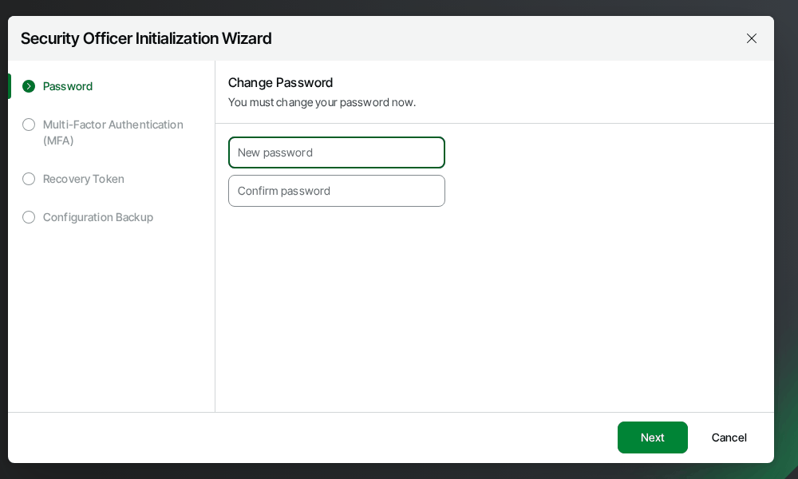{ loading=lazy }
/// caption
Première connexion de `veeamso` : le mot de passe provisoire doit être remplacé.
///

4. 🌐 **Étape Multi-Factor Authentication (MFA)** : ajouter **un nouveau compte** dans l'application d'authentification en scannant le QR code de **cette** page (c'est un second secret, distinct de celui de `veeamadmin`), puis saisir le code à 6 chiffres dans **Enter the one-time code shown in the app**. Cliquer sur **Next**.

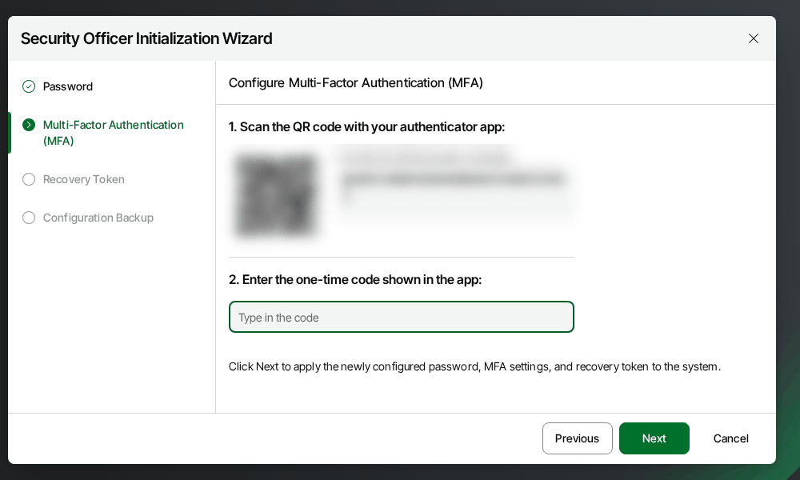{ loading=lazy }
/// caption
Le QR code et la clé de cet écran ont été **floutés** : chaque appliance génère les siens. Scanner le QR code de **votre** écran.
///

5. 🌐 **Étape Recovery Token** : l'assistant affiche un **jeton de récupération** (une suite de caractères du type `xxxxxxxx-xxxx-…`) qui permet de **retrouver l'accès** au compte si le mot de passe ou le MFA sont perdus. **L'écrire sur papier ou l'enregistrer dans un gestionnaire de mots de passe**, puis **Next**.

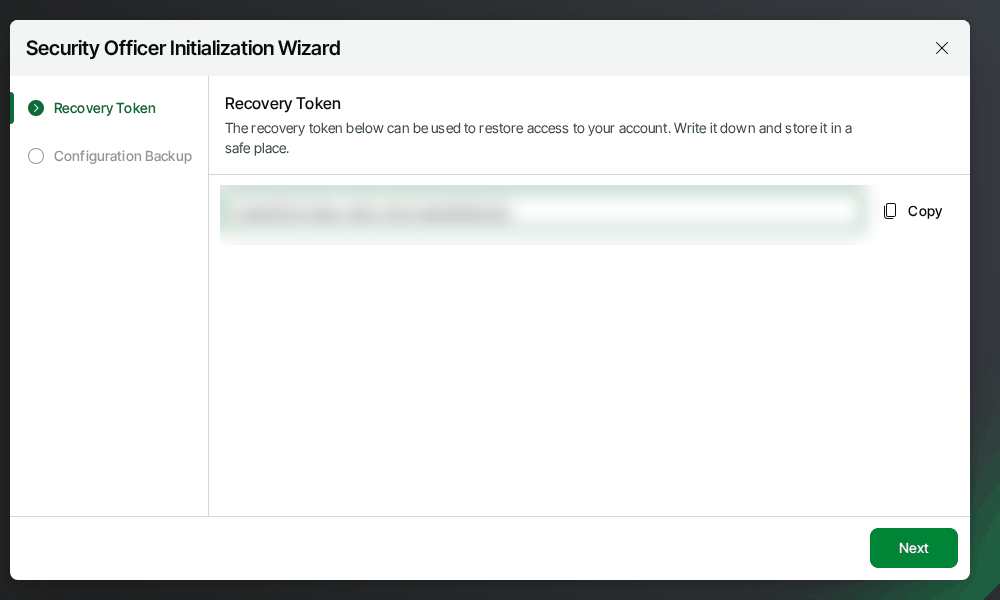{ loading=lazy }
/// caption
Le jeton de récupération (flouté ici) s'affiche **une seule fois**. À conserver hors de l'appliance.
///

!!! danger "Le jeton de récupération ne se réaffiche pas"
    Il est montré une seule fois. Sans lui, il peut devenir impossible de rouvrir le compte du Security Officer si le mot de passe ou le MFA sont perdus. Host Management propose, dans ses **Quick Actions**, l'entrée **Create password recovery token** pour en créer un nouveau.

6. 🌐 **Étape Configuration Backup** : l'assistant demande une **phrase secrète de sauvegarde de configuration** (*passphrase*) et un indice (*hint*). Saisir `PoPoPo666@@@Lab`, avec l'indice `Phrase secrete du lab Veeam`, puis **Finish**.

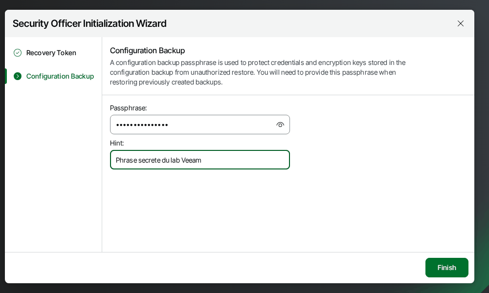{ loading=lazy }
/// caption
La phrase secrète de sauvegarde de configuration, avec son indice. Elle protège les mots de passe et clés de chiffrement contenus dans la sauvegarde de configuration.
///

7. 🌐 Vérifier le résultat : dans Host Management, le menu **Configuration** du Security Officer affiche **Configuration Backup**, la date de création, l'indice **Phrase secrete du lab Veeam** et le lien **Change Passphrase**.

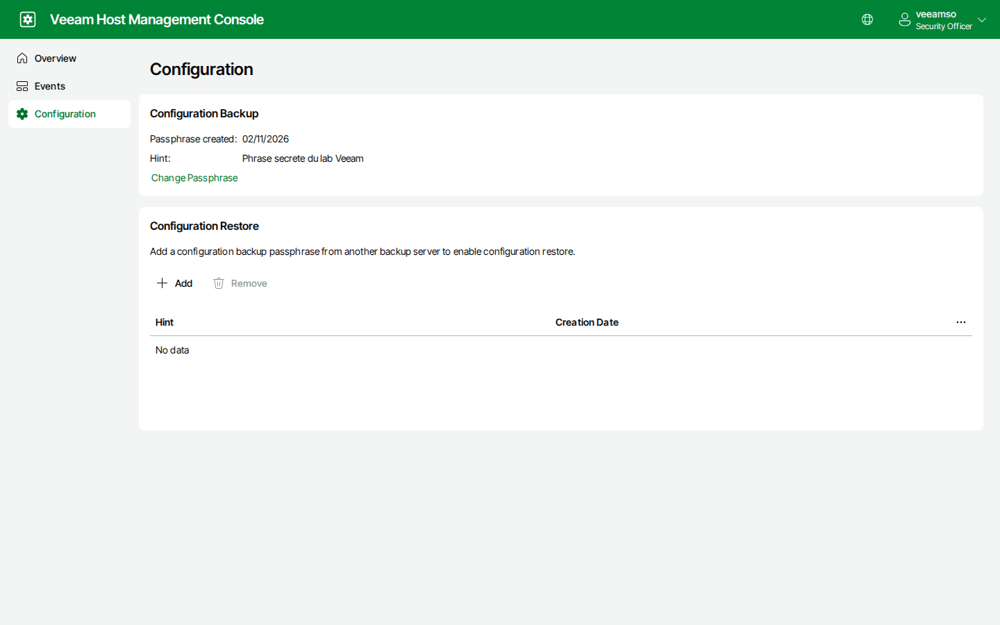{ loading=lazy }
/// caption
La phrase secrète est enregistrée (date, indice).
///

!!! failure "Message d'erreur si on saute cette étape : « Unable to process the configuration backup without the Security Officer's passphrase… »"
    En [partie 5](05-sauvegarder-configuration-et-serveur-de-fichiers.md), la **sauvegarde de configuration chiffrée** du serveur de sauvegarde **échoue** si le Security Officer n'a pas créé sa phrase secrète. Le journal du lab affiche exactement :

    `Unable to process the configuration backup without the Security Officer's passphrase. Ask your Security Officer to configure it in the Host Management console.`

    Il faut alors se connecter à Host Management avec `veeamso`, créer la phrase secrète (cette étape 9), et relancer la sauvegarde. Autant le faire **maintenant**.

!!! question "Pourquoi une phrase secrète en plus du mot de passe de chiffrement ?"
    La sauvegarde de configuration contient les identifiants et clés de chiffrement de toute l'infrastructure. Elle est chiffrée par un mot de passe choisi dans la console (`Popopo444@@@` en partie 5) **et** liée à la phrase secrète du Security Officer : un administrateur seul ne peut pas restaurer cette configuration sans l'accord de l'officier de sécurité. Même principe des « quatre yeux » qu'à l'[étape 6.7](#67-compte-security-officer).

---

## 10. Préparer `srv-fichiers`

`srv-fichiers` est le **serveur de fichiers Windows** à protéger. Il héberge aussi la **console** Veeam et le navigateur du lab.

### 10.1 Créer la VM

| Réglage | Valeur |
|---|---|
| Nom | `srv-fichiers` |
| Système | Windows Server 2025 |
| Processeurs / mémoire | 2 vCPU, 4 Go |
| Disque 1 | 60 Go (C:) |
| Disque 2 | 40 Go (futur E:) |
| Réseau | LAN du TP pfSense |
| Démarrage | UEFI |

=== "VMware Workstation"

    **New Virtual Machine… > Custom**, système invité **Windows Server 2025** (ou **Windows Server 2022** si 2025 n'est pas proposé), nom `srv-fichiers`, 2 processeurs, **4096 Mo**. **Firmware type : UEFI** dans **Options > Advanced**. Disque de **60 Go**, puis **Add > Hard Disk** de **40 Go**. Réseau **Custom : VMnet19**. ISO de Windows Server.

=== "VirtualBox"

    **Machine > Nouvelle**, type **Microsoft Windows**, version **Windows 2022 (64-bit)**, 4096 Mo, 2 processeurs, **Activer EFI**. Disque **VDI de 60 Go** dynamique, puis un second de **40 Go**. **Réseau privé hôte**. Cocher **Passer l'installation automatique** : l'installation se fait à la main.

=== "Proxmox VE"

    **Create VM** : type **Microsoft Windows**, version **11/2022/2025**, **BIOS OVMF (UEFI)** avec **Add EFI Disk**, **Machine** `q35`. **SATA** pour les disques et carte réseau **Intel E1000** (pour éviter d'installer les pilotes VirtIO pendant l'installation ; les pilotes VirtIO sont un choix valable pour les connaisseurs). Disques de **60 Go** et **40 Go**, **2 cœurs**, **4096 Mo**, pont `vmbr19`.

### 10.2 Installer Windows Server 2025

1. 🪟 Démarrer la VM sur l'ISO (appuyer sur une touche au message « Press any key to boot from CD or DVD »). Choisir **Français** (langue, format de l'heure, clavier français), puis **Suivant > Installer maintenant**.
2. 🪟 Si la clé de produit est demandée, cliquer sur **Je n'ai pas de clé de produit** (version d'évaluation).
3. 🪟 Choisir **Windows Server 2025 Standard (expérience de bureau)** (*Desktop Experience*). Ne pas prendre la première ligne sans « expérience de bureau » : c'est la version sans interface graphique.
4. 🪟 Accepter les termes de licence, choisir **Personnalisé : installer uniquement Windows**, et sélectionner le **disque de 60 Go** (le **Lecteur 0**, pas celui de 40 Go).
5. 🪟 Après redémarrage, définir le mot de passe de l'**Administrateur** : `Popopo222@@@`, puis ouvrir la session avec **Ctrl+Alt+Suppr** (dans la console de l'hyperviseur, utiliser son menu **Envoyer Ctrl+Alt+Suppr**).

!!! tip "Fermer l'invitation Windows Admin Center"
    À la première ouverture de session, le **Gestionnaire de serveur** démarre tout seul et affiche par-dessus une fenêtre « Essayez Windows Admin Center et Azure Arc ». Cocher **Ne plus afficher ce message**, puis la fermer avec la croix. Le Gestionnaire de serveur peut rester ouvert : il ne sert pas dans ce TP.

### 10.3 Nom, adresse IP, réseau et ping

1. 🪟 Ouvrir **Windows PowerShell en tant qu'administrateur** (clic droit sur **Démarrer**, puis **Terminal (admin)** ou **Windows PowerShell (admin)** selon l'entrée proposée).
2. 🪟 Coller le script suivant : il donne l'**adresse IP fixe**, passe le réseau en **profil privé**, autorise le **ping** (ICMP) et renomme le serveur, qui redémarre.

    ```powershell title="Réseau et nom de srv-fichiers"
    # 1. Choisir la carte réseau connectée et la renommer « LAN »
    $nic = Get-NetAdapter | Where-Object Status -eq 'Up' | Select-Object -First 1
    Rename-NetAdapter -Name $nic.Name -NewName 'LAN'
    $nic = Get-NetAdapter -Name 'LAN'

    # 2. Adresse IP fixe : pas de DHCP sur ce LAN
    Set-NetIPInterface -InterfaceIndex $nic.ifIndex -Dhcp Disabled
    New-NetIPAddress -InterfaceIndex $nic.ifIndex -IPAddress 192.168.19.22 `
        -PrefixLength 24 -DefaultGateway 192.168.19.21
    Set-DnsClientServerAddress -InterfaceIndex $nic.ifIndex `
        -ServerAddresses 192.168.19.21,1.1.1.1

    # 3. Profil réseau « privé » (le pare-feu est moins restrictif)
    Start-Sleep -Seconds 5
    Get-NetConnectionProfile | Set-NetConnectionProfile -NetworkCategory Private

    # 4. Autoriser le ping entrant (règle ICMPv4)
    Enable-NetFirewallRule -Name FPS-ICMP4-ERQ-In

    # 5. Renommer le serveur et redémarrer
    Rename-Computer -NewName SRV-FICHIERS -Restart
    ```

!!! question "Pourquoi un profil réseau privé et le ping autorisé ?"
    Windows classe un réseau inconnu en **Public** et y bloque presque tout, y compris le ping. Sur un LAN de confiance, le profil **Privé** s'applique à un pare-feu moins strict, et la règle ICMP permet de tester la connexion depuis les autres machines (`ping 192.168.19.22`). Sans elle, la vérification de fin de partie échoue sans qu'il y ait de véritable panne.

3. 🪟 Après redémarrage, ouvrir une session et vérifier : `ipconfig` doit afficher `192.168.19.22`, et `ping 192.168.19.21` doit répondre.

### 10.4 Le disque E: et les documents d'exemple

Le deuxième disque de 40 Go est encore vierge. Le script ci-dessous le formate en **NTFS**, lui donne la lettre **E:** et le nom **DONNEES**, et crée le dossier `E:\Documents-importants` avec quelques fichiers d'exemple (le « patrimoine » à protéger en [partie 5](05-sauvegarder-configuration-et-serveur-de-fichiers.md)). Le disque **F:** est ajouté en [partie 4](04-ajouter-des-depots-de-sauvegarde.md) : ne pas le créer ici.

!!! failure "Message : « New-Partition : The requested access path is already in use »"
    La lettre **E:** est déjà prise, en général par le **lecteur DVD** d'un second ISO ou de l'ISO d'installation encore monté. Dans le lab, un second lecteur CD occupait `E:` : le retirer de la VM (ou **éjecter** l'ISO dans l'hyperviseur), **redémarrer Windows**, puis relancer le script. La commande `Get-Volume` montre les lettres déjà utilisées.

1. 🪟 Dans **PowerShell (admin)**, coller :

    ```powershell title="prep-fichiers.ps1 : disque E: et documents d'exemple"
    $ErrorActionPreference = 'Stop'

    # 1. Repérer le disque de données : ni le disque système (n° 0), ni un disque déjà partitionné
    $d = Get-Disk | Where-Object {
        $_.Number -ne 0 -and (
            $_.PartitionStyle -eq 'RAW' -or
            ((Get-Partition -DiskNumber $_.Number -ErrorAction SilentlyContinue |
              Where-Object Type -eq 'Basic').Count -eq 0))
    } | Select-Object -First 1

    # 2. Le formater : GPT, une seule partition NTFS, lettre E:, nom DONNEES
    if ($d) {
        if ($d.PartitionStyle -eq 'RAW') { Initialize-Disk -Number $d.Number -PartitionStyle GPT }
        New-Partition -DiskNumber $d.Number -UseMaximumSize -DriveLetter E |
            Format-Volume -FileSystem NTFS -NewFileSystemLabel 'DONNEES' -Confirm:$false | Out-Null
    }

    # 3. Les documents « très importants » à protéger
    $base = 'E:\Documents-importants'
    foreach ($s in 'Comptabilite','Contrats','Ressources-humaines') {
        New-Item -ItemType Directory -Force -Path "$base\$s" | Out-Null
    }
    Set-Content "$base\Comptabilite\factures-2026.csv" `
        "Numero;Client;Montant`nF2026-001;Boulangerie Martin;1250,00`nF2026-002;Garage Durand;3480,50`nF2026-003;Cabinet Leroy;890,00" -Encoding UTF8
    Set-Content "$base\Comptabilite\bilan-previsionnel.txt" `
        "Bilan previsionnel 2026 - document confidentiel" -Encoding UTF8
    Set-Content "$base\Contrats\contrat-maintenance-2026.txt" `
        "Contrat de maintenance informatique - signe le 05/01/2026" -Encoding UTF8
    Set-Content "$base\Ressources-humaines\planning-conges.csv" `
        "Salarie;Debut;Fin`nAlice;2026-07-15;2026-08-05`nBruno;2026-08-01;2026-08-20" -Encoding UTF8

    # 4. Contrôle
    Get-Volume -DriveLetter E | Format-Table DriveLetter,FileSystemLabel,FileSystem,Size -AutoSize
    Get-ChildItem -Recurse $base | Format-Table FullName,Length -AutoSize
    ```

2. 🪟 Vérifier : `E:` apparaît dans l'**Explorateur de fichiers** sous le nom **DONNEES**, et contient `Documents-importants` avec trois sous-dossiers.

!!! question "Pourquoi un script ?"
    Le formatage se ferait aussi dans **Gestion des disques** (`diskmgmt.msc`) à la souris. Le script a l'avantage d'être **reproductible** et de produire des fichiers connus d'avance : en partie 5, on supprimera l'un d'eux pour le restaurer, et il faudra le reconnaître.

---

## 11. Installer la console Windows sur `srv-fichiers`

La **console Windows** (Veeam Backup & Replication Console) est le programme historique de Veeam. On la **télécharge depuis l'appliance** elle-même, ce qui garantit une version identique. Elle reste nécessaire pour certaines fonctions que l'interface web 13.1 ne couvre pas encore.

1. 🪟 Ouvrir **Microsoft Edge** sur `srv-fichiers`, aller sur `https://192.168.19.55`, accepter l'avertissement de certificat ([étape 7.1](#71-ouvrir-linterface-web)).
2. 🪟 Sur la page de connexion, cliquer sur le lien **Download Windows-based backup console for full experience** (en bas). Le fichier `VeeamBackup&ReplicationConsole_13.1.2.57.exe` (environ **2 Go**) est téléchargé dans le dossier **Téléchargements**. Dans le lab, la copie a pris moins d'une minute sur le réseau local.

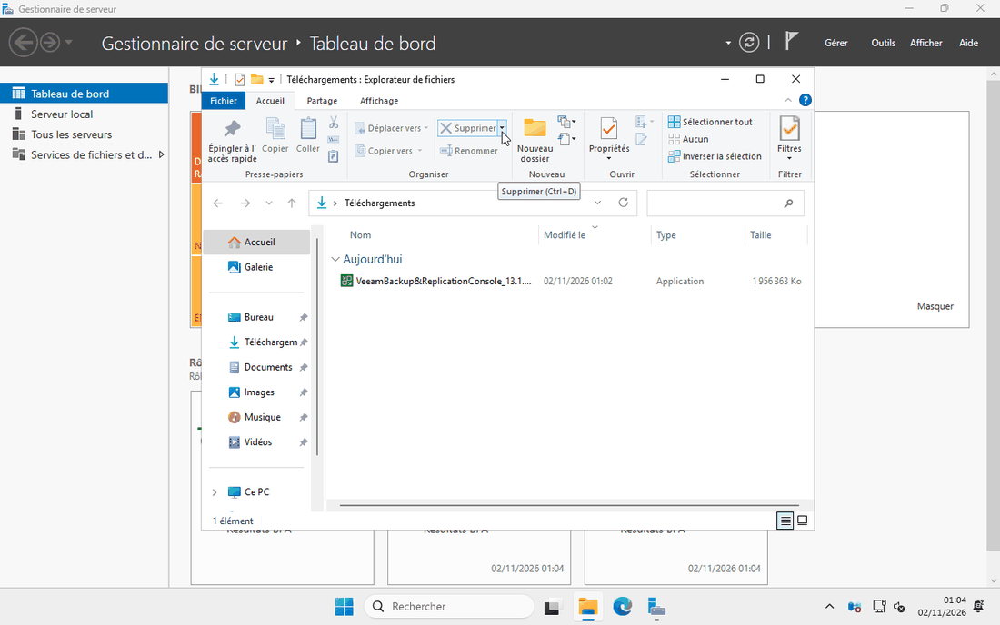{ loading=lazy }
/// caption
L'installeur de la console, téléchargé depuis l'appliance.
///

3. 🪟 Double-cliquer sur le fichier. Dans l'assistant : accepter le contrat (**I Accept**), laisser le programme **vérifier la configuration** (il active les composants Windows manquants), puis **Install**. L'installation a pris environ **7 minutes** dans le lab. Terminer avec **Finish**. Si un redémarrage est demandé, l'accepter et relancer l'installeur.
4. 🪟 Lancer **Veeam Backup & Replication Console** depuis le menu **Démarrer**.
5. 🪟 Dans **Specify backup server**, saisir `192.168.19.55` à la place de `localhost`, puis **Connect**.

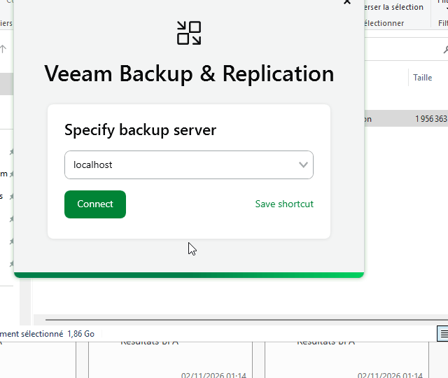{ loading=lazy width="420" }
/// caption
Remplacer `localhost` par `192.168.19.55`.
///

6. 🪟 Une fenêtre **Untrusted server certificate** apparaît : « Server 192.168.19.55 has an untrusted certificate ». **Avant** de cliquer sur **Yes**, vérifier l'empreinte : passer la souris sur **Copy fingerprints to clipboard** ou **View certificate** pour afficher l'**empreinte SHA256**, puis la **comparer** à celle de l'écran final de l'appliance (étape 6.8). Les premiers caractères doivent correspondre (`A263ED…` dans le lab).

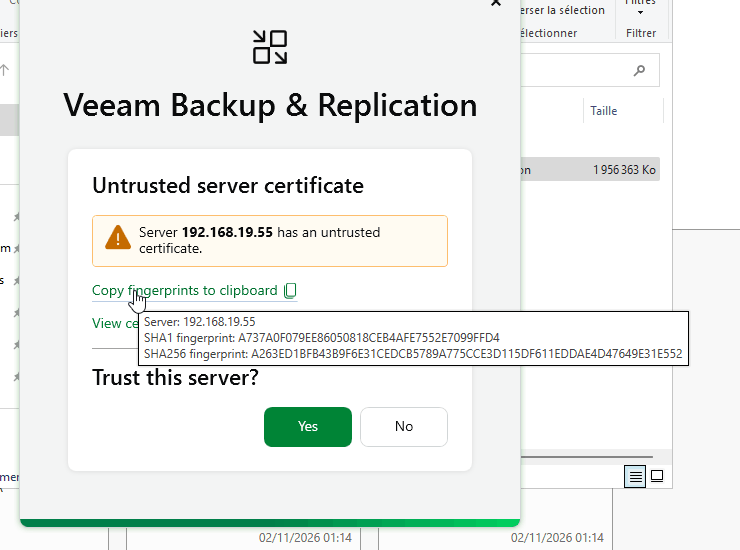{ loading=lazy }
/// caption
L'empreinte SHA256 (`A263ED…E552` dans le lab) est **identique** à celle de l'écran final de l'appliance : on parle bien à `vbr`.
///

!!! question "Pourquoi comparer l'empreinte ?"
    Le certificat est **auto-signé**, la console ne peut donc pas le vérifier seule. Si un intrus se plaçait entre `srv-fichiers` et l'appliance (attaque de l'homme du milieu), il présenterait un **autre certificat**, donc une **autre empreinte**. Comparer les deux empreintes, c'est l'équivalent de vérifier une pièce d'identité. En lab on la contrôle une fois par principe ; en production, c'est un vrai contrôle de sécurité.

7. 🪟 Cliquer sur **Yes**, puis se connecter avec `veeamadmin` et `PoPoPo000@@@Lab` (**Sign in**).
8. 🪟 La console demande une **mise à jour de ses modules** (« Plug-ins update is required ») : cliquer sur **Update** (environ **164 Mo** dans le lab, suite à la mise à jour critique de l'appliance). La console revient à l'écran de connexion : se reconnecter avec les mêmes identifiants.

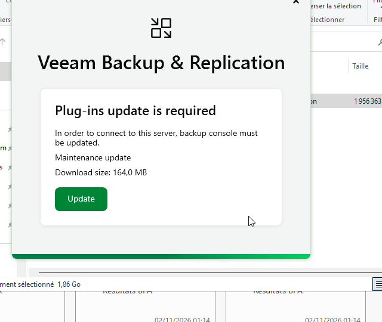{ loading=lazy width="420" }
/// caption
Les modules de la console doivent correspondre à la version de l'appliance.
///

9. 🪟 La console s'ouvre sur l'écran **Home**. Une fenêtre peut rappeler l'expiration de la licence d'essai : cliquer sur **OK**.

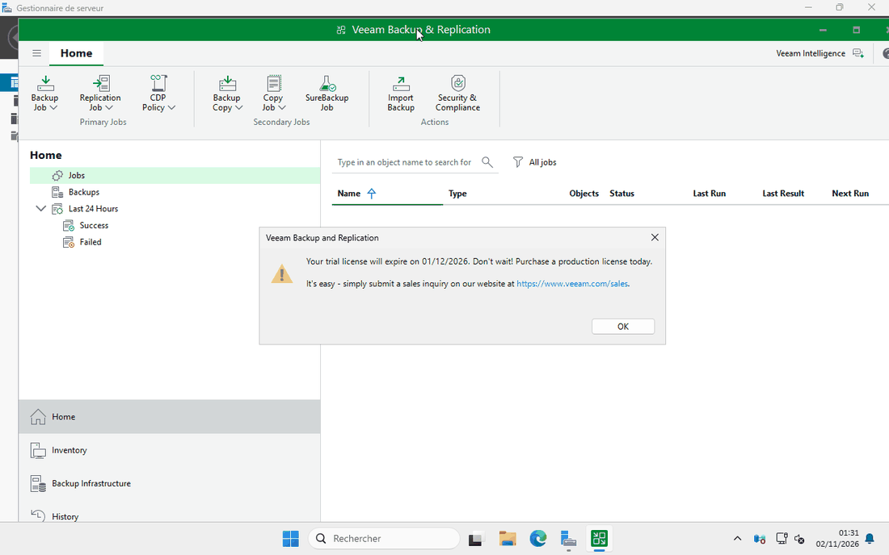{ loading=lazy }
/// caption
La console ouverte sur `vbr` depuis `srv-fichiers`.
///

---

## 12. Préparer `srv-debian`

`srv-debian` est le **serveur Linux** qui sera sauvegardé puis restauré en [partie 6](06-sauvegarder-restaurer-serveur-linux.md).

### 12.1 Créer la VM

| Réglage | Valeur |
|---|---|
| Nom | `srv-debian` |
| Système | Debian 13 (64 bits) |
| Processeurs / mémoire | 2 vCPU, 2 Go |
| Disque | 20 Go |
| Démarrage | **BIOS** ou **UEFI sans Secure Boot** |
| Réseau | LAN du TP pfSense |

!!! warning "Pas de Secure Boot sur `srv-debian`"
    L'agent de sauvegarde de Veeam pour Linux utilise un **module noyau** non signé par une clé que Secure Boot reconnaît. Avec Secure Boot actif, ce module est refusé ou demande d'enregistrer une clé (*MOK*, procédure de la [partie 6](06-sauvegarder-restaurer-serveur-linux.md)). Pour que la partie 6 se passe sans détour, **désactiver Secure Boot** sur cette VM.

=== "VMware Workstation"

    **New Virtual Machine… > Custom**, système invité **Debian 12.x 64-bit** (ou **Debian 11.x 64-bit** à défaut), 2 processeurs, **2048 Mo**, disque de **20 Go**, réseau **Custom : VMnet19**. Laisser le **Firmware type** sur **BIOS** (valeur par défaut, aucun réglage de Secure Boot).

=== "VirtualBox"

    **Machine > Nouvelle**, type **Linux**, version **Debian (64-bit)**, 2048 Mo, 2 processeurs, disque **VDI de 20 Go** dynamique. Ne **pas** cocher **Activer EFI** (BIOS par défaut). **Réseau privé hôte**.

=== "Proxmox VE"

    **Create VM** : type **Linux**, version **6.x - 2.6 Kernel**, **BIOS** `SeaBIOS` (par défaut : pas d'UEFI, donc pas de Secure Boot), 2 cœurs, **2048 Mo**, disque de **20 Go**, carte réseau **VirtIO** sur `vmbr19`.

### 12.2 Installer Debian 13

1. 🐧 Démarrer sur l'ISO *netinst* de Debian 13 et choisir **Install** (installation en mode texte, pas l'installation graphique).
2. 🐧 **Langue** : Français. **Pays** : France. **Clavier** : Français.
3. 🐧 **Configuration du réseau** : l'installeur cherche un serveur DHCP, qui n'existe pas sur ce LAN. Quand il échoue, choisir **Configurer le réseau manuellement** et saisir :

    | Question | Réponse |
    |---|---|
    | Adresse IP | `192.168.19.170` |
    | Masque de réseau | `255.255.255.0` |
    | Passerelle | `192.168.19.21` |
    | Serveurs de noms | `192.168.19.21 1.1.1.1` (séparés par une espace) |
    | Nom de machine | `srv-debian` |
    | Domaine | laisser vide |

4. 🐧 **Mot de passe du superutilisateur (root)** : laisser **vide** (deux fois). Debian désactive alors la connexion `root` et donne au premier utilisateur le droit d'utiliser **`sudo`**.
5. 🐧 **Compte utilisateur** : nom complet `user`, identifiant `user`, mot de passe `Popopo333@@@`.
6. 🐧 **Fuseau horaire** : Paris. **Partitionnement** : **Assisté - utiliser un disque entier**, le disque de 20 Go, **Tout dans une seule partition**, puis terminer et **valider** l'écriture sur le disque.
7. 🐧 **Miroir** : France, `deb.debian.org`, sans proxy. **Étude statistique** (*popularity-contest*) : **Non**.
8. 🐧 **Sélection des logiciels** : **décocher** « environnement de bureau Debian » et « GNOME » (ou tout autre bureau), **cocher** **serveur SSH** et **utilitaires usuels du système** (*standard system utilities*), puis **Continuer**.
9. 🐧 **GRUB** : accepter l'installation sur le disque. À la fin, **Continuer** pour redémarrer ; éjecter l'ISO si l'hyperviseur le propose.

!!! question "Pourquoi root sans mot de passe ?"
    C'est une bonne pratique : personne ne peut se connecter en `root` directement (ni par SSH, ni à la console). Pour une tâche d'administration, on fait `sudo` devant la commande, avec le mot de passe de `user`. Cela laisse une trace de qui a fait quoi, et réduit la surface d'attaque. Veeam en aura besoin en partie 6 pour installer l'agent.

### 12.3 Vérifier l'accès SSH

1. 🐧 Ouvrir la session sur la console de la VM : `user` / `Popopo333@@@`. Vérifier l'adresse et la sortie vers Internet :

    ```bash
    ip -br a
    ping -c 2 192.168.19.21
    ping -c 2 deb.debian.org
    ```

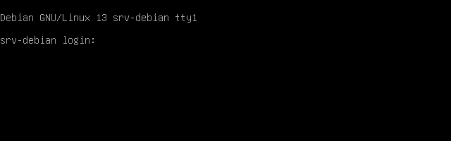{ loading=lazy }
/// caption
Le premier démarrage de `srv-debian` : l'invite de connexion indique la version 13 et le nom `srv-debian`.
///

2. 🖥️ Depuis un terminal du PC hôte (ou, sous Proxmox, depuis `srv-fichiers` si l'outil `ssh` y est présent), se connecter en SSH :

    ```bash
    ssh user@192.168.19.170
    ```

    Accepter l'empreinte de la machine (`yes`), saisir `Popopo333@@@`, puis vérifier le droit `sudo` :

    ```bash
    sudo whoami
    ```

!!! success "Résultat attendu"
    La commande `sudo whoami` renvoie `root`. L'invite SSH affiche `user@srv-debian`. Si `ssh` refuse la connexion (« Connection refused »), le paquet `openssh-server` n'est pas installé : l'installer avec `sudo apt install openssh-server`.

---

## 13. Vérification de fin de partie

Avec les quatre VM allumées (`pfsense-19`, `vbr`, `srv-fichiers`, `srv-debian`), dérouler la vérification.

| # | Test | Depuis | Commande ou action | Résultat attendu |
|---|---|---|---|---|
| 1 | Ping de la passerelle | 🪟 `srv-fichiers` | `ping 192.168.19.21` | Réponses |
| 2 | Ping de l'appliance | 🪟 `srv-fichiers` | `ping 192.168.19.55` | Réponses (le ping est ouvert sur l'appliance) |
| 3 | Ping du serveur de fichiers | 🐧 `srv-debian` | `ping -c 2 192.168.19.22` | Réponses (règle ICMP activée à l'étape 10.3) |
| 4 | Ping de Debian | 🪟 `srv-fichiers` | `ping 192.168.19.170` | Réponses |
| 5 | Interface web | 🌐 | `https://192.168.19.55` | Page de connexion, puis le tableau de bord |
| 6 | Licence | 🌐 | **Configuration > License Information** | Statut **Valid** |
| 7 | Host Management | 🌐 | `https://192.168.19.55:10443` | Connexion `veeamadmin` + code MFA |
| 8 | Security Officer | 🌐 | `veeamso` dans Host Management | **Configuration Backup** indique une phrase secrète créée |
| 9 | Console | 🪟 `srv-fichiers` | Console Veeam, serveur `192.168.19.55` | Écran **Home** |
| 10 | SSH | 🖥️ | `ssh user@192.168.19.170`, puis `sudo whoami` | `root` |
| 11 | Disque de données | 🪟 `srv-fichiers` | `Get-Volume -DriveLetter E` | `DONNEES`, `NTFS` |

!!! success "Résultat attendu"
    Les onze tests réussissent. Si l'un échoue, reprendre l'étape correspondante avant de continuer : la partie 4 suppose un lab sain.

!!! failure "Le ping vers `192.168.19.22` ne répond pas"
    Presque toujours, la règle ICMP n'est pas active sur Windows (profil réseau **Public** au lieu de **Privé**). Revenir à l'étape 10.3 : `Get-NetConnectionProfile` doit afficher `NetworkCategory : Private`, et `Get-NetFirewallRule -Name FPS-ICMP4-ERQ-In | Select Enabled` doit afficher `True`.

### 🛟 Instantané `01-lab-pret`

**Éteindre proprement** les trois VM `vbr`, `srv-fichiers` et `srv-debian` (et `pfsense-19`, de préférence, pour garder un lab cohérent), puis prendre sur **chacune** un instantané nommé **`01-lab-pret`**. Il permet de **recommencer les parties 4, 5 et 6** avec un lab propre.

=== "VMware Workstation"

    **VM > Snapshot > Take Snapshot…**, nom `01-lab-pret`, sur chaque VM éteinte.

=== "VirtualBox"

    Onglet **Instantanés** de la VM (menu **Machine > Outils > Instantanés**) puis **Prendre**, nom `01-lab-pret`, sur chaque VM éteinte.

=== "Proxmox VE"

    VM sélectionnée > **Snapshots > Take Snapshot**, nom `lab-pret-01`, l'équivalent de `01-lab-pret` : Proxmox exige qu'un nom d'instantané commence par une **lettre** et ne contienne ensuite que des lettres, des chiffres, `-` et `_` (40 caractères au plus). Le snapshot Proxmox dépend du stockage choisi : avec un stockage qui ne le gère pas (certains répertoires bruts), utiliser une **sauvegarde** de la VM à la place.

!!! warning "Un instantané n'est pas une sauvegarde"
    L'instantané reste **sur le même disque** que la VM : voir l'[encadré de la page d'accueil du parcours](index.md#instantanes-conseilles).

!!! note "Reprendre le travail"
    Rallumer ensuite `pfsense-19`, `vbr` et les autres machines pour continuer. La partie 4 demande `pfsense-19`, `vbr` et `srv-fichiers`.

---

## 14. Questions de révision

1. Quelle entrée du menu de démarrage de l'ISO est sélectionnée par défaut, et pourquoi faut-il la changer pour une première installation ?
2. Pourquoi le mot de passe `Popopo000@@@` est-il refusé par l'appliance ?
3. Pourquoi l'heure exacte de l'appliance est-elle indispensable à l'authentification multifacteur ?
4. Pourquoi préférer le QR code à la saisie manuelle de la clé secrète MFA ?
5. Que se passe-t-il si l'on n'installe pas de licence sur l'appliance ?
6. À quoi sert le compte Security Officer, et que se passe-t-il en partie 5 si sa phrase secrète n'a pas été créée ?
7. Pourquoi compare-t-on l'empreinte du certificat à celle de l'écran de l'appliance avant de se connecter avec la console ?
8. Pourquoi désactive-t-on Secure Boot sur `srv-debian` mais pas sur `vbr` ?

??? success "Corrigé"
    1. **Reinstall** : elle conserve les sauvegardes et ne fait que réinstaller le système. Pour une première installation, il faut **Install**, qui installe à neuf et efface les disques.
    2. Il contient **5 minuscules à la suite** (« opopo ») et fait moins de **15 caractères**, ce que la politique **DISA STIG** de l'appliance interdit. `PoPoPo000@@@Lab` respecte toutes les règles.
    3. Les codes **TOTP** sont calculés à partir d'un secret partagé **et de l'heure** (un code toutes les 30 secondes). Si l'horloge de l'appliance dérive, ses codes ne correspondent plus à ceux du téléphone : ils sont refusés. D'où le serveur **NTP** et le bon fuseau.
    4. Dans la police de la console, la lettre **O** ressemble à un **D** : une clé recopiée à la main peut être fausse, et les codes calculés ensuite aussi. Le QR code transmet la clé exacte.
    5. L'appliance fonctionne en **Community Edition** : elle ne permet **que la restauration** de données existantes, **aucune nouvelle sauvegarde**.
    6. Le **Security Officer** approuve les actions sensibles de l'administrateur (principe des quatre yeux). Sans sa **phrase secrète de sauvegarde de configuration**, la sauvegarde de configuration chiffrée échoue avec « Unable to process the configuration backup without the Security Officer's passphrase… ».
    7. Le certificat est **auto-signé**, donc non vérifiable automatiquement. Un attaquant placé entre les deux machines présenterait un autre certificat, donc une autre **empreinte** : la comparaison garantit qu'on se connecte bien à `vbr`.
    8. Sur `vbr`, le système est celui de Veeam, signé et accepté avec Secure Boot. Sur `srv-debian`, l'agent Veeam installe un **module noyau** que Secure Boot refuserait ou obligerait à signer (clé *MOK*) : le désactiver évite ce détour en partie 6.

---

## Ressources

- [Exigences système du serveur de sauvegarde Veeam Backup & Replication 13](https://helpcenter.veeam.com/docs/vbr/userguide/system_requirements_backup_server.html?ver=13) — matériel de l'appliance (section « Linux-Based Backup Server (Veeam Software Appliance) »).
- [Installer la Veeam Software Appliance depuis l'ISO](https://helpcenter.veeam.com/docs/vbr/userguide/deployment_linux_iso_install.html) — le déroulé de l'assistant de configuration initiale.
- [Configurer le compte Security Officer à l'installation](https://helpcenter.veeam.com/docs/vbr/userguide/deployment_linux_iso_install_security_officer.html) — l'étape **Security Officer** de l'assistant.
- [Veeam Host Management](https://helpcenter.veeam.com/docs/vbr/userguide/hmc_about.html) — le rôle de la console d'administration du système.
- [Installer la console Veeam](https://helpcenter.veeam.com/docs/vbr/userguide/deploy_console.html) — installation de la console Windows.
- [Téléchargements Veeam](https://www.veeam.com/products/downloads.html) — ISO de l'appliance et licence d'essai (compte gratuit).
- [Parcours : cluster de pare-feux pfSense en haute disponibilité](../pfsense-ha/index.md) — le réseau du lab.
- Partie précédente : [Découvrir Veeam Data Platform](02-decouvrir-veeam-data-platform.md) · Partie suivante : [Ajouter des dépôts de sauvegarde](04-ajouter-des-depots-de-sauvegarde.md).
