<!-- ============================================================ -->
<!-- ⚠️ RAPPEL IMPORTANT :                                          -->
<!-- Pensez TOUJOURS à ajouter une entrée dans le fichier d'index  -->
<!-- (index.md) du dossier correspondant (ex: docs/cloud/index.md) -->
<!-- afin de référencer ce nouvel article et permettre aux         -->
<!-- visiteurs de le trouver et de cliquer dessus !                -->
<!-- ============================================================ -->

# Ajouter des dépôts de sauvegarde

!!! abstract "Résumé"
    Un **dépôt de sauvegarde** (*backup repository*) est l'endroit où Veeam range les fichiers de sauvegarde. Ce TP présente les différents types de dépôts, puis en met deux en place :

    1. le **dépôt par défaut** que l'appliance Veeam crée toute seule : un dépôt Linux **durci et immuable** (7 jours), à découvrir ;
    2. un **second dépôt**, `Depot-2-srv-fichiers`, sur un nouveau disque `F:` du serveur Windows `srv-fichiers`, formaté en **ReFS avec des clusters de 64 Ko** pour profiter du *fast clone*.

    Pour y parvenir, le serveur Windows est d'abord installé comme **serveur géré** grâce au **kit de déploiement Veeam** et à l'**authentification par certificat**. Le TP explique aussi, captures à l'appui, pourquoi un dépôt sur partage SMB ne fonctionne pas avec l'appliance dans un lab sans domaine Active Directory.

| Propriété | Valeur |
|-----------|--------|
| Difficulté | Intermédiaire |
| Durée estimée | 1 h 30 (la lecture de la section 3, facultative, ajoute 10 min) |
| Version décrite | Veeam Backup & Replication 13.1.2.57 (appliance Linux), Windows Server 2025 |
| Place dans le parcours | Partie 4 sur 7 du parcours [Veeam Backup & Replication](index.md) |
| Dernière mise à jour | 2026-11-02 |

<!-- NOTE DE RÉDACTION (non affichée) : Ce qui a changé par rapport à la version 1.5 du support (juin 2024)
- Le support décrivait VBR **12 sur Windows** : le premier dépôt était un **volume en miroir (RAID 1) de deux disques NVMe**, formaté en ReFS 64 Ko sur le serveur Windows qui portait aussi Veeam. Avec l'**appliance Linux 13.1**, ce premier dépôt existe déjà : l'appliance crée un **dépôt durci et immuable** sur son second disque (XFS). La section 2 de ce TP le découvre au lieu de le créer.
- Le support créait le dépôt n° 2 sur un **partage SMB** d'un serveur de fichiers. Sur l'appliance (système durci, mode FIPS) installée en **groupe de travail**, cela échoue, comme le montrent les captures de la section 3. Le dépôt n° 2 devient donc un **dépôt Windows** (*direct attached storage*) sur un disque `F:` dédié, après installation du **kit de déploiement Veeam** sur le serveur Windows.
- Les captures du support venaient de la **console Windows**. Les assistants sont ici ceux de l'**interface web** (Web UI) de la 13.1. L'interface web exige que le serveur Windows soit **déjà déclaré** dans **Managed Servers** avant de pouvoir y créer un dépôt.
- La section 5.3 du support (dépôt sur le stockage objet Azure) est traitée dans la [partie 7](07-sauvegarder-vers-azure-blob.md) et n'est pas reprise ici.
- Le TP signale un piège de l'interface web : après **Finish**, le dépôt est créé en arrière-plan sans que la liste se rafraîchisse, et relancer l'assistant crée un **doublon**.
-->

!!! info "Convention de lecture"
    Chaque action précise la machine sur laquelle elle se fait :

    | Repère | Machine |
    |--------|---------|
    | 🖥️ | PC hôte (hyperviseur) |
    | 🌐 | Navigateur web connecté à l'interface web de l'appliance : `https://192.168.19.55/` |
    | 🪟 | `srv-fichiers` (Windows Server 2025, `192.168.19.22`) |
    | 📦 | Console de l'appliance `vbr` (écran de la VM) : **inutile dans ce TP** |
    | 🐧 | `srv-debian` : **inutile dans ce TP** |

    Les menus et les boutons sont écrits **en anglais**, comme ils s'affichent dans Veeam, et traduits quand c'est utile.

---

## Objectifs

- Distinguer les types de dépôts de sauvegarde et savoir à quoi servent la passerelle et le serveur de montage.
- Expliquer pourquoi une deuxième copie des sauvegardes doit se trouver sur une autre machine.
- Lire les propriétés du dépôt par défaut de l'appliance et comprendre son immuabilité.
- Comprendre pourquoi un partage SMB par adresse IP échoue sur l'appliance en groupe de travail.
- Ajouter un disque à une VM Windows et le formater en ReFS avec des clusters de 64 Ko.
- Installer le kit de déploiement Veeam et déclarer un serveur Windows en **serveur géré** avec un certificat.
- Créer un dépôt Windows et éviter le doublon de l'assistant.

## Prérequis

- Les parties [1](01-comprendre-la-sauvegarde.md) à [3](03-preparer-le-lab-installer-appliance.md) terminées : l'appliance `vbr` est installée, la licence d'évaluation est en place, et vous disposez des comptes décrits dans [Comptes et mots de passe](index.md#comptes-et-mots-de-passe).
- **Instantané de départ** : `01-lab-pret` (fin de la partie 3). En cas d'erreur, revenir à cet instantané permet de refaire cette partie proprement (voir [Instantanés conseillés](index.md#instantanes-conseilles)).
- État attendu des machines :

| Machine | État | Détail |
|---------|------|--------|
| `pfsense-19` | Allumée | Passerelle et DNS du LAN `192.168.19.0/24` |
| `vbr` | Allumée | `192.168.19.55`, interface web accessible, connexion `veeamadmin` avec MFA |
| `srv-fichiers` | Allumée au début, **éteinte** pour ajouter un disque (section 4), puis rallumée | `192.168.19.22`, compte `Administrateur` (mot de passe `Popopo222@@@`), Microsoft Edge disponible |
| `srv-debian` | Indifférente | Pas utilisée dans ce TP |

---

## 1. Comprendre les dépôts de sauvegarde

### 1.1 Qu'est-ce qu'un dépôt ?

Un **dépôt** (*backup repository*) est un emplacement de stockage où Veeam écrit les fichiers de sauvegarde (`.vbk`, `.vib`, `.vbm`, voir la [partie 2](02-decouvrir-veeam-data-platform.md#47-le-depot-de-sauvegarde-backup-repository)). Un job de sauvegarde ne s'écrit jamais « dans le vide » : on lui désigne toujours un dépôt. Veeam surveille son état (en ligne ou non), son espace libre, et le nombre de tâches qui y écrivent en même temps.

### 1.2 Les types de dépôts

L'assistant de la console Windows regroupe les dépôts en familles. On y retrouve celles de l'interface web.

| Type | Principe | Remarque |
|------|----------|----------|
| **Stockage à disque local** (*direct attached storage*) | Un dossier sur un disque d'un serveur **Windows** ou **Linux** qui est un serveur géré par Veeam. Le *Data Mover* (le composant qui déplace les données, voir la [partie 2](02-decouvrir-veeam-data-platform.md#43-le-veeam-data-mover-demenageur-de-donnees)) s'exécute **sur ce serveur** : c'est le cas le plus rapide. | Dépôt n° 2 de ce TP (Windows). |
| **Dépôt durci** (*hardened repository*) | Un serveur **Linux** dont le système de fichiers verrouille les sauvegardes contre la modification et la suppression pendant une durée donnée (**immuabilité**). | Le dépôt par défaut de l'appliance en est un. |
| **Partage réseau** (*network attached storage*) | Un partage **SMB** (Windows) ou **NFS** (Linux, NAS). Le stockage ne peut pas exécuter de Data Mover : une **passerelle** le fait à sa place. | Disponible dans la console Windows. Voir la [section 3](#3-pourquoi-un-partage-smb-ne-convient-pas-ici) de ce TP. |
| **Appliance de déduplication** | Dell Data Domain, HPE StoreOnce, etc. | Hors parcours. |
| **Stockage objet** | Amazon S3, Azure Blob, etc. | Voir la [partie 7](07-sauvegarder-vers-azure-blob.md). |
| **Veeam Data Cloud Vault** | Stockage cloud proposé par Veeam. | Hors parcours. |

<figure markdown="span">
  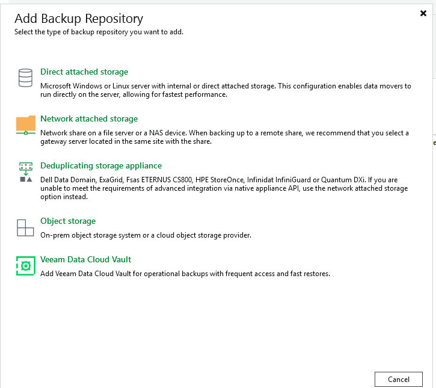{ loading=lazy }
  <figcaption>La console Windows propose cinq familles de dépôts. L'interface web, utilisée dans ce TP, n'affiche que les dépôts Windows, Linux et durci (voir 2.1).</figcaption>
</figure>

### 1.3 La passerelle et le serveur de montage

Deux autres rôles interviennent autour d'un dépôt. Ils sont décrits dans la [partie 2](02-decouvrir-veeam-data-platform.md#45-le-serveur-passerelle-gateway-server) ; voici ce qu'il faut en retenir ici.

- Le **serveur passerelle** (*gateway server*) sert de relais pour les stockages qui ne peuvent pas exécuter de Data Mover (partages SMB et NFS, stockage objet). Il doit être **proche** du stockage.
- Le **serveur de montage** (*mount server*) monte le contenu d'une sauvegarde pour restaurer un fichier ou un élément d'application sans tout restaurer. L'assistant de création d'un dépôt vous demande d'en choisir un, un pour Windows et un pour Linux (section [7](#7-creer-le-depot-n-2-depot-2-srv-fichiers)).

### 1.4 Pourquoi un second dépôt, sur une autre machine ?

La règle [3-2-1](01-comprendre-la-sauvegarde.md#31-la-regle-3-2-1) demande **plusieurs copies**, sur **plusieurs supports**. Un seul dépôt, c'est un seul point de défaillance : si la machine qui l'héberge tombe en panne, brûle ou est chiffrée par un rançongiciel, toutes les sauvegardes disparaissent avec elle. Un second dépôt sur **une autre machine** réduit ce risque. Une seconde copie (job de copie de sauvegarde) y sera envoyée, ou on y enverra directement certaines sauvegardes.

!!! warning "Dans le lab, c'est un compromis"
    Le dépôt n° 2 vit sur `srv-fichiers`, **qui est aussi la machine à protéger** dans la [partie 5](05-sauvegarder-configuration-et-serveur-de-fichiers.md). Les VM du lab partagent de plus le même PC hôte. C'est suffisant pour apprendre les assistants, mais **en production, on placerait ce dépôt sur une machine distincte** de celles qu'il protège, idéalement dans un autre bâtiment. Les parties suivantes précisent quel dépôt chaque job utilise.

---

## 2. Découvrir le dépôt par défaut de l'appliance (dépôt n° 1)

### 2.1 Ouvrir la liste des dépôts

1. 🌐 Ouvrir l'interface web `https://192.168.19.55/` et se connecter avec `veeamadmin`, le mot de passe `PoPoPo000@@@Lab` et le code MFA.
2. Dans le menu de gauche, ouvrir **Infrastructure > Repositories**. L'onglet **Backup Repositories** est sélectionné.

<figure markdown="span">
  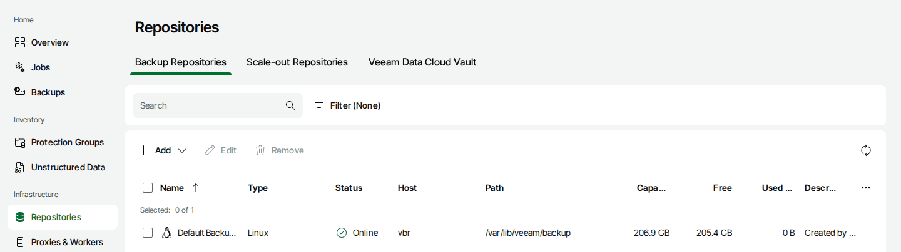{ loading=lazy }
  <figcaption>Avant tout ajout : un seul dépôt, créé par l'appliance. Type Linux, hôte vbr, chemin /var/lib/veeam/backup, 206,9 Go.</figcaption>
</figure>

L'appliance a créé **toute seule** ce dépôt, `Default Backup Repository`, sur son **second disque** de 240 Go. Sa description indique « Created by Veeam Backup ». Avec l'appliance, ce premier dépôt n'est donc pas à créer : il suffit de le découvrir.

!!! info "Pourquoi 206,9 Go et pas 240 Go ?"
    L'appliance partitionne ses disques elle-même, selon un schéma prédéfini. Le second disque ne sert pas qu'au dépôt : il accueille aussi, par exemple, le catalogue des fichiers invités. Le dépôt n'en reçoit donc qu'une partie. La valeur exacte dépend de la taille du disque ; avec un second disque de 240 Go, la capacité affichée est de 206,9 Go.

3. Cliquer sur **Add** pour voir les types de dépôts que l'interface web sait créer.

<figure markdown="span">
  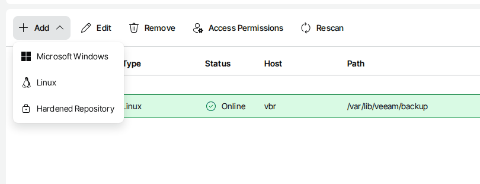{ loading=lazy width="560" }
  <figcaption>Le menu Add de l'interface web 13.1.2 : Microsoft Windows, Linux et Hardened Repository.</figcaption>
</figure>

!!! note "Et le SMB, le NFS, le stockage objet ?"
    Dans ce menu de l'interface web 13.1.2, **aucune entrée SMB ou NFS** n'apparaît : seuls les dépôts Windows, Linux et durcis sont proposés. Les partages réseau se créent dans la **console Windows** (entrée « Network attached storage » de la figure du 1.2). La documentation officielle indique les types disponibles pour chaque interface : une version ultérieure peut ajouter des entrées.

4. Appuyer sur ++escape++ pour fermer le menu.

### 2.2 Lire les propriétés du dépôt

1. Cocher la ligne **Default Backup Repository** puis cliquer sur **Edit**.
2. Cliquer deux fois sur **Next** pour arriver à l'étape **Repository**.

<figure markdown="span">
  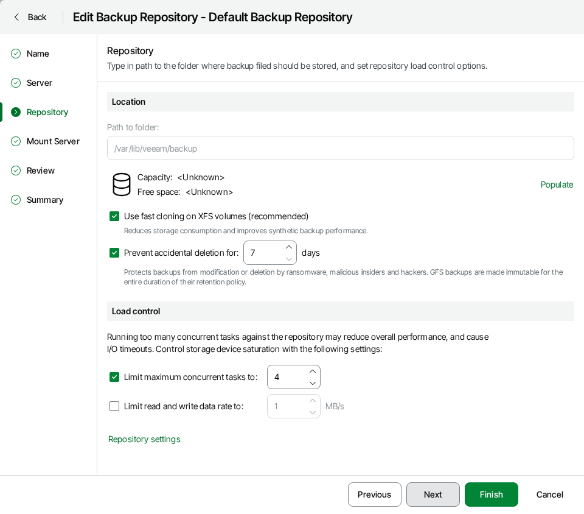{ loading=lazy }
  <figcaption>Les deux cases qui comptent : Use fast cloning on XFS volumes (clonage de blocs) et Prevent accidental deletion for 7 days (immuabilité de 7 jours).</figcaption>
</figure>

3. Lire les réglages **sans rien modifier**, puis fermer l'assistant avec **Cancel** (et confirmer l'abandon si Veeam le demande). **Ne pas cliquer sur Finish** : rien n'est à changer ici.

Chaque réglage se comprend ainsi :

| Réglage | Valeur | Signification |
|---------|--------|---------------|
| **Path to folder** | `/var/lib/veeam/backup` | Le dossier de l'appliance où les sauvegardes sont écrites, sur le second disque. Il est grisé : on ne le change pas. |
| **Use fast cloning on XFS volumes** | Coché | Active le **clonage de blocs** sur XFS (voir 4.2) : les sauvegardes complètes synthétiques se créent en quelques secondes et n'occupent presque pas de place en plus. |
| **Prevent accidental deletion for** | Coché, **7 jours** | **Immuabilité** : pendant 7 jours, les fichiers de sauvegarde ne peuvent **ni être modifiés ni être supprimés**, même par un administrateur de Veeam. |
| **Limit maximum concurrent tasks to** | 4 | Nombre maximal de tâches qui écrivent ou lisent en même temps dans ce dépôt. Trop de tâches simultanées saturent le disque. |

!!! question "Pourquoi 7 jours d'immuabilité ?"
    Un rançongiciel qui prend le contrôle du serveur de sauvegarde essaie d'abord de détruire les sauvegardes. Avec l'immuabilité, même avec un compte administrateur volé, les fichiers récents restent intacts pendant la durée choisie. Le principe est expliqué dans le cours : [sauvegarde immuable](01-comprendre-la-sauvegarde.md#45-sauvegarde-immuable). Ce dépôt est un **dépôt durci** (*hardened repository*), c'est-à-dire configuré pour ce rôle par l'appliance : le système est verrouillé (pas de `root` utilisable, SSH désactivé par défaut) et les fichiers sont protégés au niveau du système de fichiers.

!!! info "Et le RAID ?"
    Sur un serveur Windows qui porte Veeam, on protège souvent le dépôt avec un **miroir RAID 1** de deux disques : si un disque tombe en panne, l'autre contient toujours les données (voir [Qu'est-ce que le RAID ?](01-comprendre-la-sauvegarde.md#14-quest-ce-que-le-raid)). Le RAID protège contre la **panne d'un disque**, pas contre une suppression, un rançongiciel ou un incendie : ce n'est pas une sauvegarde.

    Avec l'appliance, la redondance des disques se règle **sous l'appliance** : en production, par une **carte RAID** du serveur ou par le **stockage** qui héberge les disques virtuels. Dans le lab, le second disque de `vbr` est un **seul disque virtuel** de 240 Go : aucune redondance, ce qui est acceptable pour un lab.

---

## 3. Pourquoi un partage SMB ne convient pas ici

!!! note "Cette section se lit, elle ne se refait pas"
    L'idée la plus simple serait de créer le dépôt n° 2 sur un **partage SMB** de `srv-fichiers`. Avec l'appliance, cette piste **échoue**. Les captures ci-dessous montrent les messages d'erreur : les connaître évite de perdre du temps si vous tentez la même chose. **Il n'y a rien à faire dans cette section** ; passer directement à la [section 4](#4-ajouter-le-disque-f-a-srv-fichiers-et-le-formater-en-refs-64-ko) pour la procédure retenue.

### 3.1 L'essai dans la console Windows

Dans la console Windows de l'appliance, lancée sur `srv-fichiers`, on suit le chemin classique : **Backup Infrastructure > Backup Repositories > Add Repository > Network attached storage > SMB share**. Le partage `\\192.168.19.22\RepoVeeam` (un dossier de `srv-fichiers`) est désigné avec le compte local `SRV-FICHIERS\Administrateur`.

<figure markdown="span">
  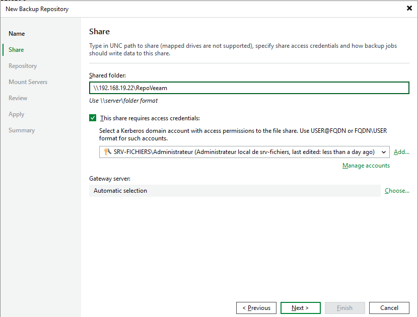{ loading=lazy }
  <figcaption>Étape Share : chemin UNC par adresse IP, compte local de srv-fichiers, passerelle en sélection automatique.</figcaption>
</figure>

Au clic sur **Next**, Veeam teste l'accès et refuse :

<figure markdown="span">
  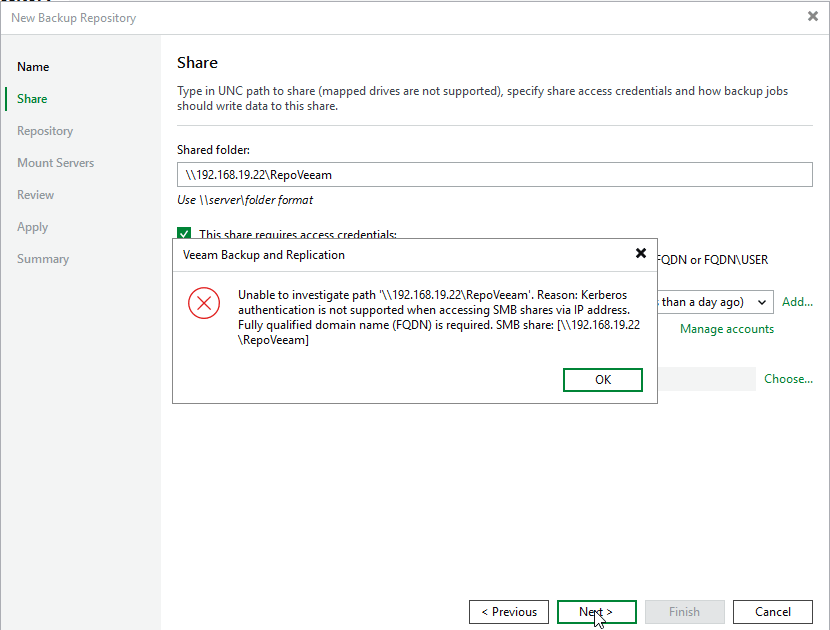{ loading=lazy }
  <figcaption>L'erreur de la console : l'accès à un partage SMB par adresse IP n'est pas possible, un nom complet (FQDN) est exigé.</figcaption>
</figure>

!!! failure "Message d'erreur"
    Unable to investigate path '\\192.168.19.22\RepoVeeam'. Reason: Kerberos authentication is not supported when accessing SMB shares via IP address. Fully qualified domain name (FQDN) is required. SMB share: [\\192.168.19.22\RepoVeeam]

### 3.2 L'essai avec un compte local dans l'interface web

Autre piste : déclarer `srv-fichiers` comme serveur géré avec son **compte local**, c'est-à-dire un identifiant et un mot de passe (l'option **Connect using admin credentials** de l'assistant décrit en [section 6](#6-declarer-srv-fichiers-comme-serveur-gere)), ici `SRV-FICHIERS\Administrateur` et le mot de passe `Popopo222@@@`.

<figure markdown="span">
  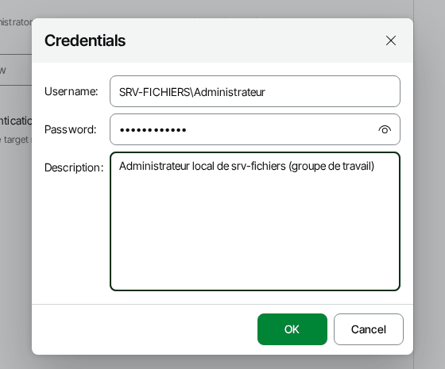{ loading=lazy width="460" }
  <figcaption>Saisie d'un compte local : SRV-FICHIERS\Administrateur.</figcaption>
</figure>

Au clic sur **Next**, l'appliance tente d'ouvrir une session sur `srv-fichiers` et échoue :

<figure markdown="span">
  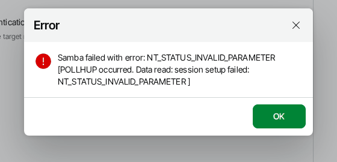{ loading=lazy width="460" }
  <figcaption>L'appliance n'arrive pas à ouvrir de session avec un compte local.</figcaption>
</figure>

!!! failure "Message d'erreur"
    Samba failed with error: NT_STATUS_INVALID_PARAMETER [POLLHUP occurred. Data read: session setup failed: NT_STATUS_INVALID_PARAMETER]

### 3.3 Comprendre l'échec

Ces deux erreurs ont la même origine : l'appliance est un système **durci, en mode FIPS**, et `srv-fichiers` est en **groupe de travail** (aucun domaine Active Directory).

- Pour atteindre un partage Windows **par adresse IP**, l'appliance ne peut pas utiliser **Kerberos**, qui exige des **noms** (FQDN) et un domaine. C'est ce que dit le premier message.
- Avec un compte **local**, il ne resterait que le protocole **NTLM**, que l'appliance n'utilise pas. Veeam a abandonné NTLM dans l'appliance de la version 13 : elle fonctionne selon les exigences **FIPS** (normes de cryptographie du gouvernement américain), et la documentation de Veeam précise qu'en mode FIPS, « NTLM est désactivé » et que **Kerberos est le seul protocole d'authentification de domaine**. L'ouverture de session échoue donc, avec l'erreur `NT_STATUS_INVALID_PARAMETER`.

!!! tip "En entreprise"
    Un **domaine Active Directory** résout le problème : les machines ont des noms complets, Kerberos fonctionne, et l'appliance peut s'authentifier avec un compte de domaine. Ce lab reste volontairement en groupe de travail, pour rester simple.

La solution retenue ici évite complètement les mots de passe Windows : **l'authentification par certificat**, grâce au kit de déploiement (sections 5 et 6). Le dépôt n° 2 devient un dépôt **Windows** : le Data Mover s'exécute sur `srv-fichiers` lui-même, sans passerelle ni partage SMB.

---

## 4. Ajouter le disque `F:` à `srv-fichiers` et le formater en ReFS 64 Ko

### 4.1 Pourquoi un disque dédié ?

Le dépôt n° 2 a besoin d'un **volume à lui**, séparé du disque système `C:` et du disque de données `E:` (qui contient les fichiers à protéger). Une sauvegarde qui partage le disque de ce qu'elle protège ne protège de rien : si le disque tombe, les deux disparaissent. Le lab ajoute donc un **disque virtuel de 40 Go**, que Windows verra comme `F:` (la lettre `D:` est déjà prise par le lecteur de DVD).

### 4.2 Pourquoi ReFS avec des clusters de 64 Ko ?

**ReFS** (*Resilient File System*) est le système de fichiers moderne de Microsoft. Pour Veeam, il présente un grand avantage : le **clonage de blocs** (*block cloning*, *fast clone* côté Veeam).

!!! question "Qu'est-ce que le clonage de blocs ?"
    Une sauvegarde complète synthétique est faite à partir de blocs déjà écrits dans les sauvegardes précédentes. Sur NTFS, Veeam doit **recopier** ces blocs (long, et gourmand en disque). Sur ReFS, il **crée un renvoi** vers les blocs existants : comme noter dans un cahier « voir la page 12 » au lieu de recopier la page. La complète synthétique se fabrique en quelques secondes et n'occupe presque pas de place en plus. Le principe est le même que le *fast clone* du dépôt XFS de l'appliance (2.2).

La **taille de cluster** (la plus petite unité d'allocation du système de fichiers) recommandée par Veeam est de **64 Ko**. Veeam avertit d'ailleurs lors de la création du dépôt si le volume n'est pas en ReFS (voir 7.2). Les conditions du clonage de blocs sont détaillées dans la documentation sur le [Fast Clone](https://helpcenter.veeam.com/docs/vbr/userguide/backup_repository_block_cloning.html).

### 4.3 Ajouter le disque virtuel à la VM

L'ajout d'un disque se fait de préférence **VM éteinte**. 🪟 Éteindre `srv-fichiers` proprement (menu **Démarrer > Alimentation > Arrêter**), puis 🖥️ ajouter le disque dans l'hyperviseur.

Les libellés peuvent varier légèrement selon la version de l'hyperviseur.

=== "VMware Workstation"

    1. Sélectionner `srv-fichiers`, puis **VM > Settings…**.
    2. Dans l'onglet **Hardware**, cliquer sur **Add…**, choisir **Hard Disk**, puis **Next**.
    3. Garder le type recommandé (**SCSI**), puis **Next**, **Create a new virtual disk**, **Next**.
    4. Saisir **Maximum disk size** `40` Go. Laisser **Allocate all disk space now** décoché (disque dynamique, comme les autres disques du lab), puis **Next**.
    5. Valider le nom du fichier avec **Finish**, puis **OK**.

=== "VirtualBox"

    1. Sélectionner `srv-fichiers`, puis **Configuration > Stockage**.
    2. Sous le contrôleur qui porte déjà les disques de la VM (par exemple **SATA**), cliquer sur l'icône **Ajoute un disque dur**.
    3. Cliquer sur **Créer**, choisir le format **VDI**, **Dynamiquement alloué**, et une taille de **40 Go**.
    4. Valider avec **Créer**, puis **Choisir** et **OK**.

=== "Proxmox VE"

    1. Sélectionner la VM `srv-fichiers`, puis ouvrir l'onglet **Hardware**.
    2. Cliquer sur **Add > Hard Disk**.
    3. Choisir le même **Bus/Device** que le disque système de la VM (le système sait déjà piloter ce type de bus), un **Storage**, et saisir **Disk size (GiB)** `40`.
    4. Cliquer sur **Add**.

=== "KVM/libvirt"

    Sur le PC hôte, créer le disque dynamique `qcow2` de 40 Go, puis l'attacher à la VM éteinte (adapter le nom du pool, de la VM et le chemin à votre installation) :

    ```bash
    virsh -c qemu:///system vol-create-as lab-veeam veeam-srv-fichiers-2.qcow2 40G --format qcow2 --prealloc-metadata
    virsh -c qemu:///system attach-disk veeam-srv-fichiers \
      /home/user/VMs/lab-veeam/disks/veeam-srv-fichiers-2.qcow2 sdd \
      --subdriver qcow2 --targetbus sata --config
    ```

    `--config` rend l'ajout permanent (pris en compte au prochain démarrage).

Rallumer ensuite `srv-fichiers` et ouvrir une session avec `Administrateur` (mot de passe `Popopo222@@@`).

### 4.4 Initialiser le disque et le formater en ReFS 64 Ko

🪟 Sur `srv-fichiers`, ouvrir **PowerShell en tant qu'administrateur** (clic droit sur **Démarrer > Terminal (administrateur)**), puis exécuter :

```powershell title="PowerShell (administrateur) : initialiser et formater le disque F:"
$d = Get-Disk | Where-Object PartitionStyle -eq 'RAW' | Select-Object -First 1
Initialize-Disk -Number $d.Number -PartitionStyle GPT
New-Partition -DiskNumber $d.Number -UseMaximumSize -DriveLetter F |
  Format-Volume -FileSystem ReFS -AllocationUnitSize 65536 -NewFileSystemLabel 'SAUVEGARDES' -Confirm:$false
New-Item -ItemType Directory -Force -Path 'F:\RepoVeeam'
```

!!! question "Que fait chaque ligne ?"
    - `Get-Disk | Where-Object PartitionStyle -eq 'RAW'` cherche le disque **vierge** (style de partition `RAW`) : c'est le disque ajouté. Les autres disques sont déjà initialisés, donc ils ne sont pas touchés.
    - `Initialize-Disk … -PartitionStyle GPT` prépare le disque (table de partitions moderne, adaptée aux grands disques).
    - `New-Partition … -DriveLetter F` crée une partition qui occupe tout le disque et lui donne la lettre `F:`.
    - `Format-Volume -FileSystem ReFS -AllocationUnitSize 65536` formate en **ReFS** avec des clusters de **64 Ko** (65 536 octets). L'étiquette du volume sera `SAUVEGARDES`.
    - `New-Item … F:\RepoVeeam` crée le dossier qui recevra les sauvegardes : on ne range jamais un dépôt à la **racine** d'un volume.

!!! tip "Variante graphique"
    Dans la **Gestion des disques** (`diskmgmt.msc`), on peut obtenir le même résultat : initialiser le disque en **GPT**, créer un **nouveau volume simple**, lui attribuer la lettre `F:`, puis choisir **ReFS**, une **taille d'unité d'allocation** de **64 Ko** et le nom `SAUVEGARDES`. La commande PowerShell reste plus rapide et évite les erreurs de saisie.

Vérifier le résultat :

```powershell title="PowerShell : vérifier les volumes"
Get-Volume | Where-Object DriveLetter | Format-Table DriveLetter,FileSystemLabel,FileSystem,AllocationUnitSize,Size -AutoSize
```

!!! success "Résultat attendu"
    ```text
    DriveLetter FileSystemLabel FileSystem AllocationUnitSize        Size
    ----------- --------------- ---------- ------------------        ----
              E DONNEES         NTFS                     4096 42931843072
              C Windows         NTFS                     4096 63368589312
              F SAUVEGARDES     ReFS                    65536 42882564096
    ```
    Le volume `F:` est en **ReFS** avec des clusters de **65 536 octets**. Les tailles varient légèrement d'un hyperviseur à l'autre ; la ligne de `D:` (lecteur de DVD, sans système de fichiers) ne s'affiche pas toujours.

---

## 5. Installer le kit de déploiement Veeam sur `srv-fichiers`

### 5.1 À quoi sert le kit ?

Pour envoyer des données à `srv-fichiers`, l'appliance doit y installer des composants (Data Mover, etc.) et s'y **authentifier**. Sans domaine Active Directory, un mot de passe local ne fonctionne pas (section 3). Le **kit de déploiement Veeam** (*Veeam Deployment Kit*) règle ce problème : c'est un paquet, **généré par l'appliance**, qui installe sur le serveur cible un petit service Veeam et des **certificats**. L'appliance et le serveur se reconnaissent ensuite grâce à ces certificats, au lieu d'un nom et d'un mot de passe ([documentation officielle](https://helpcenter.veeam.com/docs/vbr/userguide/deployment_kit.html)).

!!! info "Pourquoi par certificat plutôt que par mot de passe ?"
    Un certificat remplace le couple identifiant / mot de passe par une paire de clés cryptographiques. L'appliance ne connaît plus aucun mot de passe Windows, et le serveur n'accepte que les connexions de celui qui possède le certificat attendu. Cela fonctionne en groupe de travail et ne dépend ni de NTLM ni de Kerberos.

### 5.2 Télécharger le kit depuis l'interface web

Le kit se télécharge **avec le navigateur de `srv-fichiers`**, pour qu'il arrive directement sur la bonne machine.

1. 🪟 Sur `srv-fichiers`, ouvrir **Microsoft Edge** et aller sur `https://192.168.19.55/`. Si Edge signale un certificat non approuvé (certificat auto-signé de l'appliance), accepter de continuer.
2. 🪟🌐 Se connecter avec `veeamadmin`, le mot de passe `PoPoPo000@@@Lab` et le code MFA.
3. Ouvrir **Infrastructure > Managed Servers**, puis cliquer sur **Create Veeam Deployment Kit**.

<figure markdown="span">
  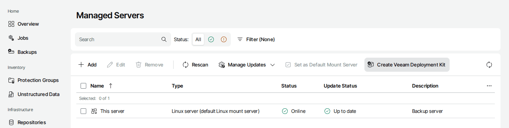{ loading=lazy }
  <figcaption>Managed Servers : seul le serveur de sauvegarde est présent. Le bouton Create Veeam Deployment Kit génère le kit.</figcaption>
</figure>

4. Edge télécharge un fichier nommé `veeam-deployment-kit-<identifiant>.zip` (environ **21 Mo**) dans le dossier **Téléchargements**. Attendre la fin du téléchargement.

!!! warning "Le lien de téléchargement est à usage unique"
    Le kit est généré à la demande, et son lien ne sert **qu'une fois** : un second téléchargement avec le même lien renvoie une erreur « 404 Not Found ». Si le fichier n'arrive pas ou est perdu, cliquer de nouveau sur **Create Veeam Deployment Kit** pour en générer un nouveau.

!!! danger "Le kit contient des clés"
    Le zip contient des certificats **et la clé privée** du serveur. Une fois le kit installé (5.3), **supprimer le zip et le dossier extrait**, et ne jamais le partager.

### 5.3 Extraire et installer le kit

Le zip contient sept fichiers :

| Fichier | Rôle |
|---------|------|
| `client-cert.pem` | Certificat que l'appliance présentera au serveur |
| `server-cert.pem`, `server-key.pem` | Certificat et clé privée du serveur |
| `VeeamInstallerSvc.msi` | Service d'installation Veeam (le service `VeeamDeploySvc`) |
| `OpenSSL_FIPS_Redistributable_3.1.2_x64.msi` | Bibliothèque de chiffrement conforme FIPS |
| `InstallDeploymentKit.bat` | Script qui installe le tout |
| `ReadMe.txt` | Instructions d'installation manuelle |

1. 🪟 Ouvrir **PowerShell en tant qu'administrateur** et extraire le zip :

    ```powershell title="PowerShell (administrateur) : extraire le kit"
    $zip = (Get-ChildItem "$env:USERPROFILE\Downloads\veeam-deployment-kit-*.zip").FullName
    Expand-Archive -Path $zip -DestinationPath C:\veeam-deployment-kit -Force
    ```

2. Lancer le script d'installation :

    ```powershell title="PowerShell (administrateur) : installer le kit"
    cd C:\veeam-deployment-kit
    cmd /c InstallDeploymentKit.bat
    ```

Le script termine avec ces lignes :

```text
Installing Veeam Installer service
Importing certificates
Server certificate installed successfully
Client certificate installed successfully
Restarting Veeam Installer service
```

!!! note "Un message en français à ignorer"
    Au début, le script peut afficher « Removing existing Veeam Installer service » suivi d'un message de Windows Installer en français (« Cette action est valide uniquement pour les produits déjà installés »). Il signifie seulement qu'il n'y avait **rien à désinstaller** : c'est normal lors d'une première installation.

3. Vérifier que le service tourne et que le pare-feu a été configuré :

    ```powershell title="PowerShell : vérifier le service du kit"
    Get-Service VeeamDeploySvc | Format-Table Name,Status,StartType -AutoSize
    Get-NetFirewallRule | Where-Object DisplayName -match 'Veeam' | Format-Table DisplayName,Enabled,Direction -AutoSize
    ```

!!! success "Résultat attendu"
    Le service `VeeamDeploySvc` est en **Running** et des règles de pare-feu dont le nom contient « Veeam » sont **activées**. Le kit est installé.

4. Supprimer maintenant le zip et le dossier (voir l'encadré ci-dessus) :

    ```powershell title="PowerShell (administrateur) : nettoyer"
    cd $env:USERPROFILE   # sortir du dossier avant de le supprimer
    Remove-Item C:\veeam-deployment-kit -Recurse -Force
    Remove-Item $zip -Force
    ```

---

## 6. Déclarer `srv-fichiers` comme serveur géré

Un **serveur géré** (*managed server*) est une machine que Veeam connaît, administre et peut utiliser (comme dépôt, proxy, serveur de montage…). L'interface web exige de déclarer d'abord la machine ici avant de pouvoir créer un dépôt dessus.

1. 🌐 Dans l'interface web, ouvrir **Infrastructure > Managed Servers**, puis cliquer sur **Add**.
2. Choisir **Microsoft Windows**.

<figure markdown="span">
  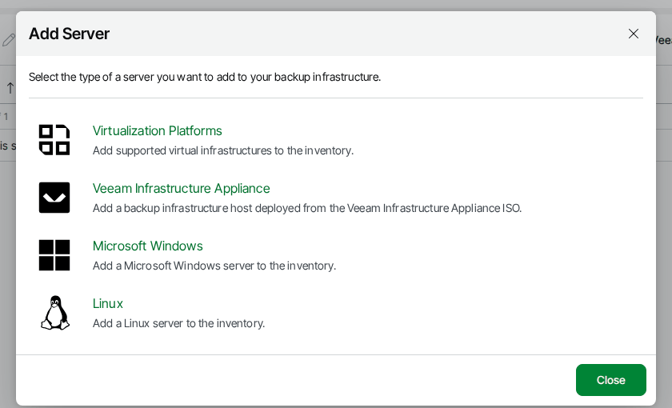{ loading=lazy width="620" }
  <figcaption>Choisir Microsoft Windows : srv-fichiers est un serveur Windows.</figcaption>
</figure>

3. Étape **Name** : saisir **DNS name or IP address** `192.168.19.22` et **Description** `srv-fichiers : serveur de fichiers Windows Server 2025`, puis cliquer sur **Next**.

<figure markdown="span">
  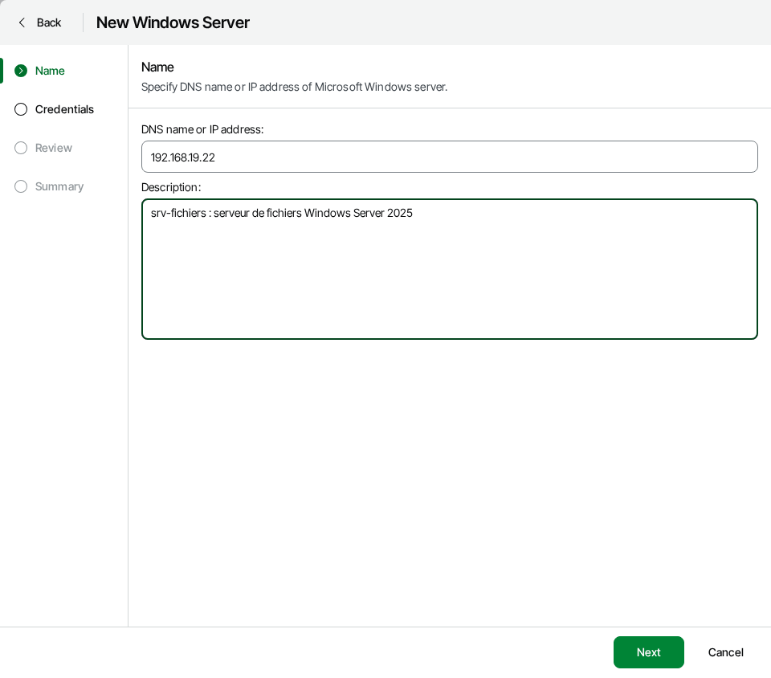{ loading=lazy width="620" }
  <figcaption>Étape Name : l'adresse IP de srv-fichiers et une description.</figcaption>
</figure>

4. Étape **Credentials** : sélectionner **Connect using certificate-based authentication** (« se connecter par certificat »), puis cliquer sur **Next**.

<figure markdown="span">
  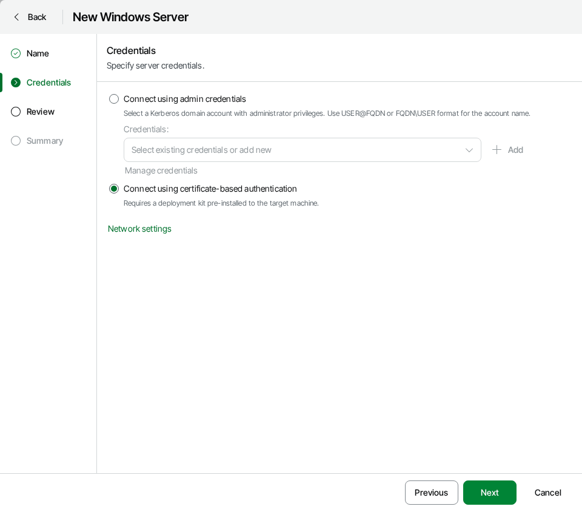{ loading=lazy width="620" }
  <figcaption>Choisir l'authentification par certificat. L'assistant rappelle qu'elle « nécessite un kit de déploiement préinstallé sur la machine cible » (section 5).</figcaption>
</figure>

!!! failure "Si le kit n'est pas installé"
    Sans la section 5, l'assistant ne peut pas se connecter à `srv-fichiers`. Reprendre la [section 5](#5-installer-le-kit-de-deploiement-veeam-sur-srv-fichiers) avant de continuer. Ne pas choisir **Connect using admin credentials** : c'est le chemin qui échoue en section 3.

5. Étape **Review** : Veeam liste les composants à installer sur le serveur. Cliquer sur **Next**.

<figure markdown="span">
  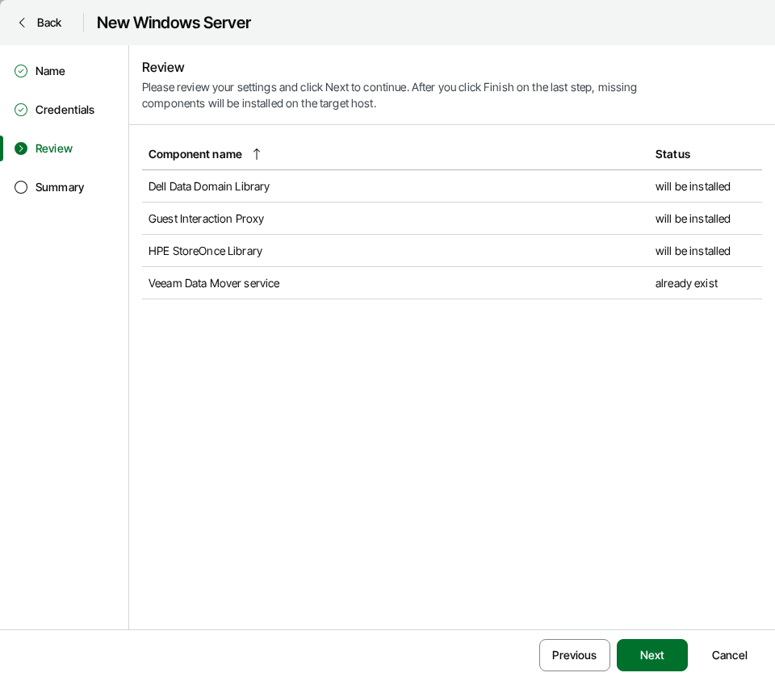{ loading=lazy width="620" }
  <figcaption>La connexion par certificat fonctionne : Veeam a pu interroger le serveur et affiche ce qu'il va installer. Le Data Mover est déjà présent.</figcaption>
</figure>

6. Étape **Summary** : cliquer sur **Finish**. Les composants manquants s'installent sur `srv-fichiers`.
7. Attendre une minute, puis recharger la page avec ++f5++ : `192.168.19.22` apparaît dans la liste.

<figure markdown="span">
  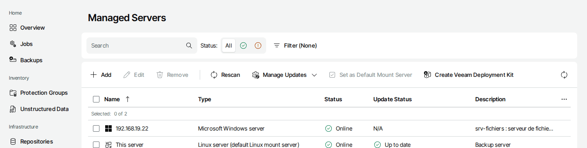{ loading=lazy }
  <figcaption>srv-fichiers (192.168.19.22) est déclaré, en ligne, de type Microsoft Windows server.</figcaption>
</figure>

!!! warning "Ne pas relancer l'assistant"
    Comme pour les dépôts (voir 7.3), l'interface web termine la création **en arrière-plan** : la liste peut mettre un moment à se mettre à jour. Patienter et recharger la page avant de conclure que l'ajout a échoué.

---

## 7. Créer le dépôt n° 2 `Depot-2-srv-fichiers`

### 7.1 L'assistant pas à pas

1. 🌐 Ouvrir **Infrastructure > Repositories**, cliquer sur **Add**, puis **Microsoft Windows**.
2. Étape **Name** : saisir **Name** `Depot-2-srv-fichiers` et **Description** `Dépôt n° 2 : disque F: (ReFS 64 Ko) du serveur de fichiers srv-fichiers`, puis cliquer sur **Next**.

<figure markdown="span">
  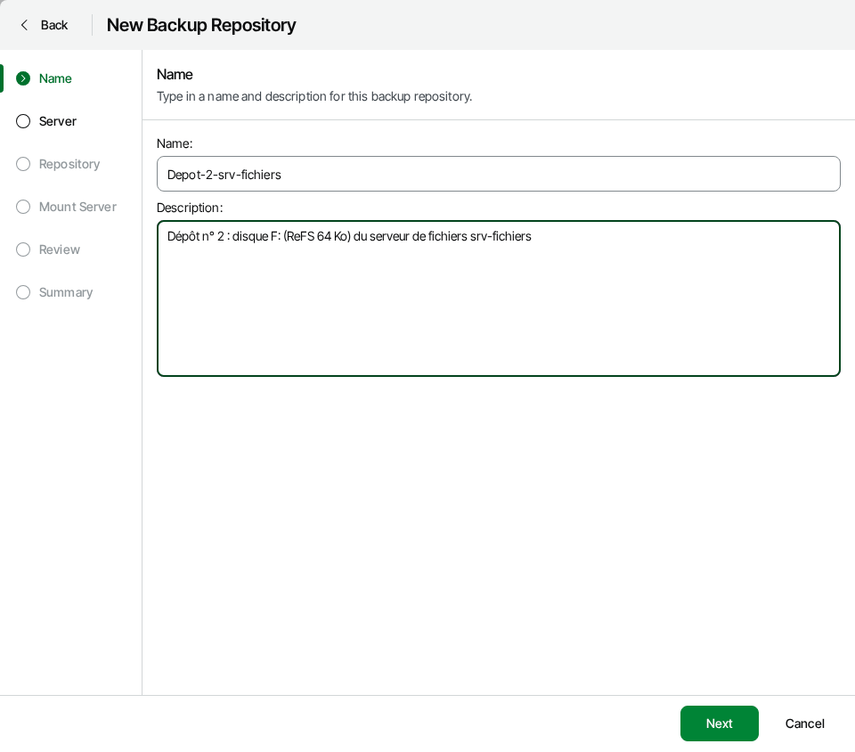{ loading=lazy width="620" }
  <figcaption>Un nom explicite : il apparaîtra dans les jobs et dans les rapports.</figcaption>
</figure>

3. Étape **Server** : dans la liste **Repository server**, choisir `192.168.19.22 (srv-fichiers : serveur de fichiers Windows Server 2025)`. Les volumes du serveur s'affichent : `C:`, `E:` et `F:`.

<figure markdown="span">
  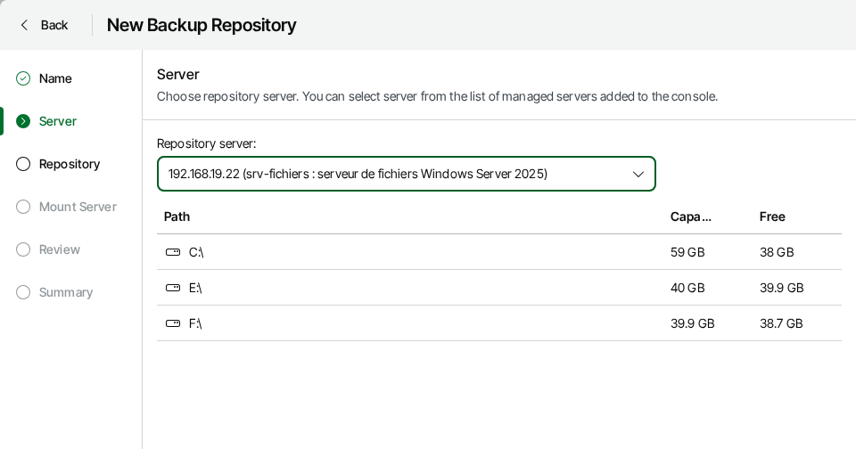{ loading=lazy width="620" }
  <figcaption>Les trois volumes de srv-fichiers. Le dépôt ira sur F: (39,9 Go).</figcaption>
</figure>

!!! failure "La liste « Repository server » est vide : « No options found »"
    La liste est vide, avec le message **The field is required** sous la zone, tant que le serveur n'est pas déclaré dans **Managed Servers**. Retourner à la [section 6](#6-declarer-srv-fichiers-comme-serveur-gere), puis relancer l'assistant.

4. Cliquer sur **Next**. Étape **Repository** : dans **Path to folder**, saisir `F:\RepoVeeam`, puis cliquer sur **Populate**. Veeam affiche la capacité (**39,94 Go**) et l'espace libre (**38,67 Go**). Laisser **Limit maximum concurrent tasks to** `4`, puis cliquer sur **Next**.

<figure markdown="span">
  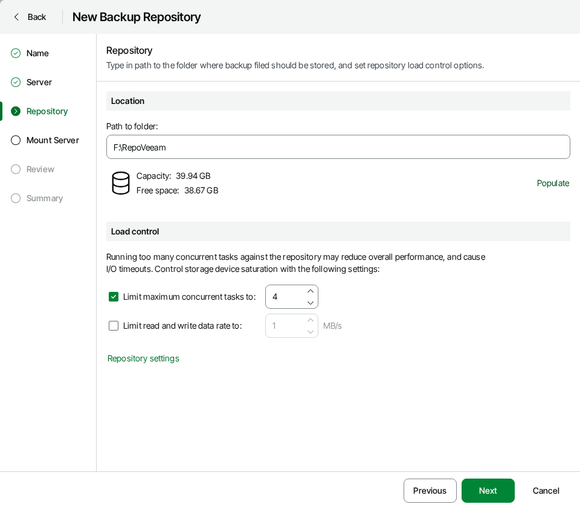{ loading=lazy width="620" }
  <figcaption>Populate lit la capacité du volume : preuve que Veeam accède bien à F:.</figcaption>
</figure>

!!! info "Pourquoi pas d'option d'immuabilité ?"
    Contrairement au dépôt de l'appliance, cet assistant n'offre **aucune case d'immuabilité** : un dépôt Windows en ReFS n'est pas durci. L'immuabilité vient d'un dépôt durci Linux ou d'un stockage objet. C'est une raison de plus de ne pas faire de ce dépôt la seule copie.

5. Étape **Mount Server** : garder les valeurs proposées, **Windows mount server** `192.168.19.22 (srv-fichiers…)` et **Linux mount server** `vbr (Backup server)`, puis cliquer sur **Next**.

<figure markdown="span">
  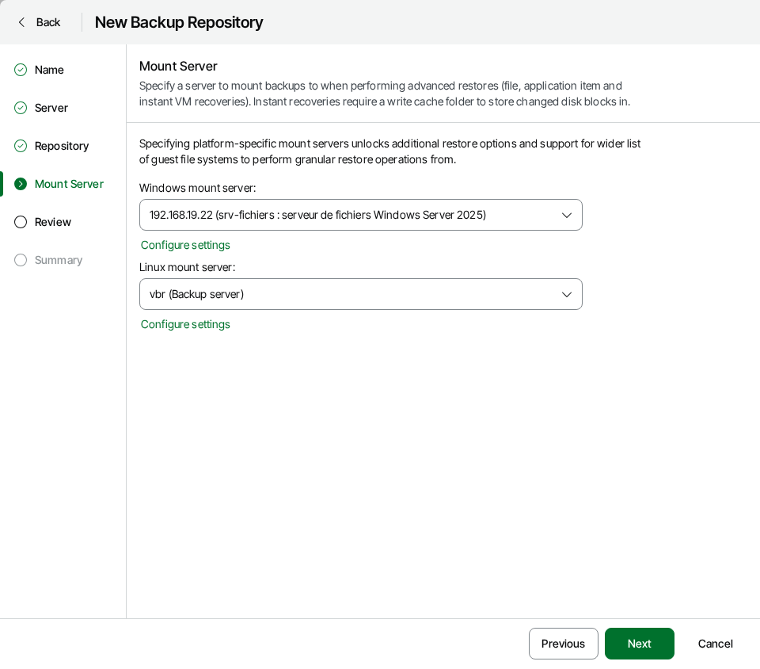{ loading=lazy width="620" }
  <figcaption>Serveurs de montage : srv-fichiers pour Windows, l'appliance pour Linux. Ce sont eux qui serviront aux restaurations de fichiers.</figcaption>
</figure>

6. Étape **Review** : Veeam liste les composants. Laisser **Search the repository for existing backups and import them automatically** **décoché** (le dépôt est vide), puis cliquer sur **Next**.

<figure markdown="span">
  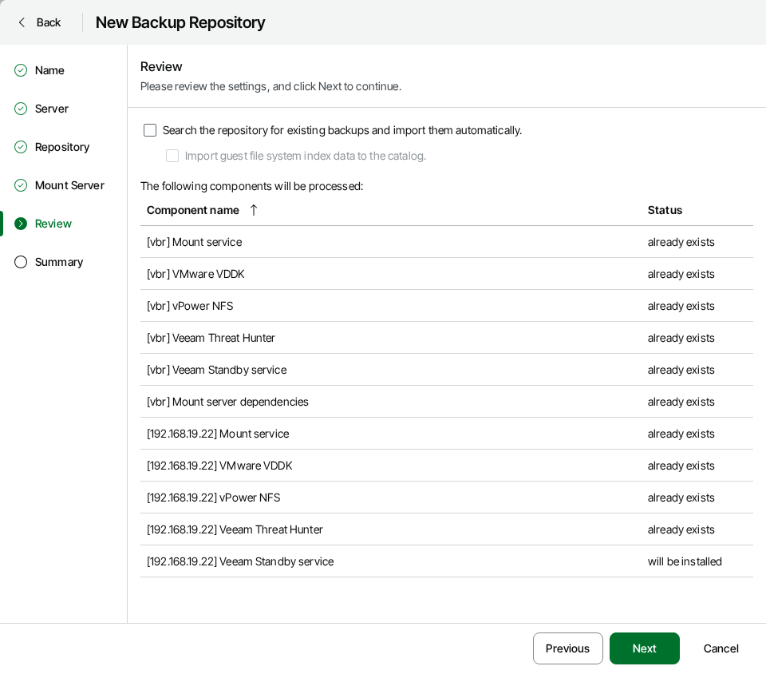{ loading=lazy width="620" }
  <figcaption>Composants nécessaires : presque tous sont déjà présents, un seul reste à installer sur srv-fichiers.</figcaption>
</figure>

7. Veeam applique alors les réglages (installation du composant manquant sur `srv-fichiers`). Attendre la fin, cliquer sur **Next** pour afficher l'étape **Summary**, vérifier le récapitulatif, puis cliquer **une seule fois** sur **Finish**.

<figure markdown="span">
  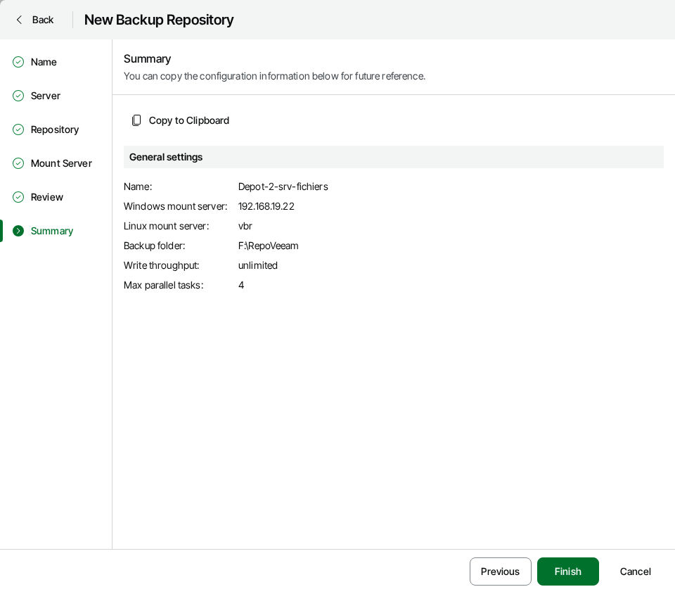{ loading=lazy width="620" }
  <figcaption>Récapitulatif : dossier F:\RepoVeeam, débit d'écriture illimité, 4 tâches parallèles.</figcaption>
</figure>

### 7.2 Si l'assistant avertit que le volume n'est pas en ReFS

Si le dossier se trouve sur un volume **NTFS** (c'est ce qui arrive si l'on choisit `E:` par erreur), Veeam affiche une fenêtre d'avertissement après l'étape **Repository**.

<figure markdown="span">
  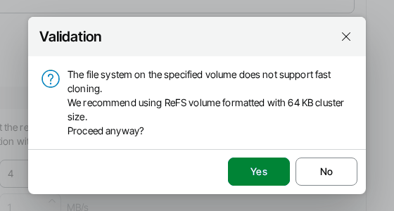{ loading=lazy width="500" }
  <figcaption>Cet avertissement apparaît avec un volume NTFS. Avec F: en ReFS 64 Ko, il ne s'affiche pas.</figcaption>
</figure>

!!! failure "Message d'avertissement"
    The file system on the specified volume does not support fast cloning. We recommend using ReFS volume formatted with 64 KB cluster size. Proceed anyway?

Cliquer sur **No**, vérifier la lettre du lecteur saisie (`F:`) et le formatage (4.4), puis reprendre. Répondre **Yes** reste possible, mais le dépôt n'aura alors ni *fast clone*, ni les gains de temps et de place qui vont avec.

### 7.3 Le piège du doublon

!!! failure "Le dépôt n'apparaît pas dans la liste après « Finish » : ne pas relancer l'assistant"
    Après **Finish**, l'interface web 13.1 crée le dépôt **en arrière-plan** et **ne rafraîchit pas la liste**. Il arrive que la liste n'affiche qu'un seul dépôt pendant plus d'une minute alors que le nouveau existe déjà. Relancer l'assistant à ce moment crée un **deuxième dépôt du même nom** (`Depot-2-srv-fichiers` en double).

    À faire à la place :

    1. **Patienter** une à deux minutes.
    2. Cliquer sur la cloche **Notifications** et ouvrir **Logs & Events** : une session **Infrastructure Item Saving** au résultat **Success** indique que la création est terminée.
    3. Recharger la page avec ++f5++, plusieurs fois si nécessaire.

    Si un doublon a déjà été créé : cocher **l'un des deux dépôts** (tous deux sont vides, **0 B** utilisés, tant qu'aucun job ne les utilise), cliquer sur **Remove** dans la barre d'outils, puis confirmer. Recharger la page : un seul `Depot-2-srv-fichiers` doit rester. **Ne jamais supprimer un dépôt qui contient des sauvegardes** sans savoir ce que l'on fait.

---

## 8. Vérification

1. 🌐 Recharger **Infrastructure > Repositories** : deux dépôts sont listés.

<figure markdown="span">
  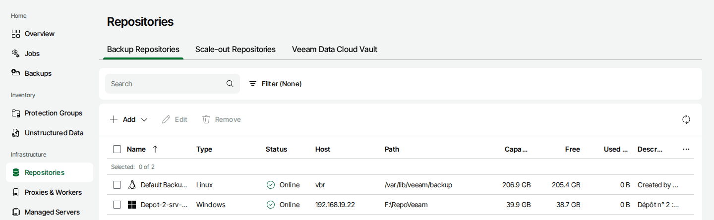{ loading=lazy }
  <figcaption>Résultat final : deux dépôts en ligne. Le n° 2 est un dépôt Windows sur 192.168.19.22, dossier F:\RepoVeeam.</figcaption>
</figure>

2. 🪟 Sur `srv-fichiers`, vérifier le volume et le dossier :

    ```powershell title="PowerShell : contrôle du dépôt n° 2"
    Get-Volume -DriveLetter F | Format-List DriveLetter,FileSystemLabel,FileSystem,AllocationUnitSize
    Test-Path 'F:\RepoVeeam'
    ```

!!! success "Résultat attendu"
    - Deux dépôts sont **Online** : `Default Backup Repository` (Linux, `vbr`, `/var/lib/veeam/backup`, 206,9 Go) et `Depot-2-srv-fichiers` (Windows, `192.168.19.22`, `F:\RepoVeeam`, environ 39,9 Go, 38,7 Go libres).
    - **Aucun doublon** : un seul `Depot-2-srv-fichiers`.
    - `F:` est en **ReFS**, avec une unité d'allocation de **65536**, et `Test-Path` répond `True`.

### 🛟 Prendre l'instantané `02-depots`

Le lab est dans un état propre, qu'il vaut mieux figer avant la partie 5.

1. 🪟 Éteindre `srv-fichiers` proprement, puis éteindre `vbr` et les autres machines du lab (voir [Instantanés conseillés](index.md#instantanes-conseilles)).
2. 🖥️ Prendre un instantané **nommé `02-depots`** sur **toutes les machines du lab** en même temps.
3. Rallumer les machines (`pfsense-19` d'abord, puis `vbr`, puis `srv-fichiers`).

!!! warning "Un instantané n'est pas une sauvegarde"
    Il reste sur le disque du PC hôte. Il sert à **recommencer** la partie 5 en quelques secondes, pas à protéger des données.

---

## 9. Questions de révision

1. Citer trois types de dépôts de sauvegarde que Veeam sait utiliser.
2. Pourquoi un dépôt sur un partage SMB a-t-il besoin d'un serveur passerelle, alors qu'un dépôt Windows à disque local n'en a pas besoin ?
3. Quel est le rôle de l'option « Prevent accidental deletion for 7 days » du dépôt par défaut de l'appliance ?
4. Pourquoi le lab ne peut-il pas créer le dépôt sur un partage SMB de `srv-fichiers` accessible par son adresse IP ?
5. À quoi sert le kit de déploiement Veeam ? Pourquoi son lien de téléchargement doit-il être utilisé immédiatement ?
6. Pourquoi formater `F:` en ReFS avec des clusters de 64 Ko ?
7. Après avoir cliqué sur **Finish**, le nouveau dépôt n'apparaît pas dans la liste. Que faire, et quelle erreur éviter ?

??? success "Corrigé"
    1. Au choix : dépôt Windows ou Linux à disque local, dépôt durci Linux, partage réseau SMB ou NFS, stockage objet (Amazon S3, Azure Blob), appliance de déduplication.
    2. Un partage SMB ne peut pas exécuter le **Data Mover** : il faut une **passerelle** qui l'exécute à sa place. Sur un serveur Windows à disque local, le Data Mover tourne **sur le serveur lui-même**.
    3. À rendre les fichiers de sauvegarde **immuables** pendant 7 jours : ils ne peuvent ni être modifiés ni être supprimés, même par un administrateur. Cela protège contre un rançongiciel ou un compte administrateur volé.
    4. L'appliance est durcie (mode FIPS) et `srv-fichiers` est en groupe de travail. Par adresse IP, **Kerberos** n'est pas utilisable (un FQDN est exigé) ; avec un compte local, il faudrait **NTLM**, que l'appliance n'utilise pas (`NT_STATUS_INVALID_PARAMETER`). Un domaine Active Directory résoudrait le problème.
    5. Il installe sur le serveur Windows un service Veeam et des **certificats**, ce qui permet l'**authentification par certificat** sans mot de passe ni domaine. Le lien est à **usage unique** : un second téléchargement renvoie une erreur 404 ; il faut régénérer le kit.
    6. Pour activer le **clonage de blocs** (*fast clone*) : les sauvegardes complètes synthétiques référencent des blocs existants au lieu de les recopier, ce qui économise temps et espace. Veeam recommande des clusters de 64 Ko et avertit si le volume est en NTFS.
    7. **Patienter**, consulter les notifications et **Logs & Events** (session *Infrastructure Item Saving*), puis recharger la page. Ne **pas relancer l'assistant** : cela crée un **doublon**, qu'il faudrait supprimer.

---

## Ressources

- [Backup Repositories](https://helpcenter.veeam.com/docs/vbr/userguide/backup_repository.html) — types de dépôts, guide officiel de Veeam Backup & Replication 13 (en anglais).
- [Hardened Repository](https://helpcenter.veeam.com/docs/vbr/userguide/hardened_repository.html) — dépôt durci et immuabilité.
- [Using Veeam Deployment Kit](https://helpcenter.veeam.com/docs/vbr/userguide/deployment_kit.html) — kit de déploiement et authentification par certificat.
- [Fast Clone](https://helpcenter.veeam.com/docs/vbr/userguide/backup_repository_block_cloning.html) — clonage de blocs sur XFS et ReFS.
- [FIPS Compliance](https://helpcenter.veeam.com/docs/vbr/userguide/fips_compliance.html) et [Kerberos Authentication](https://helpcenter.veeam.com/docs/vbr/userguide/kerberos_authentication.html) — mode FIPS, NTLM désactivé, Kerberos seul protocole de domaine.
- [Gateway Servers](https://helpcenter.veeam.com/docs/vbr/userguide/gateway_server.html) et [Mount Servers](https://helpcenter.veeam.com/docs/vbr/userguide/mount_server.html) — rôles de la passerelle et du serveur de montage.
- [Block cloning sur ReFS](https://learn.microsoft.com/fr-fr/windows-server/storage/refs/block-cloning) — documentation Microsoft.
- Partie précédente : [Préparer le lab et installer l'appliance](03-preparer-le-lab-installer-appliance.md) · Partie suivante : [Sauvegarder la configuration et un serveur de fichiers](05-sauvegarder-configuration-et-serveur-de-fichiers.md).
