<!-- ============================================================ -->
<!-- ⚠️ RAPPEL IMPORTANT :                                          -->
<!-- Pensez TOUJOURS à ajouter une entrée dans le fichier d'index  -->
<!-- (index.md) du dossier correspondant (ex: docs/cloud/index.md) -->
<!-- afin de référencer ce nouvel article et permettre aux         -->
<!-- visiteurs de le trouver et de cliquer dessus !                -->
<!-- ============================================================ -->

# Sauvegarder la configuration de Veeam et le serveur de fichiers

!!! abstract "Résumé"
    Ce TP met en route les **premières sauvegardes réelles** du lab. Il commence par protéger **Veeam lui-même** : la *sauvegarde de configuration* (la « carte d'identité » du serveur de sauvegarde), chiffrée et envoyée sur le dépôt du serveur de fichiers. Il continue avec la sauvegarde d'un **dossier de documents importants** du serveur Windows `srv-fichiers` : création d'un **groupe de protection**, déploiement automatique de l'**agent Veeam pour Windows**, création du **job** en mode fichiers, premier lancement.

    Il se termine par ce que beaucoup oublient : un **test de restauration**. Un fichier est supprimé volontairement, puis récupéré depuis la sauvegarde, et son **empreinte SHA-256** prouve qu'il est identique à l'original.

| Propriété | Valeur |
|-----------|--------|
| Difficulté | Intermédiaire |
| Durée estimée | 2 h 30 (dont environ 10 minutes d'attente des traitements) |
| Version décrite | Veeam Backup & Replication **13.1.2.57** (Veeam Software Appliance), agent Veeam pour Windows installé par l'appliance |
| Prérequis | Parties [3](03-preparer-le-lab-installer-appliance.md) et [4](04-ajouter-des-depots-de-sauvegarde.md) terminées ; instantané `02-depots` |
| Place dans le parcours | Partie 5 sur 7 du parcours [Veeam Backup & Replication](index.md) |
| Dernière mise à jour | 2026-11-02 |

<!-- NOTE DE RÉDACTION (non affichée) : Ce qui a changé par rapport à la version 1.5 du support (juin 2024)
- Le support utilisait Veeam Backup & Replication 12 **installé sur Windows**, avec la console Windows pour tout faire. Ici, le serveur est l'**appliance Linux 13.1** : le **job de sauvegarde** et le **groupe de protection** se créent dans l'**interface web**, alors que le **réglage de la sauvegarde de configuration** se fait dans la **console Windows**.
- La **phrase secrète du Security Officer** (partie 3) est **obligatoire** pour que la sauvegarde de configuration d'une appliance réussisse : elle n'existait pas dans le support. Son absence fait échouer la tâche (voir l'encadré de dépannage de la section 2.5).
- Le support envoyait la sauvegarde de configuration sur le dépôt local du serveur Veeam. Ce TP la dirige vers le **dépôt n° 2** (`Depot-2-srv-fichiers`), situé sur **une autre machine** : une sauvegarde de configuration stockée sur le serveur qu'elle protège disparaît avec lui.
- Le support appelait « serveur de fichiers » une machine déclarée par son adresse et un compte administrateur. Dans ce lab, `srv-fichiers` est déjà un **serveur géré par certificat** depuis la partie 4 : le déploiement de l'agent passe par ce même mécanisme, **sans saisir de mot de passe**.
- Le support corrigeait après coup une adresse IP erronée dans le job. Ce TP la fait saisir correctement une fois pour toutes, par le **groupe de protection**.
- Un **test de restauration** (suppression volontaire d'un fichier, restauration, contrôle d'empreinte) a été ajouté : une sauvegarde jamais restaurée n'est pas une sauvegarde fiable.
-->

!!! info "Convention de lecture"
    Chaque action précise la machine sur laquelle elle se fait : 🖥️ PC hôte (hyperviseur), 🌐 navigateur web connecté à l'appliance, 🪟 `srv-fichiers` (Windows Server 2025), 📦 console de l'appliance `vbr`. Les menus et boutons sont écrits **en anglais**, comme Veeam les affiche, et traduits quand c'est utile. Les adresses, comptes et mots de passe sont ceux de la page [d'accueil du parcours](index.md#plan-dadressage) ; pour mémoire :

    | Élément | Valeur |
    |---|---|
    | Interface web et console Windows | `https://192.168.19.55`, compte `veeamadmin`, mot de passe `PoPoPo000@@@Lab` + code MFA |
    | `srv-fichiers` | `192.168.19.22`, compte `Administrateur`, mot de passe `Popopo222@@@` |
    | Mot de passe de chiffrement de la sauvegarde de configuration | `Popopo444@@@` (indice « Mot de passe du lab Veeam ») |
    | Phrase secrète du Security Officer (partie 3) | `PoPoPo666@@@Lab` (indice « Phrase secrete du lab Veeam ») |

---

## Objectifs

À la fin de ce TP, il est possible de :

- expliquer ce que contient une **sauvegarde de configuration** et pourquoi elle ne doit **jamais** rester sur le serveur qu'elle protège ;
- régler, chiffrer et lancer la sauvegarde de configuration depuis la console Windows ;
- créer un **groupe de protection** et laisser l'appliance **déployer l'agent** sur un serveur Windows ;
- créer un **job de sauvegarde par agent** en mode fichiers, le lancer et lire son résultat ;
- **restaurer un fichier supprimé** et prouver, par son empreinte, que la restauration est fidèle.

## Prérequis

- Les parties [3](03-preparer-le-lab-installer-appliance.md) et [4](04-ajouter-des-depots-de-sauvegarde.md) sont terminées : l'appliance `vbr` fonctionne, `srv-fichiers` est un **serveur géré** et possède le dépôt `Depot-2-srv-fichiers` (disque `F:`, chemin `F:\RepoVeeam`).
- La **console Windows** de Veeam est installée sur `srv-fichiers` (fin de la partie 3).
- Le **Security Officer** de l'appliance a été initialisé, avec sa **phrase secrète** de sauvegarde de configuration (section « Initialiser le compte Security Officer » de la [partie 3](03-preparer-le-lab-installer-appliance.md#9-initialiser-le-compte-security-officer)).
- Machines allumées : `pfsense-19`, `vbr`, `srv-fichiers`. `srv-debian` n'est pas encore utile.
- Le dossier `E:\Documents-importants` existe sur `srv-fichiers` (voir l'encadré ci-dessous).
- **Instantané conseillé** : `02-depots`, pris à la fin de la partie 4. Il permet de recommencer cette partie sans refaire les précédentes (voir [Instantanés conseillés](index.md#instantanes-conseilles)).

??? example "Préparer le dossier de documents à protéger (si absent)"
    Sur `srv-fichiers`, le disque `E:` (40 Go, NTFS, nommé « DONNEES ») doit contenir quelques documents fictifs. Dans **PowerShell** ouvert en administrateur :

    ```powershell
    $base = 'E:\Documents-importants'
    foreach ($s in 'Comptabilite','Contrats','Ressources-humaines') {
        New-Item -ItemType Directory -Force -Path "$base\$s" | Out-Null
    }
    Set-Content "$base\Comptabilite\factures-2026.csv" "Numero;Client;Montant`nF2026-001;Boulangerie Martin;1250,00`nF2026-002;Garage Durand;3480,50`nF2026-003;Cabinet Leroy;890,00" -Encoding UTF8
    Set-Content "$base\Comptabilite\bilan-previsionnel.txt" "Bilan previsionnel 2026 - document confidentiel" -Encoding UTF8
    Set-Content "$base\Contrats\contrat-maintenance-2026.txt" "Contrat de maintenance informatique - signe le 05/01/2026" -Encoding UTF8
    ```

    Le fichier de la section 5 est `factures-2026.csv`. Peu importe le contenu des autres fichiers.

---

## 1. Comprendre ce qu'il faut protéger

Un serveur de sauvegarde Veeam protège les données **des autres machines**. Mais il a lui-même besoin d'être protégé : s'il disparaît, il faut pouvoir le reconstruire sans tout reconfigurer.

### 1.1 Qu'est-ce qu'une sauvegarde de configuration ?

Veeam enregistre sa configuration dans une **base de données** (PostgreSQL sur l'appliance) : la liste des dépôts, des serveurs gérés, des jobs, des groupes de protection, les identifiants enregistrés, les historiques de sessions et le catalogue des points de restauration. La **sauvegarde de configuration** (*configuration backup*) en fait une copie, dans un fichier au format `.bco`.

| Contenu | Dans la sauvegarde de configuration ? |
|---|---|
| Jobs, planifications, dépôts, serveurs gérés, groupes de protection | Oui |
| Historique des sessions, catalogue des points de restauration | Oui |
| Identifiants, certificats, clés de chiffrement | **Seulement si la sauvegarde est chiffrée** |
| **Les données sauvegardées** (fichiers, images de machines) | **Non** : elles restent dans les dépôts |

!!! question "Pourquoi est-ce vital ?"
    Sans configuration, un nouveau serveur Veeam, même branché sur les bons dépôts, ne connaît ni les jobs ni les mots de passe : il faut tout recréer à la main et retrouver le mot de passe de chaque sauvegarde chiffrée pour pouvoir la relire. Avec elle, il suffit de réinstaller l'appliance puis de **restaurer la configuration** : en quelques minutes, jobs, dépôts et historique reviennent. C'est l'équivalent de la **carte grise et du carnet d'entretien** d'une voiture : ils ne remplacent pas la voiture, mais sans eux, la remplacer est un cauchemar.

### 1.2 Où la stocker ?

Par défaut, Veeam propose le dépôt `Default Backup Repository`, qui se trouve **sur l'appliance elle-même** (`/var/lib/veeam/backup`). C'est une **mauvaise idée** : si l'appliance est détruite ou chiffrée par un rançongiciel, la sauvegarde de sa configuration disparaît avec elle. C'est exactement la situation contre laquelle elle doit protéger.

Ce TP envoie donc la sauvegarde de configuration vers `Depot-2-srv-fichiers`, un dépôt situé sur **une autre machine** (`srv-fichiers`, disque `F:`). En production, on la copierait en plus **hors site** (autre bâtiment, cloud, dépôt immuable) : la règle [3-2-1-1-0](01-comprendre-la-sauvegarde.md#32-la-regle-3-2-1-1-0) s'applique aussi à la configuration de Veeam.

### 1.3 Une double protection : mot de passe et phrase secrète

Sur une appliance avec un compte **Security Officer**, la sauvegarde de configuration est protégée par **deux secrets** :

| Secret | Qui le définit, où | Rôle |
|---|---|---|
| **Mot de passe de chiffrement** | Le gestionnaire de sauvegarde, dans la console Windows (section 2.3) | Chiffre le fichier `.bco` ; il faut le fournir pour restaurer |
| **Phrase secrète** (*passphrase*) | Le Security Officer, dans **Host Management** (partie 3) | Ajoute un **second chiffrement** : un administrateur seul ne peut plus restaurer ni lire la configuration |

L'idée est la **séparation des pouvoirs** : celui qui administre Veeam au quotidien ne détient pas, à lui seul, tout ce qu'il faut pour exploiter une sauvegarde de configuration volée. D'après la documentation de Veeam, si cette protection est active, la tâche de sauvegarde de configuration **échoue** tant que le chiffrement n'est pas activé.

!!! warning "Conserver ces secrets hors de l'appliance"
    Le mot de passe et la phrase secrète **ne se récupèrent pas** : sans eux, le fichier `.bco` est inutilisable, et l'assistance technique de Veeam ne peut pas les retrouver (la console le rappelle à l'écran). Les noter dans un **gestionnaire de mots de passe** ou un coffre **qui ne dépend pas de l'appliance**. Les stocker sur le serveur de sauvegarde lui-même reviendrait à ranger la clé du coffre **dans** le coffre. Dans ce lab pédagogique, les valeurs sont publiées en clair dans la page d'accueil du parcours : ce n'est acceptable que parce que le lab ne contient aucune donnée réelle.

---

## 2. Sauvegarder la configuration de Veeam

!!! info "Console Windows ou interface web ?"
    Ce réglage se fait dans la **console Windows**, comme le décrit la documentation de Veeam (menu principal, **Configuration Backup**). Dans la version 13.1.2, les pages **Configuration** de l'interface web ne le proposent pas. Si une version ultérieure l'ajoute, la logique reste la même.

### 2.1 Ouvrir les réglages

1. 🪟 Sur `srv-fichiers`, ouvrir la **console Veeam Backup & Replication** et se connecter à `192.168.19.55` avec `veeamadmin` (mot de passe `PoPoPo000@@@Lab` + code MFA), comme en fin de partie 3.
2. Cliquer sur le **menu principal** (l'icône ≡ en haut à gauche), puis sur **Configuration Backup**.

<figure markdown="span">
  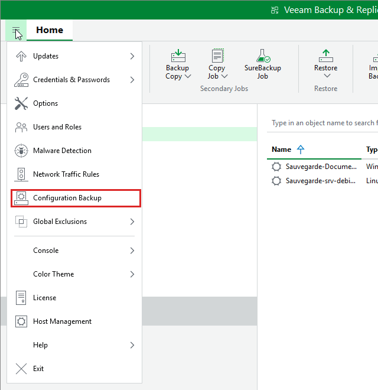{ loading=lazy }
  <figcaption>Le menu principal (≡) de la console Windows : <strong>Configuration Backup</strong> est entre <strong>Malware Detection</strong>… et <strong>Global Exclusions</strong>.</figcaption>
</figure>

La fenêtre **Configuration Backup Settings** s'ouvre. Au départ, le dépôt choisi est `Default Backup Repository`, la rétention est de **10** points de restauration et la sauvegarde est planifiée **tous les jours à 10:00**. Une alerte jaune prévient que les identifiants enregistrés, les certificats et les données de l'appliance **ne seront pas inclus tant que le chiffrement n'est pas activé**.

<figure markdown="span">
  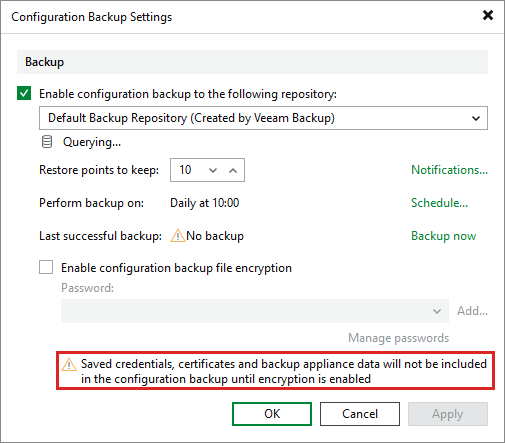{ loading=lazy }
  <figcaption>Réglages par défaut. L'avertissement entouré en rouge disparaît quand le chiffrement est activé (section 2.3).</figcaption>
</figure>

### 2.2 Choisir le dépôt n° 2

1. Cocher **Enable configuration backup to the following repository** si ce n'est pas fait.
2. Dans la liste **Backup repository** située sous cette case, remplacer `Default Backup Repository` par **`Depot-2-srv-fichiers`** (« Dépôt n° 2 : disque F: (ReFS 64 Ko) du serveur de fichiers srv-fichiers »).
3. Laisser **Restore points to keep** à **10** : Veeam conserve les 10 dernières sauvegardes de configuration et supprime les plus anciennes.

<figure markdown="span">
  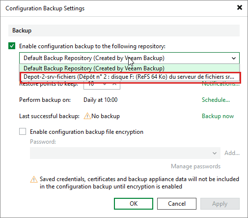{ loading=lazy }
  <figcaption>Choisir le dépôt n° 2, situé sur <code>srv-fichiers</code>, et non celui de l'appliance.</figcaption>
</figure>

!!! question "Pourquoi 10 points de restauration et une sauvegarde quotidienne ?"
    La configuration change à chaque nouveau job ou dépôt. Une sauvegarde **quotidienne** garde au pire une journée de modifications à refaire ; 10 points permettent de remonter jusqu'à 10 jours en arrière si une erreur de configuration passe inaperçue. Le fichier est petit (environ 227 Ko dans le lab) : conserver davantage de points coûte très peu.

### 2.3 Activer le chiffrement

1. Cocher **Enable configuration backup file encryption**.
2. Cliquer sur **Add...** à droite du champ **Password**.
3. Dans la fenêtre **Password**, saisir :
    - **Hint** (indice) : `Mot de passe du lab Veeam` ;
    - **Password** : `Popopo444@@@`.
4. Cliquer sur **OK**.

<figure markdown="span">
  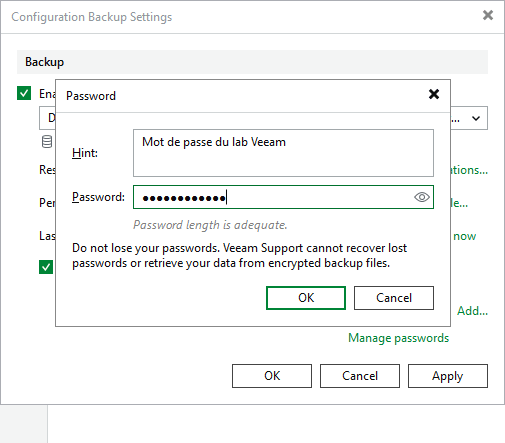{ loading=lazy }
  <figcaption>L'<strong>indice</strong> n'est pas un secret : il rappelle quel mot de passe a été utilisé. Il ne doit jamais contenir le mot de passe.</figcaption>
</figure>

!!! tip "Écrire l'indice avec soin"
    Un indice trop vague (« le mot de passe habituel ») est inutile le jour de la reconstruction. Un indice trop précis (« nom du chien + année ») aide un attaquant. Le bon indice permet de **retrouver dans le gestionnaire de mots de passe** la bonne entrée.

### 2.4 Lancer la sauvegarde (Backup now)

1. Cliquer sur **Apply** pour enregistrer les réglages. Veeam interroge le dépôt et affiche son espace libre (dans le lab : `38,6 GB free of 39,9 GB`).
2. Cliquer sur **Backup now** à droite de **Last successful backup**.

<figure markdown="span">
  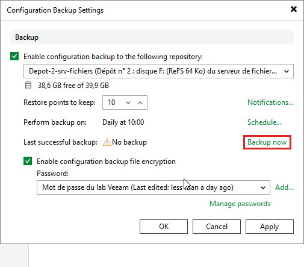{ loading=lazy }
  <figcaption>Réglages finaux : dépôt n° 2, chiffrement activé, mot de passe choisi. <strong>Backup now</strong> lance la sauvegarde sans attendre 10:00.</figcaption>
</figure>

Au bout d'une minute environ, la ligne **Last successful backup** affiche la date et l'heure de la sauvegarde. Cliquer sur **OK** pour fermer la fenêtre.

<figure markdown="span">
  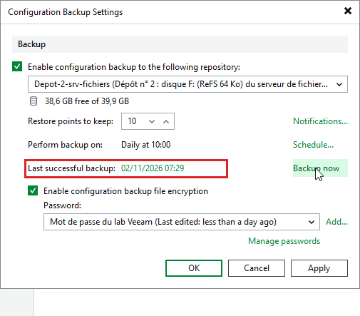{ loading=lazy }
  <figcaption>La ligne <strong>Last successful backup</strong> porte désormais une date : la sauvegarde de configuration a réussi.</figcaption>
</figure>

### 2.5 Dépanner : la phrase secrète du Security Officer manque

!!! failure "La tâche « Backup Configuration Job » échoue"
    Si **Backup now** se termine en **Failed**, ouvrir le journal de la session. Si la phrase secrète n'a pas encore été définie, il contient :

    ```text
    Failed  Processing configuration VeeamBackup at /run/postgresql
    Failed  Unable to process the configuration backup without the Security Officer's passphrase.
            Ask your Security Officer to configure it in the Host Management console.
    ```

    **Cause** : sur une appliance, la sauvegarde de configuration est protégée par la **phrase secrète du Security Officer**. Si elle n'a pas été définie lors de la première connexion du Security Officer (partie 3), la sauvegarde ne peut pas être produite.

    **Correction** :

    1. 🌐 Ouvrir **Host Management** de l'appliance et se connecter avec le compte du Security Officer `veeamso` (mot de passe `PoPoPo555@@@Lab` + code MFA, voir la [partie 3](03-preparer-le-lab-installer-appliance.md#9-initialiser-le-compte-security-officer)).
    2. Si l'assistant d'initialisation s'affiche, le terminer jusqu'à l'étape **Configuration Backup**. Saisir la **Passphrase** `PoPoPo666@@@Lab` et l'indice `Phrase secrete du lab Veeam`.
    3. Vérifier, dans **Configuration**, la ligne **Passphrase created** (voir la capture ci-dessous).
    4. 🪟 Retourner dans la console Windows et cliquer de nouveau sur **Backup now**.

<figure markdown="span">
  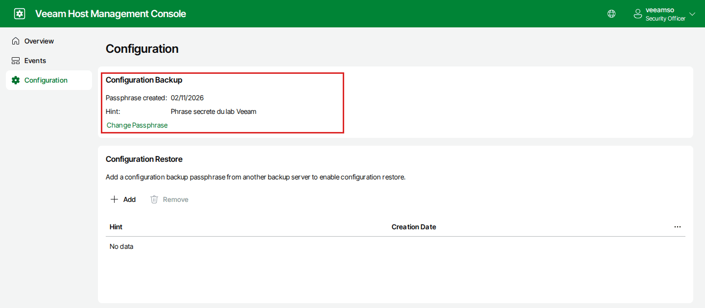{ loading=lazy }
  <figcaption>Dans Host Management, la rubrique <strong>Configuration Backup</strong> indique <strong>Passphrase created</strong> et son indice : la sauvegarde de configuration peut réussir.</figcaption>
</figure>

### 2.6 Vérifier le fichier de sauvegarde

Vérifier que le fichier existe bien **sur le dépôt n° 2**, donc sur une autre machine que l'appliance.

1. 🪟 Sur `srv-fichiers`, ouvrir **PowerShell** et lancer :

    ```powershell
    Get-ChildItem F:\RepoVeeam\VeeamConfigBackup -Recurse -File | Select-Object FullName, Length
    ```

2. Un fichier `.bco` apparaît, dans un sous-dossier portant le nom du serveur de sauvegarde. Dans le lab :

    ```text
    FullName                                                       Length
    --------                                                       ------
    F:\RepoVeeam\VeeamConfigBackup\vbr\vbr_2026-11-02_07-29-09.bco 232832
    ```

Le nom contient la date et l'heure de la sauvegarde ; la taille (environ **227 Ko**) est faible puisqu'il ne contient que la configuration, pas les données.

!!! note "Et la restauration de la configuration ?"
    Ce TP **crée** la sauvegarde de configuration mais ne la **restaure pas** : une restauration remplace la configuration du serveur de sauvegarde en cours, ce qui n'a pas sa place ici. Elle se fait avec l'assistant **Restore** de la console Windows, en fournissant le mot de passe de chiffrement et la phrase secrète du Security Officer. Retenir surtout ceci : **sans ces deux secrets, la sauvegarde est inutilisable**.

---

## 3. Créer le groupe de protection de `srv-fichiers`

### 3.1 Pourquoi un groupe de protection ?

Pour sauvegarder un serveur physique ou une machine virtuelle **sans passer par l'hyperviseur**, Veeam installe un petit logiciel sur la machine : l'**agent Veeam pour Windows**. Les **groupes de protection** (*protection groups*) permettent de le faire de façon automatisée :

- un groupe regroupe les machines à protéger (ici, une seule) ;
- l'appliance **découvre** les machines du groupe, installe l'agent et le **tient à jour** ;
- le groupe est **réanalysé** (*rescan*) chaque jour : une machine ajoutée plus tard au groupe est détectée et équipée toute seule.

!!! question "Pourquoi l'agent et pas une simple copie de fichiers ?"
    Copier un dossier avec l'Explorateur ne garde ni l'historique, ni la déduplication, ni la compression, ni le chiffrement, et bloque sur les fichiers ouverts. L'agent s'appuie sur le **service d'instantanés de volume de Windows** (VSS) pour lire un état cohérent même si des fichiers sont ouverts, puis envoie les blocs modifiés au dépôt.

### 3.2 Créer le groupe

1. 🌐 Ouvrir `https://192.168.19.55` dans le navigateur et se connecter (`veeamadmin`, `PoPoPo000@@@Lab` + code MFA).
2. Dans le menu de gauche, ouvrir **Inventory** > **Protection Groups**, puis cliquer sur **Add New**.
3. Choisir **Individual Computers** : un groupe où l'on liste les machines une par une, adapté aux petits parcs sans annuaire. L'autre choix, **Microsoft Active Directory Objects**, suit dynamiquement des unités d'organisation d'un domaine Active Directory ; ce lab est en groupe de travail.

<figure markdown="span">
  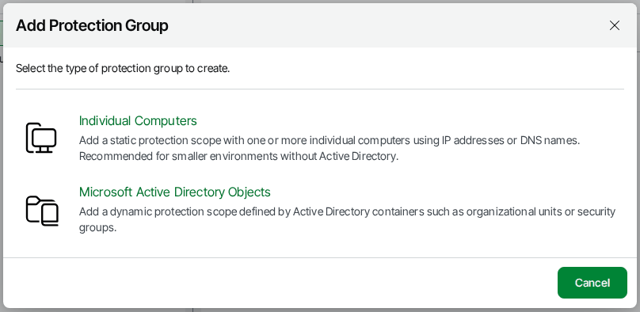{ loading=lazy }
  <figcaption>Le type de groupe. <strong>Individual Computers</strong> convient aux petits parcs, sans Active Directory.</figcaption>
</figure>

4. À l'étape **Name**, saisir :
    - **Name** : `GP-srv-fichiers`
    - **Description** : `Groupe de protection du serveur de fichiers Windows (agent Veeam)`

<figure markdown="span">
  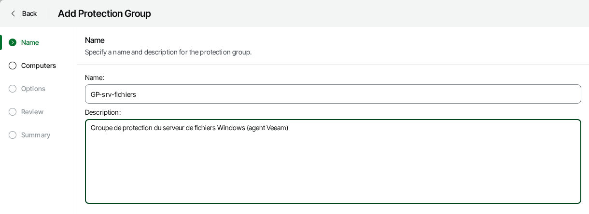{ loading=lazy }
  <figcaption>Étape <strong>Name</strong> : un nom explicite (« GP » pour groupe de protection, puis la machine).</figcaption>
</figure>

5. Cliquer sur **Next**, puis sur **Add** pour ajouter un ordinateur.
6. Saisir `192.168.19.22` dans **Hostname or IP address**, puis choisir **Connect using certificate-based authentication** (« se connecter par certificat »), et cliquer sur **OK**.

<figure markdown="span">
  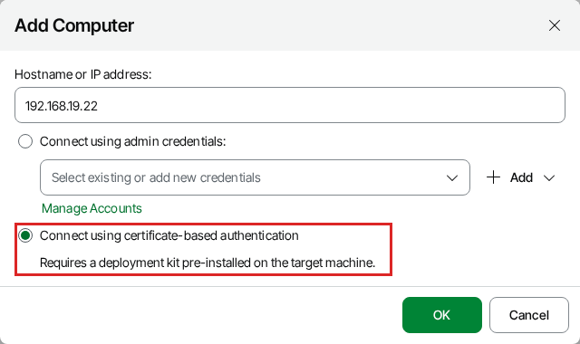{ loading=lazy }
  <figcaption>L'option par certificat s'appuie sur le <em>deployment kit</em> déjà présent sur la machine : aucun mot de passe à saisir.</figcaption>
</figure>

!!! question "Pourquoi l'authentification par certificat ?"
    La seconde option, **Connect using admin credentials**, demande un compte administrateur de la machine. Le choix par certificat évite de saisir un mot de passe, et l'ordinateur est déjà **connu** de l'appliance : `srv-fichiers` a été ajouté comme **serveur géré** en partie 4, ce qui a installé le *Veeam Deployment Service* (le service `VeeamDeploySvc` tourne sur le serveur). La colonne **Account** de la liste indique d'ailleurs « Veeam Deployment Service ». Si la machine n'avait pas ce service, il faudrait passer par le compte administrateur (`Administrateur`, `Popopo222@@@`).

<figure markdown="span">
  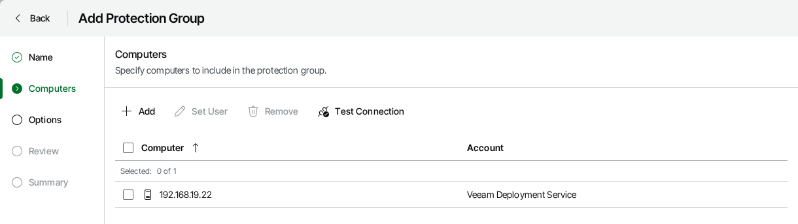{ loading=lazy }
  <figcaption>L'ordinateur est ajouté. Le <em>Veeam Deployment Service</em> joue le rôle de compte de déploiement.</figcaption>
</figure>

7. Cliquer sur **Next**. À l'étape **Options**, **garder les valeurs par défaut** :

    | Option | Valeur | Signification |
    |---|---|---|
    | **Rescan protection group** | Chaque jour à 21:00 | Quand l'appliance revérifie le groupe |
    | **Distribution server** | `vbr` | Le serveur qui fournit le logiciel de l'agent |
    | **Install backup agent** | Coché | Installe l'agent sur la machine |
    | **Install changed block tracking driver** | Décoché | Pilote optionnel qui suit les blocs modifiés (utile pour les sauvegardes de volumes) |
    | **Install nosnap backup agent** | Décoché | Pour Linux uniquement |
    | **Auto-update backup agents** | Coché | Met l'agent à jour automatiquement |
    | **Reboot automatically if required** | Décoché | Évite un redémarrage inattendu d'un serveur en production |

<figure markdown="span">
  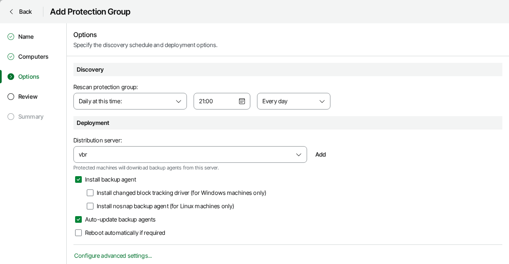{ loading=lazy }
  <figcaption>Les options par défaut conviennent : l'agent est installé depuis <code>vbr</code> et mis à jour automatiquement.</figcaption>
</figure>

8. Cliquer sur **Next** : l'étape **Review** annonce que le composant **Veeam Distribution Service** « sera installé » sur la machine. Cliquer encore sur **Next**.

<figure markdown="span">
  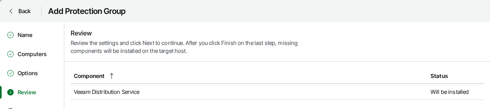{ loading=lazy }
  <figcaption>L'étape <strong>Review</strong> : le composant qui permettra à l'appliance d'installer l'agent sera mis en place sur la machine.</figcaption>
</figure>

9. À l'étape **Summary**, laisser coché **Run discovery when I click Finish** (« lancer la découverte à la fin »), puis cliquer sur **Finish**.

<figure markdown="span">
  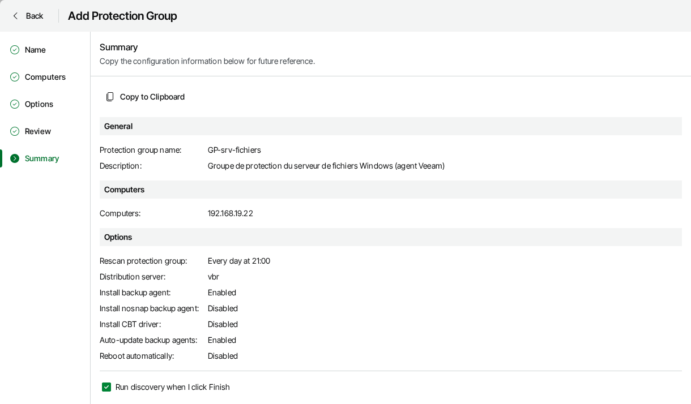{ loading=lazy }
  <figcaption>Le résumé reprend toute la configuration. Garder la case <strong>Run discovery when I click Finish</strong> cochée.</figcaption>
</figure>

### 3.3 Suivre le déploiement de l'agent

Une fenêtre **Machine Rescan** s'ouvre. Veeam se connecte à `srv-fichiers`, installe l'agent et ses composants. Compter **environ 2 minutes** (dans le lab : 1 min 39). Attendre l'état **Success** puis cliquer sur **Close**.

<figure markdown="span">
  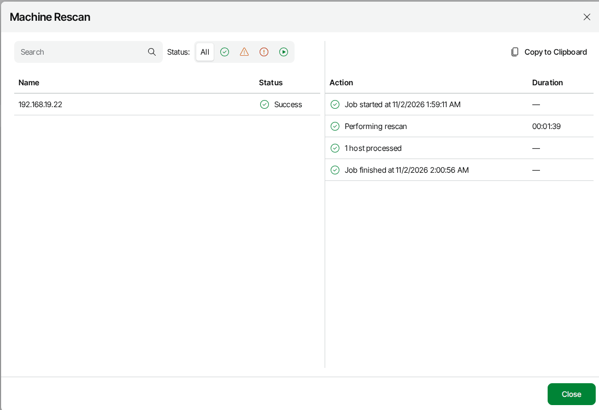{ loading=lazy }
  <figcaption>Le <em>rescan</em> a réussi : « Performing rescan » puis « 1 host processed ».</figcaption>
</figure>

Dans la liste **Protection Groups** > `GP-srv-fichiers`, la machine `SRV-FICHIERS` apparaît avec son système (**Microsoft Windows Server 2025**), son adresse `192.168.19.22` et la colonne **Backup Agent Status** à **Installed**.

<figure markdown="span">
  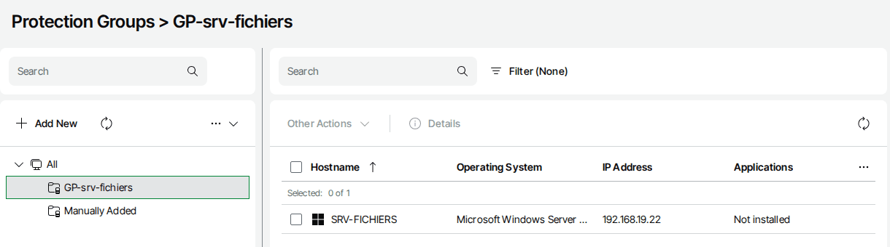{ loading=lazy }
  <figcaption>La machine est maintenant gérée par le groupe de protection.</figcaption>
</figure>

**Vérifier** que l'agent est bien installé et démarré sur le serveur :

```powershell
# 🪟 srv-fichiers, PowerShell
Get-Service | Where-Object DisplayName -match 'Veeam' | Format-Table Name, DisplayName, Status -AutoSize
```

Le résultat doit inclure le service **Veeam Agent for Microsoft Windows** (`VeeamEndpointBackupSvc`) à l'état **Running**, à côté du service d'installation `VeeamDeploySvc` et de services d'aide à la restauration (`VeeamExplorersRecoverySvc`, `VeeamMountSvc`, `VeeamTransportSvc`…), tous normalement à l'état **Running**.

!!! failure "Le rescan se termine en erreur"
    Avant d'incriminer Veeam, vérifier dans l'ordre : l'adresse saisie (`192.168.19.22`), la communication réseau entre `vbr` et `srv-fichiers` (un `ping` depuis la VM), le **pare-feu Windows**, et que le service **VeeamDeploySvc** tourne sur `srv-fichiers`. Ouvrir le détail de la session depuis **Logs & Events** pour lire le message complet.

---

## 4. Créer le job de sauvegarde du dossier

Le job indique **quoi** sauvegarder, **où**, **quand** et **combien de temps** conserver les données.

### 4.1 Lancer l'assistant

1. 🌐 Dans le menu de gauche, ouvrir **Home** > **Jobs**.
2. Cliquer sur **New Job**, puis choisir **Agent Backup Job**.
3. Choisir le mode **Server job**.

<figure markdown="span">
  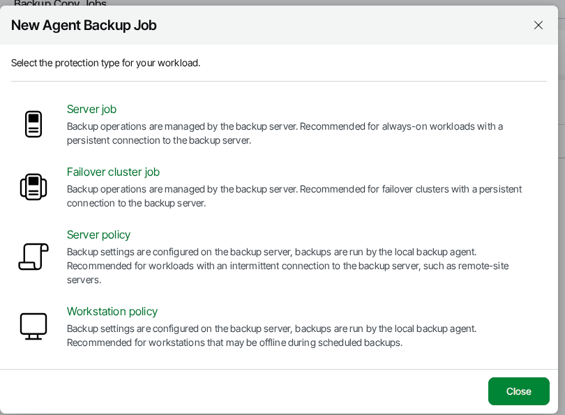{ loading=lazy }
  <figcaption>Le mode du job : <strong>Server job</strong> est géré par le serveur de sauvegarde ; les <em>policy</em> sont gérées par l'agent local.</figcaption>
</figure>

!!! question "Server job ou Server policy ?"
    Dans un **Server job**, c'est le **serveur de sauvegarde** qui commande l'agent : il convient aux serveurs **toujours allumés et joignables**, comme `srv-fichiers`. Une **policy** donne à l'agent ses réglages : l'agent sauvegarde ensuite seul, même si le serveur est injoignable. C'est le bon choix pour des postes ou des portables **nomades**. Le **Failover cluster job** protège un cluster Windows : hors du sujet ici.

4. À l'étape **Name**, saisir :
    - **Name** : `Sauvegarde-Documents-importants-srv-fichiers`
    - **Description** : `Sauvegarde au niveau fichiers du dossier E:\Documents-importants de srv-fichiers`

<figure markdown="span">
  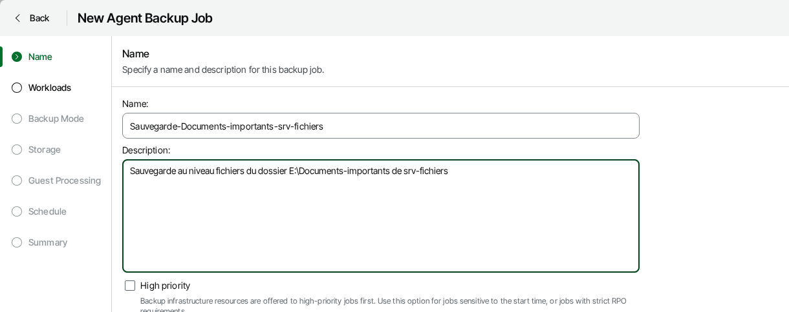{ loading=lazy }
  <figcaption>Le nom du job dit ce qui est sauvegardé et d'où : il reste lisible des mois plus tard.</figcaption>
</figure>

5. À l'étape **Workloads**, cliquer sur **Add**, cocher le groupe **`GP-srv-fichiers`** puis valider. Le groupe apparaît avec le type **Physical infrastructure**.

<figure markdown="span">
  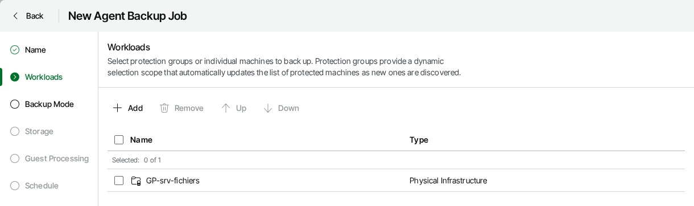{ loading=lazy }
  <figcaption>On désigne le <strong>groupe</strong>, pas la machine : une machine ajoutée plus tard au groupe sera sauvegardée sans modifier le job.</figcaption>
</figure>

### 4.2 Choisir le mode de sauvegarde

À l'étape **Backup Mode**, trois choix s'offrent :

| Mode | Ce qu'il sauvegarde | Quand le choisir |
|---|---|---|
| **Entire machine backup** | L'image complète de la machine (système et données) | Pour reconstruire la machine entière (c'est le mode du serveur Linux de la [partie 6](06-sauvegarder-restaurer-serveur-linux.md)) |
| **Volume-level backup** | Les volumes choisis, par exemple le seul disque de données | Pour protéger un disque entier sans le système |
| **File-level backup** (*slower*) | Uniquement les **fichiers et dossiers** choisis | Pour un dossier précis, comme ici |

Sélectionner **File-level backup (slower)**, puis **Next**.

<figure markdown="span">
  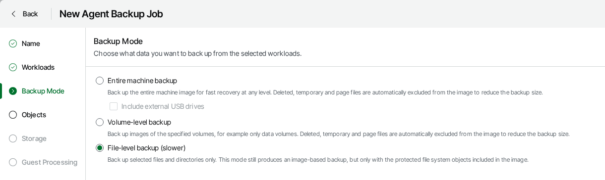{ loading=lazy }
  <figcaption>Le mode fichiers. Veeam précise « <em>slower</em> » : il est plus lent qu'une sauvegarde d'image, mais il ne retient que les objets demandés.</figcaption>
</figure>

!!! warning "Un mode fichiers ne permet pas de reconstruire la machine"
    Avec ce mode, on retrouve **les fichiers**, pas le système Windows. Ce n'est pas un problème ici, car les documents sont l'objet de la protection. Pour protéger le **serveur entier**, utiliser **Entire machine backup**.

### 4.3 Désigner le dossier à sauvegarder

À l'étape **Objects**, trois cases sont proposées : **Operating system**, **Personal files** et **The following file system objects**. Les deux premières sont décochées.

<figure markdown="span">
  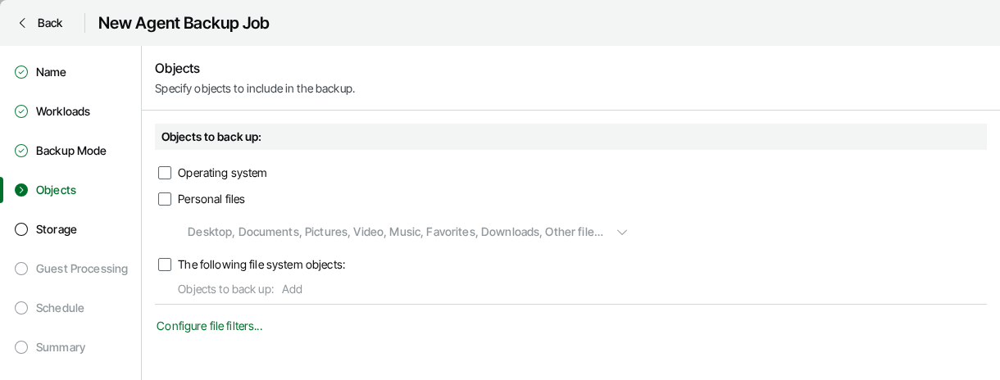{ loading=lazy }
  <figcaption>Au départ, rien n'est sélectionné.</figcaption>
</figure>

1. Cocher **The following file system objects**.
2. Cliquer sur **Add** à côté de **Objects to back up**, saisir `E:\Documents-importants`, puis valider avec **Add**.
3. Cliquer sur **Next**.

<figure markdown="span">
  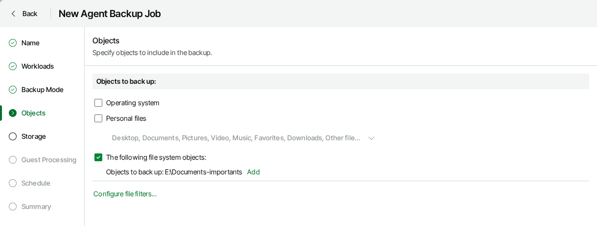{ loading=lazy }
  <figcaption>Le dossier <code>E:\Documents-importants</code> est dans la liste : tout son contenu, sous-dossiers compris, sera sauvegardé.</figcaption>
</figure>

### 4.4 Choisir le dépôt et la rétention

À l'étape **Storage** :

1. Cliquer sur **Select** et choisir **`Default Backup Repository`** (l'appliance), pas `Depot-2-srv-fichiers`.

<figure markdown="span">
  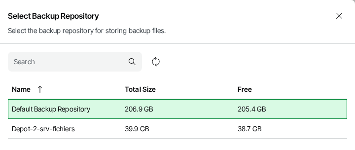{ loading=lazy }
  <figcaption>Les deux dépôts du lab. Ici, on choisit celui de l'appliance : <strong>Default Backup Repository</strong>.</figcaption>
</figure>

!!! question "Pourquoi le dépôt de l'appliance, et pas celui de srv-fichiers ?"
    Les documents à protéger **sont sur `srv-fichiers`**. Les sauvegarder sur `F:` du même serveur laisserait les données et leur copie sur **la même machine** : un incendie, un vol ou un rançongiciel emporterait les deux. En les envoyant sur l'appliance, les données se trouvent sur **deux machines différentes**. De plus, ce dépôt est **immuable** (7 jours dans ce lab, voir la [partie 4](04-ajouter-des-depots-de-sauvegarde.md)) : même un attaquant qui contrôle Veeam ne peut pas supprimer les fichiers de sauvegarde pendant cette durée. À l'inverse, le dépôt n° 2 reçoit la sauvegarde de **configuration** de Veeam, pour la raison inverse : celle-ci doit se trouver **hors** de l'appliance.

2. Laisser **Retention policy** à **7 days**.

<figure markdown="span">
  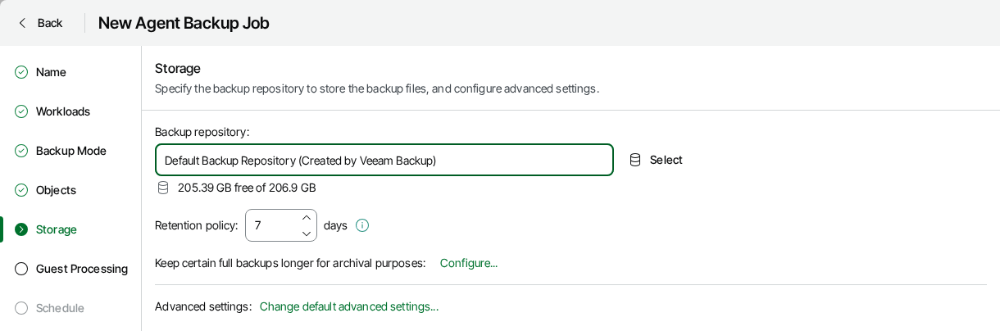{ loading=lazy }
  <figcaption>Dépôt et rétention : on garde <strong>7 jours</strong> de points de restauration.</figcaption>
</figure>

!!! question "Que signifie une rétention de 7 jours ?"
    Veeam conserve les points de restauration des **7 derniers jours** et supprime les plus anciens. Chaque sauvegarde étant planifiée une fois par jour, cela revient à pouvoir **remonter une semaine en arrière**. Cette durée est alignée sur celle de l'immuabilité du dépôt (7 jours) : un point plus ancien que 7 jours peut être supprimé, un point plus récent est verrouillé. Dans un vrai projet, la rétention découle des **besoins métier et réglementaires** (30 jours, 12 mois…). Le lien **Configure…** (*Keep certain full backups longer for archival purposes*) permet d'ajouter des sauvegardes complètes à long terme.

3. Ne pas toucher à **Advanced settings** et cliquer sur **Next**.

### 4.5 Traitement invité et planification

À l'étape **Guest Processing**, laisser les valeurs par défaut :

- **Enable application-aware processing** : activé. Veeam détecte les applications (bases de données par exemple) et prépare une sauvegarde **cohérente**. Sans effet gênant ici : `srv-fichiers` n'héberge pas d'application particulière.
- **Enable guest file system indexing and malware detection** : désactivé. L'indexation permettrait une recherche globale de fichiers et la détection d'activités suspectes, mais elle ralentit le traitement.

<figure markdown="span">
  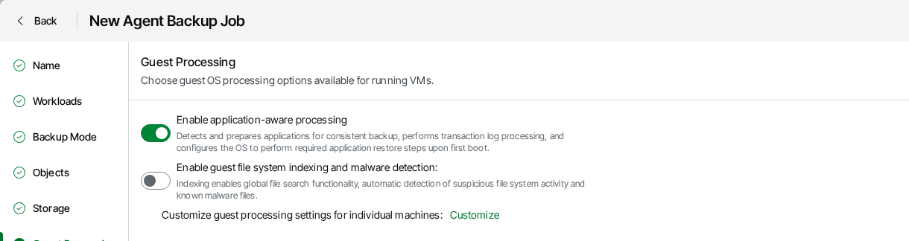{ loading=lazy }
  <figcaption>Traitement invité par défaut : cohérence applicative activée, indexation désactivée.</figcaption>
</figure>

À l'étape **Schedule**, laisser :

- **Run job on schedule** activé, **Daily at this time** `22:00`, **Every day** : le job tourne chaque soir à 22 h, quand les utilisateurs ont quitté leurs postes ;
- **Enable automatic retries** activé : en cas d'échec, trois nouvelles tentatives (**3 times**), à 10 minutes d'intervalle ;
- **Backup window** désactivé : aucune heure limite pour terminer.

<figure markdown="span">
  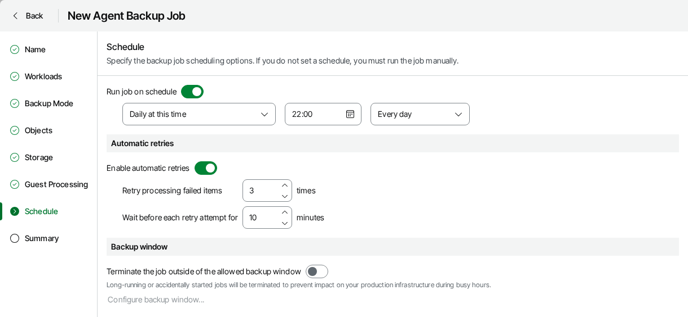{ loading=lazy }
  <figcaption>Planification : tous les jours à 22:00, avec trois nouvelles tentatives en cas d'échec.</figcaption>
</figure>

!!! tip "Pourquoi choisir la nuit ?"
    Une sauvegarde lit beaucoup de données et sollicite le disque et le réseau. La lancer **en dehors des heures de travail** évite de ralentir les utilisateurs. Elle fixe aussi le **RPO** (voir la [partie 1](01-comprendre-la-sauvegarde.md)) : avec une sauvegarde quotidienne, on accepte de perdre au pire **24 heures** de données.

### 4.6 Résumé et premier lancement

À l'étape **Summary**, relire les réglages : mode **Server**, type **Agent backup job**, mode **File-level backup (slower)**, dépôt `/var/lib/veeam/backup`, périmètre **GP-srv-fichiers (Agent)**. Veeam affiche aussi la commande PowerShell qui lance le job.

1. **Laisser cochée** la case **Run the job after I click Finish** : le job démarre tout de suite, sans attendre 22 h.
2. Cliquer sur **Finish**.

<figure markdown="span">
  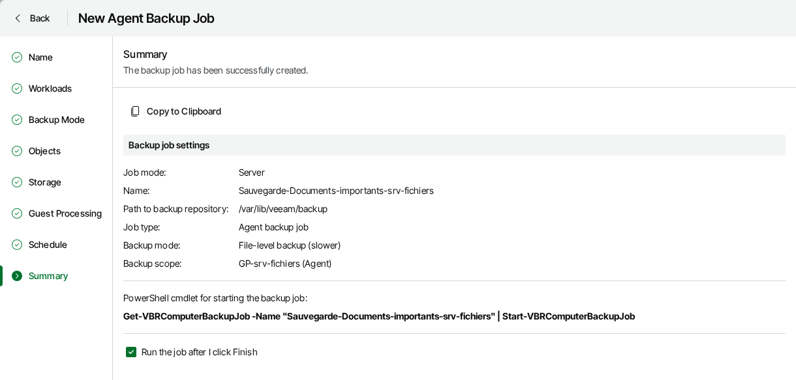{ loading=lazy }
  <figcaption>Le résumé. La commande <code>Start-VBRComputerBackupJob</code> permet de lancer le même job par script.</figcaption>
</figure>

### 4.7 Lire le résultat

Le job apparaît dans **Home** > **Jobs**. Attendre que la colonne **Last Result** passe à **Success**. Dans le lab, le premier passage a duré **2 min 59**. La prochaine exécution est annoncée dans **Next Run** (à 22:00).

<figure markdown="span">
  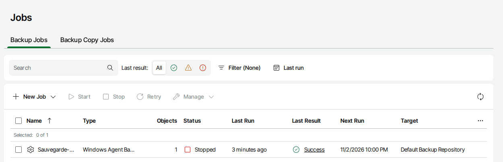{ loading=lazy }
  <figcaption>Le job a réussi : <strong>Last Result</strong> = <strong>Success</strong>, prochaine exécution à 22:00.</figcaption>
</figure>

Cliquer sur **Success** pour ouvrir le détail de la session.

<figure markdown="span">
  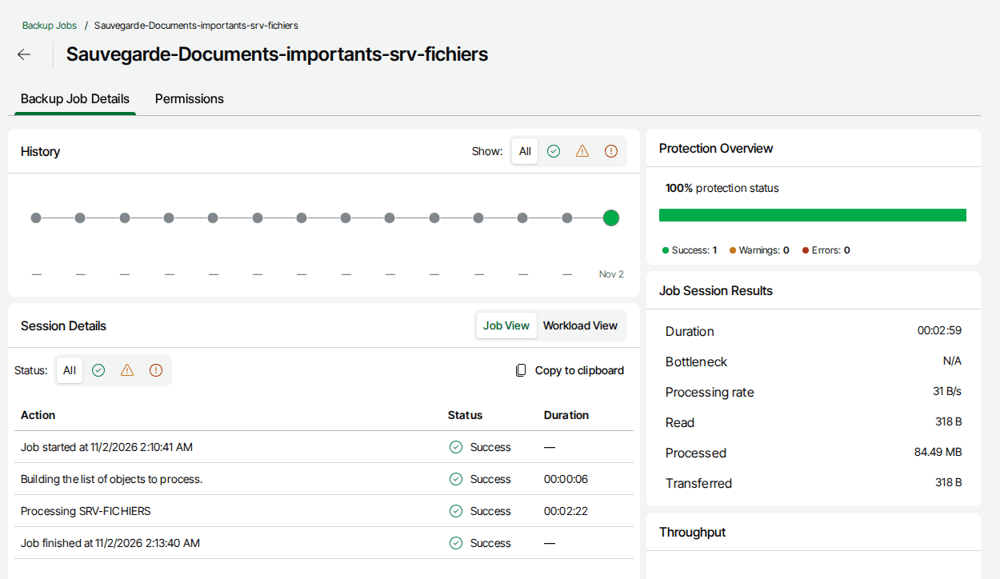{ loading=lazy }
  <figcaption>Le détail de la session : <strong>Protection Overview</strong> à 100 %, durée de <strong>00:02:59</strong>, quatre étapes en <strong>Success</strong> (le traitement de <code>SRV-FICHIERS</code> a duré 2 min 22).</figcaption>
</figure>

!!! note "Les statistiques d'une toute petite sauvegarde"
    Les compteurs **Read** et **Transferred** sont très faibles (318 octets dans la capture, alors que **Processed** affiche 84,49 Mo) : le dossier ne contient que quelques fichiers de quelques lignes, et Veeam compresse et ne transfère que les blocs utiles. Ces valeurs n'ont rien d'anormal pour ce lab. Les durées et les volumes d'un vrai serveur seront bien supérieurs.

---

## 5. Tester la restauration d'un fichier

Une sauvegarde qui n'a jamais été restaurée est une **promesse non vérifiée**. C'est le « **0** » de la règle [3-2-1-1-0](01-comprendre-la-sauvegarde.md#32-la-regle-3-2-1-1-0) : zéro erreur à la restauration. On simule ici l'accident le plus courant : la suppression d'un fichier par erreur.

### 5.1 Relever l'empreinte puis supprimer le fichier

L'**empreinte** (*hash*) SHA-256 est une signature calculée à partir du contenu d'un fichier : si un seul octet change, l'empreinte change complètement. Elle permet de prouver que le fichier restauré est **identique** à l'original.

1. 🪟 Sur `srv-fichiers`, ouvrir **PowerShell** et relever l'empreinte :

    ```powershell
    (Get-FileHash E:\Documents-importants\Comptabilite\factures-2026.csv -Algorithm SHA256).Hash
    ```

    Dans le lab, avec le contenu proposé plus haut :

    ```text
    1646D545EF0DCCD77A0C88BEF952B13A24B941CE553B8DDADB0E29A6B49B18F8
    ```

    Si le fichier a un autre contenu, l'empreinte sera différente : **la noter**.

2. Supprimer le fichier, puis vérifier qu'il a disparu :

    ```powershell
    Remove-Item E:\Documents-importants\Comptabilite\factures-2026.csv
    Get-ChildItem E:\Documents-importants\Comptabilite
    ```

    Il ne reste que `bilan-previsionnel.txt`.

!!! warning "Une suppression « normale » n'est pas annulable"
    `Remove-Item` supprime le fichier **sans passer par la corbeille**. Il n'existe plus que dans la sauvegarde : c'est ce que le test vérifie.

### 5.2 Choisir le point de restauration

1. 🌐 Dans l'interface web, ouvrir **Home** > **Backups**.
2. Déplier la ligne `Sauvegarde-Documents-importants-srv-fichiers` et sélectionner la machine **SRV-FICHIERS**.

<figure markdown="span">
  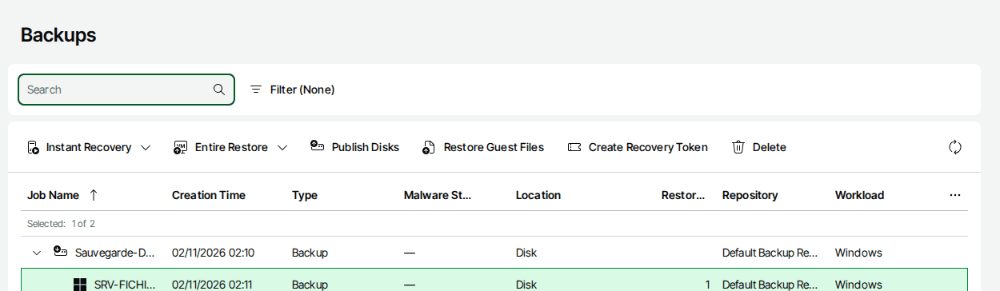{ loading=lazy }
  <figcaption>Sélectionner la <strong>machine</strong> (sous le nom du job) : la barre d'outils propose alors <strong>Restore Guest Files</strong>.</figcaption>
</figure>

3. Cliquer sur **Restore Guest Files** (« restaurer des fichiers invités »).
4. Dans la fenêtre **Select Restore Point**, choisir le point de restauration (ici, un seul : *latest*, de type **Full**) puis cliquer sur **Select**.

<figure markdown="span">
  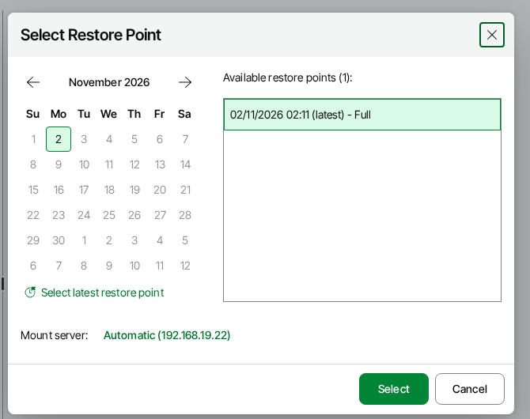{ loading=lazy }
  <figcaption>Les points de restauration disponibles. Le <strong>Mount server</strong> est choisi automatiquement : <code>192.168.19.22</code>.</figcaption>
</figure>

!!! question "Que se passe-t-il pendant le montage ?"
    Veeam ne **décompresse pas** toute la sauvegarde. Il **monte** son contenu sur un **serveur de montage** (*mount server*), ici `srv-fichiers` lui-même, ce qui permet de **parcourir** les fichiers comme un disque et de n'en récupérer qu'un. L'écran affiche « Starting restore session… » quelques secondes.

!!! tip "Le navigateur de restauration ne s'ouvre pas ?"
    Le navigateur de restauration s'ouvre dans une **nouvelle fenêtre**. Si rien n'apparaît, le navigateur web bloque sans doute les **fenêtres contextuelles** (*pop-ups*) : cliquer sur l'icône de blocage qui s'affiche dans la barre d'adresse, autoriser les fenêtres contextuelles pour `https://192.168.19.55`, puis relancer **Restore Guest Files**.

### 5.3 Retrouver le fichier

Une fenêtre **Browse - SRV-FICHIERS** s'ouvre avec l'arborescence de la machine. Deux méthodes pour trouver le fichier :

- **parcourir** : développer `SRV-FICHIERS` > `E:` > `Documents-importants` > `Comptabilite` ;
- **rechercher** : saisir `factures` dans la zone **Search** et valider par **Entrée**.

<figure markdown="span">
  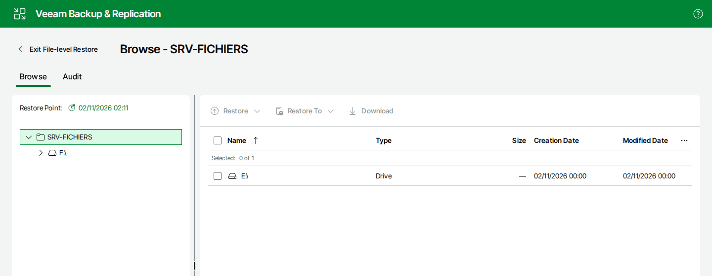{ loading=lazy }
  <figcaption>L'arborescence de <code>SRV-FICHIERS</code> telle qu'elle était lors de la sauvegarde, avec son disque <code>E:</code>.</figcaption>
</figure>

La recherche renvoie un seul fichier : `factures-2026.csv`, de type **File**, d'une taille de **126 octets**, dans `E:\Documents-importants\Comptabilite`.

<figure markdown="span">
  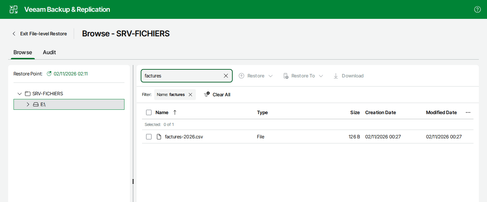{ loading=lazy }
  <figcaption>La recherche « factures » ne renvoie que <code>factures-2026.csv</code>, avec sa taille et ses dates.</figcaption>
</figure>

### 5.4 Choisir comment restaurer : Overwrite, Keep ou Permissions only

1. **Cocher** le fichier `factures-2026.csv`.
2. Cliquer sur **Restore** : un menu propose trois choix.

| Choix | Effet |
|---|---|
| **Overwrite** | **Remplace** le fichier actuel par celui de la sauvegarde, à son emplacement d'origine |
| **Keep** | **Conserve** le fichier actuel et enregistre celui de la sauvegarde **à côté**, dans le même dossier. S'il existe déjà un fichier de même nom, la copie restaurée reçoit le suffixe `_RESTORED_AAAAMMJJ_HHMMSS` (date et heure de la restauration) |
| **Permissions only** | Ne restaure **que les droits d'accès** (NTFS) du fichier, pas son contenu ; le fichier doit exister |

<figure markdown="span">
  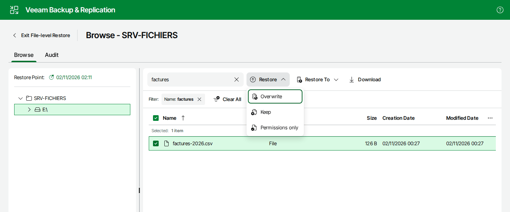{ loading=lazy }
  <figcaption>Le menu <strong>Restore</strong> : <strong>Overwrite</strong>, <strong>Keep</strong>, <strong>Permissions only</strong>.</figcaption>
</figure>

3. Choisir **Keep**.

!!! question "Pourquoi Keep ?"
    **Keep** est le choix **prudent** : il n'écrase jamais rien. Ici le fichier **n'existe plus**, donc il n'y a rien à conserver et la restauration le recrée sous son nom d'origine. Si un fichier du même nom avait existé (par exemple une version modifiée entre-temps), les deux auraient coexisté, et on aurait comparé avant de supprimer l'un des deux. **Overwrite** est plus rapide, mais **irréversible** : à réserver aux cas où l'on est sûr de vouloir revenir à l'ancienne version.

Une fenêtre **Restoring files to 192.168.19.22** affiche la progression. Dans le lab, la restauration a duré **21 secondes** et s'est terminée par **Status: Success**. Le journal indique `Restored file "E:\Documents-importants\Comptabilite\factures-2026.csv"`, `Restored files: 1`, `Restored data size: 126,0 B` et `Restore completed`. Il indique aussi, sur l'appliance, le chemin d'un **journal d'audit** de la restauration (`/var/lib/veeam/VeeamBackupLogFolder/Audit/…`) : une trace de **qui** a restauré **quoi** et **quand**. Cliquer sur **OK**, puis quitter le navigateur de restauration avec **Exit File-level Restore**.

<figure markdown="span">
  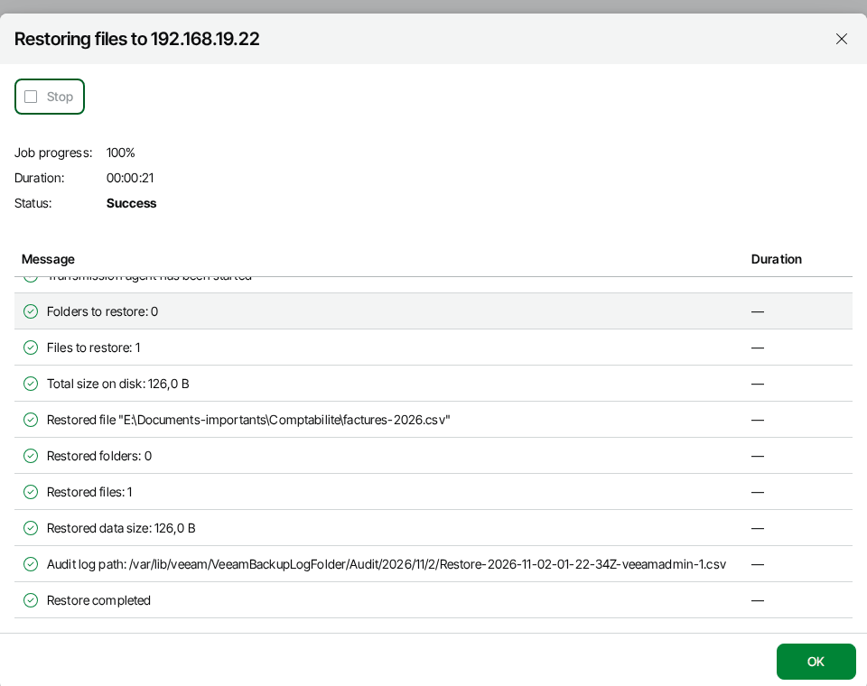{ loading=lazy }
  <figcaption>La restauration est terminée : un fichier, 126 octets, <strong>Status: Success</strong>.</figcaption>
</figure>

### 5.5 Vérifier que le fichier est identique

1. 🪟 Dans **PowerShell** sur `srv-fichiers`, contrôler que le fichier est revenu et recalculer son empreinte :

    ```powershell
    Get-ChildItem E:\Documents-importants\Comptabilite
    (Get-FileHash E:\Documents-importants\Comptabilite\factures-2026.csv -Algorithm SHA256).Hash
    ```

2. **Comparer** avec l'empreinte relevée en 5.1. Dans le lab :

    ```text
    Name                   Length
    ----                   ------
    bilan-previsionnel.txt     52
    factures-2026.csv         126

    1646D545EF0DCCD77A0C88BEF952B13A24B941CE553B8DDADB0E29A6B49B18F8
    ```

    L'empreinte est **identique** à celle d'avant la suppression : le fichier restauré est, bit pour bit, celui de l'original. **Le test est réussi.**

!!! failure "Les empreintes sont différentes, ou le fichier n'est pas revenu"
    - **Fichier absent** : la restauration a peut-être écrit le fichier avec le suffixe `_RESTORED_…` (si un fichier du même nom existait déjà) : lister le dossier complet.
    - **Empreinte différente** : vérifier qu'on compare le **même fichier**, et que le fichier n'a pas été modifié **avant** la sauvegarde (le job ne conserve que ce qu'il a lu à 22 h ou au lancement manuel). Ne pas considérer la sauvegarde comme fiable avant d'avoir compris l'écart.
    - **Le navigateur de restauration ne s'ouvre pas** : voir l'encadré sur les fenêtres contextuelles en 5.2.

### 5.6 Pour aller plus loin

!!! example "Exercice : restaurer avec Overwrite"
    1. Modifier `E:\Documents-importants\Contrats\contrat-maintenance-2026.txt` (ajouter une ligne dans le Bloc-notes).
    2. Relancer **Restore Guest Files** sur le **même** point de restauration, retrouver ce fichier et choisir **Restore** > **Overwrite**.
    3. Vérifier que le contenu est revenu à la version sauvegardée. Que serait-il arrivé avec **Keep** ?

!!! example "Exercice : restaurer vers un autre emplacement"
    Le navigateur de restauration propose aussi **Restore To** (restaurer vers une autre machine ou un autre dossier) et **Download** (télécharger les éléments choisis, dans une archive `.zip`, sur le poste où le navigateur web est ouvert). Selon la liste des limites de l'interface web dans la documentation de Veeam, la restauration de fichiers invités vers **un autre emplacement** se fait plutôt dans la **console Windows** (clic droit sur la machine dans **Backups**, **Restore guest files** > **Microsoft Windows**). Essayer d'y restaurer `factures-2026.csv` dans `E:\Restauration-test`, puis comparer l'empreinte.

---

## 6. Vérification de fin de partie

Cocher chaque point avant de passer à la partie suivante :

- [ ] Un fichier `.bco` existe dans `F:\RepoVeeam\VeeamConfigBackup\vbr\` (section 2.6) ;
- [ ] la console affiche une date à côté de **Last successful backup**, avec le chiffrement activé ;
- [ ] le groupe `GP-srv-fichiers` est en état **Installed** pour `SRV-FICHIERS` et le service `VeeamEndpointBackupSvc` est **Running** ;
- [ ] le job `Sauvegarde-Documents-importants-srv-fichiers` est en **Success**, avec une prochaine exécution à 22:00 ;
- [ ] dans **Home** > **Backups**, la machine `SRV-FICHIERS` possède un point de restauration ;
- [ ] `factures-2026.csv` a été restauré et son empreinte SHA-256 est identique à celle d'origine.

### 🛟 Instantané : `03-fichiers-sauvegardes`

!!! success "Prendre l'instantané `03-fichiers-sauvegardes`"
    1. **Éteindre** proprement les machines du lab (`vbr`, `srv-fichiers`, `pfsense-19`) ;
    2. prendre l'instantané **`03-fichiers-sauvegardes`** sur **toutes** les machines (sauf `srv-debian` si elle n'est pas encore installée) ;
    3. rallumer : pfSense d'abord, puis `vbr`, puis `srv-fichiers`.

    Il permet de **recommencer la partie 6** sans refaire celle-ci. Rappel : un instantané n'est pas une sauvegarde, il reste sur le même disque que la machine (voir [Instantanés conseillés](index.md#instantanes-conseilles)).

---

## 7. Questions de révision

1. Que contient une sauvegarde de configuration, et que ne contient-elle **pas** ?
2. Pourquoi ne faut-il pas la laisser sur le dépôt de l'appliance ?
3. Quels sont les **deux secrets** qui protègent la sauvegarde de configuration d'une appliance, et qui les détient ?
4. Pourquoi crée-t-on un **groupe de protection** plutôt que d'ajouter la machine directement au job ?
5. Quelle différence entre **Entire machine backup**, **Volume-level backup** et **File-level backup** ?
6. Pourquoi avoir choisi le dépôt de l'appliance pour sauvegarder les documents de `srv-fichiers` ?
7. Quelle est la différence entre **Overwrite**, **Keep** et **Permissions only** ?
8. À quoi sert l'**empreinte SHA-256** dans un test de restauration ?

??? success "Corrigé"
    1. Les **réglages** de Veeam (jobs, dépôts, serveurs gérés, groupes de protection), l'historique et le catalogue des points de restauration, et, **si elle est chiffrée**, les identifiants, certificats et clés. Elle ne contient **pas les données sauvegardées**, qui restent dans les dépôts.
    2. Parce qu'elle disparaîtrait avec l'appliance si celle-ci était détruite, volée ou chiffrée par un rançongiciel, c'est-à-dire dans la situation même où on en a besoin. On la place sur **une autre machine**, idéalement aussi **hors site**.
    3. Le **mot de passe de chiffrement** (défini par l'administrateur Veeam dans la console) et la **phrase secrète** (définie par le **Security Officer** dans Host Management). Sans la phrase secrète, la tâche échoue avec « Unable to process the configuration backup without the Security Officer's passphrase ».
    4. Le groupe permet à l'appliance de **déployer et mettre à jour l'agent**, de **réanalyser** régulièrement les machines et de **suivre automatiquement** celles qu'on ajoute : le job désigne le groupe, pas chaque machine.
    5. **Entire machine** : image complète, pour reconstruire la machine. **Volume-level** : des volumes entiers choisis. **File-level** : seulement les fichiers et dossiers désignés, sans le système, adapté à un dossier précis.
    6. Pour que les données et leur copie soient sur **deux machines différentes**, et parce que ce dépôt est **immuable** (7 jours dans le lab), ce qui protège contre la suppression des sauvegardes.
    7. **Overwrite** remplace le fichier actuel par celui de la sauvegarde. **Keep** garde le fichier actuel et restaure l'ancien à côté (suffixe `_RESTORED_` + date et heure si un fichier de même nom existe). **Permissions only** ne restaure que les droits d'accès, pas le contenu.
    8. À **prouver que le fichier restauré est identique à l'original** : si une seule différence existe, l'empreinte change. C'est un test objectif, plus fiable qu'un simple coup d'œil.

---

## Ressources

- [Création de sauvegardes de configuration chiffrées (documentation Veeam)](https://helpcenter.veeam.com/docs/vbr/userguide/config_backup_encrypted.html) — pourquoi chiffrer, rôle de la phrase secrète du Security Officer (en anglais).
- [Lancer une sauvegarde de configuration manuellement (documentation Veeam)](https://helpcenter.veeam.com/docs/vbr/userguide/vbr_config_manually.html) — menu **Configuration Backup**, **Backup now** (en anglais).
- [Sauvegardes de configuration immuables (documentation Veeam)](https://helpcenter.veeam.com/docs/vbr/userguide/config_backup_immutable.html) — conserver la configuration sur un dépôt immuable.
- [Groupes de protection (documentation Veeam)](https://helpcenter.veeam.com/docs/vbr/userguide/protection_group.html) — types de groupes et déploiement des agents.
- [Créer un job de sauvegarde par agent pour Windows, console web (documentation Veeam)](https://helpcenter.veeam.com/docs/vbr/userguide/agent_job_create_win_web.html) — les étapes de l'assistant.
- [Restauration de fichiers invités (documentation Veeam)](https://helpcenter.veeam.com/docs/vbr/userguide/guest_file_recovery.html) — montage, serveur de montage, Overwrite et Keep.
- [Restaurer des fichiers invités dans l'interface web, étape Finalize Recovery (documentation Veeam)](https://helpcenter.veeam.com/docs/vbr/userguide/guest_restore_save_vm_web.html) — Keep, Overwrite, Download et suffixe `RESTORED_`.
- [Limites de l'interface web (documentation Veeam)](https://helpcenter.veeam.com/docs/vbr/userguide/web_ui_limitations.html) — ce que l'interface web ne permet pas encore.
- Partie précédente : [Ajouter des dépôts de sauvegarde](04-ajouter-des-depots-de-sauvegarde.md) · Partie suivante : [Sauvegarder et restaurer un serveur Linux](06-sauvegarder-restaurer-serveur-linux.md) · Retour au [sommaire du parcours](index.md).
