<!-- ============================================================ -->
<!-- ⚠️ RAPPEL IMPORTANT :                                          -->
<!-- Pensez TOUJOURS à ajouter une entrée dans le fichier d'index  -->
<!-- (index.md) du dossier correspondant (ex: docs/cloud/index.md) -->
<!-- afin de référencer ce nouvel article et permettre aux         -->
<!-- visiteurs de le trouver et de cliquer dessus !                -->
<!-- ============================================================ -->

# Sauvegarder et restaurer un serveur Linux avec Veeam

!!! abstract "Résumé"
    Ce TP protège un serveur **Debian 13** (`srv-debian`) : création d'un **groupe de protection** qui déploie l'agent Veeam par SSH, **job de sauvegarde de la machine entière** vers le dépôt par défaut de l'appliance, puis **panne totale simulée** (disque système remplacé par un disque vierge) et **restauration *bare metal*** avec le support de récupération Veeam.

    Deux erreurs réellement rencontrées sont expliquées pas à pas : le refus du module noyau de l'agent par **Secure Boot**, et la résolution du nom `vbr`. À la fin, la preuve que le serveur restauré est bien le même : même clé d'hôte SSH, même nombre de paquets, mêmes réglages.

| Propriété | Valeur |
|-----------|--------|
| Difficulté | Intermédiaire |
| Durée estimée | 2 h 30 (une dizaine de minutes de calcul seulement : le reste est de la saisie et de la lecture) |
| Version décrite | Veeam Backup & Replication 13.1.2.57 (appliance) ; agent Veeam pour Linux 13.1.2.11 ; support de récupération 13.1.2.11 |
| Place dans le parcours | Partie 6 sur 7 du parcours [Veeam Backup & Replication](index.md) |
| Rejoué dans le lab | 2 novembre 2026 (KVM/libvirt) |
| Dernière mise à jour | 2026-11-02 |

<!-- NOTE DE RÉDACTION (non affichée) : Ce qui a changé par rapport à la version 1.5 du support (juin 2024)
- Le support utilisait un serveur Veeam 12 sous **Windows** et un dépôt en **RAID 1** créé sur ce serveur. Ici, c'est l'**appliance Linux 13.1** et son **dépôt par défaut** (`Default Backup Repository`, immuable 7 jours) qui jouent ce rôle : aucune création de RAID ni de dépôt n'est nécessaire.
- Le groupe de protection, le job et les restaurations se font dans l'**interface web** (`https://192.168.19.55`) et non plus dans la console Windows.
- Le support affirmait qu'un **compte Veeam est indispensable** pour télécharger l'ISO de récupération : c'est **faux**. L'ISO est téléchargeable **sans compte** depuis le dépôt public de Veeam (lien et vérification en [section 7](#7-telecharger-et-attacher-liso-de-recuperation) de ce TP).
- Le support demandait de taper **`sudo veeam`** au démarrage du support de récupération : c'est **dépassé**. Avec la version 13, l'écran de licence s'affiche directement, puis le menu principal.
- Pour se connecter au serveur Veeam depuis le support de récupération, le support utilisait le compte Windows du serveur (champ *Domain* `WORKGROUP`). La version 13 propose un **jeton de récupération** (*recovery token*) créé dans l'interface web : plus besoin de communiquer le mot de passe administrateur à une machine en panne.
- **Nouveau** : le dépannage de **Secure Boot** (module noyau DKMS refusé) et celui de la résolution du nom `vbr`, rencontrés dans le lab.
- Le support d'origine avait été rédigé par une autre personne, avec un lab légèrement différent : les valeurs (adresses, tailles de disques) ont été harmonisées avec le reste du parcours.
-->

!!! note "Convention de lecture"
    Chaque action est précédée de la machine sur laquelle elle se fait :

    - 🖥️ **PC hôte** : le PC qui fait tourner les machines virtuelles (hyperviseur, terminal du PC) ;
    - 🌐 **Navigateur** : l'interface web de l'appliance, `https://192.168.19.55`, ouverte depuis `srv-fichiers` ou depuis le PC hôte ;
    - 🐧 **srv-debian** : le serveur Linux à protéger (console de la VM ou SSH) ;
    - 📦 **Appliance `vbr`** : le serveur de sauvegarde (on n'y tape rien dans ce TP, on y accède par le navigateur) ;
    - 💿 **Support de récupération** : le système de secours Veeam, démarré sur `srv-debian` à partir d'une ISO.

    Dans les copies de terminal, la ligne qui commence par `$` est à saisir ; les autres lignes sont ce que la machine répond.

---

## Objectifs

À la fin de ce TP, vous saurez :

- déployer l'agent Veeam sur un serveur Linux **sans rien installer à la main**, grâce à un groupe de protection ;
- créer un job de sauvegarde **machine entière** et lire ses résultats ;
- **diagnostiquer** deux pannes classiques : module noyau refusé par Secure Boot, nom du serveur Veeam introuvable ;
- simuler une **panne totale** et restaurer le serveur sur un disque vierge avec le **support de récupération** ;
- **prouver** que la restauration est fidèle.

## Prérequis

- Les parties [1](01-comprendre-la-sauvegarde.md) à [5](05-sauvegarder-configuration-et-serveur-de-fichiers.md) lues ou réalisées ; au minimum la partie 3 (appliance installée, interface web accessible).
- **Machines allumées** : `pfsense-19` (passerelle et DNS), `vbr` (appliance), `srv-debian`. `srv-fichiers` sert uniquement de poste pour le navigateur : le PC hôte peut le remplacer.
- État attendu de `srv-debian` : Debian 13, adresse `192.168.19.170/24`, SSH actif, compte `user` membre de `sudo` (mot de passe `Popopo333@@@`), accès à Internet (l'agent télécharge des paquets Debian), **idéalement sans Secure Boot** (voir la [partie 3](03-preparer-le-lab-installer-appliance.md)). Si Secure Boot est actif, ne pas s'inquiéter : la [section 4](#4-depanner-deux-erreurs-courantes) explique comment le traiter.
- Un **instantané** `03-fichiers-sauvegardes` de toutes les machines, pris à la fin de la partie 5 (voir les [instantanés conseillés](index.md#instantanes-conseilles)).
- Un **disque vierge** de la **même taille** que le disque système de `srv-debian` (20 Go) pour simuler la panne, et environ 1 Go libre pour l'ISO de récupération.
- Un navigateur connecté en `veeamadmin` (mot de passe `PoPoPo000@@@Lab` + code MFA) : voir [comptes et mots de passe](index.md#comptes-et-mots-de-passe).

!!! tip "Savoir où l'on va"
    | Étape | Ce que l'on fait | Où |
    |---|---|---|
    | 1 | Groupe de protection `GP-srv-debian` (l'agent est déployé par SSH) | 🌐 |
    | 2 | Job `Sauvegarde-srv-debian-machine-entiere` | 🌐 |
    | 3 | Sauvegarde réussie | 🌐 |
    | 4 | Instantané `04-avant-panne`, puis panne simulée | 🖥️ |
    | 5 | ISO de récupération, démarrage dessus, réseau, jeton, restauration | 🖥️ 💿 🌐 |
    | 6 | Vérifications | 🐧 |

---

## 1. Comprendre ce que l'on construit

### 1.1 La sauvegarde « machine entière »

Une sauvegarde **machine entière** (*Entire computer* ou *Entire machine backup*) copie **tous les volumes** du serveur : partitions de démarrage EFI, système, données, mais pas les disques que l'on exclut explicitement. Elle permet la restauration **à nu** (*bare metal*, « métal nu ») : on repart d'un disque **vide** et on retrouve le serveur tel qu'il était, systèmes de fichiers et démarrage compris.

C'est l'opposé d'une sauvegarde de fichiers : on ne choisit pas « les dossiers importants », on prend **tout** pour pouvoir tout remettre en un seul geste.

### 1.2 L'agent Veeam pour Linux

Veeam ne sait pas lire seul l'intérieur d'un serveur Linux : un petit logiciel, l'**agent** (*Veeam Agent for Linux*), s'installe sur le serveur. Il fige l'état des disques au moment de la sauvegarde grâce à un **module noyau** qui prend un **instantané** (le module `blksnap`, compilé sur place), puis envoie les blocs modifiés à l'appliance.

!!! question "Pourquoi un module noyau ?"
    Pour sauvegarder un disque **pendant que le serveur travaille**, il faut figer une image cohérente du disque sans l'arrêter, comme une photographie. Seul le noyau (le cœur du système) peut le faire de façon fiable : l'agent apporte donc un morceau de noyau supplémentaire, le **module** `blksnap`. C'est la source du problème Secure Boot de la [section 4](#4-depanner-deux-erreurs-courantes).

### 1.3 La destination : le dépôt par défaut de l'appliance

Le job écrit dans `Default Backup Repository` (`/var/lib/veeam/backup`, 206,9 Go, **immuable 7 jours**). Un fichier de sauvegarde ne peut ni être modifié ni être supprimé pendant 7 jours, même par un administrateur : c'est la protection contre un rançongiciel qui chercherait à effacer les sauvegardes. Aucun dépôt supplémentaire n'est à créer pour ce TP.

---

## 2. Créer le groupe de protection `GP-srv-debian`

Un **groupe de protection** (*protection group*) est une liste de machines que Veeam sait joindre. Il sert à **découvrir** ces machines et, c'est ce qui nous intéresse, à **y déployer l'agent automatiquement**. Les jobs, eux, ciblent ensuite le groupe.

### 2.1 Nommer le groupe

1. 🌐 Dans l'interface web, ouvrir **Inventory > Protection Groups**, cliquer sur **Add New**, puis choisir **Individual Computers** (ordinateurs individuels).
2. Saisir le **nom** `GP-srv-debian` et la **description** `Groupe de protection du serveur Linux Debian 13 (agent Veeam)`. Cliquer sur **Next**.

<figure markdown="span">
  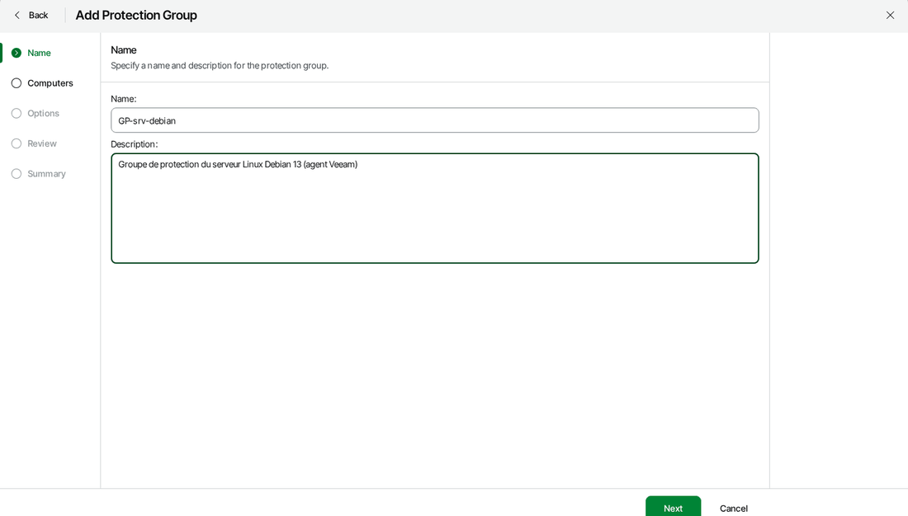{ loading=lazy }
  <figcaption>Étape Name : le nom du groupe reprend celui de la machine, pour retrouver l'objet sans hésiter.</figcaption>
</figure>

### 2.2 Ajouter le serveur et enregistrer les identifiants SSH

1. Sur l'étape **Computers**, cliquer sur **Add**, saisir l'adresse `192.168.19.170` dans **Hostname or IP address**.
2. Sous **Connect using admin credentials**, ouvrir le menu **Add** à côté de la liste des comptes : il propose cinq façons de se connecter. Choisir **Stored SSH credentials** (identifiants SSH enregistrés).

<figure markdown="span">
  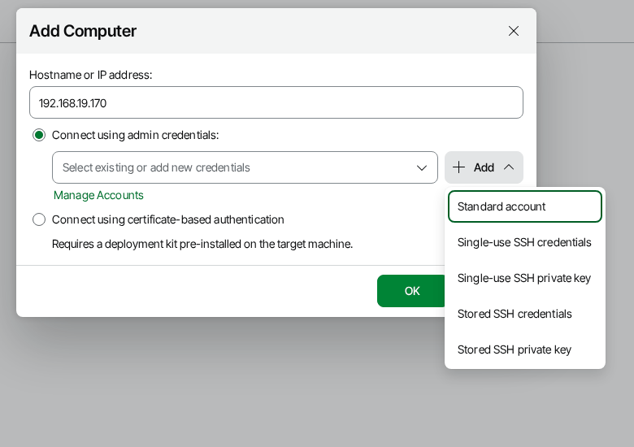{ loading=lazy }
  <figcaption>Cinq types d'identifiants. « Standard account » vise Windows ; pour Linux, on prend « Stored SSH credentials ».</figcaption>
</figure>

!!! question "Pourquoi « Stored » plutôt que « Single-use » ?"
    *Single-use* (« à usage unique ») sert à ouvrir une session SSH le temps du déploiement, puis **oublie** le mot de passe. *Stored* le **range** dans la base de l'appliance : Veeam peut alors **mettre à jour l'agent** ou **réanalyser** la machine plus tard sans qu'on le ressaisisse. En production, on préfère une **clé SSH** (*Stored SSH private key*) à un mot de passe.

3. Renseigner la boîte **Credentials** :

    | Champ | Valeur |
    |---|---|
    | Username | `user` |
    | Password | `Popopo333@@@` |
    | SSH Port | `22` |
    | Elevate account privileges automatically | **cochée** |
    | Description | `Compte user (sudo) de srv-debian` |

    <figure markdown="span">
      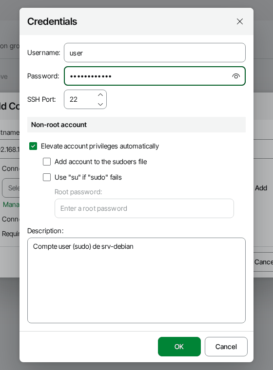{ loading=lazy width="420" }
      <figcaption>Identifiants SSH enregistrés. La case « Elevate… » est indispensable : voir ci-dessous.</figcaption>
    </figure>

4. Cliquer sur **OK**. Le compte apparaît sélectionné ; cliquer à nouveau sur **OK** pour ajouter l'ordinateur.

<figure markdown="span">
  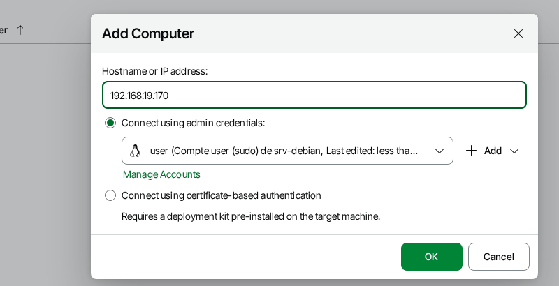{ loading=lazy }
  <figcaption>Adresse et compte sont liés : Veeam se connectera à 192.168.19.170 avec le compte « user ».</figcaption>
</figure>

!!! question "Pourquoi cocher « Elevate account privileges automatically » ?"
    Sur Debian, la connexion `root` par SSH est **désactivée** et `root` n'a pas de mot de passe. Le compte `user` n'est pas administrateur par lui-même : il le devient avec **`sudo`**. Cette case demande à Veeam d'exécuter ses commandes d'installation avec `sudo`, **en réutilisant le mot de passe de `user`**. Sans elle, le déploiement échouerait faute de droits. Les cases « Add account to the sudoers file » et « Root password » restent grisées : elles servent aux comptes qui ne sont pas encore dans `sudo`.

### 2.3 Options de déploiement

Les étapes suivantes règlent **quand** et **comment** l'agent est installé. Garder les valeurs proposées :

<figure markdown="span">
  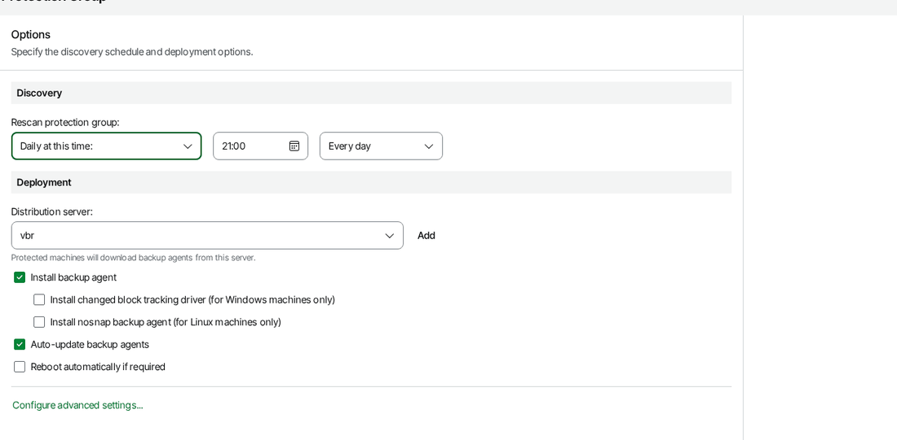{ loading=lazy }
  <figcaption>Étape Options : on installe l'agent et on le laisse se mettre à jour tout seul. La ligne « Distribution server » désigne l'appliance qui diffuse l'agent.</figcaption>
</figure>

| Réglage | Valeur du lab | Explication |
|---|---|---|
| Rescan protection group | Tous les jours à 21:00 | Veeam réinterroge le groupe pour voir les machines ajoutées ou disparues |
| Distribution server | `vbr` | L'appliance elle-même fournit l'agent et le déploie |
| Install backup agent | Cochée | Installe l'agent sur les machines du groupe |
| Install nosnap backup agent (Linux only) | **Décochée** | Variante de l'agent **sans module noyau**, qui ne fait que des sauvegardes de fichiers : inutile ici |
| Auto-update backup agents | Cochée | L'agent suit les mises à jour du serveur Veeam |
| Reboot automatically if required | Décochée | On évite qu'un redémarrage imprévu coupe un serveur en production |

Cliquer sur **Next** : l'étape **Review** annonce le composant à utiliser (*Veeam Distribution Service*, état *Already exists*, c'est-à-dire déjà présent sur l'appliance). Cliquer à nouveau sur **Next**.

!!! info "Pas de domaine ni de certificat dans ce lab"
    L'assistant propose aussi l'authentification **par certificat** (*Connect using certificate-based authentication*). Elle suppose qu'un agent est **déjà** installé sur la machine : ce n'est pas le cas ici.

### 2.4 Résumé et premier déploiement

L'étape **Summary** récapitule le groupe. Laisser cochée **Run discovery when I click Finish**, puis cliquer sur **Finish**.

<figure markdown="span">
  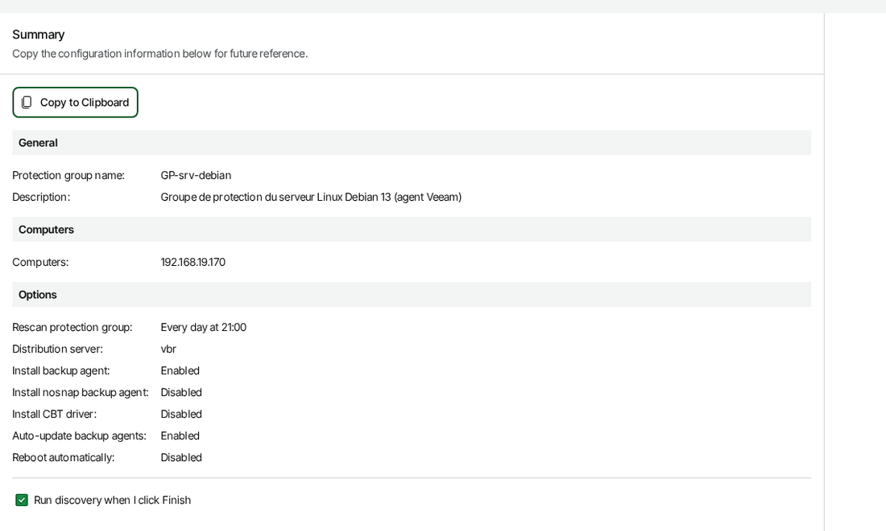{ loading=lazy }
  <figcaption>Le résumé confirme les réglages. « Run discovery… » lance l'installation tout de suite.</figcaption>
</figure>

Une fenêtre **Machine Rescan** s'ouvre : Veeam se connecte en SSH, installe l'agent, puis inventorie la machine. L'opération a duré **3 min 19 s** dans le lab. Attendre que le statut devienne **Success**, puis cliquer sur **Close**.

<figure markdown="span">
  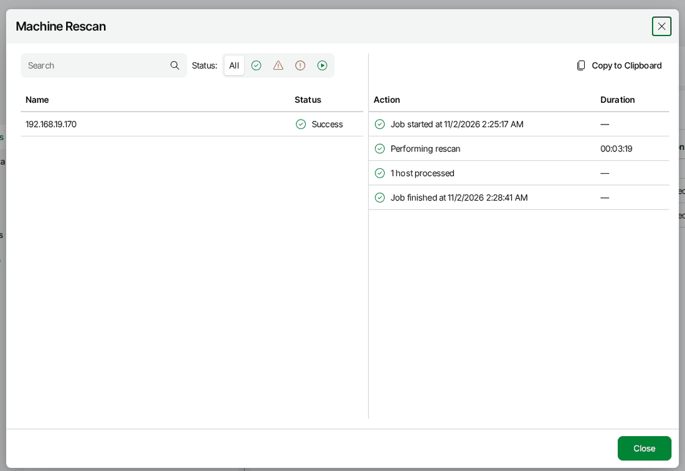{ loading=lazy }
  <figcaption>Rescan réussi : l'agent est en place sur srv-debian.</figcaption>
</figure>

### 2.5 Ce que l'agent a installé

Sur 🐧 **srv-debian**, on peut constater ce que le déploiement a ajouté (le journal du lab en témoigne) :

```console
$ dpkg -l | grep -iE "veeam|fuse|blksnap" | awk '{print $1,$2,$3}'
ii blksnap 13.1.2.11
ii libfuse2t64:amd64 2.9.9-9
ii libfuse3-4:amd64 3.17.2-3
ii veeam 13.1.2.11
ii veeam-libs 13.1.2.11
ii veeamdeployment 13.1.2.57
ii veeamtransport 13.1.2.57
$ systemctl is-active veeamservice
active
```

| Élément | Rôle |
|---|---|
| `veeam`, `veeam-libs` | L'agent proprement dit, version 13.1.2.11 |
| `veeamdeployment`, `veeamtransport` | Le **déployeur** et le **transport de données** (*Data Mover*) pilotés par l'appliance, version 13.1.2.57 |
| `blksnap` | Le **code source du module noyau** de capture d'instantanés, **compilé sur place par DKMS** |
| `libfuse2t64` | La bibliothèque FUSE, utilisée pour **monter une sauvegarde** et en extraire des fichiers |

Le journal d'installation de Debian montre aussi que l'agent a fait installer, par `apt`, tout le nécessaire à la compilation : **les en-têtes du noyau** (`linux-headers-6.12.113+deb13-amd64`), **`dkms`**, **`build-essential`** (compilateur `gcc`, `make`…), **`lvm2`** et **`libfuse2t64`**.

!!! success "L'article 7 disait vrai : `libfuse` s'installe seule sur Debian 13"
    Dans le lab, c'est bien **l'agent** qui a installé `libfuse2t64` (paquet de la bibliothèque FUSE 2) pendant le déploiement : aucune commande manuelle. `libfuse3-4` était déjà présent. Le problème de `libfuse` décrit en [partie 7](07-sauvegarder-vers-azure-blob.md#33-depanner-lechec-du-rescan-la-bibliotheque-libfuse) concerne une machine qui n'avait **pas accès** aux dépôts de paquets au moment du déploiement. Deux conséquences : `srv-debian` doit **sortir sur Internet** pendant l'installation, et le déploiement est plus long qu'on l'imagine (plusieurs dizaines de paquets).

---

## 3. Créer le job de sauvegarde « machine entière »

1. 🌐 Ouvrir **Home > Jobs**, cliquer sur **New Job** et choisir **Linux Computer**.
2. La boîte **New Agent Backup Job** demande qui gère la sauvegarde. Choisir **Server job**.

<figure markdown="span">
  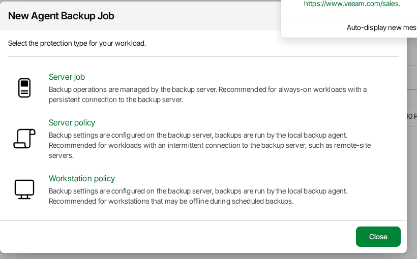{ loading=lazy }
  <figcaption>« Server job » : le serveur Veeam déclenche la sauvegarde. Les deux autres choix laissent l'agent décider seul (postes qui s'éteignent).</figcaption>
</figure>

!!! question "Server job, server policy ou workstation policy ?"
    - **Server job** : c'est l'appliance qui lance la sauvegarde et en réclame le résultat. Adapté à un **serveur toujours allumé**, comme `srv-debian`.
    - **Server policy** : la configuration est donnée par l'appliance, mais l'agent sauvegarde **seul** selon le planning. Pour des serveurs distants ou des liaisons intermittentes.
    - **Workstation policy** : l'agent sauvegarde quand le **poste est disponible** (portable, PC éteint la nuit).

3. Saisir le **nom** `Sauvegarde-srv-debian-machine-entiere` et la **description** `Sauvegarde complète (machine entière) du serveur Debian 13 srv-debian`. Laisser **High priority** décochée. **Next**.

### 3.1 Choisir ce qu'on sauvegarde

1. Sur l'étape **Workloads**, cliquer sur **Add**, dérouler la liste : on choisit le **groupe de protection** et non la machine isolée. Cocher `GP-srv-debian`, puis **Add**.

<figure markdown="span">
  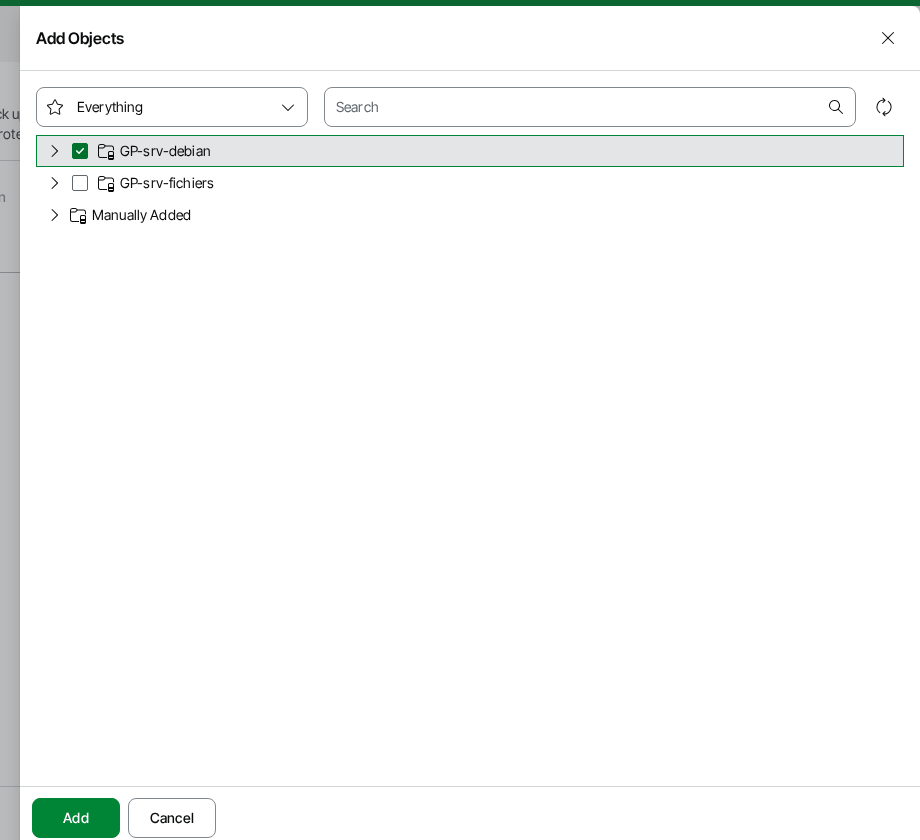{ loading=lazy width="560" }
  <figcaption>On cible le groupe : toute machine ajoutée plus tard au groupe sera sauvegardée sans toucher au job.</figcaption>
</figure>

2. **Next**. À l'étape **Backup Mode**, garder le premier choix, **Entire machine backup**.

<figure markdown="span">
  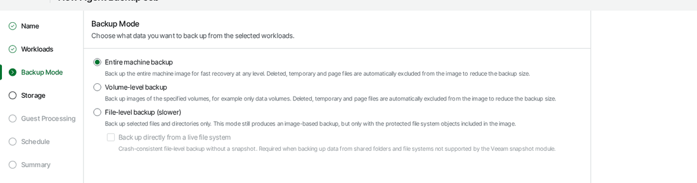{ loading=lazy }
  <figcaption>« Entire machine backup » permet la restauration bare metal ; les deux autres ne gardent que des volumes choisis ou des dossiers.</figcaption>
</figure>

| Mode | Contenu | Restauration à nu ? |
|---|---|---|
| **Entire machine backup** | Tous les volumes de la machine (hors fichiers temporaires et d'échange) | **Oui** |
| **Volume-level backup** | Seulement les volumes cochés | Non : on ne retrouve pas le système entier |
| **File-level backup (slower)** | Fichiers et dossiers choisis, sans instantané du disque | Non |

### 3.2 Stockage, traitement, planification

1. Étape **Storage** : le dépôt proposé est `Default Backup Repository (Created by Veeam Backup)`, la **rétention** 7 jours. Garder ces valeurs.

<figure markdown="span">
  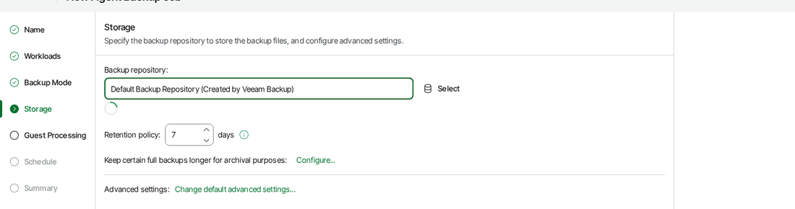{ loading=lazy }
  <figcaption>Le dépôt par défaut de l'appliance (immuable 7 jours), avec 7 jours de rétention.</figcaption>
</figure>

!!! question "Que signifie « 7 jours » de rétention ?"
    Veeam garde les **points de restauration** des 7 derniers jours, puis supprime les plus anciens. Elle s'accorde avec l'**immuabilité** de 7 jours du dépôt : un point récent ne peut pas être effacé avant d'avoir eu 7 jours.

2. Étape **Guest Processing** : laisser les deux interrupteurs **désactivés**. Ils servent à l'analyse d'applications (bases de données) et à l'indexation des fichiers, inutiles pour un Debian vierge.

<figure markdown="span">
  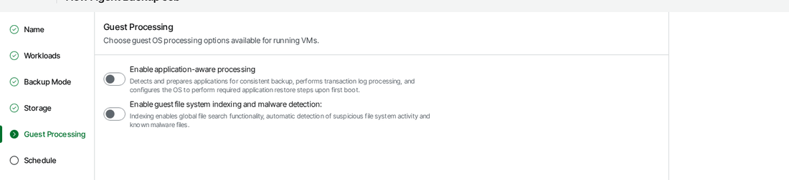{ loading=lazy }
  <figcaption>Aucun traitement applicatif sur ce serveur.</figcaption>
</figure>

3. Étape **Schedule** : laisser **Run job on schedule** activé, **Daily at this time 22:00, Every day**, et les **nouvelles tentatives automatiques** (3 tentatives à 10 minutes d'intervalle).

<figure markdown="span">
  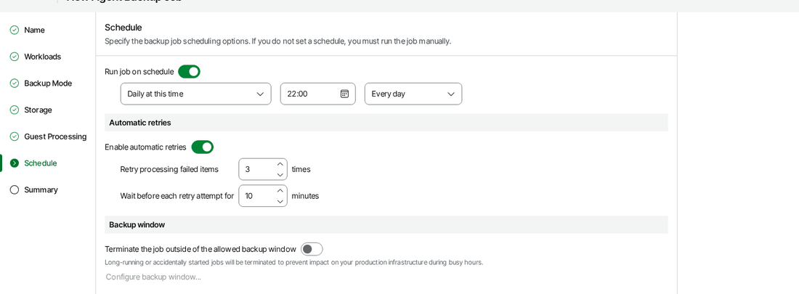{ loading=lazy }
  <figcaption>Une sauvegarde par jour à 22:00 : c'est ce qui fixe l'objectif de point de reprise (RPO), voir les questions de révision.</figcaption>
</figure>

4. **Next** : l'étape **Summary** récapitule le job (nom, dépôt `/var/lib/veeam/backup`, type *Agent backup job*, mode *Entire machine backup*, portée `GP-srv-debian (Agent)`). Cocher **Run the job after I click Finish**, puis **Finish**.

<figure markdown="span">
  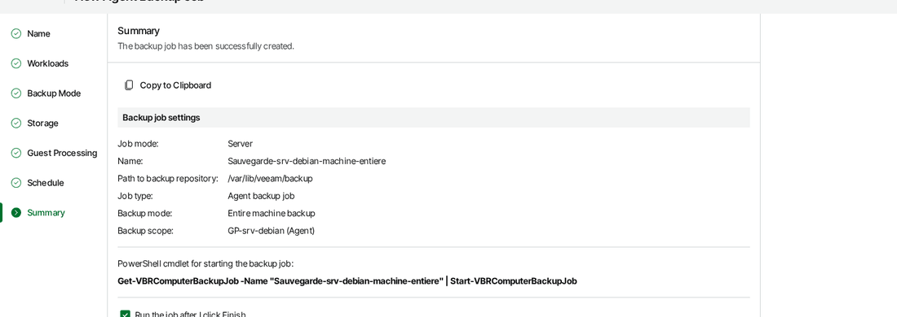{ loading=lazy }
  <figcaption>Résumé du job. Le résumé donne aussi la commande PowerShell équivalente, pratique pour automatiser.</figcaption>
</figure>

Le job démarre. Dans le lab, **le premier essai a échoué**.

<figure markdown="span">
  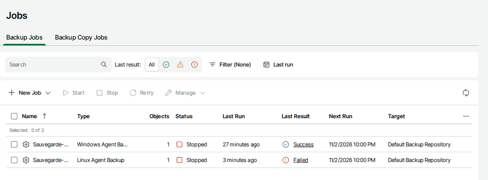{ loading=lazy }
  <figcaption>Colonne « Last Result » : Failed. Pas de panique : c'est le cas d'école de la section suivante.</figcaption>
</figure>

---

## 4. Dépanner deux erreurs courantes

Cette section sert à **toute personne dont le premier job échoue**. Si le vôtre a réussi du premier coup (cas de `srv-debian` créé sans Secure Boot, comme recommandé en partie 3), passer directement à la [section 5](#5-verifier-la-sauvegarde-puis-prendre-linstantane).

### 4.1 Comment trouver la cause

1. 🌐 Dans **Jobs**, cliquer sur le résultat **Failed** : la fenêtre de session indique **Processing srv-debian** en échec, mais pas pourquoi.
2. 🐧 Sur `srv-debian`, lire le journal du job (il y en a un par session) :

    ```console
    $ sudo veeamconfig session list
    Job name                                                Type    ID        State   ...
    Sauvegarde-srv-debian-machine-entiere - 192.168.19.170  Backup  {933a…}   Failed  ...
    $ sudo bash -c 'cd "/var/log/veeam/Backup/Sauvegarde-srv-debian-machine-entiere - 192.168.19.170/"Session_*; grep -hE "ERR |WARN" Job.log | tail -20'
    ```

Deux messages importants apparaissent dans le journal du lab.

### 4.2 Erreur n° 1 : Secure Boot refuse le module noyau

!!! failure "Message d'erreur"
    ```text
    ERR |Failed to load kernel module [veeamblksnap]. … Is Secure Boot enabled?
    ```

    et, en essayant de charger le module à la main :

    ```console
    $ sudo modprobe veeamblksnap
    modprobe: ERROR: could not insert 'veeamblksnap': Key was rejected by service
    $ mokutil --sb-state
    SecureBoot enabled
    $ sudo dmesg | grep -i lockdown
    [    0.000000] Kernel is locked down from EFI Secure Boot; see man kernel_lockdown.7
    ```

!!! question "Pourquoi Secure Boot refuse-t-il le module ?"
    **Secure Boot** (démarrage sécurisé) est une fonction du firmware UEFI : le démarrage ne laisse passer que du code **signé par une clé de confiance** (celle de Microsoft, de la distribution…). Lorsqu'il est actif, Linux passe en mode **lockdown** (« verrouillé ») et refuse de charger un **module noyau non signé par une clé connue**, pour qu'un logiciel malveillant ne puisse pas se glisser dans le noyau.

    Or le module `blksnap` n'est **pas** livré compilé : DKMS le compile sur la machine et le signe avec une **clé générée localement** (`/var/lib/dkms/mok.pub`, la *Machine Owner Key*, MOK). Tant que le firmware **ne connaît pas** cette clé, il répond « *Key was rejected by service* ». Ce n'est ni un bogue de Veeam ni un module défectueux : c'est la protection qui fonctionne.

    Vérification : `dkms status` indique que le module est bien **installed**, et `modinfo veeamblksnap` le trouve dans `/lib/modules/…/updates/dkms/`.

Deux solutions existent.

#### Solution A (retenue dans le lab) : désactiver Secure Boot

C'est la plus simple pour un lab. **Éteindre** la VM, puis :

=== "VMware Workstation"

    1. Clic droit sur la VM > **Settings** > onglet **Options** > **Advanced**.
    2. Dans **Firmware type**, laisser **UEFI** et **décocher** **Enable secure boot**.
    3. **OK**, puis rallumer la VM.

=== "VirtualBox"

    VirtualBox démarre **en BIOS** (sans EFI) par défaut pour Debian : si c'est votre cas, Secure Boot **n'existe pas** et l'erreur ne peut pas venir de lui.

    Si vous avez coché **Enable EFI (special OSes only)** dans **Settings > System > Motherboard**, VirtualBox 7 propose aussi une option **Secure Boot** sur cette page : la **décocher**. Ne **pas** décocher EFI pour autant si Debian y a été installée : elle ne redémarrerait plus.

=== "Proxmox VE"

    Une VM **OVMF (UEFI)** est créée avec un disque EFI qui, **par défaut**, contient des **clés Secure Boot pré-inscrites** (case *Pre-Enroll keys*) : Secure Boot est donc **actif**.

    1. Démarrer la VM et appuyer sur **Échap** dès l'écran du logo pour entrer dans le menu du firmware.
    2. **Device Manager > Secure Boot Configuration**, décocher **Attempt Secure Boot**, puis enregistrer et redémarrer.

    Autre solution : supprimer le disque EFI et le recréer **sans** *Pre-Enroll keys* (Debian se relance alors depuis l'entrée de secours du disque).

=== "KVM / libvirt (rejoué dans le lab)"

    Dans la définition de la VM, remplacer le firmware à clés inscrites par un firmware sans Secure Boot, puis démarrer avec une NVRAM remise à zéro :

    ```xml
    <os firmware='efi'>
      <firmware>
        <feature enabled='no' name='enrolled-keys'/>
        <feature enabled='no' name='secure-boot'/>
      </firmware>
    </os>
    ```

    ```console
    $ virsh start veeam-srv-debian --reset-nvram
    ```

!!! warning "Les réglages VMware, VirtualBox et Proxmox n'ont pas été rejoués"
    Le lab de 2026 tourne sous KVM/libvirt. Les trois premiers onglets s'appuient sur la documentation de chaque produit : les libellés peuvent différer légèrement selon la version. Seul l'onglet KVM a été exécuté.

Vérification, une fois la VM redémarrée :

```console
$ mokutil --sb-state
This system doesn't support Secure Boot
$ sudo modprobe veeamblksnap && lsmod | grep -i blksnap
veeamblksnap          155648  0
bdevfilter             94208  1 veeamblksnap
```

Dans le lab, le message est « *This system doesn't support Secure Boot* » parce que le firmware utilisé n'a pas de Secure Boot du tout ; avec un firmware qui le propose mais désactivé (VMware, par exemple), on lit plutôt `SecureBoot disabled`. L'important est que `modprobe` **réussisse** et que `veeamblksnap` apparaisse dans `lsmod`.

!!! danger "Désactiver Secure Boot n'est pas innocent"
    Sur un serveur de production, Secure Boot protège le démarrage. La bonne pratique est de **garder** Secure Boot et d'**inscrire la clé** du module, voir la solution B. Désactiver est acceptable pour un lab.

#### Solution B : inscrire la clé MOK de DKMS (n'a pas abouti dans le lab)

C'est la méthode que décrit la [documentation Veeam](https://helpcenter.veeam.com/docs/agentforlinux/userguide/installation_uefi_secure_boot.html) : demander au firmware de faire confiance à la clé qui signe le module.

1. 🐧 Demander l'inscription de la clé et choisir un **mot de passe temporaire** (il ne sert qu'une fois, au prochain démarrage) :

    ```console
    $ sudo mokutil --import /var/lib/dkms/mok.pub
    input password:
    input password again:
    $ sudo mokutil --list-new
    ```

2. Redémarrer la machine. Un **écran bleu** (le gestionnaire **MokManager**) s'affiche brièvement avec un compte à rebours : **appuyer sur une touche** avant la fin, sinon le démarrage continue normalement et la demande est **perdue** (il faut alors refaire l'étape 1).
3. Choisir **Enroll MOK > Continue > Yes**, saisir le mot de passe temporaire, puis **Reboot**.
4. Vérifier : `sudo mokutil --test-key /var/lib/dkms/mok.pub` doit répondre que la clé est **already enrolled**, puis relancer le job (**Retry**).

!!! warning "Non vérifié : cette voie n'a pas abouti dans le lab"
    Deux tentatives ont été faites sur KVM. La première a échoué parce qu'une touche automatique a **validé l'option par défaut** (« Continue boot ») au lieu d'**Enroll MOK** : la demande a été consommée sans inscrire la clé (`/var/lib/dkms/mok.pub is not enrolled`). À la seconde, l'écran bleu est apparu mais la VM s'est ensuite arrêtée sur le menu GRUB sans démarrer ; la cause n'a pas été élucidée dans le temps imparti et le lab a basculé sur la solution A. Les étapes 3 et 4 ci-dessus suivent la documentation et **n'ont pas été rejouées**. Au besoin, saisir ces étapes à la main, sans automatisation, dans la console de la VM.

### 4.3 Erreur n° 2 : le nom `vbr` ne se résout pas

!!! failure "Message d'erreur (journal du job sur srv-debian)"
    ```text
    WARN|Failed to resolve endpoint [vbr:10006].
    >>  |Failed to resolve name: vbr. Error: Name or service not known
    ```

**Pourquoi l'agent cherche-t-il `vbr` ?** L'appliance s'annonce à ses clients **par son nom d'hôte** (`vbr`), et non par son adresse IP. Quand l'agent doit joindre le serveur Veeam (port TCP `10006`), il cherche donc `vbr`. Or `srv-debian` ne connaît que l'adresse du résolveur DNS de pfSense, et pfSense **ne connaît pas** `vbr` : la résolution échoue. Le journal classe ce message en `WARN` (avertissement) et pas en `ERR` : dans le lab, le premier job s'est arrêté sur Secure Boot, mais les **deux correctifs** (Secure Boot et nom) ont été appliqués **avant** le second essai : on ne sait donc pas si le nom seul aurait suffi à bloquer le job. Ne pas le négliger : une machine qui ne trouve pas son serveur de sauvegarde ne peut pas communiquer avec lui.

Deux façons de le corriger :

=== "Rapide : /etc/hosts (retenu dans le lab)"

    🐧 Sur `srv-debian`, ajouter une ligne d'association nom-adresse :

    ```console
    $ echo "192.168.19.55 vbr" | sudo tee -a /etc/hosts
    $ getent hosts vbr
    192.168.19.55   vbr
    ```

    Simple et immédiat, mais à refaire **sur chaque machine** protégée.

=== "Propre : un enregistrement DNS sur pfSense"

    Déclarer `vbr` **une fois**, dans le DNS qui sert tous les clients du LAN. Dans pfSense : **Services > DNS Resolver > Host Overrides > Add**, avec **Host** `vbr`, **Domain** le domaine du lab, **IP Address** `192.168.19.55`. Toutes les machines (dont celles ajoutées plus tard) résoudront `vbr` sans autre réglage.

    Cette variante est la bonne pratique, mais **elle n'a pas été testée dans le lab** : le lab a utilisé le fichier `hosts`. Après l'ajout, vérifier avec `getent hosts vbr` depuis `srv-debian`.

### 4.4 Relancer le job

Une fois les deux corrections faites :

1. 🌐 Dans **Jobs**, cocher le job `Sauvegarde-srv-debian-machine-entiere`.
2. Cliquer sur **Retry** (« réessayer » : relance uniquement les machines en échec).

---

## 5. Vérifier la sauvegarde, puis prendre l'instantané

### 5.1 Lire le résultat

Dans le lab, le second essai a duré environ **3 minutes** et le statut est passé à **Success**.

<figure markdown="span">
  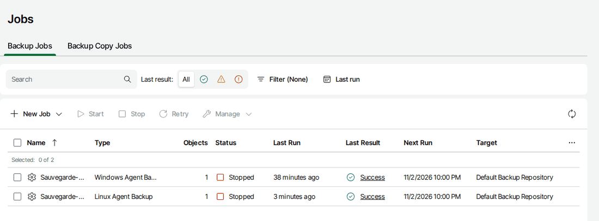{ loading=lazy }
  <figcaption>Last Result : Success. Un point de restauration existe désormais dans le dépôt par défaut.</figcaption>
</figure>

### 5.2 Relever les « preuves avant panne »

Pour pouvoir comparer **après** la restauration, relever ces valeurs sur 🐧 **srv-debian** et les noter :

```console
$ hostname
srv-debian
$ grep vbr /etc/hosts
192.168.19.55 vbr
$ dpkg -l | grep -c ^ii
397
$ ssh-keygen -lf /etc/ssh/ssh_host_ed25519_key.pub
256 SHA256:5Im5cNqiO6PCyJKPME/rSa5XR3MQf3V4RnvRUa4D69c root@srv-debian (ED25519)
```

!!! question "Pourquoi la clé d'hôte SSH ?"
    La clé d'hôte SSH est générée **une seule fois**, à l'installation de la machine, et ne change jamais. Si, après la restauration, elle est **identique**, c'est la preuve que ce n'est pas une nouvelle installation mais bien **le même disque** retrouvé. C'est aussi ce qui évite l'alerte « *REMOTE HOST IDENTIFICATION HAS CHANGED* » chez les clients SSH. Votre valeur sera **différente** de celle du lab : ne comparer que les vôtres.

### 5.3 🛟 Instantané `04-avant-panne`

1. 🐧 Éteindre proprement `srv-debian` : `sudo systemctl poweroff`.
2. 🖥️ Prendre l'instantané **`04-avant-panne`** de `srv-debian` (et, de préférence, de toutes les machines du lab : voir les [instantanés conseillés](index.md#instantanes-conseilles)).

!!! tip "Pourquoi ce point de retour ?"
    La suite détruit volontairement le disque de `srv-debian`. Avec cet instantané, vous pourrez **rejouer** toute la restauration autant de fois que nécessaire, en revenant ici. Ce n'est **pas** la sauvegarde elle-même (voir l'avertissement de la page d'accueil du parcours) : la vraie sauvegarde est sur l'appliance.

---

## 6. Simuler la panne : remplacer le disque système

**Éteindre** la VM `srv-debian` (déjà fait), puis remplacer son disque système par un disque **vierge de même taille ou plus grand** (20 Go ici).

=== "VMware Workstation"

    1. **Settings > Hard Disk (NVMe/SCSI) > Remove** pour détacher le disque (ne pas supprimer le fichier : il resservira).
    2. **Add > Hard Disk > Create a new virtual disk**, **20 Go**, même type de contrôleur.

=== "VirtualBox"

    1. **Settings > Storage** : sélectionner le disque dur du contrôleur, cliquer sur **Remove Attachment** (ne pas supprimer le fichier).
    2. Cliquer sur **Adds hard disk > Create**, **VDI**, **20 Go**.

=== "Proxmox VE"

    1. **Hardware** : sélectionner le disque, **Detach** (il apparaît en *Unused Disk*).
    2. **Add > Hard Disk**, même bus, **20 GiB**.

=== "KVM / libvirt (rejoué dans le lab)"

    Créer un volume vierge de 20 Go, puis remplacer la source du disque `vda` dans la définition de la VM :

    ```console
    $ virsh vol-create-as lab-veeam veeam-srv-debian-disque-vierge.qcow2 20G --format qcow2 --prealloc-metadata
    $ virsh edit veeam-srv-debian    # remplacer <source file='…'/> du disque vda
    ```

!!! info "Disque de même taille ou plus grand"
    Le support de récupération recrée les partitions telles qu'elles étaient ; il lui faut au moins **autant d'espace** que la machine d'origine. Une taille inférieure peut bloquer la restauration.

Démarrer ensuite la VM : **elle ne démarre plus**. Il n'y a plus de système sur le disque : selon l'hyperviseur, on obtient un écran de firmware (*No bootable device*, *Boot failed*, un shell UEFI…). C'est exactement le scénario d'une panne de disque dans un vrai serveur. **Éteindre la VM** avant de continuer.

---

## 7. Télécharger et attacher l'ISO de récupération

### 7.1 Télécharger l'ISO (sans compte)

Le support de récupération est une **ISO amorçable** : un petit système Debian 13 qui sait parler à Veeam. Elle se télécharge **sans compte Veeam** : Veeam publie ces ISO dans un dépôt **public**.

1. 🖥️ Le dépôt est à l'adresse <https://repository.veeam.com/backup/linux/agent/veeam-recovery-media/x64/>. Vérifier qu'il répond, puis télécharger :

    ```console
    $ curl -sIL https://repository.veeam.com/backup/linux/agent/veeam-recovery-media/x64/veeam-recovery-amd64-13.0.0.iso | grep -iE '^HTTP|content-length|last-modified'
    HTTP/1.1 200 OK
    Content-Length: 762314752
    Last-Modified: Tue, 27 Oct 2026 16:17:55 GMT
    $ curl -L -O https://repository.veeam.com/backup/linux/agent/veeam-recovery-media/x64/veeam-recovery-amd64-13.0.0.iso
    ```

2. Vérifier le fichier :

    ```console
    $ ls -l veeam-recovery-amd64-13.0.0.iso
    -rw-rw-r-- 1 user user 762314752 ... veeam-recovery-amd64-13.0.0.iso
    $ sha256sum veeam-recovery-amd64-13.0.0.iso
    b866ce121b2d5d30ecba84cf640bc2e00112e4e9467594a2993f502427912724  veeam-recovery-amd64-13.0.0.iso
    $ file veeam-recovery-amd64-13.0.0.iso
    veeam-recovery-amd64-13.0.0.iso: ISO 9660 CD-ROM filesystem data (DOS/MBR boot sector) 'veeam-recovery-iso-13.1.2.11' (bootable)
    ```

!!! warning "Un nom de fichier qui ment : « 13.0.0 » contient la version 13.1.2.11"
    Ce qui est **sûr** : le dépôt n'offre qu'**un seul fichier pour la série 13**, nommé `veeam-recovery-amd64-13.0.0.iso` ; il pèse **762 314 752 octets** et son **étiquette de volume** (celle que lit la commande `file`) est `veeam-recovery-iso-13.1.2.11`. L'ISO est donc **assortie à l'agent 13.1.2.11** installé en section 2 : c'est cette version qu'il faut retenir.

    Ce qui n'est **pas** établi : pourquoi Veeam laisse `13.0.0` dans le nom (probablement le nom de la série, mais ce n'est pas documenté). Ne **pas** vous fier au nom du fichier : renommer la copie en `veeam-recovery-amd64-13.1.2.11.iso` évite toute confusion. Le **SHA-256** ci-dessus est celui de l'ISO du lab ; si Veeam la republie, il changera, et seule la comparaison avec le fichier du dépôt public a un sens.

!!! tip "Veeam documente aussi ces ISO"
    La page [Veeam Recovery Media](https://helpcenter.veeam.com/docs/agentforlinux/userguide/recovery_media.html) explique le contenu du support de récupération et la page [Veeam Recovery Media Versions](https://helpcenter.veeam.com/docs/agentforlinux/userguide/recovery_media_versions.html) liste les versions publiées.

### 7.2 Attacher l'ISO et démarrer dessus

1. 🖥️ Insérer l'ISO dans le **lecteur CD/DVD virtuel** de `srv-debian` (le lecteur doit exister dans la VM ; l'ajouter sinon).
2. Placer le **lecteur CD/DVD en premier** dans l'**ordre de démarrage**, **avant** le disque (vide : le firmware passerait de toute façon à l'ISO, mais autant ne pas dépendre de cela).

    - VMware : **VM > Power > Power On to Firmware**, puis menu **Boot**, ou **CD-ROM** déplacé en tête dans **Settings > Options > Boot Options** ;
    - VirtualBox : **Settings > System > Motherboard > Boot Order**, cocher **Optical** et le monter en tête ;
    - Proxmox VE : **Options > Boot Order**, activer **ide2** (le lecteur CD) et le glisser en premier ;
    - KVM/libvirt (lab) : `<boot order='1'/>` sur le CD-ROM, `<boot order='2'/>` sur le disque.

3. Démarrer la VM. Le menu **GRUB** de l'ISO propose les entrées « Veeam recovery … » : laisser la première, le démarrage se fait seul au bout de quelques secondes.

<figure markdown="span">
  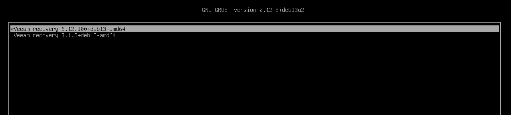{ loading=lazy }
  <figcaption>Le menu GRUB du support de récupération. La première entrée, mise en évidence, démarre seule.</figcaption>
</figure>

---

## 8. Restaurer le serveur avec le support de récupération

Le support de récupération est en **mode texte** : on navigue avec le clavier. Les **flèches** déplacent la sélection, **Entrée** valide, **Tab** passe à l'élément suivant, **Échap** revient en arrière.

!!! warning "Clavier : deux pièges possibles"
    - **Disposition QWERTY probable** : le clavier du support de récupération est vraisemblablement en **QWERTY** (touches de l'anglais américain). Ce point **n'a pas pu être vérifié** dans le lab, où la saisie passait par un clavier virtuel déjà en QWERTY. Avant de taper un mot de passe, une adresse ou un jeton, **lire à l'écran** ce qui s'est écrit, car `:`, `-` ou `@` peuvent être ailleurs sur un clavier AZERTY.
    - **Clavier qui ne répond pas** : dans le lab (KVM), le support de récupération **ignorait le clavier virtuel PS/2** de la VM. Ajouter un **clavier USB** à la VM a réglé le problème. Avec VMware, VirtualBox ou Proxmox, ce défaut n'a pas été testé : si les touches sont sans effet, essayer d'ajouter un contrôleur/clavier USB à la VM.

### 8.1 Identifiants SSH temporaires et licence

Après quelques dizaines de secondes, une fenêtre **SSH Connection Info** s'affiche. C'est une nouveauté de la version 13 : le support de récupération ouvre un **accès SSH temporaire** (nom d'utilisateur `veeamuser`, mot de passe aléatoire propre à ce démarrage) pour pouvoir le piloter à distance. On n'en a pas besoin ici. Le lab n'a obtenu **aucune adresse IPv4** (pas de DHCP sur ce réseau) : seule une adresse IPv6 locale s'affiche, ce qui est normal.

<figure markdown="span">
  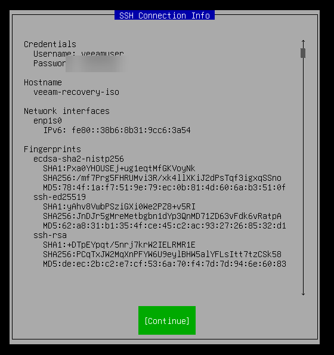{ loading=lazy width="420" }
  <figcaption>Identifiants SSH temporaires (mot de passe flouté ici). Appuyer sur Entrée pour [Continue].</figcaption>
</figure>

1. Valider **[Continue]**.
2. L'écran **Accept license agreement** s'affiche directement, sans commande à taper (pas de `sudo veeam` avec la version 13). Il faut cocher les **deux cases** (contrat de licence Veeam et composants tiers) : **Espace** coche la case sélectionnée, **Tab** passe à la case suivante puis aux boutons. Puis **[Continue]**.

<figure markdown="span">
  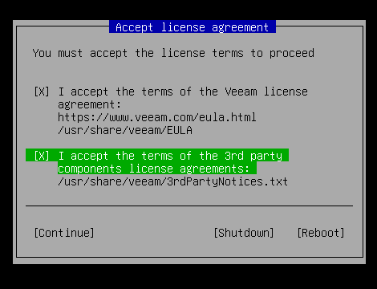{ loading=lazy width="420" }
  <figcaption>Les deux cases doivent être cochées ; dans ce menu, les flèches étaient ignorées dans le lab, seuls Espace et Tab répondent.</figcaption>
</figure>

Le **menu principal** s'affiche :

<figure markdown="span">
  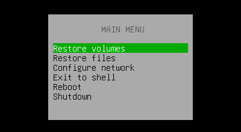{ loading=lazy width="360" }
  <figcaption>Menu principal du support de récupération.</figcaption>
</figure>

| Entrée | Rôle |
|---|---|
| **Restore volumes** | Restaurer des volumes entiers (c'est le cas d'une panne totale) |
| **Restore files** | Récupérer seulement quelques fichiers |
| **Configure network** | Régler le réseau |
| **Exit to shell** | Ouvrir un terminal de dépannage |
| **Reboot** / **Shutdown** | Redémarrer / éteindre |

### 8.2 Configurer le réseau avec `nmtui`

Le support démarre **sans réseau utilisable** : il faut lui redonner l'adresse d'origine du serveur pour qu'il joigne l'appliance.

!!! question "Pourquoi l'adresse d'origine `192.168.19.170` ?"
    On pourrait utiliser une autre adresse libre du LAN. Reprendre l'**ancienne** adresse évite d'oublier un réglage (baux DHCP, règles de pare-feu, entrées DNS) qui désignait ce serveur, et c'est ce qu'il aura **de toute façon** une fois restauré.

1. Choisir **Configure network**. L'outil texte `nmtui` (*NetworkManager Text User Interface*) s'ouvre ; choisir **Edit a connection**, puis **Wired connection 1**, **Edit…**.
2. Placer le curseur sur **IPv4 CONFIGURATION `<Automatic>`**, ouvrir la liste et choisir **Manual**, puis **`<Show>`** pour déplier les champs.

<figure markdown="span">
  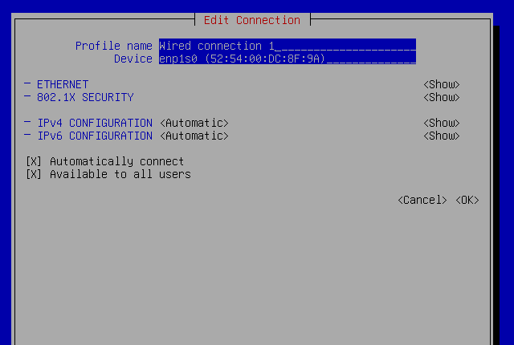{ loading=lazy }
  <figcaption>Avant : IPv4 en « Automatic » (DHCP).</figcaption>
</figure>

<figure markdown="span">
  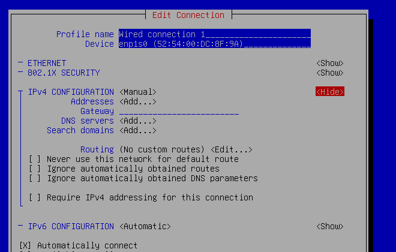{ loading=lazy }
  <figcaption>Après avoir choisi « Manual » : les champs apparaissent, vides.</figcaption>
</figure>

3. Renseigner :

    | Champ | Valeur |
    |---|---|
    | Addresses | `192.168.19.170/24` |
    | Gateway | `192.168.19.21` |
    | DNS servers | `192.168.19.21` |

    Pour saisir une valeur dans une ligne `<Add...>`, appuyer sur **Entrée**, taper, puis **Tab**.

<figure markdown="span">
  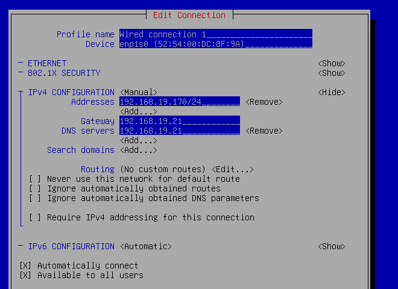{ loading=lazy }
  <figcaption>Adresse d'origine du serveur, avec le préfixe /24, passerelle et DNS de pfSense.</figcaption>
</figure>

4. Descendre jusqu'à **`<OK>`** (en bas, **Tab** plusieurs fois) et valider. Appuyer ensuite sur **Échap** autant de fois que nécessaire pour quitter `nmtui` et retrouver le menu principal.
5. Vérifier depuis 🖥️ le PC hôte : `ping 192.168.19.170` doit répondre. Dans le lab, il répondait immédiatement après **OK**.

### 8.3 Créer le jeton de récupération

Le support de récupération doit se **connecter à l'appliance** pour lire la sauvegarde. Au lieu de lui confier le mot de passe de `veeamadmin`, on lui donne un **jeton de récupération** (*recovery token*) : un accès **limité dans le temps** (**24 heures**) et limité aux **sauvegardes pour lesquelles il a été généré** (ici, une seule). Selon la documentation Veeam, il évite justement de partager les identifiants du serveur de sauvegarde pendant une restauration à nu.

1. 🌐 Dans l'interface web, ouvrir **Home > Backups**.
2. Sélectionner la ligne `Sauvegarde-srv-debian-machine-entiere` (case à cocher).
3. Cliquer sur **Create Recovery Token** dans la barre d'outils, puis sur **Create**.

<figure markdown="span">
  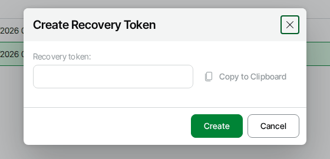{ loading=lazy width="420" }
  <figcaption>La boîte s'ouvre avec le champ vide ; cliquer sur Create.</figcaption>
</figure>

<figure markdown="span">
  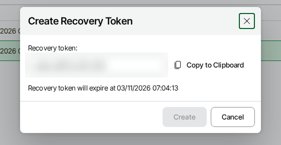{ loading=lazy width="420" }
  <figcaption>Le jeton (flouté ici, sous la forme de quatre groupes de quatre caractères) et sa date d'expiration, le lendemain à la même heure.</figcaption>
</figure>

4. Noter le jeton (**Copy to Clipboard**) : on le recopie à la main dans le support de récupération (pas de copier-coller possible dans une VM en mode texte).

!!! question "Pourquoi un jeton plutôt que le compte `veeamadmin` ?"
    Le support de récupération tourne sur une **machine en panne**, parfois sur un réseau douteux, dans un système dont on ne maîtrise pas le contenu. Y saisir le compte **administrateur** de toute la plateforme de sauvegarde serait un risque : quiconque lirait l'écran ou le clavier pourrait **tout supprimer**. Le jeton, lui, **expire seul au bout de 24 h** et ne donne accès **qu'à la sauvegarde pour laquelle il a été créé** : même volé, il n'ouvre ni la console ni les autres sauvegardes. C'est le principe du **moindre privilège**. Veeam précise que, avec un jeton, on ne voit pas toutes les sauvegardes du dépôt : pour cela, il faut l'authentification par mot de passe. Le formulaire propose aussi *Login and password*, qui reste possible mais à éviter.

### 8.4 Se connecter à l'appliance

1. 💿 Dans le menu principal, choisir **Restore volumes**. L'écran **Select backup location** propose cinq emplacements. Choisir **Add Veeam backup repository…** (troisième descente depuis *Mount local disk…*).

<figure markdown="span">
  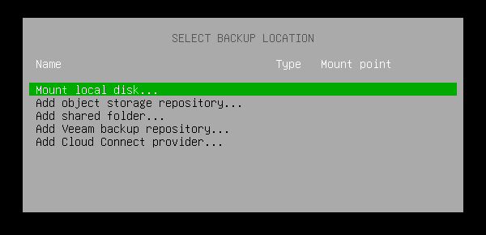{ loading=lazy width="520" }
  <figcaption>La sauvegarde est sur l'appliance : on ajoute un « Veeam backup repository » (dépôt Veeam).</figcaption>
</figure>

2. Dans **Connect to a backup server**, saisir l'**adresse** `192.168.19.55`, laisser le **port** `10006`, choisir **Recovery token** (touche **Espace** sur le bouton radio), puis taper le **jeton** et valider avec **[Next]**.

<figure markdown="span">
  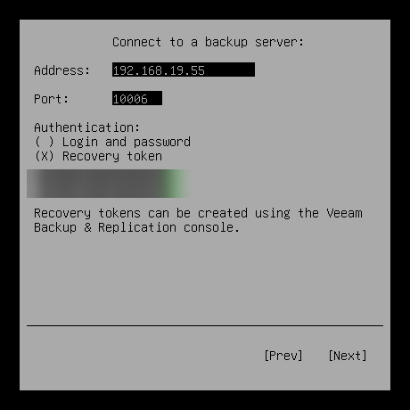{ loading=lazy width="420" }
  <figcaption>Adresse de l'appliance, port 10006, authentification par jeton (flouté).</figcaption>
</figure>

3. Une fenêtre **Certificate details** montre le certificat de l'appliance : *Self-signed certificate*, émetteur et sujet `/CN=vbr`, et son **empreinte SHA-256**. Comparer l'empreinte avec celle de l'appliance (dans le lab : `A263ED1B…E552`, identique à ce que montre l'écran de `vbr`), puis choisir **[Accept]**.

<figure markdown="span">
  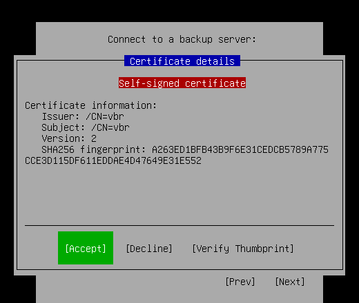{ loading=lazy width="460" }
  <figcaption>Le bouton sélectionné par défaut est [Decline] : se déplacer avec Tab sur [Accept] avant d'appuyer sur Entrée.</figcaption>
</figure>

!!! question "Pourquoi comparer l'empreinte du certificat ?"
    Le certificat de l'appliance est **auto-signé** : aucune autorité extérieure ne garantit qu'il appartient bien à `192.168.19.55`. Sans comparaison, un intrus placé sur le réseau pourrait se faire passer pour l'appliance et capter le jeton. L'**empreinte** (*thumbprint*) est la carte d'identité du certificat : si elle est identique des deux côtés, c'est bien le bon serveur. Le bouton **[Verify Thumbprint]** permet de saisir l'empreinte attendue.

### 8.5 Choisir la sauvegarde et le point de restauration

La sauvegarde de `srv-debian` apparaît, avec le nom du job, le nom d'hôte `srv-debian`, **1 point** et l'heure du point de restauration (affichée en UTC : `01:47` correspond à 02:47 en heure locale du lab).

<figure markdown="span">
  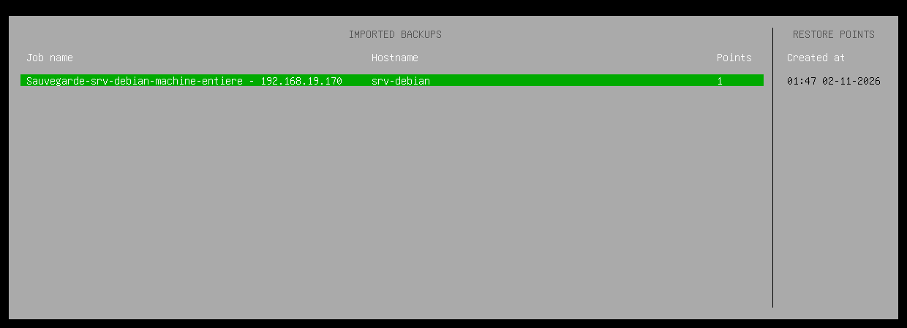{ loading=lazy }
  <figcaption>Colonne de droite : les points de restauration disponibles. Ici, un seul.</figcaption>
</figure>

1. Appuyer sur **Entrée** pour sélectionner la sauvegarde, puis sur **Entrée** à nouveau pour choisir le point (colonne de droite).

### 8.6 Faire correspondre les disques

L'écran suivant compare à gauche le **système actuel** (*Current system*) et à droite le **contenu de la sauvegarde** (*In backup*).

<figure markdown="span">
  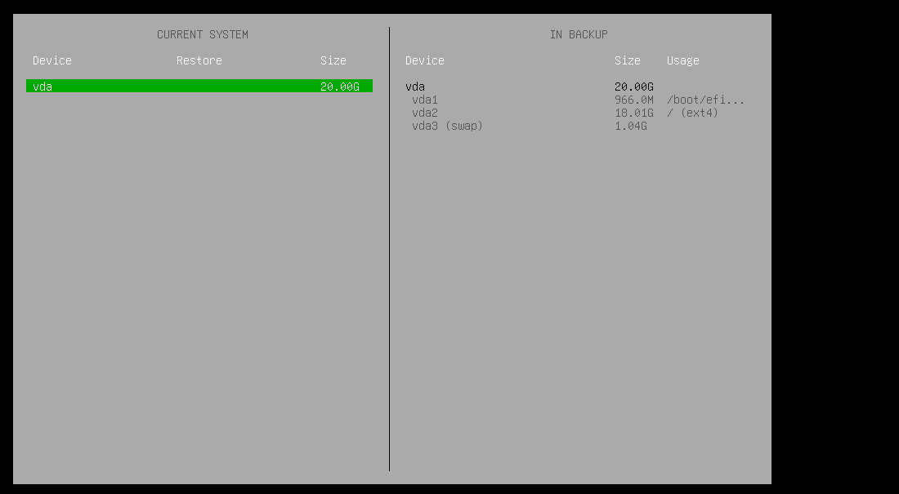{ loading=lazy }
  <figcaption>Gauche : le disque vierge de 20 Go (vda). Droite : le disque sauvegardé, avec ses trois partitions.</figcaption>
</figure>

| Partition sauvegardée | Taille | Contenu |
|---|---|---|
| `vda1` | 966 Mo | Partition de démarrage EFI (`/boot/efi`, vfat) |
| `vda2` | 18,01 Go | Système (`/`, ext4) |
| `vda3` | 1,04 Go | Espace d'échange (*swap*) |

1. Appuyer sur **Tab** pour passer à la colonne de droite et sélectionner le **disque de la sauvegarde** (`vda`), puis sur **Entrée**.
2. Dans le petit menu, choisir **Restore to…** (l'autre entrée, **Close**, ferme le menu).

<figure markdown="span">
  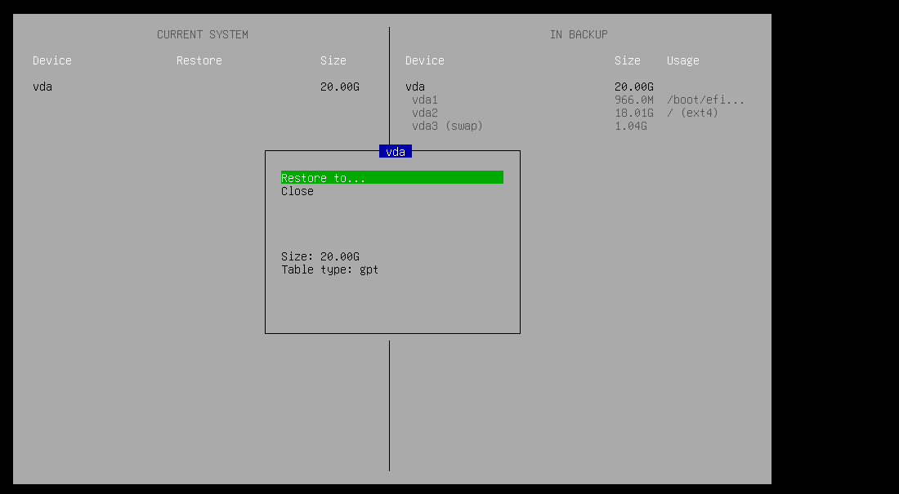{ loading=lazy }
  <figcaption>Restore to… demande vers quel disque restaurer ; la table de partitions est GPT (démarrage UEFI).</figcaption>
</figure>

3. Choisir le **disque cible** (`vda`, 20 Go : le disque vierge) puis **Entrée**. Le tableau de gauche se remplit : la colonne **Restore** associe maintenant chaque partition au disque vierge.

<figure markdown="span">
  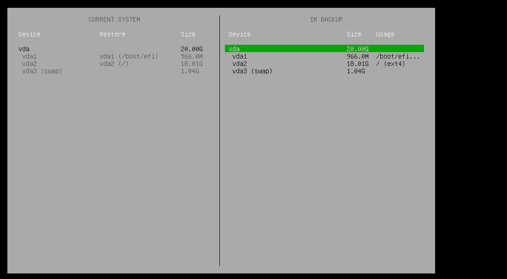{ loading=lazy }
  <figcaption>La correspondance est faite : chaque partition de la sauvegarde reprendra sa place sur le disque vierge.</figcaption>
</figure>

!!! danger "Le disque cible est effacé"
    La restauration **réécrit** la table de partitions et les systèmes de fichiers du disque cible : tout ce qu'il contient est perdu. Ici, c'est le disque vierge ; sur un vrai serveur, **vérifier deux fois** qu'il ne s'agit pas d'un disque de données.

### 8.7 Lancer la restauration

1. En bas de l'écran, les raccourcis sont rappelés : **S** (*Start Restore*, démarrer la restauration), **Z** (annuler une correspondance). Appuyer sur **S**.
2. Un **résumé** (*Recovery summary*) liste exactement ce qui va se passer : création de la table GPT et des trois partitions, restauration de `vda1` (vfat) et de `vda2` (ext4).

<figure markdown="span">
  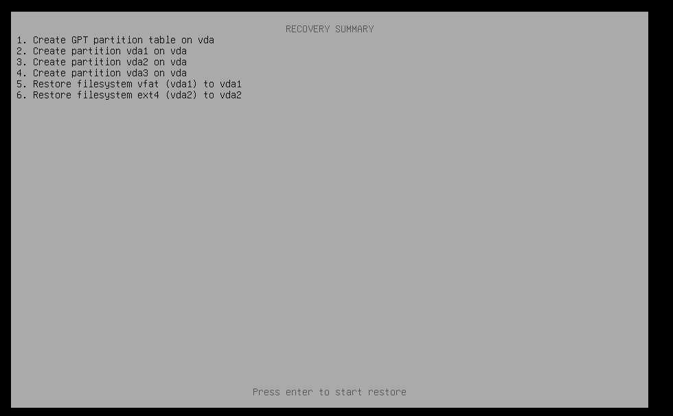{ loading=lazy }
  <figcaption>Recovery summary : six actions, de la table de partitions aux deux systèmes de fichiers. La partition d'échange est recréée, pas copiée.</figcaption>
</figure>

3. Appuyer sur **Entrée** (*Start Recovery*). La barre de progression avance ; l'écran affiche en direct les actions, avec les volumes restaurés.

<figure markdown="span">
  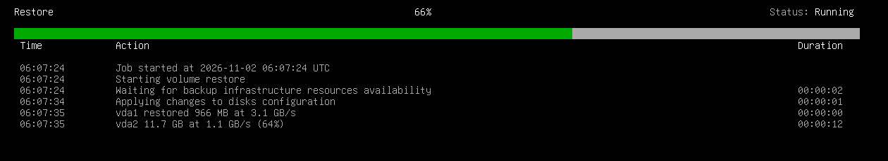{ loading=lazy }
  <figcaption>Restauration en cours : le débit dépend du disque et du réseau (ici, une machine virtuelle sur disque local).</figcaption>
</figure>

4. À la fin, le statut passe à **Success** (100 %). Dans le lab, la restauration a duré **environ 30 secondes**. Le détail indique notamment `vda1 restored 966 MB`, `vda2 restored 18 GB`, `Restore EFI volume: /dev/vda1` et `Restore EFI boot manager entry: debian` : l'entrée de démarrage UEFI est **recréée**.

<figure markdown="span">
  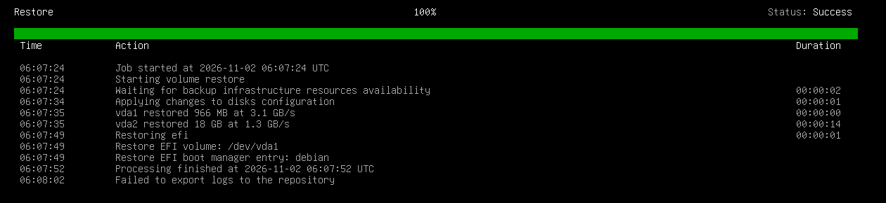{ loading=lazy }
  <figcaption>Statut : Success. La dernière ligne signale un échec d'export des journaux, sans conséquence sur la restauration (voir ci-dessous).</figcaption>
</figure>

!!! info "« Failed to export logs to the repository »"
    Une dernière ligne indique, **après** le succès, que le support n'a pas pu envoyer ses journaux de restauration vers le dépôt. La cause n'a pas été étudiée dans le lab. La restauration elle-même est terminée (`Status: Success`) et le serveur redémarre correctement, comme le montre la section suivante.

### 8.8 Redémarrer sans l'ISO

1. Appuyer sur **Échap** pour revenir au menu principal, puis choisir **Reboot** (ou **Shutdown**, ce qu'a fait le lab).

<figure markdown="span">
  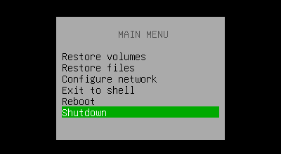{ loading=lazy width="360" }
  <figcaption>Éteindre le support (ici Shutdown) pour pouvoir retirer l'ISO.</figcaption>
</figure>

2. 🖥️ Une fois la VM **éteinte**, **retirer l'ISO** du lecteur (ou le mettre en dernier dans l'ordre de démarrage) et, si on l'avait ajouté, **supprimer le clavier USB** temporaire.

    !!! danger "Ne pas oublier de retirer l'ISO"
        Si l'ISO reste en tête de l'ordre de démarrage, la VM redémarre **sur le support de récupération** au lieu de Debian, et on croit à tort que la restauration a échoué.

3. Démarrer la VM : le menu **GRUB de Debian** s'affiche, le système démarre. Le disque contenait un système vierge quelques minutes plus tôt.

<figure markdown="span">
  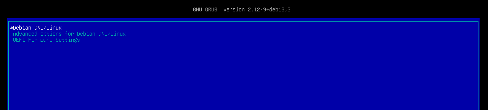{ loading=lazy }
  <figcaption>Le menu GRUB de Debian, restauré depuis la sauvegarde : Debian GNU/Linux, Advanced options, UEFI Firmware Settings.</figcaption>
</figure>

---

## 9. Vérifier la restauration

🐧 Une fois `srv-debian` démarré (attendre que SSH réponde), rejouer les mêmes commandes qu'en [section 5.2](#52-relever-les-preuves-avant-panne) et comparer.

```console
$ hostname
srv-debian
$ grep vbr /etc/hosts
192.168.19.55 vbr
$ dpkg -l | grep -c ^ii
397
$ ssh-keygen -lf /etc/ssh/ssh_host_ed25519_key.pub
256 SHA256:5Im5cNqiO6PCyJKPME/rSa5XR3MQf3V4RnvRUa4D69c root@srv-debian (ED25519)
$ systemctl is-active veeamservice
active
$ lsblk -o NAME,SIZE,FSTYPE,MOUNTPOINTS
NAME    SIZE FSTYPE MOUNTPOINTS
vda      20G
├─vda1  966M vfat   /boot/efi
├─vda2   18G ext4   /
└─vda3    1G swap   [SWAP]
```

| Contrôle | Attendu | Ce que cela prouve |
|---|---|---|
| **Clé d'hôte SSH ED25519** | Identique à celle d'avant la panne | C'est bien le **même** système, pas une réinstallation |
| **Nombre de paquets** (`dpkg -l \| grep -c ^ii`) | Même nombre (**397** dans le lab) | Tout le logiciel installé est revenu |
| **`/etc/hosts`** | Contient `192.168.19.55 vbr` | La configuration modifiée **avant** la sauvegarde a été restaurée |
| **`veeamservice`** | `active` | L'agent Veeam a été restauré avec la machine et redémarre |
| **`lsblk`** | Trois partitions sur `vda` | La disposition des disques est identique |

!!! success "Critère de réussite du TP"
    Les cinq contrôles ci-dessus concordent avec les « preuves avant panne » relevées en section 5.2. Le serveur a été **entièrement reconstruit sur un disque vierge** à partir de la sauvegarde.

### 9.1 Refaire une sauvegarde

Un serveur restauré est dans l'état du **dernier point**, pas dans celui du moment de la panne : tout ce qui a été écrit depuis la dernière sauvegarde est perdu. C'est le sens du RPO (voir ci-dessous). Après toute restauration :

1. 🌐 Dans **Jobs**, sélectionner `Sauvegarde-srv-debian-machine-entiere` et cliquer sur **Start** pour lancer une sauvegarde **tout de suite**, sans attendre 22:00.
2. Vérifier qu'elle se termine en **Success**. Si le job signale un avertissement ou une erreur, lire le message : le comportement exact de l'agent juste après une restauration à nu n'a **pas** été étudié dans le lab.

!!! tip "🛟 Point d'instantané en fin de TP"
    - L'instantané **`04-avant-panne`** (section 5.3) est votre point de départ pour **rejouer** la panne et la restauration : y revenir, retirer le disque vierge restauré, replacer un nouveau disque vierge, et recommencer la section 6.
    - Il n'y a **pas** de nouvel instantané à prendre pour la suite : la [partie 7](07-sauvegarder-vers-azure-blob.md) est illustrée et n'a pas été rejouée dans le lab.
    - L'**ISO** peut être supprimée du PC hôte ; le **jeton** n'a pas besoin d'être supprimé : il expire de lui-même au bout de 24 h.

---

## 10. Questions de révision

1. Pourquoi l'agent Veeam a-t-il besoin d'un module noyau, et pourquoi Secure Boot le refuse-t-il ?
2. Quelles sont les deux façons de lever ce refus, et laquelle recommander en production ?
3. Pourquoi l'agent cherche-t-il le nom `vbr` ? Quelle est la façon propre de le résoudre pour tout un réseau ?
4. Quelle différence entre un job « machine entière » et un job « volume » ou « fichiers » ?
5. Pourquoi utiliser un **jeton de récupération** plutôt que le compte `veeamadmin` dans le support de récupération ?
6. Que se passerait-il si la sauvegarde était stockée dans un dépôt **non immuable**, et que l'appliance était piratée ?
7. Quel est le **RPO** de ce job ? Que perd-on en cas de panne à 21 h 45 ?
8. Pourquoi comparer l'empreinte du certificat de l'appliance au moment de la connexion ?
9. Comment prouver, après la restauration, qu'il s'agit bien du même serveur ?
10. Que se passe-t-il si on oublie de retirer l'ISO après la restauration ?

??? success "Corrigé"
    1. Pour figer une image cohérente du disque pendant que le serveur travaille, l'agent charge un **module noyau** (`blksnap`) compilé sur place par DKMS. Avec Secure Boot, le noyau n'accepte que des modules **signés par une clé connue du firmware** : la clé locale de DKMS (MOK) ne l'est pas, d'où « *Key was rejected by service* ».
    2. **Désactiver Secure Boot** (simple, adapté au lab) ou **inscrire la clé MOK de DKMS** avec `mokutil --import` puis MokManager au redémarrage. En production, on recommande l'**inscription de la clé**, qui conserve la protection au démarrage. (Dans le lab, seule la désactivation a abouti.)
    3. L'appliance s'annonce à ses clients par son **nom d'hôte** ; l'agent doit pouvoir le résoudre pour la joindre sur le port 10006. Solution rapide : une ligne dans `/etc/hosts` de chaque machine. Solution propre : un **enregistrement DNS** (pfSense : *Services > DNS Resolver > Host Overrides*) valable pour tout le réseau.
    4. **Machine entière** : tous les volumes, y compris le démarrage, ce qui permet la restauration à nu. **Volumes** : seulement ceux que l'on coche. **Fichiers** : seulement des dossiers, sans instantané du disque ; impossible de reconstruire le serveur.
    5. Le support de récupération tourne sur une machine **en panne**. Un jeton **expire au bout de 24 h** et n'ouvre que **la sauvegarde pour laquelle il a été créé**, alors que `veeamadmin` donne **tous les droits** sur la plateforme de sauvegarde. C'est le **moindre privilège**.
    6. Sans immuabilité, une personne ou un rançongiciel qui obtient des droits sur l'appliance pourrait **modifier ou supprimer** les sauvegardes, et il n'y aurait plus rien à restaurer. Avec le dépôt par défaut **immuable 7 jours**, un fichier de sauvegarde ne peut pas être effacé avant 7 jours, même par un administrateur.
    7. Le job tourne **une fois par jour, à 22:00** : le **RPO** (perte de données maximale acceptable) est d'environ **24 heures**. Une panne à 21 h 45 fait perdre les données écrites depuis la sauvegarde de la veille à 22:00, soit presque 24 heures. Pour réduire le RPO, planifier le job plus souvent.
    8. Le certificat est **auto-signé** : seule l'**empreinte** garantit qu'on parle à la vraie appliance et pas à un serveur qui s'en ferait passer, ce qui lui ferait capter le jeton.
    9. La **clé d'hôte SSH ED25519** (générée une seule fois à l'installation) est **identique**, le **nombre de paquets** est le même, `/etc/hosts` a conservé la ligne `vbr`, et `veeamservice` est actif.
    10. La VM redémarre **sur le support de récupération** au lieu de Debian et l'on croit à tort que la restauration a échoué : toujours **retirer l'ISO** (ou la mettre en dernier dans l'ordre de démarrage).

---

## Ressources

- [Veeam Recovery Media](https://helpcenter.veeam.com/docs/agentforlinux/userguide/recovery_media.html) — le support de récupération Veeam pour Linux (documentation officielle, en anglais).
- [Veeam Recovery Media Versions](https://helpcenter.veeam.com/docs/agentforlinux/userguide/recovery_media_versions.html) — versions des ISO publiées.
- [Dépôt public des ISO de récupération](https://repository.veeam.com/backup/linux/agent/veeam-recovery-media/x64/) — téléchargement sans compte.
- [Créer un jeton de récupération](https://helpcenter.veeam.com/docs/agentforlinux/userguide/integration_recovery_token.html) — validité de 24 heures, portée du jeton, création depuis l'onglet Backups.
- [Restauration de volumes avec le support de récupération](https://helpcenter.veeam.com/docs/agentforlinux/userguide/integration_disk_restore.html) — procédure officielle (Veeam Agent for Linux avec Veeam Backup & Replication).
- [Configuring UEFI Secure Boot](https://helpcenter.veeam.com/docs/agentforlinux/userguide/installation_uefi_secure_boot.html) — inscription de la clé MOK du module noyau (DKMS ou pré-compilé).
- [Exigences système de Veeam Agent for Linux](https://helpcenter.veeam.com/docs/agentforlinux/userguide/system_requirements.html) — distributions prises en charge, paquets requis.
- [Créer un groupe de protection d'ordinateurs individuels](https://helpcenter.veeam.com/docs/vbr/userguide/protection_group_individual.html) — documentation Veeam Backup & Replication.
- [SecureBoot sur Debian](https://wiki.debian.org/SecureBoot) — fonctionnement de Secure Boot, des modules DKMS et de la MOK.
- [Page de manuel de `mokutil`](https://manpages.debian.org/trixie/mokutil/mokutil.1.en.html) — gérer les clés du firmware depuis Linux.
- [Machines virtuelles Proxmox VE (OVMF et UEFI)](https://pve.proxmox.com/wiki/Qemu/KVM_Virtual_Machines) — firmware et disque EFI.
- Partie précédente : [Sauvegarder la configuration et le serveur de fichiers](05-sauvegarder-configuration-et-serveur-de-fichiers.md) · Partie suivante : [Sauvegarder vers Azure Blob Storage](07-sauvegarder-vers-azure-blob.md) · Retour au [sommaire du parcours](index.md).
