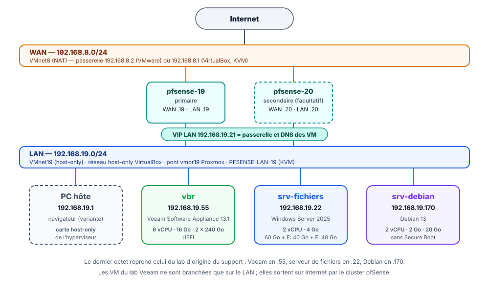

# Veeam Backup & Replication 13.1 : cours et travaux pratiques

!!! abstract "Résumé"
    Ce parcours en sept parties apprend à **protéger les données d'une petite infrastructure** avec **Veeam Backup & Replication 13.1**, l'un des logiciels de sauvegarde les plus répandus en entreprise. Il commence par deux cours (les principes de la sauvegarde, puis l'offre Veeam), continue par quatre travaux pratiques rejoués de bout en bout dans un laboratoire virtuel, et se termine par une partie illustrée sur la sauvegarde dans le cloud Azure.

    Au bout du parcours, un serveur de sauvegarde Veeam protège un **serveur de fichiers Windows** et un **serveur Linux**. Le serveur Linux aura été **entièrement reconstruit** à partir de sa sauvegarde, après une panne simulée.

    Cette page rassemble ce qu'il faut garder sous la main pendant tout le parcours : le plan, le schéma du lab, les adresses, les comptes et mots de passe, le dimensionnement des machines virtuelles et les instantanés conseillés.

| Propriété | Valeur |
|-----------|--------|
| Public | Débutants en administration système : aucune connaissance de Veeam n'est demandée |
| Durée totale | Environ 15 h (cours, TP et questions de révision) |
| Version décrite | Veeam Backup & Replication **13.1.2.57** (Veeam Software Appliance, octobre 2026) |
| Rejoué dans le lab | Du 1er au 2 novembre 2026, sur KVM/libvirt (toutes les captures d'écran viennent de ce lab) |
| Dernière mise à jour | 2026-11-02 |

<!-- NOTE DE RÉDACTION (non affichée) : Ce qui a changé par rapport à la version 1.5 du support (juin 2024)
- Le support décrivait **Veeam Backup & Replication 12** installé sur un **Windows Server**. Le parcours utilise désormais la **Veeam Software Appliance 13.1**, le serveur de sauvegarde Linux durci que Veeam livre prêt à installer. L'installation et le dépôt local ont été réécrits en conséquence.
- Toutes les parties pratiques ont été **rejouées dans un lab réel** en novembre 2026 ; les captures d'écran viennent de ce lab.
- L'adressage reprend celui du TP [cluster pfSense en haute disponibilité](../../reseaux/cluster-haute-disponibilite-pfsense-carp-pfsync.md) du wiki : les machines du lab Veeam s'y branchent directement.
- La partie sur **Veeam ONE** (supervision) a été retirée. La partie **Azure** n'a pas été rejouée et le signale clairement.
- Un **test de restauration d'un fichier** a été ajouté à la partie 5 : une sauvegarde jamais restaurée n'est pas une sauvegarde fiable.
-->

---

## Objectifs du parcours

À la fin du parcours, il est possible de :

- expliquer la différence entre sauvegarde, synchronisation, réplication et RAID, et appliquer la règle **3-2-1-1-0** ;
- installer et sécuriser une **Veeam Software Appliance** (MFA, compte *Security Officer*, dépôt immuable) ;
- créer des **dépôts de sauvegarde** sur l'appliance et sur un serveur Windows ;
- protéger la **configuration** du serveur de sauvegarde lui-même ;
- sauvegarder un serveur Windows au niveau des fichiers et **restaurer un fichier supprimé** ;
- sauvegarder un serveur Linux entier et le **restaurer sur un disque vierge** (*bare metal*) ;
- comprendre comment envoyer une copie des sauvegardes **hors site**, dans un stockage objet.

## Plan du parcours

| Partie | Type | Durée | Contenu | Machines allumées |
|:---:|---|---|---|---|
| [1. Comprendre la sauvegarde](01-comprendre-la-sauvegarde.md) | Cours | 2 h 30 | Sauvegarde, synchronisation, réplication, RAID, règles 3-2-1 et 3-2-1-1-0, types de sauvegarde, PCA et PRA, RPO et RTO | Aucune |
| [2. Découvrir Veeam Data Platform 13](02-decouvrir-veeam-data-platform.md) | Cours | 1 h 30 | Produits Veeam, nouveautés de la version 13, licences, composants d'une infrastructure Veeam | Aucune |
| [3. Préparer le lab et installer l'appliance](03-preparer-le-lab-installer-appliance.md) | TP | 4 h | Réseau, machines virtuelles, installation de l'appliance, interface web, licence, *Security Officer*, console Windows | Toutes |
| [4. Ajouter des dépôts de sauvegarde](04-ajouter-des-depots-de-sauvegarde.md) | TP | 1 h 30 | Dépôt immuable de l'appliance, serveur Windows géré, dépôt ReFS | pfSense, `vbr`, `srv-fichiers` |
| [5. Sauvegarder la configuration et le serveur de fichiers](05-sauvegarder-configuration-et-serveur-de-fichiers.md) | TP | 2 h | Sauvegarde de configuration chiffrée, agent Veeam pour Windows, restauration d'un fichier | pfSense, `vbr`, `srv-fichiers` |
| [6. Sauvegarder et restaurer un serveur Linux](06-sauvegarder-restaurer-serveur-linux.md) | TP | 2 h 30 | Agent Veeam pour Linux, panne totale, restauration *bare metal* avec le support de récupération | pfSense, `vbr`, `srv-debian` (+ `srv-fichiers` pour le navigateur) |
| [7. Sauvegarder vers Azure Blob Storage](07-sauvegarder-vers-azure-blob.md) | Cours illustré | 1 h | Dépôt objet dans Azure, job vers le cloud, dépannage `libfuse` (non rejoué) | Aucune |

Les durées sont indicatives : la première installation de l'appliance prend à elle seule environ une heure, dont une bonne partie d'attente.

!!! tip "Suivre l'ordre"
    Chaque TP s'appuie sur le précédent : la partie 5 utilise le dépôt créé en partie 4, la partie 6 la console et l'appliance installées en partie 3. Les deux cours peuvent se lire avant ou pendant les longues attentes de la partie 3.

## Schéma du lab

<figure markdown="span">
  { loading=lazy }
  <figcaption>Le lab Veeam se branche sur le LAN du TP pfSense. Les trois machines virtuelles n'ont qu'une carte réseau et sortent sur Internet par la VIP 192.168.19.21.</figcaption>
</figure>

Le rôle de chaque composant Veeam dans ce lab est détaillé dans la [partie 2](02-decouvrir-veeam-data-platform.md#48-les-composants-dans-le-lab-des-tp).

## Plan d'adressage

| Machine | Rôle | Adresse IP | Passerelle et DNS | Système |
|---|---|---|---|---|
| `pfsense-19` (+ `pfsense-20`, facultatif) | Pare-feu, routeur NAT et DNS du LAN | VIP LAN `192.168.19.21` | — | pfSense CE |
| `vbr` | Serveur de sauvegarde : Veeam Software Appliance 13.1 | `192.168.19.55/24` | `192.168.19.21` | Rocky Linux 9 durci (fourni par Veeam) |
| `srv-fichiers` | Serveur de fichiers à protéger, dépôt n° 2, console Veeam | `192.168.19.22/24` | `192.168.19.21` | Windows Server 2025 Standard |
| `srv-debian` | Serveur Linux à protéger | `192.168.19.170/24` | `192.168.19.21` | Debian 13 |
| PC hôte | Navigateur web (variante) | `192.168.19.1` | — | Celui du PC |

Les derniers octets sont faciles à retenir : `.55` pour Veeam, `.22` pour le serveur de fichiers, `.170` pour Debian. L'adressage est celui du [TP pfSense](../../reseaux/cluster-haute-disponibilite-pfsense-carp-pfsync.md), sur lequel les machines du lab se branchent directement. Toutes les machines du lab sont branchées sur le **même réseau LAN**, dont le nom dépend de l'hyperviseur :

=== "VMware Workstation"

    Réseau **VMnet19** en mode **Host-only**, sous-réseau `192.168.19.0/24`, créé dans l'éditeur de réseaux virtuels pendant le TP pfSense. Le PC hôte y reçoit l'adresse `192.168.19.1`.

=== "VirtualBox"

    **Réseau privé hôte** (*host-only*) `192.168.19.0/24`, créé pendant le TP pfSense. Le PC hôte y a l'adresse `192.168.19.1`.

=== "Proxmox VE"

    **Pont Linux** (par exemple `vmbr19`) **sans port physique**, créé dans *Datacenter > nœud > System > Network*. Un pfSense (ou un autre routeur) relie ce pont au réseau qui sort sur Internet. Le PC de l'administrateur n'est pas sur ce réseau : le navigateur du lab est celui de `srv-fichiers`.

!!! info "Sans le lab pfSense"
    Le cluster pfSense n'est pas indispensable : un seul pfSense suffit, ou n'importe quel routeur qui offre la passerelle et le DNS en `192.168.19.21`. À défaut, brancher les trois VM sur le **réseau NAT** de l'hyperviseur et garder les mêmes derniers octets dans le sous-réseau de ce NAT, avec la passerelle propre à l'hyperviseur (par exemple `.2` pour le NAT de VMware). Il faut alors remplacer partout `192.168.19.x` par les adresses de ce sous-réseau.

## Comptes et mots de passe

Ce lab est **pédagogique** : les mots de passe sont écrits ici volontairement pour que chacun puisse suivre à l'identique. En production, chaque mot de passe serait unique, long et rangé dans un gestionnaire de mots de passe.

| Où | Compte | Mot de passe | Créé en |
|---|---|---|---|
| Appliance `vbr` : interface web, Host Management, console Windows | `veeamadmin` (nom imposé) | `PoPoPo000@@@Lab` + code MFA | Partie 3 |
| Appliance `vbr` : Host Management | `veeamso` (*Security Officer*) | `PoPoPo111@@@Lab` à l'installation, puis `PoPoPo555@@@Lab` dès la première connexion + code MFA | Partie 3 |
| Phrase secrète de sauvegarde de configuration (*Security Officer*) | — | `PoPoPo666@@@Lab` | Partie 3 |
| `srv-fichiers` (Windows Server 2025) | `Administrateur` | `Popopo222@@@` | Partie 3 |
| `srv-debian` (Debian 13) | `user` (membre du groupe `sudo`) | `Popopo333@@@` | Partie 3 |
| Chiffrement de la sauvegarde de configuration | — | `Popopo444@@@` | Partie 5 |

!!! question "Pourquoi `PoPoPo000@@@Lab` et pas `Popopo000@@@` sur l'appliance ?"
    L'appliance applique la politique de mots de passe du référentiel de sécurité **DISA STIG** : au moins **15 caractères**, des majuscules, des minuscules, des chiffres et des caractères spéciaux, **jamais plus de 4 caractères de la même catégorie à la suite**, et un contrôle par dictionnaire. `Popopo000@@@` est refusé (« opopo » = 5 minuscules de suite, et 12 caractères seulement). `PoPoPo000@@@Lab` respecte toutes les règles. La [partie 3](03-preparer-le-lab-installer-appliance.md) montre les messages de refus.

Les **codes MFA** sont générés par une application d'authentification installée sur un téléphone (Microsoft Authenticator, Google Authenticator, FreeOTP…). Chaque appliance a sa propre clé secrète : les QR codes des captures sont floutés exprès.

## Dimensionnement des machines virtuelles

| Machine | Confortable (utilisé dans le lab) | Minimal | Disques |
|---|---|---|---|
| `vbr` | 6 vCPU, 16 Go | 4 vCPU, 8 Go | 2 disques de 240 Go, dynamiques, UEFI |
| `srv-fichiers` | 2 vCPU, 4 Go | 2 vCPU, 4 Go | 60 Go (C:) + 40 Go (E:) + 40 Go (F:, partie 4) |
| `srv-debian` | 2 vCPU, 2 Go | 2 vCPU, 2 Go | 20 Go (+ un disque vierge de 20 Go en partie 6) |
| `pfsense-19` | 1 vCPU, 2 Go | 1 vCPU, 1 Go | 20 Go |

- Pour l'appliance, Veeam demande au minimum **8 cœurs et 16 Go de RAM** (plus 500 Mo par job simultané), et accepte **6 vCPU et 16 Go** pour une petite infrastructure de 5 machines protégées au plus : c'est le profil **confortable**, celui avec lequel le lab a été rejoué. Le profil **minimal** (8 Go, 4 vCPU) est **en dessous du minimum pris en charge par Veeam** : il ne convient pas à la production et n'a pas été validé de bout en bout dans ce lab ; il dépanne un PC à la mémoire comptée, au prix de lenteurs et sans garantie.
- **Mémoire du PC hôte** : 32 Go permettent de tout allumer en profil confortable. Avec **16 à 24 Go**, prendre le profil minimal et n'allumer que les machines de la partie en cours (colonne « Machines allumées » du [plan](#plan-du-parcours)), en fermant les applications inutiles du PC.
- **Disque du PC hôte** : prévoir environ **150 Go libres**, de préférence sur un **SSD**. Les disques sont dynamiques : les 2 × 240 Go de l'appliance n'occupent au départ qu'une trentaine de gigaoctets ; l'espace occupé grandit ensuite avec les sauvegardes.
- La **virtualisation matérielle** (Intel VT-x ou AMD-V) doit être activée dans le BIOS/UEFI du PC.

## Instantanés conseillés

Un **instantané** (*snapshot*) fige l'état d'une machine virtuelle. En cas d'erreur, on y revient en quelques secondes au lieu de tout recommencer. Prendre les instantanés **VM éteintes** de préférence, sur **toutes les machines du lab** en même temps, aux étapes marquées 🛟 :

| Instantané | Moment | Permet de recommencer |
|---|---|---|
| `01-lab-pret` | Fin de la partie 3 | Les parties 4, 5 et 6 avec un lab propre |
| `02-depots` | Fin de la partie 4 | La partie 5 |
| `03-fichiers-sauvegardes` | Fin de la partie 5 | La partie 6 |
| `04-avant-panne` | Partie 6, juste avant de simuler la panne | La restauration *bare metal* autant de fois que nécessaire |

!!! warning "Un instantané n'est pas une sauvegarde"
    L'instantané reste **sur le même disque** que la machine virtuelle : si le disque du PC hôte tombe en panne, les instantanés disparaissent avec lui. C'est exactement la différence entre une copie de confort et une vraie sauvegarde, expliquée dans la [partie 1](01-comprendre-la-sauvegarde.md).

## Logiciels à télécharger

| Logiciel | Où le trouver | Remarque |
|---|---|---|
| Veeam Software Appliance 13.1 (ISO d'environ 16,7 Go, soit 15,6 Gio) | [Téléchargements Veeam](https://www.veeam.com/products/downloads.html) | Compte Veeam gratuit obligatoire ; la clé d'essai de 30 jours se demande au même endroit |
| Windows Server 2025 (ISO d'évaluation) | [Microsoft Evaluation Center](https://www.microsoft.com/fr-fr/evalcenter/download-windows-server-2025) | Évaluation gratuite de 180 jours, en français |
| Debian 13 (image *netinst*) | [debian.org](https://www.debian.org/distrib/netinst) | Image d'installation par le réseau, environ 800 Mo |
| Support de récupération Veeam pour Linux | Lien donné dans la [partie 6](06-sauvegarder-restaurer-serveur-linux.md) | Téléchargement public, sans compte |
| Application d'authentification (MFA) | Magasin d'applications du téléphone | Microsoft Authenticator, Google Authenticator, FreeOTP… |

## Convention de lecture

Dans les TP, chaque action précise la machine sur laquelle elle se fait :

| Repère | Machine |
|---|---|
| 🖥️ | PC hôte (hyperviseur) |
| 📦 | Console de l'appliance `vbr` (écran de la VM) |
| 🌐 | Navigateur web connecté à l'appliance (Edge sur `srv-fichiers`, ou le PC hôte) |
| 🪟 | `srv-fichiers` (Windows Server 2025) |
| 🐧 | `srv-debian` (Debian 13) |

Les menus et les boutons sont écrits **en anglais**, comme ils s'affichent dans Veeam, et traduits quand c'est utile. Les encadrés « Pourquoi ? » expliquent ce que fait chaque réglage : comprendre vaut mieux que recopier.

## Ressources

- [Documentation de Veeam Backup & Replication 13](https://helpcenter.veeam.com/docs/vbr/userguide/overview.html) — guide officiel de l'utilisateur.
- [Veeam University](https://www.veeam.com/support/training/veeam-university-free.html) — formations gratuites en ligne.
- [TP : cluster de pare-feux pfSense en haute disponibilité](../../reseaux/cluster-haute-disponibilite-pfsense-carp-pfsync.md) — le réseau sur lequel s'appuie ce parcours.
