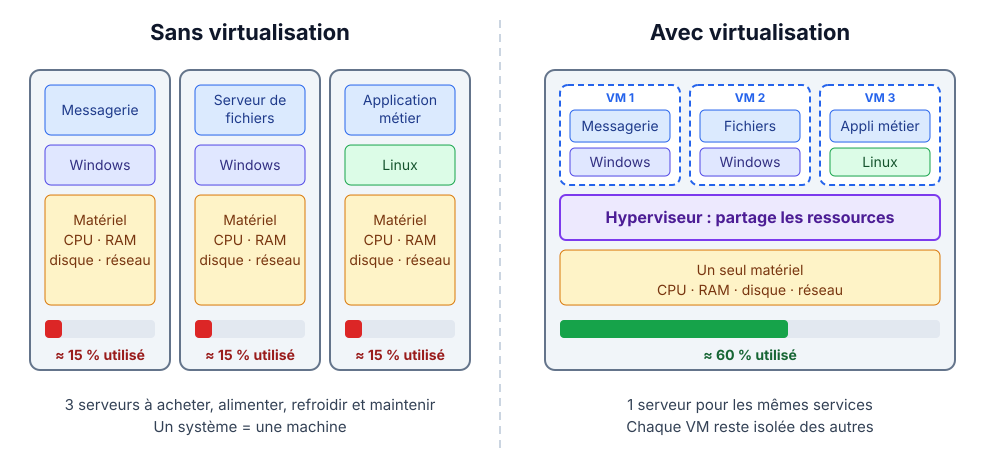
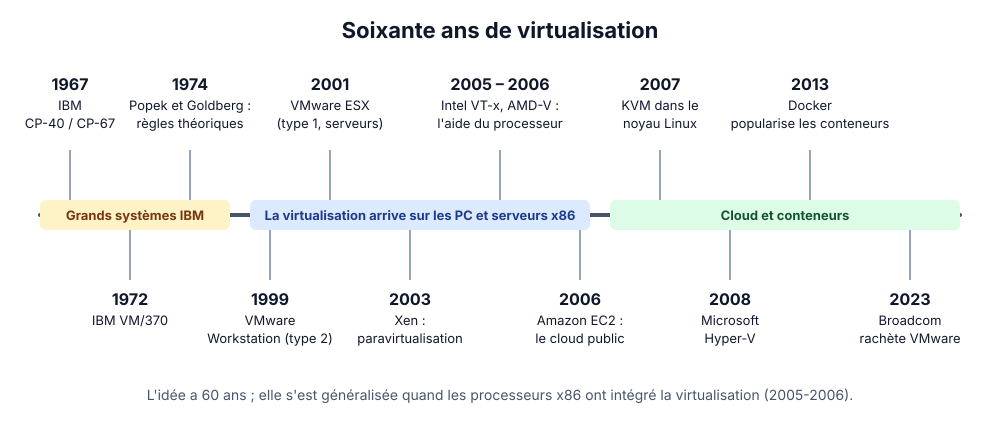

<!-- ============================================================ -->
<!-- ⚠️ RAPPEL IMPORTANT :                                          -->
<!-- Pensez TOUJOURS à ajouter une entrée dans le fichier d'index  -->
<!-- (index.md) du dossier correspondant (ex: docs/cloud/index.md) -->
<!-- afin de référencer ce nouvel article et permettre aux         -->
<!-- visiteurs de le trouver et de cliquer dessus !                -->
<!-- ============================================================ -->

# Comprendre la virtualisation

!!! abstract "Résumé"
    Cette première partie répond à trois questions :

    1. **Qu'est-ce que la virtualisation**, en termes simples ?
    2. **Pourquoi** est-elle devenue incontournable dans les entreprises ?
    3. **Quels avantages et quels inconvénients** apporte-t-elle ?

    Elle alterne de courtes explications, une activité de découverte, un **exercice chiffré** (combien de serveurs peut-on économiser ?) et un **débat** en équipes. À la fin, il est possible d'expliquer la virtualisation à un collègue ou à un client en deux minutes, avec ses atouts et ses risques.

| Propriété | Valeur |
|-----------|--------|
| Difficulté | Débutant — aucun prérequis technique |
| Durée estimée | 1 h 45 (cours, activités, exercice et débat) |
| Version décrite | Indépendant du logiciel |
| Place dans le parcours | Partie 1 sur 17 du parcours [Virtualisation](index.md) — jour 1 |
| Dernière mise à jour | 2026-11-16 |

---

## 1. Activité d'ouverture : la virtualisation sans le savoir

💬 **Par deux, 10 minutes.** Lister des situations de la vie courante ou professionnelle où l'on utilise **un ordinateur qui n'existe pas vraiment**, ou un service qui tourne « quelque part » sans savoir sur quelle machine. Viser au moins cinq exemples, puis les mettre en commun.

??? success "Quelques exemples possibles"
    - **Une messagerie en ligne** (Gmail, Outlook.com) ou un **stockage en ligne** (OneDrive, Google Drive) : les serveurs qui répondent sont presque toujours des machines virtuelles ou des conteneurs dans un centre de données.
    - **L'émulateur Android** d'un développeur, ou un **émulateur de console de jeux** : une machine entière simulée par un logiciel.
    - **Le sous-système Windows pour Linux (WSL 2)** ou le **Bac à sable Windows** : Windows lance en réalité une petite machine virtuelle.
    - **Le serveur du site web** d'une entreprise, loué chez un hébergeur (un « VPS » est un serveur privé **virtuel**).
    - **Le « cloud gaming »** (jouer à un jeu qui tourne sur un serveur distant) ou un **bureau Windows à distance** fourni par l'employeur.
    - **Les machines de TP** d'un centre de formation : souvent des VM, qu'on remet à zéro en un clic.

    Conclusion : la virtualisation est **partout**, mais elle est **invisible** pour l'utilisateur. C'est justement son but.

## 2. Définition en termes simples

### 2.1 Un ordinateur dans un ordinateur

Une **machine virtuelle** (*virtual machine*, **VM**) est un ordinateur **simulé par un logiciel**. Elle a un processeur, de la mémoire, un disque et une carte réseau, mais ces composants sont **virtuels** : ils sont fabriqués par un logiciel, à partir des composants **réels** d'un ordinateur physique.

Pour fonctionner, toute machine a besoin de **quatre ressources** : le **processeur** (CPU), la **mémoire vive** (RAM), le **stockage** (disque) et un **accès au réseau**. Une VM emprunte ces quatre ressources à la machine qui l'héberge.

Le vocabulaire de base :

| Terme | Définition | Dans le lab du parcours |
|---|---|---|
| **Hôte** (*host*) | L'ordinateur **physique** qui héberge les VM | Le PC de chacun |
| **Invité** (*guest*) | Le système installé **dans** une VM | Debian 13 |
| **Hyperviseur** | Le logiciel qui crée les VM et **partage** les ressources de l'hôte entre elles | VMware Workstation Pro |
| **Ressources virtuelles** | Les vCPU, la mémoire, les disques et cartes réseau que voit la VM | 2 vCPU, 2 Go, un disque de 20 Go |

La définition « officielle » est plus abstraite : la virtualisation est l'ensemble des techniques qui permettent de faire fonctionner, **sur une seule machine physique**, plusieurs systèmes d'exploitation ou plusieurs applications, **séparément les uns des autres**, comme s'ils fonctionnaient sur des machines physiques distinctes. On dit qu'on intercale une **couche d'abstraction** entre le matériel et les systèmes : les systèmes ne parlent plus directement au matériel, ils parlent à l'hyperviseur.

### 2.2 L'analogie de l'immeuble

!!! question "Une image pour s'en souvenir"
    Un **serveur physique sans virtualisation**, c'est une **maison individuelle** : une seule famille (un seul système, une seule application) occupe tout le terrain, même si elle n'utilise que deux pièces.

    Un **serveur virtualisé**, c'est un **immeuble** construit sur le même terrain :

    - le **terrain et les fondations** sont le **matériel** (processeur, mémoire, disques) ;
    - le **gestionnaire de l'immeuble** est l'**hyperviseur** : il distribue l'eau, l'électricité et le chauffage à chaque appartement, selon ce qui a été prévu dans le bail ;
    - chaque **appartement** est une **VM** : il a sa propre porte et sa propre clé, ses habitants le décorent comme ils veulent et ne voient pas chez les voisins ;
    - si un appartement est en travaux ou en dégât des eaux, les autres continuent de vivre normalement (**isolation**).

    L'image montre aussi les **limites** : si les fondations s'effondrent ou si l'électricité de l'immeuble est coupée, **tous** les appartements sont touchés en même temps. Et si le gestionnaire a loué plus de places de parking qu'il n'en existe, tout va bien… jusqu'au jour où tout le monde rentre en même temps (c'est la **surallocation**, vue en [partie 4](04-partager-les-ressources.md)).

### 2.3 Ce que change la virtualisation

<figure markdown="span">
  { loading=lazy }
  <figcaption>La consolidation : les mêmes services, sur moins de matériel, chacun restant isolé dans sa VM.</figcaption>
</figure>

Sans virtualisation, le système d'exploitation est **lié au matériel** par ses pilotes : déplacer un serveur sur une autre machine revient à le réinstaller. Avec la virtualisation, le système et son application sont **découplés** du matériel : une VM n'est qu'un **ensemble de fichiers** (la [partie 3](03-creer-sa-premiere-vm.md#3-explorer-les-fichiers-dune-vm) le montre). On peut donc la **copier**, la **déplacer** sur un autre hôte, la **mettre en pause** ou revenir à un état antérieur.

## 3. Un peu d'histoire

<figure markdown="span">
  { loading=lazy }
  <figcaption>La virtualisation est une vieille idée, devenue courante quand les processeurs des PC et des serveurs l'ont prise en charge.</figcaption>
</figure>

- **Années 1960-1970 : les grands systèmes IBM.** Un ordinateur coûte alors une fortune : IBM invente les machines virtuelles pour que **plusieurs utilisateurs** partagent le même ordinateur central, chacun croyant en avoir un pour lui seul (CP-40, en production en 1967 ; CP-67 ; puis **VM/370**, annoncé en 1972). En 1974, les chercheurs **Popek et Goldberg** publient les conditions qu'un processeur doit remplir pour être « virtualisable ».
- **Années 1990 : l'ère « un serveur, une application ».** Les serveurs x86 deviennent bon marché. Par prudence (une application qui plante ne doit pas entraîner les autres), on installe **une application par serveur**. Les salles serveurs se remplissent de machines presque vides.
- **1999-2003 : la virtualisation arrive sur x86.** VMware sort **Workstation** en 1999 (un hyperviseur qui s'installe sur un PC), puis **ESX** en 2001 pour les serveurs. En 2003, le projet libre **Xen** popularise la **paravirtualisation** (jour 3).
- **2005-2006 : le processeur s'en mêle.** Intel (**VT-x**, fin 2005) puis AMD (**AMD-V**, 2006) ajoutent dans leurs processeurs des instructions dédiées à la virtualisation. Elle devient plus simple et plus rapide : c'est le grand décollage.
- **2006-2008 : le cloud et les hyperviseurs libres ou intégrés.** Amazon lance **EC2** en 2006 (louer des VM à l'heure) ; **KVM** entre dans le noyau Linux en 2007 ; Microsoft sort **Hyper-V** en 2008.
- **2013 : les conteneurs.** **Docker** rend populaires les **conteneurs**, une virtualisation plus légère qui isole des applications sans simuler une machine complète (jour 3).
- **2023 : un séisme commercial.** **Broadcom** finalise le rachat de VMware le 22 novembre 2023 et arrête dès décembre la vente des licences **perpétuelles** au profit des **abonnements**. Beaucoup d'entreprises étudient alors des alternatives (Proxmox VE, Hyper-V, Nutanix…) : savoir changer d'hyperviseur devient une compétence recherchée.

## 4. Pourquoi virtualiser ?

### 4.1 Le problème de départ : des serveurs sous-utilisés

Selon une étude de l'organisation NRDC publiée en 2014, un serveur de centre de données n'utilise en moyenne que **12 à 18 %** de sa capacité de calcul. Le reste du temps, il consomme de l'électricité, chauffe la salle et occupe de la place… pour rien. C'est la conséquence directe de la règle « un serveur, une application ».

La virtualisation permet de **regrouper** ces serveurs peu chargés sur quelques hôtes bien remplis : c'est la **consolidation**.

### 4.2 Les raisons de virtualiser

| Raison | Ce que cela apporte concrètement |
|---|---|
| **Faire des économies** | Moins de serveurs à acheter, à alimenter, à refroidir et à loger ; moins de licences matérielles et de contrats de maintenance |
| **Mutualiser les serveurs** | Plusieurs systèmes, même différents (Windows et Linux), sur le même matériel, chacun isolé |
| **Tester un système ou une infrastructure** | Monter un lab complet sur un seul PC, essayer une mise à jour sur une copie avant la production |
| **Sauvegarder et restaurer facilement** | Une VM est un ensemble de fichiers : on la sauvegarde et on la restaure en entier, sans réinstaller |
| **Assurer la haute disponibilité** | Si un hôte tombe en panne, ses VM redémarrent sur un autre hôte (jour 2) |
| **Migrer sans couper** | Déplacer une VM d'un hôte à un autre pendant qu'elle fonctionne, pour faire une maintenance |
| **Faciliter la maintenance** | Revenir en arrière grâce aux instantanés, créer un nouveau serveur en quelques minutes à partir d'un modèle |
| **Rendre possible le cloud** | Le cloud loue des VM et des conteneurs : sans virtualisation, pas de cloud (jour 5) |

### 4.3 ✍️ Exercice chiffré : combien de serveurs économiser ?

Une PME possède **12 serveurs physiques** identiques. Chacun a **8 cœurs** de processeur et **32 Go** de mémoire. En moyenne, chaque serveur utilise **15 %** de son processeur et **40 %** de sa mémoire. Chacun consomme en moyenne **300 W**.

La direction veut virtualiser ces 12 serveurs sur des **hôtes neufs** de **32 cœurs** et **256 Go** de mémoire, qui consomment chacun **500 W**. Pour garder de la marge, on ne veut pas dépasser **70 %** d'utilisation du processeur et de la mémoire sur un hôte.

1. De combien de cœurs et de combien de gigaoctets de mémoire les 12 serveurs ont-ils **réellement** besoin ?
2. Combien d'hôtes faut-il au minimum ?
3. Si un hôte tombe en panne, les VM doivent pouvoir redémarrer sur les autres (règle **N+1** : un hôte de plus que le strict nécessaire). Combien d'hôtes faut-il alors ?
4. Quelle économie d'électricité en kWh par an, puis en euros à **0,20 € le kWh** ? (Une année compte 8 760 heures. On ne compte pas la climatisation.)

??? success "Corrigé"
    1. **Processeur** : 12 × 8 cœurs × 15 % = **14,4 cœurs** réellement utilisés. **Mémoire** : 12 × 32 Go × 40 % = **153,6 Go** réellement utilisés.
    2. Un hôte offre 70 % × 32 = **22,4 cœurs** et 70 % × 256 = **179,2 Go** utilisables. Les besoins (14,4 cœurs et 153,6 Go) tiennent sur **un seul hôte**.
    3. Avec la règle **N+1**, il faut **2 hôtes** : en temps normal, la charge est répartie sur les deux ; si l'un tombe, l'autre peut tout porter.
    4. Avant : 12 × 300 W = 3 600 W. Après : 2 × 500 W = 1 000 W. Économie : 2 600 W, soit 2,6 kW × 8 760 h = **22 776 kWh par an**, environ **4 555 € par an**, sans compter la climatisation ni la place libérée dans la baie.

    À retenir : on dimensionne avec la consommation **réelle** des serveurs (que l'on mesure avant le projet), **pas** avec leurs caractéristiques sur le papier, et on garde toujours une **marge** et un **hôte de secours**.

## 5. Avantages et inconvénients

### 5.1 Les avantages

- **Moins de serveurs physiques** : plusieurs VM fonctionnent sur un même serveur ; on économise du matériel, de l'énergie et de la place.
- **Meilleure disponibilité** : une VM peut être **déplacée** d'un serveur physique à un autre, parfois sans même être arrêtée.
- **Isolation** : chaque service est « enfermé » dans sa VM ; une panne ou une erreur dans une VM ne touche pas les autres.
- **Sauvegardes et retours arrière simplifiés** : on peut sauvegarder le disque virtuel d'une VM, même pendant qu'elle fonctionne, et créer des **instantanés** pour revenir à un état précédent.
- **Souplesse et rapidité** : on ajoute de la mémoire ou un processeur à une VM en quelques clics, on crée un serveur en quelques minutes à partir d'un **modèle**, on répartit la charge entre les hôtes.
- **Indépendance vis-à-vis du matériel** : une VM se moque de la marque du serveur ; changer de serveur ne demande plus de réinstallation.

### 5.2 Les inconvénients et les risques

- **Point unique de défaillance** : si le serveur physique tombe en panne, **toutes** ses VM s'arrêtent en même temps. D'où l'intérêt de plusieurs hôtes et de la haute disponibilité.
- **Risques de sécurité propres** : une faille de l'hyperviseur peut permettre à un programme de **sortir de sa VM** et d'agir sur l'hôte ou sur les autres VM (on parle d'**évasion de VM**). L'hyperviseur et la console d'administration deviennent des cibles de choix : qui les contrôle contrôle **tous** les serveurs.
- **Contention des ressources** (*voisin bruyant*) : une VM qui consomme énormément de processeur, de mémoire ou de disque ralentit les autres VM du même hôte.
- **Stockage partagé à protéger** : pour déplacer les VM d'un hôte à l'autre, tous les hôtes doivent accéder au **même stockage**. Il devient critique et doit être sécurisé et redondant.
- **Coûts et compétences** : licences des hyperviseurs (voir le changement de modèle de VMware en 2023), stockage partagé, formation des équipes. La virtualisation fait économiser du matériel mais demande des compétences.
- **Légère perte de performance** : la couche de virtualisation consomme un peu de ressources, et certains usages (temps réel, très gros calculs graphiques) s'y prêtent mal.
- **Prolifération des VM** : créer une VM est si facile qu'on finit par en avoir des dizaines oubliées, non mises à jour et non documentées. La **documentation** de l'environnement virtualisé fait partie du métier de TSSR.

## 6. 💬 Débat : faut-il tout virtualiser ?

**Mise en situation.** La société fictive *Bureautix* (40 salariés) a 6 serveurs physiques vieillissants dans un placard : un contrôleur de domaine, un serveur de fichiers, la messagerie, un logiciel de comptabilité, un serveur d'impression et une vieille application métier qui ne fonctionne qu'avec une clé de licence USB. La direction se demande s'il faut tout virtualiser.

**Déroulement (35 minutes).**

1. **Former deux équipes** : l'équipe « **Pour** » et l'équipe « **Prudence** ». Dans chaque équipe, chacun tire un **rôle** : directeur financier, responsable de la sécurité (RSSI), technicien support, responsable RSE (environnement), utilisateur de la comptabilité.
2. **Préparer (10 min)** : chaque équipe trouve **5 arguments distincts**, chacun défendu du point de vue d'un rôle, et prévoit une réponse aux arguments adverses.
3. **Débattre (15 min)** : un argument par équipe, à tour de rôle, 1 minute maximum chacun.
4. **Conclure ensemble (10 min)** : rédiger en commun une recommandation de **5 lignes** pour la direction de *Bureautix*.

??? success "Éléments de réponse"
    - **Pour** : un ou deux hôtes neufs au lieu de six machines vieillissantes (économies d'énergie, de place, de maintenance) ; sauvegardes et restaurations plus simples ; instantanés avant chaque mise à jour du logiciel de comptabilité ; possibilité de redémarrer les VM sur un second hôte en cas de panne ; création rapide d'une copie de test.
    - **Prudence** : tout concentrer sur un seul hôte crée un **point unique de défaillance** ; il faut un deuxième hôte ou au moins une bonne sauvegarde ; la console de l'hyperviseur devient très sensible ; **la clé de licence USB** doit être redirigée vers la VM (c'est possible, mais à tester avant la migration) ; il faut former quelqu'un pour administrer l'ensemble.
    - **Recommandation type** : virtualiser **tous** les serveurs sur **deux hôtes** avec un stockage partagé ou une réplication, **tester d'abord** l'application à clé USB, mettre en place une **sauvegarde** externalisée des VM, protéger l'accès à l'hyperviseur par un compte dédié et un mot de passe fort, et **documenter** l'installation.

## 7. Les grandes familles de virtualisation

Le mot « virtualisation » désigne plusieurs techniques. Par défaut, il désigne la virtualisation **de serveurs** (des VM sur un hôte), mais on virtualise aussi le reste de l'infrastructure. Ce tableau sert de carte pour les cinq jours.

| Famille | Ce qui est virtualisé | Exemples | Dans le parcours |
|---|---|---|---|
| **Serveurs** | Des machines complètes (VM) sur un hôte | VMware ESXi, Hyper-V, Proxmox VE, KVM | Jours 1 et 2 |
| **Réseau** | Commutateurs, réseaux et pare-feux devenus logiciels | Commutateurs virtuels, VLAN, SDN, pare-feu en VM | Jours 2 et 4 |
| **Stockage** | Des disques et des baies présentés de façon logique, indépendamment des disques physiques | Disques virtuels, NAS, SAN, iSCSI, vSAN, Ceph | Jours 2 et 4 |
| **Postes de travail** (VDI) | Le bureau de l'utilisateur, exécuté sur un serveur | Citrix, Azure Virtual Desktop, VMware Horizon | Jour 4 |
| **Applications** | Une application seule, isolée ou diffusée à distance | Citrix Virtual Apps, Microsoft App-V, RemoteApp | Jour 4 |
| **Conteneurs** | Des applications isolées qui partagent le noyau de l'hôte | Docker, LXC, Kubernetes | Jour 3 |

## 8. Questions de révision

1. Expliquer la virtualisation en **une phrase**, sans jargon, à quelqu'un qui n'est pas informaticien.
2. Quelles sont les **quatre ressources** dont une machine, physique ou virtuelle, a besoin pour fonctionner ?
3. Quel type d'hyperviseur est dit *bare metal* ?
4. Citer **cinq avantages** de la virtualisation.
5. Citer **cinq inconvénients** ou risques de la virtualisation.
6. Pourquoi l'arrivée de **VT-x** et d'**AMD-V** en 2005-2006 a-t-elle accéléré la virtualisation ?

??? success "Corrigé"
    1. Par exemple : « La virtualisation, c'est faire tourner plusieurs ordinateurs “simulés” sur un seul ordinateur réel, chacun croyant être seul. » L'important est l'idée de **plusieurs machines isolées sur un seul matériel**.
    2. Le **processeur** (CPU), la **mémoire vive** (RAM), le **stockage** (disque) et l'**accès au réseau**.
    3. L'hyperviseur de **type 1** : il s'installe directement sur le matériel, sans système d'exploitation en dessous (la [partie 2](02-hyperviseur-et-machine-virtuelle.md) le détaille).
    4. Moins de serveurs physiques (économies de matériel, d'énergie et de place) ; meilleure disponibilité (déplacement des VM d'un hôte à l'autre) ; isolation des services ; sauvegardes et retours arrière simplifiés grâce aux instantanés ; souplesse (ajout de ressources, création rapide de serveurs à partir d'un modèle, répartition de la charge).
    5. Point unique de défaillance (une panne de l'hôte arrête toutes ses VM) ; risque d'évasion de VM et console d'administration très sensible ; contention des ressources (une VM gourmande ralentit les autres) ; stockage partagé à ouvrir à plusieurs hôtes et donc à protéger ; coûts de licences et de compétences ; prolifération de VM non documentées.
    6. Avant, l'hyperviseur devait **contourner** par logiciel les instructions du processeur qui posaient problème, ce qui était complexe et coûteux en performances. Avec VT-x et AMD-V, le **processeur lui-même** sait exécuter une VM et rendre la main à l'hyperviseur au bon moment : les hyperviseurs deviennent plus simples, plus rapides et plus fiables.

---

## Ressources

- [ENERGY STAR — Consolidate lightly utilized servers](https://www.energystar.gov/products/consolidate_lightly_utilized_servers) — l'agence américaine de l'environnement résume l'étude NRDC sur le taux d'utilisation des serveurs et l'intérêt de la consolidation (en anglais).
- [IBM — 50 ans de z/VM](https://www.ibm.com/support/pages/zvm/history/50th/) — l'histoire de VM/370 racontée par IBM (en anglais).
- [Red Hat — Qu'est-ce que la virtualisation ?](https://www.redhat.com/fr/topics/virtualization/what-is-virtualization) — une présentation générale en français.
- Partie suivante : [Hyperviseur et machine virtuelle](02-hyperviseur-et-machine-virtuelle.md).

*[VM]: Virtual Machine — machine virtuelle
*[CPU]: Central Processing Unit — processeur
*[RAM]: Random Access Memory — mémoire vive
*[VDI]: Virtual Desktop Infrastructure — infrastructure de postes de travail virtuels
*[RSSI]: Responsable de la sécurité des systèmes d'information
*[RSE]: Responsabilité sociétale des entreprises
*[NRDC]: Natural Resources Defense Council — organisation américaine de défense de l'environnement
*[VPS]: Virtual Private Server — serveur privé virtuel
*[WSL]: Windows Subsystem for Linux — sous-système Windows pour Linux
*[SDN]: Software-Defined Networking — réseau défini par logiciel
