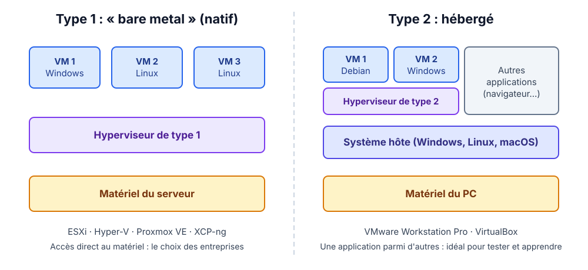

<!-- ============================================================ -->
<!-- ⚠️ RAPPEL IMPORTANT :                                          -->
<!-- Pensez TOUJOURS à ajouter une entrée dans le fichier d'index  -->
<!-- (index.md) du dossier correspondant (ex: docs/cloud/index.md) -->
<!-- afin de référencer ce nouvel article et permettre aux         -->
<!-- visiteurs de le trouver et de cliquer dessus !                -->
<!-- ============================================================ -->

# Hyperviseur et machine virtuelle

!!! abstract "Résumé"
    Cette partie explique **ce que fait un hyperviseur**, **comment fonctionne une machine virtuelle** et en quoi elle diffère d'un ordinateur physique, puis présente les **deux types d'hyperviseurs** (type 1 et type 2) sans entrer dans les détails des produits, qui viendront au jour 3.

    Côté pratique, on **vérifie que son PC sait virtualiser** (Intel VT-x ou AMD-V activé, hyperviseur de Windows actif ou non), puis on **prend en main VMware Workstation Pro** : version, dossier des VM, préférences et réseaux virtuels. À la fin, chacun a rempli la **fiche d'identité** de son poste de virtualisation.

| Propriété | Valeur |
|-----------|--------|
| Difficulté | Débutant |
| Durée estimée | 1 h 30 |
| Version décrite | VMware Workstation Pro 26H1 sur Windows 10 (20H1 ou plus récent) ou Windows 11 |
| Place dans le parcours | Partie 2 sur 17 du parcours [Virtualisation](index.md) — jour 1 |
| Dernière mise à jour | 2026-11-16 |

---

!!! info "Convention de lecture"
    🖥️ **PC hôte** (Windows et Workstation) · 💬 **activité en binôme ou en groupe** · ✍️ **exercice**. Les menus de Workstation sont écrits en anglais ; dans la version française, ils sont au même endroit.

## 1. L'hyperviseur, chef d'orchestre des ressources

L'**hyperviseur** est le logiciel qui **crée** les machines virtuelles et **répartit** les ressources de la machine hôte entre elles. On l'appelle aussi **VMM** (*Virtual Machine Monitor*, moniteur de machines virtuelles).

Il travaille en deux temps :

1. **À la création** de chaque VM, il fabrique des **ressources virtuelles** : un nombre de processeurs virtuels (**vCPU**), une quantité de mémoire, un ou plusieurs disques, une ou plusieurs cartes réseau. Ces valeurs agissent comme des **limites** : la VM ne pourra pas utiliser plus que ce qui lui a été attribué.
2. **Pendant le fonctionnement**, il joue le **chef d'orchestre** : il donne à chaque VM le temps de processeur, la mémoire et les accès au disque et au réseau dont elle a besoin, **au bon moment** et **dans la limite** fixée à la création.

!!! question "Une image pour s'en souvenir"
    On peut comparer l'hyperviseur à un **arbre** qui envoie à chacune de ses feuilles la sève dont elle a besoin : le tronc (l'hyperviseur) puise dans les racines (le matériel) et distribue, branche par branche (VM par VM), les bonnes quantités.

Ses missions :

| Mission | Ce que cela veut dire |
|---|---|
| **Partager le processeur** | Chaque vCPU est, pour l'hôte, une tâche à exécuter ; l'hyperviseur les fait passer à tour de rôle sur les cœurs réels |
| **Partager la mémoire** | Il attribue à chaque VM une zone de la mémoire de l'hôte et empêche une VM de lire la mémoire d'une autre |
| **Simuler les périphériques** | Il présente à la VM une carte mère, une carte réseau, un contrôleur de disque, une carte graphique… virtuels |
| **Isoler les VM** | Un plantage ou un virus dans une VM ne doit pas toucher les autres VM ni l'hôte |
| **Gérer le cycle de vie** | Créer, démarrer, suspendre, arrêter, cloner, déplacer les VM, prendre des instantanés |

## 2. Comment fonctionne une machine virtuelle ?

### 2.1 Un matériel « fabriqué »

Le système installé dans une VM (le **système invité**) croit tourner sur un vrai ordinateur. Il démarre sur un **BIOS ou un UEFI virtuel**, voit une **carte mère virtuelle**, une **carte réseau virtuelle** avec sa propre adresse MAC, et un **disque** qui est en réalité un **fichier** sur le disque de l'hôte.

Certains de ces composants sont **émulés** : l'hyperviseur imite un vrai modèle de matériel connu (une vieille carte réseau Intel, un contrôleur de disque standard) pour que n'importe quel système le reconnaisse sans pilote particulier. D'autres sont **paravirtualisés** : ce sont des composants « idéaux » qui n'existent pas en vrai, plus rapides, mais qui demandent un **pilote spécial** dans l'invité (installé par les **VMware Tools** sous Windows, déjà présent dans le noyau sous Linux). La différence est approfondie au jour 3.

### 2.2 Le rôle du processeur : Intel VT-x et AMD-V

Un processeur protège le **noyau** du système (la partie qui pilote le matériel) des programmes ordinaires. Dans une VM, le noyau de l'invité **ne doit pas** commander directement le vrai matériel, sinon il prendrait le contrôle de l'hôte et des autres VM.

Depuis 2005-2006, les processeurs Intel (**VT-x**) et AMD (**AMD-V**) savent exécuter le code d'une VM dans un **mode invité** : le code de la VM tourne directement sur le processeur, à pleine vitesse, et dès qu'il tente une opération sensible (accéder au matériel, modifier la mémoire protégée), le processeur **rend la main à l'hyperviseur**, qui traite la demande à sa place. Une seconde génération de ces extensions (**EPT** chez Intel, **RVI** chez AMD) accélère aussi la gestion de la mémoire des VM.

!!! warning "Sans VT-x ou AMD-V, pas de VM 64 bits"
    VMware Workstation Pro demande un processeur 64 bits sorti en **2011 ou après**, et l'extension **VT-x** ou **AMD-V** est **indispensable** pour faire tourner un système invité 64 bits. Ces extensions existent dans presque tous les processeurs actuels, mais elles sont parfois **désactivées dans le BIOS/UEFI** du PC : c'est l'objet du [TP de la section 4](#4-tp-verifier-que-son-pc-sait-virtualiser).

### 2.3 Machine physique ou machine virtuelle : les différences

| | Machine physique | Machine virtuelle |
|---|---|---|
| **Matériel** | Composants réels, achetés | Composants virtuels, créés par l'hyperviseur |
| **Disque** | Un disque dur ou SSD | Un ou plusieurs **fichiers** sur le disque de l'hôte |
| **Ajouter de la mémoire** | Ouvrir le boîtier, acheter une barrette | Changer un nombre dans les paramètres de la VM |
| **Démarrage** | Bouton d'alimentation | Bouton **Power On** de l'hyperviseur |
| **Copier la machine** | Réinstaller ou cloner le disque avec un outil | **Cloner** la VM en quelques clics |
| **Revenir en arrière** | Restaurer une sauvegarde | Revenir à un **instantané** en quelques secondes |
| **Déplacer sur un autre matériel** | Réinstaller, changer les pilotes | Copier les fichiers de la VM, ou la déplacer à chaud entre hôtes |
| **Performances** | Tout le matériel pour un seul système | Ressources partagées, légère perte due à la virtualisation |
| **Pannes** | Une panne touche une machine | Une panne de l'**hôte** touche **toutes** ses VM |

La [partie 3](03-creer-sa-premiere-vm.md#6-machine-physique-ou-machine-virtuelle) fait vérifier ces différences de l'intérieur d'une VM, avec des commandes.

## 3. Les deux types d'hyperviseurs

{ loading=lazy }
/// caption
La différence tient en une question : y a-t-il un système d'exploitation entre l'hyperviseur et le matériel ?
///

### 3.1 Type 1 : « bare metal » ou natif

L'hyperviseur de **type 1** s'installe **directement sur le matériel**, à la place d'un système d'exploitation classique. Il n'y a pas de Windows ni de Linux « généraliste » en dessous : l'hyperviseur accède **directement** aux ressources, et la quasi-totalité de celles-ci est consacrée aux VM. C'est le type préféré des **entreprises** pour leurs serveurs.

Exemples : **VMware ESXi**, **Microsoft Hyper-V**, **Proxmox VE** (basé sur KVM), **XCP-ng**, **Nutanix AHV**.

!!! info "Deux cas particuliers à connaître"
    - **Hyper-V** s'active comme une fonctionnalité de Windows, ce qui le fait ressembler à un type 2. Pourtant, Microsoft le classe en **type 1** : une fois activé, l'hyperviseur démarre **en premier**, et Windows lui-même devient une sorte de VM privilégiée (la « partition parente »).
    - **KVM** transforme le noyau Linux en hyperviseur. Red Hat le classe en **type 1**, d'autres auteurs en type 2 : la classification est discutée. Ce qui compte en pratique : KVM est un module du noyau qui exécute les VM avec l'aide de VT-x ou AMD-V.

### 3.2 Type 2 : hébergé

L'hyperviseur de **type 2** est une **application** qui s'installe sur un système d'exploitation existant (Windows, Linux, macOS), comme un navigateur ou un traitement de texte. C'est le plus simple à mettre en place, et il permet de créer des VM indépendantes du système hôte.

Exemples : **VMware Workstation Pro** (Windows et Linux), **Oracle VirtualBox** (Windows, Linux, macOS), **VMware Fusion** et **Parallels Desktop** (macOS).

!!! warning "La limite du type 2"
    Pour le système hôte, l'hyperviseur n'est qu'une **application parmi d'autres**, sans priorité sur les ressources. Le système hôte garde aussi des ressources pour lui-même. Une autre application qui a soudain besoin de beaucoup de ressources (ouvrir un très gros fichier, une mise à jour de Windows, un antivirus qui analyse le disque) peut **ralentir les VM**. C'est parfait pour **apprendre, tester et développer**, pas pour faire tourner les serveurs d'une entreprise.

### 3.3 💬 Activité : classer les hyperviseurs

**Par deux, 15 minutes, avec Internet.** Trouver **trois** solutions de virtualisation, dont au moins **une de type 1** et **une de type 2**, et remplir pour chacune ce tableau :

| Nom | Éditeur | Type 1 ou 2 | Gratuit ou payant ? | Usage typique | Différence avec les deux autres |
|---|---|---|---|---|---|
| … | … | … | … | … | … |

Mise en commun : chaque binôme présente **une** solution en une minute. **Seul**, comparer son tableau avec les exemples ci-dessous.

??? success "Exemples de réponses"
    | Nom | Éditeur | Type | Licence | Usage typique |
    |---|---|---|---|---|
    | VMware ESXi | Broadcom | 1 | Payant (abonnement) ; une édition gratuite limitée (ESXi 8.0 Update 3e, sans support, sans vCenter) est proposée depuis avril 2025 | Serveurs d'entreprise, gérés par vCenter |
    | Microsoft Hyper-V | Microsoft | 1 | Inclus dans Windows Server et dans Windows 10/11 Pro, Entreprise, Éducation | Entreprises équipées de Windows Server, postes de développeurs |
    | Proxmox VE | Proxmox Server Solutions | 1 | Libre et gratuit ; abonnement facultatif pour le support et le dépôt « entreprise » | PME, labs, alternative à VMware depuis 2023 |
    | XCP-ng | Vates | 1 | Libre et gratuit, support payant | Alternative libre à VMware, basée sur Xen |
    | VMware Workstation Pro | Broadcom | 2 | **Gratuit** pour tous les usages depuis le 11 novembre 2024 | Labs, formation, tests sur un PC Windows ou Linux |
    | Oracle VirtualBox | Oracle | 2 | Gratuit (licence libre GPL) ; le pack d'extensions a une licence à part, payante pour un usage en entreprise | Tests et formation, multiplateforme (y compris macOS) |

    **Différences à faire ressortir** : les types 1 visent la **production** (performances, haute disponibilité, administration centralisée de plusieurs hôtes) ; les types 2 visent le **poste de travail** (facilité d'installation, cohabitation avec les applications habituelles).

## 4. TP : vérifier que son PC sait virtualiser

### 4.1 La virtualisation matérielle est-elle activée ?

1. 🖥️ Ouvrir le **Gestionnaire des tâches** (++ctrl+shift+esc++), onglet **Performances**, puis **Processeur**.
2. En bas à droite, repérer la ligne **Virtualisation** : elle doit indiquer **Activé**.
3. Noter aussi le nombre de **Cœurs** et de **Processeurs logiques** : ils serviront à dimensionner les VM en [partie 4](04-partager-les-ressources.md).

!!! failure "La ligne Virtualisation indique « Désactivé »"
    Le processeur sait virtualiser, mais la fonction est **coupée dans le BIOS/UEFI** du PC. Il faut redémarrer, entrer dans le BIOS/UEFI (touche ++f2++, ++del++, ++f10++ ou ++f12++ selon le constructeur, affichée au démarrage) et activer l'option, dont le nom varie : **Intel Virtualization Technology**, **Intel VT-x**, **VT-x**, **Virtualization**, ou **SVM Mode** sur les processeurs AMD. Enregistrer, puis **éteindre complètement** le PC et le rallumer (un simple redémarrage ne suffit pas toujours). Sur un PC géré par un établissement ou une entreprise, l'accès au BIOS peut être verrouillé : demander à l'administrateur.

### 4.2 L'hyperviseur de Windows est-il actif ?

Windows 10 et 11 peuvent lancer **leur propre hyperviseur** (celui d'Hyper-V) sans que l'utilisateur l'ait demandé : il sert à la **sécurité basée sur la virtualisation** (VBS, dont l'**Intégrité de la mémoire**), à **WSL 2** ou au **Bac à sable Windows**. Dans ce cas, Workstation ne peut plus piloter VT-x lui-même : il fonctionne en **mode « Host VBS »**, en passant par l'hyperviseur de Windows.

1. 🖥️ Ouvrir **Informations système** : touche ++win+r++, taper `msinfo32`, puis ++enter++.
2. Dans **Résumé système**, lire la ligne **Sécurité basée sur la virtualisation** : « En cours d'exécution » signifie que l'hyperviseur de Windows est actif.
3. Tout en bas de la même liste, les lignes consacrées à **Hyper-V** sont remplacées par une phrase indiquant qu'**un hyperviseur a été détecté** quand l'hyperviseur de Windows est actif.

??? info "Ce que change le mode Host VBS"
    D'après la documentation de VMware, en mode Host VBS :

    - les VM peuvent être **plus lentes** ;
    - la **virtualisation imbriquée** (une VM qui fait elle-même tourner des VM) **n'est pas possible**.

    Pour les jours 1 et 2, ce n'est pas gênant. Pour le **jour 3**, où l'on installe Proxmox VE **dans** une VM Workstation, il faudra désactiver l'hyperviseur de Windows : la procédure est dans les [annexes](annexes.md#13-desactiver-lhyperviseur-de-windows-pour-la-virtualisation-imbriquee). **Ne rien changer pour l'instant** : cette procédure baisse la sécurité de Windows et ne sera utile qu'au jour 3, si la virtualisation imbriquée est nécessaire.

## 5. TP : prendre en main VMware Workstation Pro

Workstation Pro est **gratuit** pour tous les usages depuis novembre 2024. S'il n'est pas encore installé, suivre la procédure des [annexes](annexes.md#11-telecharger-et-installer-vmware-workstation-pro) (un compte gratuit sur le portail de Broadcom est obligatoire pour le télécharger).

### 5.1 Vérifier la version

1. 🖥️ Lancer **VMware Workstation Pro**. L'onglet **Home** (*Accueil*) s'affiche, avec les boutons **Create a New Virtual Machine** (*Créer une nouvelle machine virtuelle*) et **Open a Virtual Machine** (*Ouvrir une machine virtuelle*).
2. Ouvrir **Help > About VMware Workstation** (*Aide > À propos*) et noter la **version** et le **numéro de build**. Ce parcours décrit la version **26H1** : le nom indique l'année (20**26**) et le semestre (**H1**, premier semestre).

!!! info "Pourquoi « 26H1 » et pas « 18 » ?"
    Jusqu'en 2025, les versions de Workstation étaient numérotées 15, 16, 17… Depuis la version **25H2** (octobre 2025), Broadcom utilise une numérotation **calendaire** : 25H2, puis 26H1 (mai 2026), puis des mises à jour comme **26H1u1** (*update 1*).

### 5.2 Choisir où ranger les VM

Une VM occupe vite plusieurs gigaoctets. Par défaut, Workstation les range dans le dossier **Documents** de l'utilisateur, sous `Virtual Machines`. Si le dossier Documents est **synchronisé avec OneDrive**, c'est une très mauvaise idée : OneDrive essaierait d'envoyer en permanence des fichiers de plusieurs gigaoctets qui changent sans arrêt.

1. 🖥️ Créer un dossier dédié, de préférence sur un **SSD**, par exemple `C:\VM` (ou `D:\VM` s'il existe un second disque).
2. Dans Workstation, ouvrir **Edit > Preferences** (*Édition > Préférences*), rubrique **Workspace** (*Espace de travail*).
3. Dans **Default location for virtual machines** (*Emplacement par défaut des machines virtuelles*), choisir le dossier créé, puis **OK**.

### 5.3 Jeter un œil aux réglages de la mémoire

Toujours dans **Edit > Preferences**, ouvrir la rubrique **Memory** (*Mémoire*). Elle contient deux réglages :

- **Reserved memory** (*mémoire réservée*) : la quantité **maximale** de mémoire de l'hôte que l'ensemble des VM peut utiliser. Ce n'est pas une mémoire prise à l'avance, mais un **plafond**.
- **Additional memory** (*mémoire supplémentaire*) : ce que fait Workstation quand les VM demandent plus que ce plafond. **Fit all virtual machine memory into reserved host RAM** interdit de dépasser ; **Allow some virtual machine memory to be swapped** et **Allow most virtual machine memory to be swapped** autorisent à placer une partie de la mémoire des VM sur le disque (plus lent).

Ne rien modifier : ces notions sont expliquées et mises en pratique en [partie 4](04-partager-les-ressources.md#3-la-memoire).

### 5.4 Découvrir les réseaux virtuels

Ouvrir **Edit > Virtual Network Editor** (*Édition > Éditeur de réseau virtuel*). Workstation a créé trois **commutateurs virtuels** (*switchs*) à son installation :

| Commutateur | Mode | En une phrase |
|---|---|---|
| **VMnet0** | **Bridged** (pont) | Les VM sont branchées **directement sur le réseau physique** du PC, comme un PC de plus dans la salle |
| **VMnet1** | **Host-only** (réseau privé hôte) | Les VM ne voient que **le PC hôte et les autres VM** de ce réseau ; pas d'Internet |
| **VMnet8** | **NAT** | Les VM ont leur **propre petit réseau privé** et sortent sur Internet **derrière l'adresse du PC**, comme une box Internet |

Noter le **sous-réseau** de **VMnet8** (colonne *Subnet Address*) : c'est le réseau des VM du jour 1. Fermer l'éditeur **sans rien changer**. Les trois modes sont étudiés et pratiqués au **jour 2**.

!!! tip "Pourquoi « NAT » par défaut ?"
    Le mode NAT donne Internet aux VM **sans dépendre du réseau de la salle** : pas besoin d'adresse fournie par le réseau de l'établissement, pas de risque de conflit avec les PC voisins. C'est le mode le plus simple et le plus sûr pour débuter.

### 5.5 ✍️ La fiche d'identité de son poste

Recopier et remplir ce tableau. Il servira à dimensionner les VM des prochaines parties.

| Information | Où la trouver | Valeur sur mon PC |
|---|---|---|
| Processeur (modèle) | Gestionnaire des tâches > Performances > Processeur | |
| Nombre de cœurs et de processeurs logiques | Idem | |
| Mémoire vive totale | Gestionnaire des tâches > Performances > Mémoire | |
| Virtualisation matérielle activée ? | Idem, ligne **Virtualisation** | |
| Hyperviseur de Windows actif (VBS) ? | `msinfo32` | |
| Version de Workstation | **Help > About** | |
| Dossier des VM | **Edit > Preferences > Workspace** | |
| Sous-réseau de VMnet8 | **Edit > Virtual Network Editor** | |
| Espace libre sur le disque des VM | Explorateur de fichiers > Ce PC | |

!!! success "Vérifier son poste"
    Le poste est prêt pour la suite si :

    - la ligne **Virtualisation** indique **Activé** ;
    - Workstation s'ouvre et affiche une version **26H1** ou plus récente ;
    - le dossier des VM est sur un disque local avec **au moins 30 Go libres**, hors OneDrive ;
    - **VMnet8** existe dans l'éditeur de réseau virtuel, en mode **NAT**.

## 6. Questions de révision

1. Quelles sont les deux grandes missions d'un hyperviseur ?
2. Quelle est la différence entre un hyperviseur de type 1 et un hyperviseur de type 2 ? Donner un exemple de chaque.
3. Pourquoi une entreprise préfère-t-elle un hyperviseur de type 1 pour ses serveurs ?
4. À quoi servent les extensions **Intel VT-x** et **AMD-V** ? Où les active-t-on ?
5. Hyper-V s'installe depuis Windows. Pourquoi est-il pourtant classé en type 1 ?
6. Quelle est la différence entre VMware Workstation et VirtualBox ? Détailler.

??? success "Corrigé"
    1. **Créer** les machines virtuelles (en fabriquant leurs ressources virtuelles, qui servent de limites) et **répartir** les ressources de l'hôte entre elles pendant leur fonctionnement, en les isolant les unes des autres.
    2. Le **type 1** (*bare metal*) s'installe directement sur le matériel, sans système d'exploitation en dessous : VMware ESXi, Hyper-V, Proxmox VE. Le **type 2** (hébergé) est une application installée sur un système existant : VMware Workstation Pro, VirtualBox.
    3. Il accède **directement** au matériel, sans système généraliste qui consomme des ressources ou qui peut les ralentir ; presque toutes les ressources vont aux VM. Les types 1 offrent aussi les fonctions de production : administration centralisée de plusieurs hôtes, haute disponibilité, migration des VM à chaud.
    4. Elles permettent au **processeur** d'exécuter directement le code des VM dans un mode invité et de rendre la main à l'hyperviseur dès qu'une opération sensible est tentée. Sans elles, impossible de faire tourner un système invité 64 bits dans Workstation. Elles s'activent dans le **BIOS/UEFI** du PC (option *Intel Virtualization Technology*, *VT-x* ou *SVM Mode*).
    5. Une fois activé, l'hyperviseur d'Hyper-V **démarre avant Windows** et s'exécute directement sur le matériel ; Windows tourne alors au-dessus, dans une **partition parente** privilégiée. C'est donc bien un hyperviseur posé sur le matériel.
    6. Les deux sont des hyperviseurs de **type 2**, aujourd'hui **gratuits** (Workstation Pro l'est pour tous les usages depuis novembre 2024). **VirtualBox** s'installe sur Windows, Linux et macOS, et accepte plusieurs formats de disques (VDI, son format natif, mais aussi VHD et VMDK). **Workstation Pro** s'installe sur Windows et Linux, utilise le format de disque **VMDK** (celui de toute la gamme VMware, ce qui facilite le passage d'une VM vers ESXi), et propose un éditeur de réseaux virtuels complet. Les deux savent prendre des instantanés et cloner des VM.

---

## Ressources

- [Broadcom — Configuration requise du processeur pour Workstation Pro 26H1](https://techdocs.broadcom.com/us/en/vmware-cis/desktop-hypervisors/workstation-pro/26H1/using-vmware-workstation-pro/introduction-and-system-requirements/host-system-requirements-for-workstation-pro/processor-requirements-for-host-systems.html) — processeurs et extensions de virtualisation exigés (en anglais).
- [Broadcom — Workstation sur un hôte où Hyper-V est actif](https://techdocs.broadcom.com/us/en/vmware-cis/desktop-hypervisors/workstation-pro/26H1/using-vmware-workstation-pro/running-workstation-on-a-hyper-v-enabled-host.html) — le mode Host VBS et ses limites (en anglais).
- [Microsoft — Architecture d'Hyper-V](https://learn.microsoft.com/fr-fr/windows-server/administration/performance-tuning/role/hyper-v-server/architecture) — pourquoi Hyper-V est un hyperviseur de type 1.
- [Microsoft — Activer la virtualisation sur Windows](https://support.microsoft.com/fr-fr/windows/activer-la-virtualisation-sur-windows-c5578302-6e43-4b4b-a449-8ced115f58e1) — activer VT-x ou AMD-V dans le BIOS/UEFI.
- Partie précédente : [Comprendre la virtualisation](01-comprendre-la-virtualisation.md) · Partie suivante : [Créer sa première VM Debian 13](03-creer-sa-premiere-vm.md).

*[VM]: Virtual Machine — machine virtuelle
*[VMM]: Virtual Machine Monitor — moniteur de machines virtuelles, autre nom de l'hyperviseur
*[vCPU]: processeur virtuel
*[VBS]: Virtualization-Based Security — sécurité basée sur la virtualisation
*[WSL]: Windows Subsystem for Linux — sous-système Windows pour Linux
*[EPT]: Extended Page Tables — accélération Intel de la mémoire des VM
*[RVI]: Rapid Virtualization Indexing — accélération AMD de la mémoire des VM
*[NAT]: Network Address Translation — traduction d'adresses
*[UEFI]: Unified Extensible Firmware Interface — successeur du BIOS
*[MAC]: Media Access Control — adresse physique d'une carte réseau
*[BIOS]: Basic Input/Output System — micrologiciel de démarrage
*[SSD]: Solid State Drive — disque à mémoire flash
*[VT-x]: extensions de virtualisation des processeurs Intel
*[AMD-V]: extensions de virtualisation des processeurs AMD
*[KVM]: Kernel-based Virtual Machine — hyperviseur intégré au noyau Linux
*[PME]: Petite ou moyenne entreprise
