<!-- ============================================================ -->
<!-- ⚠️ RAPPEL IMPORTANT :                                          -->
<!-- Pensez TOUJOURS à ajouter une entrée dans le fichier d'index  -->
<!-- (index.md) du dossier correspondant (ex: docs/cloud/index.md) -->
<!-- afin de référencer ce nouvel article et permettre aux         -->
<!-- visiteurs de le trouver et de cliquer dessus !                -->
<!-- ============================================================ -->

# Créer sa première VM Debian 13

!!! abstract "Résumé"
    Ce TP crée la machine virtuelle **`debian-tp`** qui sert pendant tout le parcours. On commence par **télécharger** l'image d'installation de Debian 13 et **vérifier son empreinte**, puis on **crée la VM** avec l'assistant de VMware Workstation. Avant même de l'allumer, on **explore ses fichiers** pour comprendre qu'une VM n'est qu'un dossier sur le disque du PC.

    On **installe ensuite Debian 13** sans interface graphique, on ajoute **`sudo`** et les outils d'intégration **open-vm-tools**, et l'on termine par une enquête : **comment savoir, de l'intérieur, qu'on est dans une VM ?** À la fin, `debian-tp` fonctionne, a accès à Internet, et un premier instantané la protège.

| Propriété | Valeur |
|-----------|--------|
| Difficulté | Débutant |
| Durée estimée | 2 h (dont environ 15 minutes d'installation automatique) |
| Version décrite | VMware Workstation Pro 26H1, Debian 13.7 (image *netinst* amd64) |
| Place dans le parcours | Partie 3 sur 17 du parcours [Virtualisation](index.md) — jour 1 |
| Dernière mise à jour | 2026-11-16 |

---

!!! info "Convention de lecture"
    🖥️ **PC hôte** (Windows et Workstation) · 🐧 **VM Debian** `debian-tp` · ✍️ **exercice** · 🛟 **instantané**. Les [comptes et mots de passe](index.md#comptes-et-mots-de-passe) sont rappelés sur la page d'accueil du parcours.

<!-- NOTE DE RÉDACTION (non affichée) : les captures de l'installateur Debian ont été prises sur un hyperviseur KVM (disque « Virtio Block Device » /dev/vda, BIOS) le 2026-11-16 avec debian-13.7.0-amd64-netinst.iso ; l'installateur est identique sous Workstation, seuls le nom du disque (sda/nvme0n1) et le réseau (DHCP de VMnet8 qui répond) diffèrent : le texte le signale. Le cas « DHCP en échec » vient de ce lab (DHCP bloqué) et sert d'encadré de dépannage. Les écrans de l'assistant de Workstation sont décrits d'après la documentation Broadcom 26H1 (libellés « Typical (recommended) », « I will install… », « Store virtual disk as a single file » non présents mot pour mot dans la doc). -->

## 1. Télécharger Debian 13 et vérifier l'image

Debian est distribué sous forme d'**images ISO** : un fichier qui contient tout le contenu d'un DVD d'installation. L'image **netinst** (*network install*, installation par le réseau) est petite (environ 790 Mo) : elle contient le strict nécessaire pour démarrer l'installation, puis télécharge le reste sur Internet.

1. 🖥️ Ouvrir la page [Debian — installation par le réseau](https://www.debian.org/distrib/netinst) et télécharger l'image **amd64** (petits CD). Le fichier s'appelle `debian-13.7.0-amd64-netinst.iso` (ou une version 13.x plus récente).
2. 🖥️ Le ranger dans un dossier dédié, par exemple `C:\VM\ISO`.
3. 🖥️ Calculer son **empreinte** (*hash*) dans PowerShell :

    ```powershell
    Get-FileHash C:\VM\ISO\debian-13.7.0-amd64-netinst.iso -Algorithm SHA256
    ```

4. 🖥️ Comparer le résultat avec la ligne correspondante du fichier `SHA256SUMS`, publié dans le [dossier de téléchargement officiel](https://cdimage.debian.org/debian-cd/current/amd64/iso-cd/). Les deux empreintes doivent être **strictement identiques**.

!!! question "Pourquoi vérifier l'empreinte ?"
    L'empreinte est une sorte d'**empreinte digitale** du fichier : changer un seul octet change complètement le résultat. Si les deux empreintes sont identiques, le fichier téléchargé est **exactement** celui publié par Debian : il n'a été ni abîmé pendant le téléchargement, ni modifié par un tiers malveillant. C'est un réflexe à prendre pour **tout** fichier d'installation de système ou de logiciel serveur.

## 2. Créer la VM avec l'assistant

1. 🖥️ Dans Workstation, ouvrir **File > New Virtual Machine** (*Fichier > Nouvelle machine virtuelle*) ou cliquer sur **Create a New Virtual Machine** dans l'onglet **Home**. L'assistant **New Virtual Machine Wizard** s'ouvre.
2. Remplir les pages de l'assistant ainsi :

| Page de l'assistant | Réglage | Pourquoi |
|---|---|---|
| **Welcome to the New Virtual Machine Wizard** | **Typical (recommended)** | La configuration typique pose peu de questions et choisit des valeurs adaptées au système invité |
| **Guest Operating System Installation** | **Installer disc image file (iso)**, puis **Browse** et choisir l'ISO de Debian | La VM démarrera sur l'image comme sur un DVD. Workstation peut indiquer qu'il ne reconnaît pas le système de l'image : ce n'est pas grave, on le précise à la page suivante |
| **Select a Guest Operating System** | **Linux**, puis la version **Debian** la plus récente de la liste en **64-bit** (par exemple *Debian 13.x 64-bit*, ou *Debian 12.x 64-bit* si la 13 n'apparaît pas) | Workstation adapte le matériel virtuel (contrôleur de disque, carte réseau) au système déclaré |
| **Name the Virtual Machine** | Nom : `debian-tp` ; emplacement : `C:\VM\debian-tp` | Un dossier par VM, dans le dossier choisi en [partie 2](02-hyperviseur-et-machine-virtuelle.md#52-choisir-ou-ranger-les-vm) |
| **Specify Disk Capacity** | **Maximum disk size** : `20` Go ; garder **Split virtual disk into multiple files** | 20 Go suffisent largement ; le disque est **dynamique** : il ne prendra que la place réellement écrite (voir la [partie 4](04-partager-les-ressources.md#4-le-disque)) |
| **Ready to Create Virtual Machine** | Cliquer sur **Customize Hardware…** (voir ci-dessous) | Ajuster la mémoire et les processeurs |

3. Dans **Customize Hardware** (*personnaliser le matériel*) :
    - **Memory** : `2048` Mo (2 Go) ;
    - **Processors** : **Number of processors** `1`, **Number of cores per processor** `2` ;
    - **Network Adapter** : **NAT** (réglage par défaut) ;
    - facultatif : sélectionner **Sound Card** et **Printer**, puis **Remove** : un serveur n'a besoin ni de son ni d'imprimante virtuelle.

    Cliquer sur **Close**.

4. Sur la dernière page, **décocher** **Power on this virtual machine after creation** (*démarrer la VM après sa création*) : on va d'abord explorer ses fichiers. Cliquer sur **Finish**.

!!! tip "Sur un PC de 8 Go"
    Donner **1 Go** et **1 processeur × 1 cœur** à la VM : l'installation sera un peu plus lente, mais Debian sans bureau fonctionne très bien avec 1 Go.

## 3. Explorer les fichiers d'une VM

Une VM, ce n'est **que des fichiers**. C'est ce qui la rend si facile à copier, à déplacer et à sauvegarder.

1. 🖥️ Ouvrir le dossier `C:\VM\debian-tp` dans l'Explorateur de fichiers. Afficher les **extensions** des fichiers (menu **Affichage**, cocher **Extensions de noms de fichiers**) et passer en affichage **Détails** pour voir les tailles.
2. Repérer les fichiers suivants :

| Fichier | Rôle |
|---|---|
| `debian-tp.vmx` | Le fichier de **configuration** de la VM : processeurs, mémoire, disques, cartes réseau… C'est un simple fichier texte |
| `debian-tp.vmdk` | Le **disque virtuel**. Avec l'option « découper en plusieurs fichiers », ce premier fichier est un petit **descripteur** qui pointe vers les morceaux `debian-tp-s001.vmdk`, `debian-tp-s002.vmdk`… (au plus 2 Go chacun) |
| `debian-tp.vmsd` | La liste des **instantanés** (vide pour l'instant) |
| `debian-tp.nvram` | La mémoire du **BIOS/UEFI** virtuel (ordre de démarrage, réglages) ; il apparaît au premier démarrage |
| `vmware.log` | Le **journal** de la VM, très utile en cas de panne ; il apparaît au premier démarrage |

3. 🖥️ Ouvrir `debian-tp.vmx` avec le **Bloc-notes** (clic droit > **Ouvrir avec**), **sans rien modifier**, et y chercher (++ctrl+f++) les lignes qui commencent par `memsize`, `numvcpus`, `cpuid.coresPerSocket`, `guestOS` et `ethernet0.connectionType`. On y retrouve, en clair, ce qui a été choisi dans l'assistant. Fermer le Bloc-notes **sans enregistrer**.
4. 🖥️ Noter la taille totale des fichiers `.vmdk` : le disque est déclaré à 20 Go, mais il ne pèse pour l'instant que quelques Mo, puisqu'il est vide.

!!! danger "Ne jamais modifier ces fichiers à la main pendant que la VM tourne"
    Workstation pose un **verrou** sur les fichiers d'une VM allumée (un dossier `debian-tp.vmx.lck` apparaît). Modifier le `.vmx` ou un `.vmdk` à la main peut rendre la VM inutilisable. Les réglages se changent dans **VM > Settings**, VM éteinte de préférence.

## 4. Installer Debian 13

### 4.1 Démarrer sur l'image d'installation

🖥️ Sélectionner `debian-tp` et cliquer sur **Power on this virtual machine** (*démarrer*). Cliquer dans la console de la VM pour lui donner le clavier (++ctrl+alt++ pour le reprendre).

Le menu de l'installateur s'affiche. Choisir **Graphical install** (*installation graphique*) et appuyer sur ++enter++.

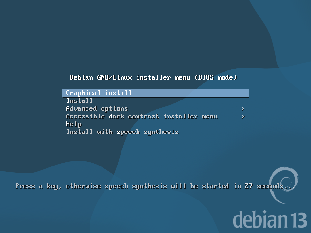{ loading=lazy }
/// caption
Le menu de l'installateur Debian 13
///

!!! warning "Valider en moins de 30 secondes"
    Sur certaines VM, un compte à rebours s'affiche en bas du menu (*Press a key, otherwise speech synthesis will be started in 27 seconds*) : sans action, l'installateur passe en **synthèse vocale**, prévue pour les personnes non voyantes. Si cela arrive, redémarrer la VM (**VM > Power > Reset**) et valider **Graphical install** plus vite.

### 4.2 Langue, pays et clavier

| Écran | Choix |
|---|---|
| **Select a language** | **French - Français**, puis **Continue** |
| **Choix de votre situation géographique** | **France** |
| **Configurer le clavier** | **Français** |

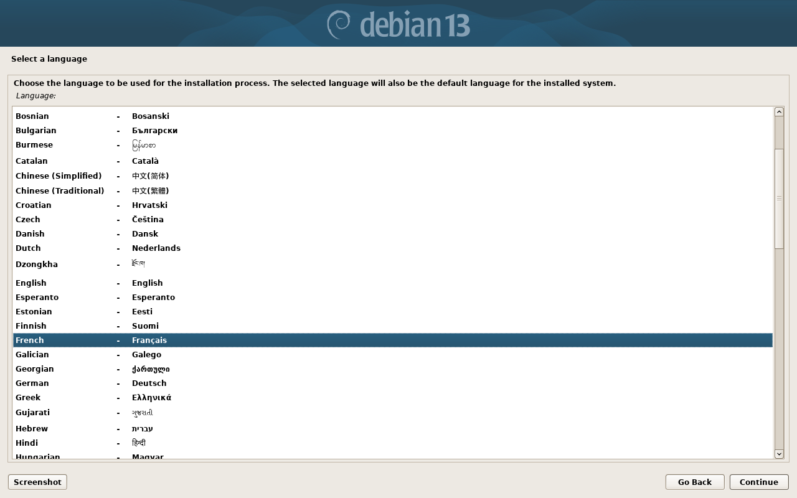{ loading=lazy }
/// caption
Le choix de la langue sert aussi de langue par défaut au système installé
///

Dès que la disposition **Français** est validée, le clavier de la VM est en **AZERTY**. L'installateur charge ensuite des composants, détecte la carte réseau et configure le réseau **automatiquement** : sur le réseau NAT de Workstation, le serveur DHCP répond tout de suite et il n'y a **aucune question** sur le réseau.

??? failure "Dépannage : « La configuration automatique a échoué »"
    Si aucun serveur DHCP ne répond (carte réseau de la VM débranchée, services VMware arrêtés…), l'installateur attend une trentaine de secondes puis affiche cet écran :

    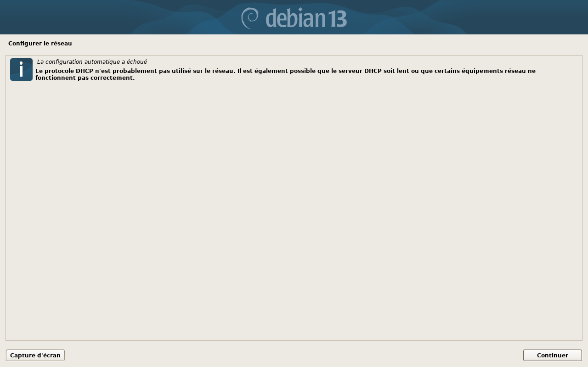{ loading=lazy }
    /// caption
    Aucun serveur DHCP n'a répondu
    ///

    Deux solutions :

    - **Réparer le DHCP** : vérifier dans Workstation que la carte réseau est connectée (**VM > Settings > Network Adapter**, case **Connected**) et que les services **VMware DHCP Service** et **VMware NAT Service** tournent sur le PC (voir les [annexes](annexes.md#16-pas-dinternet-dans-la-vm)), puis choisir **Réessayer la configuration automatique du réseau**.
    - **Configurer le réseau à la main** : choisir **Configurer vous-même le réseau**, puis saisir une adresse **libre** du réseau VMnet8 **sous** la plage DHCP (par exemple `192.168.x.10/24`), la passerelle `192.168.x.2` et le serveur de noms `192.168.x.2`, où `x` est le troisième octet du réseau VMnet8 de son PC.

    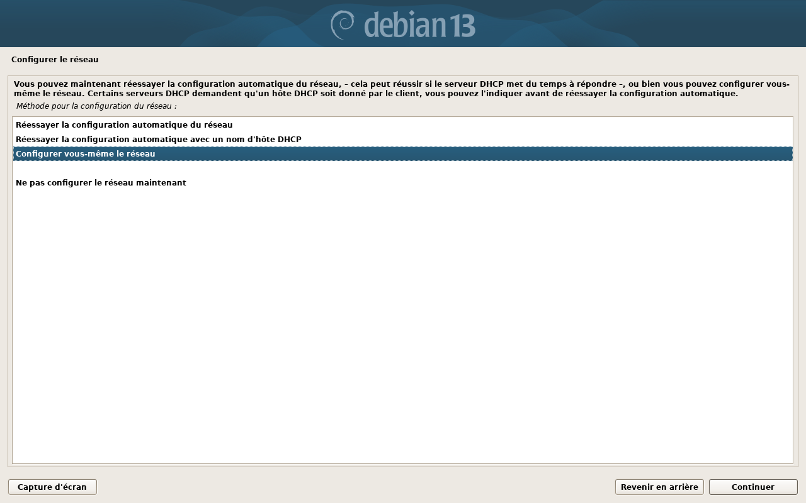{ loading=lazy }
    /// caption
    Le choix de la configuration manuelle
    ///

    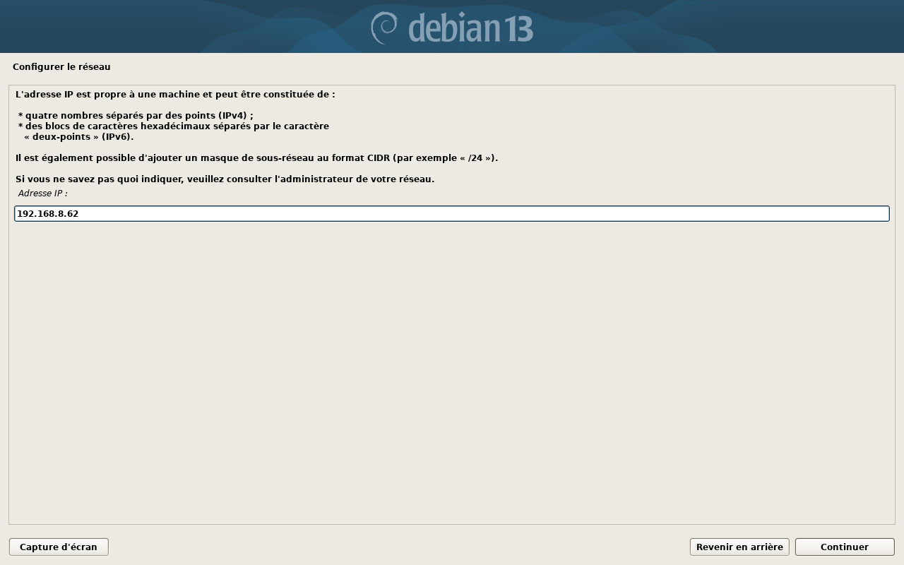{ loading=lazy }
    /// caption
    L'adresse IP peut être saisie avec son masque au format CIDR (/24)
    ///

### 4.3 Nom de la machine et comptes

| Écran | Champ | Valeur |
|---|---|---|
| **Configurer le réseau** | **Nom de machine** | `debian-tp` (remplacer `debian`, proposé par défaut) |
| **Configurer le réseau** | **Domaine** | laisser **vide** |
| **Créer les utilisateurs et choisir les mots de passe** | **Mot de passe du superutilisateur (« root »)** et sa confirmation | `Virtu2026!` |
| idem | **Nom complet du nouvel utilisateur** | `Technicien TSSR` |
| idem | **Identifiant pour le compte utilisateur** | `tssr` (l'installateur propose `technicien` : **le remplacer**) |
| idem | **Mot de passe pour le nouvel utilisateur** et sa confirmation | `Virtu2026!` |

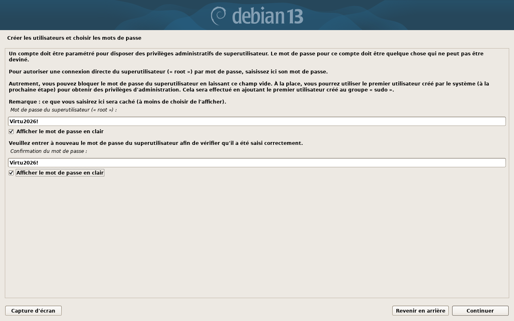{ loading=lazy }
/// caption
Cocher « Afficher le mot de passe en clair » permet de vérifier la saisie au clavier AZERTY
///

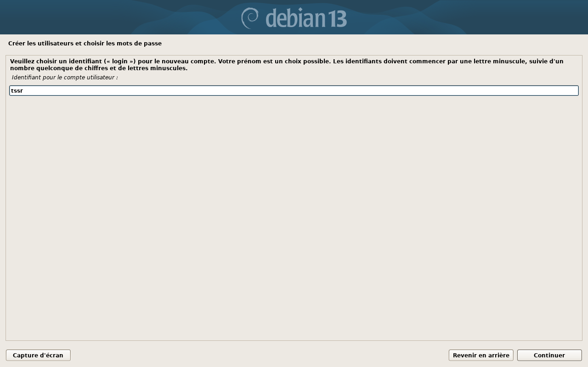{ loading=lazy }
/// caption
L'installateur propose un identifiant tiré du nom complet : le remplacer par tssr
///

!!! question "Pourquoi un compte root ET un compte utilisateur ?"
    `root` est le **superutilisateur** : il a tous les droits, y compris celui de tout casser. On travaille au quotidien avec un compte **ordinaire** (`tssr`) et on ne prend les droits d'administrateur que **quand c'est nécessaire**. Comme un mot de passe root est défini, l'installateur **n'installe pas** l'outil `sudo` : on l'ajoutera en [section 5](#5-premier-demarrage-sudo-et-outils-dintegration). Si l'on laissait le mot de passe root **vide**, le compte root serait bloqué et `tssr` recevrait directement les droits `sudo` : c'est l'autre façon de faire, proposée par l'installateur lui-même.

Il n'y a pas de question sur le fuseau horaire : la France n'en ayant qu'un, l'installateur applique **Europe/Paris**.

### 4.4 Partitionner le disque

| Écran | Choix |
|---|---|
| **Méthode de partitionnement** | **Assisté - utiliser un disque entier** |
| **Disque à partitionner** | Le seul disque proposé (20 Go, soit « 21.5 GB » en unités décimales) |
| **Schéma de partitionnement** | **Tout dans une seule partition (recommandé pour les débutants)** |
| Récapitulatif des partitions | **Terminer le partitionnement et appliquer les changements** |
| **Faut-il appliquer les changements sur les disques ?** | **Oui** (attention : **Non** est présélectionné) |

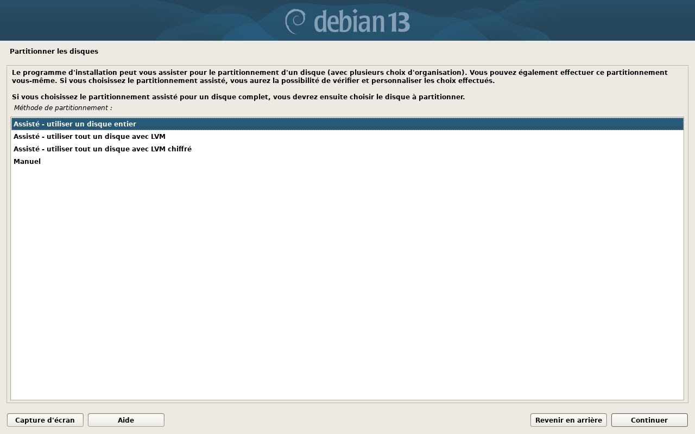{ loading=lazy }
/// caption
Le partitionnement assisté convient très bien à une VM de TP
///

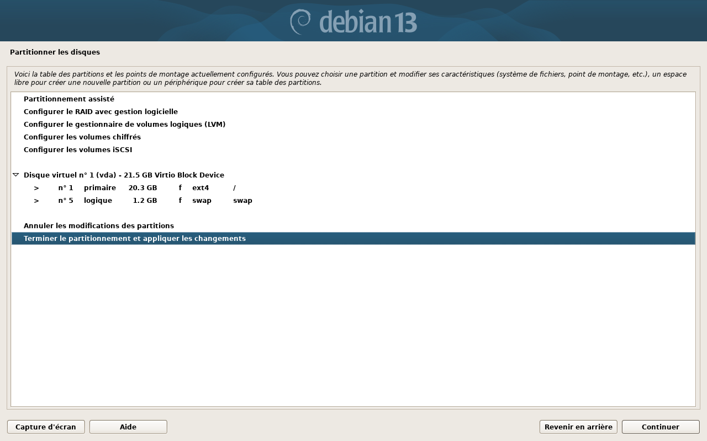{ loading=lazy }
/// caption
Le schéma proposé : une partition système et une partition d'échange
///

!!! info "Le nom du disque dépend de l'hyperviseur"
    Sur les illustrations, le disque s'appelle `vda` (« Virtio Block Device »), le nom que Linux donne aux disques **paravirtualisés** de l'hyperviseur KVM. Dans Workstation, il s'appelle `sda` (contrôleur SCSI ou SATA) ou `nvme0n1` (contrôleur NVMe), avec un libellé qui contient « VMware ». Le principe est le même : un **disque virtuel** que Linux voit comme un vrai disque.

!!! question "Pourquoi « 21.5 GB » pour un disque de 20 Go ?"
    Workstation compte en **gibioctets** (1 Gio = 1 073 741 824 octets) ; l'installateur Debian affiche des **gigaoctets décimaux** (1 Go = 1 000 000 000 octets). 20 Gio = 21,47 milliards d'octets, soit « 21.5 GB ». C'est la même raison pour laquelle un disque dur « de 1 To » n'affiche que 931 Gio dans Windows.

L'installateur installe ensuite le **système de base** (environ 2 minutes).

### 4.5 Gestionnaire de paquets et logiciels

| Écran | Choix |
|---|---|
| **Faut-il analyser d'autres supports d'installation ?** | **Non** |
| **Pays du miroir de l'archive Debian** | **France** |
| **Miroir de l'archive Debian** | **deb.debian.org** |
| **Mandataire HTTP** | laisser **vide** (sauf si le réseau de la salle impose un proxy) |
| **Souhaitez-vous participer à l'étude statistique sur l'utilisation des paquets ?** | **Non** |
| **Sélection des logiciels** | **Décocher** « environnement de bureau Debian » et « … GNOME » ; **cocher** « serveur SSH » ; garder « utilitaires usuels du système » |

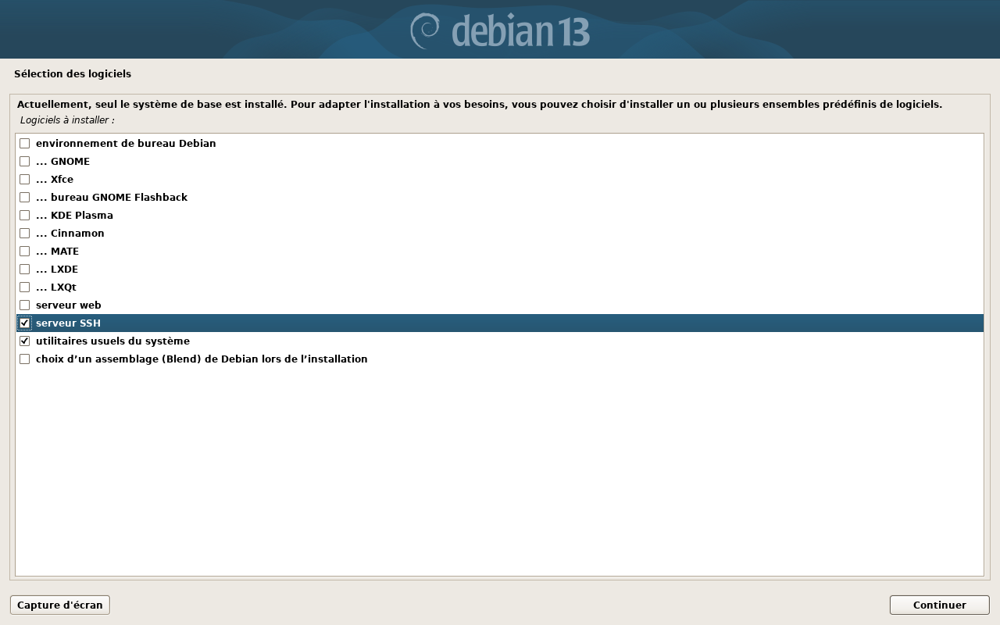{ loading=lazy }
/// caption
Un serveur n'a pas besoin de bureau graphique : seuls le serveur SSH et les utilitaires sont cochés
///

!!! question "Pourquoi pas d'environnement de bureau ?"
    Un serveur s'administre en ligne de commande, souvent **à distance**. Sans bureau, Debian occupe environ **2 Go** de disque et un peu plus de **200 Mo** de mémoire au démarrage ; avec GNOME, il en faudrait plusieurs fois plus. Moins de logiciels, c'est aussi **moins de failles** à corriger. Le **serveur SSH** permettra de se connecter à la VM depuis Windows.

### 4.6 Programme de démarrage et fin de l'installation

| Écran | Choix |
|---|---|
| **Installer le programme de démarrage GRUB sur le disque principal ?** | **Oui** (selon le micrologiciel de la VM, cette question peut ne pas apparaître) |
| **Périphérique où sera installé le programme de démarrage** | Le disque de la VM : `/dev/sda` (ou `/dev/nvme0n1`), **pas** « Choix manuel du périphérique », présélectionné |
| **Installation terminée** | **Continuer** : la VM redémarre |

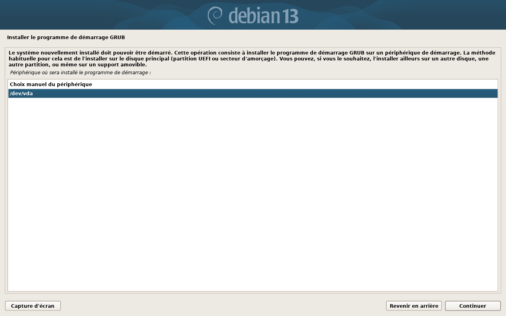{ loading=lazy }
/// caption
Choisir le disque de la VM, et non « Choix manuel du périphérique »
///

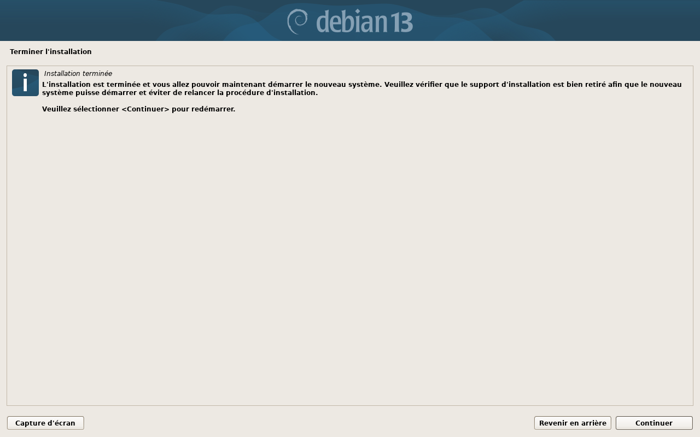{ loading=lazy }
/// caption
L'installation est terminée
///

!!! tip "Retirer l'image d'installation"
    Une fois Debian installé, la VM démarre sur son disque. Pour éviter qu'elle démarre un jour sur l'installateur par erreur, 🖥️ ouvrir **VM > Settings**, sélectionner le lecteur **CD/DVD** et décocher **Connected** et **Connect at power on**.

Le menu **GNU GRUB** s'affiche quelques secondes, puis Debian démarre et affiche l'invite de connexion `debian-tp login:`. Sur un PC récent, l'installation complète prend **environ 15 minutes**.

## 5. Premier démarrage, sudo et outils d'intégration

### 5.1 Se connecter et installer sudo

1. 🐧 Se connecter en `tssr` (le mot de passe ne s'affiche pas pendant la saisie, c'est normal).
2. 🐧 Afficher l'adresse IP de la VM et la noter :

    ```bash
    ip -4 a
    ```

    La carte réseau (souvent nommée `ens33`) a une adresse en `192.168.x.128` ou au-dessus, distribuée par le DHCP de Workstation.

3. 🐧 Devenir `root`, installer `sudo` et les outils d'intégration, puis donner les droits `sudo` à `tssr` :

    ```bash
    su -                                  # mot de passe de root : Virtu2026!
    apt update
    apt install -y sudo open-vm-tools
    usermod -aG sudo tssr                 # ajoute tssr au groupe sudo
    exit                                  # quitte la session root
    ```

4. 🐧 Se **déconnecter** (`exit`) puis se **reconnecter** en `tssr` : l'appartenance à un nouveau groupe ne compte qu'à la connexion suivante.
5. 🐧 Vérifier :

    ```bash
    sudo whoami
    ```

    Après le mot de passe de `tssr`, la réponse est `root`.

### 5.2 Les outils d'intégration open-vm-tools

Les **VMware Tools** sont une suite de pilotes et de services qui améliorent le fonctionnement d'une VM dans un hyperviseur VMware : pilotes **paravirtualisés** (réseau, disque, affichage), **ballon** mémoire, synchronisation de l'heure, **arrêt propre** depuis Workstation, envoi de l'adresse IP à l'hyperviseur. Pour Linux, VMware recommande leur version libre **open-vm-tools**, fournie par les distributions : c'est le paquet installé à l'étape précédente.

!!! info "Déjà installé ?"
    L'installateur Debian installe parfois `open-vm-tools` tout seul quand il détecte VMware. Dans ce cas, `apt` répond que le paquet est déjà à la version la plus récente : c'est normal.

🐧 Vérifier que le service tourne :

```bash
systemctl is-active open-vm-tools
vmware-toolbox-cmd -v
```

!!! success "Vérifier son lab"
    - `systemctl is-active open-vm-tools` répond `active`.
    - `vmware-toolbox-cmd -v` affiche un numéro de version (12.5 avec Debian 13).
    - 🖥️ Dans Workstation, l'onglet de la VM (résumé, en bas) affiche maintenant son **adresse IP** : c'est open-vm-tools qui l'envoie à l'hyperviseur.
    - 🐧 `ping -c 3 deb.debian.org` répond : la VM a accès à Internet par le NAT de Workstation.

??? tip "Astuce : administrer la VM depuis Windows en SSH"
    Taper des commandes dans la console de Workstation n'est pas très confortable (pas de copier-coller, clavier capturé). Comme le **serveur SSH** est installé et que le PC a une adresse sur le réseau VMnet8, on peut se connecter depuis **PowerShell** ou le **Terminal Windows** :

    ```powershell
    ssh tssr@192.168.x.y      # adresse IP de la VM, notée à l'étape 5.1
    ```

    Répondre `yes` à la question sur l'empreinte de la machine, puis saisir le mot de passe. Le copier-coller fonctionne alors normalement. C'est ainsi qu'on administre les serveurs Linux en entreprise : à distance, sans écran.

## 6. Machine physique ou machine virtuelle ?

✍️ **Enquête, 20 minutes.** Un système peut-il savoir qu'il tourne dans une VM ? Pour le découvrir, comparer ce que voient la VM et le PC hôte. Recopier et remplir ce tableau.

| Question | 🐧 Commande dans la VM | Réponse dans la VM | 🖥️ Commande sur le PC (PowerShell) | Réponse sur le PC |
|---|---|---|---|---|
| Suis-je virtualisé ? | `systemd-detect-virt` | | `(Get-CimInstance Win32_ComputerSystem).HypervisorPresent` | |
| Quel est le fabricant de la machine ? | `sudo dmidecode -s system-manufacturer` | | `(Get-CimInstance Win32_ComputerSystem).Manufacturer` | |
| Quel processeur ? | `lscpu` (lignes *Model name*, *Hypervisor vendor*) | | `(Get-CimInstance Win32_Processor).Name` | |
| Combien de processeurs ? | `nproc` | | `$env:NUMBER_OF_PROCESSORS` | |
| Combien de mémoire ? | `free -h` | | Gestionnaire des tâches > Performances > Mémoire | |
| Quels disques ? | `lsblk` | | `Get-Disk` | |
| Quelles cartes et quels contrôleurs ? | `lspci` | | Gestionnaire de périphériques | |

??? success "Corrigé"
    - **Suis-je virtualisé ?** Dans la VM, `systemd-detect-virt` répond `vmware` (il répondrait `kvm` sous KVM, `microsoft` sous Hyper-V, `oracle` sous VirtualBox, et `none` sur une machine physique). Sur le PC, `HypervisorPresent` vaut `False`, sauf si l'hyperviseur de Windows est actif (voir la [partie 2](02-hyperviseur-et-machine-virtuelle.md#42-lhyperviseur-de-windows-est-il-actif)) : Windows lui-même tourne alors au-dessus d'un hyperviseur !
    - **Fabricant** : dans la VM, `VMware, Inc.` : le BIOS virtuel annonce clairement l'hyperviseur. Sur le PC, le vrai constructeur (Dell, HP, Lenovo, ou le fabricant de la carte mère).
    - **Processeur** : la VM voit le **même modèle** de processeur que le PC (l'hyperviseur le lui présente tel quel), mais `lscpu` ajoute une ligne **Hypervisor vendor: VMware** et **Virtualization type: full**.
    - **Nombre de processeurs** : la VM n'en voit que **2** (ses vCPU), le PC tous ses processeurs logiques.
    - **Mémoire** : la VM voit un peu **moins de 2 Go** (environ 1,9 Gio), le noyau en réservant une partie ; le PC voit toute sa mémoire.
    - **Disques** : la VM voit **un disque de 20 Go**, qui n'est en réalité qu'un fichier `.vmdk` de quelques Go sur le disque du PC.
    - **Cartes** : `lspci` liste des composants dont plusieurs portent le nom **VMware** (adaptateur graphique SVGA, ponts PCI Express…) et une carte réseau virtuelle.

    **Conclusion** : un système invité **peut** savoir qu'il est virtualisé, et les logiciels s'en servent (par exemple pour installer automatiquement les bons pilotes, ou pour vérifier une licence). Pour tout le reste, il se comporte exactement comme sur une machine physique.

## 7. Prendre le premier instantané

1. 🐧 Éteindre proprement la VM :

    ```bash
    sudo poweroff
    ```

2. 🛟 🖥️ Une fois la VM éteinte, ouvrir **VM > Snapshot > Take Snapshot** (*VM > Instantané > Prendre un instantané*), nommer l'instantané `01-installation-terminee`, avec la description « Debian 13 installée, sudo et open-vm-tools », puis **Take Snapshot**.

Cet instantané permettra de repartir d'une Debian propre à tout moment. La [partie 4](04-partager-les-ressources.md#5-les-instantanes) explique comment il fonctionne.

!!! success "Vérifier son lab"
    - Le dossier `C:\VM\debian-tp` contient maintenant un fichier `.vmsn` et un nouveau disque différentiel `debian-tp-000001.vmdk` (ou plusieurs fichiers `-000001-s001.vmdk`… si le disque est découpé).
    - **VM > Snapshot > Snapshot Manager** affiche l'instantané `01-installation-terminee`.
    - Les fichiers `.vmdk` d'origine pèsent environ **2 à 3 Go** au total, bien moins que les 20 Go annoncés.

## 8. Questions de révision

1. Qu'est-ce qu'une image ISO *netinst*, et pourquoi faut-il un accès à Internet pour l'utiliser ?
2. À quoi sert la vérification de l'empreinte SHA256 d'une image téléchargée ?
3. Quel fichier contient la configuration d'une VM Workstation ? Et son disque ?
4. Pourquoi l'installateur n'installe-t-il pas `sudo` dans ce TP ? Comment donner les droits d'administration à `tssr` ?
5. À quoi servent les open-vm-tools ? Citer trois fonctions.
6. Citer deux moyens, depuis l'intérieur d'une VM Linux, de savoir qu'elle est virtualisée.

??? success "Corrigé"
    1. Une image **netinst** ne contient que le minimum pour démarrer l'installateur et installer le système de base. Les autres paquets (logiciels choisis, mises à jour) sont **téléchargés** pendant l'installation depuis un miroir Debian : sans Internet, l'installation reste très limitée.
    2. Elle prouve que le fichier téléchargé est **identique** à celui publié par Debian : il n'est ni abîmé ni modifié par un tiers. Une seule différence d'octet donnerait une empreinte complètement différente.
    3. La configuration est dans le fichier texte **`.vmx`** ; le disque est le ou les fichiers **`.vmdk`**.
    4. Parce qu'un **mot de passe root** a été défini : l'installateur considère qu'on administrera avec `root`. On installe `sudo` en tant que root (`su -`, puis `apt install sudo`) et on ajoute `tssr` au groupe `sudo` (`usermod -aG sudo tssr`), puis on se reconnecte.
    5. Pilotes paravirtualisés (réseau, disque, affichage), ballon mémoire, synchronisation de l'heure avec l'hôte, arrêt et redémarrage propres depuis l'hyperviseur, envoi de l'adresse IP et de l'état de la VM à l'hyperviseur, réduction des disques.
    6. `systemd-detect-virt` (répond `vmware`), `lscpu` (ligne *Hypervisor vendor*), `sudo dmidecode -s system-manufacturer` (`VMware, Inc.`), ou `lspci` (composants au nom de VMware).

---

## Ressources

- [Debian — installation par le réseau](https://www.debian.org/distrib/netinst) — télécharger l'image *netinst*.
- [Guide d'installation de Debian 13 (amd64)](https://www.debian.org/releases/trixie/amd64/) — le manuel officiel de l'installateur, en français.
- [Broadcom — Fichiers d'une machine virtuelle (Workstation 26H1)](https://techdocs.broadcom.com/us/en/vmware-cis/desktop-hypervisors/workstation-pro/26H1/using-vmware-workstation-pro/creating-virtual-machines-in-workstation-user-guide/virtual-machine-files.html) — le rôle de chaque fichier d'une VM (en anglais).
- [Broadcom — Prise en charge d'open-vm-tools](https://knowledge.broadcom.com/external/article?legacyId=2073803) — pourquoi VMware recommande open-vm-tools pour les invités Linux (en anglais).
- Partie précédente : [Hyperviseur et machine virtuelle](02-hyperviseur-et-machine-virtuelle.md) · Partie suivante : [Partager les ressources](04-partager-les-ressources.md).

*[ISO]: format d'image d'un disque optique (CD, DVD)
*[VM]: Virtual Machine — machine virtuelle
*[SHA256]: algorithme de calcul d'empreinte
*[DHCP]: Dynamic Host Configuration Protocol — attribution automatique d'adresses IP
*[NAT]: Network Address Translation — traduction d'adresses
*[GRUB]: GRand Unified Bootloader — programme de démarrage de Linux
*[SSH]: Secure Shell — protocole d'administration à distance chiffré
*[CIDR]: notation /24, /16… de la taille d'un réseau
*[NVMe]: interface rapide pour les disques SSD
