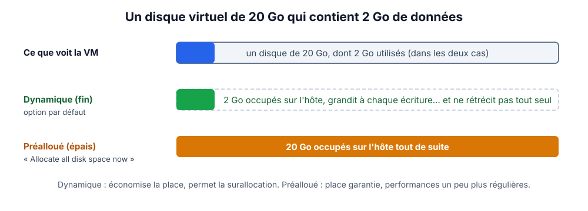
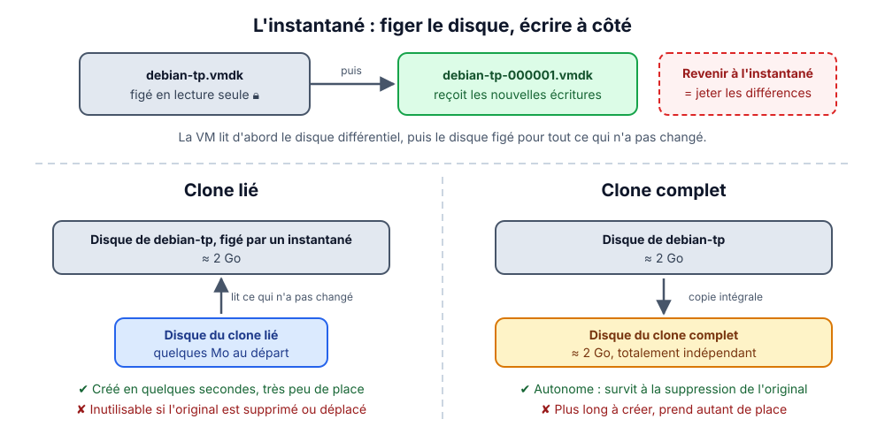
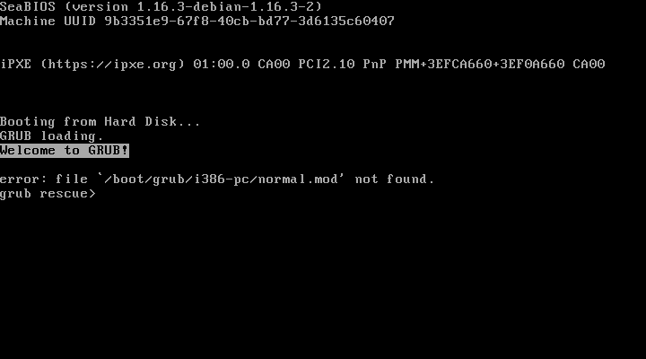

<!-- ============================================================ -->
<!-- ⚠️ RAPPEL IMPORTANT :                                          -->
<!-- Pensez TOUJOURS à ajouter une entrée dans le fichier d'index  -->
<!-- (index.md) du dossier correspondant (ex: docs/cloud/index.md) -->
<!-- afin de référencer ce nouvel article et permettre aux         -->
<!-- visiteurs de le trouver et de cliquer dessus !                -->
<!-- ============================================================ -->

# Partager les ressources : CPU, mémoire, disque, instantanés et clones

!!! abstract "Résumé"
    Une VM n'a pas de matériel à elle : elle **emprunte** le processeur, la mémoire et le disque de l'hôte. Cette partie fait **observer ce partage** de l'intérieur et de l'extérieur de la VM `debian-tp` :

    - le **processeur** : ce qu'est un vCPU, et ce que change le fait d'en donner un ou deux ;
    - la **mémoire** : ce que la VM consomme réellement sur l'hôte, ce qu'est la **surallocation** et ce qui arrive quand la mémoire manque ;
    - le **disque** : disque **dynamique** ou **préalloué**, et pourquoi un disque virtuel grandit mais ne rétrécit pas tout seul.

    On manipule ensuite les deux outils les plus utiles au quotidien : les **instantanés**, en **cassant la VM exprès** pour la réparer en quelques secondes, et les **clones**, liés ou complets. Un **défi** sans pas-à-pas termine la journée.

| Propriété | Valeur |
|-----------|--------|
| Difficulté | Débutant |
| Durée estimée | 1 h 45, défi compris |
| Version décrite | VMware Workstation Pro 26H1, Debian 13.7 |
| Place dans le parcours | Partie 4 sur 17 du parcours [Virtualisation](index.md) — jour 1 |
| Dernière mise à jour | 2026-11-16 |

---

!!! info "Convention de lecture"
    🖥️ **PC hôte** (Windows et Workstation) · 🐧 **VM Debian** `debian-tp` (connecté en `tssr`) · ✍️ **exercice** · 🛟 **instantané**. Les [comptes et mots de passe](index.md#comptes-et-mots-de-passe) sont rappelés sur la page d'accueil du parcours.

**Prérequis** : la VM `debian-tp` de la [partie 3](03-creer-sa-premiere-vm.md) est installée, avec `sudo` et les outils `open-vm-tools`, et l'instantané `01-installation-terminee` existe.

## 1. Préparer les outils de mesure

1. 🖥️ Démarrer `debian-tp` et se connecter en `tssr`.
2. 🐧 Installer l'outil **stress-ng**, qui sait charger volontairement le processeur, la mémoire ou le disque :

    ```bash
    sudo apt update
    sudo apt install -y stress-ng
    ```

3. 🖥️ Ouvrir le **Gestionnaire des tâches** de Windows (++ctrl+shift+esc++), onglet **Performances**, et le placer à côté de la fenêtre de Workstation : on va observer l'hôte pendant qu'on charge la VM.

!!! tip "Libérer la souris et le clavier"
    Quand on clique dans la console de la VM, Workstation « capture » la souris et le clavier. Pour revenir à Windows, appuyer sur ++ctrl+alt++.

## 2. Le processeur

### 2.1 Ce qu'est un vCPU

Un **vCPU** (processeur virtuel) est, pour l'hôte, une simple **tâche** à exécuter, comme un programme. L'hyperviseur fait passer ces tâches à tour de rôle sur les **processeurs logiques** du PC (un cœur avec l'*hyperthreading* compte pour deux processeurs logiques). Une VM à 2 vCPU peut donc utiliser au maximum **l'équivalent de 2 processeurs logiques** de l'hôte, jamais plus.

Dans les paramètres d'une VM (**VM > Settings > Processors**), Workstation demande :

- **Number of processors** (*nombre de processeurs*) : le nombre de **sockets** (de « puces ») virtuels ;
- **Number of cores per processor** (*nombre de cœurs par processeur*) : le nombre de cœurs de chacun.

Le nombre total de vCPU est le **produit** des deux. Pour Linux, `1 × 2` ou `2 × 1` revient au même. Certains logiciels sont vendus **par socket** : on préfère alors 1 processeur et plusieurs cœurs.

!!! warning "Plus de vCPU ne veut pas dire plus rapide"
    - Ne **jamais** donner à une VM plus de vCPU que l'hôte n'a de processeurs logiques.
    - Une VM à 4 vCPU doit attendre que l'hyperviseur lui trouve **4 processeurs logiques libres** en même temps pour s'exécuter efficacement. Sur un hôte chargé, une VM surdimensionnée peut être **plus lente** qu'une VM à 2 vCPU.
    - Règle pratique : commencer petit (1 ou 2 vCPU), **mesurer**, puis augmenter si la VM est réellement limitée par le processeur.

### 2.2 TP : mesurer la puissance d'un ou de deux vCPU

1. 🐧 Afficher le nombre de vCPU vus par Debian :

    ```bash
    nproc
    ```

2. 🐧 Lancer un test de calcul de 20 secondes sur **tous** les vCPU (`--cpu 0` = autant de calculs que de vCPU) :

    ```bash
    stress-ng --cpu 0 --cpu-method int64 --metrics-brief -t 20s
    ```

3. 🖥️ Pendant le test, regarder le graphique **Processeur** du Gestionnaire des tâches : l'utilisation du PC monte de l'équivalent de **2 processeurs logiques** (sur un PC à 8 processeurs logiques, environ 25 %).
4. 🐧 À la fin, noter la valeur de la colonne **bogo ops/s** (*real time*) de la ligne `cpu` : c'est le nombre d'opérations de calcul faites par seconde.
5. 🐧 Éteindre la VM : `sudo poweroff`.
6. 🖥️ Ouvrir **VM > Settings > Processors** (*VM > Paramètres > Processeurs*), mettre **Number of processors** à `1` et **Number of cores per processor** à `1`, puis **OK**. Démarrer la VM et refaire les étapes 1 à 4.
7. 🖥️ Remettre ensuite la VM à **2 vCPU** (1 processeur × 2 cœurs).

!!! success "Vérifier son lab"
    Avec 2 vCPU, `nproc` affiche `2` ; avec 1 vCPU, il affiche `1`. Le nombre d'opérations par seconde est **à peu près divisé par deux** avec un seul vCPU. Exemple de mesure sur un hôte équipé d'un Intel Core i7-6700K :

    ```text
    # 2 vCPU
    stress-ng: metrc: [719] stressor       bogo ops real time  usr time  sys time   bogo ops/s     bogo ops/s
    stress-ng: metrc: [719] cpu               85581     20.00     39.42      0.00      4279.04        2171.17
    # 1 vCPU
    stress-ng: metrc: [700] cpu               44349     20.49     19.98      0.01      2164.13        2218.69
    ```

    La dernière colonne (opérations par seconde **par vCPU**) reste la même : chaque vCPU a la puissance d'un processeur logique de l'hôte. La valeur exacte dépend du processeur de chaque PC : seul le **rapport** entre les deux mesures compte.

??? info "Vu de l'hôte : un vCPU est un fil d'exécution"
    Sur un hôte Linux avec l'hyperviseur KVM, le processus d'une VM à 2 vCPU contient deux fils d'exécution nommés `CPU 0/KVM` et `CPU 1/KVM`, et la commande `top` de l'hôte affiche ce processus à **200 %** de processeur (deux processeurs logiques pleins) pendant le test. Sous Windows, Workstation fonctionne de la même manière : chaque vCPU est un fil d'exécution du processus `vmware-vmx.exe`.

## 3. La mémoire

### 3.1 Mémoire attribuée et mémoire réellement utilisée

Quand on attribue **2 Go** à une VM, l'hyperviseur ne prend généralement pas 2 Go à l'hôte d'un coup : il fournit la mémoire **au fur et à mesure** que le système invité l'utilise. En revanche, une mémoire que l'invité a utilisée puis libérée **n'est pas forcément rendue** à l'hôte.

??? info "Une mesure sur un hôte KVM"
    Une VM Debian 13 à qui l'on attribue 1 Gio de mémoire :

    | Moment | Mémoire utilisée **dans** la VM (`free -m`) | Mémoire occupée **sur l'hôte** par la VM |
    |---|---|---|
    | Juste après le démarrage | 221 Mo | ≈ 400 Mo |
    | Pendant un `stress-ng` qui occupe 600 Mo | 830 Mo | ≈ 990 Mo |
    | Après le `stress-ng` | 230 Mo | ≈ 990 Mo : la mémoire **n'a pas été rendue** à l'hôte |

    C'est pour récupérer cette mémoire que les hyperviseurs utilisent un **ballon** (voir plus bas).

### 3.2 La surallocation de la mémoire

La **surallocation** (*overcommitment*) consiste à attribuer aux VM, **au total**, plus de mémoire que l'hôte n'en possède. Par exemple, cinq VM de 4 Go sur un hôte de 16 Go. Ça fonctionne tant que les VM n'utilisent pas toutes leur mémoire en même temps, comme une compagnie aérienne qui vend plus de billets que de sièges en comptant sur les absents.

Quand la mémoire réelle vient à manquer, l'hyperviseur dispose de plusieurs techniques, de la plus douce à la plus pénalisante :

| Technique | Principe |
|---|---|
| **Ballon** (*ballooning*) | Un pilote installé dans l'invité (fourni par les VMware Tools ou open-vm-tools) « gonfle » : il réclame de la mémoire **à l'intérieur** de la VM, que l'hyperviseur peut alors rendre à l'hôte ou donner à une autre VM. L'invité choisit lui-même quoi libérer : c'est la méthode la plus intelligente |
| **Partage de pages** | Des pages de mémoire identiques (même système dans plusieurs VM) ne sont stockées qu'une fois. Pour des raisons de sécurité, VMware ne le fait plus par défaut **entre** VM différentes sur ESXi |
| **Compression** | Les pages peu utilisées sont compressées en mémoire |
| **Échange sur disque** (*swap*) | L'hyperviseur place une partie de la mémoire des VM dans un fichier sur le disque. C'est **très lent** : les VM rament |

Dans Workstation, le plafond de mémoire de toutes les VM se règle dans **Edit > Preferences > Memory** :

- **Reserved memory** : la mémoire de l'hôte que les VM peuvent utiliser au total (un plafond, pas une réservation à l'avance) ;
- **Fit all virtual machine memory into reserved host RAM** : refuse de démarrer une VM si la mémoire de toutes les VM allumées ne tient pas dans ce plafond (pas de surallocation) ;
- **Allow some virtual machine memory to be swapped** ou **Allow most virtual machine memory to be swapped** : autorise la surallocation, une partie de la mémoire des VM pouvant alors partir sur le disque.

### 3.3 TP : observer la mémoire de la VM

1. 🐧 Dans la VM, afficher la mémoire :

    ```bash
    free -h
    ```

    La ligne `Mem:` affiche un **total** un peu inférieur aux 2 Go attribués : le noyau Linux en réserve une petite partie pour lui-même. La ligne `Swap:` montre l'**espace d'échange** que l'installateur de Debian a créé sur le disque.

2. 🖥️ Dans le Gestionnaire des tâches, onglet **Performances > Mémoire**, noter la mémoire **En cours d'utilisation** du PC.
3. 🐧 Occuper 1,5 Go de mémoire pendant 60 secondes :

    ```bash
    stress-ng --vm 1 --vm-bytes 1500M --vm-keep -t 60s &
    free -h
    ```

    Le `&` lance la commande en arrière-plan, ce qui permet de taper `free -h` pendant le test.

4. 🖥️ Pendant le test, regarder de nouveau la mémoire **En cours d'utilisation** de Windows, puis encore une fois **après** la fin du test.

### 3.4 ✍️ Exercice : que se passe-t-il quand la mémoire manque ?

1. 🐧 Éteindre la VM (`sudo poweroff`). 🖥️ Dans **VM > Settings > Memory**, attribuer **512 Mo**, puis démarrer la VM.
2. 🐧 Demander **700 Mo** de mémoire, plus que la VM n'en a, tout en observant la mémoire chaque seconde :

    ```bash
    stress-ng --vm 1 --vm-bytes 700M --vm-keep -t 30s &
    vmstat 1 20
    ```

3. Observer les colonnes `swpd` (mémoire placée sur le disque), `si` et `so` (données qui entrent et sortent de l'espace d'échange chaque seconde), puis lire les messages du noyau :

    ```bash
    sudo dmesg | grep -i -E "out of memory|killed process"
    ```

4. 🖥️ Remettre la VM à **2 Go** de mémoire (VM éteinte).

Que s'est-il passé ? Pourquoi la VM est-elle devenue lente ? Qu'aurait-il pu se passer sans espace d'échange ?

??? success "Corrigé"
    - Avec 512 Mo, le système invité manque de mémoire : il déplace une partie de son contenu dans son **espace d'échange** (les colonnes `swpd`, `si` et `so` augmentent). Le disque étant des milliers de fois plus lent que la mémoire, **toute la VM ralentit**.
    - Si la mémoire et l'espace d'échange ne suffisent plus, le noyau Linux déclenche le **tueur de processus** (*OOM killer*, pour *Out Of Memory*) : il arrête de force le programme qui consomme le plus. Sur une VM sans espace d'échange, `dmesg` affiche alors un message comme :

        ```text
        Out of memory: Killed process 700 (stress-ng-vm) total-vm:524336kB, anon-rss:371540kB, ...
        ```

    - Leçon pour la production : une VM **sous-dimensionnée** en mémoire devient lente ou perd des processus. Une **surallocation** trop forte sur l'hôte provoque le même effet, mais pour **toutes** les VM à la fois. On surveille donc la mémoire de l'hôte et des VM, et on garde une marge.

## 4. Le disque

### 4.1 Disque dynamique ou préalloué

<figure markdown="span">
  { loading=lazy }
  <figcaption>La VM voit la même chose dans les deux cas ; seule la place occupée sur l'hôte change.</figcaption>
</figure>

| | Disque **dynamique** (*thin*, fin) | Disque **préalloué** (*thick*, épais) |
|---|---|---|
| Dans Workstation | Par défaut | Case **Allocate all disk space now** (*allouer tout l'espace disque maintenant*), en configuration **Custom** |
| Place sur l'hôte | Ce qui a été réellement écrit | La taille totale, tout de suite |
| Création | Instantanée | Longue (il faut écrire toute la taille) |
| Surallocation | Possible : la somme des tailles peut dépasser le disque de l'hôte | Impossible |
| Risque | Si le disque de l'hôte se remplit, **toutes** les VM qui veulent écrire sont mises en pause | Aucun pour l'espace, mais gaspillage de place |

Workstation propose aussi de **découper** le disque en plusieurs fichiers d'au plus 2 Go (**Split virtual disk into multiple files**, choix par défaut) ou de le garder en **un seul fichier**. Le découpage facilite la copie sur une clé USB formatée en FAT32 ; le fichier unique est un peu plus simple à manipuler.

### 4.2 TP : regarder le disque grandir

1. 🖥️ Dans l'Explorateur de fichiers, ouvrir le dossier de la VM (`C:\VM\debian-tp`) et noter la **taille** des fichiers `.vmdk` (sélectionner tous les `.vmdk`, puis clic droit > **Propriétés**).
2. 🐧 Afficher la place occupée **dans** la VM :

    ```bash
    df -h /
    ```

3. 🐧 Écrire un fichier de 2 Go rempli de données aléatoires :

    ```bash
    dd if=/dev/urandom of=~/gros-fichier bs=1M count=2048 status=progress
    sync
    ```

4. 🖥️ Regarder de nouveau la taille des `.vmdk` : elle a **augmenté d'environ 2 Go**.
5. 🐧 Supprimer le fichier, puis vérifier dans la VM que la place est libérée :

    ```bash
    rm ~/gros-fichier
    df -h /
    ```

6. 🖥️ Regarder la taille des `.vmdk` : elle **n'a pas diminué**.

!!! question "Pourquoi le disque ne rétrécit-il pas ?"
    Quand on supprime un fichier, le système invité note simplement que ses blocs sont **libres** ; il ne prévient pas l'hyperviseur. Pour l'hyperviseur, ces blocs ont été écrits un jour, il les garde. Mesure faite sur un hôte KVM avec un disque dynamique de 20 Go : 2,7 Go occupés sur l'hôte → 4,6 Go après l'écriture de 2 Gio → **toujours 4,6 Go** après la suppression du fichier.

    Pour récupérer la place, on **réduit** (*shrink*) le disque. Dans une VM Linux, les outils open-vm-tools le font en une commande, à lancer **avant** de prendre des instantanés :

    ```bash
    sudo vmware-toolbox-cmd disk shrink /
    ```

    La commande remplit d'abord l'espace libre de zéros, puis Workstation compacte le fichier. D'après Broadcom, la réduction est **impossible** sur un disque **préalloué** et sur un disque qui a des **instantanés** (il faut d'abord les supprimer). Dans ce TP, `debian-tp` a déjà l'instantané `01-installation-terminee` : on ne réduit donc pas son disque maintenant, il suffit de retenir la méthode.

## 5. Les instantanés

### 5.1 Comment ça marche

Un **instantané** (*snapshot*) enregistre l'état d'une VM à un instant donné : le contenu de ses disques, ses paramètres et, si elle est allumée, le contenu de sa mémoire. On peut ensuite **revenir** à cet état en quelques secondes.

<figure markdown="span">
  { loading=lazy }
  <figcaption>Un instantané ne copie rien : il fige le disque et écrit les changements à côté. Le clone lié repose sur le même principe.</figcaption>
</figure>

Au moment de l'instantané, Workstation **fige** le disque de la VM, qui passe en lecture seule, et crée un **disque différentiel** (un fichier comme `debian-tp-000001.vmdk`) qui reçoit toutes les écritures suivantes. **Revenir** à l'instantané revient à jeter ce disque différentiel. Si la VM était allumée, l'état de sa mémoire est enregistré dans un fichier `.vmem` et l'état de la VM dans un fichier `.vmsn` ; le fichier `.vmsd` tient la liste des instantanés.

!!! danger "Un instantané n'est PAS une sauvegarde"
    - Il est stocké **dans le dossier de la VM**, sur le **même disque** : une panne de disque, un vol du PC ou un rançongiciel l'emportent avec la VM.
    - Il **dépend** du disque d'origine : sans le disque figé, le disque différentiel est inutilisable.
    - Plus il vit longtemps, plus le disque différentiel **grossit**, et plus la VM **ralentit** (elle doit lire dans plusieurs fichiers).

    Bonnes pratiques : prendre un instantané **avant** une opération risquée (mise à jour, changement de configuration), vérifier que tout fonctionne, puis le **supprimer** dans les jours qui suivent. Ne jamais toucher aux fichiers `.vmdk` à la main.

### 5.2 TP : casser sa VM exprès… et la réparer

On va faire ce qu'il ne faut **jamais** faire sur un vrai serveur : effacer tout le système. Grâce à un instantané, la réparation prend quelques secondes.

1. 🖥️ Vérifier que les **dossiers partagés** sont désactivés : **VM > Settings > Options > Shared Folders** doit être sur **Disabled** (*désactivé*), le réglage par défaut. Sinon, la commande destructrice pourrait aussi effacer des fichiers du PC.
2. 🛟 🖥️ Prendre un instantané de la VM **allumée** : **VM > Snapshot > Take Snapshot** (*VM > Instantané > Prendre un instantané*), nom `02-outils-installes`, description « avant l'erreur volontaire ». Pendant quelques secondes, Workstation enregistre la mémoire de la VM.
3. 🖥️ Regarder le dossier de la VM : un nouveau fichier `-000001.vmdk` et des fichiers `.vmsn` et `.vmem` sont apparus.
4. 🐧 Créer un fichier témoin :

    ```bash
    echo "version 1" > ~/important.txt
    cat ~/important.txt
    ```

5. 🐧 Effacer **tout** le système (à ne faire **que** dans cette VM de TP) :

    ```bash
    sudo rm -rf --no-preserve-root /
    ```

    Les messages d'erreur défilent. Taper ensuite `ls` ou `whoami` : la réponse est `command not found`, les commandes elles-mêmes ont été effacées.

6. 🖥️ Redémarrer la VM de force : **VM > Power > Reset** (*VM > Alimentation > Réinitialiser*). La VM ne démarre plus et s'arrête sur l'invite de secours de GRUB, le programme de démarrage :

    { loading=lazy }
    /// caption
    Le système a été effacé : le chargeur de démarrage ne trouve plus ses fichiers
    ///

7. 🖥️ Revenir à l'instantané : **VM > Snapshot > Revert to Snapshot: 02-outils-installes** (*Rétablir l'instantané*), puis confirmer. La VM reprend **exactement** là où elle en était au moment de l'instantané, session ouverte comprise.
8. 🐧 Vérifier :

    ```bash
    cat ~/important.txt
    ls /usr/share/doc | wc -l
    ```

!!! success "Vérifier son lab"
    - `cat ~/important.txt` répond `No such file or directory` : c'est **normal**, le fichier a été créé **après** l'instantané. Tout ce qui a été fait après l'instantané est perdu, le bon comme le mauvais.
    - `ls /usr/share/doc | wc -l` affiche plusieurs centaines de dossiers : le système est revenu en entier.
    - Le retour à un instantané prend **quelques secondes** ; sur un hôte KVM, la mesure donne 2,2 secondes pour une VM de 1 Go.

??? question "Et si l'on avait créé `important.txt` avant l'instantané ?"
    Il serait revenu avec le reste. C'est tout l'enjeu du **moment** où l'on prend l'instantané : juste **avant** l'opération risquée, et pas une heure avant, sinon on perd tout le travail de l'heure.

### 5.3 Le gestionnaire d'instantanés

🖥️ Ouvrir **VM > Snapshot > Snapshot Manager** (*Gestionnaire d'instantanés*). Il affiche l'**arbre** des instantanés de la VM : `01-installation-terminee`, puis `02-outils-installes`, puis l'état actuel (**You Are Here**, *vous êtes ici*). On peut y prendre, supprimer, cloner un instantané ou y revenir (**Go To**).

!!! info "Supprimer un instantané ne supprime pas les données de la VM"
    **Supprimer** un instantané (**Delete**) ne fait pas revenir la VM en arrière : Workstation **fusionne** le disque différentiel avec le disque figé, et la VM garde son état actuel. On perd seulement la **possibilité** de revenir à ce point.

## 6. Les clones

### 6.1 Clone lié ou clone complet

**Cloner** une VM, c'est en créer une **copie** qui démarre comme une nouvelle machine. Workstation propose deux sortes de clones (voir le schéma de la [section 5.1](#51-comment-ca-marche)) :

| | Clone **lié** (*linked clone*) | Clone **complet** (*full clone*) |
|---|---|---|
| Principe | Partage le disque figé de la VM d'origine, n'enregistre que ses différences | Copie intégrale et indépendante |
| Création | Quelques secondes | Le temps de copier tout le disque |
| Place | Quelques Mo au départ | Autant que l'original |
| Dépendance | Ne fonctionne **plus** si l'original (ou son instantané) est supprimé ou déplacé | Aucune |
| Usage | Labs, formations, tests jetables | Machine durable, à déplacer ou à donner |

Mesure sur un hôte KVM, à partir d'un disque Debian 13 de 327 Mo (compressé) : le clone lié est créé en 0,05 s et occupe 196 Ko ; le clone complet prend 3,3 s et occupe 961 Mo.

### 6.2 TP : créer un clone lié et un clone complet

1. 🐧 Éteindre `debian-tp` (`sudo poweroff`). Un clone se crée VM **éteinte**.
2. 🖥️ Ouvrir **VM > Manage > Clone** (*VM > Gérer > Cloner*). L'assistant **Clone Virtual Machine Wizard** s'ouvre ; cliquer sur **Next**.
3. **Clone Source** (*source du clone*) : choisir **An existing snapshot** (*un instantané existant*) et sélectionner `02-outils-installes`, puis **Next**.
4. **Clone Type** (*type de clone*) : choisir **Create a linked clone** (*créer un clone lié*), puis **Next**.
5. **Name of the New Virtual Machine** : nom `debian-clone-lie`, emplacement `C:\VM\debian-clone-lie`, puis **Finish**. La création est quasi instantanée ; cliquer sur **Close**.
6. 🖥️ Recommencer depuis `debian-tp` avec **Create a full clone** (*créer un clone complet*), nom `debian-clone-complet`, emplacement `C:\VM\debian-clone-complet`. Cette fois, une barre de progression s'affiche pendant la copie.
7. 🖥️ Les clones héritent des réglages de `debian-tp`. Pour économiser la mémoire du PC, ouvrir **VM > Settings** de chaque clone et régler **Processors** sur 1 × 1 et **Memory** sur **1 Go**.
8. 🖥️ Dans l'Explorateur, comparer la taille des trois dossiers `debian-tp`, `debian-clone-lie` et `debian-clone-complet`.

### 6.3 Donner une identité propre au clone

Un clone est une **copie parfaite** : même nom de machine, même identifiant de machine, mêmes clés SSH, même identifiant auprès du serveur DHCP. Workstation génère une **nouvelle adresse MAC** pour la carte réseau du clone, mais le reste doit être changé à la main, sinon deux machines se présentent sous la même identité sur le réseau.

1. 🖥️ Démarrer `debian-clone-lie` et se connecter en `tssr`. 🐧 Le nom affiché est toujours `debian-tp`.
2. 🐧 Changer le nom de la machine :

    ```bash
    sudo hostnamectl set-hostname debian-clone-lie
    sudo sed -i 's/debian-tp/debian-clone-lie/g' /etc/hosts
    ```

3. 🐧 Générer un nouvel **identifiant de machine** (utilisé par systemd, les journaux et certains logiciels pour reconnaître la machine) :

    ```bash
    sudo rm /etc/machine-id
    sudo systemd-machine-id-setup
    ```

4. 🐧 Générer de nouvelles **clés SSH d'hôte** (sinon les deux machines ont la même « empreinte » pour les clients SSH) :

    ```bash
    sudo rm /etc/ssh/ssh_host_*
    sudo dpkg-reconfigure openssh-server
    ```

5. 🐧 Effacer l'**identifiant DHCP** du client `dhcpcd`, utilisé par Debian 13 pour demander son adresse IP. Il est recréé automatiquement au prochain démarrage, propre au clone :

    ```bash
    sudo rm -f /var/lib/dhcpcd/duid
    ```

6. 🐧 Redémarrer (`sudo reboot`), se reconnecter, puis vérifier :

    ```bash
    hostnamectl
    cat /etc/machine-id
    ip -4 a
    ```

!!! info "Sous Windows : Sysprep"
    Sous Windows, le même problème se règle avec l'outil **Sysprep** (`C:\Windows\System32\Sysprep\sysprep.exe`, option **Généraliser**), qui efface l'identité de la machine avant de la cloner. C'est indispensable avant de joindre des clones à un domaine Active Directory.

!!! success "Vérifier son lab"
    - Le dossier `debian-clone-lie` ne pèse que **quelques dizaines de Mo**, le dossier `debian-clone-complet` à peu près **autant que `debian-tp`**.
    - Dans le clone, `hostnamectl` affiche `Static hostname: debian-clone-lie`, et l'identifiant de `cat /etc/machine-id` est **différent** de celui de `debian-tp`.
    - `ip -4 a` affiche une adresse en `192.168.x.128` ou au-dessus, **différente** de celle de `debian-tp`.

!!! warning "Ne pas supprimer debian-tp"
    Le clone lié **dépend** de `debian-tp` et de son instantané `02-outils-installes`. Supprimer `debian-tp`, le déplacer ou supprimer cet instantané rendrait `debian-clone-lie` inutilisable.

## 7. Défi du jour 1

!!! example "Mise en situation"
    Le responsable informatique de *Bureautix* doit tester une mise à jour risquée sur deux serveurs Linux avant de la faire en production. Il demande un **environnement de test jetable**, construit à partir de `debian-tp`, et une **fiche de documentation**.

    Sans pas-à-pas, réaliser :

    1. deux clones **liés** de `debian-tp` nommés `test-web` et `test-bdd`, chacun avec **1 vCPU** et **768 Mo** de mémoire, et une identité propre (nom, identifiant de machine, clés SSH) ;
    2. la preuve que les deux machines **se voient** sur le réseau (avec `ping`, en utilisant leurs adresses IP) ;
    3. sur `test-web`, un instantané `avant-maj`, puis la mise à jour complète du système (`sudo apt update && sudo apt full-upgrade -y`), puis le **retour** à l'instantané, comme si la mise à jour avait échoué ;
    4. le calcul de la **place totale** occupée sur le PC par `debian-tp`, `test-web` et `test-bdd`, avec une explication en deux phrases ;
    5. une **fiche de documentation** des deux machines de test : nom, rôle, vCPU, mémoire, taille du disque, réseau, adresse IP, instantanés, VM dont elles dépendent.

    Temps conseillé : 45 minutes.

??? success "Corrigé"
    1. Pour chaque clone : `debian-tp` éteinte, **VM > Manage > Clone**, source **An existing snapshot** (`02-outils-installes`), **Create a linked clone**, nom `test-web` (puis `test-bdd`). Dans **VM > Settings** du clone : **Processors** à 1 × 1, **Memory** à 768 Mo. Démarrer le clone, puis appliquer les commandes de la [section 6.3](#63-donner-une-identite-propre-au-clone) avec le bon nom (`sudo hostnamectl set-hostname test-web`, `/etc/hosts`, `machine-id`, clés SSH, identifiant DHCP) et redémarrer.
    2. Sur chaque clone, `ip -4 a` donne l'adresse (deux adresses différentes en `192.168.x.128` ou au-dessus). Depuis `test-web` : `ping -c 4 <adresse de test-bdd>` répond, car les deux VM sont branchées sur le même commutateur virtuel **VMnet8**.
    3. Sur `test-web` : **VM > Snapshot > Take Snapshot** (`avant-maj`), puis `sudo apt update && sudo apt full-upgrade -y`, puis **VM > Snapshot > Revert to Snapshot: avant-maj**. On peut vérifier avec `apt list --upgradable` que les mises à jour sont de nouveau « en attente ».
    4. `debian-tp` pèse quelques gigaoctets (le système installé, plus le fichier de 2 Go écrit puis effacé en section 4.2, que le disque dynamique n'a pas rendu) ; chaque clone lié ne pèse que **quelques dizaines à quelques centaines de Mo** (ses fichiers de configuration, ses journaux et les blocs modifiés depuis le clonage, dont les fichiers de la mise à jour si on ne l'a pas annulée). Explication : les clones liés **partagent** le disque figé de `debian-tp` et n'enregistrent que leurs **différences** ; c'est ce qui permet de monter vite un lab de plusieurs machines sans remplir le disque du PC.
    5. Exemple de fiche :

        | Nom | Rôle | vCPU | Mémoire | Disque | Réseau | IP | Instantanés | Dépend de |
        |---|---|---|---|---|---|---|---|---|
        | `test-web` | Test de mise à jour, serveur web | 1 | 768 Mo | 20 Go dynamique, clone lié | VMnet8 (NAT) | `192.168.x.1xx` (DHCP) | `avant-maj` | `debian-tp`, instantané `02-outils-installes` |
        | `test-bdd` | Test de mise à jour, base de données | 1 | 768 Mo | 20 Go dynamique, clone lié | VMnet8 (NAT) | `192.168.x.1xx` (DHCP) | aucun | `debian-tp`, instantané `02-outils-installes` |

        La colonne **Dépend de** est la plus importante : elle évite qu'un collègue supprime `debian-tp` en pensant faire du ménage.

## 8. Questions de révision

1. Une VM a 4 vCPU sur un hôte de 4 processeurs logiques déjà chargé par d'autres VM. Pourquoi peut-elle être **plus lente** qu'avec 2 vCPU ?
2. Qu'est-ce que la **surallocation** de la mémoire ? Citer deux techniques qu'utilise l'hyperviseur quand la mémoire vient à manquer.
3. Un disque dynamique de 40 Go contient 10 Go de données ; on efface 5 Go de fichiers dans la VM. Quelle place occupe-t-il sur l'hôte ? Comment récupérer de la place ?
4. Pourquoi un instantané n'est-il pas une sauvegarde ? Donner deux raisons.
5. Quelle est la différence entre un clone lié et un clone complet ? Dans quel cas choisir l'un ou l'autre ?
6. Après avoir cloné une VM Linux, quels éléments faut-il changer pour lui donner une identité propre ? Et sous Windows ?

??? success "Corrigé"
    1. Pour s'exécuter efficacement, ses 4 vCPU doivent trouver **4 processeurs logiques libres** au même moment. Sur un hôte chargé, elle attend plus souvent son tour qu'une VM à 2 vCPU. De plus, ses 4 vCPU entrent en concurrence avec ceux des autres VM. On dimensionne au plus juste et on augmente après mesure.
    2. Attribuer aux VM, au total, **plus de mémoire que l'hôte n'en possède**, en pariant qu'elles ne l'utiliseront pas toutes en même temps. Techniques : le **ballon** (un pilote dans l'invité libère de la mémoire que l'hyperviseur récupère), le **partage de pages** identiques, la **compression**, l'**échange sur disque** (*swap*, le plus lent).
    3. Il occupe toujours **environ 10 Go** (voire un peu plus) : les blocs libérés dans la VM ne sont pas rendus à l'hôte. Pour récupérer la place, on **réduit** le disque (`sudo vmware-toolbox-cmd disk shrink /` dans une VM Linux), à condition que le disque soit **dynamique** et n'ait **pas d'instantané**.
    4. Il est stocké **au même endroit** que la VM (une panne du disque, un vol ou un rançongiciel l'emporte aussi) et il **dépend** du disque d'origine. Il ralentit aussi la VM et grossit avec le temps : il est fait pour durer quelques heures ou quelques jours, pas pour protéger des données.
    5. Le clone **lié** partage le disque figé de l'original et ne stocke que ses différences : création instantanée, très peu de place, mais **dépendance** à l'original. Le clone **complet** est une copie indépendante : plus long et plus volumineux, mais **autonome**. Lié pour un lab ou un test jetable ; complet pour une machine durable, à déplacer ou à livrer.
    6. Sous Linux : le **nom de la machine** (`hostnamectl`, `/etc/hosts`), l'**identifiant de machine** (`/etc/machine-id`), les **clés SSH d'hôte** et l'identifiant DHCP (`/var/lib/dhcpcd/duid`) ; Workstation change déjà l'adresse MAC. Sous Windows : passer **Sysprep** en mode **Généraliser**, qui réinitialise l'identité de la machine (dont son identifiant de sécurité, le SID) avant le clonage.

---

## Ressources

- [Broadcom — Fichiers d'une machine virtuelle (Workstation 26H1)](https://techdocs.broadcom.com/us/en/vmware-cis/desktop-hypervisors/workstation-pro/26H1/using-vmware-workstation-pro/creating-virtual-machines-in-workstation-user-guide/virtual-machine-files.html) — rôle des fichiers `.vmx`, `.vmdk`, `.vmsd`, `.vmsn`, `.vmem` (en anglais).
- [Broadcom — Réduire un disque virtuel de Workstation](https://knowledge.broadcom.com/external/article/315631/defragmenting-and-shrinking-vmware-works.html) — conditions et procédure de réduction d'un disque (en anglais).
- [Page de manuel de stress-ng](https://manpages.debian.org/trixie/stress-ng/stress-ng.1.en.html) — toutes les options de l'outil de charge (en anglais).
- Partie précédente : [Créer sa première VM Debian 13](03-creer-sa-premiere-vm.md) · Partie suivante : Virtualiser des serveurs (jour 2).

*[vCPU]: processeur virtuel
*[VM]: Virtual Machine — machine virtuelle
*[OOM]: Out Of Memory — mémoire épuisée
*[MAC]: Media Access Control — adresse physique d'une carte réseau
*[SSH]: Secure Shell — protocole d'administration à distance chiffré
*[SID]: Security Identifier — identifiant de sécurité Windows
*[FAT32]: système de fichiers ancien, limité à des fichiers de 4 Go
