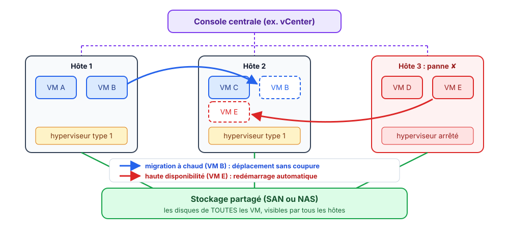

# Virtualiser des serveurs

!!! abstract "Résumé"
    La virtualisation de serveurs ne se limite pas à « faire tourner des VM ». Dans une entreprise, elle apporte des **fonctions** impossibles avec des serveurs physiques : déployer un serveur en quelques minutes à partir d'un **modèle**, **déplacer** une VM allumée d'un hôte à l'autre, **redémarrer automatiquement** les VM d'un hôte tombé en panne, répartir la charge.

    Le cours présente ces fonctions et le vocabulaire des grandes plateformes (vCenter, vMotion, HA, DRS, P2V). Le TP met en pratique la plus utile au quotidien : on prépare un **modèle** de serveur Debian, avec un **script** qui donne une identité propre à chaque copie, puis on **déploie trois serveurs web** en quelques minutes, joignables depuis le navigateur du PC.

| Propriété | Valeur |
|-----------|--------|
| Difficulté | Débutant |
| Durée estimée | 1 h 45 |
| Version décrite | VMware Workstation Pro 26H1, Debian 13.7, nginx |
| Place dans le parcours | Partie 5 sur 17 du parcours [Virtualisation](index.md) — jour 2 |
| Dernière mise à jour | 2026-11-16 |

---

!!! info "Convention de lecture"
    🖥️ **PC hôte** (Windows et Workstation) · 🐧 **VM Debian** (le nom de la VM est précisé) · 🌐 **navigateur du PC** · ✍️ **exercice** · 🛟 **instantané**. Les [comptes et mots de passe](index.md#comptes-et-mots-de-passe) sont rappelés sur la page d'accueil du parcours.

<!-- NOTE DE RÉDACTION (non affichée) : TP vérifié sur KVM (clones de la Debian 13.7 installée en partie 3) : script personnaliser-clone.sh exécuté en 2,2 s, machine-id changé seulement si /var/lib/dbus/machine-id est aussi supprimé, nginx installé en 4,7 s, page index.html servie en priorité, alerte SSH après régénération des clés. Écrans Workstation (Template mode, Clone wizard) d'après la doc Broadcom 26H1. -->

**Prérequis** : la VM `debian-tp` du jour 1, avec ses instantanés `01-installation-terminee` et `02-outils-installes` (pris VM éteinte).

## 1. Ce que la virtualisation change pour les serveurs

### 1.1 Rappel : la consolidation

Au jour 1, on a vu que la plupart des serveurs physiques sont **sous-utilisés** et que la virtualisation permet de les **regrouper** sur quelques hôtes ([partie 1](01-comprendre-la-virtualisation.md#43-exercice-chiffre-combien-de-serveurs-economiser)). Elle permet aussi d'appliquer une bonne pratique autrefois trop chère : **un service par serveur**. Avec des VM, séparer le contrôleur de domaine, le serveur de fichiers et la messagerie ne coûte plus trois machines : une panne ou une mise à jour de l'un ne touche plus les autres.

### 1.2 Les fonctions d'une plateforme de virtualisation de serveurs

En entreprise, les hôtes de type 1 (ESXi, Hyper-V, Proxmox VE…) sont regroupés en **cluster** et administrés depuis une **console centrale** : **vCenter Server** chez VMware, **System Center Virtual Machine Manager** ou **Windows Admin Center** chez Microsoft, l'interface web de **Proxmox VE**. Les disques des VM sont rangés sur un **stockage partagé** que tous les hôtes voient (la [partie 7](07-virtualiser-le-stockage.md) y est consacrée).

{ loading=lazy }
/// caption
Le stockage partagé permet à n'importe quel hôte de faire tourner n'importe quelle VM
///

| Fonction | Nom chez VMware | Ce qu'elle fait | Coupure pour les utilisateurs |
|---|---|---|---|
| **Modèle** (*template*) | Template | Une VM « maître » qui sert à créer de nouveaux serveurs déjà installés et configurés | — |
| **Migration à chaud** | vMotion | Déplace une VM **allumée** d'un hôte à un autre : la mémoire est copiée pendant que la VM tourne, puis la bascule finale dure une fraction de seconde | Aucune perceptible |
| **Migration du stockage à chaud** | Storage vMotion | Déplace les **disques** d'une VM allumée d'un stockage à un autre | Aucune perceptible |
| **Haute disponibilité** | vSphere HA | Si un hôte tombe en panne, ses VM **redémarrent automatiquement** sur les autres hôtes du cluster | Le temps de redémarrer les VM |
| **Tolérance aux pannes** | Fault Tolerance (FT) | Une copie « miroir » de la VM tourne en permanence sur un autre hôte et prend le relais instantanément | Aucune, mais coûteux en ressources |
| **Répartition de charge** | DRS | Déplace automatiquement les VM (par migration à chaud) pour équilibrer la charge entre les hôtes | Aucune |
| **Conversion** | P2V, V2V | Transforme un serveur **physique** en VM (*Physical to Virtual*), ou une VM d'un hyperviseur vers un autre (*Virtual to Virtual*) | Selon la méthode |

!!! question "Haute disponibilité ou tolérance aux pannes ?"
    La **haute disponibilité** ne supprime pas la coupure : elle la **raccourcit**. Quand l'hôte tombe, la VM s'arrête brutalement, comme si l'on avait coupé le courant, puis elle redémarre sur un autre hôte. La **tolérance aux pannes** évite toute coupure, mais elle double la consommation de ressources de la VM protégée : on la réserve aux quelques services vraiment critiques.

!!! info "Et dans Workstation ?"
    Workstation est un hyperviseur de **type 2** pour un poste de travail : il n'a ni cluster, ni migration à chaud, ni haute disponibilité. On y trouve en revanche les **modèles** et les **clones**, qui sont la base du déploiement rapide. C'est l'objet du TP.

### 1.3 ✍️ Exercice : quelle fonction pour quelle situation ?

Pour chaque situation, indiquer la fonction la plus adaptée.

1. Il faut changer une barrette de mémoire défectueuse sur l'hôte 2, en pleine journée, sans gêner les utilisateurs.
2. L'alimentation de l'hôte 3 a lâché à 3 h du matin ; personne n'est d'astreinte.
3. Le service des ventes réclame cinq nouveaux serveurs Linux identiques pour demain matin.
4. Un vieux serveur physique sous Windows Server, dont personne ne sait réinstaller l'application, doit quitter la salle machine.
5. La baie de stockage A arrive en fin de garantie ; ses VM doivent passer sur la baie B, sans arrêt.
6. Tous les lundis matin, l'hôte 1 sature pendant que l'hôte 2 se tourne les pouces.

??? success "Corrigé"
    1. **Migration à chaud** (vMotion) : on déplace les VM de l'hôte 2 vers les autres hôtes, on met l'hôte en **mode maintenance**, on change la barrette, puis on remet l'hôte en service.
    2. **Haute disponibilité** (vSphere HA) : les VM de l'hôte 3 redémarrent automatiquement sur les autres hôtes. Il y a une coupure, le temps que les VM redémarrent, mais personne n'a besoin d'intervenir la nuit.
    3. Un **modèle** (*template*) : chaque serveur est créé en quelques minutes à partir d'une VM déjà installée et à jour, au lieu de cinq installations complètes.
    4. Une conversion **P2V** (*Physical to Virtual*) : le serveur est copié tel quel dans une VM, application comprise.
    5. **Migration du stockage à chaud** (Storage vMotion).
    6. **Répartition de charge** (DRS) : le cluster déplace automatiquement des VM de l'hôte 1 vers l'hôte 2.

## 2. TP : préparer un modèle de serveur

Un bon modèle est une VM **propre, à jour et généralisée** : on ne garde dedans que ce qui doit être commun à tous les serveurs. Ici, le modèle `modele-debian` contiendra Debian 13 à jour, `sudo`, open-vm-tools et un **script de personnalisation** qui donne à chaque copie sa propre identité (on a fait ces opérations à la main au jour 1, en [partie 4](04-partager-les-ressources.md#63-donner-une-identite-propre-au-clone)).

### 2.1 Créer la VM modèle

1. 🖥️ Vérifier que `debian-tp` est **éteinte**. Ouvrir **VM > Manage > Clone**, puis **Next**.
2. **Clone Source** : **An existing snapshot**, choisir `02-outils-installes`, puis **Next**.
3. **Clone Type** : **Create a full clone** : le modèle doit être **indépendant** de `debian-tp`. Puis **Next**.
4. Nom `modele-debian`, emplacement `C:\VM\modele-debian`, puis **Finish** et **Close**.
5. 🖥️ Dans **VM > Settings** de `modele-debian`, régler **Processors** sur 1 × 1 et **Memory** sur **1 Go** : les serveurs déployés hériteront de ces valeurs.

### 2.2 Écrire le script de personnalisation

1. 🖥️ Démarrer `modele-debian` et se connecter en `tssr`.
2. 🐧 **modele-debian** : mettre le système à jour :

    ```bash
    sudo apt update && sudo apt full-upgrade -y
    ```

3. 🐧 **modele-debian** : créer le script avec l'éditeur `nano` :

    ```bash
    sudo nano /usr/local/sbin/personnaliser-clone.sh
    ```

    Y copier le contenu suivant (dans la console de Workstation, le copier-coller ne fonctionne pas : le taper, ou se connecter en SSH depuis Windows comme expliqué en [partie 3](03-creer-sa-premiere-vm.md#52-les-outils-dintegration-open-vm-tools)) :

    ```bash title="/usr/local/sbin/personnaliser-clone.sh"
    #!/bin/bash
    # personnaliser-clone.sh : donne une identité propre à un clone de debian-tp
    # Usage : sudo personnaliser-clone.sh <nouveau-nom>
    set -e
    NOM="$1"
    if [ -z "$NOM" ]; then echo "Usage : sudo $0 <nouveau-nom>"; exit 1; fi
    if [ "$(id -u)" -ne 0 ]; then echo "Erreur : lancer ce script avec sudo"; exit 1; fi
    ANCIEN=$(hostname)
    sed -i "s/\b$ANCIEN\b/$NOM/g" /etc/hosts           # nom dans /etc/hosts
    hostnamectl set-hostname "$NOM"                   # nom de la machine
    rm -f /etc/machine-id /var/lib/dbus/machine-id    # identifiant de machine (et sa copie)
    systemd-machine-id-setup
    rm -f /etc/ssh/ssh_host_*                         # clés SSH d'hôte
    dpkg-reconfigure openssh-server
    rm -f /var/lib/dhcpcd/duid /var/lib/dhcpcd/*.lease  # identifiant DHCP
    echo "Identité changée : $ANCIEN -> $NOM. Redémarrer avec : sudo reboot"
    ```

    Enregistrer avec ++ctrl+o++ puis ++enter++, quitter avec ++ctrl+x++.

4. 🐧 **modele-debian** : rendre le script exécutable :

    ```bash
    sudo chmod 755 /usr/local/sbin/personnaliser-clone.sh
    ```

??? question "Comment fonctionne ce script ?"
    - `set -e` arrête le script à la **première erreur**, au lieu de continuer sur un système à moitié modifié.
    - `$1` est le **premier argument** de la commande : le nouveau nom. Sans argument, ou sans `sudo` (`id -u` vaut alors autre chose que `0`), le script affiche son mode d'emploi et s'arrête.
    - Chaque ligne suivante reprend une étape faite à la main en partie 4 : nom dans `/etc/hosts` (`\b` désigne une limite de mot, pour ne remplacer que le nom exact), nom de la machine, identifiant de machine, clés SSH, identifiant DHCP.
    - Un script, c'est une procédure **écrite une fois et relancée à volonté, sans erreur** : c'est la base de l'**automatisation**, une compétence attendue d'un TSSR.

### 2.3 Figer le modèle

1. 🐧 **modele-debian** : éteindre la VM : `sudo poweroff`.
2. 🛟 🖥️ VM éteinte, prendre un instantané nommé `modele-v1` (**VM > Snapshot > Take Snapshot**), description « Debian 13 à jour + script de personnalisation ».
3. 🖥️ Ouvrir **VM > Settings**, onglet **Options**, rubrique **Advanced**, cocher **Enable Template mode (to be used for cloning)**, puis **OK**.

!!! question "À quoi sert le mode modèle ?"
    En mode modèle, Workstation **protège** la VM : on ne peut plus supprimer ni la VM ni ses instantanés. C'est un garde-fou : supprimer `modele-debian` ou son instantané `modele-v1` par erreur rendrait inutilisables tous les serveurs déployés à partir de lui en clones liés.

## 3. TP : déployer trois serveurs web

### 3.1 Créer les clones

Pour chacun des noms `web1`, `web2` et `web3` :

1. 🖥️ Sélectionner `modele-debian`, ouvrir **VM > Manage > Clone**, puis **Next**.
2. **Clone Source** : **An existing snapshot**, `modele-v1`.
3. **Clone Type** : **Create a linked clone**.
4. Nom `web1` (puis `web2`, `web3`), emplacement `C:\VM\web1` (puis `web2`, `web3`), **Finish**, **Close**.

!!! tip "Chronométrer"
    Lancer un chronomètre au début du premier clone et l'arrêter quand la page web du troisième serveur s'affiche (section 3.3). Comparer avec le temps d'installation de Debian de la partie 3.

### 3.2 Personnaliser chaque serveur

Pour **chaque** serveur (`web1`, puis `web2`, puis `web3`) :

1. 🖥️ Démarrer la VM et se connecter en `tssr`.
2. 🐧 Donner son identité au serveur (exemple pour `web1`), puis redémarrer :

    ```bash
    sudo personnaliser-clone.sh web1
    sudo reboot
    ```

3. 🐧 Après le redémarrage, se reconnecter, installer le serveur web **nginx** et remplacer sa page d'accueil par une page qui affiche le nom du serveur :

    ```bash
    sudo apt install -y nginx
    echo "<h1>Serveur $(hostname)</h1>" | sudo tee /var/www/html/index.html
    ```

4. 🐧 Noter l'adresse IP du serveur :

    ```bash
    ip -4 a
    ```

??? question "Pourquoi `sudo tee` et pas `sudo echo … > fichier` ?"
    Dans `sudo echo "texte" > /var/www/html/index.html`, c'est le **shell de l'utilisateur** qui fait la redirection `>`, **sans** les droits d'administrateur : on obtient « Permission non accordée ». La commande `tee` écrit dans le fichier ; lancée avec `sudo`, c'est elle qui a les droits.

### 3.3 Tester depuis le PC

🌐 Dans le navigateur du PC, ouvrir `http://<adresse de web1>`, puis celles de `web2` et `web3`.

!!! success "Vérifier son lab"
    - Chaque page affiche **son propre nom** : « Serveur web1 », « Serveur web2 », « Serveur web3 ».
    - 🐧 Sur chaque serveur, `hostnamectl` affiche le bon nom, et `cat /etc/machine-id` donne un identifiant **différent** sur les trois serveurs.
    - Les trois serveurs ont trois adresses IP **différentes**.
    - 🖥️ Une fois les serveurs éteints, les dossiers `web1`, `web2` et `web3` ne pèsent que **quelques dizaines à quelques centaines de Mo** chacun (nginx, les journaux, les fichiers modifiés), contre plusieurs Go pour `modele-debian`. Une VM allumée a en plus un fichier `.vmem` de la taille de sa mémoire.
    - Le déploiement des trois serveurs prend bien moins de temps que **trois** installations de Debian (environ 15 minutes chacune), configuration non comprise.

??? failure "La page ne s'affiche pas"
    - 🐧 `systemctl status nginx` : le service doit être **active (running)**.
    - 🐧 `wget -qO- http://localhost` : si la page s'affiche dans la VM mais pas sur le PC, vérifier l'adresse IP tapée dans le navigateur.
    - Deux serveurs ont la **même** adresse IP : le script n'a pas été lancé sur l'un d'eux, ou la VM n'a pas été redémarrée après. Le relancer, puis `sudo reboot`.

### 3.4 Éteindre ce qui ne sert plus

🐧 Éteindre `web2` et `web3` (`sudo poweroff`) : seul `web1` resservira en partie 6. Les garder (ne pas les supprimer) pour le défi du jour.

## 4. Questions de révision

1. Qu'est-ce qu'un modèle (*template*), et que doit-il contenir ? Que ne doit-il **pas** contenir ?
2. Quelle est la différence entre la **migration à chaud** et la **haute disponibilité** ? Laquelle provoque une coupure ?
3. Pourquoi la migration à chaud et la haute disponibilité exigent-elles un **stockage partagé** ?
4. Que signifie **P2V** ? Dans quel cas l'utilise-t-on ?
5. Que fait la ligne `set -e` au début d'un script bash ? Pourquoi est-elle utile ici ?
6. Pourquoi coche-t-on **Enable Template mode** sur `modele-debian` ?

??? success "Corrigé"
    1. Une VM « maître », installée, à jour et configurée, qui sert à créer rapidement de nouveaux serveurs. Elle contient ce qui est **commun** à tous (système, mises à jour, outils, scripts). Elle ne doit pas contenir ce qui est **propre** à chaque serveur : nom, identifiants, clés, adresse IP fixe, données.
    2. La **migration à chaud** déplace une VM **allumée** d'un hôte à un autre, sans coupure perceptible : on l'utilise pour une maintenance **prévue**. La **haute disponibilité** redémarre automatiquement les VM d'un hôte tombé en **panne** sur les autres hôtes : il y a une coupure, le temps du redémarrage.
    3. Parce que l'hôte qui reprend la VM doit pouvoir lire **ses disques**. Avec un stockage partagé, il n'y a pas de disque à copier : seule la mémoire (migration) ou rien du tout (haute disponibilité) doit passer d'un hôte à l'autre.
    4. *Physical to Virtual* : la conversion d'un serveur **physique** en VM. On l'utilise pour virtualiser un serveur existant sans le réinstaller, par exemple quand l'application est difficile ou impossible à réinstaller.
    5. Elle arrête le script dès qu'une commande échoue. Sans elle, le script continuerait sur un système à moitié modifié (par exemple, clés SSH supprimées mais jamais recréées), ce qui serait pire qu'un arrêt net.
    6. Pour que Workstation **protège** la VM modèle : impossible de supprimer la VM ou son instantané `modele-v1`, sur lesquels reposent les clones liés `web1`, `web2` et `web3`.

---

## Ressources

- [Broadcom — Cloner une VM dans Workstation 26H1](https://techdocs.broadcom.com/us/en/vmware-cis/desktop-hypervisors/workstation-pro/26H1/using-vmware-workstation-pro/creating-virtual-machines-in-workstation-user-guide/cloning-virtual-machines/clone-a-virtual-machine.html) — clones liés et complets (en anglais).
- [Broadcom — Le mode modèle (Template mode)](https://techdocs.broadcom.com/us/en/vmware-cis/desktop-hypervisors/workstation-pro/26H1/using-vmware-workstation-pro/creating-virtual-machines-in-workstation-user-guide/cloning-virtual-machines/enable-template-mode-for-a-parent-virtual-machine-of-linked-clones.html) — protéger la VM parente des clones liés (en anglais).
- [Debian — Guide de référence, la ligne de commande et les scripts](https://www.debian.org/doc/manuals/debian-reference/ch01.fr.html) — premiers pas avec le shell, en français.
- [nginx — documentation](https://nginx.org/en/docs/) — le serveur web utilisé dans le TP (en anglais).
- Partie précédente : [Partager les ressources](04-partager-les-ressources.md) · Partie suivante : [Virtualiser le réseau](06-virtualiser-le-reseau.md).

*[VM]: Virtual Machine — machine virtuelle
*[P2V]: Physical to Virtual — conversion d'un serveur physique en VM
*[V2V]: Virtual to Virtual — conversion d'une VM d'un hyperviseur à un autre
*[HA]: High Availability — haute disponibilité
*[FT]: Fault Tolerance — tolérance aux pannes
*[DRS]: Distributed Resource Scheduler — répartition automatique de la charge chez VMware
*[DHCP]: Dynamic Host Configuration Protocol — attribution automatique d'adresses IP
*[SSH]: Secure Shell — protocole d'administration à distance chiffré
*[IP]: Internet Protocol — adresse d'une machine sur le réseau
