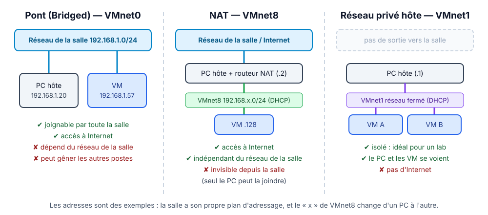
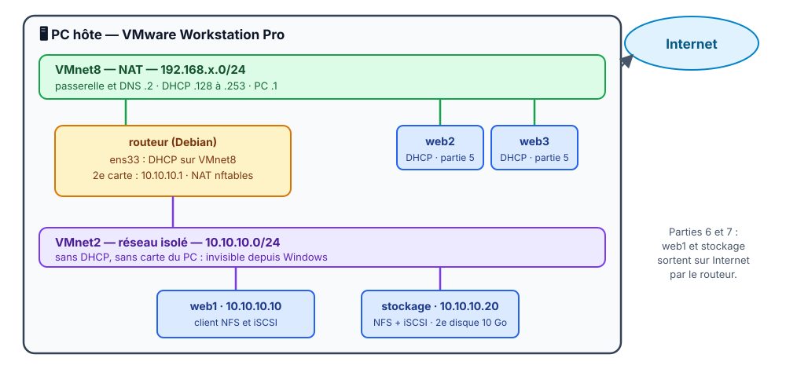

# Virtualiser le réseau

!!! abstract "Résumé"
    Une VM a besoin d'un réseau, et ce réseau est lui aussi **virtuel** : cartes réseau virtuelles, **commutateurs virtuels**, routeurs et pare-feux qui ne sont que des logiciels. Cette partie explique comment l'hyperviseur relie les VM entre elles et au monde extérieur, et compare les trois modes de Workstation : **pont**, **NAT** et **réseau privé hôte**.

    Le TP construit un petit réseau d'entreprise **isolé** : un réseau privé `10.10.10.0/24` invisible depuis Windows, un serveur web dedans, et une **VM Debian qui sert de routeur** pour le relier à Internet. À la fin, le serveur `web1` est caché derrière le routeur, sort sur Internet par lui, et peut même être publié sur un port choisi.

| Propriété | Valeur |
|-----------|--------|
| Difficulté | Intermédiaire |
| Durée estimée | 2 h |
| Version décrite | VMware Workstation Pro 26H1, Debian 13.7, nftables 1.1 |
| Place dans le parcours | Partie 6 sur 17 du parcours [Virtualisation](index.md) — jour 2 |
| Dernière mise à jour | 2026-11-16 |

---

!!! info "Convention de lecture"
    🖥️ **PC hôte** (Windows et Workstation) · 🐧 **VM Debian** (le nom de la VM est précisé) · 🌐 **navigateur du PC** · ✍️ **exercice** · 🛟 **instantané**. Les [comptes et mots de passe](index.md#comptes-et-mots-de-passe) sont rappelés sur la page d'accueil du parcours.

<!-- NOTE DE RÉDACTION (non affichée) : déroulé vérifié sur KVM avec des clones de la Debian 13.7 installée (réseau isolé libvirt sans IP hôte = VMnet2 sans carte hôte ni DHCP) : /etc/sysctl.conf absent en Debian 13 ; nftables installé mais désactivé, /etc/nftables.conf contient déjà une table inet filter vide ; masquerade → ping 1.1.1.1 OK, sans masquerade 100 % de perte ; hôte → 10.10.10.10 100 % de perte ; DNAT 8080 → page web1 depuis l'hôte. Interfaces nommées enp1s0/enp7s0 sous KVM ; sous Workstation ens33 puis un nom variable pour la 2e carte (le texte fait relever le nom). Libellés du Virtual Network Editor d'après la doc Broadcom 26H1. Texte des modes repris du support « Configuration des paramètres réseau de VMware Workstation » du formateur. -->

**Prérequis** : la [partie 5](05-virtualiser-des-serveurs.md) est terminée : le modèle `modele-debian` (instantané `modele-v1`) et le serveur `web1` existent.

## 1. Les briques d'un réseau virtuel

### 1.1 Carte réseau et commutateur virtuels

Dans un réseau physique, chaque ordinateur a une **carte réseau**, reliée par un câble à un **commutateur** (*switch*), qui fait passer les trames d'une machine à l'autre. Dans un hyperviseur, tout cela existe **en logiciel** :

| Élément physique | Équivalent virtuel | Dans Workstation |
|---|---|---|
| Carte réseau | **Carte réseau virtuelle** (vNIC), avec sa propre adresse MAC | **Network Adapter** dans **VM > Settings** |
| Câble | Le réglage qui relie la carte à un réseau | Le choix **Bridged**, **NAT**, **Host-only** ou **Custom** |
| Commutateur | **Commutateur virtuel** (vSwitch) | Les réseaux **VMnet0** à **VMnet19** |
| Routeur, box Internet | Routeur NAT intégré à l'hyperviseur, ou VM routeur | Le service NAT de **VMnet8**, ou une VM comme celle du TP |
| Serveur DHCP | Service DHCP de l'hyperviseur | Le service DHCP de VMnet1 et VMnet8 |

Les VM branchées sur le **même** commutateur virtuel communiquent entre elles, exactement comme des PC sur le même switch. Pour passer d'un réseau à un autre, il faut un **routeur**, physique ou virtuel.

!!! question "Pourquoi virtualiser le réseau ?"
    - **Segmenter** : séparer les serveurs, les postes, une zone exposée à Internet (DMZ) ou un lab, sans acheter un switch par réseau. Un attaquant qui compromet une machine d'un segment ne voit pas directement les autres.
    - **Tester** : monter une architecture réseau complète (routeurs, pare-feux, plusieurs sous-réseaux) sur un seul PC, comme le lab pfSense du wiki.
    - **Automatiser** : créer un réseau devient une opération logicielle, scriptable. C'est le principe du **réseau défini par logiciel** (SDN), vu au jour 4.

### 1.2 Les trois modes de Workstation

{ loading=lazy }
/// caption
Le mode choisi décide qui peut parler à la VM, et si elle peut sortir sur Internet
///

VMware Workstation propose principalement trois types de réseau :

- **Le pont** (*Bridged*), géré par le commutateur virtuel **VMnet0**, branche les VM **directement sur le réseau physique** du PC. Elles reçoivent une adresse IP du serveur DHCP du réseau de la salle (le routeur ou la box) et communiquent dans les **deux sens** avec toutes les machines de ce réseau (un ping fonctionne dans les deux sens si les pare-feux l'autorisent).
- **Le NAT** (*Network Address Translation*), géré par **VMnet8**, place les VM sur leur **propre réseau virtuel**. Elles reçoivent une adresse du serveur DHCP de VMware et sortent vers le réseau physique et Internet **derrière l'adresse IP du PC**, qui fait office de passerelle : le NAT **masque** leurs adresses privées. La communication est donc **à sens unique** : les VM peuvent joindre la salle et Internet, mais la salle ne peut pas joindre les VM, sauf avec une **redirection de port**. Seul le PC hôte peut les joindre, car il a une adresse sur VMnet8.
- **Le réseau privé hôte** (*Host-only*), géré par **VMnet1**, relie les VM à un réseau **fermé** : faute de routeur NAT, il ne communique avec aucun autre réseau. Seuls le PC (d'où le nom *host-only*) et les VM branchées sur ce commutateur en font partie ; le DHCP de VMware leur attribue une adresse.

En résumé : le **pont** met les VM sur le réseau de la salle, le **NAT** leur donne un réseau à part qui sort sur Internet par le PC, le **réseau privé hôte** leur donne un réseau à part qui ne sort nulle part. Les commutateurs VMnet0, VMnet1 et VMnet8 sont préconfigurés ; on peut en créer d'autres (**VMnet2** à **VMnet19**, soit 20 réseaux au total sous Windows) dans l'éditeur de réseaux virtuels.

### 1.3 ✍️ Exercice : quel mode choisir ?

1. Un serveur web dans une VM doit être consulté par tous les PC de la salle.
2. Une VM de test doit pouvoir télécharger des mises à jour, mais personne ne doit pouvoir s'y connecter depuis la salle.
3. Un lab d'analyse de logiciels malveillants : les VM ne doivent **jamais** sortir du PC.
4. Un lab avec un pare-feu en VM qui protège plusieurs serveurs en VM.
5. Au centre de formation, le réseau de la salle n'accepte qu'un seul appareil par prise murale.

??? success "Corrigé"
    1. **Pont** : la VM a une adresse sur le réseau de la salle et tout le monde peut la joindre.
    2. **NAT** : la VM sort sur Internet, mais elle est invisible depuis la salle.
    3. **Réseau privé hôte**, et même un réseau **personnalisé sans carte du PC** (comme le VMnet2 du TP) : rien ne sort, ni vers Internet, ni vers Windows.
    4. Le pare-feu a **deux cartes** : l'une en NAT (ou en pont) pour l'extérieur, l'autre sur un réseau personnalisé isolé où sont branchés les serveurs. C'est exactement le TP de cette partie.
    5. **NAT** : le pont ferait apparaître une adresse MAC supplémentaire par VM sur la prise, que le réseau refuserait. En NAT, seule l'adresse du PC apparaît.

## 2. TP : créer un réseau isolé

On crée un réseau **VMnet2** totalement isolé : pas de serveur DHCP, pas de carte réseau du PC branchée dessus. Il jouera le rôle du réseau interne d'une entreprise, `10.10.10.0/24`.

{ loading=lazy }
/// caption
Le lab à la fin du jour 2 : le routeur est le seul lien entre le réseau isolé et l'extérieur
///

1. 🖥️ Dans Workstation, ouvrir **Edit > Virtual Network Editor**. Si les réglages sont grisés, cliquer sur **Change Settings** en bas de la fenêtre : des droits d'administrateur Windows sont demandés.
2. Cliquer sur **Add Network…**, choisir **VMnet2**, puis **OK**.
3. VMnet2 sélectionné, dans la partie basse de la fenêtre :
    - choisir **Host-only (connect VMs internally on a private network)** ;
    - **décocher** **Connect a host virtual adapter to this network** : le PC ne sera pas branché sur ce réseau ;
    - **décocher** **Use local DHCP service to distribute IP addresses to VMs** : les adresses seront fixées à la main, comme sur un réseau de serveurs ;
    - **Subnet IP** : `10.10.10.0` ; **Subnet mask** : `255.255.255.0`.
4. Cliquer sur **Apply**, puis **OK**.

!!! question "Pourquoi pas de DHCP ni de carte du PC ?"
    Sans **carte du PC**, Windows ne voit pas ce réseau : rien ne peut y entrer ou en sortir, sauf par une VM qui a une carte de chaque côté (le routeur). Sans **DHCP**, on fixe les adresses des serveurs à la main : c'est l'usage pour des serveurs, dont l'adresse ne doit jamais changer.

## 3. TP : construire une VM routeur

### 3.1 Créer la VM et lui ajouter une seconde carte

1. 🖥️ Créer un **clone lié** de `modele-debian` (instantané `modele-v1`) nommé `routeur`, dans `C:\VM\routeur` (même méthode qu'en [partie 5](05-virtualiser-des-serveurs.md#31-creer-les-clones)). Lui laisser 1 vCPU ; régler sa mémoire sur **512 Mo** (un routeur Linux sans interface graphique n'a pas besoin de plus).
2. 🖥️ VM `routeur` éteinte, ouvrir **VM > Settings**, cliquer sur **Add…**, choisir **Network Adapter**, puis **Finish**.
3. Sélectionner le nouveau **Network Adapter 2**, choisir **Custom: Specific virtual network** et, dans la liste, **VMnet2**. Laisser le premier **Network Adapter** en **NAT**. Cliquer sur **OK**.
4. 🖥️ Démarrer `routeur` et se connecter en `tssr`.
5. 🐧 **routeur** : donner son identité au clone, puis redémarrer et se reconnecter :

    ```bash
    sudo personnaliser-clone.sh routeur
    sudo reboot
    ```

### 3.2 Identifier les deux cartes

🐧 **routeur** : afficher les cartes réseau et leurs adresses :

```bash
ip -br link
ip -br a
```

Noter le nom des **deux** cartes :

- la **première**, branchée sur VMnet8, a une adresse en `192.168.x.128` ou au-dessus ; elle s'appelle souvent `ens33` (parfois `ens160` ou `ens192`, selon le type de carte choisi par Workstation) ;
- la **seconde**, sur VMnet2, n'a **pas d'adresse** ; elle s'appelle par exemple `ens36` ou `ens37`.

Dans la suite de la page, la carte VMnet8 du routeur est appelée `ens33` et la carte VMnet2 `ens36` : **remplacer les deux noms** par ceux affichés, dans **toutes** les commandes et tous les fichiers.

🐧 **routeur** : relever aussi l'adresse de la **passerelle et du DNS de VMnet8**, qui donne le `x` de son PC :

```bash
ip route
```

La première ligne, `default via 192.168.x.2 dev ens33`, donne l'adresse `192.168.x.2`. **La noter** : elle servira de serveur DNS à toutes les VM du réseau VMnet2 (parties 6, 7 et 8).

!!! tip "Quelle carte est laquelle ?"
    En cas de doute, comparer les **adresses MAC** : `ip -br link` affiche celle de chaque carte, et Workstation celle de chaque **Network Adapter** (bouton **Advanced…** dans **VM > Settings**).

### 3.3 Donner une adresse fixe à la carte du réseau interne

1. 🐧 **routeur** : ouvrir le fichier de configuration du réseau :

    ```bash
    sudo nano /etc/network/interfaces
    ```

2. Ajouter à la fin (avec le **vrai** nom de la seconde carte) :

    ```text title="/etc/network/interfaces (ajout)"
    # Carte du réseau interne (VMnet2)
    allow-hotplug ens36
    iface ens36 inet static
        address 10.10.10.1/24
    ```

    Pas de ligne `gateway` : la passerelle par défaut du routeur reste celle de VMnet8, reçue par DHCP sur `ens33`. Enregistrer et quitter (++ctrl+o++, ++enter++, ++ctrl+x++).

3. 🐧 **routeur** : activer la carte et vérifier :

    ```bash
    sudo ifup ens36
    ip -br a
    ```

### 3.4 Activer le routage

Par défaut, Linux **ne fait pas passer** les paquets d'une carte à l'autre : un poste ordinaire n'est pas un routeur. On active le **routage IP** (*IP forwarding*).

🐧 **routeur** :

```bash
echo "net.ipv4.ip_forward=1" | sudo tee /etc/sysctl.d/99-routeur.conf
sudo sysctl --system | grep forward
```

La réponse `net.ipv4.ip_forward = 1` confirme que le routage est actif. Le fichier dans `/etc/sysctl.d/` le réactive à chaque démarrage.

!!! info "Et `/etc/sysctl.conf` ?"
    Beaucoup de tutoriels modifient `/etc/sysctl.conf`. Ce fichier **n'existe plus** dans Debian 13, et même recréé, il ne serait plus lu au démarrage par le service `systemd-sysctl` : le réglage serait perdu au premier redémarrage. Les réglages du noyau se placent dans des fichiers `.conf` du dossier `/etc/sysctl.d/`, lus au démarrage et par `sysctl --system`.

### 3.5 Activer la traduction d'adresses (NAT)

Le réseau `10.10.10.0/24` est inconnu en dehors du routeur : une réponse venant d'Internet ne saurait pas revenir vers `10.10.10.10`. Le routeur doit donc **remplacer** l'adresse des machines internes par la sienne quand les paquets sortent : c'est la **traduction d'adresses** (NAT), ici en mode *masquerade*. On utilise **nftables**, le pare-feu standard de Debian.

1. 🐧 **routeur** : vérifier que nftables est installé (il l'est en principe depuis l'installation de Debian ; sinon, la commande l'installe) :

    ```bash
    sudo apt install -y nftables
    ```

2. 🐧 **routeur** : ouvrir le fichier de configuration de nftables (il contient déjà une table `inet filter` vide, sans effet) :

    ```bash
    sudo nano /etc/nftables.conf
    ```

3. Ajouter à la fin :

    ```text title="/etc/nftables.conf (ajout)"
    table ip nat {
        chain postrouting {
            type nat hook postrouting priority srcnat; policy accept;
            oifname "ens33" masquerade
        }
    }
    ```

    La règle se lit : « pour tout paquet qui **sort** par `ens33` (vers VMnet8 et Internet), remplacer l'adresse source par celle du routeur ». **`ens33` doit être le vrai nom de la carte VMnet8 du routeur**, relevé en section 3.2 : avec un nom faux, `nft -c` ne signale aucune erreur, mais la règle ne s'applique jamais et les VM de VMnet2 n'ont pas Internet.

4. 🐧 **routeur** : vérifier la syntaxe, activer nftables au démarrage, le démarrer, puis afficher les règles chargées :

    ```bash
    sudo nft -c -f /etc/nftables.conf
    sudo systemctl enable --now nftables
    sudo nft list ruleset
    ```

    La première commande ne répond **rien** si le fichier est correct.

5. 🐧 **routeur** : éteindre la VM : `sudo poweroff`.
6. 🛟 🖥️ Prendre l'instantané `routeur-ok`, puis redémarrer `routeur`. Il doit rester **allumé** pendant toute la suite du jour 2 : c'est le seul accès à Internet du réseau VMnet2.

!!! warning "Un routeur, pas encore un pare-feu"
    La table `inet filter` de `/etc/nftables.conf` est **vide** : le routeur fait passer **tout** le trafic, dans les deux sens. Le réseau interne est seulement **caché** par la traduction d'adresses : une machine de VMnet8 qui connaîtrait la route vers `10.10.10.0/24` pourrait joindre `web1`. Un vrai pare-feu ajoute des **règles de filtrage** (par exemple : tout refuser par défaut, n'autoriser que les connexions sortantes et le port publié), comme le fait pfSense dans le [parcours pfSense](../pfsense-ha/index.md).

## 4. TP : placer web1 derrière le routeur

1. 🐧 **web1** : éteindre la VM (`sudo poweroff`).
2. 🖥️ Dans **VM > Settings** de `web1`, sélectionner **Network Adapter**, choisir **Custom: Specific virtual network** > **VMnet2**, puis **OK**.
3. 🖥️ Démarrer `web1` et se connecter en `tssr` **dans la console de Workstation** (plus d'accès SSH direct depuis Windows : le PC n'est pas sur VMnet2 ; voir l'astuce ci-dessous).
4. 🐧 **web1** : remplacer la configuration DHCP par une adresse fixe :

    ```bash
    sudo nano /etc/network/interfaces
    ```

    Remplacer la ligne `iface ens33 inet dhcp` (le nom de la carte peut être différent : garder celui du fichier) par :

    ```text title="/etc/network/interfaces (extrait)"
    iface ens33 inet static
        address 10.10.10.10/24
        gateway 10.10.10.1
    ```

5. 🐧 **web1** : redémarrer (`sudo reboot`) et se reconnecter.
6. 🐧 **web1** : indiquer le serveur DNS. Sur VMnet8, le routeur NAT de Workstation (l'adresse `192.168.x.2` notée en section 3.2) fait aussi serveur DNS ; `web1` le joindra à travers `routeur` :

    ```bash
    echo "nameserver 192.168.x.2" | sudo tee /etc/resolv.conf
    ```

    On écrit ce fichier **après** le redémarrage : à l'arrêt, le client DHCP qui tournait encore aurait pu le réécrire.

??? tip "Astuce : se connecter en SSH à travers le routeur"
    Dans la console de Workstation, pas de copier-coller. Le client SSH de Windows sait **rebondir** par une machine intermédiaire (option `-J`, *jump*) : le PC joint `routeur` (sur VMnet8), qui joint `web1` (sur VMnet2). Dans PowerShell :

    ```powershell
    ssh -J tssr@<adresse ens33 du routeur> tssr@10.10.10.10
    ```

    Le mot de passe est demandé deux fois (routeur, puis `web1`). Le copier-coller fonctionne alors normalement. En entreprise, ce rôle de machine intermédiaire s'appelle un **bastion**. En cas d'alerte « REMOTE HOST IDENTIFICATION HAS CHANGED », voir l'encadré de la [partie 4](04-partager-les-ressources.md#63-donner-une-identite-propre-au-clone).

!!! info "Pourquoi pas `dns-nameservers` dans `/etc/network/interfaces` ?"
    Les options `dns-*` de ce fichier ne fonctionnent qu'avec un paquet comme **resolvconf** (ou **openresolv**), qui n'est pas installé. Sans lui, on écrit directement le fichier `/etc/resolv.conf`.

## 5. Tester

🐧 **web1** :

```bash
ip route                        # la route par défaut passe par 10.10.10.1
ping -c 3 10.10.10.1            # le routeur
ping -c 3 1.1.1.1               # Internet, par son adresse
ping -c 3 deb.debian.org        # Internet, par son nom (DNS)
sudo apt update                 # les dépôts Debian
```

🖥️ **PC** (PowerShell) : `ping 10.10.10.10`.

🐧 **routeur** : `wget -qO- http://10.10.10.10` (affiche la page de `web1`).

!!! success "Vérifier son lab"
    - Sur `web1`, `ip route` affiche une ligne qui commence par `default via 10.10.10.1`, et `cat /etc/resolv.conf` affiche `nameserver 192.168.x.2`.
    - Les trois `ping` de `web1` répondent (0 % de perte) et `sudo apt update` télécharge les listes de paquets : `web1` sort sur Internet **à travers** `routeur`.
    - Depuis le **PC**, `ping 10.10.10.10` **échoue** (délai d'attente dépassé) : le réseau interne est invisible depuis Windows. C'est voulu. (Si le réseau de la salle utilise lui-même des adresses en `10.10.10.x`, le ping peut répondre par erreur : choisir alors un autre réseau pour VMnet2, par exemple `10.99.99.0/24`, et adapter toutes les adresses.)

??? failure "Dépannage : web1 ne sort pas sur Internet"
    Tester couche par couche, depuis `web1` :

    - `ping -c 3 10.10.10.1` **échoue** : vérifier dans Workstation que la carte de `web1` est sur **VMnet2** et **Connected** ; sur `routeur`, que la carte VMnet2 a bien `10.10.10.1` (`ip -br a`) ; sur `web1`, l'adresse et le masque (`ip -br a`) et l'absence de faute dans `/etc/network/interfaces`.
    - `ping 10.10.10.1` répond mais pas `ping 1.1.1.1` : sur `routeur`, `cat /proc/sys/net/ipv4/ip_forward` doit afficher `1`, et `sudo nft list ruleset` doit montrer `masquerade` avec le **nom exact** de la carte VMnet8 (comparer avec `ip -br link`).
    - `ping 1.1.1.1` répond mais pas `ping deb.debian.org` : `cat /etc/resolv.conf` doit contenir `nameserver 192.168.x.2` avec le bon `x`.
    - Depuis `routeur`, `wget -qO- http://10.10.10.10` affiche `<h1>Serveur web1</h1>`.

### 5.1 ✍️ Expérience : sans traduction d'adresses

1. 🐧 **routeur** : vider la règle de NAT : `sudo nft flush chain ip nat postrouting`.
2. 🐧 **web1** : `ping -c 3 1.1.1.1`.
3. 🐧 **routeur** : recharger la configuration : `sudo systemctl restart nftables`.
4. 🐧 **web1** : `ping -c 3 1.1.1.1`.

Que se passe-t-il à l'étape 2 ? Pourquoi ?

??? success "Corrigé"
    À l'étape 2, le ping échoue (**100 % de perte**). Les paquets de `web1` traversent bien le routeur et sortent avec l'adresse source `10.10.10.10`. Mais le routeur NAT de Workstation, puis Internet, ne connaissent **aucune route** vers `10.10.10.0/24` : les réponses ne peuvent pas revenir. Avec le *masquerade*, les paquets sortent avec l'adresse du routeur sur VMnet8 ; les réponses reviennent au routeur, qui les retransmet à `web1` grâce à sa **table de suivi des connexions**. À l'étape 4, tout refonctionne.

### 5.2 Pour aller plus loin : publier le serveur web

Le serveur `web1` est caché derrière le routeur. Pour le rendre joignable depuis le PC, on peut faire une **redirection de port** (*DNAT*) : tout ce qui arrive sur le **port 8080** du routeur est renvoyé vers le port 80 de `web1`.

1. 🐧 **routeur** : ajouter à la fin de `/etc/nftables.conf` :

    ```text title="/etc/nftables.conf (ajout)"
    table ip redirection {
        chain prerouting {
            type nat hook prerouting priority dstnat; policy accept;
            iifname "ens33" tcp dport 8080 dnat to 10.10.10.10:80
        }
    }
    ```

2. 🐧 **routeur** : `sudo nft -c -f /etc/nftables.conf && sudo systemctl restart nftables`, puis noter l'adresse de `ens33` (`ip -br a`).
3. 🌐 Dans le navigateur du PC, ouvrir `http://<adresse ens33 du routeur>:8080` : la page « Serveur web1 » s'affiche.

C'est ainsi qu'une entreprise publie un serveur interne : seul le port choisi est redirigé. Pour que le reste du réseau interne soit réellement inaccessible, il faut en plus des règles de **filtrage** (voir l'encadré « Un routeur, pas encore un pare-feu »).

## 6. Questions de révision

1. Quelle est la différence entre une carte réseau virtuelle et un commutateur virtuel ?
2. Quel mode réseau de Workstation rend une VM joignable par tous les PC de la salle ? Lequel la rend invisible depuis la salle tout en lui donnant Internet ?
3. Pourquoi a-t-on décoché **Connect a host virtual adapter to this network** pour VMnet2 ?
4. Que fait `net.ipv4.ip_forward=1` ? Que se passerait-il sans lui ?
5. Pourquoi `web1` ne peut-il pas sortir sur Internet sans la règle `masquerade` ?
6. Que fait une redirection de port (DNAT) ? Donner un exemple d'usage en entreprise.

??? success "Corrigé"
    1. La **carte réseau virtuelle** (vNIC) appartient à une VM : c'est sa prise réseau, avec son adresse MAC. Le **commutateur virtuel** (VMnet dans Workstation, vSwitch chez VMware ESXi) est le switch logiciel sur lequel on branche ces cartes ; les VM d'un même commutateur communiquent entre elles.
    2. Le mode **pont** (*Bridged*, VMnet0) rend la VM joignable par toute la salle. Le mode **NAT** (VMnet8) lui donne Internet tout en la rendant invisible depuis la salle.
    3. Pour que le **PC** ne soit pas branché sur ce réseau : VMnet2 est ainsi totalement isolé, seul le routeur (qui a une carte de chaque côté) le relie à l'extérieur.
    4. Elle autorise le noyau Linux à **faire passer** des paquets d'une carte réseau à une autre, ce qui fait de la machine un routeur. Sans elle, le routeur recevrait les paquets de `web1` destinés à Internet et les jetterait.
    5. Parce que l'adresse `10.10.10.10` est **privée** et inconnue en dehors du lab : les réponses ne trouveraient pas le chemin du retour. Le *masquerade* remplace l'adresse source par celle du routeur, que le reste du réseau sait joindre.
    6. Elle renvoie ce qui arrive sur un port du routeur vers une machine interne. Exemple : publier le serveur web interne d'une entreprise (port 443 du pare-feu vers le serveur web en DMZ), sans exposer les autres machines.

---

## Ressources

- [Broadcom — Configurer les réseaux virtuels de Workstation 26H1](https://techdocs.broadcom.com/us/en/vmware-cis/desktop-hypervisors/workstation-pro/26H1/using-vmware-workstation-pro/configuring-network-connections.html) — pont, NAT, réseau privé hôte et éditeur de réseaux virtuels (en anglais).
- [Wiki nftables — Performing Network Address Translation](https://wiki.nftables.org/wiki-nftables/index.php/Performing_Network_Address_Translation_%28NAT%29) — *masquerade* et redirection de port (en anglais).
- [Manuel Debian — `interfaces(5)`](https://manpages.debian.org/trixie/ifupdown/interfaces.5.fr.html) — la syntaxe de `/etc/network/interfaces`, en français.
- [Parcours : cluster de pare-feux pfSense en haute disponibilité](../pfsense-ha/index.md) — le même principe de routeur entre deux réseaux, avec un vrai pare-feu.
- Partie précédente : [Virtualiser des serveurs](05-virtualiser-des-serveurs.md) · Partie suivante : [Virtualiser le stockage](07-virtualiser-le-stockage.md).

*[VM]: Virtual Machine — machine virtuelle
*[vNIC]: virtual Network Interface Card — carte réseau virtuelle
*[MAC]: Media Access Control — adresse physique d'une carte réseau
*[NAT]: Network Address Translation — traduction d'adresses
*[DNAT]: Destination NAT — redirection de port
*[DHCP]: Dynamic Host Configuration Protocol — attribution automatique d'adresses IP
*[DNS]: Domain Name System — résolution des noms
*[DMZ]: zone démilitarisée — réseau des serveurs exposés à Internet
*[SDN]: Software-Defined Networking — réseau défini par logiciel
*[IP]: Internet Protocol — adresse d'une machine sur le réseau
*[SSH]: Secure Shell — protocole d'administration à distance chiffré
