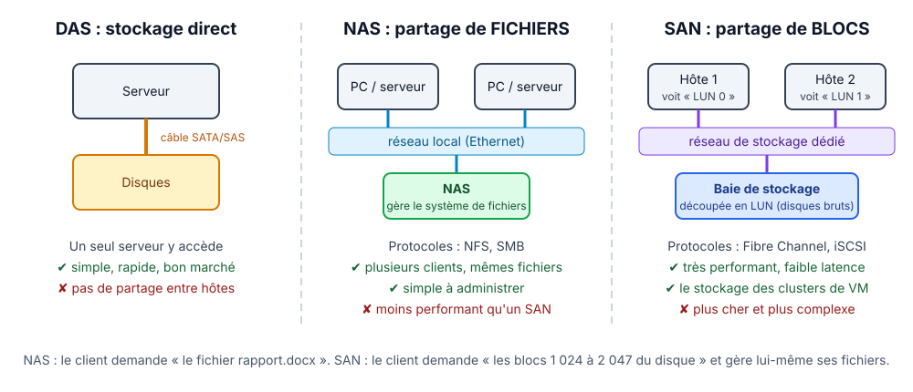

# Virtualiser le stockage

!!! abstract "Résumé"
    Les VM ont besoin de disques, et en entreprise ces disques ne sont presque jamais « dans » le serveur : ils sont sur un **stockage partagé**, indispensable à la migration à chaud et à la haute disponibilité vues en [partie 5](05-virtualiser-des-serveurs.md). La virtualisation du stockage consiste à présenter des espaces de stockage **logiques** (un partage, un disque) indépendamment des disques physiques qui les portent.

    Le cours distingue le stockage **direct** (DAS), le partage de **fichiers** (NAS, protocoles NFS et SMB) et le partage de **blocs** (SAN, Fibre Channel et iSCSI), et revient sur le provisionnement fin. Le TP transforme une VM Debian en **baie de stockage** : elle partage un dossier en **NFS** et un disque entier en **iSCSI**. Le serveur `web1` monte les deux et l'on constate la différence entre un partage de fichiers et un disque réseau.

| Propriété | Valeur |
|-----------|--------|
| Difficulté | Intermédiaire |
| Durée estimée | 2 h |
| Version décrite | VMware Workstation Pro 26H1, Debian 13.7 (nfs-kernel-server 2.8, targetcli-fb 2.1, open-iscsi 2.1) |
| Place dans le parcours | Partie 7 sur 17 du parcours [Virtualisation](index.md) — jour 2 |
| Dernière mise à jour | 2026-11-16 |

---

!!! info "Convention de lecture"
    🖥️ **PC hôte** (Windows et Workstation) · 🐧 **VM Debian** (le nom de la VM est précisé) · ✍️ **exercice** · 🛟 **instantané**. Les [comptes et mots de passe](index.md#comptes-et-mots-de-passe) sont rappelés sur la page d'accueil du parcours.

<!-- NOTE DE RÉDACTION (non affichée) : déroulé vérifié sur KVM (Debian 13.7, second disque virtio vdb ; sous Workstation sdb si le disque système est SCSI/SATA) : exportfs -v montre root_squash par défaut ; montage nfs4 vers=4.2 ; fstab _netdev remonté après redémarrage ; targetcli crée le portail 0.0.0.0:3260 automatiquement, saveconfig dans /etc/rtslib-fb-target/saveconfig.json, service rtslib-fb-targetctl activé ; initiateur : lsblk montre TRAN iscsi, VENDOR LIO-ORG, MODEL lun0 ; mkfs.ext4 + mount OK. Questions 5 et 6 du QCM du formateur reprises (SAN/NAS corrigé : « Ethernet » pour NAS = le réseau local, SAN = réseau dédié). -->

**Prérequis** : la [partie 6](06-virtualiser-le-reseau.md) est terminée : `routeur` relie le réseau isolé VMnet2 (`10.10.10.0/24`) à Internet, et `web1` est en `10.10.10.10`. 🖥️ `routeur` doit être **allumé** pendant toute la partie : sans lui, aucune VM de VMnet2 ne peut installer de paquet.

## 1. Les familles de stockage

### 1.1 DAS, NAS, SAN

{ loading=lazy }
/// caption
NAS : on partage des fichiers. SAN : on partage des disques.
///

| | DAS (*Direct Attached Storage*) | NAS (*Network Attached Storage*) | SAN (*Storage Area Network*) |
|---|---|---|---|
| Ce qui est partagé | Rien : disques d'un seul serveur | Des **fichiers** et des dossiers | Des **blocs** : des disques bruts, appelés **LUN** |
| Qui gère le système de fichiers | Le serveur | **Le NAS** | **Le client** (le serveur qui utilise la LUN) |
| Réseau | Câble direct (SATA, SAS, USB) | Réseau local Ethernet | Réseau de stockage dédié : Fibre Channel, ou Ethernet avec iSCSI |
| Protocoles | — | **NFS** (Linux, VMware), **SMB** (Windows) | **Fibre Channel**, **iSCSI**, FCoE, NVMe over Fabrics |
| Usage typique | Serveur isolé, poste de travail | Partages de fichiers, sauvegardes, stockage de VM pour une PME | Stockage des VM d'un cluster, bases de données |

!!! question "Une image pour s'en souvenir"
    Un **NAS**, c'est une **bibliothèque** : on demande « le livre *rapport.docx* » et le bibliothécaire va le chercher ; c'est lui qui sait où sont rangés les livres. Un **SAN**, c'est un **garde-meuble** : on reçoit une pièce vide (la LUN) et on y range ses affaires comme on veut ; le gardien ne sait pas ce qu'il y a dedans.

### 1.2 Ce que la virtualisation apporte au stockage

La **virtualisation du stockage** ajoute une couche logicielle entre les disques physiques et ceux qui les utilisent :

- **Regroupement** (*pooling*) : plusieurs disques ou plusieurs baies forment une seule réserve d'espace, découpée à la demande en volumes, partages ou LUN.
- **Provisionnement fin** (*thin provisioning*) : comme le disque dynamique d'une VM ([partie 4](04-partager-les-ressources.md#41-disque-dynamique-ou-prealloue)), un volume de 1 To n'occupe que l'espace réellement écrit. On peut **sur-allouer**, à condition de surveiller le remplissage.
- **Instantanés et réplication** au niveau de la baie, pour toutes les VM à la fois.
- **Migration à chaud** des données d'une baie à une autre (Storage vMotion).

Le jour 4 va plus loin avec le **stockage défini par logiciel** (SDS) et l'**hyperconvergence**, où le stockage partagé est fabriqué à partir des disques des hôtes eux-mêmes.

### 1.3 Les protocoles à connaître

| Protocole | Type | Port | À retenir |
|---|---|---|---|
| **NFS** (*Network File System*) | Fichiers | TCP 2049 | Le partage de fichiers du monde Unix et Linux ; ESXi peut y stocker des VM. Version actuelle : NFSv4.2 |
| **SMB** (*Server Message Block*) | Fichiers | TCP 445 | Le partage de fichiers de Windows (dossiers partagés, `\\serveur\partage`) ; Samba l'implémente sous Linux |
| **iSCSI** (*Internet Small Computer System Interface*) | Blocs | TCP 3260 | Des commandes de disque SCSI transportées sur un réseau IP ordinaire : un SAN sans matériel Fibre Channel |
| **Fibre Channel** | Blocs | — | Réseau de stockage dédié, avec ses propres commutateurs et cartes (HBA) : très performant, coûteux |

Le vocabulaire d'iSCSI :

- la **cible** (*target*) est le serveur de stockage qui partage les disques ;
- l'**initiateur** (*initiator*) est le client qui s'y connecte ;
- une **LUN** (*Logical Unit Number*) est un disque présenté par la cible ;
- un **IQN** (*iSCSI Qualified Name*) est le nom unique d'une cible ou d'un initiateur, de la forme `iqn.AAAA-MM.domaine-inversé:nom`, par exemple `iqn.2026-11.lab.tssr:stockage`.

## 2. TP : préparer la VM de stockage

### 2.1 Créer la VM et son second disque

1. 🖥️ Créer un **clone lié** de `modele-debian` (instantané `modele-v1`) nommé `stockage`, dans `C:\VM\stockage`. Mémoire : **1 Go**.
2. 🖥️ VM éteinte, dans **VM > Settings** : sélectionner **Network Adapter**, choisir **Custom: Specific virtual network** > **VMnet2**.
3. 🖥️ Toujours dans **VM > Settings**, cliquer sur **Add…**, choisir **Hard Disk**, puis **Next** ; choisir le type **SCSI** (même si l'assistant en propose un autre), **Create a new virtual disk**, taille **10** Go, garder **Split virtual disk into multiple files** (comme pour le disque système), puis **Finish** et **OK**.

### 2.2 Personnaliser la VM et lui donner son adresse

1. 🖥️ Démarrer `stockage` et se connecter en `tssr` dans la console de Workstation.
2. 🐧 **stockage** : donner son identité au clone :

    ```bash
    sudo personnaliser-clone.sh stockage
    ```

3. 🐧 **stockage** : dans `/etc/network/interfaces` (`sudo nano /etc/network/interfaces`), remplacer la ligne `iface ens33 inet dhcp` (garder le nom de carte du fichier) par :

    ```text title="/etc/network/interfaces (extrait)"
    iface ens33 inet static
        address 10.10.10.20/24
        gateway 10.10.10.1
    ```

4. 🐧 **stockage** : redémarrer (`sudo reboot`) et se reconnecter.
5. 🐧 **stockage** : indiquer le serveur DNS, avec l'adresse `192.168.x.2` notée sur `routeur` en [partie 6](06-virtualiser-le-reseau.md#32-identifier-les-deux-cartes), puis vérifier l'accès à Internet :

    ```bash
    echo "nameserver 192.168.x.2" | sudo tee /etc/resolv.conf
    ping -c 3 deb.debian.org
    ```

6. 🐧 **stockage** : repérer le nouveau disque :

    ```bash
    lsblk
    ```

    Le nouveau disque est celui de **10G**, **sans partition** ni point de montage : souvent `sdb`. S'il a un autre nom (`sda` si le disque système est en NVMe, par exemple), **remplacer `sdb` par ce nom** dans toute la suite.

    !!! danger "Ne jamais choisir le disque qui porte `/`"
        Le disque système est celui dont une partition est montée sur `/` (colonne `MOUNTPOINTS`). Le partager en iSCSI, puis le formater depuis `web1`, détruirait le système de `stockage`.

## 3. TP : partager un dossier en NFS

### 3.1 Côté serveur : stockage

1. 🐧 **stockage** : installer le serveur NFS et créer le dossier à partager :

    ```bash
    sudo apt install -y nfs-kernel-server
    sudo mkdir -p /srv/partage
    sudo chmod 777 /srv/partage
    ```

    `chmod 777` autorise tout le monde à écrire dans le dossier : c'est pratique pour un lab, à proscrire en production, où l'on gère les droits par utilisateur ou par groupe.

2. 🐧 **stockage** : déclarer le partage dans `/etc/exports`, le fichier qui liste les dossiers partagés et les machines autorisées :

    ```bash
    echo "/srv/partage 10.10.10.0/24(rw,sync,no_subtree_check)" | sudo tee -a /etc/exports
    sudo exportfs -ra
    sudo exportfs -v
    ```

!!! question "Que veulent dire ces options ?"
    - `10.10.10.0/24` : seules les machines du réseau interne peuvent monter le partage.
    - `rw` : lecture et écriture.
    - `sync` : le serveur confirme une écriture seulement quand elle est sur le disque (plus sûr, un peu plus lent).
    - `no_subtree_check` : désactive une vérification inutile quand on partage un dossier entier.
    - `exportfs -v` affiche aussi des options par défaut, dont `root_squash` : l'utilisateur `root` d'un client est traité comme un utilisateur **sans droits** sur le partage. Un client compromis ne devient pas `root` sur le serveur de fichiers.

### 3.2 Côté client : web1

1. 🐧 **web1** : installer le client NFS, créer le point de montage et monter le partage :

    ```bash
    sudo apt install -y nfs-common
    sudo mkdir -p /mnt/partage
    sudo mount -t nfs 10.10.10.20:/srv/partage /mnt/partage
    ```

2. 🐧 **web1** : écrire un fichier dans le partage et vérifier le montage :

    ```bash
    echo "écrit depuis $(hostname)" > /mnt/partage/test.txt
    findmnt /mnt/partage
    ```

3. 🐧 **stockage** : vérifier que le fichier est bien arrivé : `cat /srv/partage/test.txt`.

!!! success "Vérifier son lab"
    - Sur `web1`, `findmnt /mnt/partage` affiche la source `10.10.10.20:/srv/partage` et le type `nfs4` : le client a choisi automatiquement **NFS version 4** (`findmnt -o SOURCE,FSTYPE,OPTIONS /mnt/partage` détaille `vers=4.2`).
    - Sur `stockage`, `cat /srv/partage/test.txt` affiche `écrit depuis web1`, et `ls -l /srv/partage` montre le fichier appartenant à `tssr` : sur le serveur, c'est un **fichier ordinaire**, dans un système de fichiers que gère le serveur.

### 3.3 Monter le partage automatiquement

🐧 **web1** : pour que le partage soit monté à chaque démarrage, l'ajouter à `/etc/fstab`, le fichier des systèmes de fichiers à monter :

```bash
echo "10.10.10.20:/srv/partage  /mnt/partage  nfs  defaults,_netdev,nofail  0  0" | sudo tee -a /etc/fstab
sudo systemctl daemon-reload
sudo umount /mnt/partage
sudo mount -a
findmnt /mnt/partage
```

L'option `_netdev` indique qu'il s'agit d'un **stockage réseau** : il ne doit être monté qu'une fois le réseau disponible. L'option `nofail` permet à `web1` de démarrer normalement même si `stockage` est éteint (sans le partage, et sans attendre une minute et demie). Démarrer de préférence `routeur`, puis `stockage`, puis `web1`. `mount -a` monte tout ce qui est dans `/etc/fstab` : s'il ne répond rien et que `findmnt` affiche le partage, la ligne est correcte. Après un `sudo reboot`, le partage est remonté automatiquement.

!!! danger "Toujours tester `/etc/fstab` avec `mount -a`"
    Une erreur dans `/etc/fstab` peut empêcher la machine de démarrer normalement. On vérifie donc chaque modification avec `sudo mount -a` **avant** de redémarrer.

## 4. TP : partager un disque en iSCSI

### 4.1 Côté serveur : créer la cible

On utilise **targetcli**, l'outil qui pilote la cible iSCSI intégrée au noyau Linux (LIO).

🐧 **stockage** :

```bash
sudo apt install -y targetcli-fb
sudo targetcli /backstores/block create name=lun0 dev=/dev/sdb
sudo targetcli /iscsi create iqn.2026-11.lab.tssr:stockage
sudo targetcli /iscsi/iqn.2026-11.lab.tssr:stockage/tpg1/luns create /backstores/block/lun0
sudo targetcli /iscsi/iqn.2026-11.lab.tssr:stockage/tpg1/acls create iqn.2026-11.lab.tssr:web1
sudo targetcli saveconfig
sudo targetcli ls
```

Ces commandes, dans l'ordre :

1. déclarent le disque `/dev/sdb` comme **espace de stockage** (*backstore*) nommé `lun0` ;
2. créent la **cible** iSCSI et son IQN ; targetcli ajoute automatiquement un **portail** qui écoute sur toutes les adresses, port **3260** ;
3. exposent `lun0` comme **LUN 0** de cette cible ;
4. créent une **ACL** (liste de contrôle d'accès) : seul un initiateur qui se présente sous le nom `iqn.2026-11.lab.tssr:web1` pourra se connecter (un filtre sur le nom, sans mot de passe : voir la question 4 de révision) ;
5. enregistrent la configuration dans `/etc/rtslib-fb-target/saveconfig.json`, que le service `rtslib-fb-targetctl` recharge à chaque démarrage.

!!! success "Vérifier son lab"
    `sudo targetcli ls` affiche l'arbre de la configuration : `lun0` sous `backstores/block` avec `[/dev/sdb (10.0GiB) write-thru activated]`, la cible `iqn.2026-11.lab.tssr:stockage`, son ACL `iqn.2026-11.lab.tssr:web1` avec `[Mapped LUNs: 1]`, et le portail `0.0.0.0:3260`. La commande `ss -ltn | grep 3260` montre le port en écoute.

### 4.2 Côté client : se connecter à la cible

1. 🐧 **web1** : installer l'initiateur iSCSI :

    ```bash
    sudo apt install -y open-iscsi
    ```

2. 🐧 **web1** : donner à l'initiateur le nom autorisé par l'ACL. Le fichier `/etc/iscsi/initiatorname.iscsi` contient un nom généré au hasard (`iqn.1993-08.org.debian:01:…`) ; le remplacer, puis redémarrer le service :

    ```bash
    echo "InitiatorName=iqn.2026-11.lab.tssr:web1" | sudo tee /etc/iscsi/initiatorname.iscsi
    sudo systemctl restart iscsid
    ```

3. 🐧 **web1** : **découvrir** les cibles proposées par `stockage`, puis s'y **connecter** :

    ```bash
    sudo iscsiadm -m discovery -t sendtargets -p 10.10.10.20
    sudo iscsiadm -m node --login
    ```

4. 🐧 **web1** : un **nouveau disque** est apparu :

    ```bash
    lsblk -o NAME,SIZE,TYPE,TRAN,VENDOR,MODEL
    ```

5. 🐧 **web1** : le formater et le monter, exactement comme un disque local (remplacer `sdb` par le nom affiché par `lsblk`) :

    ```bash
    sudo mkfs.ext4 -L donnees-iscsi /dev/sdb
    sudo mkdir -p /mnt/iscsi
    sudo mount /dev/sdb /mnt/iscsi
    df -h /mnt/iscsi
    ```

!!! success "Vérifier son lab"
    - La découverte répond `10.10.10.20:3260,1 iqn.2026-11.lab.tssr:stockage`, et la connexion se termine par `Login to [iface: default, target: iqn.2026-11.lab.tssr:stockage, portal: 10.10.10.20,3260] successful.`
    - `lsblk` affiche un disque de **10G** dont la colonne `TRAN` (transport) vaut `iscsi`, le fabricant `LIO-ORG` et le modèle `lun0` : pour `web1`, c'est un **disque**, pas un partage.
    - `df -h /mnt/iscsi` affiche un système de fichiers d'environ **9,8G**, géré par `web1` lui-même.

!!! danger "Une LUN, un seul client à la fois"
    Le système de fichiers ext4 du disque iSCSI est géré par **`web1`**, pas par le serveur de stockage. Si un second client montait la même LUN en même temps, chacun écrirait sans savoir ce que fait l'autre, et le système de fichiers serait **détruit**. Pour partager un disque bloc entre plusieurs hôtes (cas des clusters de VM), il faut un **système de fichiers de cluster** conçu pour cela : **VMFS** chez VMware, **CSV** chez Microsoft, OCFS2 ou GFS2 sous Linux.

### 4.3 Comparer

✍️ Remplir ce tableau à partir de ce qui vient d'être fait.

| Question | NFS | iSCSI |
|---|---|---|
| Ce que voit `web1` | | |
| Qui a créé le système de fichiers ? | | |
| Le serveur `stockage` peut-il lire les fichiers de `web1` ? | | |
| Plusieurs clients peuvent-ils l'utiliser en même temps ? | | |
| Famille | | |

??? success "Corrigé"
    | Question | NFS | iSCSI |
    |---|---|---|
    | Ce que voit `web1` | Un **dossier** réseau, monté en `nfs4` | Un **disque** de 10 Go (souvent `sdb`), transport `iscsi` |
    | Qui a créé le système de fichiers ? | Le **serveur** `stockage` (c'est son disque système) | Le **client** `web1` (`mkfs.ext4`) |
    | Le serveur peut-il lire les fichiers ? | **Oui** : ce sont des fichiers ordinaires dans `/srv/partage` | **Non**, pas directement : pour lui, son disque de 10 Go n'est qu'une suite de blocs que `web1` a formatés |
    | Plusieurs clients en même temps ? | **Oui**, c'est fait pour | **Non** avec ext4 ; oui avec un système de fichiers de cluster (VMFS, CSV…) |
    | Famille | **NAS** (fichiers) | **SAN** (blocs) |

??? failure "Dépannage NFS et iSCSI"
    - `mount.nfs: access denied by server while mounting` : le réseau autorisé est mal écrit dans `/etc/exports`, ou `sudo exportfs -ra` a été oublié. Vérifier avec `sudo exportfs -v` sur `stockage`.
    - `mount` reste bloqué : `stockage` est éteint ou injoignable (`ping 10.10.10.20` depuis `web1`).
    - La découverte iSCSI répond `No route to host` ou `Connection refused` : `stockage` est éteint, ou le portail est absent (`sudo targetcli ls` sur `stockage`).
    - La connexion échoue avec une erreur d'**autorisation** (*authorization failure*) : le nom de `/etc/iscsi/initiatorname.iscsi` sur `web1` ne correspond pas **exactement** à l'ACL créée sur `stockage` (faute de frappe fréquente). Corriger le fichier, puis `sudo systemctl restart iscsid` et recommencer la découverte et la connexion.

1. 🐧 **web1** puis 🐧 **stockage** : éteindre les deux VM, dans cet ordre (`sudo poweroff`).
2. 🛟 🖥️ Prendre sur chacune l'instantané `stockage-ok` (le même nom sur les deux : il marque l'état du lab à la fin de la partie 7).

## 5. Questions de révision

1. Quelles sont les différences entre un SAN et un NAS ?
2. Que signifie SMB ? Sur quel port fonctionne-t-il ?
3. Dans iSCSI, qu'est-ce qu'une cible, un initiateur, une LUN et un IQN ?
4. Pourquoi a-t-on créé une ACL sur la cible iSCSI ?
5. Pourquoi ne faut-il pas monter la même LUN formatée en ext4 sur deux serveurs à la fois ?
6. À quoi sert l'option `_netdev` dans `/etc/fstab` ?

??? success "Corrigé"
    1. Un **NAS** partage des **fichiers** sur le réseau local, avec NFS ou SMB : c'est lui qui gère le système de fichiers, et plusieurs clients lisent les mêmes fichiers. Un **SAN** partage des **blocs** (des disques bruts, les LUN) sur un réseau de stockage dédié, en Fibre Channel ou en iSCSI : chaque serveur formate et gère lui-même son disque. Le SAN est plus performant et a une latence plus faible ; le NAS est plus simple à utiliser et à administrer, et moins cher.
    2. **Server Message Block** : le protocole client-serveur de partage de fichiers, de dossiers et d'imprimantes de Windows. Il fonctionne sur le port **TCP 445**. Sous Linux, **Samba** le met en œuvre.
    3. La **cible** est le serveur de stockage qui partage les disques ; l'**initiateur** est le client qui s'y connecte ; une **LUN** est un disque logique présenté par la cible ; un **IQN** est le nom unique d'une cible ou d'un initiateur (`iqn.2026-11.lab.tssr:stockage`).
    4. Pour que seul l'initiateur dont le **nom** est autorisé (`web1`) puisse se connecter au disque. C'est un premier filtre, mais faible : un IQN n'est pas un secret, et n'importe quelle machine peut prendre ce nom (on l'a fait soi-même dans le TP). En production, on ajoute une **authentification CHAP** (identifiant et mot de passe) et on isole le réseau de stockage (réseau ou VLAN dédié).
    5. Le système de fichiers ext4 est géré par **chaque** client, qui garde en mémoire sa propre vision du disque. Deux clients écriraient sans se coordonner et détruiraient le système de fichiers. Il faut un système de fichiers de cluster (VMFS, CSV, GFS2, OCFS2).
    6. Elle indique un **système de fichiers réseau** : le système attend que le réseau soit disponible avant de le monter, et le démonte avant de couper le réseau à l'arrêt. (`nofail`, elle, évite de bloquer le démarrage si le serveur NFS est absent.)

---

## Ressources

- [SNIA — What is a SAN?](https://www.snia.org/education/storage_networking_primer/san/what_san) — l'association de l'industrie du stockage définit les réseaux de stockage (en anglais).
- [RFC 7143 — iSCSI](https://www.rfc-editor.org/rfc/rfc7143) — la norme du protocole iSCSI (en anglais).
- [Wiki Debian — NFS Server Setup](https://wiki.debian.org/NFSServerSetup) — installation d'un serveur NFS sous Debian (en anglais).
- [Manuel Debian — `targetcli(8)`](https://manpages.debian.org/trixie/targetcli-fb/targetcli.8.en.html) — toutes les commandes de targetcli (en anglais).
- [Manuel Debian — `iscsiadm(8)`](https://manpages.debian.org/trixie/open-iscsi/iscsiadm.8.en.html) — l'outil de l'initiateur iSCSI (en anglais).
- Partie précédente : [Virtualiser le réseau](06-virtualiser-le-reseau.md) · Partie suivante : [Défi du jour 2](08-defi-jour-2.md).

*[DAS]: Direct Attached Storage — stockage directement attaché
*[NAS]: Network Attached Storage — stockage en réseau, partage de fichiers
*[SAN]: Storage Area Network — réseau de stockage, partage de blocs
*[NFS]: Network File System — partage de fichiers Unix et Linux
*[SMB]: Server Message Block — partage de fichiers Windows
*[iSCSI]: Internet Small Computer System Interface — disques SCSI sur IP
*[LUN]: Logical Unit Number — disque logique présenté par une baie
*[IQN]: iSCSI Qualified Name — nom unique iSCSI
*[ACL]: Access Control List — liste de contrôle d'accès
*[HBA]: Host Bus Adapter — carte d'accès au réseau de stockage
*[FCoE]: Fibre Channel over Ethernet
*[LIO]: Linux-IO — la cible SCSI du noyau Linux
*[SDS]: Software-Defined Storage — stockage défini par logiciel
*[VMFS]: Virtual Machine File System — système de fichiers de cluster de VMware
*[CSV]: Cluster Shared Volumes — volumes partagés de cluster de Microsoft
*[VM]: Virtual Machine — machine virtuelle
*[DNS]: Domain Name System — résolution des noms
*[SCSI]: Small Computer System Interface — famille de normes d'accès aux disques
*[SATA]: Serial ATA — interface de disque
*[SAS]: Serial Attached SCSI — interface de disque pour serveurs
*[USB]: Universal Serial Bus
*[NVMe]: interface rapide pour les disques SSD
*[TCP]: Transmission Control Protocol
*[IP]: Internet Protocol — adresse d'une machine sur le réseau
*[PME]: Petite ou moyenne entreprise
*[CHAP]: Challenge-Handshake Authentication Protocol — authentification par mot de passe d'iSCSI
*[VLAN]: Virtual LAN — réseau local virtuel
