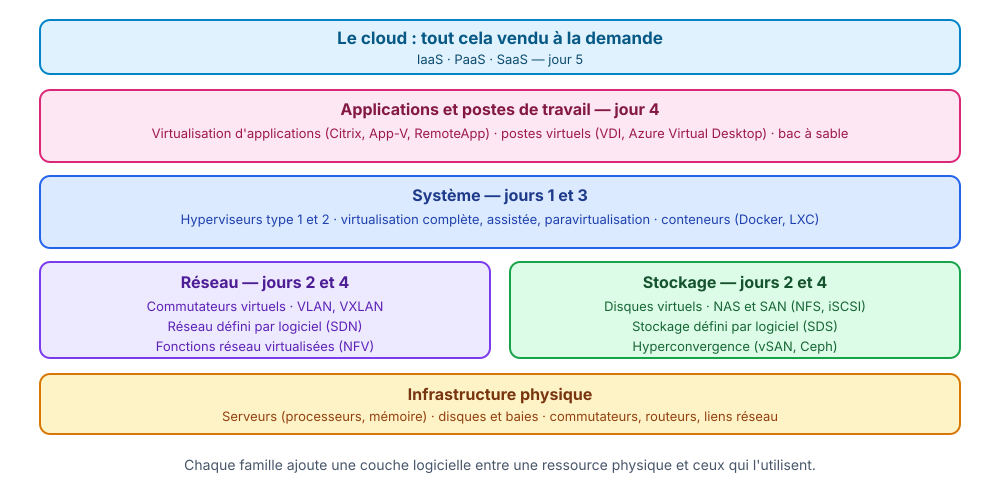

# Panorama des technologies de virtualisation

!!! abstract "Résumé"
    Les jours 1 et 2 ont fait manipuler la virtualisation des serveurs, du réseau et du stockage avec un seul outil. Cette partie prend de la hauteur : elle dresse la **carte** des technologies de virtualisation, les **compare** entre elles (ce qu'elles virtualisent, comment, pour quel usage) et prépare les jours 3 à 5, qui détaillent chacune d'elles.

    Le cœur de la séquence est un **atelier de recherche** : chacun prépare une **fiche technologie** sourcée, puis la présente. On apprend ainsi à faire une **veille technologique** fiable, une activité que le référentiel du titre TSSR demande explicitement (« assurer la veille technologique sur les différentes offres et techniques »).

| Propriété | Valeur |
|-----------|--------|
| Difficulté | Débutant |
| Durée estimée | 1 h 45 (cours 30 min, atelier 1 h, présentations 15 min) |
| Version décrite | Indépendant du logiciel |
| Place dans le parcours | Partie 9 sur 17 du parcours [Virtualisation](index.md) — jour 3 |
| Dernière mise à jour | 2026-11-16 |

---

## 1. La carte des technologies

{ loading=lazy }
/// caption
Les familles de virtualisation et les jours du parcours qui les traitent
///

Toutes les technologies de virtualisation suivent la même idée : **intercaler une couche logicielle** entre une ressource physique et ceux qui l'utilisent, pour la **partager**, la **découper**, la **déplacer** ou la **regrouper** sans toucher au matériel.

## 2. Comparer les technologies

### 2.1 Ce que chaque famille virtualise

| Famille | Ce qui est virtualisé | Ce que l'utilisateur voit | Exemples de produits | Usage typique |
|---|---|---|---|---|
| **Système : VM** | Une machine entière (processeur, mémoire, disques, cartes) | Un ordinateur complet, avec son propre système | VMware ESXi, Hyper-V, Proxmox VE (KVM), XCP-ng, Workstation, VirtualBox | Serveurs de l'entreprise, labs, systèmes différents sur un même hôte |
| **Système : conteneurs** | L'environnement d'une application (fichiers, réseau, processus), en partageant le noyau de l'hôte | Une application isolée, prête à lancer | Docker, Podman, LXC, Kubernetes | Applications web, microservices, déploiement rapide |
| **Stockage** | Les disques et les baies | Un volume, un partage ou une LUN, quel que soit le disque physique | NAS et SAN, vSAN, Ceph, Storage Spaces Direct, TrueNAS | Stockage partagé des clusters, sauvegardes |
| **Réseau** | Les commutateurs, routeurs, pare-feux et liens | Des réseaux logiques, créés et supprimés par logiciel | Commutateurs virtuels, VLAN, VXLAN, VMware NSX, Open vSwitch, pfSense en VM | Segmentation, multi-clients, labs, cloud |
| **Applications** | L'exécution d'une application | Une application qui s'affiche sur le poste mais tourne ailleurs, ou isolée du système | Citrix, App-V, RemoteApp, Windows Sandbox | Logiciels métier diffusés à de nombreux postes |
| **Postes de travail (VDI)** | Le bureau complet de l'utilisateur | Son bureau Windows, depuis n'importe quel appareil | Citrix, Azure Virtual Desktop, Omnissa Horizon | Télétravail, centres d'appels, postes sécurisés |

### 2.2 VM ou conteneur : la comparaison la plus importante

| | Machine virtuelle | Conteneur |
|---|---|---|
| Ce qui est isolé | Une machine entière | Une application et ses dépendances |
| Noyau du système | **Chaque VM a le sien** | **Partagé** avec l'hôte |
| Système invité | N'importe lequel (Windows sur un hôte Linux, par exemple) | Le même type de noyau que l'hôte (Linux sur Linux) |
| Démarrage | Comme un vrai ordinateur : de quelques secondes à quelques minutes | Comme un programme : moins d'une seconde à quelques secondes |
| Poids | Plusieurs Go (un système complet) | Quelques Mo à quelques centaines de Mo |
| Isolation | Forte : assurée par l'hyperviseur et le processeur | Plus faible : une faille du noyau partagé touche tous les conteneurs |
| Usage | Serveurs complets, systèmes différents, isolation forte | Applications à déployer vite et souvent, à grande échelle |

La [partie 11](11-conteneurs.md) fait mesurer ces différences sur un conteneur LXC et une VM.

### 2.3 Trois façons de virtualiser un système

Pour exécuter le code d'une VM sans qu'il prenne le contrôle du vrai matériel, les hyperviseurs ont utilisé trois techniques, détaillées en [partie 10](10-types-hyperviseurs-paravirtualisation.md) :

- **Virtualisation complète** : l'hyperviseur intercepte et traduit par logiciel les instructions sensibles du système invité, qui n'a pas besoin d'être modifié.
- **Paravirtualisation** : le système invité **sait** qu'il est virtualisé et appelle directement l'hyperviseur, par des pilotes ou un noyau adaptés. C'est plus rapide, mais l'invité doit être modifié ou équipé de pilotes spéciaux.
- **Virtualisation assistée par le matériel** : le processeur lui-même (VT-x, AMD-V) gère le passage entre la VM et l'hyperviseur. C'est la base de tous les hyperviseurs actuels, souvent combinée à des **pilotes paravirtualisés** pour le disque et le réseau.

## 3. 💬 Atelier : la fiche technologie

### 3.1 Consignes

**Par deux, 1 heure, avec Internet.** Chaque binôme choisit (ou tire au sort) **une** technologie dans la liste ci-dessous et rédige sa **fiche technologie**, puis la présente en **5 minutes**. **Seul** : rédiger deux fiches, sur deux familles différentes.

Technologies proposées :

1. Proxmox VE
2. Microsoft Hyper-V
3. XCP-ng
4. Docker
5. Kubernetes
6. Ceph
7. VMware vSAN
8. Open vSwitch
9. VXLAN
10. pfSense ou OPNsense en VM (fonction réseau virtualisée)
11. Citrix Virtual Apps and Desktops
12. Azure Virtual Desktop ou Windows 365

Modèle de fiche (une page au maximum) :

| Rubrique | Contenu attendu |
|---|---|
| **Nom et éditeur** | Nom exact, éditeur ou communauté, licence (libre, propriétaire, gratuite, payante) |
| **Famille** | Système, stockage, réseau, applications ou postes |
| **En une phrase** | Ce que fait la technologie, compréhensible par un non-informaticien |
| **Principe de fonctionnement** | Comment elle virtualise (2 à 4 phrases, un petit schéma si possible) |
| **Concurrents** | Deux produits qui rendent le même service |
| **Avantages** | Trois avantages |
| **Limites** | Trois limites ou risques |
| **Cas d'usage** | Une entreprise type qui l'utiliserait, et pourquoi |
| **Pour le TSSR** | Ce qu'un technicien doit savoir faire avec (installer, surveiller, sauvegarder…) |
| **Sources** | Au moins **deux** sources, dont la **documentation officielle** de l'éditeur, avec leur date |

### 3.2 Bien chercher : les règles de la veille

!!! tip "Des sources fiables"
    - **D'abord la documentation officielle** de l'éditeur ou du projet : c'est la seule qui fait foi pour les versions, les prérequis et les limites.
    - **Puis des sources reconnues** : agences publiques (ANSSI, CNIL), organismes de normalisation (IETF, NIST), presse spécialisée (LeMagIT, Le Monde Informatique), sites de tutoriels sérieux et datés (IT-Connect).
    - **Vérifier la date** : en virtualisation, un article de plus de deux ou trois ans est souvent périmé (prix, licences, produits renommés ou rachetés).
    - **Croiser** : une information importante doit être confirmée par deux sources indépendantes.
    - **Se méfier** des comparatifs non datés, des pages commerciales et des réponses d'IA générative non sourcées : toujours remonter à la source.

!!! info "Organiser sa veille"
    S'abonner aux flux RSS ou aux lettres d'information des éditeurs utilisés (notes de version, avis de sécurité), suivre les avis du CERT-FR pour les failles des hyperviseurs, et noter chaque semaine, dans un document partagé, ce qui change. C'est ce que le référentiel du TSSR appelle « assurer la veille technologique sur les différentes offres et techniques ».

### 3.3 Grille pour évaluer une fiche

| Critère | Oui / Non |
|---|---|
| La phrase « en une phrase » est compréhensible par un non-informaticien | |
| Le principe de fonctionnement est juste et rattaché à la bonne famille | |
| Avantages **et** limites sont présents, sans ton commercial | |
| La documentation officielle est citée, avec une date | |
| Les versions, licences et prix sont à jour (moins d'un an) | |
| La rubrique « Pour le TSSR » décrit des tâches concrètes | |

??? success "Exemple de fiche : Proxmox VE"
    | Rubrique | Contenu |
    |---|---|
    | Nom et éditeur | **Proxmox Virtual Environment**, par Proxmox Server Solutions (Autriche). Logiciel libre (licence AGPLv3), gratuit ; abonnement facultatif pour le support et le dépôt « entreprise » |
    | Famille | Système (VM et conteneurs), avec stockage (Ceph, ZFS) et réseau (SDN) intégrés |
    | En une phrase | Un logiciel qu'on installe à la place de Windows ou de Linux sur un serveur pour le transformer en hébergeur de machines virtuelles, géré depuis un navigateur web |
    | Principe | Distribution basée sur **Debian**, qui utilise **KVM** pour les VM et **LXC** pour les conteneurs ; interface web d'administration ; plusieurs serveurs peuvent former un **cluster**, avec migration à chaud et haute disponibilité |
    | Concurrents | VMware vSphere (ESXi + vCenter), Microsoft Hyper-V, XCP-ng |
    | Avantages | Gratuit et complet ; VM et conteneurs dans la même interface ; cluster, sauvegarde (Proxmox Backup Server) et stockage distribué intégrés |
    | Limites | Support officiel payant ; écosystème de partenaires plus petit que celui de VMware ; demande des compétences Linux |
    | Cas d'usage | Une PME qui quitte VMware après la hausse de ses licences et veut garder un cluster de trois serveurs avec haute disponibilité |
    | Pour le TSSR | Installer un nœud, créer des VM et des conteneurs, configurer le réseau et le stockage, planifier les sauvegardes, appliquer les mises à jour |
    | Sources | Documentation officielle (pve.proxmox.com), notes de version de la dernière version ; un article de presse spécialisée daté |

## 4. Questions de révision

1. Citer les quatre grandes familles de virtualisation et un exemple de produit pour chacune.
2. Donner trois différences entre une VM et un conteneur.
3. Peut-on faire tourner un conteneur Windows sur un hôte Linux ? Une VM Windows sur un hôte Linux ? Pourquoi ?
4. Quelles sont les trois techniques pour virtualiser un système ? Laquelle utilisent tous les hyperviseurs actuels ?
5. Pourquoi faut-il toujours dater ses sources dans une veille sur la virtualisation ?

??? success "Corrigé"
    1. **Système** (Proxmox VE, Hyper-V, Docker), **stockage** (Ceph, vSAN, un NAS), **réseau** (commutateur virtuel, VLAN, NSX, pfSense en VM), **applications et postes** (Citrix, App-V, Azure Virtual Desktop).
    2. La VM a **son propre noyau**, le conteneur **partage** celui de l'hôte ; la VM démarre comme un ordinateur (secondes à minutes), le conteneur comme un programme (souvent moins d'une seconde) ; la VM pèse plusieurs Go, le conteneur quelques Mo à quelques centaines de Mo ; l'isolation d'une VM est plus forte.
    3. Un **conteneur Windows**, non : il a besoin d'un noyau Windows, et le conteneur partage le noyau de l'hôte, ici Linux. Une **VM Windows**, oui : elle apporte son propre noyau, et l'hyperviseur lui présente un matériel virtuel complet.
    4. La **virtualisation complète**, la **paravirtualisation** et la **virtualisation assistée par le matériel**. Tous les hyperviseurs actuels s'appuient sur l'assistance matérielle (VT-x, AMD-V), souvent combinée à des pilotes paravirtualisés pour le disque et le réseau.
    5. Parce que les produits, leurs noms, leurs licences et leurs prix changent vite (rachat de VMware par Broadcom en 2023, produits renommés, versions gratuites supprimées ou réintroduites) : une information de plus de deux ou trois ans est souvent fausse aujourd'hui.

---

## Ressources

- [Red Hat — Qu'est-ce que la virtualisation ?](https://www.redhat.com/fr/topics/virtualization/what-is-virtualization) — les grandes familles de virtualisation, en français.
- [Red Hat — Conteneurs et machines virtuelles](https://www.redhat.com/fr/topics/containers/containers-vs-vms) — la comparaison détaillée, en français.
- [CERT-FR — Avis de sécurité](https://www.cert.ssi.gouv.fr/avis/) — les failles des logiciels, dont les hyperviseurs : une source de veille indispensable.
- Partie précédente : [Défi du jour 2](08-defi-jour-2.md) · Partie suivante : [Types d'hyperviseurs et paravirtualisation](10-types-hyperviseurs-paravirtualisation.md).

*[VM]: Virtual Machine — machine virtuelle
*[LUN]: Logical Unit Number — disque logique présenté par une baie
*[VLAN]: Virtual LAN — réseau local virtuel
*[VXLAN]: Virtual eXtensible LAN — réseaux virtuels transportés sur IP
*[SDN]: Software-Defined Networking — réseau défini par logiciel
*[NFV]: Network Functions Virtualization — virtualisation des fonctions réseau
*[SDS]: Software-Defined Storage — stockage défini par logiciel
*[VDI]: Virtual Desktop Infrastructure — postes de travail virtuels
*[KVM]: Kernel-based Virtual Machine — hyperviseur intégré au noyau Linux
*[LXC]: Linux Containers — conteneurs Linux
*[TSSR]: Technicien supérieur systèmes et réseaux
*[ANSSI]: Agence nationale de la sécurité des systèmes d'information
*[CERT-FR]: centre gouvernemental de veille et de réponse aux attaques informatiques
*[RSS]: format de flux d'actualités
*[PME]: Petite ou moyenne entreprise
