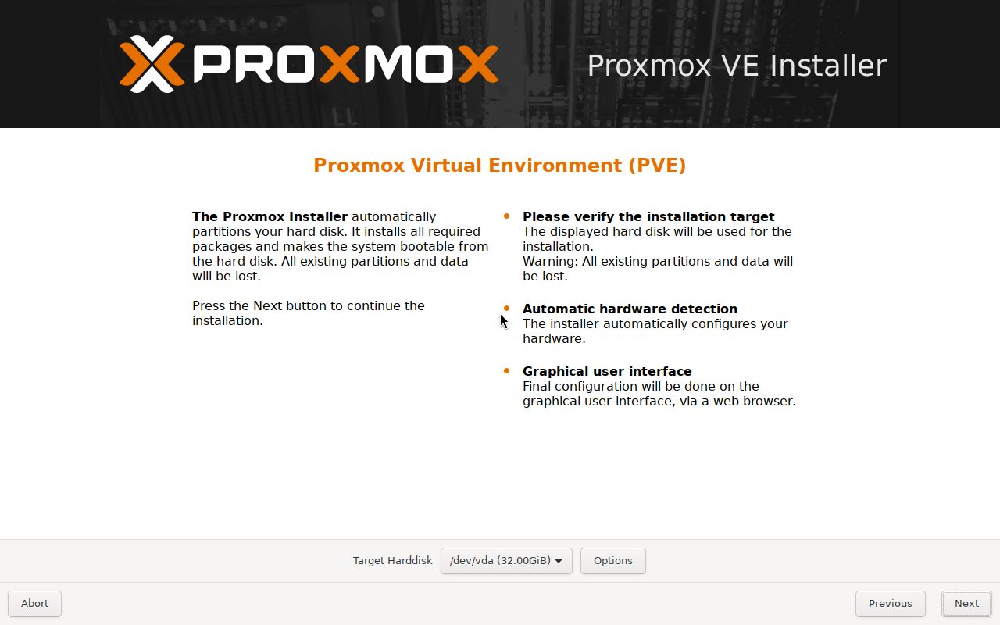
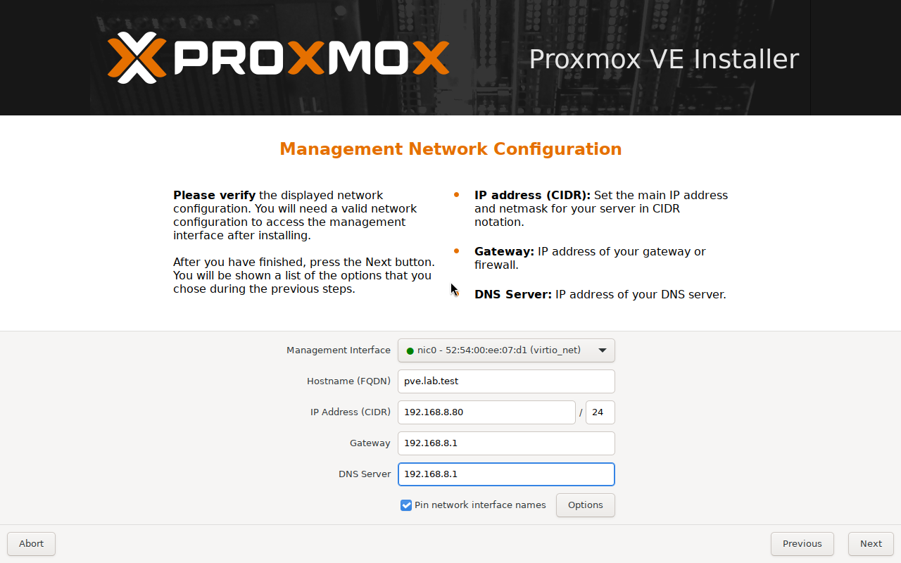
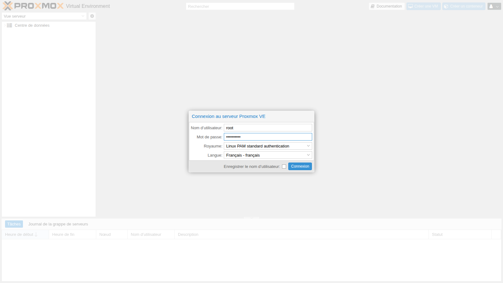
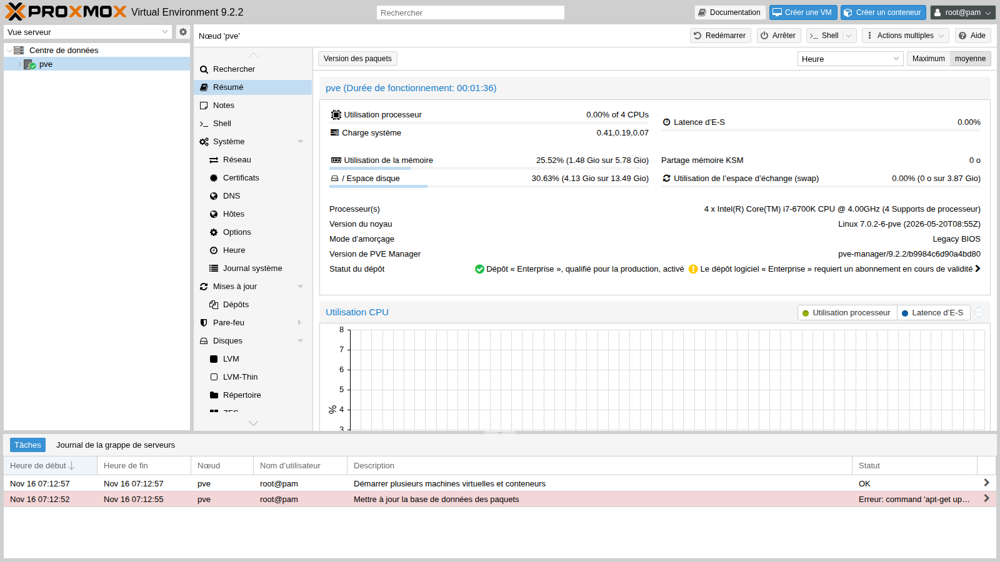
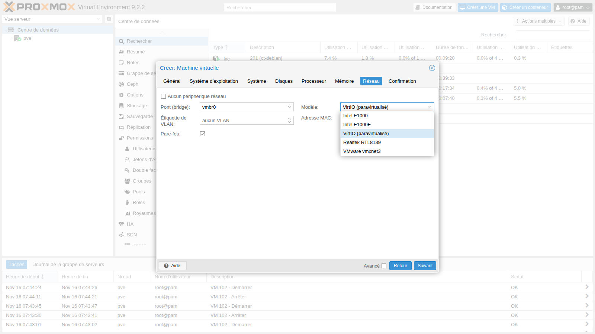

# Types d'hyperviseurs et paravirtualisation

!!! abstract "Résumé"
    Au jour 1, on a distingué les hyperviseurs de **type 1** et de **type 2**. Cette partie va plus loin : elle explique **comment** un hyperviseur fait tourner un système invité sans qu'il prenne le contrôle du matériel (virtualisation **complète**, **paravirtualisation**, virtualisation **assistée par le matériel**), et pourquoi les pilotes **paravirtualisés** sont si importants pour les performances.

    Le TP installe un vrai hyperviseur de type 1, **Proxmox VE 9.2**, **dans** une VM Workstation (virtualisation **imbriquée**), le configure, puis compare deux VM identiques : l'une avec un disque et une carte réseau **émulés**, l'autre avec des périphériques **VirtIO** paravirtualisés. Le résultat est sans appel : environ **19 fois** plus de débit réseau avec VirtIO.

| Propriété | Valeur |
|-----------|--------|
| Difficulté | Intermédiaire |
| Durée estimée | 2 h 30 (dont environ 5 minutes d'installation de Proxmox) |
| Version décrite | VMware Workstation Pro 26H1, Proxmox VE 9.2 (9.2.2), Debian 13 |
| Place dans le parcours | Partie 10 sur 17 du parcours [Virtualisation](index.md) — jour 3 |
| Dernière mise à jour | 2026-11-16 |

---

!!! info "Convention de lecture"
    🖥️ **PC hôte** (Windows et Workstation) · 📦 **console de la VM Proxmox** (`pve`) dans Workstation · 🌐 **interface web de Proxmox** dans le navigateur du PC · 🐧 **une VM Debian** · ✍️ **exercice** · 🛟 **instantané**.

<!-- NOTE DE RÉDACTION (non affichée) : Proxmox VE 9.2 (ISO proxmox-ve_9.2-1.iso, 1 706 178 560 octets, 21/05/2026) installé dans un hyperviseur KVM imbriqué (host-passthrough) par un agent le 16/11/2026, captures 10-* : libellés exacts, durées (installation 4 min 20 s, interface web 26 s après démarrage), dépôts deb822, mesures iperf3/dd. Comparaison faite avec l'image genericcloud + noyau standard installé (piège e1000) ; l'image debian-13-generic-amd64.qcow2 a ensuite été vérifiée (VM IDE + e1000 qui répond au ping). Écrans Workstation (case Virtualize Intel VT-x/EPT or AMD-V/RVI) d'après la doc Broadcom 26H1. Mesures disque dominées par le disque mécanique de l'hôte pour un nouveau fichier : seules les mesures en réécriture/lecture sont publiées. Dans Workstation, l'adresse DHCP proposée par l'installateur est à remplacer par .80 (hors plage DHCP). -->

**Prérequis** :

- un PC avec **16 Go** de mémoire et **au moins 4 processeurs logiques** ;
- l'**hyperviseur de Windows désactivé** (mode Host VBS impossible pour la virtualisation imbriquée) : suivre la [procédure des annexes](annexes.md#13-desactiver-lhyperviseur-de-windows-pour-la-virtualisation-imbriquee) avant de commencer ;
- environ **40 Go** libres sur le disque des VM ;
- **toutes les autres VM éteintes** : `pve` utilise à lui seul 6 Go de mémoire.

## 1. Trois façons de virtualiser un processeur

### 1.1 Le problème à résoudre

Un système d'exploitation est écrit pour **commander** le matériel : il exécute des instructions **privilégiées** (changer la table des pages mémoire, piloter les interruptions, arrêter le processeur). Dans une VM, ces instructions ne doivent **pas** atteindre le vrai matériel, sinon le système invité prendrait le contrôle de l'hôte. L'hyperviseur doit donc les **intercepter** et les traiter à la place de l'invité. Il y a trois façons de le faire.

| Technique | Principe | L'invité est-il modifié ? | Exemples |
|---|---|---|---|
| **Virtualisation complète** (logicielle) | L'hyperviseur exécute directement le code ordinaire de l'invité et **traduit à la volée** les instructions sensibles en instructions sûres (*traduction binaire*) | Non | Les premières versions de VMware (1998-1999) |
| **Paravirtualisation** | Le noyau de l'invité est **modifié** : au lieu d'exécuter une instruction sensible, il **appelle** directement l'hyperviseur (un *hypercall*), comme un programme appelle le système | Oui (noyau adapté) | Xen en mode PV (2003) |
| **Virtualisation assistée par le matériel** | Le **processeur** (VT-x, AMD-V) exécute l'invité dans un mode spécial et rend la main à l'hyperviseur dès qu'une instruction sensible est tentée | Non | KVM, Hyper-V, ESXi, Workstation, VirtualBox aujourd'hui |

!!! info "Et l'émulation ?"
    Un **émulateur** (comme QEMU utilisé seul, sans KVM) simule **tout** le processeur par logiciel, instruction par instruction. Il peut faire tourner un système prévu pour un **autre** processeur (un système ARM sur un PC x86, par exemple), mais il est beaucoup plus lent. La virtualisation, elle, exécute le code de l'invité **directement** sur le vrai processeur.

### 1.2 Aujourd'hui : assistance matérielle et pilotes paravirtualisés

Depuis l'arrivée de VT-x et d'AMD-V (2005-2006), tous les hyperviseurs utilisent l'**assistance matérielle** pour le processeur et la mémoire. Mais il reste les **périphériques** : disque, carte réseau, carte graphique. L'hyperviseur peut les présenter de deux façons :

| | Périphérique **émulé** | Périphérique **paravirtualisé** |
|---|---|---|
| Ce que voit l'invité | Un vrai modèle de matériel, ancien et très répandu (contrôleur IDE Intel PIIX, carte Intel E1000, Realtek RTL8139…) | Un périphérique « idéal » qui n'existe pas en vrai (VirtIO, vmxnet3, PVSCSI…) |
| Pilote nécessaire | Le pilote du vrai matériel, présent dans presque tous les systèmes | Un pilote **spécial**, conscient d'être virtualisé |
| Fonctionnement | L'hyperviseur doit imiter chaque registre du vrai matériel : beaucoup d'allers-retours | L'invité et l'hyperviseur échangent directement des lots de données en mémoire partagée |
| Performances | Faibles | Proches du matériel réel |
| Usage | Compatibilité (vieux systèmes, installation de Windows sans pilotes) | Par défaut, dès que l'invité a les pilotes |

| Famille d'hyperviseurs | Pilotes paravirtualisés | Où les trouver |
|---|---|---|
| KVM, Proxmox VE | **VirtIO** (disque `virtio-scsi`, `virtio-blk`, carte `virtio-net`, ballon…) | Dans le noyau Linux ; pour Windows, l'ISO `virtio-win` |
| VMware | **vmxnet3** (réseau), **PVSCSI** (disque) | Dans le noyau Linux ; VMware Tools pour Windows |
| Hyper-V | Pilotes de « services d'intégration » (VMBus) | Intégrés à Windows et au noyau Linux |
| Xen | Pilotes PV (mode PVHVM) | Noyau Linux, pilotes Xen pour Windows |

### 1.3 Proxmox VE, un hyperviseur de type 1

**Proxmox VE** (*Proxmox Virtual Environment*) est un hyperviseur de **type 1** libre (licence AGPLv3), édité par la société autrichienne Proxmox Server Solutions. C'est une distribution **Debian** (Debian 13 pour la version 9) qui utilise **KVM** pour les VM et **LXC** pour les conteneurs, avec une interface web d'administration, la gestion de clusters, la haute disponibilité, le stockage distribué Ceph et la sauvegarde. Gratuit, il est devenu une alternative très répandue à VMware vSphere depuis 2023. Un abonnement facultatif donne accès au support et au dépôt de mises à jour « entreprise ».

## 2. TP : installer Proxmox VE dans Workstation

### 2.1 Télécharger l'image

1. 🖥️ Télécharger l'image ISO de **Proxmox VE 9.2** depuis la [page de téléchargement officielle](https://www.proxmox.com/en/downloads) (environ 1,7 Go, sans compte) et la ranger dans `C:\VM\ISO`.
2. 🖥️ Vérifier son empreinte SHA256 avec `Get-FileHash` (comme en [partie 3](03-creer-sa-premiere-vm.md#1-telecharger-debian-13-et-verifier-limage)) et la comparer à celle de la page de téléchargement.

### 2.2 Créer la VM `pve`

1. 🖥️ **File > New Virtual Machine**, configuration **Typical**, image ISO de Proxmox VE.
2. **Select a Guest Operating System** : **Linux**, version **Debian 13.x 64-bit** (ou la version de Debian la plus récente de la liste) : Proxmox VE 9 est une Debian 13.
3. Nom `pve`, emplacement `C:\VM\pve` ; disque de **32 Go**.
4. **Customize Hardware** :
    - **Memory** : **6144** Mo (6 Go) ; sur un PC de 16 Go, c'est le maximum raisonnable ;
    - **Processors** : **1** processeur, **4** cœurs (2 si le PC n'a que 4 processeurs logiques), et **cocher** **Virtualize Intel VT-x/EPT or AMD-V/RVI** ;
    - **Network Adapter** : **NAT**.
5. Décocher **Power on this virtual machine after creation**, puis **Finish**.
6. 🖥️ Dans **VM > Settings > Options > Advanced**, choisir **BIOS** dans **Firmware type**, comme pour `debian-tp`.

!!! question "Pourquoi cocher « Virtualize Intel VT-x/EPT or AMD-V/RVI » ?"
    Proxmox VE est lui-même un hyperviseur : pour faire tourner ses propres VM avec KVM, il a besoin des extensions VT-x ou AMD-V. Cette case **transmet** ces extensions à la VM : c'est la **virtualisation imbriquée** (*nested virtualization*), un hyperviseur dans un hyperviseur. Elle n'est possible que si l'hyperviseur de Windows est désactivé ; elle a un coût en performances, acceptable pour un lab, pas pour la production.

### 2.3 Installer Proxmox VE

1. 🖥️ Démarrer la VM `pve`. 📦 Dans le menu, choisir **Install Proxmox VE (Graphical)**.
2. **END USER LICENSE AGREEMENT (EULA)** : **I agree**.
3. **Target Harddisk** : le disque de 32 Go proposé ; ne rien changer dans **Options** (système de fichiers **ext4** avec LVM). **Next**.

    { loading=lazy }
    /// caption
    Le disque choisi sera entièrement effacé
    ///

4. **Location and Time Zone selection** : taper `France` dans **Country** : le fuseau passe à **Europe/Paris** et le clavier (**Keyboard Layout**) à **French** tout seul. Le clavier de l'installateur passe aussitôt en **AZERTY**.
5. **Administration Password and Email Address** : mot de passe `Virtu2026!` (deux fois) et une adresse e-mail, obligatoire (par exemple `admin@lab.test`) : Proxmox y enverra ses alertes.
6. **Management Network Configuration** :
    - **Management Interface** : la seule carte proposée (`nic0`) ;
    - **Hostname (FQDN)** : `pve.lab.test` ;
    - **IP Address (CIDR)** : `192.168.x.80` / `24`, avec le `x` de son VMnet8 ;
    - **Gateway** et **DNS Server** : `192.168.x.2`.

    { loading=lazy }
    /// caption
    Exemple d'écran rempli (ici sur un réseau 192.168.8.0/24)
    ///

    !!! warning "Une adresse fixe, hors de la plage DHCP"
        L'installateur propose l'adresse reçue par DHCP (en `.128` ou au-dessus) : la **remplacer** par `.80`, une adresse **fixe** hors de la plage DHCP de VMnet8 (`.128` à `.253`). Un hyperviseur doit toujours avoir une adresse fixe : on doit pouvoir le joindre au même endroit après chaque redémarrage.

7. **Summary** : vérifier le résumé, puis **Install**. L'installation copie les fichiers en **4 à 5 minutes**.
8. **Installation successful!** : cliquer sur **Reboot**. 📦 La console affiche ensuite l'adresse de l'interface web, `https://192.168.x.80:8006/`, et l'invite `pve login:`.

### 2.4 Se connecter à l'interface web

1. 🌐 Dans le navigateur du PC, ouvrir `https://192.168.x.80:8006`. Le navigateur affiche un **avertissement de sécurité** : Proxmox utilise un certificat **auto-signé**. Dans un lab, continuer vers le site (**Paramètres avancés > Continuer**).
2. 🌐 Sur l'écran de connexion, choisir d'abord la **Langue** **Français - français**, puis : **Nom d'utilisateur** `root`, **Mot de passe** `Virtu2026!`, **Royaume** **Linux PAM standard authentication**, puis **Connexion**.

    { loading=lazy }
    /// caption
    La langue se choisit sur l'écran de connexion
    ///

3. 🌐 Une fenêtre **Aucun abonnement en cours de validité** s'affiche : c'est normal, Proxmox VE est utilisable gratuitement sans abonnement. Cliquer sur **OK** (elle reviendra à chaque connexion).
4. 🌐 Dans l'arbre de gauche, ouvrir **Centre de données > pve**, puis **Résumé** : on y voit le processeur, la mémoire, le disque et la version.

    { loading=lazy }
    /// caption
    Le résumé du nœud `pve` : un serveur de virtualisation, administré depuis un navigateur
    ///

### 2.5 Utiliser le dépôt gratuit des mises à jour

Par défaut, Proxmox VE est réglé sur le dépôt **Enterprise**, réservé aux abonnés : la mise à jour échoue (erreur `401 Unauthorized`). On passe sur le dépôt gratuit **pve-no-subscription**, comme le prévoit la documentation de Proxmox.

1. 🌐 Ouvrir **pve > Shell** : un terminal `root` s'ouvre dans le navigateur.
2. 🌐 Créer le fichier du dépôt gratuit :

    ```bash
    cat > /etc/apt/sources.list.d/proxmox.sources <<'EOF'
    Types: deb
    URIs: http://download.proxmox.com/debian/pve
    Suites: trixie
    Components: pve-no-subscription
    Signed-By: /usr/share/keyrings/proxmox-archive-keyring.gpg
    EOF
    ```

3. 🌐 Désactiver les dépôts réservés aux abonnés, puis mettre à jour la liste des paquets :

    ```bash
    echo "Enabled: false" >> /etc/apt/sources.list.d/pve-enterprise.sources
    echo "Enabled: false" >> /etc/apt/sources.list.d/ceph.sources
    apt update
    ```

!!! success "Vérifier son lab"
    - `apt update` se termine sans erreur `401`, avec une ligne `pve-no-subscription`.
    - 🌐 **pve > Mises à jour > Dépôts** affiche « Vous disposez des mises à jour de Proxmox VE ».
    - La mise à jour complète (`apt full-upgrade`) n'est **pas** nécessaire pour le TP ; en production, on l'applique régulièrement.

🛟 🌐 Éteindre `pve` (bouton **Arrêter** en haut à droite du nœud), puis 🖥️ prendre l'instantané `01-pve-installe` dans Workstation.

## 3. TP : périphériques émulés contre VirtIO

On crée deux VM Debian **identiques**, sauf leurs périphériques :

| VM | Disque | Carte réseau |
|---|---|---|
| **101 `emulee`** | Contrôleur **IDE** (Intel PIIX, émulé) | **Intel E1000** (émulée) |
| **102 `virtio`** | **VirtIO SCSI single** (paravirtualisé) | **VirtIO** (paravirtualisée) |

Pour gagner du temps, on n'installe pas Debian : on **importe** l'image disque officielle prête à l'emploi de Debian 13, et Proxmox configure le compte et le réseau au premier démarrage grâce à **cloud-init**.

### 3.1 Créer les deux VM

1. 🖥️ Démarrer `pve`. 🌐 Ouvrir **pve > Shell** et télécharger l'image Debian 13 **generic** (environ 440 Mo) :

    ```bash
    wget https://cloud.debian.org/images/cloud/trixie/latest/debian-13-generic-amd64.qcow2
    wget https://cloud.debian.org/images/cloud/trixie/latest/SHA512SUMS
    grep 'debian-13-generic-amd64.qcow2$' SHA512SUMS | sha512sum -c -
    ```

    La dernière commande vérifie l'empreinte de l'image, comme en partie 3 : elle doit répondre `debian-13-generic-amd64.qcow2: Réussi` (ou `OK`).

    !!! warning "L'image « generic », pas « genericcloud »"
        L'image `genericcloud`, plus légère, n'a **pas** le pilote de la carte Intel E1000 : la VM émulée démarrerait sans réseau. C'est une bonne illustration du tableau de la section 1.2 : un périphérique émulé a besoin du pilote du **vrai** matériel.

2. 🌐 Créer la VM **101** (remplacer `x` par le troisième octet de son VMnet8) :

    ```bash
    qm create 101 --name emulee --memory 1024 --cores 1 --ostype l26 \
      --net0 e1000,bridge=vmbr0 \
      --ide0 local-lvm:0,import-from=/root/debian-13-generic-amd64.qcow2 \
      --ide2 local-lvm:cloudinit --boot order=ide0 \
      --ciuser tssr --cipassword 'Virtu2026!' \
      --ipconfig0 ip=192.168.x.81/24,gw=192.168.x.2 --nameserver 192.168.x.2
    ```

3. 🌐 Créer la VM **102** :

    ```bash
    qm create 102 --name virtio --memory 1024 --cores 1 --ostype l26 \
      --net0 virtio,bridge=vmbr0 --scsihw virtio-scsi-single \
      --scsi0 local-lvm:0,import-from=/root/debian-13-generic-amd64.qcow2,iothread=1 \
      --ide2 local-lvm:cloudinit --boot order=scsi0 \
      --ciuser tssr --cipassword 'Virtu2026!' \
      --ipconfig0 ip=192.168.x.82/24,gw=192.168.x.2 --nameserver 192.168.x.2
    ```

4. 🌐 Démarrer les deux VM : `qm start 101` puis `qm start 102`. Elles sont joignables au bout d'une minute environ.

??? question "Que font ces options ?"
    - `--net0 e1000,bridge=vmbr0` : une carte réseau Intel E1000, branchée sur le pont `vmbr0` (le commutateur virtuel de Proxmox, relié à la carte de `pve`).
    - `--ide0 local-lvm:0,import-from=…` : un disque IDE, créé sur le stockage `local-lvm` en important l'image téléchargée.
    - `--scsihw virtio-scsi-single` et `--scsi0 …,iothread=1` : un contrôleur VirtIO SCSI et son disque, avec un fil d'exécution dédié aux entrées-sorties.
    - `--ide2 local-lvm:cloudinit` : un petit lecteur virtuel qui transmet à **cloud-init** le compte (`--ciuser`, `--cipassword`) et la configuration réseau (`--ipconfig0`, `--nameserver`).
    - Avec l'**assistant web** (**Créer une VM**), les valeurs par défaut sont justement **VirtIO SCSI single** et une carte **VirtIO (paravirtualisé)** : Proxmox choisit la paravirtualisation dès que possible.

{ loading=lazy }
/// caption
Dans l'assistant **Créer une VM**, le modèle de carte réseau se choisit dans l'onglet **Réseau**
///

### 3.2 Observer ce que voit chaque VM

1. 🌐 Ouvrir la **Console** de la VM 101 (sélectionner la VM dans l'arbre, puis **Console**) et se connecter en `tssr` / `Virtu2026!`. Faire de même, dans un autre onglet, pour la VM 102.
2. 🐧 Dans chaque VM, installer les deux petits outils d'inventaire, puis observer :

    ```bash
    sudo apt update && sudo apt install -y pciutils ethtool
    lspci | grep -i -E 'ether|ide|scsi|virtio'
    sudo ethtool -i eth0 | head -1
    ```

!!! success "Vérifier son lab"
    | | VM 101 `emulee` | VM 102 `virtio` |
    |---|---|---|
    | Carte réseau vue par `lspci` | `Intel Corporation 82540EM Gigabit Ethernet Controller` | `Red Hat, Inc. Virtio … network device` |
    | Pilote (`ethtool -i`) | `driver: e1000` | `driver: virtio_net` |
    | Contrôleur de disque | `IDE interface: Intel Corporation 82371SB PIIX3 IDE` | `Red Hat, Inc. Virtio … SCSI` |

    La VM 102 voit aussi un contrôleur IDE : il porte seulement le lecteur cloud-init.

### 3.3 Mesurer le débit réseau

1. 🌐 Sur le nœud (**pve > Shell**), installer et lancer le serveur de mesure **iperf3** :

    ```bash
    DEBIAN_FRONTEND=noninteractive apt install -y iperf3
    iperf3 -s -D
    ```

2. 🐧 Dans chaque VM, installer iperf3 et mesurer pendant 10 secondes le débit vers le nœud :

    ```bash
    sudo DEBIAN_FRONTEND=noninteractive apt install -y iperf3
    iperf3 -c 192.168.x.80 -t 10
    ```

3. Noter la ligne `receiver` (débit reçu) de chaque VM, et refaire la mesure trois fois.

!!! success "Vérifier son lab"
    La VM VirtIO va **beaucoup** plus vite. Exemple de mesure, sur un Proxmox VE lui-même virtualisé :

    | Essai | VM 101 (E1000 émulée) | VM 102 (VirtIO) |
    |---|---|---|
    | 1 | 621 Mbit/s | 16,2 Gbit/s |
    | 2 | 650 Mbit/s | 11,7 Gbit/s |
    | 3 | 628 Mbit/s | 11,8 Gbit/s |

    Soit environ **19 fois plus** de débit en VirtIO. Les chiffres exacts dépendent du PC ; seul le **rapport** compte. Le trafic ne quitte pas le nœud (il passe par le pont `vmbr0`), d'où des débits supérieurs à ceux d'une vraie carte à 1 Gbit/s.

??? info "Et le disque ?"
    La différence existe aussi pour le disque : sur le même lab, une réécriture de 1 Go (`dd … oflag=direct conv=notrunc`) atteint environ **1,7 Go/s** en VirtIO SCSI contre **610 Mo/s** en IDE, et une lecture directe environ **3 Go/s** contre **650 Mo/s**. Mais dans une VM imbriquée, ces mesures sont très perturbées par le disque du PC et par ses caches : ne pas s'étonner de résultats irréguliers.

??? failure "Les VM 101 et 102 n'ont pas de réseau"
    - Vérifier dans la console de la VM l'adresse (`ip -br a`) et la passerelle (`ip route`) : elles doivent correspondre au `x` de son VMnet8. Sinon, corriger les valeurs dans l'onglet **Cloud-Init** de la VM, régénérer l'image cloud-init (bouton en haut de l'onglet), puis redémarrer la VM.
    - Vérifier que la VM `pve` est bien sur **NAT** dans Workstation, et que le nœud lui-même joint Internet (`ping -c 3 deb.debian.org` dans **pve > Shell**).
    - Pour la VM 101, vérifier qu'on a bien utilisé l'image **generic** (pilote E1000 présent).

### 3.4 Arrêter les VM

🌐 Éteindre les VM 101 et 102 (`qm shutdown 101` et `qm shutdown 102`) : la VM 102 resservira en partie 12, la 101 en partie 13.

## 4. Questions de révision

1. Quelles sont les trois techniques pour virtualiser un processeur ? Laquelle demande de modifier le système invité ?
2. Quelle différence y a-t-il entre l'émulation et la virtualisation ?
3. Pourquoi une carte réseau paravirtualisée est-elle plus rapide qu'une carte émulée ?
4. Pourquoi propose-t-on encore des périphériques émulés (IDE, E1000) ?
5. Que faut-il cocher dans Workstation pour installer Proxmox VE dans une VM, et pourquoi ?
6. Pourquoi l'installation de Windows dans une VM Proxmox avec un disque VirtIO demande-t-elle une ISO de pilotes supplémentaire ?

??? success "Corrigé"
    1. La **virtualisation complète** (traduction binaire des instructions sensibles), la **paravirtualisation** (le noyau invité appelle directement l'hyperviseur) et la **virtualisation assistée par le matériel** (VT-x, AMD-V). La **paravirtualisation** demande un noyau invité modifié.
    2. L'**émulation** simule tout le processeur par logiciel (elle peut faire tourner un système prévu pour un autre type de processeur, mais lentement) ; la **virtualisation** exécute le code de l'invité directement sur le vrai processeur, et n'intercepte que les opérations sensibles.
    3. Avec une carte émulée, l'hyperviseur doit imiter chaque registre d'un vrai matériel, ce qui provoque de très nombreux allers-retours entre l'invité et l'hyperviseur. Avec VirtIO, l'invité et l'hyperviseur échangent directement des lots de données en mémoire partagée.
    4. Pour la **compatibilité** : un système ancien, ou un Windows en cours d'installation, possède les pilotes des vrais matériels très répandus, mais pas ceux de VirtIO.
    5. **Virtualize Intel VT-x/EPT or AMD-V/RVI** (dans **VM > Settings > Processors**) : Proxmox VE a besoin de ces extensions pour faire tourner ses propres VM avec KVM. C'est la virtualisation imbriquée, qui exige aussi que l'hyperviseur de Windows soit désactivé.
    6. Parce que Windows ne contient **pas** les pilotes VirtIO : sans eux, l'installateur ne voit pas le disque. On ajoute l'ISO `virtio-win` en second lecteur et on charge le pilote pendant l'installation (ou on utilise un disque SATA, émulé, plus lent).

---

## Ressources

- [Proxmox VE — Documentation officielle](https://pve.proxmox.com/pve-docs/) — le guide de l'administrateur (en anglais).
- [Proxmox VE — Dépôts de paquets](https://pve.proxmox.com/wiki/Package_Repositories) — dépôts Enterprise et no-subscription (en anglais).
- [Xen Project — Concepts](https://handbook.xenproject.org/users/concepts.html) — paravirtualisation, HVM et PVH expliqués par le projet Xen (en anglais).
- [Broadcom — Paramètres du processeur d'une VM Workstation 26H1](https://techdocs.broadcom.com/us/en/vmware-cis/desktop-hypervisors/workstation-pro/26H1/using-vmware-workstation-pro/configuring-virtual-machine-hardware-settings/configuring-virtual-machine-processor-settings.html) — dont la virtualisation de VT-x (en anglais).
- Partie précédente : [Panorama des technologies](09-panorama-des-technologies.md) · Partie suivante : [Conteneurs](11-conteneurs.md).

*[VM]: Virtual Machine — machine virtuelle
*[KVM]: Kernel-based Virtual Machine — hyperviseur intégré au noyau Linux
*[LXC]: Linux Containers — conteneurs Linux
*[IDE]: ancienne interface de disque
*[PIIX]: ancien contrôleur Intel, émulé par QEMU
*[PVSCSI]: contrôleur de disque paravirtualisé de VMware
*[VMBus]: canal de communication paravirtualisé d'Hyper-V
*[PVHVM]: invité Xen virtualisé par le matériel avec des pilotes paravirtualisés
*[FQDN]: Fully Qualified Domain Name — nom complet d'une machine
*[CIDR]: notation /24, /16… de la taille d'un réseau
*[EULA]: End User License Agreement — contrat de licence
*[AGPLv3]: licence libre GNU Affero
*[SHA256]: algorithme de calcul d'empreinte
