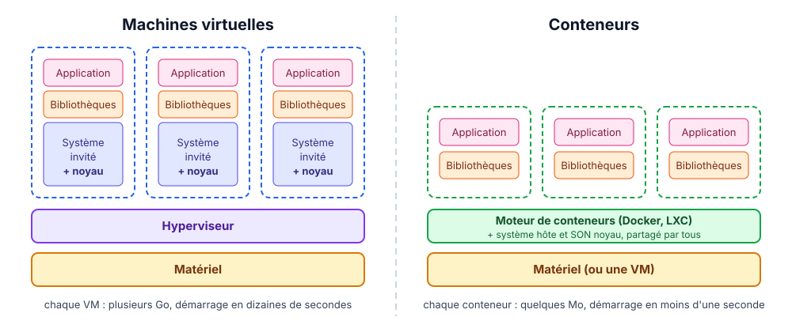
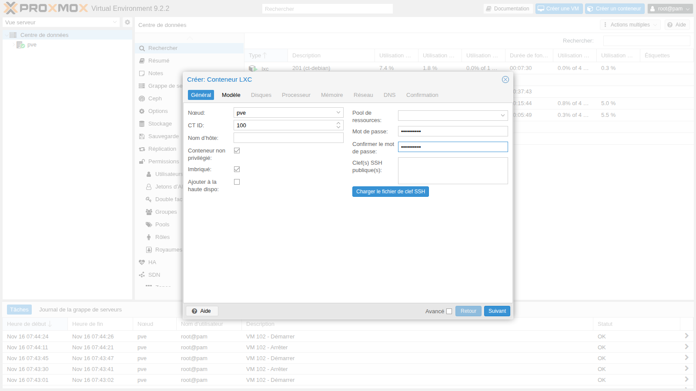
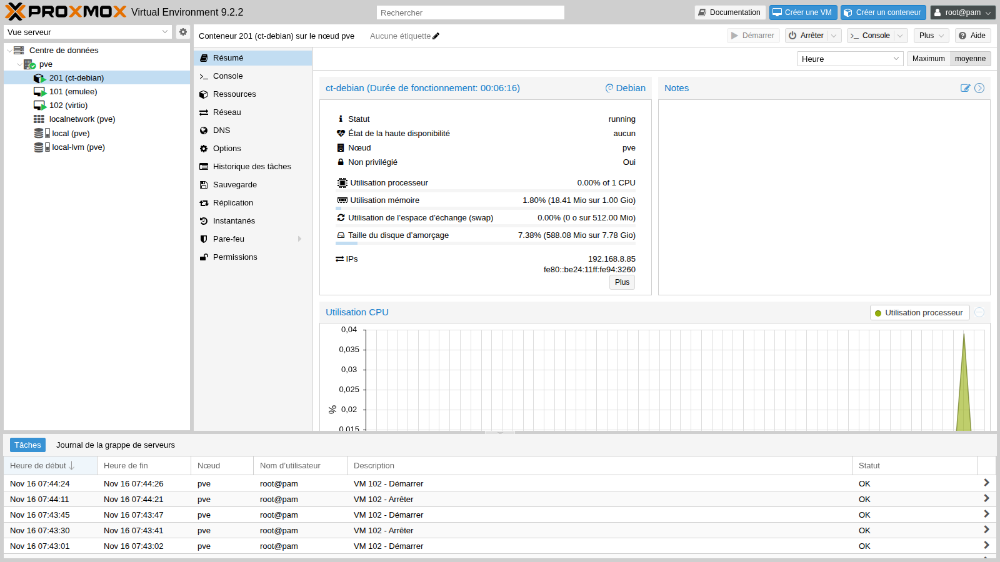

# Conteneurs : Docker et LXC

!!! abstract "Résumé"
    Un **conteneur** isole une application et tout ce dont elle a besoin, **sans** simuler une machine complète : il **partage le noyau** du système hôte. Résultat : il démarre en une fraction de seconde, pèse quelques Mo et se déploie partout de la même façon. Cette partie explique comment fonctionnent les conteneurs (espaces de noms, groupes de contrôle), présente les deux grandes familles, les conteneurs **d'application** (**Docker**) et les conteneurs **système** (**LXC**), et les compare aux VM.

    Sans entrer dans le détail de l'administration des conteneurs, la démonstration fait **toucher du doigt** les différences : un serveur web **nginx** lancé avec Docker en moins d'une seconde dans `debian-tp`, puis un conteneur **LXC** créé dans Proxmox VE et mesuré face à une VM : temps de démarrage, mémoire, noyau, processus.

| Propriété | Valeur |
|-----------|--------|
| Difficulté | Débutant |
| Durée estimée | 1 h 30 |
| Version décrite | Debian 13, Docker 26.1 (paquet `docker.io` de Debian), Proxmox VE 9.2 (LXC) |
| Place dans le parcours | Partie 11 sur 17 du parcours [Virtualisation](index.md) — jour 3 |
| Dernière mise à jour | 2026-11-16 |

---

!!! info "Convention de lecture"
    🖥️ **PC hôte** · 🐧 **VM Debian** `debian-tp` · 🌐 **interface web ou Shell de Proxmox** (`pve`) · ✍️ **exercice**.

<!-- NOTE DE RÉDACTION (non affichée) : Docker vérifié sur une Debian 13.7 KVM (1 Gio) : docker.io 26.1.5+dfsg1 installé en 32 s, hello-world, nginx:latest 163 Mo, lancement d'un conteneur déjà téléchargé 0,38 à 0,46 s, ≈ 3,3 Mio de mémoire par conteneur nginx, uname -r identique hôte/conteneur. LXC mesuré par un agent dans Proxmox VE 9.2 imbriqué : modèle debian-13-standard_13.6-1 (130 Mo, 13,3 s), création 23,9 s, avertissement « Systemd 257 detected. You may need to enable nesting. » (l'assistant web coche Imbriqué), pct exec 201 répond en 3,7 à 4,6 s contre SSH VM 102 en 26 à 29,5 s ; free -m 15 Mi contre 229 Mi ; 121 Mio côté nœud (cache compris) contre 336 Mio (RSS kvm) ; noyau 7.0.2-6-pve identique ; processus du conteneur visibles par ps du nœud avec UID 100000 (non privilégié). Syllabus : « sans rentrer dans les détails de la mise en pratique » → démonstration guidée, pas d'administration avancée. -->

## 1. Qu'est-ce qu'un conteneur ?

### 1.1 Une VM, c'est une maison ; un conteneur, c'est un appartement

Reprenons l'image de l'immeuble de la [partie 1](01-comprendre-la-virtualisation.md#22-lanalogie-de-limmeuble). Une **VM** est une **maison** construite sur le terrain : elle a ses propres fondations, sa propre chaudière, son propre compteur (son propre **noyau**, ses pilotes, son système complet). Un **conteneur** est un **appartement** : il a sa porte, ses pièces et ses meubles (ses fichiers, ses programmes, ses réglages), mais il **partage** les fondations et la chaudière de l'immeuble (le **noyau** de l'hôte).

{ loading=lazy }
/// caption
Chaque VM embarque un système complet ; les conteneurs partagent le noyau de l'hôte
///

### 1.2 Comment le noyau Linux isole un conteneur

Un conteneur est un **groupe de processus ordinaires** de l'hôte, que le noyau Linux **isole** grâce à deux mécanismes :

| Mécanisme | Rôle | Exemple |
|---|---|---|
| **Espaces de noms** (*namespaces*) | Donner au conteneur sa **propre vue** du système : ses processus, son réseau, ses points de montage, son nom de machine, ses utilisateurs | Dans le conteneur, le premier processus a le numéro 1 et l'utilisateur est `root` ; sur l'hôte, c'est un processus parmi d'autres, avec un autre numéro |
| **Groupes de contrôle** (*cgroups*) | **Limiter** les ressources du conteneur : processeur, mémoire, entrées-sorties | Un conteneur limité à 512 Mo ne peut pas consommer plus |

Il n'y a **pas** d'hyperviseur ni de matériel virtuel : c'est pourquoi un conteneur démarre aussi vite qu'un programme. C'est aussi sa limite : il ne peut faire tourner que des programmes faits pour le **même noyau** que l'hôte (un conteneur Linux sur un hôte Linux), et une faille du noyau partagé touche **tous** les conteneurs.

### 1.3 Deux familles de conteneurs

| | Conteneur **d'application** | Conteneur **système** |
|---|---|---|
| Ce qu'il contient | **Une** application et ses bibliothèques | Un système Linux presque complet (systemd, SSH, cron…) |
| Usage | Livrer et déployer une application, souvent en microservices | Remplacer une petite VM Linux, plus légère |
| Durée de vie | Jetable : on le détruit et on le recrée à chaque mise à jour | Durable : on le met à jour comme un serveur |
| Outils | **Docker**, **Podman**, orchestrés par **Kubernetes** | **LXC**, **Incus**, conteneurs de **Proxmox VE** |

Le format des images de conteneurs d'application est normalisé par l'**OCI** (*Open Container Initiative*, fondée en 2015) : une image construite avec Docker fonctionne avec Podman ou Kubernetes. Les images publiques se téléchargent depuis des **registres**, comme **Docker Hub**.

### 1.4 Conteneur ou VM ?

| Critère | VM | Conteneur |
|---|---|---|
| Isolation | **Forte** (hyperviseur et processeur) | Plus faible (noyau partagé) |
| Systèmes possibles | Tous (Windows sur un hôte Linux…) | Le même noyau que l'hôte |
| Démarrage | Dizaines de secondes | Moins d'une seconde à quelques secondes |
| Taille | Plusieurs Go | Quelques Mo à quelques centaines de Mo |
| Densité | Dizaines de VM par hôte | Centaines de conteneurs par hôte |
| Cas typiques | Serveurs complets, Windows, isolation forte, systèmes anciens | Applications web, microservices, environnements de développement |

En pratique, les deux **coexistent** : les conteneurs tournent très souvent **dans des VM**, ce qui combine l'isolation de la VM et la légèreté des conteneurs.

## 2. Démonstration 1 : un conteneur Docker dans `debian-tp`

1. 🖥️ Démarrer `debian-tp` et se connecter en `tssr`.
2. 🐧 Installer Docker depuis les dépôts de Debian (environ 30 secondes) :

    ```bash
    sudo apt update
    sudo apt install -y docker.io
    sudo docker --version
    ```

3. 🐧 Lancer le conteneur de test officiel, qui affiche un message puis s'arrête :

    ```bash
    sudo docker run --rm hello-world
    ```

    Docker télécharge l'image `hello-world` depuis Docker Hub, crée un conteneur, l'exécute et le supprime (`--rm`). Le message commence par `Hello from Docker!`.

4. 🐧 Lancer un **serveur web nginx** en arrière-plan (`-d`), en reliant le port 8080 de `debian-tp` au port 80 du conteneur (`-p 8080:80`) :

    ```bash
    sudo docker run -d --name web -p 8080:80 nginx
    sudo docker ps
    wget -qO- http://localhost:8080 | grep title
    ```

5. 🌐 Dans le navigateur du PC, ouvrir `http://<adresse de debian-tp>:8080` : la page « Welcome to nginx! » s'affiche.
6. 🐧 Comparer le noyau de `debian-tp` et celui du conteneur, puis la mémoire utilisée par le conteneur :

    ```bash
    uname -r
    sudo docker exec web uname -r
    sudo docker stats --no-stream
    ```

7. 🐧 Supprimer le conteneur : `sudo docker rm -f web`.

!!! success "Vérifier son lab"
    - `docker ps` affiche le conteneur `web`, image `nginx`, état `Up`, et `0.0.0.0:8080->80/tcp`.
    - `wget` affiche `<title>Welcome to nginx!</title>`.
    - Les deux `uname -r` affichent **exactement le même noyau** : le conteneur n'a pas de noyau à lui.
    - `docker stats` montre un conteneur nginx qui n'utilise que **quelques Mo** de mémoire (environ 3,4 Mio mesurés), contre plus de 200 Mo pour une VM Debian au repos.
    - Une fois l'image téléchargée, lancer un nouveau conteneur nginx prend **moins d'une demi-seconde**.

!!! info "Pour aller plus loin, plus tard"
    Écrire ses propres images (`Dockerfile`), décrire plusieurs conteneurs ensemble (Docker Compose) et les orchestrer (Kubernetes) font l'objet de formations à part. Retenir ici le principe : une **image** est un modèle en lecture seule ; un **conteneur** est une instance de cette image qui s'exécute.

## 3. Démonstration 2 : un conteneur LXC dans Proxmox VE

### 3.1 Télécharger un modèle et créer le conteneur

1. 🖥️ Démarrer `pve`. 🌐 Dans **pve > Shell**, mettre à jour la liste des modèles de conteneurs et télécharger celui de Debian 13 (environ 130 Mo) :

    ```bash
    pveam update
    pveam available --section system | grep debian-13
    pveam download local debian-13-standard_13.6-1_amd64.tar.zst
    ```

    Adapter le nom du fichier à celui affiché par la deuxième commande (le numéro de version peut avoir changé).

2. 🌐 Cliquer sur **Créer un conteneur** (en haut à droite) et remplir l'assistant :

    | Onglet | Champ | Valeur |
    |---|---|---|
    | **Général** | **CT ID** | `201` |
    | | **Nom d'hôte** | `ct-debian` |
    | | **Conteneur non privilégié** et **Imbriqué** | cochés (par défaut) |
    | | **Mot de passe** | `Virtu2026!` (deux fois) |
    | **Modèle** | **Stockage** / **Modèle** | `local` / le modèle Debian 13 téléchargé |
    | **Disques** | **Taille du disque (Gio)** | `8` |
    | **Processeur** | **Cœurs** | `1` |
    | **Mémoire** | **Mémoire (MiB)** | `1024` |
    | **Réseau** | **IPv4** | **Statique**, **IPv4/CIDR** `192.168.x.85/24`, **Passerelle (IPv4)** `192.168.x.2` |
    | **DNS** | **Serveurs DNS** | `192.168.x.2` |
    | **Confirmation** | — | cocher **Démarrer après création**, puis **Terminer** |

    { loading=lazy }
    /// caption
    L'onglet **Général** de l'assistant de création de conteneur
    ///

!!! question "Pourquoi « non privilégié » et « imbriqué » ?"
    - **Non privilégié** : l'utilisateur `root` **du conteneur** correspond, sur le nœud, à un utilisateur **sans droits** (numéro 100000). Si un attaquant sort du conteneur, il n'est pas `root` sur l'hôte. C'est le réglage recommandé.
    - **Imbriqué** (*nesting*) : nécessaire aux versions récentes de systemd à l'intérieur du conteneur. Sans lui, Proxmox affiche l'avertissement « Systemd 257 detected. You may need to enable nesting. ».

### 3.2 Comparer le conteneur 201 et la VM 102

1. 🌐 **pve > Shell** : mesurer le temps de démarrage du conteneur (arrêté au préalable) jusqu'à ce qu'il réponde, puis celui de la VM 102 de la [partie 10](10-types-hyperviseurs-paravirtualisation.md) jusqu'à ce que son serveur SSH réponde :

    ```bash
    pct shutdown 201
    time ( pct start 201 && until pct exec 201 -- true 2>/dev/null; do sleep 0.2; done )
    time ( qm start 102 && until timeout 1 bash -c '</dev/tcp/192.168.x.82/22' 2>/dev/null; do sleep 0.5; done )
    ```

2. 🌐 Comparer le noyau du nœud et celui du conteneur, et la mémoire utilisée dans le conteneur :

    ```bash
    uname -r
    pct exec 201 -- uname -r
    pct exec 201 -- free -m
    ```

3. 🌐 Chercher, **depuis le nœud**, les processus du conteneur, puis ceux de la VM :

    ```bash
    ps -eo pid,user,comm | grep -E '^ *[0-9]+ 100000'
    ps -eo pid,comm | grep kvm
    ```

!!! success "Vérifier son lab"
    | Mesure | Conteneur 201 | VM 102 |
    |---|---|---|
    | Temps avant de répondre | **3,7 à 4,6 s** | **26 à 29,5 s** (jusqu'à SSH) |
    | Mémoire utilisée vue de l'intérieur (`free -m`) | **15 Mi** | **229 Mi** |
    | Noyau | celui du **nœud** (`7.0.2-6-pve`) | **son propre** noyau Debian |
    | Processus vus depuis le nœud | **tous** (systemd, sshd…), avec l'utilisateur `100000` | **un seul** processus `kvm` |

    Exemple de mesures sur un Proxmox VE lui-même virtualisé ; les valeurs exactes varient, mais l'écart reste du même ordre.

{ loading=lazy }
/// caption
Le conteneur LXC 201 dans l'interface de Proxmox VE
///

??? question "✍️ Qu'en conclure ?"
    Le conteneur démarre **six à sept fois plus vite** et consomme **quinze fois moins** de mémoire, parce qu'il ne démarre ni BIOS, ni noyau, ni matériel virtuel : seulement des processus. Mais le nœud **voit et contrôle** tous ses processus, et le conteneur dépend du noyau du nœud : un Windows ou un autre noyau Linux y est impossible. Pour un petit service Linux (DNS, serveur web, supervision), un conteneur LXC suffit souvent ; pour un système complet, isolé ou non Linux, on garde une VM.

🌐 Arrêter le conteneur et la VM : `pct shutdown 201` et `qm shutdown 102`.

## 4. Questions de révision

1. Qu'est-ce qui distingue un conteneur d'une VM ?
2. À quoi servent les espaces de noms (*namespaces*) et les groupes de contrôle (*cgroups*) ?
3. Quelle est la différence entre un conteneur d'application (Docker) et un conteneur système (LXC) ?
4. Pourquoi ne peut-on pas faire tourner un conteneur Windows sur un hôte Linux ?
5. Qu'est-ce qu'une image Docker ? Un registre ?
6. Pourquoi les conteneurs LXC de Proxmox sont-ils « non privilégiés » par défaut ?

??? success "Corrigé"
    1. Le conteneur **partage le noyau** de l'hôte et n'isole que des processus ; la VM a son **propre noyau** et un matériel virtuel complet. Conséquences : le conteneur est plus léger et plus rapide, la VM plus isolée et capable de faire tourner n'importe quel système.
    2. Les **espaces de noms** donnent au conteneur sa propre vue des processus, du réseau, des fichiers, du nom de machine et des utilisateurs ; les **groupes de contrôle** limitent ses ressources (processeur, mémoire, entrées-sorties).
    3. Un conteneur **d'application** contient une seule application et ses bibliothèques ; il est jetable et recréé à chaque mise à jour. Un conteneur **système** contient un Linux presque complet (systemd, SSH…) et s'administre comme un petit serveur.
    4. Parce qu'un conteneur n'a **pas de noyau** : il utilise celui de l'hôte. Un programme Windows a besoin d'un noyau Windows. Il faudrait une VM Windows.
    5. Une **image** est un modèle en lecture seule qui contient une application et tout ce dont elle a besoin ; un conteneur en est une instance qui s'exécute. Un **registre** stocke et distribue des images (Docker Hub, par exemple).
    6. Pour la **sécurité** : le `root` du conteneur n'est, sur le nœud, qu'un utilisateur sans droits (100000). Un attaquant qui s'échapperait du conteneur n'aurait pas les droits de `root` sur l'hôte.

---

## Ressources

- [Docker — Présentation de Docker](https://docs.docker.com/get-started/docker-overview/) — images, conteneurs, registres (en anglais).
- [Proxmox VE — Conteneurs Linux](https://pve.proxmox.com/wiki/Linux_Container) — les conteneurs LXC dans Proxmox VE (en anglais).
- [Red Hat — Conteneurs et machines virtuelles](https://www.redhat.com/fr/topics/containers/containers-vs-vms) — la comparaison, en français.
- [Page de manuel `namespaces(7)`](https://man7.org/linux/man-pages/man7/namespaces.7.html) — les espaces de noms du noyau Linux (en anglais).
- Partie précédente : [Types d'hyperviseurs et paravirtualisation](10-types-hyperviseurs-paravirtualisation.md) · Partie suivante : [Stockage défini par logiciel et hyperconvergence](12-stockage-sds-hyperconvergence.md).

*[VM]: Virtual Machine — machine virtuelle
*[LXC]: Linux Containers — conteneurs Linux
*[OCI]: Open Container Initiative — normes des conteneurs
*[cgroups]: control groups — groupes de contrôle du noyau Linux
*[CT]: conteneur (dans Proxmox VE)
*[SSH]: Secure Shell — protocole d'administration à distance chiffré
*[DNS]: Domain Name System — résolution des noms
