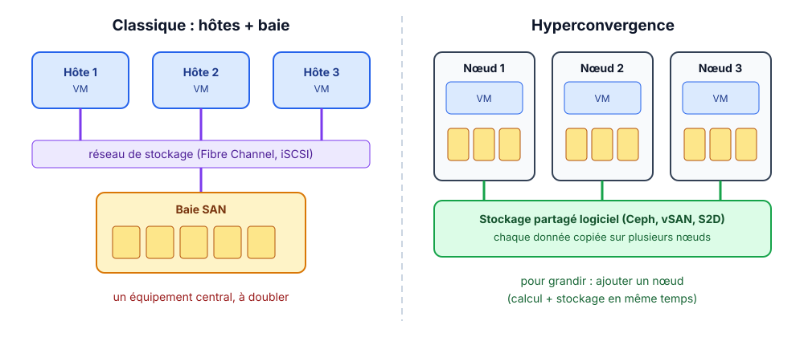
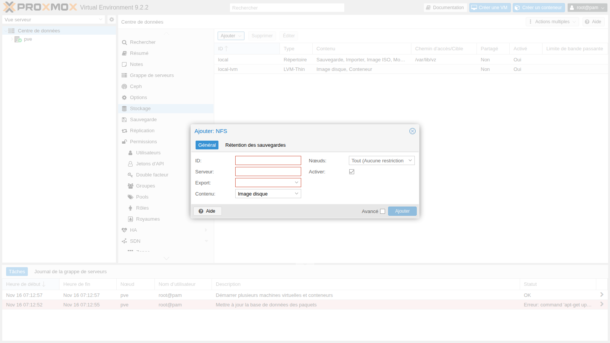

# Stockage défini par logiciel et hyperconvergence

!!! abstract "Résumé"
    Au jour 2, une VM Debian a joué le rôle de **baie de stockage** (NFS et iSCSI). Cette partie présente ce qui remplace de plus en plus les baies classiques : le **stockage défini par logiciel** (SDS), qui fabrique un stockage partagé et redondant à partir des disques de serveurs ordinaires, et l'**hyperconvergence**, où chaque serveur est à la fois hôte de VM et nœud de stockage (vSAN, Ceph, Storage Spaces Direct, Nutanix).

    Le TP relie Proxmox VE au serveur `stockage` du jour 2 : on ajoute un **stockage NFS partagé** au nœud, puis on **déplace le disque d'une VM allumée** vers ce stockage, sans l'arrêter et sans perdre un seul ping. C'est l'équivalent de la migration de stockage à chaud (Storage vMotion) vue en [partie 5](05-virtualiser-des-serveurs.md#12-les-fonctions-dune-plateforme-de-virtualisation-de-serveurs).

| Propriété | Valeur |
|-----------|--------|
| Difficulté | Intermédiaire |
| Durée estimée | 2 h |
| Version décrite | Proxmox VE 9.2, Debian 13 (serveur NFS du jour 2) |
| Place dans le parcours | Partie 12 sur 17 du parcours [Virtualisation](index.md) — jour 4 |
| Dernière mise à jour | 2026-11-16 |

---

!!! info "Convention de lecture"
    🖥️ **PC hôte** (Windows et Workstation) · 🌐 **interface web ou Shell de Proxmox** (`pve`) · 🐧 **VM Debian** (le nom est précisé) · ✍️ **exercice** · 🛟 **instantané**.

<!-- NOTE DE RÉDACTION (non affichée) : TP vérifié sur KVM : nœud Proxmox VE 9.2 avec une 2e carte sur le réseau isolé (enp7s0, 10.10.10.30/24 posée par l'API pvesh, ifupdown2), stockage NFS 10.10.10.20:/srv/partage ajouté (pvesm add nfs, actif en 0,9 s ; fenêtre « Ajouter: NFS » capturée), qm disk move 102 scsi0 nfs-stockage --format qcow2 --delete 1 VM allumée : 39,7 s, 209 pings sur 209 (toutes les 0,2 s) ; fichiers créés en nobody:nogroup (root_squash) dans /srv/partage (chmod 777 du jour 2). Faits : S2D de 2 à 16 serveurs ; Ceph 3 nœuds minimum ; vSAN 3 hôtes ou 2 + témoin. Le libellé du menu d'actions de disque de l'interface n'a pas été relevé : le TP utilise la commande qm disk move. -->

## 1. Du SAN au stockage défini par logiciel

### 1.1 Les limites de la baie de stockage classique

Au jour 2, la VM `stockage` a joué le rôle d'une **baie** : un équipement central qui partage ses disques (NFS, iSCSI). En entreprise, une vraie baie SAN est un appareil dédié, avec ses contrôleurs, ses disques et son logiciel propriétaire. Elle fonctionne très bien, mais :

- elle **coûte cher** et vient d'un seul constructeur ;
- elle devient un **point central** : il faut la doubler pour ne pas tout perdre en cas de panne ;
- pour grandir, il faut acheter des tiroirs de disques ou une nouvelle baie ;
- elle demande des compétences propres (réseau Fibre Channel, zonage, LUN).

### 1.2 Le stockage défini par logiciel (SDS)

Le **SDS** (*Software-Defined Storage*) sépare le **logiciel** qui gère le stockage (répartition des données, copies, instantanés, provisionnement fin) du **matériel** qui le porte : des serveurs standards, avec leurs disques internes. Le logiciel regroupe les disques de **plusieurs serveurs** en un seul espace de stockage, et répartit les données de façon à survivre à la panne d'un disque, voire d'un serveur entier.

| Solution SDS | Éditeur | À savoir |
|---|---|---|
| **vSAN** | VMware (Broadcom) | Intégré à ESXi ; au moins 3 hôtes (ou 2 hôtes plus un « témoin ») |
| **Ceph** | Projet libre (Linux Foundation) | Stockage en blocs (RBD), en fichiers (CephFS) et en objets ; intégré à Proxmox VE ; au moins **3 nœuds** |
| **Storage Spaces Direct** (S2D) | Microsoft | Intégré à Windows Server Datacenter ; de 2 à 16 serveurs |
| **Nutanix** | Nutanix | Plateforme hyperconvergée complète, avec son hyperviseur AHV |
| **TrueNAS** | iXsystems | Logiciel libre de NAS (ex-FreeNAS) qui transforme un serveur en baie NFS, SMB et iSCSI |

### 1.3 L'hyperconvergence

L'**infrastructure hyperconvergée** (HCI) va jusqu'au bout de l'idée : chaque serveur est **à la fois** hôte de VM **et** nœud de stockage. Le SDS regroupe les disques de tous les hôtes en un stockage partagé, sur lequel tournent les VM du cluster. Il n'y a plus de baie séparée.

{ loading=lazy }
/// caption
Hyperconvergence : le stockage partagé est fabriqué avec les disques des hôtes eux-mêmes
///

| | Architecture classique (hôtes + baie SAN) | Hyperconvergence |
|---|---|---|
| Matériel | Serveurs + baie + réseau de stockage | Des serveurs identiques, avec disques |
| Grandir | Ajouter des disques à la baie, ou une baie | **Ajouter un nœud** : on gagne à la fois calcul et stockage |
| Point de défaillance | La baie (à doubler) | Aucun point unique : les données sont copiées sur plusieurs nœuds |
| Administration | Deux métiers (serveurs, stockage) | Une seule interface |
| Limite | Coût et complexité de la baie | Calcul et stockage grandissent ensemble, même quand on n'a besoin que de l'un des deux ; au moins 3 nœuds en général ; réseau rapide indispensable |

!!! info "Ceph en une phrase"
    Ceph découpe chaque disque de VM en petits morceaux (des **objets**) et range **plusieurs copies** de chaque morceau (3 par défaut) sur des **nœuds différents** : si un nœud tombe, les copies des autres prennent le relais, et Ceph refabrique automatiquement les copies manquantes. C'est pourquoi il faut au moins trois nœuds.

### 1.4 ✍️ Exercice : baie ou hyperconvergence ?

Pour chaque entreprise, conseiller une **baie** (SAN ou NAS) ou une **infrastructure hyperconvergée**, en deux arguments.

1. Une PME de 40 salariés, 3 serveurs de virtualisation à renouveler, pas de spécialiste du stockage.
2. Un hôpital qui a déjà une baie SAN récente, sous contrat, et doit ajouter deux hôtes de calcul.
3. Une entreprise dont le volume de données double chaque année, alors que ses besoins en calcul sont stables.

??? success "Corrigé"
    1. **Hyperconvergence** (par exemple Proxmox VE et Ceph sur 3 nœuds) : pas de baie à acheter ni à administrer, une seule interface, tolérance à la panne d'un nœud.
    2. **Garder la baie** : elle est récente et sous contrat ; on ajoute simplement deux hôtes qui s'y connectent.
    3. Plutôt une **baie** (ou un stockage séparé extensible) : en hyperconvergence, chaque nœud ajouté apporte calcul **et** stockage, on paierait du processeur et de la mémoire inutiles pour gagner de la place.

## 2. TP : un stockage partagé pour Proxmox VE

On relie le nœud `pve` au réseau isolé VMnet2 du jour 2, où le serveur `stockage` partage `/srv/partage` en NFS ([partie 7](07-virtualiser-le-stockage.md#3-tp-partager-un-dossier-en-nfs)). Puis on y range le disque d'une VM.

**Prérequis** : les parties 7 et 10 sont terminées. 🖥️ Démarrer `stockage` (le routeur n'est pas nécessaire : `pve` et `stockage` seront sur le même réseau).

### 2.1 Brancher le nœud sur VMnet2

1. 🌐 Éteindre `pve` s'il est allumé (bouton **Arrêter** du nœud).
2. 🖥️ Dans **VM > Settings** de `pve`, **Add…** > **Network Adapter** > **Finish**, puis régler ce **Network Adapter 2** sur **Custom: Specific virtual network** > **VMnet2**. **OK**, puis démarrer `pve`.
3. 🌐 Ouvrir **pve > Système > Réseau** : une nouvelle ligne de type **Carte réseau**, sans adresse, est apparue (par exemple `ens36` ; sous KVM, `enp7s0`). La sélectionner, cliquer sur **Éditer**, saisir **IPv4/CIDR** `10.10.10.30/24`, cocher **Démarrage automatique**, puis **OK**.
4. 🌐 Cliquer sur **Appliquer la configuration** (en haut de la liste) : Proxmox VE applique les changements réseau sans redémarrer.
5. 🌐 Dans **pve > Shell**, vérifier : `ping -c 3 10.10.10.20` répond, et `showmount -e 10.10.10.20` liste le partage `/srv/partage` (et `/srv/site` si le défi du jour 2 a été fait).

!!! warning "Pas de passerelle sur cette carte"
    Ne pas remplir **Passerelle** : le nœud garde sa passerelle unique sur `vmbr0` (VMnet8). Une seconde passerelle par défaut perturberait tout son réseau.

### 2.2 Ajouter le stockage NFS

1. 🌐 Ouvrir **Centre de données > Stockage**, cliquer sur **Ajouter**, puis **NFS**.
2. Remplir l'onglet **Général** :

    | Champ | Valeur |
    |---|---|
    | **ID** | `nfs-stockage` (le nom du stockage dans Proxmox) |
    | **Serveur** | `10.10.10.20` |
    | **Export** | `/srv/partage` (choisir dans la liste, que Proxmox remplit en interrogeant le serveur ; si elle reste vide, taper le chemin à la main) |
    | **Contenu** | **Image disque** |
    | **Nœuds** | **Tout (Aucune restriction)** |
    | **Activer** | coché |

    { loading=lazy }
    /// caption
    La fenêtre **Ajouter: NFS** du centre de données
    ///

3. Cliquer sur **Ajouter**. Le stockage `nfs-stockage` apparaît sous le nœud, avec la taille du disque de `stockage`.

!!! question "Pourquoi « Centre de données » et pas « pve » ?"
    Les stockages se déclarent au niveau du **centre de données** : dans un cluster, ils sont alors visibles par **tous** les nœuds. C'est ce qui permet la migration à chaud et la haute disponibilité : n'importe quel nœud peut lire les disques des VM rangés sur le stockage partagé.

### 2.3 Déplacer le disque d'une VM allumée

1. 🌐 Démarrer la VM 102 (`qm start 102`) et attendre qu'elle réponde.
2. 🖥️ Dans PowerShell, lancer un ping continu vers la VM, qui servira à vérifier qu'elle n'est jamais coupée :

    ```powershell
    ping -t 192.168.x.82
    ```

3. 🌐 Dans **pve > Shell**, déplacer le disque `scsi0` de la VM 102 du stockage local vers le stockage NFS, **pendant qu'elle tourne**, au format qcow2, et supprimer l'ancien disque une fois la copie terminée :

    ```bash
    qm disk move 102 scsi0 nfs-stockage --format qcow2 --delete 1
    ```

4. 🖥️ Une fois la commande terminée, arrêter le ping (++ctrl+c++) et lire le résumé : **0 % de perte**.
5. 🌐 Vérifier où se trouve maintenant le disque :

    ```bash
    qm config 102 | grep scsi0
    ls -l /mnt/pve/nfs-stockage/images/102/
    ```

!!! success "Vérifier son lab"
    - `qm disk move` se termine par `mirror-scsi0: Completed successfully.` puis la suppression de l'ancien volume (`removing source volume 'local-lvm:vm-102-disk-0' after successful copy`). Sur un lab imbriqué, le déplacement d'un disque de 3 Go prend environ **40 secondes**.
    - Le ping n'a perdu **aucun** paquet : la VM a continué de fonctionner pendant toute la copie.
    - `qm config 102` affiche `scsi0: nfs-stockage:102/vm-102-disk-0.qcow2,…` : le disque est maintenant **sur le serveur `stockage`**.
    - 🐧 **stockage** : `ls -l /srv/partage/images/102/` montre le fichier `vm-102-disk-0.qcow2`, appartenant à `nobody` (l'option `root_squash` vue en partie 7 traite le `root` de Proxmox comme un utilisateur sans droits).

??? question "✍️ Comment la VM continue-t-elle de tourner ?"
    Proxmox demande à QEMU de **recopier** le disque en arrière-plan vers sa nouvelle destination (un **miroir**), tout en continuant à servir les lectures et les écritures de la VM. Les blocs modifiés pendant la copie sont recopiés à leur tour. Quand les deux copies sont identiques, QEMU **bascule** en une fraction de seconde sur le nouveau disque. C'est le même principe que la migration de stockage à chaud de VMware (Storage vMotion).

??? info "Et un vrai stockage distribué avec Ceph ?"
    Proxmox VE intègre **Ceph** (menu **Ceph** du nœud et du centre de données). Mais Ceph demande au moins **trois nœuds**, chacun avec un disque dédié, et un réseau rapide : soit trois VM Proxmox d'au moins 4 Go, impossible sur un PC de 16 Go. On le découvre en lisant la [documentation de Proxmox VE sur Ceph](https://pve.proxmox.com/wiki/Deploy_Hyper-Converged_Ceph_Cluster), et en le pratiquant plus tard sur un lab plus puissant.

🌐 Éteindre la VM 102 (`qm shutdown 102`). 🛟 🖥️ Éteindre `pve` et prendre l'instantané `02-pve-stockage-nfs`.

!!! warning "Le disque de la VM 102 vit désormais sur `stockage`"
    À partir de maintenant, **démarrer `stockage` avant `pve`** : sinon le stockage `nfs-stockage` est indisponible et la VM 102 ne démarre pas. Et ne pas revenir à un instantané de `pve` antérieur à cette partie sans tenir compte de ce déplacement.

## 3. Questions de révision

1. Qu'est-ce que le stockage défini par logiciel (SDS) ?
2. Quelle est la différence entre une architecture classique (hôtes et baie) et une infrastructure hyperconvergée ?
3. Pourquoi Ceph demande-t-il au moins trois nœuds ?
4. Pourquoi déclare-t-on un stockage NFS au niveau du **centre de données** dans Proxmox VE ?
5. Que s'est-il passé pour la VM 102 pendant `qm disk move` ?
6. Pourquoi le fichier du disque appartient-il à `nobody` sur le serveur `stockage` ?

??? success "Corrigé"
    1. Un stockage dont l'**intelligence** (répartition, copies, instantanés, provisionnement fin) est un **logiciel** indépendant du matériel : il fabrique un stockage partagé et redondant à partir des disques de serveurs ordinaires.
    2. En classique, les hôtes calculent et une **baie** séparée stocke, reliée par un réseau de stockage. En **hyperconvergence**, chaque serveur est à la fois hôte de VM et nœud de stockage : un logiciel (Ceph, vSAN, S2D) réunit leurs disques en un stockage partagé. On grandit en ajoutant des nœuds.
    3. Parce qu'il range **plusieurs copies** (3 par défaut) de chaque donnée sur des nœuds **différents**, et qu'il a besoin d'une **majorité** de nœuds pour décider en cas de panne : avec trois nœuds, la perte d'un seul laisse deux copies et une majorité.
    4. Pour qu'il soit visible par **tous les nœuds** du cluster : c'est la condition de la migration à chaud et de la haute disponibilité.
    5. Rien de visible : la VM a continué de tourner (aucune perte de ping). QEMU a recopié le disque en miroir vers le NFS, puis a basculé sur la copie, et Proxmox a supprimé l'ancien disque.
    6. À cause de l'option **`root_squash`** du partage NFS (par défaut) : les écritures de `root` sur le nœud Proxmox sont faites, côté serveur, sous l'identité `nobody`, sans privilèges.

---

## Ressources

- [Proxmox VE — Stockage](https://pve.proxmox.com/wiki/Storage) — tous les types de stockage de Proxmox VE, dont NFS (en anglais).
- [Proxmox VE — Cluster Ceph hyperconvergé](https://pve.proxmox.com/wiki/Deploy_Hyper-Converged_Ceph_Cluster) — l'hyperconvergence avec Ceph (en anglais).
- [Ceph — Documentation](https://docs.ceph.com/en/latest/) — l'architecture de Ceph (en anglais).
- [Microsoft — Vue d'ensemble de Storage Spaces Direct](https://learn.microsoft.com/fr-fr/windows-server/storage/storage-spaces/storage-spaces-direct-overview) — l'hyperconvergence chez Microsoft.
- Partie précédente : [Conteneurs](11-conteneurs.md) · Partie suivante : [Réseau virtuel, SDN et NFV](13-reseau-virtuel-sdn-nfv.md).

*[SDS]: Software-Defined Storage — stockage défini par logiciel
*[HCI]: Hyperconverged Infrastructure — infrastructure hyperconvergée
*[SAN]: Storage Area Network — partage de blocs
*[NAS]: Network Attached Storage — partage de fichiers
*[NFS]: Network File System — partage de fichiers Unix et Linux
*[LUN]: Logical Unit Number — disque logique présenté par une baie
*[RBD]: RADOS Block Device — disques en blocs de Ceph
*[S2D]: Storage Spaces Direct — stockage hyperconvergé de Microsoft
*[VM]: Virtual Machine — machine virtuelle
*[QEMU]: émulateur et hyperviseur utilisé par KVM
