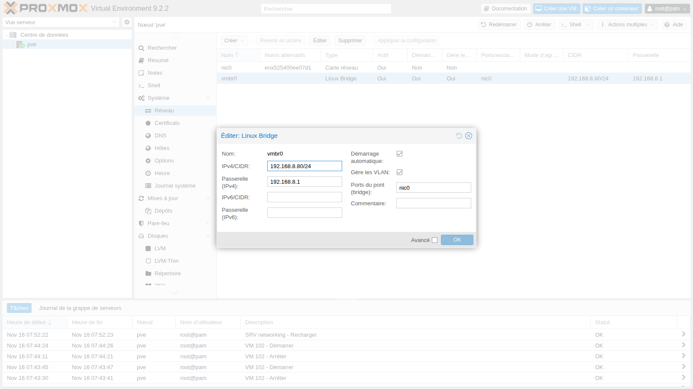

# Réseau virtuel, SDN et NFV

!!! abstract "Résumé"
    Le jour 2 a fait construire un réseau virtuel avec Workstation : commutateurs VMnet, réseau isolé, VM routeur. Cette partie présente les technologies réseau des plateformes de production : les **commutateurs virtuels** des grands hyperviseurs, les **VLAN** qui séparent plusieurs réseaux sur les mêmes câbles, **VXLAN** pour aller au-delà, le **réseau défini par logiciel** (SDN) et la **virtualisation des fonctions réseau** (NFV).

    Le TP active les **VLAN** sur le commutateur virtuel de Proxmox VE et montre, avec trois machines branchées sur le **même** pont, que seules celles du **même VLAN** peuvent se parler.

| Propriété | Valeur |
|-----------|--------|
| Difficulté | Intermédiaire |
| Durée estimée | 2 h |
| Version décrite | Proxmox VE 9.2 |
| Place dans le parcours | Partie 13 sur 17 du parcours [Virtualisation](index.md) — jour 4 |
| Dernière mise à jour | 2026-11-16 |

---

!!! info "Convention de lecture"
    🖥️ **PC hôte** · 🌐 **interface web ou Shell de Proxmox** (`pve`) · ✍️ **exercice** · 🛟 **instantané**.

<!-- NOTE DE RÉDACTION (non affichée) : TP vérifié sur Proxmox VE 9.2 imbriqué (KVM) : case « Gère les VLAN » cochée sur vmbr0 (bridge-vlan-aware yes, bridge-vids 2-4094), CT 201 et VM 102 étiquetés 10 → ping 3/3 ; VM 101 étiquetée 10 → 5/5, puis 20 → 0/5 ; CT 201 (VLAN 10) → passerelle non étiquetée 100 % de perte ; `bridge vlan show` : tapXXXi0 « 10 PVID Egress Untagged ». Faits : IEEE 802.1Q 12 bits / 4094 VLAN ; VXLAN RFC 7348, 24 bits ; Proxmox SDN installé par défaut depuis 8.1 ; NFV ETSI 2012 ; commutateur Hyper-V externe/interne/privé. -->

## 1. Les commutateurs virtuels en production

Au jour 2, les réseaux **VMnet** de Workstation ont fait découvrir le **commutateur virtuel**. Sur les hyperviseurs de production, on retrouve le même principe, avec plus de fonctions :

| Hyperviseur | Commutateur virtuel | Particularité |
|---|---|---|
| VMware ESXi | **vSwitch standard** | Configuré **hôte par hôte** |
| VMware vSphere | **vSphere Distributed Switch** (vDS) | Configuré **une fois** dans vCenter, identique sur tous les hôtes du cluster : indispensable pour qu'une VM garde son réseau en migration à chaud |
| Microsoft Hyper-V | **Commutateur virtuel Hyper-V** | Trois types : **externe** (relié à une carte physique), **interne** (VM et hôte), **privé** (VM seulement) — l'équivalent du pont, du réseau privé hôte et d'un VMnet isolé |
| Proxmox VE, KVM | **Pont Linux** (*Linux bridge*, `vmbr0`…) ou **Open vSwitch** | Le pont `vmbr0` est créé à l'installation, relié à la carte physique |

**Open vSwitch** est un commutateur virtuel libre, hébergé par la Linux Foundation, utilisé par de nombreuses plateformes (Proxmox VE en option, OpenStack) pour les fonctions avancées.

## 2. Les VLAN : plusieurs réseaux sur les mêmes câbles

Un **VLAN** (*Virtual LAN*, réseau local virtuel) découpe **un** réseau physique en **plusieurs** réseaux logiques, isolés les uns des autres, sans câbles supplémentaires. La norme **IEEE 802.1Q** ajoute à chaque trame Ethernet une **étiquette** (*tag*) qui contient le numéro du VLAN, codé sur **12 bits** : **4 094** VLAN utilisables (les valeurs 0 et 4 095 sont réservées).

| Terme | Signification |
|---|---|
| **Port d'accès** (*access*) | Port qui appartient à **un seul** VLAN ; l'appareil branché ne voit pas d'étiquette (un PC, une imprimante) |
| **Port d'agrégation** (*trunk*) | Port qui transporte **plusieurs** VLAN, chaque trame portant son étiquette (lien entre commutateurs, ou vers un hyperviseur) |
| **Étiquette** (*tag*) | Le numéro de VLAN ajouté à la trame |

Dans un hyperviseur, la carte physique de l'hôte est branchée sur un port **trunk** du commutateur de la salle. Le commutateur virtuel **lit** les étiquettes et distribue chaque trame à la bonne VM : on donne simplement à chaque carte virtuelle un **numéro de VLAN**. C'est ainsi qu'on sépare, sur les mêmes hôtes, les VM des serveurs, de la DMZ, de l'administration et du stockage.

!!! info "Et pour aller au-delà de 4 094 réseaux ?"
    Un fournisseur de cloud qui héberge des milliers de clients manque vite de VLAN. **VXLAN** (*Virtual eXtensible LAN*, RFC 7348) transporte les trames Ethernet **à l'intérieur de paquets UDP/IP** : les réseaux virtuels traversent n'importe quel réseau IP, même entre plusieurs salles. L'identifiant de réseau est codé sur **24 bits**, soit environ **16 millions** de réseaux possibles.

## 3. Le réseau défini par logiciel (SDN)

Un équipement réseau classique fait deux métiers : il **décide** où envoyer les paquets (le **plan de contrôle** : tables de routage, protocoles) et il les **envoie** (le **plan de données**). Le **SDN** (*Software-Defined Networking*) **sépare** ces deux plans : un **contrôleur** central, logiciel, décide pour tout le réseau, et programme les commutateurs (physiques ou virtuels) qui se contentent d'exécuter.

| Avantage | Exemple |
|---|---|
| Créer un réseau en quelques secondes, par logiciel ou par script | Un nouveau client d'un cloud reçoit ses réseaux isolés automatiquement |
| Une configuration **centrale** et cohérente | Un même réseau virtuel sur tous les hôtes, sans configurer chaque commutateur |
| Une sécurité fine | **Micro-segmentation** : des règles de pare-feu au niveau de chaque VM |

Produits : **VMware NSX**, **Cisco ACI**, les réseaux virtuels des clouds publics (VPC chez AWS, VNet chez Azure), et, dans Proxmox VE, le module **SDN** (installé par défaut depuis la version 8.1), qui crée des **zones** (*Simple*, *VLAN*, *QinQ*, *VXLAN*, *EVPN*) et des réseaux virtuels (**VNet**) pour tout un cluster.

## 4. La virtualisation des fonctions réseau (NFV)

La **NFV** (*Network Functions Virtualization*) remplace les **boîtiers** réseau spécialisés (routeur, pare-feu, répartiteur de charge, cœur de réseau mobile) par des **logiciels** qui tournent sur des serveurs standards : dans des VM (**VNF**, *Virtual Network Function*) ou des conteneurs (**CNF**). L'idée a été lancée en **2012** par un groupe de grands opérateurs de télécommunications, dans le cadre de l'organisme de normalisation européen **ETSI**.

Exemples à portée de main :

- le **routeur Debian** de la [partie 6](06-virtualiser-le-reseau.md) : une fonction de routage et de NAT dans une VM ;
- un pare-feu **pfSense** ou **OPNsense** en VM, comme dans le [parcours pfSense](../pfsense-ha/index.md) ;
- des routeurs virtuels (VyOS, routeurs virtuels des grands constructeurs), des répartiteurs de charge logiciels ;
- le cœur des réseaux **5G**, entièrement logiciel.

Avantages : déploiement en minutes au lieu de semaines, matériel standard moins cher, haute disponibilité et sauvegarde des fonctions réseau comme n'importe quelle VM. Limites : performances à surveiller (un pare-feu logiciel doit traiter des millions de paquets), et dépendance à la plateforme de virtualisation.

### 4.1 ✍️ Exercice : quelle technologie ?

1. Une entreprise veut séparer, sur ses trois hôtes Proxmox VE, les VM des serveurs, de la DMZ et de l'administration, sans acheter de nouveaux commutateurs.
2. Un hébergeur doit offrir à 20 000 clients chacun plusieurs réseaux privés isolés.
3. Un opérateur veut déployer un pare-feu pour un nouveau client en dix minutes, sans livrer de boîtier.
4. Sur VMware vSphere, une VM doit garder exactement la même configuration réseau après une migration à chaud vers un autre hôte.

??? success "Corrigé"
    1. Des **VLAN** : le port du commutateur physique vers chaque hôte passe en **trunk**, le pont des hôtes devient « VLAN aware », et chaque carte virtuelle reçoit son numéro de VLAN.
    2. **VXLAN** (ou un SDN qui l'utilise) : 4 094 VLAN ne suffisent pas, VXLAN offre environ 16 millions de réseaux.
    3. La **NFV** : un pare-feu virtuel (VNF) déployé dans une VM ou un conteneur, à partir d'un modèle.
    4. Un **commutateur distribué** (vSphere Distributed Switch) : configuré une seule fois dans vCenter, identique sur tous les hôtes.

## 5. TP : des VLAN dans Proxmox VE

On utilise les trois machines créées aux parties 10 et 11, toutes branchées sur le **même** pont `vmbr0`. 🖥️ Démarrer d'abord `stockage` : depuis la [partie 12](12-stockage-sds-hyperconvergence.md), le disque de la VM 102 y est rangé.

| Machine | Adresse | VLAN à lui donner |
|---|---|---|
| Conteneur **201** `ct-debian` | `192.168.x.85` | **10** |
| VM **102** `virtio` | `192.168.x.82` | **10** |
| VM **101** `emulee` | `192.168.x.81` | **20** |

### 5.1 Rendre le pont « VLAN aware »

1. 🖥️ Démarrer `pve`. 🌐 Ouvrir **pve > Système > Réseau**, sélectionner **vmbr0**, puis **Éditer**.
2. Cocher **Gère les VLAN** (*VLAN aware*), puis **OK**.

    { loading=lazy }
    /// caption
    La case **Gère les VLAN** transforme le pont en commutateur qui comprend les étiquettes 802.1Q
    ///

3. Cliquer sur **Appliquer la configuration**. L'accès à l'interface web n'est pas coupé : `vmbr0` lui-même reste dans le réseau non étiqueté.

### 5.2 Étiqueter les cartes réseau

1. 🌐 Démarrer le conteneur 201 et les VM 101 et 102.
2. 🌐 Pour la **VM 102** : **Matériel**, sélectionner **Carte réseau (net0)**, **Éditer**, saisir **Étiquette de VLAN** `10`, puis **OK**. Faire de même pour la **VM 101** avec l'étiquette `20`.
3. 🌐 Pour le **conteneur 201** : **Réseau**, sélectionner **eth0**, **Éditer**, **Étiquette de VLAN** `10`, puis **OK**.
4. 🌐 **Attendre une dizaine de secondes** après les changements d'étiquette : le temps que les machines et le pont réapprennent qui est où. Puis, dans **pve > Shell**, vérifier l'étiquette posée sur chaque port du pont :

    ```bash
    bridge vlan show | grep -E 'tap10[12]i0|veth201i0' -A1
    ```

### 5.3 Tester

🌐 Dans **pve > Shell**, faire pinguer chaque machine depuis le conteneur 201 (VLAN 10) :

```bash
pct exec 201 -- ping -c 3 192.168.x.82    # VM 102, VLAN 10
pct exec 201 -- ping -c 3 192.168.x.81    # VM 101, VLAN 20
pct exec 201 -- ping -c 3 192.168.x.2     # passerelle de VMnet8, sans VLAN
```

!!! success "Vérifier son lab"
    - `bridge vlan show` affiche `10 PVID Egress Untagged` pour `tap102i0` et `veth201i0`, et `20 PVID Egress Untagged` pour `tap101i0` : chaque port du pont appartient à son VLAN, comme un **port d'accès** d'un commutateur physique.
    - Le ping vers la **VM 102** (même VLAN) répond : **0 % de perte**. S'il échoue juste après le changement d'étiquette, attendre quelques secondes et le relancer.
    - Le ping vers la **VM 101** (VLAN 20) échoue : **100 % de perte**, alors que les deux machines sont sur le **même** pont, dans le **même** sous-réseau IP.
    - Le ping vers la **passerelle** échoue aussi : la passerelle de VMnet8 n'est dans **aucun** VLAN. Pour sortir, un VLAN a besoin de **son** routeur (ou d'un pare-feu avec une interface dans ce VLAN).

??? question "✍️ Que se passe-t-il si l'on met la VM 101 dans le VLAN 10 ?"
    Elle peut de nouveau communiquer avec le conteneur 201 et la VM 102 (essai fait : 5 pings sur 5 répondent après le changement d'étiquette). Le VLAN est une frontière **logique**, que l'on déplace par logiciel en quelques secondes : c'est toute la souplesse du réseau virtualisé, et aussi la raison de bien protéger l'accès à l'interface de l'hyperviseur.

### 5.4 Remettre en état

🌐 Retirer les étiquettes de VLAN des trois machines (champ **Étiquette de VLAN** vide), pour qu'elles retrouvent l'accès à Internet, puis les éteindre. Laisser **Gère les VLAN** coché : sans étiquette, une carte reste dans le réseau non étiqueté. 🛟 🖥️ Éteindre `pve` et prendre l'instantané `03-pve-vlan`.

## 6. Questions de révision

1. Quelle est la différence entre un vSwitch standard et un commutateur distribué (vDS) chez VMware ?
2. Combien de VLAN la norme 802.1Q permet-elle ? Pourquoi ?
3. Quelle est la différence entre un port d'accès et un port trunk ?
4. Que sépare le SDN ? Citer un avantage.
5. Qu'est-ce que la NFV ? Donner deux exemples de VNF.
6. Dans le TP, pourquoi le conteneur 201 (VLAN 10) ne peut-il plus joindre la passerelle ?

??? success "Corrigé"
    1. Le **vSwitch standard** se configure **hôte par hôte** ; le **commutateur distribué** se configure **une fois** dans vCenter et s'applique à tous les hôtes du cluster, ce qui garantit qu'une VM retrouve le même réseau après une migration à chaud.
    2. **4 094** : l'identifiant de VLAN est codé sur **12 bits** (4 096 valeurs), dont deux sont réservées (0 et 4 095).
    3. Un **port d'accès** appartient à un seul VLAN et transmet les trames **sans** étiquette (pour un poste, une imprimante). Un **port trunk** transporte **plusieurs** VLAN, chaque trame portant son étiquette (entre commutateurs, ou vers un hyperviseur).
    4. Le **plan de contrôle** (qui décide où vont les paquets) du **plan de données** (qui les transmet) : un contrôleur central programme les commutateurs. Avantages : création de réseaux par logiciel en quelques secondes, configuration centrale et cohérente, micro-segmentation.
    5. La virtualisation des fonctions réseau : remplacer des boîtiers spécialisés par des logiciels sur des serveurs standards. Exemples : un pare-feu pfSense ou OPNsense en VM, un routeur virtuel, le cœur de réseau 5G d'un opérateur.
    6. Parce que la passerelle de VMnet8 se trouve dans le réseau **non étiqueté** : le pont `vmbr0` ne fait pas passer les trames du VLAN 10 vers ce réseau. Il faudrait un routeur avec une interface dans le VLAN 10.

---

## Ressources

- [Proxmox VE — Configuration réseau](https://pve.proxmox.com/wiki/Network_Configuration) — ponts, VLAN, agrégation de liens (en anglais).
- [Proxmox VE — Software-Defined Network](https://pve.proxmox.com/pve-docs/chapter-pvesdn.html) — zones, VNet et sous-réseaux du SDN de Proxmox (en anglais).
- [RFC 7348 — VXLAN](https://www.rfc-editor.org/rfc/rfc7348) — la norme VXLAN (en anglais).
- [ETSI — Network Functions Virtualisation](https://www.etsi.org/technologies/nfv) — la NFV par l'organisme européen de normalisation (en anglais).
- Partie précédente : [Stockage défini par logiciel et hyperconvergence](12-stockage-sds-hyperconvergence.md) · Partie suivante : [Virtualiser les applications et les postes de travail](14-virtualiser-les-applications.md).

*[VLAN]: Virtual LAN — réseau local virtuel
*[VXLAN]: Virtual eXtensible LAN — réseaux virtuels transportés sur IP
*[SDN]: Software-Defined Networking — réseau défini par logiciel
*[NFV]: Network Functions Virtualization — virtualisation des fonctions réseau
*[VNF]: Virtual Network Function — fonction réseau dans une VM
*[CNF]: Cloud-native Network Function — fonction réseau dans un conteneur
*[vDS]: vSphere Distributed Switch — commutateur distribué de VMware
*[ETSI]: Institut européen des normes de télécommunications
*[IEEE]: organisme de normalisation des réseaux Ethernet et Wi-Fi
*[DMZ]: zone démilitarisée — réseau des serveurs exposés à Internet
*[VPC]: Virtual Private Cloud — réseau privé virtuel dans un cloud public
*[UDP]: User Datagram Protocol
*[VM]: Virtual Machine — machine virtuelle
