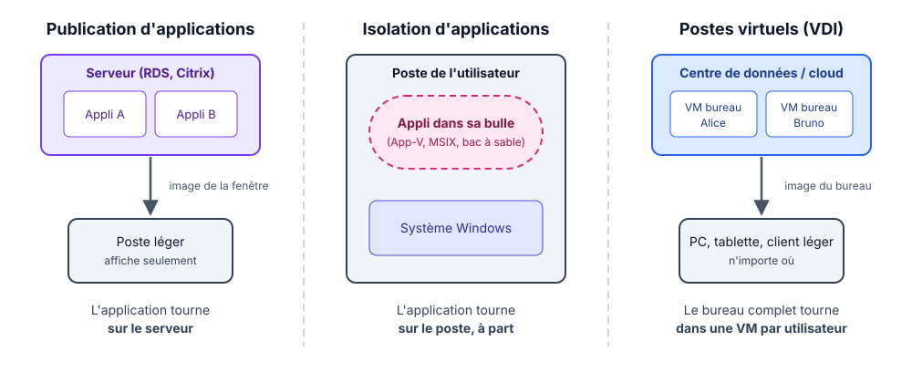

# Virtualiser les applications et les postes de travail

!!! abstract "Résumé"
    Installer et mettre à jour des dizaines d'applications sur des centaines de postes est un travail sans fin pour un service informatique. La **virtualisation des applications** et des **postes de travail** sépare l'application (ou le bureau entier) du poste de l'utilisateur : elle s'exécute **ailleurs** (sur un serveur, dans le cloud) ou **à part** (dans une bulle isolée), et le poste se contente de l'afficher.

    Cette partie présente les trois grandes approches (publication d'applications, isolation d'applications, postes virtuels VDI), les produits du marché (Citrix, Microsoft App-V et RemoteApp, Azure Virtual Desktop, Windows 365, Omnissa Horizon) avec leur situation en 2026, puis leurs **avantages et inconvénients**. Une **étude de cas** fait choisir la bonne solution pour trois entreprises, et une démonstration avec le **Bac à sable Windows** fait toucher du doigt l'isolation d'une application.

| Propriété | Valeur |
|-----------|--------|
| Difficulté | Débutant |
| Durée estimée | 1 h 30 |
| Version décrite | Indépendant du logiciel ; démonstration sur Windows 10 ou 11 Pro, Entreprise ou Éducation |
| Place dans le parcours | Partie 14 sur 17 du parcours [Virtualisation](index.md) — jour 4 |
| Dernière mise à jour | 2026-11-16 |

---

<!-- NOTE DE RÉDACTION (non affichée) : contenu de cours repris de la présentation « La Virtualisation » du formateur (diapositives V « virtualisation de poste » et VI « virtualisation d'application », listes d'avantages) et mis à jour avec faits-jours3-5.md : Citrix XenApp/XenDesktop renommés Citrix Virtual Apps and Desktops en août 2018, Citrix DaaS depuis 2022, Cloud Software Group ; App-V : client et séquenceur suivent le cycle de vie de Windows, composants serveur en support étendu jusqu'au 9 octobre 2029 (page Learn du 5/10/2026), migration conseillée vers MSIX / app attach ; Horizon → Omnissa (1er juillet 2024) ; Windows Sandbox absent de Windows Home. La démonstration Bac à sable n'a pas été jouée (pas de Windows dans le lab) : décrite d'après Microsoft Learn. -->

## 1. Le problème : des applications sur des centaines de postes

Dans une entreprise classique, chaque application est **installée sur chaque poste**. Cela pose des problèmes bien connus des techniciens :

- **déployer** une nouvelle version sur 300 postes, sans en oublier ;
- des **conflits** entre applications qui exigent des versions différentes d'un même composant ;
- des postes **puissants et chers**, parce que l'application est lourde ;
- des **données** de l'entreprise stockées sur des portables qui peuvent être perdus ou volés ;
- des utilisateurs qui veulent travailler **depuis n'importe où**, y compris sur leur ordinateur personnel ou une tablette.

La virtualisation des applications et des postes répond à ces problèmes en **découplant** l'application du poste, comme la virtualisation de serveurs a découplé le système du matériel.

## 2. Trois approches

{ loading=lazy }
/// caption
Où s'exécute l'application ? Sur un serveur, sur le poste dans une bulle, ou dans une VM de bureau.
///

| Approche | Où s'exécute l'application ? | Ce qui circule sur le réseau | Exemples |
|---|---|---|---|
| **Publication d'applications** | Sur un **serveur** partagé par plusieurs utilisateurs | L'image de la fenêtre, le clavier et la souris | Microsoft **RemoteApp** (services Bureau à distance, RDS), **Citrix Virtual Apps** |
| **Isolation d'applications** | Sur le **poste**, dans une « bulle » séparée du système | Rien en fonctionnement (l'application est livrée en paquet, parfois en flux) | Microsoft **App-V**, **MSIX** et *app attach*, Flatpak sous Linux |
| **Poste de travail virtuel (VDI)** | Dans une **VM de bureau** par utilisateur, dans le centre de données ou le cloud | L'image du bureau, le clavier et la souris | **Citrix Virtual Desktops**, **Azure Virtual Desktop**, **Windows 365**, **Omnissa Horizon** |

### 2.1 La publication d'applications

L'application est installée **une seule fois**, sur un serveur (souvent un Windows Server avec le rôle **Services Bureau à distance**). L'utilisateur la lance depuis son poste : une fenêtre s'ouvre, qui ressemble à une application locale, mais seule l'**image** de la fenêtre voyage, par un protocole d'affichage à distance (RDP chez Microsoft, HDX chez Citrix). Un poste modeste, voire un **client léger**, suffit : c'est le serveur qui calcule.

### 2.2 L'isolation d'applications

L'application s'exécute **sur le poste**, mais dans une **bulle** : ses fichiers et ses réglages sont séparés du reste du système. Deux applications incompatibles peuvent cohabiter, et l'application se retire proprement, sans laisser de traces. App-V pousse l'idée plus loin avec le **streaming** : l'application démarre avant d'être entièrement téléchargée.

### 2.3 Le poste de travail virtuel (VDI)

On virtualise le **bureau complet** : chaque utilisateur a une VM Windows dans le centre de données ou dans le cloud, à laquelle il se connecte depuis n'importe quel appareil. C'est la virtualisation de serveurs appliquée aux postes : gestion centralisée, sauvegarde et restauration, déploiement rapide à partir d'un **modèle**, comme en [partie 5](05-virtualiser-des-serveurs.md).

## 3. Les produits en 2026

| Produit | Éditeur | Approche | À savoir en 2026 |
|---|---|---|---|
| **Citrix Virtual Apps and Desktops** | Citrix (groupe Cloud Software Group) | Publication et VDI | Nouveau nom de XenApp et XenDesktop depuis **2018** ; la version en service cloud s'appelle **Citrix DaaS** depuis 2022 |
| **RemoteApp** (RDS) | Microsoft | Publication | Inclus dans Windows Server (licences d'accès client RDS nécessaires) |
| **App-V** | Microsoft | Isolation et streaming | Le client suit le cycle de vie de Windows ; les composants serveur sont en support étendu jusqu'au **9 octobre 2029**. Microsoft conseille de migrer vers **MSIX** et **app attach** |
| **Azure Virtual Desktop** | Microsoft | VDI dans le cloud Azure | Bureaux et applications Windows hébergés dans Azure, plusieurs utilisateurs possibles par VM |
| **Windows 365** | Microsoft | VDI en SaaS (*Cloud PC*) | Un PC Windows dans le cloud par utilisateur, au prix fixe mensuel |
| **Horizon** | Omnissa | VDI et publication | Ancien produit VMware, vendu par Broadcom au fonds KKR : la société **Omnissa** existe depuis le **1er juillet 2024** |
| **Bac à sable Windows** | Microsoft | Bac à sable du système (petite VM jetable) | Inclus dans Windows 10/11 **Pro, Entreprise et Éducation** (pas dans l'édition Famille) |

!!! info "Un marché qui bouge vite"
    Ces noms et ces situations changent souvent (renommages, rachats, fins de support). C'est un bon sujet de **veille** : avant de conseiller un produit, vérifier sa page officielle de cycle de vie.

## 4. Avantages et inconvénients

### 4.1 Les avantages

| Avantage | Publication d'applications | VDI |
|---|---|---|
| **Gestion centralisée** : une seule installation à maintenir | ✔ | ✔ (un modèle de bureau) |
| **Environnement utilisateur maîtrisé** | ✔ | ✔ |
| **Déploiement simple et rapide** d'une application ou d'un poste | ✔ | ✔ |
| **Maintenance simplifiée**, mises à jour faites une seule fois | ✔ | ✔ |
| **Sauvegarde et restauration** centralisées | ✔ | ✔ |
| **Réduction des coûts** : postes moins puissants, durée de vie des terminaux allongée | ✔ | ✔ |
| **Accès à distance**, depuis n'importe quel appareil | ✔ | ✔ |
| **Sécurité** : les données restent dans le centre de données, pas sur le portable | ✔ | ✔ |
| **Évolutivité** : on ajoute des ressources au serveur ou au cloud | ✔ | ✔ |

### 4.2 Les inconvénients

- **Dépendance au réseau** : sans connexion, ou avec une connexion lente, l'application ou le bureau est inutilisable ou pénible.
- **Point central de défaillance** : si le serveur ou le service cloud tombe, **tous** les utilisateurs sont arrêtés.
- **Coûts cachés** : serveurs puissants, stockage rapide, licences (Windows, RDS, Citrix…), compétences.
- **Compatibilité** : certaines applications refusent d'être publiées ou isolées (pilotes, clés de licence matérielles, applications 3D).
- **Périphériques** : impression, scanners, webcams, clés USB demandent une configuration particulière.
- **Expérience utilisateur** : vidéo, son et visioconférence sont plus délicats qu'en local.

## 5. 💬 Étude de cas : quelle solution pour quelle entreprise ?

**Par deux, 30 minutes.** Pour chaque entreprise, choisir l'approche (installation classique, publication, isolation, VDI sur site, VDI dans le cloud), puis justifier en trois arguments et citer un risque. **Seul** : traiter les trois cas, puis comparer avec le corrigé.

1. **Un centre d'appels** de 120 personnes en 3 équipes, sur des postes partagés, qui utilisent toutes les mêmes 4 applications métier et un navigateur.
2. **Un cabinet d'architectes** de 15 personnes qui travaillent sur des logiciels de dessin 3D très gourmands, au bureau.
3. **Une entreprise de 400 salariés** dont 60 % télétravaillent deux jours par semaine sur leur ordinateur personnel, et qui veut que les données restent dans l'entreprise.

??? success "Éléments de réponse"
    1. **Centre d'appels** : **publication d'applications** (RemoteApp ou Citrix) ou **VDI non persistant** (le bureau est remis à zéro à chaque déconnexion). Arguments : mêmes applications pour tous, postes partagés, mises à jour faites une fois, clients légers peu coûteux. Risque : si le serveur tombe, 120 personnes sont arrêtées ; il faut au moins deux serveurs.
    2. **Cabinet d'architectes** : **installation classique** sur des stations de travail puissantes. Arguments : les applications 3D se virtualisent mal sans cartes graphiques virtualisées (vGPU), très coûteuses pour 15 postes ; le travail se fait au bureau. Risque : sauvegarder les postes et leurs fichiers, qui ne sont pas centralisés.
    3. **Entreprise en télétravail** : **VDI dans le cloud** (Azure Virtual Desktop, Windows 365, Citrix DaaS) ou VDI sur site. Arguments : l'ordinateur personnel n'affiche qu'une image, les données restent dans le centre de données ou le cloud, accès depuis n'importe où. Risques : qualité de la connexion des salariés, coût mensuel par utilisateur, sécurité des comptes (authentification multifacteur indispensable).

## 6. Démonstration : isoler une application avec le Bac à sable Windows

Le **Bac à sable Windows** (*Windows Sandbox*) lance un bureau Windows **jetable**, dans une petite VM gérée par l'hyperviseur de Windows : tout ce qui s'y passe est **effacé à la fermeture**. Ce n'est pas un outil de diffusion d'applications comme App-V, mais un **bac à sable du système** : il isole tout un bureau, ce qui est pratique pour tester un logiciel douteux.

!!! warning "Prérequis et conflit avec le jour 3"
    - Windows 10 ou 11 **Pro, Entreprise ou Éducation** (pas l'édition Famille), virtualisation matérielle activée.
    - Le Bac à sable a besoin de l'**hyperviseur de Windows**. S'il a été désactivé pour la virtualisation imbriquée du jour 3 ([annexes](annexes.md#13-desactiver-lhyperviseur-de-windows-pour-la-virtualisation-imbriquee)), il faut d'abord le réactiver (`bcdedit /set hypervisorlaunchtype auto` en administrateur, puis redémarrer), faire la démonstration, puis le désactiver de nouveau avant de reprendre Proxmox VE. Le plus simple est de faire la démonstration sur un autre PC, ou de la lire seulement.
    - Sur un PC géré par un établissement, l'activation peut être interdite : demander à l'administrateur.

1. 🖥️ Ouvrir **Activer ou désactiver des fonctionnalités Windows** (++win+r++, `optionalfeatures`), cocher **Bac à sable Windows** (*Windows Sandbox*), valider, puis redémarrer le PC.
2. 🖥️ Lancer **Bac à sable Windows** depuis le menu Démarrer : une fenêtre affiche un bureau Windows vierge.
3. Dans le bac à sable, créer un fichier sur le bureau, installer une petite application (par exemple un éditeur de texte téléchargé depuis le site de son éditeur) et la lancer.
4. Fermer la fenêtre du bac à sable (Windows prévient que tout sera effacé), puis le relancer.

!!! success "Ce qu'on observe"
    Au second lancement, le bureau est de nouveau **vierge** : ni le fichier ni l'application ne sont restés. Le PC lui-même n'a rien gardé de l'application. C'est l'**isolation** : l'application a tourné dans une bulle, sans toucher au système de l'hôte.

## 7. Questions de révision

1. Quelle différence y a-t-il entre la **publication** d'une application et le **VDI** ?
2. Où s'exécute une application isolée avec App-V ? Et une application publiée avec RemoteApp ?
3. Citer quatre avantages et trois inconvénients de la virtualisation des applications.
4. Pourquoi les applications 3D se prêtent-elles mal à la publication ou au VDI ?
5. Qu'est devenu VMware Horizon ? Et XenApp ?

??? success "Corrigé"
    1. La **publication** fait tourner **une application** sur un serveur partagé par plusieurs utilisateurs ; le **VDI** donne à chaque utilisateur **un bureau complet**, dans sa propre VM.
    2. Avec App-V, l'application s'exécute **sur le poste**, dans une bulle isolée. Avec RemoteApp, elle s'exécute **sur le serveur** ; le poste n'affiche que l'image de sa fenêtre.
    3. Avantages : gestion centralisée, déploiement et mises à jour faits une seule fois, accès depuis n'importe où, postes moins chers et plus durables, données qui restent dans l'entreprise, sauvegarde centralisée. Inconvénients : dépendance au réseau, point central de défaillance, coûts de serveurs et de licences, applications ou périphériques incompatibles.
    4. Parce qu'elles demandent une **carte graphique puissante** et beaucoup d'images par seconde : il faut des serveurs équipés de cartes graphiques virtualisables (vGPU), très coûteuses, et une connexion rapide pour transporter l'affichage.
    5. **Horizon** a été vendu par Broadcom au fonds KKR et appartient depuis juillet 2024 à la société **Omnissa**. **XenApp** (et XenDesktop) s'appelle **Citrix Virtual Apps and Desktops** depuis 2018.

---

## Ressources

- [Microsoft — Services Bureau à distance (RDS)](https://learn.microsoft.com/fr-fr/windows-server/remote/remote-desktop-services/remote-desktop-services-overview) — bureaux et applications publiés (RemoteApp).
- [Microsoft — Politique de support d'App-V](https://learn.microsoft.com/en-us/microsoft-desktop-optimization-pack/app-v/appv-support-policy) — le cycle de vie d'App-V et la migration conseillée (en anglais).
- [Microsoft — Azure Virtual Desktop](https://learn.microsoft.com/fr-fr/azure/virtual-desktop/overview) — le VDI dans le cloud Azure.
- [Microsoft — Bac à sable Windows](https://learn.microsoft.com/fr-fr/windows/security/application-security/application-isolation/windows-sandbox/) — prérequis et fonctionnement.
- Partie précédente : [Réseau virtuel, SDN et NFV](13-reseau-virtuel-sdn-nfv.md) · Partie suivante : [Le cloud : IaaS, PaaS, SaaS](15-le-cloud.md).

*[VDI]: Virtual Desktop Infrastructure — postes de travail virtuels
*[RDS]: Remote Desktop Services — services Bureau à distance de Microsoft
*[RDP]: Remote Desktop Protocol — protocole d'affichage à distance de Microsoft
*[HDX]: protocole d'affichage à distance de Citrix
*[DaaS]: Desktop as a Service — postes de travail fournis en service
*[SaaS]: Software as a Service — logiciel fourni en service
*[MSIX]: format de paquet d'applications de Microsoft
*[vGPU]: carte graphique virtualisée, partagée entre plusieurs VM
*[VM]: Virtual Machine — machine virtuelle
