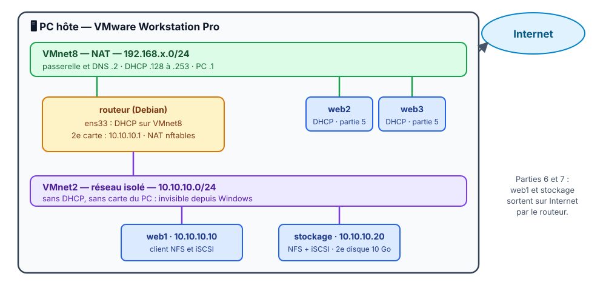

<!-- ============================================================ -->
<!-- ⚠️ RAPPEL IMPORTANT :                                          -->
<!-- Pensez TOUJOURS à ajouter une entrée dans le fichier d'index  -->
<!-- (index.md) du dossier correspondant (ex: docs/cloud/index.md) -->
<!-- afin de référencer ce nouvel article et permettre aux         -->
<!-- visiteurs de le trouver et de cliquer dessus !                -->
<!-- ============================================================ -->

# Virtualisation : cours et travaux pratiques en 5 jours

!!! abstract "Résumé"
    Ce parcours de **cinq jours** apprend ce qu'est la **virtualisation**, pourquoi elle est partout dans les systèmes d'information d'aujourd'hui, et comment l'exploiter au quotidien. Chaque séquence alterne un **cours court**, une **activité** (débat, exercice chiffré, recherche) et un **travail pratique** sur son propre PC, avec **VMware Workstation Pro** et des machines virtuelles **Debian 13**.

    - **Jour 1** : comprendre la virtualisation, l'hyperviseur et la machine virtuelle ; créer ses premières VM ; voir comment le processeur, la mémoire et le disque sont partagés ; casser une VM exprès et la réparer en quelques secondes grâce à un instantané.
    - **Jour 2** : les trois grands domaines de la virtualisation : serveurs, réseau et stockage.
    - **Jours 3 à 5** : le panorama des technologies (hyperviseurs de type 1 et 2, paravirtualisation, conteneurs, stockage et réseau définis par logiciel, virtualisation des applications), le cloud et les tendances du métier.

    Cette page rassemble ce qu'il faut garder sous la main pendant tout le parcours : le plan, le schéma du lab, les comptes et mots de passe, le dimensionnement des machines virtuelles et les instantanés conseillés.

| Propriété | Valeur |
|-----------|--------|
| Public | Techniciens supérieurs systèmes et réseaux (TSSR) en formation : savoir utiliser Windows et taper quelques commandes suffit |
| Durée totale | 5 jours de 7 h (35 h) |
| Version décrite | VMware Workstation Pro **26H1** sur Windows 10 ou 11, Debian **13.7** « trixie » |
| Dernière mise à jour | 2026-11-16 |

<!-- NOTE DE RÉDACTION (non affichée) : Parcours construit en novembre 2026 à partir des supports du formateur : présentation « La Virtualisation » (pptx), « QCM virtu avec réponses », « Configuration des paramètres réseau de VMware Workstation », notes « Virtualisation.docx », cours EFORT « Virtualisation de serveur », TP3 KVM/QEMU, et du syllabus du centre de formation (2 jours de concepts + 3 jours de technologies). Référentiel : REAC TSSR 2026, activité « Exploiter des serveurs dans une infrastructure virtualisée » (connaissance de la notion de conteneur, des architectures IaaS/PaaS/SaaS, des offres des principaux opérateurs de cloud, veille technologique, documentation de l'environnement de virtualisation).
Écarts avec les supports : Workstation Pro gratuit depuis le 11/11/2024 (le QCM disait « payant ») ; FreeNAS renommé TrueNAS ; « vSphere/WebSphere » corrigé (WebSphere est un produit IBM sans rapport) ; iSCSI est un protocole standard (RFC 7143), pas une option VMware ; TP Azure avec compte remplacé par un TP sans compte (décision du formateur) ; chiffre EFORT « 4 t de CO2 par serveur » non repris (non sourcé).
Les commandes et mesures (disque fin, RAM, vCPU, instantanés, clones, rm -rf) ont été vérifiées sur un hyperviseur KVM avec Debian 13.7 ; les écrans de Workstation sont décrits d'après la documentation Broadcom 26H1. -->

---

## Objectifs du parcours

À la fin du parcours, il est possible de :

- expliquer **simplement** ce qu'est la virtualisation, à quoi elle sert, et citer ses avantages et ses limites ;
- décrire le rôle d'un **hyperviseur** et distinguer les hyperviseurs de **type 1** (*bare metal*) et de **type 2** (hébergés) ;
- créer, configurer et dimensionner une **machine virtuelle**, installer un système d'exploitation dedans et ses outils d'intégration ;
- expliquer comment le **processeur**, la **mémoire** et le **disque** d'un hôte sont partagés entre les VM, et ce qu'est la **surallocation** ;
- utiliser les **instantanés** et les **clones** à bon escient, et savoir pourquoi un instantané n'est pas une sauvegarde ;
- expliquer la virtualisation des **serveurs**, du **réseau** et du **stockage** et les mettre en œuvre dans un petit lab ;
- comparer les grandes **technologies** (hyperviseurs, conteneurs, stockage et réseau définis par logiciel, virtualisation des applications) et les offres **cloud** (IaaS, PaaS, SaaS) ;
- faire une **veille** et documenter un environnement virtualisé, comme le demande le métier de TSSR.

## Plan du parcours

Chaque partie dure entre 1 h 30 et 2 h et mêle cours, activités et pratique. Les durées sont indicatives.

### Jour 1 — Comprendre la virtualisation et créer ses premières VM

| Partie | Type | Durée | Contenu | Machines allumées |
|:---:|---|---|---|---|
| [1. Comprendre la virtualisation](01-comprendre-la-virtualisation.md) | Cours et activités | 1 h 45 | Définition simple, histoire, pourquoi virtualiser, avantages et inconvénients, exercice de consolidation, débat | Aucune |
| [2. Hyperviseur et machine virtuelle](02-hyperviseur-et-machine-virtuelle.md) | Cours et TP | 1 h 30 | Rôle de l'hyperviseur, types 1 et 2, VT-x / AMD-V, vérifier son PC, prise en main de Workstation | Aucune |
| [3. Créer sa première VM Debian 13](03-creer-sa-premiere-vm.md) | TP | 2 h | Assistant de création, fichiers d'une VM, installation de Debian, outils d'intégration, machine physique ou virtuelle ? | `debian-tp` |
| [4. Partager les ressources : CPU, RAM, disque, instantanés et clones](04-partager-les-ressources.md) | TP et défi | 1 h 45 | vCPU, mémoire, disque fin ou épais, surallocation, instantanés, clones liés et complets, défi du jour | `debian-tp` et ses clones |

### Jour 2 — Virtualiser les serveurs, le réseau et le stockage

| Partie | Type | Durée | Contenu | Machines allumées |
|:---:|---|---|---|---|
| [5. Virtualiser des serveurs](05-virtualiser-des-serveurs.md) | Cours et TP | 1 h 45 | Fonctions d'un cluster (migration à chaud, haute disponibilité, P2V), modèle, script de personnalisation, trois serveurs web déployés à partir du modèle | `modele-debian`, puis `web1` à `web3` un par un |
| [6. Virtualiser le réseau](06-virtualiser-le-reseau.md) | Cours et TP | 2 h | Commutateurs virtuels, modes pont, NAT et réseau privé hôte, réseau isolé VMnet2, VM routeur avec NAT nftables, redirection de port | `routeur`, `web1` |
| [7. Virtualiser le stockage](07-virtualiser-le-stockage.md) | Cours et TP | 2 h | DAS, NAS, SAN, protocoles, une VM Debian qui partage un dossier en NFS et un disque en iSCSI | `routeur`, `stockage`, `web1` (dans cet ordre) |
| [8. Défi du jour 2](08-defi-jour-2.md) | Défi | 1 h 15 | Deux serveurs web, un site partagé en NFS, publication, diagnostic de trois pannes | `routeur`, `stockage`, `web1`, `web4` |

### Jour 3 — Les technologies de virtualisation du système

| Partie | Type | Durée | Contenu | Machines allumées |
|:---:|---|---|---|---|
| [9. Panorama des technologies](09-panorama-des-technologies.md) | Cours et atelier | 1 h 45 | Carte des technologies, comparaison VM/conteneurs, fiche technologie, règles de la veille | Aucune |
| [10. Types d'hyperviseurs et paravirtualisation](10-types-hyperviseurs-paravirtualisation.md) | Cours et TP | 2 h 30 | Virtualisation complète, paravirtualisation, assistance matérielle ; Proxmox VE installé dans Workstation ; pilotes émulés contre pilotes VirtIO | `pve` |
| [11. Conteneurs](11-conteneurs.md) | Cours et démonstration | 1 h 30 | Conteneur ou VM ? Docker sur `debian-tp`, conteneur LXC dans Proxmox VE, mesures | `debian-tp`, puis `pve` |

### Jour 4 — Stockage, réseau et applications virtualisés

| Partie | Type | Durée | Contenu | Machines allumées |
|:---:|---|---|---|---|
| [12. Stockage défini par logiciel et hyperconvergence](12-stockage-sds-hyperconvergence.md) | Cours et TP | 2 h | SDS, vSAN, Ceph, hyperconvergence ; stockage NFS partagé ajouté à Proxmox, disque d'une VM déplacé à chaud | `routeur`, `stockage`, `pve` |
| [13. Réseau virtuel, SDN et NFV](13-reseau-virtuel-sdn-nfv.md) | Cours et TP | 2 h | Commutateurs virtuels, VLAN, VXLAN, SDN, NFV ; VLAN dans Proxmox VE | `stockage`, `pve` |
| [14. Virtualiser les applications et les postes](14-virtualiser-les-applications.md) | Cours et étude de cas | 1 h 30 | Publication, isolation, VDI ; Citrix, App-V, Azure Virtual Desktop, Omnissa ; Bac à sable Windows | Aucune |

### Jour 5 — Le cloud, les tendances et le défi final

| Partie | Type | Durée | Contenu | Machines allumées |
|:---:|---|---|---|---|
| [15. Le cloud : IaaS, PaaS, SaaS](15-le-cloud.md) | Cours et TP sans compte | 2 h | Définition du NIST, modèles de service, responsabilité partagée, acteurs et souveraineté, calculatrices de prix | Aucune |
| [16. Tendances et métier](16-tendances-et-metier.md) | Cours et débat | 1 h 30 | Kubernetes, serverless, edge, NFV, GPU, informatique confidentielle, énergie, impact sur le métier de TSSR | Aucune |
| [17. Défi final](17-defi-final.md) | Projet, diagnostic et QCM | 3 h | Projet de migration d'une PME, quatre incidents, QCM de vingt questions | Au choix |

Les [annexes](annexes.md) rassemblent le dépannage, les raccourcis de Workstation, un aide-mémoire des commandes et le glossaire.

!!! tip "Suivre l'ordre"
    Chaque TP s'appuie sur le précédent : la VM `debian-tp` créée en partie 3 sert dans toutes les parties suivantes. Les cours se lisent avant les TP ou pendant leurs temps d'attente, par exemple pendant l'installation de Debian (environ 15 minutes).

## Schémas du lab

{ loading=lazy }
/// caption
Le lab du jour 1 tient dans un seul PC : Workstation crée un petit réseau virtuel en NAT pour les VM.
///

## Plan d'adressage

Le jour 1, toutes les VM sont branchées sur le réseau **NAT** de Workstation (commutateur virtuel **VMnet8**) et reçoivent leur adresse **automatiquement** par le serveur DHCP de Workstation. Il n'y a donc **rien à saisir**.

| Élément | Adresse | Remarque |
|---|---|---|
| Réseau VMnet8 (NAT) | `192.168.x.0/24` | Le troisième octet `x` est **tiré au hasard** à l'installation de Workstation : il change d'un PC à l'autre |
| Passerelle NAT de Workstation | `192.168.x.2` | Fait sortir les VM sur Internet par la carte réseau du PC |
| PC hôte, carte VMware Network Adapter VMnet8 | `192.168.x.1` | Permet au PC de joindre ses VM |
| VM (`debian-tp`, clones) | `192.168.x.128` à `192.168.x.253` | Distribuées par le DHCP de Workstation (le serveur DHCP lui-même est en `.254`) |

Pour connaître le `x` de son PC : 🖥️ dans Workstation, menu **Edit > Virtual Network Editor**, ligne **VMnet8** ; ou dans la VM, commande `ip a` (partie 3). Au jour 2, on ajoute un réseau **VMnet2** totalement isolé (sans DHCP ni carte du PC), relié à l'extérieur par une VM routeur :

| Machine | Réseau | Adresse | Passerelle | DNS | Créée en |
|---|---|---|---|---|---|
| `web1`, `web2`, `web3` | VMnet8 (NAT) | DHCP | `192.168.x.2` | `192.168.x.2` | Partie 5 |
| `routeur`, 1re carte (`ens33`) | VMnet8 (NAT) | DHCP | `192.168.x.2` | `192.168.x.2` | Partie 6 |
| `routeur`, 2e carte | VMnet2 (isolé) | `10.10.10.1/24` | — | — | Partie 6 |
| `web1` (déplacé) | VMnet2 | `10.10.10.10/24` | `10.10.10.1` | `192.168.x.2` | Partie 6 |
| `stockage` | VMnet2 | `10.10.10.20/24` | `10.10.10.1` | `192.168.x.2` | Partie 7 |
| `web4` | VMnet2 | `10.10.10.11/24` | `10.10.10.1` | `192.168.x.2` | Partie 8 |

{ loading=lazy }
/// caption
Le lab à la fin de la partie 7 (le défi du jour 2 ajoute `web4` en `10.10.10.11`)
///

## Comptes et mots de passe

Ce lab est **pédagogique** : les mots de passe sont écrits ici volontairement pour que chacun puisse suivre à l'identique. En production, chaque mot de passe serait unique, long et rangé dans un gestionnaire de mots de passe.

| Où | Compte | Mot de passe | Créé en |
|---|---|---|---|
| VM Debian (`debian-tp` et ses clones) | `root` (administrateur) | `Virtu2026!` | Partie 3 |
| VM Debian (`debian-tp` et ses clones) | `tssr` (utilisateur, membre du groupe `sudo`) | `Virtu2026!` | Partie 3 |
| Portail Broadcom (téléchargement de Workstation) | Compte personnel | Choisi par chacun | [Annexes](annexes.md#11-telecharger-et-installer-vmware-workstation-pro) |

!!! warning "Le clavier de la VM"
    Le mot de passe contient un **point d'exclamation** et des **chiffres**. Pendant l'installation, l'installateur Debian passe en **AZERTY** dès que la disposition « Français » est choisie : sur un clavier AZERTY, les chiffres demandent la touche ++shift++, et `!` se tape **sans** ++shift++ sur la touche juste à gauche de la touche ++shift++ de droite (après `,` `;` `:`). L'option **Afficher le mot de passe en clair** de l'installateur permet de vérifier ce qui a été tapé.

## Dimensionnement des machines virtuelles

Le parcours est prévu pour des PC de **16 Go de mémoire vive** et un processeur de **4 cœurs** ou plus.

| Machine | Confortable (conseillé) | Minimal | Disque |
|---|---|---|---|
| `debian-tp` (Debian 13 sans interface graphique) | 2 vCPU, 2 Go | 1 vCPU, 1 Go | 20 Go, dynamique |
| Clones de `debian-tp` (partie 4) | 1 vCPU, 1 Go | 1 vCPU, 512 Mo | Quelques Mo (clone lié) ou la taille de l'original (clone complet) |
| `modele-debian` (partie 5, éteint) | 1 vCPU, 1 Go | — | Clone complet de `debian-tp`, quelques Go |
| `web1` à `web4`, `stockage` (jour 2) | 1 vCPU, 1 Go | 1 vCPU, 512 Mo | Clones liés de `modele-debian` ; `stockage` a un second disque de 10 Go |
| `routeur` (jour 2) | 1 vCPU, 512 Mo | 1 vCPU, 512 Mo | Clone lié de `modele-debian` |

- Debian recommande **1 Go** de mémoire pour un système **sans bureau**, et en exige 512 Mo au minimum. Le profil **confortable** rend l'installation plus rapide ; une fois installée, une Debian sans bureau tourne très bien avec 1 Go.
- **Mémoire du PC hôte** : avec 16 Go, trois VM de 1 à 2 Go allumées en même temps (jour 1), ou quatre VM de 512 Mo à 1 Go (jour 2, environ 3,5 Go), laissent largement de quoi faire tourner Windows et un navigateur. VMware demande au minimum 2 Go pour l'hôte lui-même, 4 Go conseillés.
- **Disque du PC hôte** : prévoir **30 Go libres** pour le jour 1 et **15 Go** de plus pour le jour 2 (surtout pour le modèle et le disque de stockage), de préférence sur un **SSD**. Les disques virtuels sont **dynamiques** : un disque de 20 Go n'occupe au départ que la place réellement écrite (environ 2 Go après l'installation).
- La **virtualisation matérielle** (Intel VT-x ou AMD-V) doit être activée dans le BIOS/UEFI du PC : la [partie 2](02-hyperviseur-et-machine-virtuelle.md#4-tp-verifier-que-son-pc-sait-virtualiser) explique comment le vérifier.

## Instantanés conseillés

Un **instantané** (*snapshot*) fige l'état d'une machine virtuelle. En cas d'erreur, on y revient en quelques secondes au lieu de tout recommencer. Les prendre aux étapes marquées 🛟 :

| Instantané | Machine | Moment | Permet de recommencer |
|---|---|---|---|
| `01-installation-terminee` | `debian-tp` | Fin de la partie 3, VM éteinte | Toutes les parties suivantes avec une Debian propre |
| `02-outils-installes` | `debian-tp` | Partie 4, VM éteinte, avant l'erreur volontaire ; sert aussi de base aux clones | L'exercice « casser sa VM exprès » autant de fois que nécessaire |
| `modele-v1` | `modele-debian` | Partie 5, VM éteinte ; base de tous les clones du jour 2 (ne jamais le supprimer) | Tous les déploiements du jour 2 |
| `routeur-ok` | `routeur` | Fin de la partie 6, VM éteinte | Les parties 7 et 8 avec un routeur qui fonctionne |
| `stockage-ok` | `web1`, `stockage` | Fin de la partie 7, VM éteintes | Le défi du jour 2 |

!!! warning "Un instantané n'est pas une sauvegarde"
    L'instantané reste **dans le dossier de la VM**, sur le **même disque** que la machine virtuelle, et il **dépend** du disque d'origine : si le disque du PC tombe en panne, ou si le dossier de la VM est supprimé, les instantanés disparaissent avec lui. La [partie 4](04-partager-les-ressources.md#5-les-instantanes) l'explique en détail.

## Logiciels à télécharger

| Logiciel | Où le trouver | Remarque |
|---|---|---|
| VMware Workstation Pro 26H1 pour Windows | [Portail de support Broadcom](https://support.broadcom.com/group/ecx/productdownloads?subfamily=VMware%20Workstation%20Pro&freeDownloads=true) | **Gratuit** pour tous les usages, mais **compte Broadcom obligatoire** ; procédure dans les [annexes](annexes.md#11-telecharger-et-installer-vmware-workstation-pro) |
| Debian 13 (image *netinst* amd64, environ 800 Mo) | [debian.org](https://www.debian.org/distrib/netinst) | Image d'installation par le réseau : les paquets sont téléchargés pendant l'installation, il faut donc un accès à Internet |

## Convention de lecture

Dans les TP, chaque action précise où elle se fait :

| Repère | Où |
|---|---|
| 🖥️ | PC hôte : Windows et la fenêtre de VMware Workstation |
| 🐧 | Dans la VM Debian (console de la VM dans Workstation) |
| 🌐 | Navigateur web du PC hôte |
| 💬 | Activité en groupe ou en binôme : débat, recherche, mise en commun |
| ✍️ | Exercice à faire seul, corrigé replié en dessous |
| 🛟 | Prendre un instantané |

Les menus de Workstation sont écrits **en gras, en anglais**, comme dans la documentation officielle de Broadcom. Workstation existe aussi **en français** : si l'interface est en français, les menus sont au même endroit, avec leur nom traduit ; les traductions indiquées entre parenthèses dans le texte sont données à titre indicatif. Les commandes à taper dans la VM sont dans des blocs de code ; le texte après `#` est un commentaire, il ne se tape pas.

## Ressources

- [Documentation de VMware Workstation Pro 26H1](https://techdocs.broadcom.com/us/en/vmware-cis/desktop-hypervisors/workstation-pro/26H1/using-vmware-workstation-pro.html) — guide officiel de l'utilisateur (en anglais).
- [Guide d'installation de Debian 13](https://www.debian.org/releases/trixie/amd64/) — le manuel officiel, en français.
- [Référentiel du titre professionnel TSSR](https://www.francecompetences.fr/recherche/rncp/37682/) — la fiche RNCP du titre, avec ses compétences.
*[vCPU]: processeur virtuel
*[SSD]: Solid State Drive — disque à mémoire flash
*[TSSR]: Technicien supérieur systèmes et réseaux
*[NAT]: Network Address Translation — traduction d'adresses
*[DHCP]: Dynamic Host Configuration Protocol — attribution automatique d'adresses IP
*[VM]: Virtual Machine — machine virtuelle
*[UEFI]: Unified Extensible Firmware Interface — successeur du BIOS
*[BIOS]: Basic Input/Output System — micrologiciel de démarrage
*[IaaS]: Infrastructure as a Service
*[PaaS]: Platform as a Service
*[SaaS]: Software as a Service
*[NFV]: Network Functions Virtualization — virtualisation des fonctions réseau
*[SDN]: Software-Defined Networking — réseau défini par logiciel
*[VDI]: Virtual Desktop Infrastructure — postes de travail virtuels
*[LXC]: Linux Containers — conteneurs Linux
*[VT-x]: extensions de virtualisation des processeurs Intel
*[AMD-V]: extensions de virtualisation des processeurs AMD
