<!-- ============================================================ -->
<!-- ⚠️ RAPPEL IMPORTANT :                                          -->
<!-- Pensez TOUJOURS à ajouter une entrée dans le fichier d'index  -->
<!-- (index.md) du dossier correspondant (ex: docs/cloud/index.md) -->
<!-- afin de référencer ce nouvel article et permettre aux         -->
<!-- visiteurs de le trouver et de cliquer dessus !                -->
<!-- ============================================================ -->

# Mettre en place un cluster de pare-feux pfSense en haute disponibilité

!!! abstract "Résumé"
    Ce TP construit, dans deux machines virtuelles, un **cluster actif/passif de deux pare-feux pfSense**. Si le pare-feu principal tombe en panne, le pare-feu de secours prend le relais en quelques secondes, sans qu'aucun poste du réseau n'ait à être reconfiguré.

    Le cluster repose sur trois mécanismes :

    - **CARP** pour partager des adresses IP virtuelles ;
    - **pfsync** pour recopier la table des connexions en cours ;
    - **XML-RPC** pour répliquer automatiquement la configuration.

    La procédure couvre toutes les étapes : préparation de l'hyperviseur, installation de pfSense CE 2.7.2, configuration de la haute disponibilité, tests de bascule et exercices corrigés. Trois prolongements sont ensuite proposés : agrégation de liens LACP, troisième nœud et **mise à jour du cluster vers pfSense CE 2.9.0** sans interruption de service.

| Propriété | Valeur |
|-----------|--------|
| Difficulté | Intermédiaire — accessible aux débutants qui suivent les étapes dans l'ordre |
| Durée estimée | 3 h 30 pour le TP principal et les exercices ; 1 h pour l'agrégation LACP ; 2 h 30 à 4 h pour la mise à jour du cluster, surtout du temps de téléchargement |
| Hyperviseur | VMware Workstation Pro (17, 25H2 ou 26H1) ou Oracle VirtualBox 7 |
| Système | pfSense Community Edition 2.7.2, mis à jour en 2.9.0 à la fin |
| Machines virtuelles | 2 VM pfSense : 1 vCPU, 1 Go de RAM (2 Go pour la mise à jour), 20 Go de disque, 3 cartes réseau |
| Organisation | Travail individuel, sur un PC disposant d'au moins 8 Go de RAM |
| Dernière mise à jour | 2026-10-13 |

!!! note "Convention de lecture"
    - Le **primaire** est le pare-feu `pfsense-19`, qui porte normalement le trafic. Le **secondaire** est `pfsense-20`, le pare-feu de secours.
    - Chaque étape indique en gras **sur quel pare-feu** elle se réalise. Beaucoup d'erreurs viennent d'une action faite sur le mauvais nœud : relire cette mention avant chaque manipulation.
    - Les menus sont donnés en anglais, la langue par défaut de pfSense, suivis de leur équivalent français : **Firewall > Rules** (*Pare-feu > Règles*).
    - Pour savoir sur quel pare-feu une capture a été prise, se fier au texte qui l'accompagne ou à l'adresse visible en haut de l'image : `192.168.19.19` pour le primaire, `192.168.19.20` pour le secondaire. Les captures mélangent l'interface en français et en anglais. Pour s'y retrouver soi-même, l'[étape 8.4](#84-distinguer-les-deux-pare-feux-dun-coup-dil) propose de distinguer les deux pare-feux par la langue et le thème.
    - Le TP principal, les exercices et la mise à jour complète du cluster vers la 2.9.0 ont été rejoués de bout en bout dans un laboratoire de test (KVM) les 12 et 13 octobre 2026, avec un poste client sur le LAN et un serveur côté WAN pour mesurer les coupures. Les mesures citées (temps de bascule, paquets perdus, durées) en sont issues. Les parties qui n'ont pas été rejouées sont signalées comme telles.

---

## 1. Objectifs du TP

À la fin de ce TP, les compétences suivantes sont acquises :

- expliquer la différence entre un pare-feu seul et un cluster à basculement (*fail-over*) ;
- préparer des réseaux virtuels (NAT, réseau privé hôte, réseau interne) dans un hyperviseur ;
- installer pfSense et réaliser sa configuration initiale en console puis dans l'interface web ;
- configurer la synchronisation de configuration (XML-RPC) et la synchronisation des états (pfsync) ;
- créer des adresses IP virtuelles CARP et une règle de NAT sortant adaptée à un cluster ;
- écrire des règles de filtrage **minimales** (seulement ce qui est nécessaire) ;
- tester une bascule, mesurer la coupure et interpréter les journaux en cas de problème ;
- mettre à jour un cluster sans interrompre le service.

---

## 2. Comprendre avant de configurer

### 2.1 pfSense en quelques mots

**pfSense** est un système d'exploitation libre (*open source*) spécialisé dans le rôle de **routeur et pare-feu**. Il est basé sur **FreeBSD**, un système de la famille Unix, et non sur Linux. À l'origine, c'est un dérivé (*fork*) du projet m0n0wall.

pfSense utilise le pare-feu **Packet Filter** (PF), un pare-feu dit **à états** (*stateful*) : il mémorise chaque connexion autorisée dans une **table d'états**, ce qui lui permet de laisser passer automatiquement les réponses sans règle supplémentaire. Il assure aussi le routage, le NAT, le VPN, le DHCP, etc., c'est-à-dire l'équivalent libre des fonctions d'un routeur professionnel propriétaire. On le rencontre aussi bien dans un réseau domestique que dans un réseau d'entreprise.

!!! info "Deux éditions de pfSense"
    Netgate, l'éditeur, propose **pfSense CE** (*Community Edition*), gratuite et utilisée dans ce TP, et **pfSense Plus**, livrée avec ses boîtiers ou disponible sous licence. Les menus utilisés ici sont les mêmes dans les deux éditions.

### 2.2 Haute disponibilité et basculement (*fail-over*)

Un pare-feu est un **point de passage obligé** : tout le trafic entre le réseau interne (LAN) et l'extérieur (WAN) le traverse. S'il tombe en panne, plus personne n'accède à Internet. On parle de **point unique de défaillance** (*SPOF*, *Single Point Of Failure*).

La **haute disponibilité** (*HA*, *High Availability*) consiste à supprimer ce point unique en doublant l'équipement. Le **basculement** (*fail-over*, « passer outre à la panne ») est la capacité de l'ensemble à passer automatiquement sur l'équipement de secours quand l'équipement principal défaille.

Il existe deux grands modes de fonctionnement :

| Mode | Principe | Usage |
|------|----------|-------|
| **Actif/actif** | Les deux équipements traitent du trafic en même temps. | Se rapproche de la répartition de charge (*load-balancing*). |
| **Actif/passif** | Le secondaire reste en veille tant que le primaire fonctionne, puis prend le relais en cas de panne. | Mode classique et le plus répandu. **C'est celui de ce TP.** |

!!! example "Analogie"
    Un avion de ligne a un pilote et un copilote. Le copilote suit tout ce qui se passe (la route, les échanges radio, les réglages) sans tenir les commandes. Si le pilote fait un malaise, le copilote reprend immédiatement le vol, car il connaît déjà la situation. Dans le cluster, le primaire est le pilote et le secondaire le copilote : **XML-RPC** lui transmet les réglages et **pfsync** la situation en cours.

### 2.3 Le principe : des adresses IP virtuelles partagées

Chaque pare-feu garde sa propre adresse IP sur chacune de ses interfaces (`.19` pour le primaire, `.20` pour le secondaire). Le cluster ajoute une **troisième adresse par réseau**, l'**adresse IP virtuelle** ou **VIP** (`.21`), **partagée** entre les deux machines.

- Les postes du LAN utilisent la VIP `192.168.19.21` comme **passerelle par défaut**, jamais l'adresse propre d'un pare-feu.
- À un instant donné, un seul pare-feu « possède » la VIP : celui qui est dans l'état **MASTER**. L'autre est **BACKUP**.
- Le MASTER annonce sa présence environ chaque seconde. Si les annonces s'arrêtent, le BACKUP récupère la VIP et devient MASTER.

<figure markdown="span">
  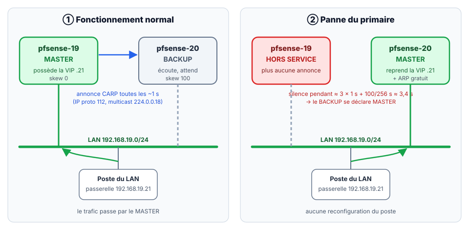{ loading=lazy }
  <figcaption>La VIP suit toujours le pare-feu MASTER : les postes du LAN ne voient aucun changement de passerelle.</figcaption>
</figure>

### 2.4 Les trois protocoles du cluster

| Protocole | Ce qu'il synchronise | Transport | Sens | Réseau emprunté |
|-----------|----------------------|-----------|------|-----------------|
| **CARP** (*Common Address Redundancy Protocol*) | Qui possède les adresses IP virtuelles (MASTER/BACKUP) | Protocole IP n° 112, en multicast vers `224.0.0.18` | Annonces émises par le MASTER | Les réseaux qui portent une VIP : **WAN et LAN** |
| **pfsync** | La **table d'états** : la liste des connexions en cours | Protocole IP n° 240 | Dans les deux sens | Le lien dédié **PFSYNC** |
| **XML-RPC** | La **configuration** : règles, NAT, VIP, utilisateurs, etc. | HTTPS (TCP 443), vers l'interface web du pair | **Uniquement** du primaire vers le secondaire | Le lien dédié **PFSYNC** |

- **CARP** permet à plusieurs hôtes d'un même réseau de partager une adresse IP. C'est une alternative libre aux protocoles VRRP et HSRP, créée par le projet OpenBSD pour contourner des brevets. En cas de défaillance du primaire, le secondaire reprend l'adresse IP virtuelle de façon transparente.
- **pfsync** recopie en continu les états des connexions entre les deux pare-feux. Lorsque le primaire tombe, le secondaire connaît déjà les connexions ouvertes et peut les **poursuivre sans les couper**. Dans le lab de test, une connexion TCP en cours a ainsi survécu à l'arrêt brutal du primaire.
- **XML-RPC** est un protocole d'appel de procédure à distance (*Remote Procedure Call*) qui transporte des données XML sur HTTP. pfSense s'en sert pour **pousser la configuration** du primaire vers le secondaire. Netgate recommande de le faire passer par le même lien dédié que pfsync.

<figure markdown="span">
  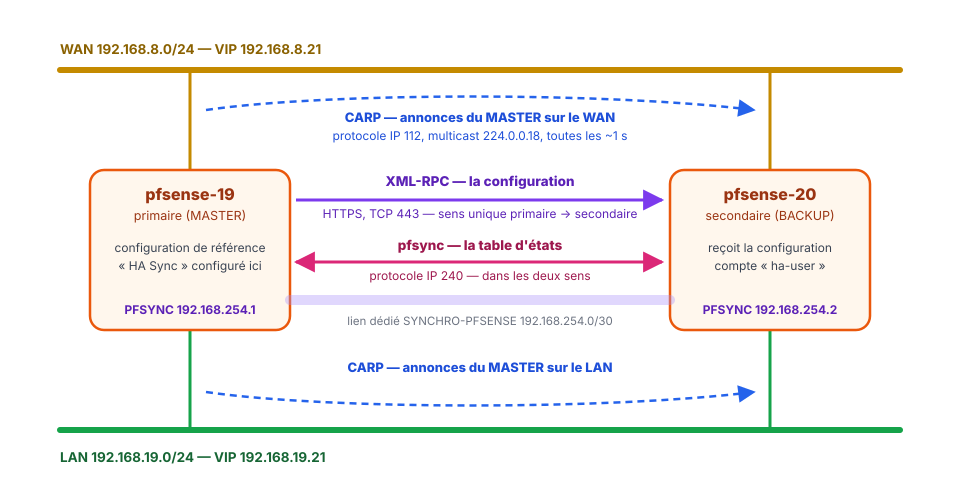{ loading=lazy }
  <figcaption>Le lien dédié transporte la configuration et les états ; les annonces CARP circulent sur les réseaux qui portent les VIP.</figcaption>
</figure>

!!! question "Pourquoi un lien de synchronisation dédié ?"
    pfsync transmet en clair, en permanence, la liste de toutes les connexions qui traversent le pare-feu. Sur le LAN, n'importe quel poste pourrait écouter ces informations, voire injecter de faux états. Un lien **réservé aux deux pare-feux** est donc plus **sûr**. Il est aussi plus **fiable**, car la synchronisation n'est pas ralentie par le trafic des utilisateurs. À défaut, Netgate tolère l'usage du LAN, mais ce TP applique la bonne pratique.

---

## 3. Prérequis

**Matériel et logiciels**

- Un PC avec **8 Go de RAM** au minimum, environ **50 Go d'espace disque** libre et la virtualisation matérielle (Intel VT-x ou AMD-V) activée dans le BIOS/UEFI.
- Un hyperviseur au choix :
    - **VMware Workstation Pro** : gratuit pour tous les usages depuis novembre 2024. Le téléchargement se fait depuis le portail de support Broadcom, avec un compte gratuit, en choisissant la variante « Personal ». La version 26H1 est la plus récente à la date de rédaction.
    - **Oracle VirtualBox 7**, gratuit.
- L'image ISO de **pfSense CE 2.7.2** (voir l'[étape 5.1](#51-telecharger-limage-iso-de-pfsense-ce-272)).
- Un accès Internet sur le PC hôte : il est nécessaire pour la mise à jour finale.

**Connaissances**

- Savoir créer une machine virtuelle.
- Connaître l'adressage IPv4 : adresse, masque, notation CIDR (`/24`, `/30`), passerelle.
- Avoir une première idée de ce qu'est une règle de pare-feu et le NAT. L'article [Configurer le NAT et le routage avec nftables](configurer-nat-routage-serveur-linux-nftables.md) présente ces notions sous Linux.

!!! tip "Prendre des instantanés"
    Un **instantané** (*snapshot*) enregistre l'état complet d'une VM et permet d'y revenir en un clic. Le TP suggère plusieurs points de sauvegarde (🛟). Ils évitent de tout recommencer après une erreur.

---

## 4. Plan d'adressage

| Interface pfSense | Rôle | `pfsense-19` (primaire) | `pfsense-20` (secondaire) | VIP partagée | Réseau virtuel |
|-------------------|------|-------------------------|---------------------------|--------------|----------------|
| `em0` | **WAN** — côté extérieur | `192.168.8.19/24` | `192.168.8.20/24` | `192.168.8.21/24` | VMnet8 (NAT) — passerelle `192.168.8.2` |
| `em1` | **LAN** — réseau interne | `192.168.19.19/24` | `192.168.19.20/24` | `192.168.19.21/24` | VMnet19 (*Host-only*) |
| `em2` | **PFSYNC** — synchronisation (ex-OPT1) | `192.168.254.1/30` | `192.168.254.2/30` | — | LAN segment « SYNCHRO-PFSENSE » |

<figure markdown="span">
  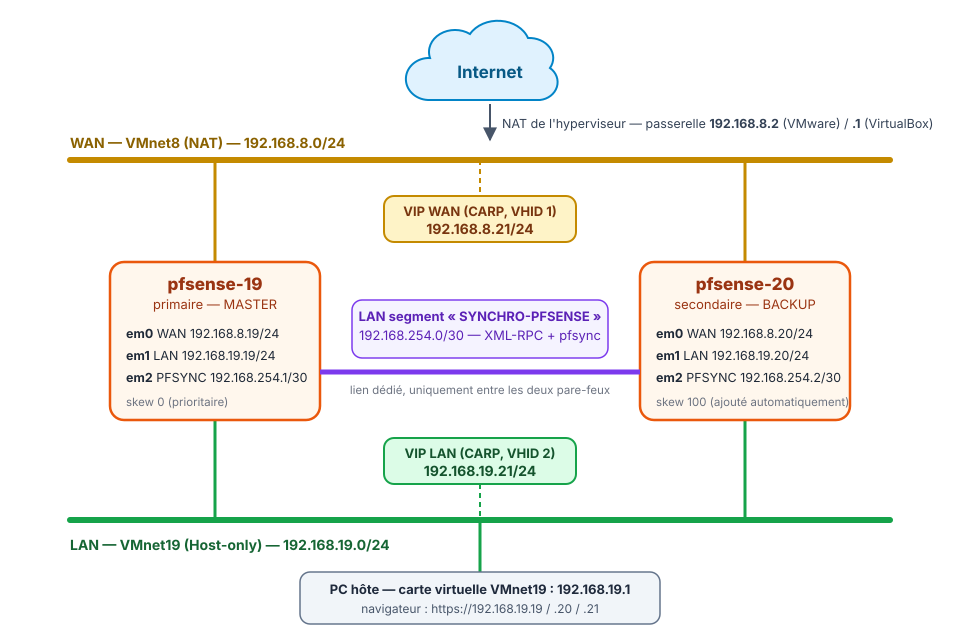{ loading=lazy }
  <figcaption>Topologie du lab. Le dernier octet rappelle le rôle : .19 = primaire, .20 = secondaire, .21 = VIP.</figcaption>
</figure>

!!! info "Pourquoi un masque /30 pour la synchronisation ?"
    Un réseau en `/30` (masque `255.255.255.252`) contient **4 adresses** : `192.168.254.0` (adresse du réseau), `.1` et `.2` (les deux seules adresses utilisables) et `.3` (diffusion). Il ne peut donc y avoir **que deux machines** sur ce réseau, exactement les deux pare-feux. Personne d'autre ne peut s'y glisser avec une adresse valide.

    Pour comparaison, un `/29` (masque `255.255.255.248`) offre 6 adresses utilisables, et un `/24` en offre 254.

!!! warning "Utilisateurs de VirtualBox : une seule différence"
    D'après la documentation d'Oracle, la passerelle d'un « Réseau NAT » VirtualBox est **toujours la première adresse** du réseau, soit `192.168.8.1`, et ce n'est pas modifiable. Partout où ce TP indique la passerelle ou le DNS `192.168.8.2`, utiliser **`192.168.8.1`** avec VirtualBox. Toutes les autres adresses sont identiques.

---

## 5. Préparer l'hyperviseur

### 5.1 Télécharger l'image ISO de pfSense CE 2.7.2

Depuis la version 2.8, pfSense CE ne se télécharge plus sous forme d'image ISO autonome. Il faut passer par le **Netgate Installer**, un installeur en ligne qui exige un compte Netgate et une connexion Internet pendant l'installation. Pour un TP, il est plus simple et plus fiable d'installer la **version 2.7.2** depuis une ISO hors ligne, puis de mettre le cluster à jour à la fin (voir la [partie 15.3](#153-mettre-a-jour-le-cluster-vers-pfsense-ce-290)). Cela permet aussi d'apprendre la procédure de mise à jour d'un cluster.

Des sites miroirs hébergent toujours l'ISO 2.7.2 :

- Dakota State University (États-Unis), archive compressée : <https://repo.ialab.dsu.edu/pfsense/pfSense-CE-2.7.2-RELEASE-amd64.iso.gz>
- Fagskolen Innlandet (Norvège), ISO directe : <https://ftp.fagskolen.gjovik.no/pub/pfSense/pfSense-CE-2.7.2-RELEASE-amd64.iso>

Un fichier en `.iso.gz` est une **archive compressée** : il faut la décompresser pour obtenir le fichier `.iso` à insérer dans le lecteur CD virtuel. Sous Windows, utiliser 7-Zip (clic droit > *7-Zip > Extraire ici*). Sous Linux, utiliser `gunzip`.

**Vérifier l'intégrité du téléchargement** permet de s'assurer que le fichier n'a été ni corrompu ni modifié. L'empreinte SHA256 officielle de l'archive `pfSense-CE-2.7.2-RELEASE-amd64.iso.gz` est :

```text
883fb7bc64fe548442ed007911341dd34e178449f8156ad65f7381a02b7cd9e4
```

=== "Windows (PowerShell)"

    ```powershell
    Get-FileHash .\pfSense-CE-2.7.2-RELEASE-amd64.iso.gz -Algorithm SHA256
    ```

=== "Linux"

    ```bash
    sha256sum pfSense-CE-2.7.2-RELEASE-amd64.iso.gz
    gunzip -k pfSense-CE-2.7.2-RELEASE-amd64.iso.gz
    ```

!!! success "Résultat attendu"
    L'empreinte affichée est **identique** à celle ci-dessus. Si elle diffère, supprimer le fichier et le télécharger à nouveau.

### 5.2 Créer les réseaux virtuels

Le lab utilise trois réseaux :

- **WAN** : il représente l'extérieur et donne accès à Internet grâce au NAT de l'hyperviseur.
- **LAN** : il représente le réseau interne de l'entreprise. Le PC hôte y est connecté, ce qui permet d'ouvrir l'interface web des pare-feux depuis son navigateur.
- **SYNCHRO-PFSENSE** : c'est un « câble virtuel » qui relie uniquement les deux pare-feux.

| Réseau du TP | VMware Workstation | VirtualBox |
|--------------|--------------------|------------|
| WAN `192.168.8.0/24` | VMnet8, type **NAT** | **Réseau NAT** (*NAT Network*) |
| LAN `192.168.19.0/24` | VMnet19, type **Host-only** | **Réseau privé hôte** (*Host-only*) |
| SYNCHRO-PFSENSE `192.168.254.0/30` | **LAN segment** | **Réseau interne** (*Internal Network*) |

=== "VMware Workstation"

    1. Ouvrir **Edit > Virtual Network Editor**, puis cliquer sur **Change Settings** (droits administrateur requis sous Windows).
    2. Sélectionner **VMnet8** (type *NAT*) et saisir **Subnet IP** `192.168.8.0` et **Subnet mask** `255.255.255.0`.
    3. Cliquer sur **NAT Settings…** et vérifier que **Gateway IP** vaut `192.168.8.2`. C'est la valeur par défaut : l'adresse `.1` est réservée au PC hôte.
    4. Cliquer sur **Add Network…**, choisir **VMnet19**, puis sélectionner **Host-only**. Saisir **Subnet IP** `192.168.19.0` et le masque `255.255.255.0`. Laisser cochée l'option **Connect a host virtual adapter to this network** : le PC hôte reçoit alors l'adresse `192.168.19.1` sur ce réseau.
    5. Cliquer sur **Apply**, puis sur **OK**.

    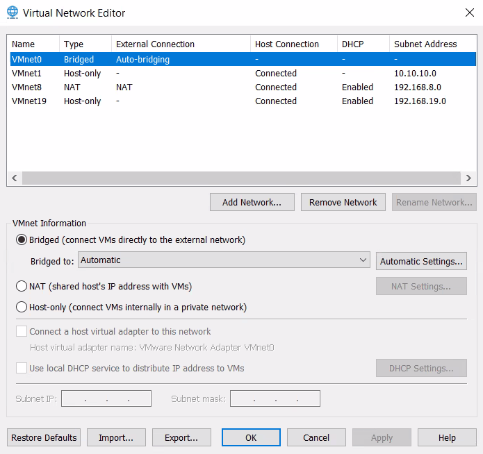{ loading=lazy }
    /// caption
    VMware — éditeur de réseaux virtuels : VMnet8 en NAT (192.168.8.0) et VMnet19 en Host-only (192.168.19.0)
    ///

    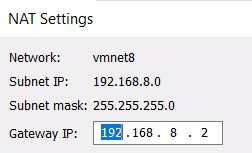{ loading=lazy width="300" }
    /// caption
    VMware — paramètres NAT de VMnet8 : passerelle 192.168.8.2
    ///

    !!! info "Pourquoi changer le sous-réseau de VMnet8 ?"
        À l'installation, VMware choisit **au hasard** un sous-réseau pour VMnet8 (par exemple `192.168.153.0/24`), différent d'un PC à l'autre. Le fixer à `192.168.8.0/24` permet de suivre le TP à l'identique. L'option DHCP de VMnet19 peut rester active : aucune machine du TP ne l'utilise.

    Le réseau **SYNCHRO-PFSENSE** ne se crée pas ici. C'est un **LAN segment**, créé depuis les paramètres de la VM (voir l'[étape 5.3](#53-creer-les-deux-machines-virtuelles)).

=== "VirtualBox"

    1. Ouvrir le **Gestionnaire de réseau** : **Fichier > Outils > Gestionnaire de réseau**, ou le volet **Outils > Réseau**.
    2. Dans l'onglet **Réseaux NAT**, cliquer sur **Créer**. Nommer le réseau `WAN-PFSENSE` et saisir le préfixe IPv4 `192.168.8.0/24`. L'option DHCP n'a pas d'importance. La passerelle sera automatiquement `192.168.8.1`.
    3. Dans l'onglet **Réseaux privés hôte**, cliquer sur **Créer**. Choisir **Configurer l'adaptateur manuellement** avec l'adresse IPv4 `192.168.19.1` et le masque `255.255.255.0`. Dans l'onglet **Serveur DHCP**, décocher **Activer le serveur**.
    4. Le réseau **SYNCHRO-PFSENSE** est un **réseau interne** : il n'a pas besoin d'être créé à l'avance. Il existe dès qu'une carte réseau est rattachée à un réseau interne portant ce nom.

    !!! note "Variante non testée dans le lab de référence"
        Les manipulations de ce TP ont été réalisées et vérifiées sous VMware Workstation et KVM. Les réglages VirtualBox ci-dessous suivent la documentation d'Oracle et les recommandations de Netgate pour la virtualisation, mais n'ont pas été rejoués dans VirtualBox.

    !!! warning "Ne pas utiliser le mode « NAT » simple pour le WAN"
        En mode **NAT** (et non *Réseau NAT*), VirtualBox crée un réseau **privé pour chaque VM** : les deux pare-feux ne se voient pas côté WAN. Chacun se croit alors seul et se déclare MASTER de la VIP WAN, et le cluster ne peut pas fonctionner. Le mode **Réseau NAT** place au contraire les deux VM sur le **même** réseau.

    !!! note "Hôte Linux ou macOS"
        Sur ces systèmes, VirtualBox n'autorise par défaut que les réseaux privés hôte compris dans `192.168.56.0/21`. Pour utiliser `192.168.19.0/24`, ajouter la ligne `* 192.168.0.0/16` dans le fichier `/etc/vbox/networks.conf`, à créer s'il n'existe pas.

### 5.3 Créer les deux machines virtuelles

Créer deux VM identiques, nommées `pfsense-19` et `pfsense-20`.

| Paramètre | Valeur | Explication |
|-----------|--------|-------------|
| Système invité | **Other > FreeBSD 14 64-bit** (VMware) ou **BSD > FreeBSD (64-bit)** (VirtualBox) | pfSense 2.7.2 repose sur FreeBSD 14. Si cette version n'est pas proposée, choisir la version 64 bits de FreeBSD la plus récente. |
| Processeur | 1 vCPU | Largement suffisant pour un lab. |
| Mémoire | **1 Go** (**2 Go** si la mise à jour de la partie 15.3 est prévue) | 1 Go est le minimum officiel et suffit pour tout le TP (512 Mo fonctionnent en pratique pour un lab). La mise à jour demande plus : avec 1 Go, elle a échoué faute de mémoire dans le lab de test (voir la [partie 15.3](#153-mettre-a-jour-le-cluster-vers-pfsense-ce-290)). |
| Disque | 20 Go | Le minimum officiel est de 8 Go. |
| Lecteur CD | L'ISO pfSense CE 2.7.2 | — |
| Cartes réseau | **3 cartes, dans cet ordre** : WAN, LAN, SYNCHRO-PFSENSE | pfSense les nommera `em0`, `em1` et `em2` dans cet ordre. |

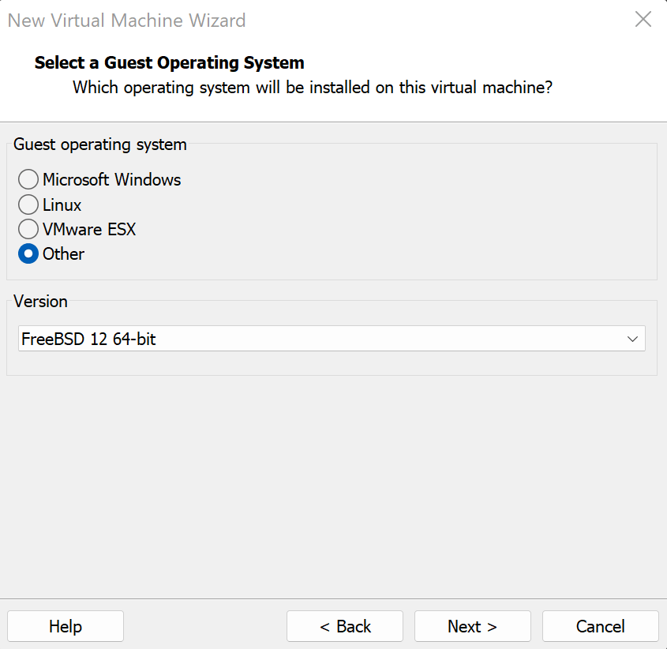{ loading=lazy width="420" }
/// caption
VMware — choix du système invité : Other, puis FreeBSD 64 bits
///

=== "VMware Workstation"

    Dans **VM > Settings… > Hardware** :

    - **Network Adapter** : **Custom** > `VMnet8 (NAT)` ;
    - **Network Adapter 2** (bouton **Add… > Network Adapter**) : **Custom** > `VMnet19` ;
    - **Network Adapter 3** : choisir **LAN segment**, cliquer sur **LAN Segments… > Add**, nommer le segment `SYNCHRO-PFSENSE`, valider, puis le sélectionner dans la liste.

    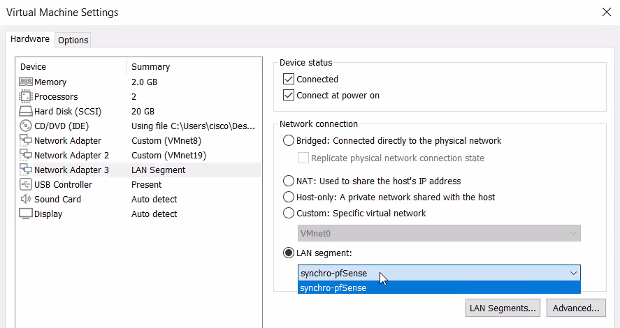{ loading=lazy }
    /// caption
    VMware — 3ᵉ carte réseau reliée au LAN segment de synchronisation
    ///

    !!! info "Qu'est-ce qu'un LAN segment ?"
        Un **LAN segment** relie entre elles les VM qui y sont connectées, comme un switch privé, **sans passer par le Virtual Network Editor**.

        - Contrairement à un VMnet, il ne crée **aucune carte réseau virtuelle sur le PC hôte** et ne fournit **aucun service DHCP**. Il faut donc obligatoirement définir des **adresses IP statiques** dans chaque VM, ici dans pfSense.
        - Il accepte n'importe quel masque, dont le `/30`. Un VMnet, lui, est aussi relié au PC hôte : le réseau de synchronisation ne serait plus réservé aux deux pare-feux. De plus, VMware déconseille de modifier le masque des VMnets, et les tests menés sous VMware Workstation n'ont pas permis d'y descendre en dessous d'un `/29` (6 hôtes).

=== "VirtualBox"

    *Variante non rejouée dans le lab de test : voir la remarque de l'[étape 5.2](#52-creer-les-reseaux-virtuels).*

    Dans **Configuration > Réseau** :

    | Carte | Mode d'accès réseau | Nom |
    |-------|---------------------|-----|
    | Adapter 1 | **Réseau NAT** | `WAN-PFSENSE` |
    | Adapter 2 | **Réseau privé hôte** | l'adaptateur créé en `192.168.19.1` |
    | Adapter 3 | **Réseau interne** | `SYNCHRO-PFSENSE` (saisir le nom) |

    Pour **chacune des trois cartes**, déplier **Avancé** et régler :

    - **Type d'interface** : `Intel PRO/1000 MT Desktop (82540EM)`. pfSense nommera alors les interfaces `em0`, `em1` et `em2`, comme dans ce TP.
    - **Mode Promiscuité** : **Tout autoriser** (*Allow All*). CARP utilise une adresse MAC virtuelle (`00:00:5e:00:01:xx`). Sans ce réglage, VirtualBox rejette les trames destinées à cette adresse et la bascule échoue. C'est la recommandation officielle de Netgate pour la virtualisation.

    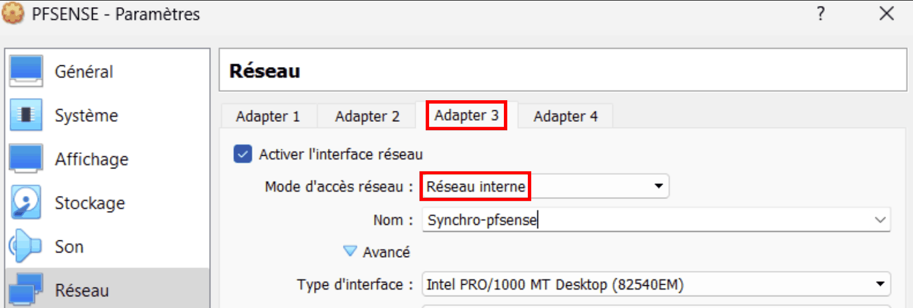{ loading=lazy }
    /// caption
    VirtualBox — 3ᵉ carte en « Réseau interne » dédié à la synchronisation
    ///

    !!! tip "Installation automatique"
        Si l'assistant de VirtualBox propose une « installation sans surveillance » (*unattended installation*), la désactiver : pfSense s'installe manuellement.

!!! warning "Ne pas modifier les adresses MAC des cartes réseau"
    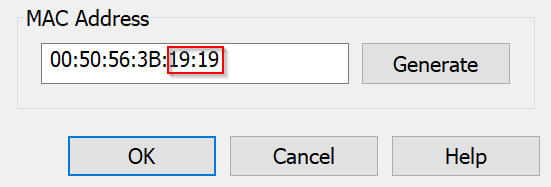{ loading=lazy width="380" }
    /// caption
    VMware — champ MAC Address d'une carte réseau : à laisser tel quel
    ///

    Il peut être tentant de personnaliser l'adresse MAC de chaque carte (**VM > Settings… > Network Adapter > Advanced > MAC Address**), pour reconnaître le réseau d'une interface à la lecture de son adresse. En pratique, cela s'est révélé source de problèmes réseau dans certains cas. **Laisser les adresses générées par l'hyperviseur.**

!!! warning "Vérifier l'ordre des interfaces"
    La synchronisation XML-RPC recopie les règles **interface par interface**. Netgate exige donc que les interfaces soient **affectées dans le même ordre sur les deux nœuds** : `em0` = WAN, `em1` = LAN, `em2` = PFSYNC. Si une VMware récente nomme les interfaces `vmx0`, `vmx1`, `vmx2` (carte de type *vmxnet3*), ce n'est pas grave : il suffit d'adapter les noms en respectant le même ordre sur les deux pare-feux.

---

## 6. Installer pfSense sur les deux VM

Réaliser cette installation **sur les deux VM**. Elles peuvent être installées en parallèle.

1. Démarrer la VM sur l'ISO. Sur l'écran **Copyright and Trademark Notices**, valider **Accept** avec ++enter++.

    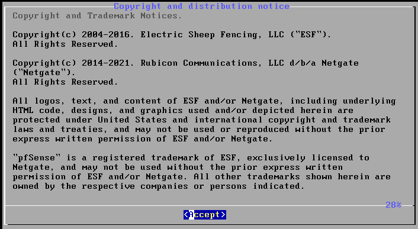{ loading=lazy width="420" }
    /// caption
    Installeur — écran de copyright : Accept
    ///

2. Sur l'écran **Welcome to pfSense!**, choisir **Install — Install pfSense**, puis **OK**.

    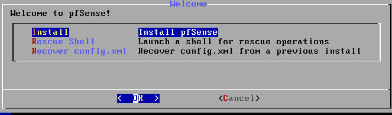{ loading=lazy width="420" }
    /// caption
    Installeur — choisir Install pfSense
    ///

3. Sur l'écran de partitionnement (**How would you like to partition your disk?**), choisir **Auto (ZFS) — Guided Root-on-ZFS**, puis **OK**.

    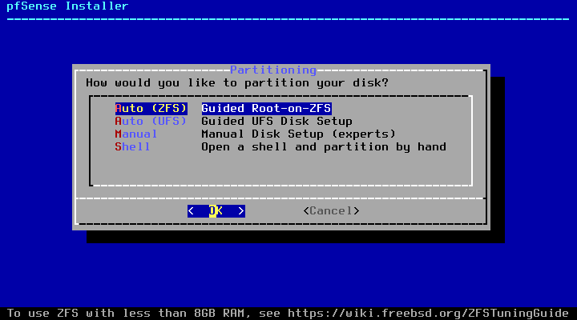{ loading=lazy width="420" }
    /// caption
    Installeur 2.7.2 — partitionnement : Auto (ZFS)
    ///

    !!! info "ZFS ou UFS ?"
        **ZFS** est un système de fichiers moderne qui résiste mieux aux coupures de courant brutales. C'est le choix par défaut depuis pfSense 2.6. Le message « *To use ZFS with less than 8GB RAM…* » est purement informatif : il ne pose aucun problème dans ce lab. Selon la version de l'installeur, l'ordre des options peut varier, ou un écran de choix du clavier (*Keymap Selection*) peut apparaître avant. Dans ce cas, garder le clavier par défaut.

4. Le menu **ZFS Configuration** s'affiche. Descendre sur **T — Pool Type/Disks** et valider avec ++enter++.

5. Choisir **stripe — No Redundancy**. La VM n'a qu'un disque : la redondance n'aurait aucun sens.

    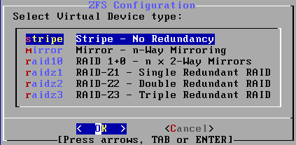{ loading=lazy width="420" }
    /// caption
    Type de pool ZFS : stripe
    ///

6. Cocher le disque `da0` avec la **barre d'espace** (une étoile `[*]` apparaît), puis valider **OK**.

    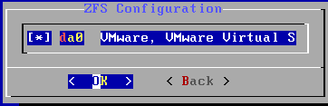{ loading=lazy width="420" }
    /// caption
    Sélection du disque da0 avec la barre d'espace
    ///

7. De retour au menu, la ligne indique **stripe: 1 disk**. Remonter sur **>>> Install — Proceed with Installation** et valider.

    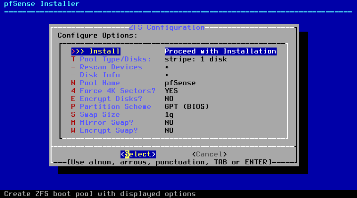{ loading=lazy width="420" }
    /// caption
    Menu ZFS Configuration : stripe sur 1 disque, prêt pour Install
    ///

8. Sur l'avertissement **Last Chance!**, choisir **YES** (flèche gauche, puis ++enter++). Le disque virtuel est vide, rien n'est perdu.

    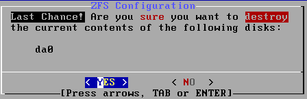{ loading=lazy width="420" }
    /// caption
    Dernière confirmation avant l'effacement du disque : YES
    ///

9. Patienter pendant la vérification et l'extraction des fichiers (une à deux minutes).

    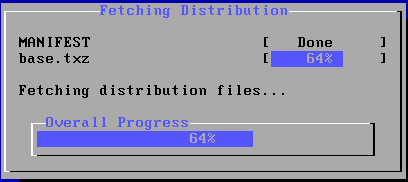{ loading=lazy width="420" }
    /// caption
    Extraction des fichiers
    ///

10. Sur l'écran **Complete**, choisir **Reboot**.

    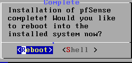{ loading=lazy width="380" }
    /// caption
    Fin de l'installation : Reboot
    ///

!!! tip "Éjecter l'ISO"
    Si la VM redémarre sur l'installeur au lieu du système installé, éteindre la VM, **déconnecter le lecteur CD** (VMware : décocher **Connected** et **Connect at power on** ; VirtualBox : **Retirer le disque du lecteur virtuel**), puis la redémarrer.

🛟 **Point de sauvegarde** : prendre un instantané des deux VM, nommé « Installation terminée ».

---

## 7. Configuration initiale en console

Au premier démarrage, pfSense affiche un menu numéroté dans la console de la VM. Le clavier y est en **QWERTY** : voir l'[annexe 16.7](#167-passer-le-clavier-de-la-console-en-azerty) pour passer en AZERTY.

### 7.1 Affecter les interfaces (option 1)

pfSense attribue automatiquement `em0` au WAN et `em1` au LAN, mais pas `em2`. L'option **1) Assign Interfaces** permet de tout affecter explicitement, **dans le même ordre sur les deux pare-feux**.

**Sur les deux pare-feux** : saisir `1`, puis répondre aux questions.

| Question affichée | Réponse | Explication |
|-------------------|---------|-------------|
| `Should VLANs be set up now [y\|n]?` | `n` | Pas de VLAN dans ce TP. |
| `Enter the WAN interface name…` | `em0` | Première carte = VMnet8 (NAT). |
| `Enter the LAN interface name…` | `em1` | Deuxième carte = VMnet19. |
| `Enter the Optional 1 interface name…` | `em2` | Troisième carte = LAN segment SYNCHRO-PFSENSE. Elle s'appellera `OPT1` jusqu'à son renommage en `PFSYNC`. |
| `Enter the Optional 2 interface name…` | ++enter++ (vide) | Plus d'autre carte. |
| `Do you want to proceed [y\|n]?` | `y` | — |

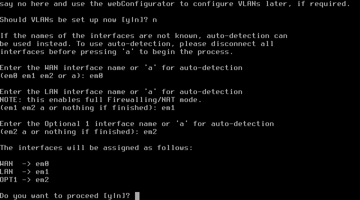{ loading=lazy width="560" }
/// caption
Console — affectation des interfaces : WAN em0, LAN em1, OPT1 em2
///

### 7.2 Donner son adresse IP au LAN (option 2)

L'adresse LAN par défaut, `192.168.1.1`, n'est pas dans le réseau du PC hôte (`192.168.19.0/24`). Il faut la changer pour pouvoir ouvrir l'interface web.

**Sur chaque pare-feu** : saisir `2`, puis `2` pour choisir l'interface LAN.

| Question affichée | `pfsense-19` | `pfsense-20` | Explication |
|-------------------|--------------|--------------|-------------|
| `Configure IPv4 address LAN interface via DHCP? (y/n)` | `n` | `n` | Un pare-feu a une adresse fixe. |
| `Enter the new LAN IPv4 address` | `192.168.19.19` | `192.168.19.20` | — |
| `Enter the new LAN IPv4 subnet bit count` | `24` | `24` | Masque `255.255.255.0`. |
| `For a WAN, enter the new LAN IPv4 upstream gateway address` | ++enter++ | ++enter++ | Pas de passerelle sur un LAN. |
| `Configure IPv6 address LAN interface via DHCP6? (y/n)` | `n` | `n` | Pas d'IPv6 dans ce TP. |
| `Enter the new LAN IPv6 address` | ++enter++ | ++enter++ | — |
| `Do you want to enable the DHCP server on LAN? (y/n)` | `n` | `n` | Deux serveurs DHCP sur le même réseau se feraient concurrence. |
| `Do you want to revert to HTTP as the webConfigurator protocol? (y/n)` | `n` | `n` | On garde HTTPS, chiffré. |

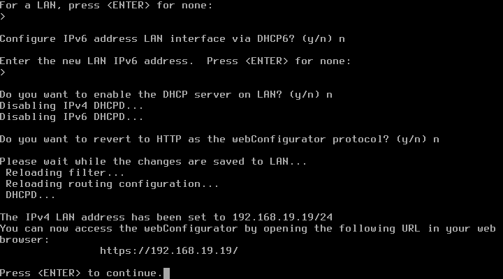{ loading=lazy width="560" }
/// caption
Console — fin de la configuration de l'adresse LAN du primaire
///

!!! success "Vérification"
    Depuis le PC hôte, la commande `ping 192.168.19.19` puis `ping 192.168.19.20` doit recevoir des réponses. Si ce n'est pas le cas, vérifier que la 2^e^ carte de la VM est bien dans VMnet19 (ou dans le réseau privé hôte de VirtualBox).

---

## 8. Premier accès web et assistant de configuration

### 8.1 Se connecter à l'interface web

Depuis le navigateur du PC hôte, ouvrir `https://192.168.19.19` pour le primaire et `https://192.168.19.20` pour le secondaire.

Le navigateur affiche un **avertissement de sécurité**. C'est normal : pfSense utilise un **certificat auto-signé**, qu'aucune autorité reconnue n'a signé. La connexion est bien chiffrée, mais le navigateur ne peut pas garantir l'identité du site. Dans un lab, cliquer sur **Paramètres avancés > Continuer vers le site**.

L'identifiant et le mot de passe par défaut sont **`admin` / `pfsense`** (documentation officielle de Netgate).

### 8.2 Suivre l'assistant de configuration (*Setup Wizard*)

L'assistant démarre automatiquement à la première connexion. Le réaliser **sur les deux pare-feux** avec les valeurs suivantes, en cliquant sur **Next** à chaque page.

| Page de l'assistant | Champ | `pfsense-19` | `pfsense-20` |
|---------------------|-------|--------------|--------------|
| Netgate Global Support | — | **Next** | **Next** |
| General Information | Hostname | `pfsense-19` | `pfsense-20` |
| | Domain | `home.arpa` | `home.arpa` |
| | Primary DNS Server | `192.168.8.2` (VirtualBox : `.1`) | idem |
| Time Server Information | Timezone | `Europe/Paris` | `Europe/Paris` |
| Configure WAN Interface | SelectedType | `Static` | `Static` |
| | IP Address / Subnet Mask | `192.168.8.19` / `24` | `192.168.8.20` / `24` |
| | Upstream Gateway | `192.168.8.2` (VirtualBox : `.1`) | idem |
| | **Block RFC1918 Private Networks** | **décoché** | **décoché** |
| | Block bogon networks | coché (par défaut) | coché |
| Configure LAN Interface | LAN IP Address / Subnet Mask | `192.168.19.19` / `24` | `192.168.19.20` / `24` |
| Set Admin WebGUI Password | Admin Password | un mot de passe robuste | **le même** que sur le primaire |
| Reload configuration | — | **Reload** | **Reload** |

<figure markdown="span">
  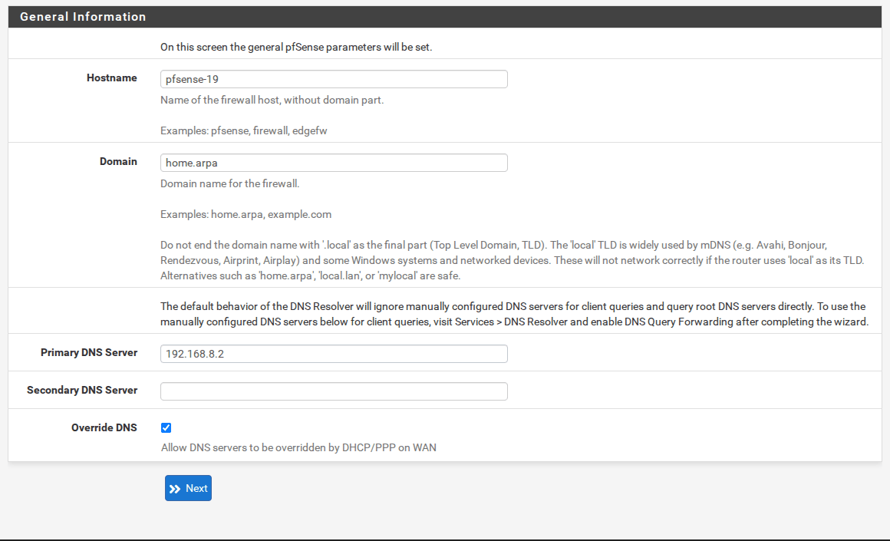{ loading=lazy }
  <figcaption>Le nom d'hôte est propre à chaque nœud et n'est jamais synchronisé : c'est lui qui permet de savoir où l'on se trouve.</figcaption>
</figure>

<figure markdown="span">
  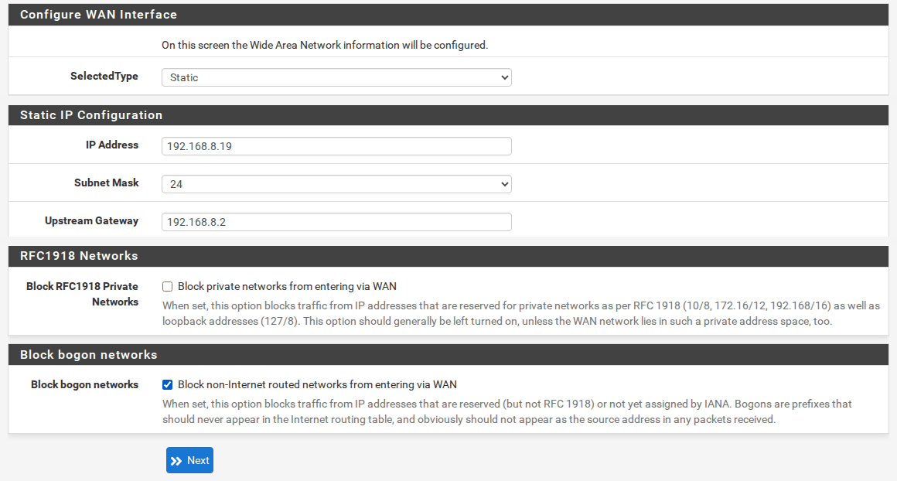{ loading=lazy }
  <figcaption>Extrait de la page WAN : seules les parties à modifier sont montrées.</figcaption>
</figure>

!!! warning "Pourquoi décocher « Block RFC1918 Private Networks » ?"
    Cette option bloque, à l'entrée du WAN, tout trafic provenant d'une adresse **privée** (`10.0.0.0/8`, `172.16.0.0/12`, `192.168.0.0/16`). Sur une vraie connexion Internet, c'est une bonne protection : aucune adresse privée ne devrait arriver d'Internet. Mais dans ce lab, **le WAN lui-même est un réseau privé** (`192.168.8.0/24`), et le texte d'aide de pfSense le précise : *« This option should generally be left turned on, unless the WAN network lies in such a private address space, too »*. Laissée cochée, l'option bloquerait toute connexion **initiée depuis le WAN** du lab, par exemple l'accès à l'interface web par le WAN décrit en [annexe 16.5](#165-acceder-a-linterface-web-par-le-wan-avec-une-regle-permanente).

    Elle ne gêne en revanche **ni CARP ni l'accès à Internet**. Le lab de test l'a vérifié : la règle automatique qui autorise CARP passe avant ce blocage, et les réponses aux connexions sortantes sont acceptées grâce à la table d'états.

!!! danger "Ne pas relancer l'assistant sur un pare-feu déjà configuré"
    L'assistant reste accessible dans **System > Setup Wizard**, mais il ne sert qu'à la première configuration. Dans le lab de test, rouvrir l'assistant sur un pare-feu en service et cliquer sur **Next** à une seule étape, sans aller jusqu'au bout, a suffi à **effacer l'adresse IP du WAN** dans la configuration. La panne n'est apparue qu'au redémarrage suivant, ce qui la rend difficile à diagnostiquer. Pour modifier un réglage ensuite, passer par le menu concerné, par exemple **Interfaces > WAN**.

!!! info "Pourquoi le même mot de passe admin sur les deux nœuds ?"
    L'option **Synchronize admin**, activée à l'[étape 10.2](#102-parametrer-la-synchronisation-sur-le-primaire), recopiera de toute façon le compte `admin` du primaire vers le secondaire. Choisir le même mot de passe dès maintenant évite toute confusion.

### 8.3 Configurer l'interface de synchronisation (OPT1 → PFSYNC)

**Sur chaque pare-feu**, ouvrir **Interfaces > OPT1**, puis :

| Champ | `pfsense-19` | `pfsense-20` |
|-------|--------------|--------------|
| Enable | coché | coché |
| Description | `PFSYNC` | `PFSYNC` |
| IPv4 Configuration Type | `Static IPv4` | `Static IPv4` |
| IPv4 Address | `192.168.254.1` / `30` | `192.168.254.2` / `30` |
| IPv4 Upstream gateway | `None` | `None` |

Cliquer sur **Save**, puis sur **Apply Changes**.

!!! info "Pourquoi « None » comme passerelle ?"
    Une passerelle (*gateway*) sert à joindre des réseaux **lointains**. Le lien de synchronisation ne mène nulle part ailleurs : les deux pare-feux sont directement reliés, une passerelle y serait inutile.

### 8.4 Distinguer les deux pare-feux d'un coup d'œil

Pour ne pas confondre les deux interfaces web, ouvertes côte à côte dans le navigateur :

- **Sur le primaire** : dans **System > General Setup** (*Système > Configuration générale*), régler **Language** sur **Français** et **Theme** sur **pfSense-dark**, puis **Save**.
- **Sur le secondaire** : laisser l'anglais et le thème clair.

Ces réglages appartiennent à **System > General Setup**, qui n'est **jamais synchronisé** : ils resteront différents même une fois la synchronisation active.

!!! success "État attendu des consoles"
    Une fois les interfaces configurées, la console de chaque pare-feu affiche ses trois adresses.

    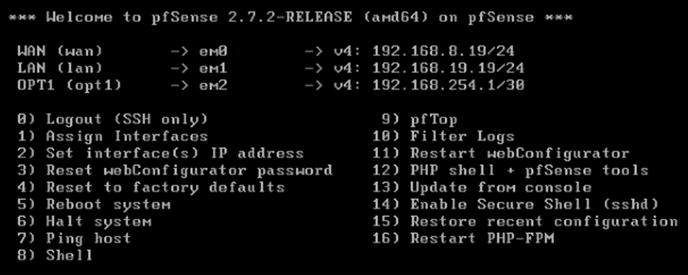{ loading=lazy width="560" }
    /// caption
    Console du primaire, interfaces configurées
    ///

    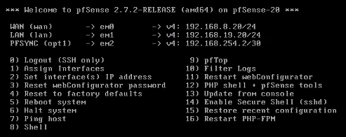{ loading=lazy width="560" }
    /// caption
    Console du secondaire, interfaces configurées
    ///

---

## 9. Tester la connectivité entre les deux pare-feux

Sur une interface optionnelle comme PFSYNC, pfSense **bloque tout le trafic entrant par défaut** tant qu'aucune règle ne l'autorise. C'est le principe du **refus par défaut** : *tout ce qui n'est pas explicitement autorisé est interdit*. Le premier test consiste à autoriser le ping du secondaire vers le primaire.

**Sur le primaire**, ouvrir **Firewall > Rules > PFSYNC** (*Pare-feu > Règles > PFSYNC*), cliquer sur **Add**, puis renseigner :

| Champ | Valeur |
|-------|--------|
| Action | `Pass` (*Autoriser*) |
| Interface | `PFSYNC` |
| Address Family | `IPv4` |
| Protocol | `ICMP` — sous-type `any` (*tout*) |
| Source | `Address or Alias` : `192.168.254.2` (le secondaire) |
| Destination | `Address or Alias` : `192.168.254.1` (le primaire) |

Cliquer sur **Save**, puis sur **Apply Changes** (*Appliquer les modifications*). Tant que ce bouton n'est pas cliqué, la règle est enregistrée mais **pas active**.

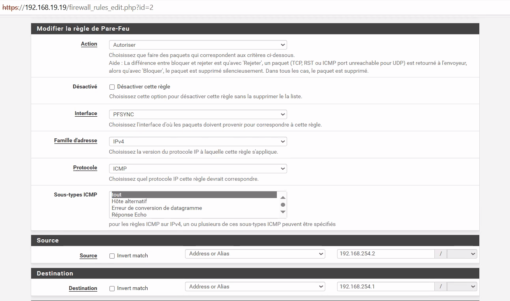{ loading=lazy }
/// caption
Primaire — règle ICMP sur PFSYNC, de 192.168.254.2 vers 192.168.254.1
///

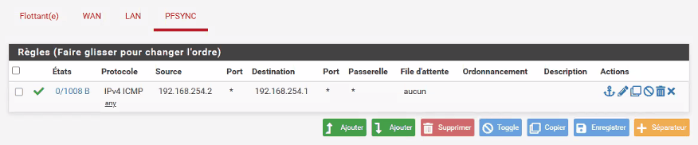{ loading=lazy }
/// caption
Primaire — la règle ICMP dans la liste des règles PFSYNC
///

**Sur le secondaire**, ouvrir **Diagnostics > Ping**, puis saisir **Hostname** `192.168.254.1`, **Source address** `PFSYNC` et cliquer sur **Ping**.

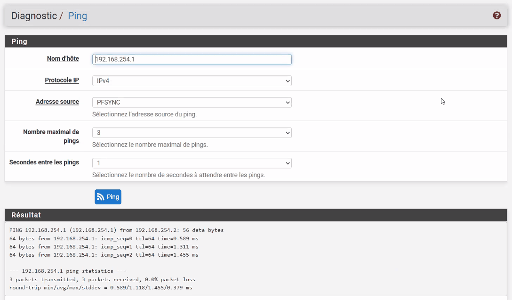{ loading=lazy }
/// caption
Secondaire — ping de 192.168.254.1 depuis l'interface PFSYNC : 0 % de perte
///

!!! question "Pourquoi créer la règle sur le primaire, alors que le ping part du secondaire ?"
    ??? success "Réponse"
        Une règle de pare-feu pfSense s'applique aux paquets qui **entrent** par une interface. Le ping (*echo request*) sort du secondaire, ce qui est toujours autorisé, puis **entre** dans le primaire par son interface PFSYNC : c'est **le primaire** qui doit l'accepter. La réponse (*echo reply*) revient ensuite automatiquement, grâce à la **table d'états**.

        Ce fonctionnement a été vérifié dans le lab de test : avec la règle sur le secondaire uniquement, on obtient **100 % de perte** ; avec la règle sur le primaire, **0 % de perte**.

!!! tip "En cas d'échec du ping"
    Si le ping ne passe toujours pas, autoriser l'ensemble du réseau **PFSYNC subnets** en source et en destination, au lieu des deux adresses, **sur les deux pare-feux**. Cette modification a réglé le problème dans certains cas.

    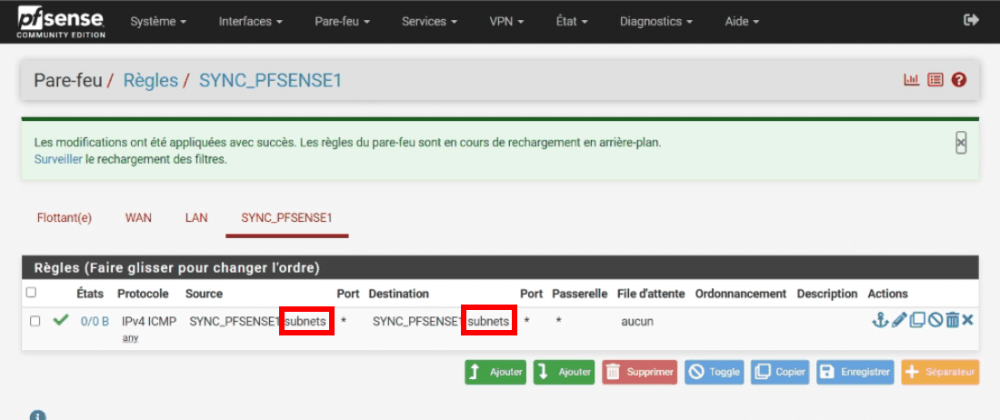{ loading=lazy }
    /// caption
    Variante de dépannage : ICMP autorisé entre PFSYNC subnets
    ///

**Vérifier aussi l'accès à Internet** (indispensable pour la mise à jour finale) : **sur chaque pare-feu**, dans **Diagnostics > Ping**, pinguer `192.168.8.2` (la passerelle), puis `1.1.1.1`, avec **Source address** `WAN`.

🛟 **Point de sauvegarde** : prendre un instantané « Configuration de base ».

---

## 10. Configurer la synchronisation haute disponibilité

### 10.1 Créer un utilisateur dédié à la synchronisation

Le primaire doit **s'authentifier** auprès du secondaire pour lui envoyer la configuration. Plutôt que d'utiliser le compte `admin`, on crée un compte dédié. C'est une bonne pratique : ce compte sert à une seule tâche, et il peut être désactivé ou changé sans toucher au compte d'administration.

**Sur le secondaire** :

1. Ouvrir **System > User Manager** (*Système > Gestionnaire d'usagers*) et cliquer sur **Add**.
2. Saisir **Username** `ha-user` et un mot de passe robuste, puis cliquer sur **Save**.
3. **Modifier à nouveau** l'utilisateur (icône crayon) : la section **Effective Privileges** n'apparaît qu'après le premier enregistrement.

    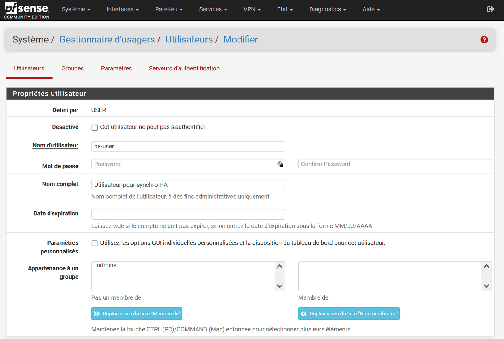{ loading=lazy }
    /// caption
    Création de l'utilisateur ha-user
    ///

4. Dans **Effective Privileges**, cliquer sur **Add**, sélectionner **System - HA node sync** (*Système – Synchronisation du nœud du Système HA*), puis enregistrer.

    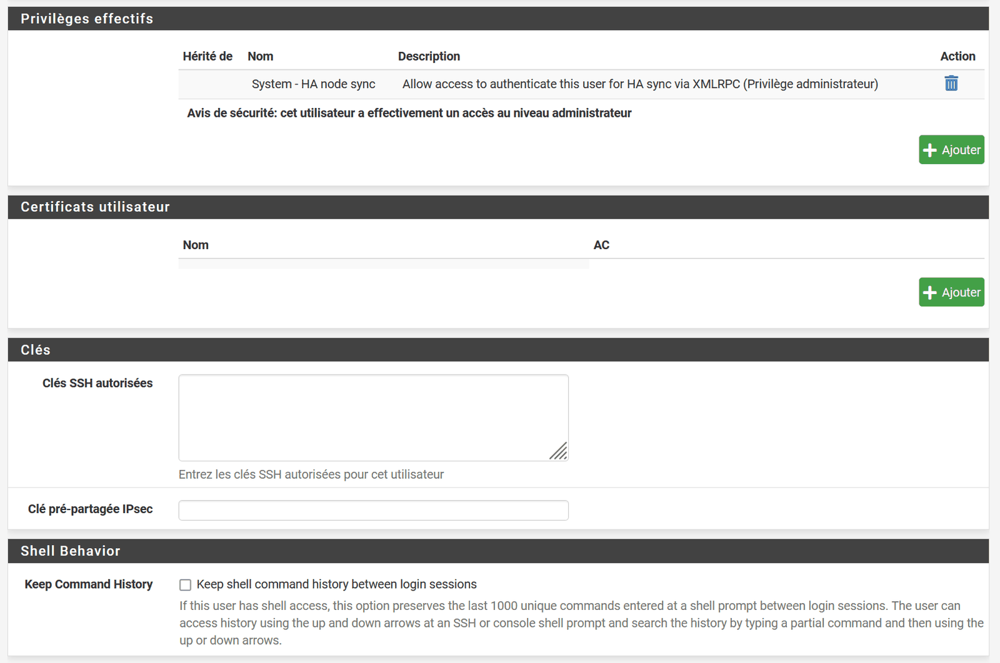{ loading=lazy }
    /// caption
    Privilège System - HA node sync attribué à ha-user
    ///

!!! warning "Un compte à protéger"
    pfSense le signale lui-même : ce privilège donne en pratique un **accès équivalent à celui d'un administrateur**, puisqu'il permet de remplacer la configuration. Le mot de passe de `ha-user` doit donc être aussi robuste que celui d'`admin`.

**Sur le primaire**, créer **le même utilisateur**, avec le même nom, le même mot de passe et le même privilège.

!!! question "Pourquoi créer aussi `ha-user` sur le primaire, alors que c'est le secondaire qui reçoit les connexions ?"
    ??? success "Réponse"
        La synchronisation XML-RPC ne **fusionne** pas les configurations : elle **remplace** des sections entières du secondaire par celles du primaire. C'est le cas de la liste des utilisateurs, dès que l'option *User manager users and groups* est cochée.

        Si `ha-user` n'existait que sur le secondaire, la première synchronisation **supprimerait** ce compte, absent du primaire, et toutes les synchronisations suivantes échoueraient faute d'authentification. Le cluster se « casserait » lui-même.

### 10.2 Paramétrer la synchronisation sur le primaire

**Sur le primaire uniquement**, ouvrir **System > High Avail. Sync**. La page s'intitule *High Availability* ; en français, le menu s'appelle **Système > High Availability**.

| Section | Champ | Valeur | Rôle |
|---------|-------|--------|------|
| State Synchronization Settings (pfsync) | **Synchronize states** | coché | Envoie la table d'états au pair. |
| | **Synchronize Interface** | `PFSYNC` | Lien dédié. |
| | Filter Host ID | vide | Identifiant unique généré automatiquement. |
| | **pfsync Synchronize Peer IP** | `192.168.254.2` | Envoi direct au secondaire, plutôt qu'en multicast. |
| Configuration Synchronization Settings (XMLRPC Sync) | **Synchronize Config to IP** | `192.168.254.2` | Adresse PFSYNC du secondaire. |
| | **Remote System Username** | `ha-user` | — |
| | **Remote System Password** | mot de passe de `ha-user` | — |
| | **Synchronize admin** | coché | Recopie aussi le compte `admin`, mot de passe compris. |
| | **Select options to sync** | **Toggle All** (tout cocher) | Règles, NAT, VIP, utilisateurs, etc. |

Cliquer sur **Save**.

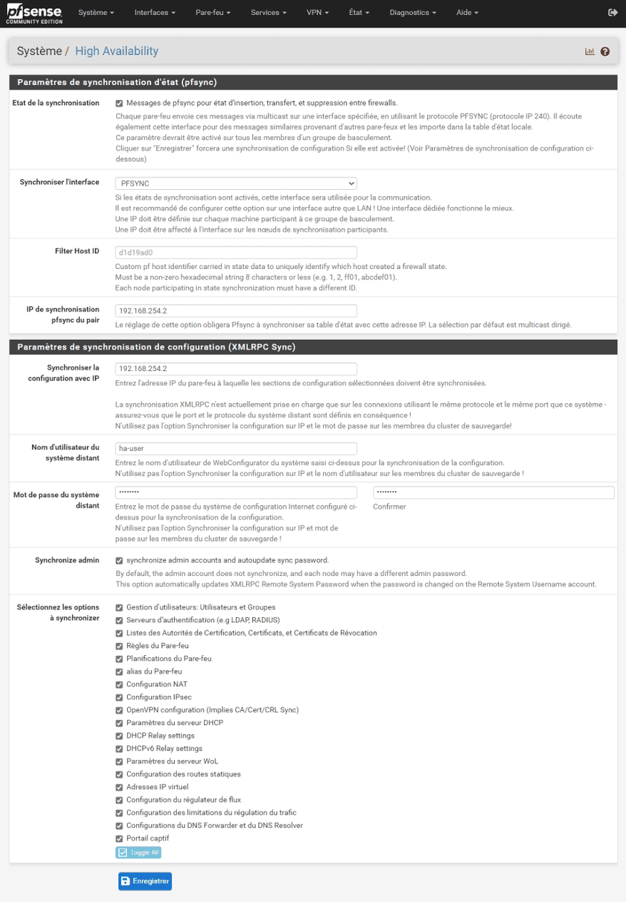{ loading=lazy }
/// caption
Primaire — page High Availability entièrement renseignée
///

**Il n'est pas nécessaire de configurer la partie XML-RPC sur le secondaire** : la réplication de la configuration du primaire s'effectuera dès que les flux seront autorisés des deux côtés.

### 10.3 Autoriser les flux de synchronisation

Pour respecter les bonnes pratiques de sécurité, on n'autorise **que les adresses, ports et protocoles strictement nécessaires** à la synchronisation, et rien de plus. La configuration se fait dans **Firewall > Rules > PFSYNC**.

#### Règle 1 — XML-RPC, pour la synchronisation de la configuration

**Sur le primaire**, cliquer sur **Add** et créer la règle suivante :

| Champ | Valeur | Explication |
|-------|--------|-------------|
| Action | `Pass` | — |
| Interface | `PFSYNC` | Interface dédiée à la réplication. |
| Address Family | `IPv4` | — |
| Protocol | `TCP` | XML-RPC voyage dans une connexion HTTPS. |
| Source | `PFSYNC subnets` | Tout le réseau `192.168.254.0/30` : il ne contient que les deux pare-feux. |
| Destination | `PFSYNC subnets` | Même raisonnement. |
| Destination Port Range | `HTTPS (443)` | Port de l'interface web, qui reçoit les appels XML-RPC. |
| Description | `autoriser la synchro de configuration XML-RPC` | Une règle décrite est une règle compréhensible six mois plus tard. |

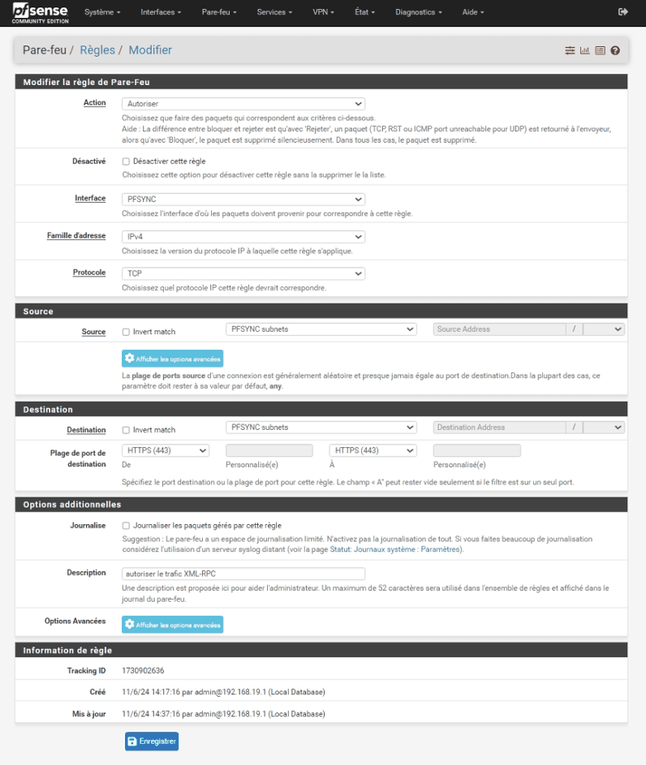{ loading=lazy }
/// caption
Règle XML-RPC : TCP 443 de PFSYNC subnets vers PFSYNC subnets
///

!!! info "Pourquoi « PFSYNC subnets » plutôt qu'une adresse IP ?"
    La règle va être **recopiée telle quelle** sur le secondaire. Avec une adresse propre à un nœud (par exemple « destination `192.168.254.1` »), la copie serait fausse sur l'autre nœud, puisque la règle ne serait pas adaptée à sa situation. **PFSYNC subnets** désigne le réseau `/30`, valable sur les deux pare-feux. Un **alias** contenant les deux adresses `192.168.254.1` et `192.168.254.2` conviendrait aussi.

**Ensuite, créer exactement la même règle sur le secondaire.**

!!! question "Pourquoi faire cette règle sur le secondaire également ?"
    ??? success "Réponse"
        Le primaire **envoie** son flux XML-RPC vers le secondaire. Ce flux **entre** donc par l'interface PFSYNC du **secondaire**. Sans règle l'autorisant sur le secondaire, il est bloqué (refus par défaut) et la synchronisation ne s'effectue pas.

        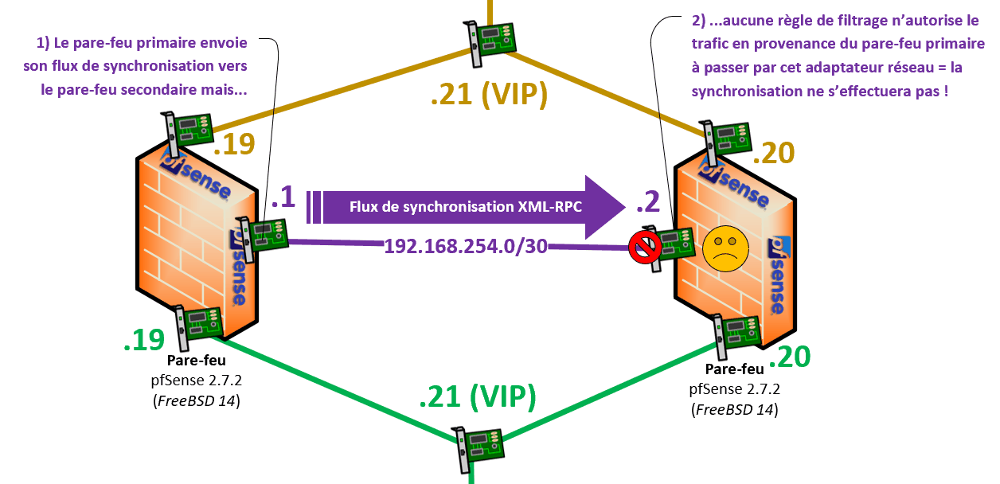{ loading=lazy }
        /// caption
        Sans règle sur le secondaire, le flux XML-RPC est bloqué à son entrée
        ///

!!! question "Pourquoi ne pas avoir commencé par la règle sur le secondaire, alors ?"
    ??? success "Réponse"
        Parce que la configuration du **primaire est la référence**. Dès que la synchronisation fonctionne, les règles du secondaire sont **remplacées** par celles du primaire.

        Si la règle XML-RPC n'existait que sur le secondaire, la première synchronisation l'**effacerait**, puisqu'elle est absente de la configuration de référence, et toutes les synchronisations suivantes seraient bloquées. En la créant d'abord sur le primaire, on garantit qu'elle fait partie de la configuration recopiée : le secondaire reçoit une copie identique de sa propre règle et la synchronisation se maintient.

        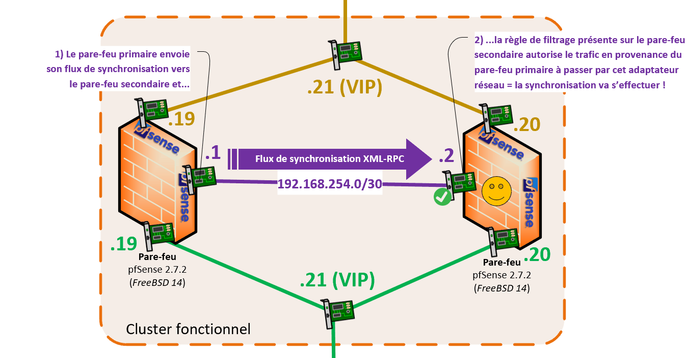{ loading=lazy }
        /// caption
        Avec la règle sur le secondaire, la synchronisation fonctionne
        ///

Une fois la règle XML-RPC créée sur le secondaire, la configuration se réplique. Pour une vérification rapide, il est possible de **forcer la synchronisation, uniquement depuis le primaire**, dans **Status > Filter Reload** (*État > Recharger les filtres*) avec le bouton **Force Config Sync**.

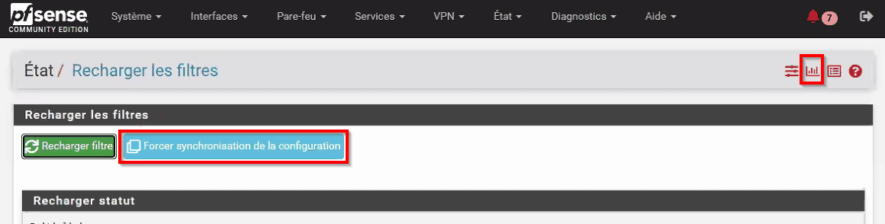{ loading=lazy }
/// caption
Primaire — État > Recharger les filtres : synchronisation forcée
///

#### Règle 2 — pfsync, pour la synchronisation des états

**Retourner sur le primaire** et créer une deuxième règle :

| Champ | Valeur |
|-------|--------|
| Action | `Pass` |
| Interface | `PFSYNC` |
| Address Family | `IPv4` |
| Protocol | `PFSYNC` |
| Source | `PFSYNC subnets` |
| Destination | `PFSYNC subnets` |
| Description | `autoriser la synchro des états pfsync` |

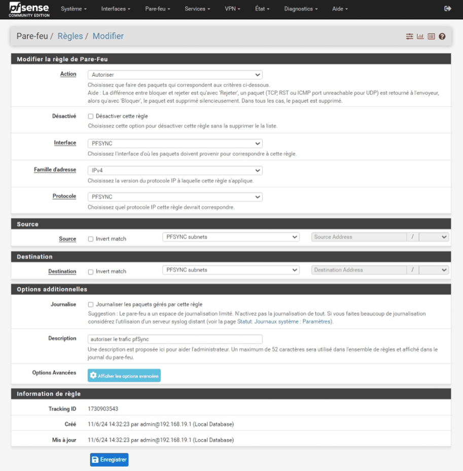{ loading=lazy }
/// caption
Règle pfsync : protocole PFSYNC entre PFSYNC subnets
///

#### Règle 3 — CARP

Toujours **sur le primaire**, créer une troisième règle sur le même modèle, avec le protocole **CARP**.

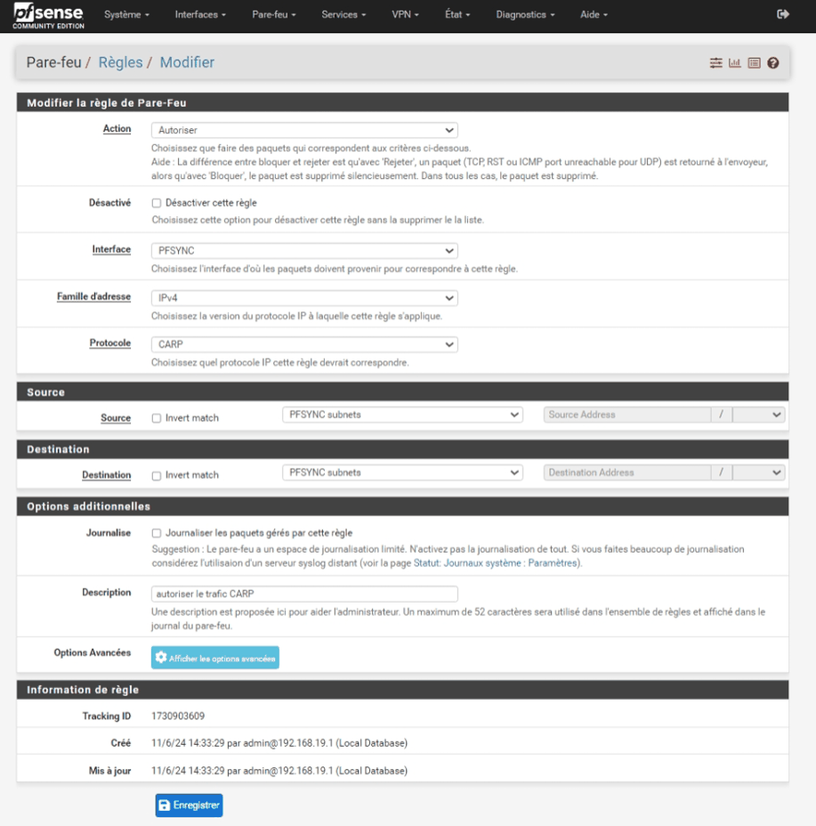{ loading=lazy }
/// caption
Règle CARP : protocole CARP entre PFSYNC subnets
///

!!! note "Pour aller plus loin : cette règle est-elle indispensable ?"
    Dès qu'une VIP CARP existe, pfSense ajoute une règle **automatique** qui autorise le protocole CARP sur toutes les interfaces. De plus, les annonces CARP circulent sur les réseaux qui portent une VIP (WAN et LAN), pas sur le lien PFSYNC. Cette troisième règle n'est donc pas strictement nécessaire. Elle ne présente aucun risque, puisqu'elle ne concerne que le `/30` des deux pare-feux, et elle **documente l'intention** de la configuration. pfsync, en revanche, n'est **jamais** autorisé automatiquement : la règle 2 est indispensable.

    Ces trois points ont été vérifiés dans le lab de test, en 2.7.2 comme en 2.9.0 :

    - la commande `pfctl -sr | grep carp` (dans **Diagnostics > Command Prompt**) affiche la règle automatique `pass quick proto carp all no state` ;
    - une capture (`tcpdump -ni em1 ip proto 112`) montre les annonces CARP sur `em0` et `em1` ;
    - sur `em2`, on ne voit passer que du pfsync.

    Les outils de capture (`tcpdump`, Wireshark) affichent les paquets CARP comme du **VRRPv2** : les deux protocoles utilisent le même numéro, 112.

Après toutes ces manipulations, l'interface PFSYNC du primaire présente ces règles :

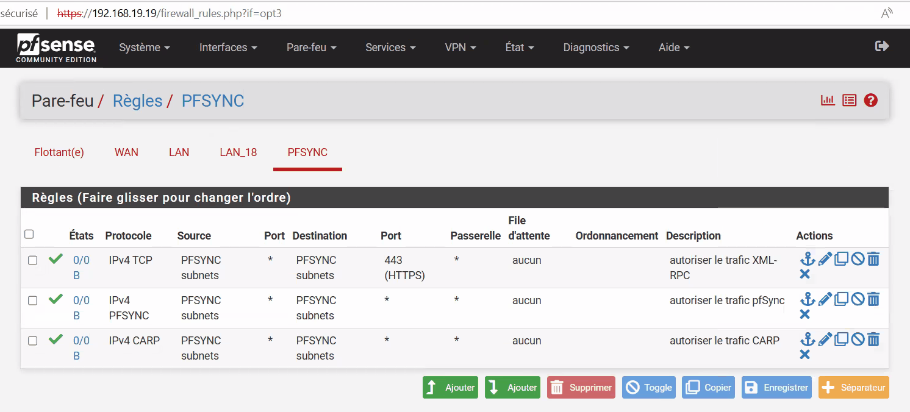{ loading=lazy }
/// caption
Primaire — règles de l'interface PFSYNC
///

**Ne pas toucher au secondaire** : les règles 2 et 3 vont y arriver toutes seules.

### 10.4 Vérifier la réplication et dépanner

**Sur le secondaire**, ouvrir **Firewall > Rules > PFSYNC** : les règles 2 et 3 sont apparues **automatiquement**, grâce à la règle XML-RPC.

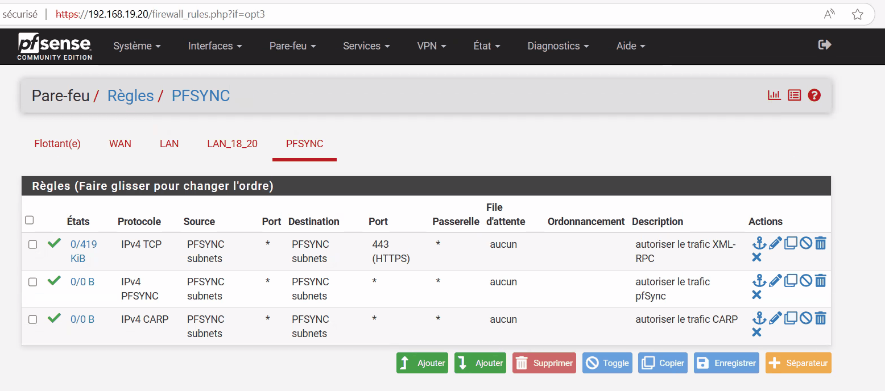{ loading=lazy }
/// caption
Secondaire — les mêmes règles, arrivées par réplication
///

En cas de problème de synchronisation, deux outils permettent d'en trouver la cause :

- **Les journaux du pare-feu sur le secondaire** : **Status > System Logs > Firewall** (*État > Journaux système > Pare-feu*). On y repère le trafic **bloqué** en provenance de l'interface PFSYNC du primaire. Le bouton **+** (*Easy Rule*) crée en un clic une règle qui l'autorise.

    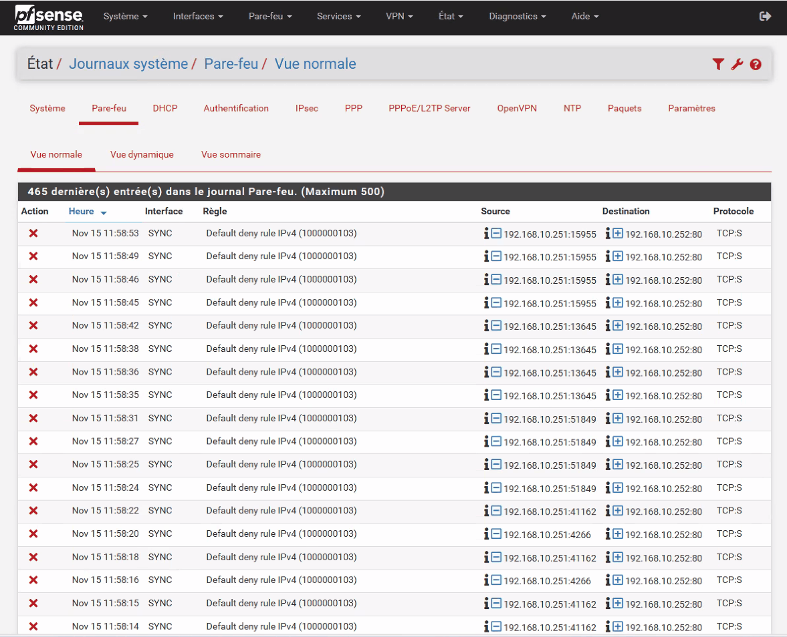{ loading=lazy }
    /// caption
    Journaux du pare-feu : trafic de synchronisation bloqué. Capture issue d'un autre lab : l'interface s'y appelle SYNC et les adresses diffèrent, mais la démarche est identique.
    ///

- **Les notifications** : l'icône en forme de **cloche**, en haut à droite. Il faut **vraiment les lire**. Elles signalent par exemple un mauvais mot de passe ou un utilisateur inexistant sur le secondaire.

**Test de réplication** : **sur le primaire**, ajouter une règle quelconque, par exemple autoriser le trafic IPv6 sur le LAN. Elle doit apparaître sur le secondaire quelques secondes plus tard. Si ce n'est pas le cas, reprendre attentivement les étapes 10.1 à 10.3.

Sur le secondaire, la page **System > High Avail. Sync** se présente ainsi :

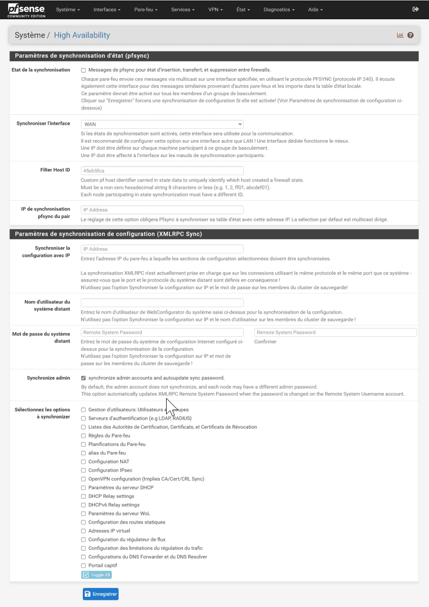{ loading=lazy }
/// caption
Secondaire — page High Availability : seule l'option Synchronize admin est cochée
///

!!! question "Les cases de la partie « XMLRPC Sync » sont décochées sur le secondaire. Faut-il les remplir ?"
    ??? success "Réponse"
        **Non.** Si les tests précédents sont concluants, il n'y a aucune raison d'y toucher. La synchronisation de configuration est à **sens unique** et ne doit être configurée **que sur le primaire**.

        La documentation de Netgate est formelle : ces réglages ne doivent être activés **que sur le primaire**. Renseignés sur le secondaire, ils lui feraient pousser à son tour **sa** configuration vers le primaire, qui cesserait d'être la référence. Netgate rappelle aussi : *« Do not make changes to the secondary in areas set to be synchronized! »*

### 10.5 Activer la réception des états pfsync sur le secondaire

!!! warning "Pourquoi cette étape est indispensable"
    La partie **haute** de la page HA (*State Synchronization Settings*, pfsync) n'est **pas synchronisée** par XML-RPC. Sur le secondaire, la case **Synchronize states** reste donc décochée.

    Dans cette situation, la bascule des VIP fonctionne, mais **le secondaire n'importe aucun état** envoyé par le primaire : il ne connaîtrait pas les connexions en cours au moment d'une bascule. Le lab de test l'a vérifié : sans cette étape, la table d'états du secondaire ne contenait **aucun** état créé par le primaire ; après cette étape, elle les contenait. Le texte d'aide de la case le précise d'ailleurs : *« This setting should be enabled on all members of a failover group »*. La documentation de Netgate demande d'activer pfsync sur **chaque** nœud, chacun pointant vers l'autre.

    Le lab l'a aussi vérifié en conditions réelles, avec un poste client : sans cette étape, une connexion TCP en cours a été **perdue** lors de l'arrêt brutal du primaire ; avec cette étape, elle a **survécu** (voir les [mesures de la partie 13.3](#133-pour-aller-plus-loin-verifier-depuis-un-poste-client)).

**Sur le secondaire**, ouvrir **System > High Avail. Sync** et renseigner **uniquement la partie haute** :

| Champ | Valeur |
|-------|--------|
| **Synchronize states** | coché |
| **Synchronize Interface** | `PFSYNC` |
| **pfsync Synchronize Peer IP** | `192.168.254.1` (le primaire) |
| Partie *XMLRPC Sync* | **laisser vide**, comme expliqué ci-dessus |

Cliquer sur **Save**.

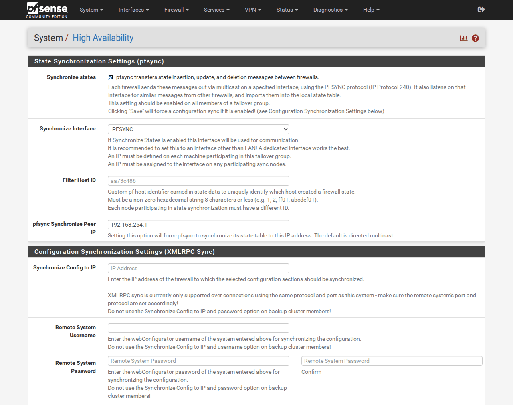{ loading=lazy }
/// caption
Secondaire — pfsync activé vers 192.168.254.1, partie XML-RPC laissée vide
///

**Vérification (facultative)** : le contrôle le plus simple se fait dans l'interface web, à l'[étape 13.1](#131-controler-letat-normal), une fois les VIP créées. Dès maintenant, la commande suivante compte les états selon le nœud qui les a créés. Elle se lance dans **Diagnostics > Command Prompt** (*Diagnostics > Invite de commande*) de **chaque** pare-feu, champ **Execute Shell Command** :

```bash
pfctl -vvss | grep -o "creatorid: [0-9a-f]*" | sort | uniq -c
```

!!! success "Résultat attendu"
    Deux identifiants (`creatorid`) différents apparaissent sur chaque nœud : celui du pare-feu lui-même et celui de son pair. Par exemple, sur le secondaire :

    ```text
      16 creatorid: aa73c486
       6 creatorid: dfd3ca09
    ```

    Si un seul identifiant apparaît, les états ne sont pas échangés : vérifier la règle pfsync (règle 2) et la case **Synchronize states** des deux nœuds.

🛟 **Point de sauvegarde** : prendre un instantané « Synchronisation HA ».

---

## 11. Configurer les adresses IP virtuelles (VIP CARP)

Pour que le cluster soit **résilient** (tolérant à la panne), chaque pare-feu garde sa propre adresse sur chaque interface, mais dispose aussi d'une **adresse IP virtuelle partagée**. On utilise donc **trois adresses par réseau** : `.19`, `.20` et `.21`.

**Sur le primaire**, ouvrir **Firewall > Virtual IPs** (*Pare-feu > IPs virtuels*) et cliquer sur **Add**.

| Champ | VIP WAN | VIP LAN | Explication |
|-------|---------|---------|-------------|
| Type | `CARP` | `CARP` | Les autres types (*IP Alias*, *Proxy ARP*) ne basculent pas. |
| Interface | `WAN` | `LAN` | — |
| Address(es) | `192.168.8.21` / `24` | `192.168.19.21` / `24` | Le masque est **celui du réseau** (`/24`), pas `/32`. |
| Virtual IP Password | un mot de passe | un mot de passe | Authentifie les annonces CARP entre les membres du groupe. |
| VHID Group | valeur par défaut (`1`) | valeur par défaut (`2`) | Numéro du groupe CARP (*Virtual Host ID*). |
| Advertising frequency — Base | `1` | `1` | Une annonce par seconde. |
| Advertising frequency — Skew | `0` | `0` | 0 = priorité la plus forte, celle du primaire. |
| Description | `carp_vip_wan` | `carp_vip_lan` | — |

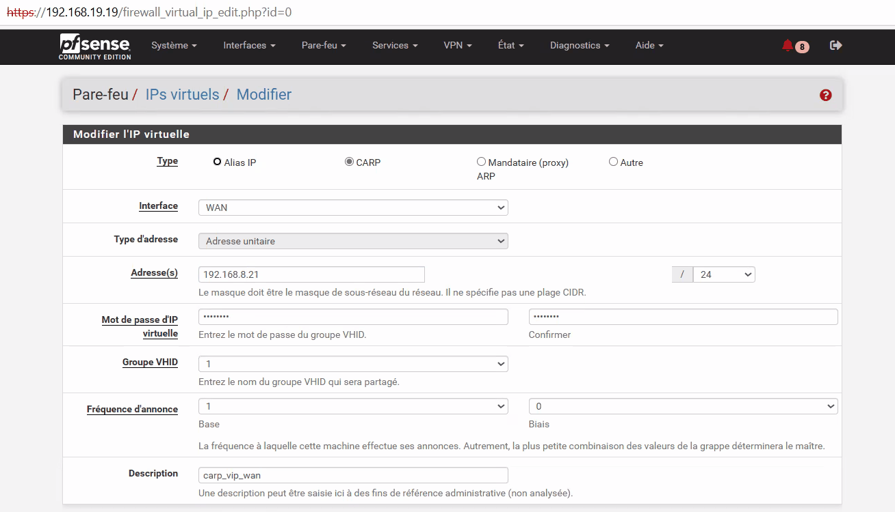{ loading=lazy }
/// caption
VIP CARP du WAN : 192.168.8.21/24, VHID 1, base 1, skew 0
///

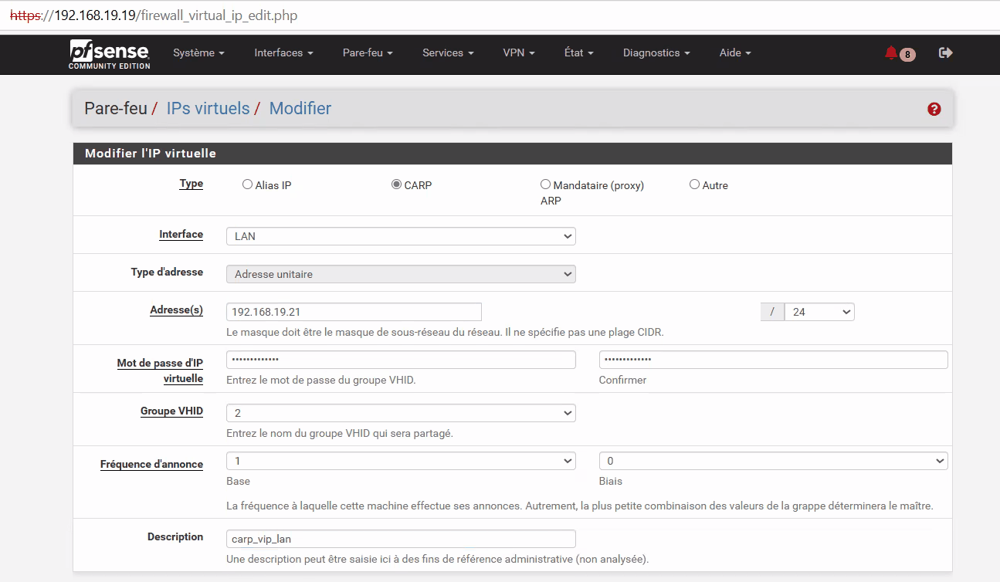{ loading=lazy }
/// caption
VIP CARP du LAN : 192.168.19.21/24
///

Cliquer sur **Save**, puis sur **Apply Changes** après chaque VIP.

!!! info "Comprendre VHID, Base et Skew"
    - Le **VHID** identifie un groupe CARP sur un réseau. Il sert aussi à fabriquer l'adresse MAC virtuelle de la VIP, `00:00:5e:00:01:<VHID>`. Deux clusters différents installés sur **le même réseau** doivent donc utiliser des VHID différents. pfSense propose automatiquement un numéro libre **sur ce pare-feu**, mais il ignore les VHID utilisés par d'autres équipements du réseau : c'est à l'administrateur de s'en assurer.
    - **Base** est l'intervalle entre deux annonces, en secondes. **Skew** (*biais*) ajoute un léger retard, en 256^e^ de seconde. **Le pare-feu dont les annonces sont les plus fréquentes gagne** : avec un skew de 0, le primaire est prioritaire.
    - Lors de la réplication vers le secondaire, pfSense **ajoute automatiquement 100 au skew**. Le secondaire annonce donc moins souvent et reste BACKUP. Le lab le confirme : la VIP du secondaire affiche `advskew 100`.
    - Le BACKUP se déclare MASTER s'il ne reçoit plus d'annonce pendant environ **3 × Base + Skew/256** secondes, soit à peu près 3,4 s ici.

La réplication vers le secondaire est automatique, mais il faut aller la vérifier dans **Firewall > Virtual IPs** sur le secondaire.

---

## 12. Faire sortir le trafic avec la VIP (NAT sortant)

Le **NAT sortant** réécrit l'adresse source des paquets qui quittent le LAN vers le WAN. Par défaut (mode *Automatic*), pfSense utilise **l'adresse propre de son interface WAN** : `192.168.8.19` sur le primaire, `192.168.8.20` sur le secondaire. Dans un cluster, c'est un problème. Les serveurs distants répondent à l'adresse propre du primaire (`192.168.8.19`). Après une bascule, ces réponses partent donc vers un pare-feu en panne, et le secondaire ne les reçoit pas : d'après la documentation de Netgate, un trafic adressé directement à un nœud, et non à une VIP, n'est jamais repris par les autres nœuds.

!!! success "Vérifié dans le lab de test"
    Un serveur placé côté WAN voyait le poste client sous l'adresse `192.168.8.21` (la VIP) avec la règle, et sous `192.168.8.19` sans elle.

    Lors de l'arrêt brutal du primaire, la connexion TCP en cours a **survécu** avec la règle. Sans elle, elle a été **perdue** : même un ping déjà lancé ne s'est jamais rétabli, car son état, recopié par pfsync, continuait de traduire vers `192.168.8.19`. Seules les nouvelles connexions sont reparties, avec l'adresse du secondaire (`192.168.8.20`).

<figure markdown="span">
  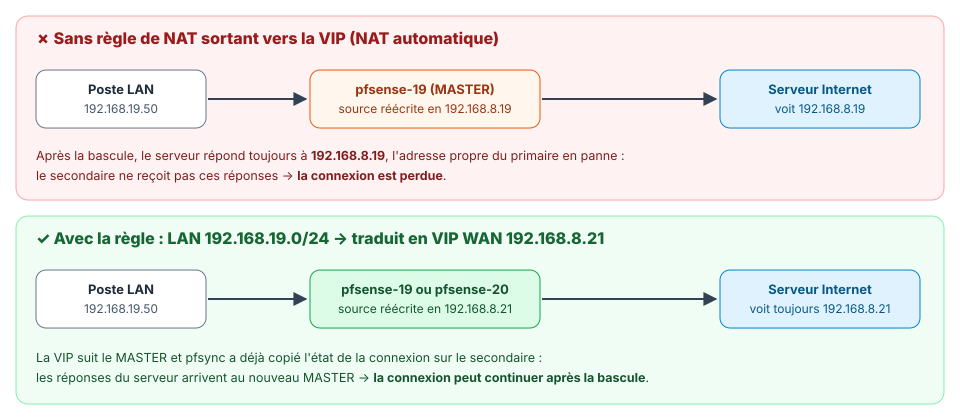{ loading=lazy }
  <figcaption>Traduire le LAN vers la VIP WAN garantit une adresse source identique quel que soit le pare-feu actif.</figcaption>
</figure>

!!! note "Et dans ce lab ?"
    Ici, l'hyperviseur ajoute lui-même un second NAT entre le réseau `192.168.8.0/24` et Internet. Le principe reste celui d'une vraie installation, où l'interface WAN porte des adresses **publiques** fournies par l'opérateur.

**Sur le primaire**, ouvrir **Firewall > NAT > Outbound** (*Pare-feu > NAT > Sortant*), puis :

1. Sélectionner **Hybrid Outbound NAT rule generation** (*Automatic Outbound NAT + rules below*), puis cliquer sur **Save**. Le mode hybride conserve les règles automatiques et y ajoute les règles manuelles.
2. Dans **Mappings**, cliquer sur **Add** et renseigner :

    | Champ | Valeur |
    |-------|--------|
    | Interface | `WAN` |
    | Address Family | `IPv4` |
    | Protocol | `any` |
    | Source | `Network or Alias` : `192.168.19.0` / `24` |
    | Destination | `Any` |
    | Translation — Address | `192.168.8.21 (carp_vip_wan)` |
    | Description | `utilisation vip sur l'interface wan` |

3. Cliquer sur **Save**, puis sur **Apply Changes**.

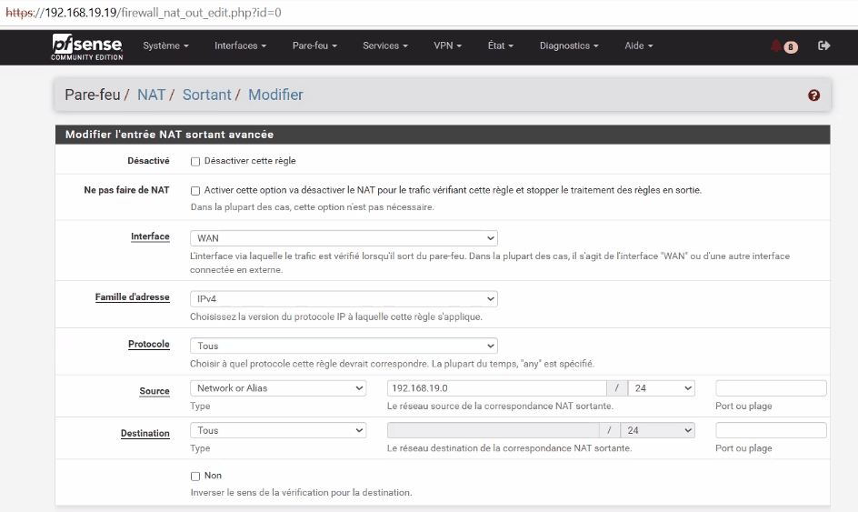{ loading=lazy }
/// caption
Règle de NAT sortant : interface WAN, source 192.168.19.0/24
///

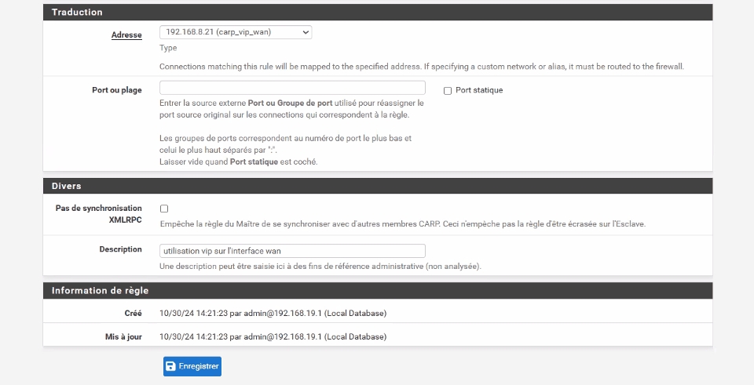{ loading=lazy }
/// caption
Suite de la règle : traduction vers la VIP 192.168.8.21
///

La règle est dupliquée automatiquement sur le secondaire.

!!! info "Les quatre modes de NAT sortant"
    - **Automatic** : pfSense génère seul les règles, avec l'adresse de l'interface.
    - **Hybrid** : règles automatiques **plus** règles manuelles, prioritaires.
    - **Manual** : uniquement les règles écrites à la main.
    - **Disabled** : pas de NAT sortant.

    Le mode hybride est le plus simple pour un cluster : seul le trafic du LAN est traduit vers la VIP, et le reste ne change pas. C'est aussi le choix de la recette officielle de Netgate.

---

## 13. Vérifier la bascule

### 13.1 Contrôler l'état normal

Ouvrir **Status > CARP (failover)** (*État > CARP (basculement)*) sur chaque pare-feu.

- Le **primaire** (`.19`) affiche **MASTER** pour les deux VIP :

    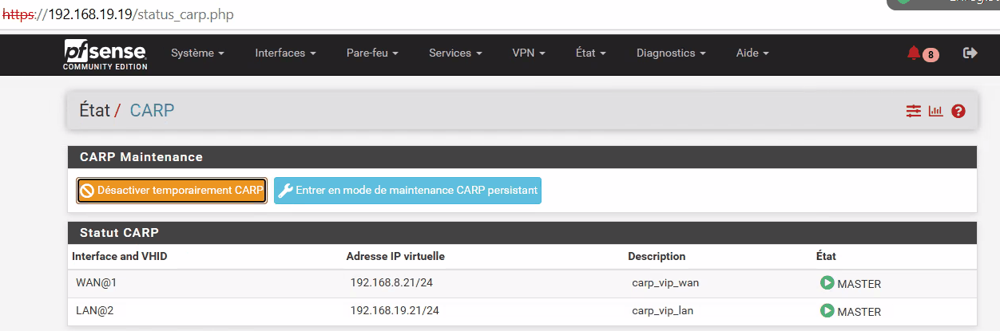{ loading=lazy }
    /// caption
    Primaire — les deux VIP en MASTER
    ///

- Le **secondaire** (`.20`) affiche **BACKUP** :

    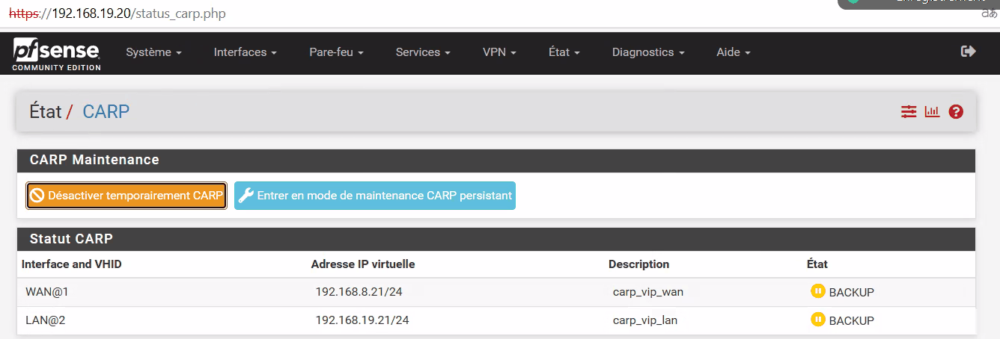{ loading=lazy }
    /// caption
    Secondaire — les deux VIP en BACKUP
    ///

La même page vérifie aussi **pfsync**. Sa section **State Synchronization Status** liste les identifiants des nœuds qui ont créé des états (*State Creator Host IDs*). Quand la synchronisation des états fonctionne dans les deux sens, **la liste est identique sur les deux pare-feux** et contient les deux identifiants. Si un nœud n'affiche que le sien, revoir l'[étape 10.5](#105-activer-la-reception-des-etats-pfsync-sur-le-secondaire).

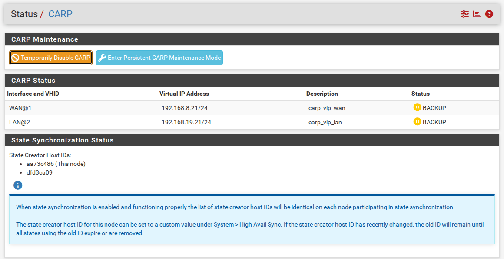{ loading=lazy }
/// caption
État > CARP : section State Synchronization Status, avec les identifiants des deux nœuds
///

!!! note "« DISABLED » juste après une synchronisation"
    Juste après la création des VIP, la page du secondaire peut afficher brièvement **DISABLED**. Il suffit de la recharger quelques secondes plus tard pour voir **BACKUP**.

### 13.2 Simuler une panne du primaire et mesurer la coupure

1. **Sur le PC hôte**, lancer un ping continu vers la VIP LAN :

    === "Windows"

        ```powershell
        ping -t 192.168.19.21
        ```

    === "Linux"

        ```bash
        ping 192.168.19.21
        ```

2. **Sur le primaire**, simuler une panne au choix :
    - dans **Status > CARP (failover)**, cliquer sur le bouton orange **Temporarily Disable CARP** (*Désactiver temporairement CARP*) ;
    - ou, dans les paramètres de la VM, **déconnecter la carte réseau du LAN** ;
    - ou **éteindre** la VM.
3. Observer le ping : quelques réponses manquent, puis il reprend tout seul.
4. **Sur le secondaire**, actualiser **Status > CARP (failover)** : les deux VIP sont passées en **MASTER**. Le cluster à basculement fonctionne.
5. Ouvrir `https://192.168.19.21` dans le navigateur et se connecter : c'est le **secondaire** qui répond. Une fois connecté, le nom `pfsense-20.home.arpa` apparaît dans le titre de l'onglet et sur le tableau de bord. La page de connexion, elle, n'affiche pas le nom du pare-feu.
6. Rétablir le primaire : bouton **Enable CARP**, carte reconnectée ou VM rallumée. Le primaire **reprend automatiquement** le rôle de MASTER : c'est la **préemption**.

!!! success "Résultat attendu"
    Dans le lab de test, la bascule a coupé le ping pendant **environ 3,4 secondes** (17 réponses perdues avec un ping toutes les 0,2 s). C'est exactement le délai théorique de CARP : 3 × 1 s + 100/256 s. Aucun réglage n'a été nécessaire sur le PC hôte.

    Au retour du primaire, la reprise du rôle de MASTER s'est faite **sans aucune perte**.

### 13.3 Pour aller plus loin : vérifier depuis un poste client

Le ping depuis le PC hôte montre que la VIP bascule. Pour vérifier qu'**une connexion en cours survit** à la panne, il faut un poste placé **derrière** le cluster, sur le LAN.

1. Créer une petite VM (Linux ou Windows) dont l'unique carte réseau est dans **VMnet19** (VirtualBox : le réseau privé hôte).
2. Lui donner une adresse fixe : IP `192.168.19.50/24`, passerelle `192.168.19.21` (la **VIP**), DNS `192.168.19.21` (le résolveur DNS de pfSense, joint lui aussi par la VIP) puis `1.1.1.1` en second DNS.

    !!! note "Si la résolution DNS échoue"
        Un VPN actif sur le PC hôte peut intercepter les requêtes DNS qui sortent des VM. Le résolveur de pfSense répond alors *SERVFAIL* : sa validation DNSSEC échoue, car les réponses ne viennent plus des vrais serveurs DNS. C'est ce qui s'est produit dans le lab de test. Le second DNS (`1.1.1.1`) permet de continuer ; le reste du TP n'en dépend pas.

3. Vérifier qu'elle accède à Internet **à travers le cluster** : `ping 1.1.1.1` doit répondre.
4. Lancer un ping continu vers Internet (`ping -t 1.1.1.1` sous Windows, `ping 1.1.1.1` sous Linux), ainsi qu'un téléchargement volumineux.
5. **Éteindre brutalement le primaire**, comme une coupure de courant : VMware : **VM > Power > Power Off** ; VirtualBox : fermer la fenêtre de la VM et choisir **Éteindre la machine**.
6. Observer : le ping s'interrompt quelques secondes puis reprend, et le téléchargement continue sans erreur.
7. Rallumer le primaire : il reprend le rôle de MASTER sans que le poste ne s'en aperçoive.

!!! example "Mesures réalisées dans le lab de test"
    Les mesures ont été prises avec un poste client du LAN (`192.168.19.50`) et un serveur placé côté WAN (`192.168.8.50`). Le serveur envoyait une ligne toutes les 0,2 s sur une connexion TCP, et le poste le pinguait toutes les 0,2 s. Chaque scénario désactive volontairement un élément de la configuration, pour montrer à quoi il sert.

    | Scénario | Connexion TCP en cours | Ping du poste vers le serveur WAN |
    |----------|------------------------|-----------------------------------|
    | Arrêt brutal du primaire, cluster complet | **intacte**, silence max 3,5 s | 12 perdus sur 299, coupure de 2,7 s |
    | Retour du primaire (préemption) | **intacte**, aucun silence | aucune perte |
    | Arrêt brutal du primaire, **sans pfsync sur le secondaire** (étape 10.5) | **perdue** | coupure de 3,5 s, puis reprise |
    | Arrêt brutal du primaire, **sans la règle de NAT vers la VIP** (partie 12) | **perdue** | jamais rétabli pendant le test |
    | Câble WAN du primaire débranché, IPv6 du WAN en DHCP6 (exercice 4) | **bloquée** pendant la panne | *Destination Host Unreachable* du primaire |
    | Câble WAN du primaire débranché, IPv6 du WAN à *None* (exercice 5) | **intacte**, silence max 3,5 s | coupure d'environ 3 s |
    | Entrée puis sortie du mode maintenance CARP | **intacte**, aucun silence | aucune perte |

---

## 14. Exercices

Réaliser les exercices suivants et faire une **capture d'écran** de chaque résultat. 🛟 Prendre un instantané des deux VM avant de commencer.

### Exercice 1

Tester si une règle de pare-feu créée **sur le secondaire** se réplique **sur le primaire**.

??? success "Réponse"
    **Non.** La synchronisation XML-RPC est à **sens unique**, du primaire vers le secondaire. Le secondaire n'a aucun paramètre XML-RPC renseigné : il ne pousse rien.

### Exercice 2

Faire basculer le secondaire en MASTER en **éteignant le primaire**, puis vérifier qu'il a bien récupéré le statut MASTER. Créer une règle de pare-feu sur ce secondaire devenu MASTER. Rallumer le primaire et vérifier qu'il récupère le statut MASTER. A-t-il récupéré la règle créée sur le secondaire pendant que ce dernier était MASTER ?

??? success "Réponse"
    **Non.** Le primaire redevient MASTER grâce à la préemption, mais ne récupère pas la règle. Les rôles CARP (MASTER/BACKUP) et le sens de la synchronisation XML-RPC sont **indépendants** : même MASTER, le secondaire ne pousse jamais sa configuration. Il ne faut donc **jamais** modifier la configuration sur le secondaire, même en cas de panne prolongée du primaire, sauf pour une urgence suivie d'une reprise manuelle sur le primaire.

### Exercice 3

À la suite de l'exercice précédent, vérifier si l'absence, sur le primaire, de la règle créée sur le secondaire a entraîné la **suppression** de cette règle sur le secondaire.

??? success "Réponse"
    **Oui**, mais **à la prochaine synchronisation**, pas au redémarrage du primaire. Dans le lab de test, la règle était encore présente sur le secondaire juste après le retour du primaire. Elle a disparu dès qu'une synchronisation a eu lieu : une modification quelconque sur le primaire, ou **Status > Filter Reload > Force Config Sync**.

    L'explication est la même que pour `ha-user` : XML-RPC **remplace** la section « règles » du secondaire par celle du primaire, et ne fusionne rien. Tout ce qui n'existe que sur le secondaire est perdu.

### Exercice 4

Simuler une panne de l'**interface WAN** du MASTER (déconnecter sa carte WAN dans les paramètres de la VM) et vérifier si le WAN du secondaire a bien récupéré le statut MASTER. Vérifier également le statut de l'interface LAN du secondaire : est-il passé en MASTER ?

??? success "Réponse"
    **Non** (avec la configuration réalisée jusqu'ici). Le WAN du secondaire passe bien MASTER, mais le LAN du **primaire** garde le statut MASTER. Les deux pare-feux se partagent alors les rôles : les postes du LAN envoient toujours leur trafic au primaire, dont le WAN est coupé, et **perdent l'accès à l'extérieur**.

    Dans le lab de test, un poste client du LAN a vu sa connexion TCP en cours **bloquée pendant toute la panne**. Ses pings recevaient la réponse *« Destination Host Unreachable »* de la part du primaire (`192.168.19.19`), resté MASTER côté LAN mais privé de WAN.

    Ce n'est **pas un défaut de pfSense** : c'est la conséquence d'un réglage laissé par l'assistant, que l'exercice 5 permet de corriger.

    **Explication (vérifiée dans le lab de test).** En théorie, pfSense active la **préemption CARP** (`net.inet.carp.preempt=1`). Quand une interface portant une VIP perd son lien, le pare-feu se **rétrograde** (*demotion* +240) sur **toutes** ses VIP, et le secondaire prend tout. Le journal système montre d'ailleurs que la VIP LAN bascule dans un premier temps. Mais l'assistant a laissé l'IPv6 du WAN en **DHCP6**. pfSense considère alors le WAN comme une interface **dynamique** et, à la perte du lien, il la « démonte » entièrement, VIP comprise. La VIP ayant disparu, la rétrogradation est **annulée** (`carp: demoted by -240 to 0 (vhid removed)`), et le primaire reprend la VIP LAN.

### Exercice 5 — Corriger le comportement de l'exercice 4

Sur **les deux pare-feux**, ouvrir **Interfaces > WAN**, régler **IPv6 Configuration Type** sur **None**, puis **Save** et **Apply Changes**. La configuration des interfaces n'est pas synchronisée : il faut le faire sur chaque nœud. Refaire ensuite l'exercice 4. Que se passe-t-il ?

??? success "Réponse"
    Cette fois, **les deux VIP** passent MASTER sur le secondaire. Sur le primaire, la VIP WAN est en **INIT** (lien absent) et la VIP LAN en **BACKUP** ; `sysctl net.inet.carp.demotion` affiche `240`. Le WAN étant désormais entièrement statique, pfSense ne démonte plus l'interface et la rétrogradation reste en place.

    Au retour du lien WAN, le primaire reprend automatiquement les deux VIP.

    Mesures du lab de test, pour un câble WAN débranché pendant 30 s :

    - un ping continu du PC hôte vers la VIP LAN n'a perdu **aucun paquet** ;
    - un poste client du LAN a conservé sa connexion TCP en cours (3,5 s de silence au plus) ;
    - le ping de ce poste vers un serveur côté WAN a été coupé environ 3 s, le temps que le secondaire reprenne la VIP WAN.

---

## 15. Pour aller plus loin

### 15.1 Agréger deux liens de synchronisation (LAGG/LACP)

Le *Link Aggregation Control Protocol* (**LACP**, norme IEEE 802.3ad) est un protocole de **niveau 2** du modèle OSI. Il regroupe plusieurs ports physiques en **une seule voie logique**, appelée **LAGG** (*Link AGGregation*) dans pfSense.

L'agrégat offre deux avantages :

- il **additionne la capacité** des liens : deux câbles de 1 Gbit/s offrent 2 Gbit/s au total ;
- il apporte de la **redondance** : si un câble ou un port tombe en panne, l'autre continue de transmettre le trafic sans interruption.

Attention : LACP répartit le trafic **par flux**, et une même conversation n'utilise qu'un seul lien à la fois. La synchronisation entre deux pare-feux ne gagne donc pas de débit. Son vrai bénéfice est la **redondance** : l'agrégat supprime le dernier point unique de défaillance du cluster. La même notion existe sous Linux : voir [Configurer une agrégation de liens (Bonding/LACP) avec Netplan](configurer-agregation-liens-bonding-lacp-netplan-ubuntu.md).

#### Ajouter une carte réseau et un second LAN segment

**Sur chaque pare-feu** (VM éteinte), ajouter une **quatrième carte réseau**. La placer dans **un autre LAN segment** que celui utilisé pour la synchronisation : on obtient ainsi deux « câbles » indépendants entre les pare-feux, un par interface de l'agrégat.

{ loading=lazy }
/// caption
Deux liens de synchronisation, chacun dans son propre LAN segment
///

!!! warning "Un segment par lien"
    Les tests ont montré qu'utiliser **le même** LAN segment pour les deux interfaces de l'agrégat provoque un problème de connectivité. Chaque lien doit avoir **son propre** segment, comme deux câbles physiques distincts.

=== "VMware Workstation"

    Créer les segments depuis **VM > Settings… > Network Adapter > LAN Segments…**. Sur les captures, la 3^e^ carte est dans `SYNCHRO-PFSENSE-1` et la nouvelle 4^e^ carte dans `SYNCHRO-PFSENSE-2`.

    { loading=lazy width="420" } { loading=lazy width="420" }
    /// caption
    VMware — 3ᵉ carte dans SYNCHRO-PFSENSE-1, 4ᵉ carte dans SYNCHRO-PFSENSE-2
    ///

=== "VirtualBox"

    Activer l'**Adapter 4** en **Réseau interne** nommé `SYNCHRO-PFSENSE-2`, avec le type d'interface Intel PRO/1000 MT Desktop et le mode promiscuité « Tout autoriser ». L'Adapter 3 reste dans le réseau interne `SYNCHRO-PFSENSE`.

    { loading=lazy }
    /// caption
    VirtualBox — 4ᵉ carte en réseau interne SYNCHRO-PFSENSE-2
    ///

#### Sauvegarder les règles de pare-feu existantes

La création du LAGG va supprimer l'interface PFSYNC **et toutes ses règles**. Il faut donc les sauvegarder d'abord, **sur le primaire** :

1. Ouvrir **Diagnostics > Backup & Restore** (*Diagnostics > Sauvegarde & Restauration*).
2. Dans l'onglet **Backup & Restore**, section **Backup Configuration**, choisir **Backup area** : **Firewall Rules** (ou toute la configuration).
3. Cliquer sur **Download configuration as XML**. Un fichier XML est téléchargé sur le PC hôte.

{ loading=lazy }
/// caption
Sauvegarde de la zone « Règles du pare-feu »
///

{ loading=lazy width="380" }
/// caption
Le fichier XML de sauvegarde téléchargé par le navigateur
///

#### Créer le LAGG

Une interface ne peut entrer dans un LAGG que si elle **n'est affectée à rien**. Il faut donc d'abord supprimer l'interface PFSYNC actuelle. Cela **supprime aussi toutes les règles** de cette interface : il faudra les recréer, ou importer la sauvegarde.

1. **Interfaces > Assignments** (*Interfaces > Affectations*) : supprimer la ligne **PFSYNC** (bouton **Delete**).

    { loading=lazy }
    /// caption
    Suppression de l'interface PFSYNC dans les affectations
    ///

2. Onglet **LAGGs** > **Add** : sélectionner les **deux interfaces libres** (++ctrl++ + clic), en les reconnaissant à leur adresse MAC. Choisir le protocole **LACP**, laisser les autres options par défaut, ajouter une description pertinente, puis **Save**.

    { loading=lazy }
    /// caption
    Création du LAGG en mode LACP avec deux interfaces membres
    ///

    { loading=lazy }
    /// caption
    Le LAGG créé
    ///

3. Onglet **Interface Assignments** : choisir `lagg0` dans **Available network ports**, puis **Add**.
4. Cliquer sur la nouvelle interface (`OPT1` dans l'exemple) et la configurer : **Enable** coché, **Description** `PFSYNC`, IPv4 statique `192.168.254.1/30`. Enregistrer, puis appliquer les changements.

    { loading=lazy }
    /// caption
    Affectation de l'interface LAGG
    ///

    { loading=lazy }
    /// caption
    Configuration de l'interface LAGG : activée, nommée PFSYNC, IP statique
    ///

5. Répéter les mêmes étapes **sur le secondaire**, avec l'adresse `192.168.254.2`.

    { loading=lazy }
    /// caption
    Secondaire — affectations avec l'interface LAGG
    ///

6. Vérifier dans **System > High Avail. Sync** que **Synchronize Interface** vaut toujours `PFSYNC` sur les deux nœuds.

#### Restaurer les règles supprimées

=== "Option 1 — Importer la sauvegarde"

    1. **Sur le primaire**, ouvrir **Diagnostics > Backup & Restore**, section **Restore Backup**.
    2. **Restore area** : **Firewall Rules**. Avec *All*, tout le contenu du fichier serait restauré.
    3. **Configuration file** : **Parcourir…** > le fichier XML exporté précédemment.
    4. Cliquer sur **Restore Configuration** et confirmer. pfSense applique les règles et redémarre les services nécessaires. Dans certains cas, un redémarrage du pare-feu est utile pour s'assurer que tout est bien appliqué.
    5. **Sur le secondaire**, vérifier la présence de la règle XML-RPC sur la nouvelle interface PFSYNC : ses anciennes règles ont été supprimées avec son interface. Si elle manque, la recréer comme à la [partie 10.3](#103-autoriser-les-flux-de-synchronisation) ; les autres règles arriveront ensuite par réplication.

    { loading=lazy }
    /// caption
    Restauration de la zone « Règles du pare-feu »
    ///

    { loading=lazy width="380" }
    /// caption
    Confirmation de la restauration
    ///

    { loading=lazy }
    /// caption
    Restauration terminée
    ///

=== "Option 2 — Recréer les règles"

    **Firewall > Rules > PFSYNC** (interface LAGG) : recréer les règles XML-RPC, pfsync et CARP de la [partie 10.3](#103-autoriser-les-flux-de-synchronisation). La règle XML-RPC doit être recréée **aussi sur le secondaire**, sinon le primaire ne peut plus lui parler. Les règles du secondaire peuvent servir de modèle. Puis **Apply Changes**.

#### Vérifier

**Sur le primaire**, créer une règle de pare-feu quelconque, par exemple sur l'interface WAN :

{ loading=lazy }
/// caption
Primaire — règle de test sur le WAN
///

Elle doit apparaître automatiquement sur le secondaire :

{ loading=lazy }
/// caption
Secondaire — la règle de test est arrivée par réplication
///

### 15.2 Ajouter un troisième nœud au cluster

Il est possible d'ajouter un **troisième pare-feu** au cluster, en conservant la synchronisation sur les trois nœuds. La méthode éprouvée consiste à **chaîner** la synchronisation :

1. Configurer le troisième pare-feu (`pfsense-22` par exemple) avec ses deux VIP, comme expliqué à la partie 11.
2. **Sur le secondaire** (ni le primaire, ni le tertiaire), dans **System > High Avail. Sync**, remplir la partie XML-RPC pour qu'il synchronise le tertiaire. Le secondaire devient ainsi le « maître » du tertiaire.
3. Configurer le tertiaire comme le secondaire l'a été pour le primaire : utilisateur `ha-user`, règles, pfsync.

!!! note "Points d'attention"
    - Le réseau de synchronisation en `/30` ne peut contenir que deux adresses. Le lien entre le secondaire et le tertiaire demande donc un **autre réseau dédié** (par exemple `192.168.254.4/30` sur un nouveau LAN segment) et une carte réseau supplémentaire sur le secondaire.
    - pfSense ajoute 100 au skew des VIP à chaque synchronisation XML-RPC (vérifié entre le primaire et le secondaire). Le tertiaire devrait donc recevoir un skew de 200 et être le dernier à prendre la main. Ce chaînage n'a pas été rejoué dans le lab de test.

### 15.3 Mettre à jour le cluster vers pfSense CE 2.9.0

pfSense CE **2.7.2** (décembre 2023) n'est plus maintenue. À la date de rédaction, la version courante est la **2.9.0** (20 août 2026), basée sur FreeBSD 16. Mettre à jour un cluster est un savoir-faire à part entière : bien menée, l'opération se fait **sans interruption de service**. Dans le lab de test, un flux TCP et un ping continus, entre un poste client du LAN et un serveur côté WAN, n'ont subi **aucune perte** lors de l'entrée et de la sortie du mode maintenance.

<figure markdown="span">
  { loading=lazy }
  <figcaption>Le principe : on ne met jamais à jour le pare-feu qui porte le trafic.</figcaption>
</figure>

!!! info "Ce qu'il faut savoir avant de commencer (constaté dans le lab de test)"
    - **Deux sauts sont nécessaires.** Sur une 2.7.2, la page de mise à jour ne propose que la 2.8.1, et la 2.9.0 n'apparaît qu'une fois en 2.8.1. Chaque nœud passe donc par **2.7.2 → 2.8.1 → 2.9.0**.
    - **Internet est indispensable, et le téléchargement est long** : 187 paquets pour passer en 2.8.1, puis 184 pour passer en 2.9.0. Dans le lab, chaque saut a pris **de 25 minutes à 1 heure par nœud**, selon la charge des serveurs de Netgate. L'installation et les redémarrages ne durent que 3 à 4 minutes ; tout le reste est du téléchargement.
    - **2 Go de RAM par VM.** Avec 1 Go, la mise à jour a réussi sur le secondaire mais a échoué sur le primaire : le système a tué le processus d'installation par manque de mémoire, et pfSense est resté inutilisable (voir le dépannage ci-dessous). L'échec n'est donc pas systématique, mais le risque est réel. Avec 2 Go, les deux sauts du primaire se sont déroulés sans erreur.
    - **Tant que les versions diffèrent, la synchronisation XML-RPC se suspend d'elle-même.** Le journal système du primaire l'indique : *« The other member is on a different configuration version of pfSense. Sync will not be done to prevent problems! »*. Il ne faut donc **rien modifier** pendant la mise à jour, car les changements ne seraient pas recopiés.
    - **Les états pfsync passent toujours vers le nœud mis à jour.** Un secondaire en 2.9.0 importait encore les états envoyés par un primaire en 2.7.2 ; l'inverse ne fonctionnait plus. Au moment de basculer vers le secondaire mis à jour, celui-ci dispose donc bien des états des connexions en cours.

#### Étape 1 — Sauvegarder les deux nœuds et prévoir 2 Go de RAM

**Sur chaque pare-feu**, ouvrir **Diagnostics > Backup & Restore**, laisser **Backup area** sur **All**, puis cliquer sur **Download configuration as XML**. 🛟 Prendre aussi un instantané des deux VM : en cas d'échec, c'est le moyen le plus rapide de revenir en arrière.

Si les VM ont été créées avec 1 Go, **éteindre le secondaire** (console : option **6) Halt system**), porter sa mémoire à **2 Go** dans les paramètres de la VM, puis le rallumer. Comme il est BACKUP, le service n'est pas affecté. Le primaire sera traité à l'étape 3, une fois en maintenance.

#### Étape 2 — Mettre à jour le secondaire (2.7.2 → 2.8.1 → 2.9.0)

**Sur le secondaire** :

1. Ouvrir **System > Update** (*Système > Mettre à jour*), onglet **Update Settings** (*Paramètres de mise à jour*). Choisir **Branch** : **Previous Stable Version (2.8.1)**, puis **Save**.

    { loading=lazy }
    /// caption
    Paramètres de mise à jour : branche 2.8.1
    ///

2. Onglet **System Update** (*Mise à jour système*) : patienter jusqu'à ce que **Latest Base System** (*Dernier système de base*) affiche `2.8.1`. L'état « *Retrieving* » peut durer une à deux minutes.

    { loading=lazy }
    /// caption
    Mise à jour système : 2.7.2 installée, 2.8.1 disponible
    ///

    !!! note "Le message « pfSense-repoc: … no pfSense packages installed »"
        Ce message apparaît dans la zone **Messages** sur une pfSense CE fraîchement installée. Il est sans conséquence : dans le lab, la mise à jour a fonctionné malgré lui sur les deux nœuds.

3. Cliquer sur **Confirm**. La page affiche la progression du téléchargement. Dans la console, la suite se déroule ainsi :
    1. le message *« System is going to be upgraded. Rebooting in … seconds »* annonce un **premier redémarrage** ;
    2. le nouveau FreeBSD et les paquets s'installent pendant deux à trois minutes ;
    3. le message *« Rebooting now »* annonce un **second redémarrage**, et la console affiche `net.inet.carp.allow: 1 -> 0` : pfSense désactive CARP avant de s'arrêter ;
    4. le menu habituel revient.

    **Ne pas éteindre la VM pendant cette phase.** Des messages inquiétants peuvent défiler, comme *« POST-INSTALL script failed »* ou *« missing file »*. Dans le lab, ils étaient sans conséquence.

4. Vérifier la bannière de la console, `*** Welcome to pfSense 2.8.1-RELEASE ***`, et, dans **Status > CARP (failover)**, que le secondaire est toujours **BACKUP**.
5. Recommencer avec **Branch** : **Current Stable Version (2.9.0)**. Cette option n'apparaît qu'en 2.8.1. Cliquer sur **Save**, puis sur **System Update > Confirm**.
6. Vérifier la bannière `2.9.0-RELEASE` et l'état **BACKUP**.

    { loading=lazy width="560" }
    /// caption
    Console du secondaire après la mise à jour en 2.9.0
    ///

#### Étape 3 — Placer le primaire en maintenance CARP

**Sur le primaire**, ouvrir **Status > CARP (failover)** et cliquer sur **Enter Persistent CARP Maintenance Mode** (*Entrer en mode de maintenance CARP persistant*).

{ loading=lazy }
/// caption
Primaire en maintenance CARP : ses VIP sont en BACKUP
///

Ce mode règle le skew de toutes les VIP du primaire à **254** (`advskew 254` dans `ifconfig`). Le secondaire, dont les annonces sont désormais plus fréquentes, devient MASTER. La bascule est **planifiée** : au lieu de disparaître brutalement, le primaire annonce sa nouvelle priorité, plus faible. Le secondaire prend donc le relais immédiatement, sans attendre le délai de détection d'une panne (environ 3,4 s). Dans le lab de test, aucun ping vers la VIP n'a été perdu.

Contrairement à *Temporarily Disable CARP*, ce mode **persiste après un redémarrage**. Si le primaire n'a que 1 Go, l'éteindre maintenant, lui donner 2 Go et le rallumer : dans le lab, il est bien resté BACKUP au redémarrage, sans aucune perte de ping.

#### Étape 4 — Mettre à jour le primaire

**Sur le primaire**, refaire les deux sauts de l'étape 2 (2.8.1, puis 2.9.0). Pendant ce temps, le secondaire assure seul le service.

#### Étape 5 — Sortir du mode de maintenance

**Sur le primaire**, dans **Status > CARP (failover)**, cliquer sur **Leave Persistent CARP Maintenance Mode** (*Quitter le mode de maintenance CARP persistant*). Le primaire redevient MASTER grâce à la préemption ; dans le lab, sans perte de ping.

!!! success "Vérifications finales"
    - Les deux consoles affichent `pfSense 2.9.0-RELEASE`.
    - Le primaire est **MASTER** et le secondaire **BACKUP** sur les deux VIP.
    - **La synchronisation XML-RPC a repris** : une règle de test créée sur le primaire apparaît sur le secondaire, et sa suppression est elle aussi répliquée. Dans le lab, en 2.9.0, une synchronisation réussie n'a ajouté aucune ligne au journal système : ce test est donc la vérification la plus fiable.
    - Dans **Status > CARP (failover)**, la section **State Synchronization Status** liste **les deux mêmes identifiants** sur les deux nœuds (voir l'[étape 13.1](#131-controler-letat-normal)) : pfsync fonctionne de nouveau dans les deux sens.
    - Si le navigateur affiche un **nouvel avertissement de certificat**, c'est que pfSense a recréé le certificat de son interface web. Dans le lab, c'est arrivé au secondaire lors de sa mise à jour, mais pas au primaire. Il suffit d'accepter le nouveau certificat.

#### Dépannage de la mise à jour

!!! failure "La page indique toujours 2.7.2, « Your system is up to date » ou « Unable to check for updates »"
    Ces trois cas ont été rencontrés dans le lab, juste après un changement de branche. Les actions suivantes ont permis d'en sortir :

    1. Retourner dans **Update Settings**, vérifier la branche et cliquer de nouveau sur **Save**.
    2. Dans **Diagnostics > Command Prompt**, lancer `pfSense-upgrade -c`. La commande doit répondre `2.8.1 version of pfSense is available`, ou indiquer la version visée.
    3. Recharger la page **System Update**.

    Le message *« Another instance of pfSense-upgrade is running »* signifie qu'une vérification est déjà en cours : patienter quelques minutes, puis recharger.

!!! failure "Après le redémarrage, la console affiche `php: not found` et une invite `login:`"
    C'est le symptôme rencontré avec 1 Go de RAM. La console affiche notamment :

    - `/etc/rc.bootup: not found` et `pfSense-upgrade: php: not found` ;
    - une invite `FreeBSD/amd64 (Amnesiac) (ttyv0) login:` à la place du menu ;
    - une interface web injoignable.

    La commande `dmesg` (connexion en `root` avec le mot de passe `admin`) montre `pkg-static … was killed: failed to reclaim memory`. L'installation a été interrompue à mi-chemin : le nouveau FreeBSD est en place, mais pas les paquets de pfSense.

    **Solution appliquée dans le lab** : restaurer l'instantané de l'étape 1, porter la RAM à 2 Go, puis recommencer la mise à jour. Sans instantané, il faut réinstaller pfSense et restaurer la sauvegarde `config.xml` de l'étape 1. Cette seconde méthode n'a pas été rejouée dans le lab.

Netgate propose aussi l'option **13) Update from console**, qui lance la même mise à jour en mode texte, et des commandes de réparation (`pkg-static clean -ay; pkg-static install -fy pkg pfSense-repo pfSense-upgrade`) dans sa page [Troubleshooting upgrades](https://docs.netgate.com/pfsense/en/latest/troubleshooting/upgrades.html). Ces deux possibilités n'ont pas été nécessaires dans le lab de test.


---

## 16. Dépannage et astuces

### 16.1 Les deux pare-feux sont MASTER en même temps

C'est le symptôme le plus courant. On parle de **« split-brain »** : chaque nœud croit être seul, car il n'entend pas les annonces de l'autre. Vérifier dans l'ordre :

1. Les deux cartes WAN (et les deux cartes LAN) sont-elles bien dans le **même** réseau virtuel ? Sous VirtualBox, le mode **NAT** simple isole chaque VM : utiliser **Réseau NAT**.
2. Sous VirtualBox, le **mode promiscuité** est-il réglé sur **Tout autoriser** ?
3. Les VIP ont-elles bien été **répliquées** sur le secondaire, avec le même VHID et le même mot de passe ?

### 16.2 Pas de ping entre les deux pare-feux

Ouvrir **Status > System Logs > Firewall** (*État > Journaux système > Pare-feu*) pour retrouver le blocage du protocole ICMP, puis créer une règle rapide avec le bouton **+** (*Easy Rule*).

{ loading=lazy }
/// caption
Journal du pare-feu : ICMP bloqué ; le bouton + crée une règle rapide
///

### 16.3 Pas de ping vers la passerelle

- Désactiver puis réactiver la carte réseau virtuelle du VMnet concerné sur le PC hôte Windows (raccourci `ncpa.cpl`).
- Supprimer le VMnet concerné, appliquer les changements, puis le recréer à l'identique.
- Redémarrer les pfSense.
- En dernier recours, et **uniquement pour diagnostiquer**, créer une règle flottante (**Firewall > Rules > Floating**) qui autorise tout trafic sur toutes les interfaces, puis vérifier si la passerelle est toujours injoignable. Si elle répond, le problème vient des règles ; sinon, il vient du réseau virtuel. **Supprimer cette règle après le test.**

    { loading=lazy }
    /// caption
    Règle flottante de diagnostic autorisant tout le trafic, à supprimer après le test
    ///

### 16.4 Accéder à l'interface web par le WAN, temporairement, en ligne de commande

Pour administrer un pare-feu par son interface WAN, la commande suivante **désactive complètement le filtrage**. Elle se tape dans le shell pfSense, option **8) Shell** de la console :

```bash
pfctl -d
```

L'interface web est alors accessible depuis le WAN. Cet accès est **à usage unique** : à la prochaine modification de configuration, pfSense réactive le filtrage et il faut relancer la commande.

!!! danger "Le pare-feu ne filtre plus rien"
    Tant que `pfctl -d` est actif, le pare-feu laisse **tout** passer. À n'utiliser que dans un lab, le temps d'une manipulation. La commande `pfctl -e` réactive le filtrage.

### 16.5 Accéder à l'interface web par le WAN avec une règle permanente

!!! danger "À ne jamais faire en production"
    Exposer l'interface d'administration côté WAN est un **trou de sécurité majeur**. Ces manipulations ne sont acceptables que dans un lab isolé.

**Avec une règle de filtrage** : ouvrir **Firewall > Rules > WAN**, puis **Add**. Il existe deux boutons **Add** : l'un ajoute la règle en haut de la liste, l'autre en bas, et les règles s'appliquent **de haut en bas**. Renseigner :

| Champ | Valeur |
|-------|--------|
| Action | `Pass` |
| Interface | `WAN` |
| Address Family | `IPv4` |
| Protocol | `TCP` |
| Source | `any` (ou un hôte ou réseau précis, ce qui est préférable) |
| Destination | `WAN address` |
| Destination port range | `HTTPS (443)`, ou `HTTP (80)` si l'interface web a été repassée en HTTP |

Cliquer sur **Save**, puis sur **Apply Changes**. Pour désactiver la règle plus tard, cliquer sur la coche verte (la règle devient grisée), puis appliquer.

{ loading=lazy }
/// caption
Règle WAN vers l'adresse WAN du pare-feu. Sur cette capture, l'interface web était servie en HTTP, d'où le port 80.
///

Dans ce lab, l'ordinateur qui se connecte côté WAN a une adresse **privée**. La règle ne fonctionne donc que si la case **Block RFC1918 Private Networks** est décochée, comme demandé dans l'assistant (étape 8.2) : le blocage des réseaux privés est évalué **avant** les règles écrites à la main. Si la case est cochée, la décocher dans **Interfaces > WAN**, section **Reserved Networks**, puis appliquer.

{ loading=lazy }
/// caption
Interfaces > WAN : case de blocage des réseaux privés
///

{ loading=lazy }
/// caption
Tableau de bord ouvert depuis l'adresse WAN
///

**Avec une redirection de port (PAT)** : une règle de **Firewall > NAT > Port Forward** peut aussi rediriger un port du WAN vers l'interface web.

{ loading=lazy }
/// caption
Redirection de port du WAN vers l'interface web (ici en HTTP, port 80)
///

### 16.6 Une règle a disparu du secondaire

C'est normal si elle avait été créée **sur le secondaire** : la synchronisation suivante l'a effacée (voir l'exercice 3). Toute modification se fait **sur le primaire**.

### 16.7 Passer le clavier de la console en AZERTY

**Temporairement**, jusqu'au prochain redémarrage : au menu de la console, choisir **8) Shell** et saisir :

```bash
kbdcontrol -l /usr/share/syscons/keymaps/fr.iso.kbd
```

Le clavier étant encore en QWERTY pendant la saisie, il faut taper :

| Pour obtenir | Appuyer sur |
|--------------|-------------|
| `-` | touche `)` |
| `m` | touche `,` |
| `/` | touche `!` |
| `a` | touche `q` |
| `.` | touche `:` (sans majuscule) |

**De façon permanente** : installer le paquet **Shellcmd**. Ouvrir **System > Package Manager > Available Packages** (*Système > Gestionnaire de paquets > Paquets disponibles*), installer **Shellcmd**, puis ouvrir **Services > Shellcmd > Add** :

| Champ | Valeur |
|-------|--------|
| Command | `kbdcontrol -l /usr/share/syscons/keymaps/fr.iso.kbd` |
| Shellcmd Type | `shellcmd` |
| Description | `clavier azerty` |

Au prochain redémarrage, la console utilisera le clavier français.

---

## 17. Aide-mémoire

| Action | Menu ou commande |
|--------|------------------|
| Affecter les interfaces | Console : **1) Assign Interfaces** |
| Changer l'adresse IP d'une interface | Console : **2) Set interface(s) IP address** — ou **Interfaces > *nom*** |
| Configurer la haute disponibilité | **System > High Avail. Sync** (*Système > High Availability*) |
| Gérer les utilisateurs | **System > User Manager** (*Système > Gestionnaire d'usagers*) |
| Règles de filtrage | **Firewall > Rules > *interface*** — toujours **Apply Changes** ensuite |
| Créer une VIP | **Firewall > Virtual IPs** (*Pare-feu > IPs virtuels*) |
| NAT sortant | **Firewall > NAT > Outbound** (*Pare-feu > NAT > Sortant*) |
| État MASTER/BACKUP, maintenance | **Status > CARP (failover)** (*État > CARP (basculement)*) |
| Forcer la synchronisation (primaire) | **Status > Filter Reload > Force Config Sync** |
| Journaux du pare-feu | **Status > System Logs > Firewall** |
| Tester la connectivité | **Diagnostics > Ping** (choisir l'adresse source) |
| Lancer une commande shell | **Diagnostics > Command Prompt** — ou console **8) Shell** |
| Sauvegarder / restaurer | **Diagnostics > Backup & Restore** |
| Mettre à jour | **System > Update** — ou console **13) Update from console** |
| Voir l'état CARP d'une interface | `ifconfig em1 \| grep carp` |
| Voir la rétrogradation CARP | `sysctl net.inet.carp.demotion` |
| Compter les états par nœud créateur | `pfctl -vvss \| grep -o "creatorid: [0-9a-f]*" \| sort \| uniq -c` |

---

## 18. Glossaire

ARP gratuit
:   Message ARP qu'un équipement envoie spontanément pour annoncer « cette adresse IP est désormais chez moi ». Le nouveau MASTER l'utilise pour que les switches et les postes mettent à jour leurs tables immédiatement.

BACKUP / MASTER
:   États d'une VIP CARP. Le **MASTER** possède la VIP et répond au trafic ; le **BACKUP** attend et surveille les annonces du MASTER.

CARP
:   *Common Address Redundancy Protocol*. Protocole qui permet à un groupe d'hôtes d'un même segment réseau de partager une adresse IP. Il sert à la tolérance de panne de routeurs, et parfois à la répartition de charge, sans protocole de routage dynamique. C'est une alternative libre et sécurisée aux protocoles VRRP (*Virtual Router Redundancy Protocol*), HSRP (*Hot Standby Router Protocol*) et FSRP, créée pour contourner des brevets.

Cluster
:   Ensemble de serveurs ou d'équipements, appelés **nœuds**, qui travaillent ensemble pour fournir un service unique. Le cluster agit comme une seule unité, ce qui améliore la fiabilité et parfois les performances.

Failover (basculement)
:   Mécanisme qui bascule automatiquement d'un système défaillant vers un système de secours, sans interruption de service ou avec une interruption minimale.

HA (High Availability, haute disponibilité)
:   Capacité d'un système à fonctionner en continu avec un minimum d'interruptions. Elle s'obtient par la redondance, la réplication des données et des procédures de basculement.

LACP / LAGG
:   *Link Aggregation Control Protocol* (IEEE 802.3ad) : protocole de niveau 2 qui regroupe plusieurs ports Ethernet en un seul lien logique, de plus grande capacité totale et redondant. Le trafic est réparti par flux. Dans pfSense, l'interface résultante s'appelle un **LAGG**.

NAT sortant
:   Traduction de l'adresse source des paquets qui sortent d'un réseau, par exemple du LAN vers le WAN. Dans un cluster, elle doit utiliser la VIP WAN.

NIC
:   *Network Interface Controller* : carte réseau, physique ou virtuelle.

pfsync
:   Protocole qui synchronise la table d'états entre plusieurs machines exécutant le pare-feu Packet Filter. Il diffuse les états des connexions actives entre les nœuds du cluster, pour que le nœud de secours les connaisse au moment d'une bascule. Il fonctionne par défaut en multicast, mais une adresse de pair (*syncpeer*) permet d'envoyer les paquets directement au nœud voulu, comme dans ce TP.

Préemption
:   Capacité d'un nœud prioritaire à **reprendre** le rôle de MASTER dès qu'il redevient disponible. Elle est activée par défaut dans pfSense.

Redondance
:   Ajout de composants ou de systèmes de secours pour assurer la continuité de service en cas de défaillance.

Rétrogradation (demotion)
:   Pénalité ajoutée par CARP à **toutes** les VIP d'un nœud quand l'une de ses interfaces tombe. Le nœud devient moins prioritaire, et l'ensemble des VIP bascule vers l'autre nœud.

Skew (biais)
:   Retard ajouté aux annonces CARP d'un nœud. Plus il est faible, plus le nœud est prioritaire. pfSense ajoute 100 au skew sur le secondaire.

Split-brain
:   Situation anormale où plusieurs nœuds se croient MASTER en même temps, ou se partagent les VIP de façon incohérente.

Table d'états
:   Liste des connexions en cours, mémorisée par un pare-feu à états. Grâce à elle, les réponses d'une connexion autorisée passent sans règle supplémentaire.

VHID
:   *Virtual Host ID*. Numéro d'un groupe CARP sur un réseau. Il détermine l'adresse MAC virtuelle `00:00:5e:00:01:<VHID>`.

VIP
:   *Virtual IP*. Adresse IP virtuelle partagée par les nœuds du cluster et portée par le MASTER.

XML-RPC
:   Protocole d'appel de procédure à distance (*Remote Procedure Call*) qui transporte des données structurées en XML sur HTTP. Il a été publié en 1998 par Dave Winer (UserLand Software) avec Microsoft. pfSense l'utilise pour répliquer la configuration du primaire vers le secondaire.

---

## 19. Ressources

- [Netgate — Configuring High Availability (recette complète)](https://docs.netgate.com/pfsense/en/latest/recipes/high-availability.html) — La procédure de référence de l'éditeur.
- [Netgate — High Availability : vue d'ensemble](https://docs.netgate.com/pfsense/en/latest/highavailability/index.html) — CARP, pfsync, XML-RPC et leurs exigences.
- [Netgate — Configuration synchronization (XML-RPC)](https://docs.netgate.com/pfsense/en/latest/highavailability/xmlrpc-sync.html) — Ce qui est synchronisé, et ce qui ne l'est pas.
- [Netgate — State synchronization (pfsync)](https://docs.netgate.com/pfsense/en/latest/highavailability/pfsync.html) — Fonctionnement et règles nécessaires.
- [Netgate — Upgrading a High Availability Cluster](https://docs.netgate.com/pfsense/en/latest/install/upgrade-guide-ha.html) — Ordre officiel de mise à jour.
- [Netgate — CARP Status](https://docs.netgate.com/pfsense/en/latest/monitoring/status/carp.html) — Désactivation temporaire et mode de maintenance.
- [Netgate — High Availability in virtual environments](https://docs.netgate.com/pfsense/en/latest/troubleshooting/high-availability-virtual.html) — Réglages des hyperviseurs (mode promiscuité).
- [Netgate — Troubleshooting upgrades](https://docs.netgate.com/pfsense/en/latest/troubleshooting/upgrades.html) — Que faire si la mise à jour échoue.
- [Netgate — Notes de version pfSense CE 2.9.0](https://docs.netgate.com/pfsense/en/latest/releases/2-9-0.html)
- [Netgate — LAGG Interfaces](https://docs.netgate.com/pfsense/en/latest/interfaces/lagg-interfaces.html)
- [Oracle — Modes réseau de VirtualBox](https://docs.oracle.com/en/virtualization/virtualbox/7.1/user/networkingdetails.html)
- [FreeBSD — page de manuel carp(4)](https://man.freebsd.org/cgi/man.cgi?query=carp&sektion=4) — Fonctionnement détaillé de CARP, préemption et rétrogradation.
- Wikipédia : [Basculement (informatique)](https://fr.wikipedia.org/wiki/Basculement_%28informatique%29), [Haute disponibilité](https://fr.wikipedia.org/wiki/Haute_disponibilit%C3%A9), [CARP](https://fr.wikipedia.org/wiki/Common_Address_Redundancy_Protocol), [pfsync](https://fr.wikipedia.org/wiki/Pfsync), [XML-RPC](https://fr.wikipedia.org/wiki/XML-RPC), [IEEE 802.3ad](https://fr.wikipedia.org/wiki/IEEE_802.3ad)

*[CARP]: Common Address Redundancy Protocol
*[VIP]: Virtual IP — adresse IP virtuelle partagée
*[VHID]: Virtual Host ID — numéro de groupe CARP
*[HA]: High Availability — haute disponibilité
*[NAT]: Network Address Translation — traduction d'adresses
*[PAT]: Port Address Translation — redirection de port
*[LACP]: Link Aggregation Control Protocol
*[LAGG]: Link Aggregation — agrégation de liens
*[SPOF]: Single Point Of Failure — point unique de défaillance
*[NIC]: Network Interface Controller — carte réseau
*[ISO]: Image disque d'un CD/DVD
*[CIDR]: Classless Inter-Domain Routing — notation /24, /30…
