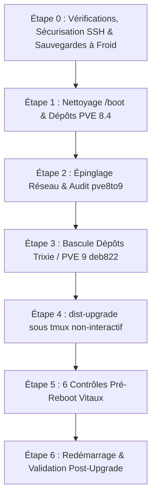

# Montée de version majeure de Proxmox VE 8 vers Proxmox VE 9

!!! abstract "Résumé"
    Procédure opérationnelle et guide méthodologique pas-à-pas pour réussir la montée de version majeure d'un hyperviseur **Proxmox Virtual Environment 8.4 (Debian 12 Bookworm)** vers **Proxmox VE 9.2 (Debian 13 Trixie)** sur serveur dédié physique (*Bare Metal* hébergé, ex: Scaleway). Ce guide aborde les mécanismes profonds du système (gestion de la partition `/boot` en RAID logiciel, amorçage UEFI/GRUB, nommage des interfaces réseau sous systemd, sécurisation SSH et console série hors-bande) et détaille la résolution systématique de six pièges critiques afin de garantir une transition sans interruption ni perte d'accès.

| Propriété | Valeur |
|-----------|--------|
| Difficulté | Avancé |
| OS / Environnement | Proxmox VE 8.4.19 &rarr; 9.2.21 (Debian 12 &rarr; 13) |
| Architecture matérielle | Serveur dédié physique x86_64 (*Bare Metal* Scaleway) |
| Dernière mise à jour | 2026-10-21 |

<!-- ============================================================ -->
## Contexte
<!-- ============================================================ -->

La montée de version majeure d'un hyperviseur de production hébergeant des machines virtuelles critiques ne s'apparente pas à une simple mise à jour de routine (`apt upgrade`). Elle implique le remplacement complet de la distribution Linux sous-jacente (**Debian 12 Bookworm &rarr; Debian 13 Trixie**), l'adoption d'une nouvelle génération de noyau Linux (**6.8 &rarr; 7.0**), ainsi que l'actualisation conjointe des moteurs de virtualisation (**QEMU 11**, **LXC 7**, **ZFS 2.4**).

Sur un serveur dédié physique accessible uniquement à distance, la moindre anomalie durant le processus (coupure réseau, réinitialisation du port SSH, partition de démarrage saturée, instabilité du chargeur d'amorçage ou renommage intempestif des cartes réseau) peut isoler irrémédiablement la machine, nécessitant un redémarrage en mode secours (*Rescue*) long et complexe.

Cette procédure a été éprouvée et validée en conditions réelles sur le nœud `SRV-AIS2`, assurant un basculement sans régression, avec zéro interruption imprévue et un score d'audit officiel `pve8to9` irréprochable (**0 Warning, 0 Failure**). Elle est conçue pour être dupliquée en toute sécurité sur l'ensemble d'un parc de serveurs similaires.

---

<!-- ============================================================ -->
## Concepts clés & éclairages pédagogiques
<!-- ============================================================ -->

Avant d'exécuter les commandes, il est essentiel de comprendre les mécanismes système et réseau sollicités par cette opération.

### 1. Mise à jour mineure vs Montée de version majeure

* **Mise à jour mineure (`apt upgrade`)** : Applique des correctifs de sécurité et de stabilité au sein d'une même version de distribution (ex : Proxmox 8.4.10 vers 8.4.19). Les versions de bibliothèques fondamentales (glibc, systemd, openssl) et les interfaces binaires applicatives (ABI) restent stables.
* **Montée de version majeure (`dist-upgrade` / `full-upgrade`)** : Fait évoluer le système d'exploitation vers une nouvelle génération majeure. Les dépôts changent de nom de code (`bookworm` &rarr; `trixie`), les paquets peuvent être renommés, supprimés ou scindés pour résoudre des dépendances complexes, et le noyau Linux franchit un cap fonctionnel majeur.

### 2. L'architecture de Proxmox VE et le cluster filesystem (`pmxcfs`)

Proxmox VE repose sur Debian en y adjoignant des couches applicatives spécialisées :

* **`pmxcfs` (`/etc/pve/`)** : Le système de fichiers Proxmox Cluster File System est un système de fichiers virtuel basé sur SQLite et Corosync, synchronisé en mémoire vive. C'est lui qui stocke la configuration des machines virtuelles, des nœuds, des utilisateurs et du stockage. Lors d'une mise à jour majeure, la préservation de `/etc/pve/` et de la base `/var/lib/pve-cluster/` est vitale.
* **Daemons centraux** : `pvedaemon` (logique métier d'administration), `pveproxy` (serveur web HTTPS sur le port 8006), et `pvestatd` (démon de collecte de métriques système).

### 3. La partition `/boot` et le RAID1 logiciel `mdadm`

Sur de nombreux serveurs dédiés physiques, le système est partitionné sur deux disques miroités via le module noyau `mdadm` (RAID1 logiciel). Pour des raisons historiques de compatibilité avec les anciens chargeurs d'amorce, la partition `/boot` est fréquemment dimensionnée à une taille restreinte (ex: **512 Mo**).

Or, chaque installation de noyau Linux Proxmox génère deux fichiers volumineux dans `/boot` :
1. L'image exécutable du noyau compressée : `vmlinuz-*` (~15 Mo).
2. Le système de fichiers racine temporaire en RAM : `initramfs-*` (~60 à 75 Mo).

Avec un total avoisinant **75 à 90 Mo par version de noyau**, la présence de 4 anciens noyaux consomme plus de 350 Mo. L'installation d'un cinquième noyau lors d'un `dist-upgrade` provoque la saturation immédiate (100%) de `/boot` lors de l'exécution d'`update-initramfs`. L'écriture de l'initramfs étant alors tronquée, le serveur ne pourra plus redémarrer.

### 4. Amorçage UEFI, BIOS hérité et le paquet parasite `grub-cloud-amd64`

Les machines modernes démarrent en mode **UEFI** (*Unified Extensible Firmware Interface*) à l'aide d'une table de partitionnement GPT (*GUID Partition Table*) et d'une partition système EFI (`/boot/efi`) au format FAT32.

Certaines images d'installation fournies par les hébergeurs sont dérivées de gabarits cloud hybrides contenant le paquet `grub-cloud-amd64`. Ce paquet inclut des hooks de maintenance prévus pour forcer l'installation de GRUB sur le secteur d'amorce MBR (`i386-pc`). Sur un système purement GPT/UEFI, cet appel échoue systématiquement (`grub-install: error: will not proceed with blocklists`) et bloque le processus `dpkg`. Il est donc impératif de remplacer ces résidus par la chaîne officielle `grub-efi-amd64`.

### 5. Nommage prédictif des interfaces réseau et fichier `systemd.link`

Sous Linux, `systemd-udevd` attribue les noms d'interfaces réseau selon un schéma prédictif basé sur l'emplacement matériel (bus PCI, slot, port) : par exemple `enp65s0f0` (*Ethernet, bus PCI 65, slot 0, fonction 0*).

Lors d'un saut de noyau majeur (noyau 6.8 &rarr; 7.0) couplé à une mise à niveau de `systemd` (v252 &rarr; v257), le moteur de détection PCI peut réordonner les contrôleurs ou modifier les index. Si l'interface physique change de nom au redémarrage (devenant par exemple `enp66s0f0` ou `eth0`), le pont virtuel Proxmox `vmbr0` défini dans `/etc/network/interfaces` ne trouvera plus son port physique. Le serveur deviendra totalement injoignable.

La solution consiste à créer un fichier de liaison déclaratif `/etc/systemd/network/10-<nom>.link` liant immuablement l'**adresse MAC** de la puce réseau au nom d'interface attendu.

### 6. Le format moderne de dépôts APT `deb822` (`.sources`)

Traditionnellement, les dépôts Debian s'écrivaient sur une ligne dans `/etc/apt/sources.list` (`deb http://... bookworm main`). Le format moderne standardisé par Debian et Proxmox est le format **deb822** (fichiers `.sources` structurés par blocs de clés/valeurs) :

```text
Types: deb
URIs: http://download.proxmox.com/debian/pve
Suites: trixie
Components: pve-no-subscription
Signed-By: /usr/share/keyrings/proxmox-archive-keyring.gpg
```

Ce format apporte une meilleure lisibilité, évite les erreurs de syntaxe monolignes et intègre directement l'association cryptographique avec la clé GPG du dépôt sans passer par l'outil obsolète et déprécié `apt-key`.

### 7. Résilience des sessions sous `tmux`

Une mise à niveau majeure nécessite le téléchargement et le décompactage de plusieurs gigaoctets de données et l'exécution de milliers de scripts de pré/post-installation. Si l'administrateur lance cette opération dans une session SSH directe et que la connexion subit une micro-coupure (ou que le démon SSH est redémarré pendant la mise à niveau), le shell reçoit un signal de déconnexion `SIGHUP`.

Ce signal interrompt immédiatement le processus `apt-get`, laissant la base de données `dpkg` verrouillée ou le système à moitié configuré. L'utilisation d'un multiplexeur de terminal comme **`tmux`** permet d'exécuter la commande dans une session détachée en tâche de fond : même si la connexion SSH coupe, le processus continue son travail sur le serveur.

---

<!-- ============================================================ -->
## Pièges critiques identifiés & résolus
<!-- ============================================================ -->

Voici la synthèse des six obstacles majeurs rencontrés sur architecture physique dédiée et les réponses techniques appliquées :

| # | Piège identifié | Cause technique | Risque encouru | Solution systématique |
|---|-----------------|-----------------|----------------|------------------------|
| **1** | **Saturation de `/boot`** | Partition de 512 Mo saturée par 4 anciens noyaux (reste 136 Mo). | Crash d'`update-initramfs` (espace disque épuisé), serveur inamorçable. | Purge préventive ciblée des noyaux obsolètes (`5.15` et anciens `6.8`) pour maintenir `/boot` > 280 Mo libres. |
| **2** | **Conflit `grub-cloud-amd64`** | Paquet cloud résiduel forçant une amorce BIOS (`i386-pc`) sur partition GPT/UEFI. | Échec bloquant de `dpkg` lors de la configuration du bootloader. | Suppression stricte de `grub-cloud-amd64` au profit de `grub-efi-amd64`. |
| **3** | **Lock-out SSH (Port 22222)** | OpenSSH propose de remplacer la configuration personnalisée par celle du mainteneur (port 22). | Perte définitive de l'accès SSH distant après le reboot. | Écriture d'un drop-in `/etc/ssh/sshd_config.d/00-scaleway-custom.conf` et injection de `--force-confold`. |
| **4** | **Perte de la console série** | Écrasement potentiel de `/etc/default/grub` supprimant la console série KVM Scaleway. | Perte de la console hors-bande (`ttyS0`), impossible de diagnostiquer en cas de panne réseau. | Conservation absolue de la configuration locale de GRUB et contrôle de `console=ttyS0,115200` dans `/boot/grub/grub.cfg`. |
| **5** | **Privilège déprécié `VM.Monitor`** | Proxmox VE 9 a supprimé le droit `VM.Monitor` (remplacé par `Sys.Audit` et `VM.GuestAgent.*`). | Audit `pve8to9` en statut `FAIL`, blocage de l'éligibilité à la mise à niveau. | Nettoyage automatisé par `sed` de la chaîne `VM.Monitor` dans `/etc/pve/user.cfg`. |
| **6** | **Dérive du nom de l'interface réseau** | Renommage dynamique PCI de la carte physique par le noyau Linux 7.0 / systemd v257. | Perte de connectivité WAN : le bridge `vmbr0` ne se rattache plus au lien physique. | Épinglage persistant par adresse MAC dans `/etc/systemd/network/10-<iface>.link`. |

---

<!-- ============================================================ -->
## Prérequis
<!-- ============================================================ -->

Avant d'initier la montée de version sur un serveur du parc :

- [x] Accès SSH en `root` ou `sudo` avec clé publique configurée sur le port d'administration (ex : `22222/tcp`).
- [x] Accès fonctionnel à la console série hors-bande (*Serial Over LAN* / KVM distant) depuis le portail de l'hébergeur.
- [x] Disponibilité de stockage local ou distant suffisant pour héberger les sauvegardes intégrales à froid des VM.
- [x] Disponibilité minimale de **280 Mo d'espace libre sur `/boot`** et au moins **10 Go d'espace libre sur `/`**.
- [x] État de santé matériel optimal (synchronisation complète des miroirs RAID logiciel `mdstat`).
- [x] Fenêtre de maintenance planifiée (les machines virtuelles doivent être éteintes proprement).

---

<!-- ============================================================ -->
## Procédure pas-à-pas
<!-- ============================================================ -->

Le schéma ci-dessous résume le flux d'exécution ordonné :



---

### Étape 0 : Vérifications initiales, sécurisation SSH & sauvegardes à froid

Cette étape verrouille l'environnement, sécurise les accès d'urgence et garantit un point de retour arrière intégral.

#### 1. Vérifier la santé du stockage et des points de montage

Contrôler que les grappes RAID sont synchronisées (`[UU]`) et inspecter la volumétrie initiale :

```bash
cat /proc/mdstat
df -h / /boot /boot/efi
```

!!! tip "Pourquoi vérifier `/proc/mdstat` ?"
    Un disque dégradé (`[_U]` ou `[U_]`) avant une montée de version expose l'hôte à une perte totale de données en cas de panne du second disque durant les intenses écritures du `dist-upgrade`. Ne jamais poursuivre sur un RAID dégradé.

#### 2. Sécuriser le port SSH dans un drop-in prioritaire

Pour éviter que la mise à jour des paquets `openssh-server` ne rétablisse le port par défaut 22 ou n'active l'authentification par mot de passe, nous créons un fichier de configuration prioritaire dans `/etc/ssh/sshd_config.d/` :

```bash
# Vérifier la directive Include dans la configuration principale
sudo grep -q "^Include /etc/ssh/sshd_config.d/\*.conf" /etc/ssh/sshd_config || sudo sed -i '1i Include /etc/ssh/sshd_config.d/*.conf' /etc/ssh/sshd_config

# Verrouiller le port 22222 et l'accès exclusif par clé publique
echo -e "Port 22222
PasswordAuthentication no
PermitRootLogin prohibit-password" | sudo tee /etc/ssh/sshd_config.d/00-scaleway-custom.conf

# Tester la validité syntaxique de la configuration
sudo sshd -t
```

#### 3. Sauvegarder les configurations critiques de l'hôte

Archiver les fichiers de configuration de l'hyperviseur et du système d'exploitation dans une archive horodatée sous `/root` :

```bash
sudo tar -czvf /root/backup_pve8_config_$(date +%F_%H%M).tar.gz     /etc/pve/ /var/lib/pve-cluster/ /etc/network/interfaces /etc/network/interfaces.d/     /etc/default/grub /etc/fstab /etc/mdadm/ /etc/lvm/ /etc/ssh/ /etc/apt/ /etc/sysctl.conf /etc/sysctl.d/
```

#### 4. Arrêter les machines virtuelles et exécuter les sauvegardes à froid

Pour prévenir toute corruption de base de données ou de système de fichiers invité lors du saut de version de QEMU, nous éteignons les VM avant de réaliser des sauvegardes complètes en mode `stop` :

```bash
# Arrêter proprement les VM (adapter les identifiants VMID selon le serveur)
sudo qm shutdown 110 --timeout 120 --forceStop 1
sudo qm shutdown 100 --timeout 120 --forceStop 1

# Contrôler qu'aucune VM n'est en cours d'exécution
sudo qm list

# Sauvegarde intégrale compressée en zstandard vers le stockage local
sudo vzdump 100 110 --compress zstd --mode stop --storage local
```

!!! info "Pourquoi le mode `stop` plutôt que `snapshot` ?"
    Le mode `snapshot` effectue une copie à chaud de la mémoire et des blocs disque via QEMU. Lors d'un changement majeur d'hyperviseur (passage de QEMU 9 à QEMU 11), démarrer sur un état snapshoté peut générer des incohérences mémoire. Le mode `stop` fige les disques dans un état parfaitement éteint et consistant.

---

### Étape 1 : Nettoyage de `/boot`, dépôts et correctifs PVE 8.4

Avant de basculer vers Debian 13, Proxmox VE 8 doit être mis à jour à son niveau de maintenance le plus récent sous Debian 12 Bookworm, et l'espace disque de `/boot` doit être assaini.

```bash
# 1. Supprimer d'éventuels dépôts résiduels Debian 11 Bullseye
sudo rm -f /etc/apt/sources.list.d/proxmox-pve.list

# 2. Purger les anciens noyaux inactifs (libère ~150 Mo indispensables)
sudo DEBIAN_FRONTEND=noninteractive apt-get purge -y     pve-kernel-5.15 pve-kernel-5.15.158-2-pve     proxmox-kernel-6.8.12-8-pve-signed proxmox-kernel-6.8.12-9-pve-signed || true
sudo DEBIAN_FRONTEND=noninteractive apt-get autoremove --purge -y

# Contrôler l'espace libre obtenu (doit être > 250 Mo)
df -h /boot

# 3. Supprimer le paquet conflictuel grub-cloud-amd64 (incompatible UEFI)
if dpkg -l | grep -q "^ii  grub-cloud-amd64"; then
    sudo DEBIAN_FRONTEND=noninteractive apt-get remove -y grub-cloud-amd64
    sudo dpkg --configure -a
fi

# 4. Désactiver les dépôts Enterprise nécessitant une souscription payante
[ -f /etc/apt/sources.list.d/pve-enterprise.list ] && sudo sed -i 's/^deb/#deb/g' /etc/apt/sources.list.d/pve-enterprise.list
[ -f /etc/apt/sources.list.d/ceph.list ] && sudo sed -i 's/^deb/#deb/g' /etc/apt/sources.list.d/ceph.list

# 5. Mettre à jour PVE 8.4 au dernier niveau Bookworm (pve-manager 8.4.21)
sudo apt-get update
sudo DEBIAN_FRONTEND=noninteractive apt-get dist-upgrade -y     -o Dpkg::Options::="--force-confdef"     -o Dpkg::Options::="--force-confold"

# Vérifier la version installée
pveversion
```

!!! tip "Que signifient `--force-confdef` et `--force-confold` ?"
    Ces options `Dpkg::Options` indiquent à `dpkg` de ne jamais interrompre l'installation pour poser des questions interactives à l'utilisateur. En cas de conflit sur un fichier de configuration déjà personnalisé (comme `/etc/ssh/sshd_config` ou `/etc/issue`), `dpkg` conserve la configuration existante de l'administrateur (`confold` = *configuration old*) et écrit la nouvelle version dans un fichier temporaire `.dpkg-dist`.

---

### Étape 2 : Épinglage réseau & audit officiel `pve8to9`

Cette étape neutralise les causes connues d'échec de l'outil d'audit officiel Proxmox et verrouille le nom des interfaces réseau physiques.

```bash
# 1. Désactiver le socket journald-audit (recommandation officielle Proxmox VE)
sudo systemctl disable --now systemd-journald-audit.socket || true

# 2. Supprimer systemd-boot s'il est présent sur un hôte démarrant en GRUB
if dpkg -l | grep -q "^ii  systemd-boot "; then
    sudo DEBIAN_FRONTEND=noninteractive apt-get remove -y systemd-boot
fi

# 3. Épingler l'interface réseau physique dans un fichier systemd.link
PHYS_IF=$(ip route show default | awk '{print $5}')
# Si la passerelle par défaut traverse le bridge vmbr0, extraire le port physique sous-jacent :
[ "$PHYS_IF" = "vmbr0" ] && PHYS_IF=$(grep -m1 "bridge-ports" /etc/network/interfaces | awk '{print $2}')
MAC_ADDR=$(cat /sys/class/net/$PHYS_IF/address)

echo -e "[Match]
MACAddress=$MAC_ADDR

[Link]
Name=$PHYS_IF" | sudo tee /etc/systemd/network/10-$PHYS_IF.link

# Nettoyer les anciennes règles persistantes udev obsolètes
sudo rm -f /etc/udev/rules.d/70-persistent-net.rules /etc/udev/rules.d/70-persistent-net.rules.bak

# 4. Supprimer le privilège déprécié VM.Monitor dans la base des utilisateurs
sudo sed -i 's/,VM.Monitor//g' /etc/pve/user.cfg

# 5. Installer le microcode processeur AMD à jour
sudo sed -i 's/main contrib$/main contrib non-free-firmware/g' /etc/apt/sources.list
sudo apt-get update && sudo DEBIAN_FRONTEND=noninteractive apt-get install -y amd64-microcode

# 6. Exécuter l'audit complet officiel
sudo pve8to9 --full
```

!!! danger "Condition de passage impérative : 0 FAILURE"
    L'audit `pve8to9` analyse plus de 30 points de contrôle (compatibilité du stockage, état du cluster, support matériel, dépôts, services actifs). Vous ne devez **en aucun cas** passer à l'étape suivante si l'outil remonte au moins un statut `FAIL`. Corrigez l'erreur signalée avant de continuer.

---

### Étape 3 : Bascule des dépôts vers Debian 13 (Trixie) & Proxmox VE 9

Une fois l'audit validé, nous basculons les miroirs de paquets vers la nouvelle version majeure.

```bash
# 1. Nettoyer les anciennes lignes Proxmox du fichier standard et basculer vers trixie
sudo sed -i '/download\.proxmox\.com/d' /etc/apt/sources.list
sudo sed -i 's/bookworm/trixie/g' /etc/apt/sources.list

# 2. Déclarer le dépôt officiel Proxmox VE 9 au format moderne deb822
echo -e "Types: deb
URIs: http://download.proxmox.com/debian/pve
Suites: trixie
Components: pve-no-subscription
Signed-By: /usr/share/keyrings/proxmox-archive-keyring.gpg" | sudo tee /etc/apt/sources.list.d/proxmox.sources

# 3. Recharger le catalogue de paquets
sudo apt-get update

# 4. Vérifier la prise en compte du nouveau catalogue
apt-cache policy proxmox-ve
```

!!! success "Résultat attendu"
    La commande `apt-cache policy proxmox-ve` doit obligatoirement afficher une version candidate majeure commençant par **`9.x`** (ex : `Candidate: 9.2.0-1`).

---

### Étape 4 : Exécution sécurisée de la montée de version majeure

Pour immuniser l'opération contre une éventuelle rupture de session SSH, nous déléguons la commande de mise à niveau à une session **tmux isolée** via un socket dédié, tout en capturant l'intégralité des flux de logs et le code de retour dans `/root/`.

```bash
# 1. Contrôler une dernière fois l'espace disponible dans /boot (> 250 Mo requis)
df -h /boot

# 2. Lancer la montée de version dans une session tmux détachée
sudo tmux -S /tmp/pve_upgrade.sock new-session -d -s pve_upgrade   "DEBIAN_FRONTEND=noninteractive apt-get dist-upgrade -y    -o Dpkg::Options::='--force-confdef'    -o Dpkg::Options::='--force-confold'    2>&1 | tee /root/pve9_upgrade.log; echo \$? > /root/pve9_upgrade.exit"

# 3. Surveiller l'avancement en temps réel
while [ ! -f /root/pve9_upgrade.exit ]; do
    sudo tail -n 5 /root/pve9_upgrade.log
    sleep 15
done

# 4. Contrôler le code de sortie
cat /root/pve9_upgrade.exit
```

!!! success "Validation du code de retour"
    Le fichier `/root/pve9_upgrade.exit` doit impérativement contenir la valeur **`0`**. Si le code est différent de 0, inspectez immédiatement `/root/pve9_upgrade.log` pour identifier le paquet en échec et résolvez-le (`sudo dpkg --configure -a`).

#### Application des configurations par défaut pour LVM et Chrony

La mise à jour dépose les nouveaux fichiers de configuration recommandés par Debian sous l'extension `.dpkg-dist`. Nous les activons pour `lvm` et `chrony` :

```bash
[ -f /etc/lvm/lvm.conf.dpkg-dist ] && sudo mv -v /etc/lvm/lvm.conf.dpkg-dist /etc/lvm/lvm.conf || true
[ -f /etc/chrony/chrony.conf.dpkg-dist ] && sudo mv -v /etc/chrony/chrony.conf.dpkg-dist /etc/chrony/chrony.conf || true
```

---

### Étape 5 : Les 6 contrôles pré-redémarrage vitaux (Checklist Anti-Crash)

> [!CAUTION]
> **Ne redémarrez jamais le serveur sans avoir validé ces 6 points de contrôle.**
> En cas d'oubli sur un serveur distant, l'hôte peut ne plus jamais remonter sur le réseau.

```bash
# Point 1 : Reconstruire tous les initramfs et actualiser la configuration GRUB
sudo update-initramfs -u -k all
sudo update-grub
ls -lh /boot/
df -h /boot

# Point 2 : Vérifier la persistance de la console série Scaleway dans GRUB
grep -E "GRUB_CMDLINE_LINUX|ttyS0" /etc/default/grub
grep "ttyS0" /boot/grub/grub.cfg | head -n 3

# Point 3 : Vérifier la syntaxe et les directives effectives d'OpenSSH
sudo sshd -t
sudo sshd -T | grep -E "^port |^passwordauthentication |^permitrootlogin "
systemctl is-enabled ssh

# Point 4 : Contrôler l'intégrité de la configuration réseau
cat /etc/network/interfaces

# Point 5 : Contrôler la synchronisation de la grappe RAID
cat /proc/mdstat

# Point 6 : Vider les tampons mémoire vers le stockage physique
sudo sync
```

!!! abstract "Critères de conformité attendus"
    - **`/boot`** : Utilisation sous le seuil des 70%, fichiers `vmlinuz-7.*` et `initrd.img-7.*` bien générés.
    - **GRUB** : La chaîne `console=ttyS0,115200` figure dans les entrées de `/boot/grub/grub.cfg`.
    - **OpenSSH** : `port` affiche `22222`, `passwordauthentication` affiche `no`, le service est bien activé (`enabled`).
    - **Réseau** : Le bridge `vmbr0` pointe sur le port physique épinglé (`enp65s0f0`).
    - **RAID** : Tous les blocs affichent `[UU]`.

---

### Étape 6 : Redémarrage & validation post-upgrade

Le système est désormais prêt à démarrer sur son nouveau socle logiciel.

```bash
# 1. Redémarrer le nœud
sudo reboot
```

Attendre environ 2 à 3 minutes (temps de l'initialisation du microprogramme matériel et du chargement du noyau 7.0), puis se reconnecter via le port d'administration sécurisé :

```bash
ssh -p 22222 root@<adresse-ip-du-noeud>
```

Une fois la session ouverte :

```bash
# 2. Vérifier la version du noyau actif et le statut des paquets Proxmox
uname -r
pveversion -v

# 3. Vérifier le bon fonctionnement des démons clés de l'hyperviseur
sudo systemctl is-active pveproxy pvedaemon pvestatd pve-cluster chrony

# 4. Rallumer les machines virtuelles dans l'ordre de priorité opérationnel :
# A. D'abord le pare-feu / routeur d'infrastructure
sudo qm start 100

# Laisser le temps aux interfaces réseau et aux routes virtuelles de s'établir
sleep 30

# B. Ensuite les machines clientes / serveurs de charge
sudo qm start 110

# Vérifier que toutes les VM sont au statut "running"
sudo qm list
```

---

<!-- ============================================================ -->
## Vérification & Validation post-upgrade
<!-- ============================================================ -->

Pour attester de la conformité parfaite de la mise à niveau, exécuter l'audit complet de validation :

```bash
sudo pve8to9 --full
```

!!! success "Résultat de conformité attendu"
    ```text
    = SUMMARY =
    TOTAL:    40
    PASSED:   34
    SKIPPED:  6
    WARNINGS: 0
    FAILURES: 0
    ```

Vérifier également les points clés de fonctionnement de l'hyperviseur :

- [x] L'interface d'administration web est accessible en HTTPS sur le port 8006 (`https://<ip-serveur>:8006`).
- [x] Le tableau de bord affiche bien **Proxmox VE 9.2** et le noyau **Linux 7.0.x-pve**.
- [x] Les machines virtuelles disposent de leur connectivité réseau et leurs services sont pleinement opérationnels.
- [x] La console série KVM Scaleway reste réactive dans le panneau d'administration de l'hébergeur.

---

<!-- ============================================================ -->
## Aide-mémoire des commandes clés
<!-- ============================================================ -->

| Action opérationnelle | Commande système |
|-----------------------|------------------|
| Sauvegarde configuration PVE | `tar -czvf /root/pve_cfg_$(date +%F).tar.gz /etc/pve/ /var/lib/pve-cluster/ /etc/network/interfaces /etc/default/grub` |
| Sauvegarde à froid d'une VM | `qm shutdown <VMID> && vzdump <VMID> --compress zstd --mode stop --storage local` |
| Purge d'un ancien noyau | `apt-get purge -y proxmox-kernel-<version>-pve-signed && apt-get autoremove --purge -y` |
| Lancement upgrade en arrière-plan | `tmux -S /tmp/pve.sock new-session -d -s pve "apt-get dist-upgrade -y ..."` |
| Audit de migration Proxmox | `pve8to9 --full` |
| Test syntaxe & options OpenSSH | `sshd -t && sshd -T \| grep -E "^port \|^permitrootlogin "` |
| Recompilation initramfs & GRUB | `update-initramfs -u -k all && update-grub` |
| Démarrage ordonné d'une VM | `qm start <VMID>` |

---

<!-- ============================================================ -->
## Checklist de déploiement multi-nœuds
<!-- ============================================================ -->

Utilisez cette liste de contrôle pour chaque serveur physique à migrer (`SRV-3`, `SRV-4`, `SRV-5`, `SRV-6`) :

- [ ] Sauvegardes à froid des VM créées et intègres (`vzdump --mode stop`).
- [ ] Archive de configuration `/root/backup_pve8_config_*.tar.gz` générée.
- [ ] Drop-in SSH `/etc/ssh/sshd_config.d/00-scaleway-custom.conf` en place (port 22222).
- [ ] Partition `/boot` allégée (au moins 280 Mo d'espace disponible).
- [ ] Paquet parasite `grub-cloud-amd64` supprimé si présent.
- [ ] Interface réseau physique épinglée par adresse MAC dans `/etc/systemd/network/10-*.link`.
- [ ] Privilège déprécié `VM.Monitor` supprimé de `/etc/pve/user.cfg`.
- [ ] Audit préalable `pve8to9 --full` validé avec **0 Failure**.
- [ ] Dépôt PVE 9 configuré au format `deb822` dans `/etc/apt/sources.list.d/proxmox.sources`.
- [ ] `dist-upgrade` exécuté avec succès sous `tmux` (code de sortie 0).
- [ ] Les 6 contrôles pré-reboot validés (initramfs, console série `ttyS0`, SSH, interfaces, RAID sync).
- [ ] Redémarrage réussi, noyau 7.0 actif, VMs relancées et audit final à 34/34 PASS.

---

<!-- ============================================================ -->
## Glossaire
<!-- ============================================================ -->

Proxmox VE (PVE)
: Solution libre d'hyperviseur bare-metal de type 1 intégrant l'orchestration des machines virtuelles KVM et des conteneurs Linux LXC, avec gestion unifiée du stockage et du réseau.

pmxcfs (*Proxmox Cluster File System*)
: Système de fichiers distribué en mémoire basé sur SQLite et Corosync, montant l'arborescence `/etc/pve/` pour partager la configuration des VM entre nœuds sans latence disque.

deb822
: Format déclaratif de configuration des dépôts APT sous Debian (fichiers `.sources`), remplaçant l'ancienne syntaxe monoligne par des blocs de champs typés intégrant directement la clé de signature GPG.

systemd.link
: Fichier de configuration déclaratif de bas niveau utilisé par `systemd-udevd` pour attribuer des attributs réseau (notamment le nom d'interface) selon des critères matériels stricts tels que l'adresse MAC.

Console série hors-bande (*SOL / UART*)
: Liaison série asynchrone (généralement `ttyS0` à 115200 bauds) permettant d'accéder au terminal texte du système au travers de la puce de gestion du serveur (BMC/IPMI/KVM matériel), indépendamment du réseau IP.

vzdump
: Outil natif de sauvegarde de machines virtuelles et de conteneurs Proxmox VE, supportant la compression multithreadée Zstandard (`zstd`) et les modes `snapshot`, `suspend` ou `stop`.

initramfs (*Initial RAM File System*)
: Archive racine temporaire chargée en mémoire vive par le bootloader (GRUB) contenant les modules noyau minimaux nécessaires (pilotes de stockage, RAID `mdadm`, LVM) pour monter le vrai système de fichiers racine.

mdadm
: Outil sous Linux permettant de configurer et d'administrer des grappes de stockage en RAID logiciel au niveau bloc (RAID0, RAID1, RAID5, RAID10).

QEMU / KVM
: *Kernel-based Virtual Machine*. Module noyau transformant Linux en hyperviseur de type 1, associé à l'émulateur matériel complet QEMU pour exécuter des systèmes invités totalement isolés avec performances quasi-natives.

---

<!-- ============================================================ -->
## Ressources
<!-- ============================================================ -->

- [Documentation officielle Proxmox : Upgrade from 8 to 9](https://pve.proxmox.com/wiki/Upgrade_from_8_to_9) — Guide de référence Proxmox Server Solutions
- [Notes de publication de Debian 13 (Trixie)](https://www.debian.org/releases/trixie/releasenotes) — Changements majeurs et évolutions de la distribution socle
- [Spécification Debian deb822 source format](https://manpages.debian.org/testing/apt/sources.list.5.en.html#DEB822-STYLE_FORMAT) — Syntaxe et options des dépôts modernes
- [Sysprep d'une VM Windows 11 25H2 et création d'un template sur Proxmox VE](sysprep-windows-11-25h2-template-proxmox.md) — Préparation et virtualisation avancée sous Proxmox VE
